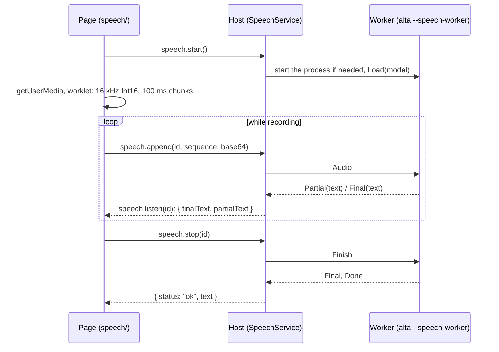

# Speech to prompt with a local model

Today a prompt can only be typed. After this work ([#117](https://github.com/CodeAlta/CodeAlta/issues/117)), a microphone button beside **Send** records the voice and writes what was said at the caret of the prompt. Nothing leaves the computer: the audio is transcribed by a local model, NVIDIA Parakeet TDT 0.6b v3 by default. Nothing is downloaded before the first click on the microphone, which asks first.

CodeAlta Desktop only. Windows is verified here; macOS gets the changes it needs but can only be tested on a Mac; on Linux the button stays hidden until NeoAstra enables media capture in WebKitGTK.

## What the user sees

1. **The button.** A discreet microphone icon just before **Send**, in the prompt of a session and of a new session. It is absent when the feature is turned off or when the WebView has no microphone API.
2. **First click.** A small popover beside the button: the model, its size, **Download** and **Cancel**, and a link to the Speech settings to choose another model.
3. **Download.** A sticky toast with a progress bar and **Cancel**: `Downloading Parakeet TDT 0.6b v3 — 212 MB of 680 MB` (the model and, the first time, the engine), then `Installing…` (checksums, first load), then `Speech to prompt is ready`. The download belongs to the application, not to the popover or the settings page: it goes on when they close. A canceled or interrupted download resumes where it stopped.
4. **Dictation.** Click (or `F9`): the button turns red and follows the voice level. The text being recognized shows greyed at the caret; each finished sentence is written in the prompt as one undo step. Click again, `F9` or `Escape` stops. Sending the prompt, leaving the tab or a read-only prompt stops too.
5. **Settings > Speech.** Turn the feature off, choose the model, see what is downloaded and delete it.

```text
Settings › Personalization › Speech
┌──────────────────────────────────────────────────────────────────────┐
│ Speech to prompt                                              [ on ] │
│ Model      [ Parakeet TDT 0.6b v3 · 25 languages · 670 MB        ▾ ] │
│            Downloaded · 670 MB                            [ Delete ] │
│ Shortcut   F9                                                        │
├──────────────────────────────────────────────────────────────────────┤
│ Downloaded models                                                    │
│ Parakeet TDT 0.6b v3   NVIDIA · CC BY 4.0        670 MB   [ Delete ] │
│ Moonshine base         English · MIT             141 MB   [ Delete ] │
└──────────────────────────────────────────────────────────────────────┘
```

## What changes

### The parts



### The engine runs in a worker process

sherpa-onnx ends the process (`_Exit(-1)`) on a model it does not understand: wrong metadata, a wrong `tokens.txt`, an unknown type. A custom model must never close CodeAlta, so the recognizer runs in a child process: the same executable started as `alta --speech-worker`, handled first in `Program.Main`, with no window and no profile.

- The host and the worker talk over the standard streams with small length-prefixed frames (`Desktop/Speech/SpeechWorkerProtocol.cs`): `Load`, `Audio`, `Finish`, `Cancel` one way; `Loaded`, `Partial`, `Final`, `Done`, `Error` the other. What the worker writes on its error stream goes to the log.
- A worker that dies becomes an error toast, "The speech model could not be loaded", and the next click starts a new one.
- The worker keeps the model loaded between dictations and exits after 5 minutes without one, on a change of model, when the feature is turned off and when CodeAlta closes. That frees the memory of the model (about 700 MB for Parakeet).
- It also ends by itself when its input closes, so it cannot outlive the host.

Partial text with a model that is not streaming follows the pattern of sherpa-onnx's own example (`parakeet-tdt-simulate-streaming-microphone-cxx-api.cc`): Silero VAD cuts the audio into utterances; while one is spoken, the buffer is decoded again every 0.2 s for the greyed text; a finished utterance is decoded once more and becomes final.

### The engine is downloaded with the first model

The native libraries of sherpa-onnx (22 to 39 MB per platform) are not added to the CodeAlta packages. The first download fetches them too, from nuget.org: `org.k2fsa.sherpa.onnx.runtime.<rid>` 1.13.8, 8 to 14 MB, checked against a SHA-256 written in the source, and unpacked into the cache. The worker loads them from there with a `NativeLibrary` resolver.

```xml
<!-- src/CodeAlta/CodeAlta.csproj: the managed wrapper only (50 KB), version in Directory.Packages.props -->
<PackageReference Include="org.k2fsa.sherpa.onnx" ExcludeAssets="native" />
```

Only the worker touches the `SherpaOnnx` types, so the host process never loads the wrapper, and nothing reaches the TUI. The worker runs in the folder of the model and gives the engine relative file names: the wrapper passes paths as ANSI on Windows, which breaks under a user folder with accents.

### Models: presets, a custom URL, and where they live

`Desktop/Speech/SpeechModelCatalog.cs` holds the presets as frozen data: Hugging Face repository, commit, files with size and SHA-256, family, languages, license.

| Preset (`id`) | Languages | Size | License |
| --- | --- | --- | --- |
| `parakeet-tdt-0.6b-v3` (default) | 25 European, detected | 670 MB | CC BY 4.0 |
| `parakeet-tdt-0.6b-v2` | English | 661 MB | CC BY 4.0 |
| `whisper-small` | 99 | 376 MB | MIT |
| `moonshine-base-en` | English | 141 MB | MIT |
| `moonshine-tiny-en` | English | 44 MB | MIT |

A custom model is a Hugging Face repository URL (`https://huggingface.co/<owner>/<repo>`, with an optional `/tree/<revision>/<folder>`). CodeAlta reads the file list from the Hugging Face API, recognizes the family from the file names (transducer, Moonshine v1 or v2, Whisper), prefers the `int8` files, and records the commit it downloaded. A list it does not recognize is refused with a message before anything is downloaded.

```text
~/.alta/cache/speech/                 shared by the normal and the developer instance
  runtime/1.13.8/<rid>/               sherpa-onnx-c-api, onnxruntime
  vad/silero_vad.onnx
  models/<id>/                        model files + model.json (source, commit, files, hashes)
  models/<id>.partial/                a download in progress: *.part files and a lock
```

Each file is downloaded to `<name>.part`, resumed with an HTTP range when it exists, then checked (SHA-256 for the large files, the git blob SHA-1 for `tokens.txt`). The folder is renamed to `models/<id>/` once `model.json` is written: a model is installed when that file is there. The lock keeps two instances from downloading the same model.

```toml
# ~/.alta/config.toml: both values are the defaults and are not written
[speech]
enabled = true
model = "parakeet-tdt-0.6b-v3"   # a preset id, or a Hugging Face repository URL
```

The settings are modelled in `CodeAlta.Catalog` (`Speech/SpeechSettings.cs`, `CodeAltaConfigStore`), like `[storage]`.

### The host service

`Desktop/Rpc/SpeechRpc.cs`, a `SpeechService` built in `DesktopApplication` like the others and closed in the close flow.

```csharp
[NeoRpcService("speech", Version = 1)]
internal sealed class SpeechService
{
    [NeoRpcMethod("read")]          SpeechListingResponse Read();              // settings, presets, installed models, sizes
    [NeoRpcMethod("saveSettings")]  SpeechListingResponse SaveSettings(...);
    [NeoRpcMethod("install")]       SpeechStatusResponse Install(...);         // starts the host-owned download
    [NeoRpcMethod("cancelInstall")] SpeechStatusResponse CancelInstall(...);
    [NeoRpcMethod("delete")]        SpeechListingResponse Delete(...);
    [NeoRpcMethod("watch")]         NeoRpcChannel<SpeechInstallState> Watch(); // replays the latest state, never cancels the work
    [NeoRpcMethod("start")]         SpeechStartResponse Start(...);            // "ok" + id, or "model_missing", "disabled", "busy"
    [NeoRpcMethod("append")]        SpeechStatusResponse Append(...);          // id, sequence, base64 of Int16 PCM
    [NeoRpcMethod("listen")]        NeoRpcChannel<SpeechTranscript> Listen(...);
    [NeoRpcMethod("stop")]          SpeechStopResponse Stop(...);              // the whole final text
}
```

- Failures are status codes, as in every service. Calls of `append` run concurrently, so each chunk carries a sequence number and the host puts them back in order.
- `listen` sends snapshots (`finalText` so far, `partialText`), not deltas: the channel keeps only the latest one, and a dropped snapshot loses nothing. The page writes the part of `finalText` it has not written yet.
- An instance started on explicit roots stays off the network, as elsewhere: the service answers `unavailable` and the button is hidden.

### The microphone

- `DesktopApplication` sets `view.PermissionRequested` to a tested static function: `AllowOnce` for `Microphone` from `app://codealta` when `[speech] enabled` is true, `DenyOnce` for everything else. Nothing is stored in the WebView profile, so turning the feature off is enough to close the microphone.
- `DesktopIntegration.MacInfoPlist` gains `NSMicrophoneUsageDescription`, which macOS requires before it asks.
- The page (`frontend/src/speech/capture.ts`) uses `getUserMedia` and an `AudioWorklet` that resamples to 16 kHz and posts Int16 chunks with their level. The worklet is a file of the build (the content security policy allows no blob script).
- A refused or missing microphone is one message: "The microphone is not available. Check the privacy settings of the system."

### The page

A feature folder `frontend/src/speech/`:

| File | Role |
| --- | --- |
| `speechStore.ts` | One store read with `useSyncExternalStore`: install state, recording state, level, partial text. Nothing of this renders `App`. |
| `capture.ts`, `pcm-worklet.js`, `pcm.ts` | Microphone to 16 kHz Int16 chunks; the resampling is a tested pure function. |
| `MicButton.tsx` | The button and its states (`data-speech="idle|recording|transcribing|installing"`), the first-use popover. |
| `useSpeechInstall.ts`, `InstallNotice.tsx` | Owned by `App`: follows `watch` and keeps the progress toast up to date. |
| `SpeechSettings.tsx` | The settings page, on `SettingsPage` and `useSettingsEditor`. |
| `messages.ts`, `speech.css` | Texts in the six languages; styles for both themes. |

Changes outside the folder: `PromptEditor.tsx` gets `insertAtCaret(text)` (one undo step, through the existing change path so that the draft and a pending send follow) and `setInterimText(text)` (a Monaco decoration: the greyed text never enters the prompt or the undo stack). `appToaster.ts` gets `dismissToast(key)`. `AppIcon.tsx` gets the `mic` icon. `OwnedSessionPanel.tsx` and `ReadOnlyComposer.tsx` render the button. `main.tsx` registers the page (`speech`, under Personalization), the `/dictate` command and the stylesheet. `commandRegistry.ts` gets the command with `F9`.

## Steps

- [x] 1. **Settings in the catalog.** `CodeAltaSpeechSettingsDocument` and the `speech` property in `CodeAltaConfigDocument.cs`; `Speech/SpeechSettings.cs` (record, defaults, validation of `model`); load, save, normalize and validate in `CodeAltaConfigStore.cs`; `SpeechRoot` in `CatalogOptions.cs`. Tests in `CodeAlta.Catalog.Tests`: round trip, defaults not written, a bad `model` refused.
- [x] 2. **Model catalog and custom URLs.** `Desktop/Speech/SpeechModelCatalog.cs` with the five presets (commits, sizes and hashes read from the Hugging Face API), the runtime packages and the VAD file with their hashes; `SpeechModelSource.cs` parsing a Hugging Face URL and classifying a file list. Tests: every preset complete, URL forms, each family recognized, an unknown list refused.
- [x] 3. **Download and installation.** `Desktop/Speech/SpeechInstaller.cs`: host-owned, one at a time, state with `Subscribe` replay; `.part` files with range resume, stall timeout, SHA-256 and git blob SHA-1 checks, the runtime package unpacked, the lock, the final rename, `model.json`; listing and deleting installed models. Tests with a stub `HttpMessageHandler` and a temporary root: progress, resume, a wrong hash, cancel, a second instance holding the lock, delete.
- [x] 4. **The worker.** `org.k2fsa.sherpa.onnx` 1.13.8 in `Directory.Packages.props` and `CodeAlta.csproj` without native assets (check the build output has no `runtimes/*/native/*onnx*`); `SpeechWorkerProtocol.cs`; `SpeechWorker.cs` (the loop, VAD, partial and final decoding, behind an `ISpeechEngine`); `SherpaSpeechEngine.cs` (the resolver, the config per family); `--speech-worker` in `Program.cs`; `SpeechWorkerClient.cs` in the host (start, load, idle exit with a `TimeProvider`, death turned into an error, close). Tests with a fake engine and in-memory streams: frames round trip, partial then final, finish flushes, a dead worker reports an error, idle exit.
- [x] 5. **The service.** `Desktop/Rpc/SpeechRpc.cs` with its DTOs and the `[JsonSerializable]` lines in `BootRpc.cs`; registration in both windows and the close flow in `DesktopApplication.cs`; `PermissionRequested`; `NSMicrophoneUsageDescription`. Tests: `unavailable` and `stale_epoch`, settings, start without a model, chunks out of order, snapshots, the permission decisions, the plist key.
- [x] 6. **The prompt bar.** The `speech/` folder (store, capture, worklet, button, popover, toast, messages, styles), `PromptEditor.tsx`, `appToaster.ts`, `AppIcon.tsx`, the two composers, the command and `F9`, the `demo-api.ts` and fixture exports. Tests: store transitions, resampling, the text still to write from a snapshot, `commandRegistry`, `localization`; a mounted browser test of the button in each state and of dictation with a fake service.
- [x] 7. **The settings page.** `SpeechSettings.tsx`, the `View` id, the navigation entry, the allowlist of `settingsNavigation`, the link from the popover. A mounted browser test with a fake service: toggle, model choice, custom URL, download state, delete, the narrow layout.
- [x] 8. **Docs.** `readme.md` (features), `site/docs/workspace.md` (dictating a prompt, the Speech page, the `[speech]` group), `doc/desktop.md` (composer, settings, the service and the worker), `doc/catalog-and-config.md` (the group, `cache/speech`), `doc/development-guide.md` (the worker process and the rule for a native engine). A picture of the Speech page for the site once the page is checked.
- [ ] 9. **Full verification** (next section), then the developer instance once session `01a133f7-751d-7a4d-9186-5fd36c9e9c1d` is done.

Each step is one commit on the branch of the worktree, with its tests.

### Progress and deviations

- Steps 2 to 5 are one commit: the installer, the worker and the service share types (`SpeechWorkerLoad`, the JSON context) and their tests share fakes, so no smaller cut builds on its own.
- The page (steps 6 and 7) is written by a sub-agent in a worktree of its own, on top of the host contract, and its commits are taken into this branch.
- After its download a model is loaded once in the worker (`SpeechInstaller.Validate`): a model the engine refuses is reported at the end of the download (`load_failed`), not at the first dictation.
- The opt-in engine test reads its folder, WAV file, model and expected words from `CODEALTA_SPEECH_TEST_ROOT`, `_WAV`, `_MODEL` and `_WORDS`.
- The page: a send, a read-only prompt, a hidden pane and Settings opening stop the dictation without the sentence still being spoken; a click, `F9` and `Escape` write it. The download toast does not say whether the engine or the model failed (the host state has one error code), and a toast the user closed is not reopened by progress. The worklet is emitted as `dist/pcm-worklet.js` by a small Vite plugin, like `splash.js`. The picture of the Speech page for the site waits for the developer instance.
- Linux (WSL, Ubuntu): the speech tests of the branch pass there, and the real worker downloaded the linux-x64 engine and Moonshine tiny and gave the recorded sentence word for word.
- NeoAstra 1.4.0 (released on GitHub on 2026-10-13; taken into this branch once nuget.org lists it): capture is on in every view of WebKitGTK and a microphone request carries the origin of the page on the three platforms, so the permission decision can require that origin everywhere. On macOS, WebKit gives a page `navigator.mediaDevices` only when the main bundle of the process has the usage description: whether the tool started by the script of `CodeAlta.app` counts as that bundle has to be seen on a Mac; without it the button is hidden.
- NeoAstra: at the user's suggestion, a session of the NeoAstra project enables media capture in WebKitGTK and fills the origin and the user-initiated flag of a permission request, then releases a version. "Linux until NeoAstra enables it" in "Out of scope" ends with that version.

## How it is verified

- [x] `dotnet build` and `dotnet test` of the solution pass, in the configuration the running CodeAlta does not use. (`Release`, 2026-10-13, on the whole branch: 7 252 passed, 0 failed, 41 skipped.)
- [x] `npm test` passes in `src/CodeAlta/frontend`, and `tsc --noEmit` is clean. (1 604 of 1 604.)
- [x] `lunet build` passes in `site`.
- [x] The real engine, without a microphone: an opt-in test (run only when `CODEALTA_SPEECH_TEST_ROOT` names a folder with an installed model) starts the real worker, feeds it a WAV file of the model's repository and reads the expected sentence. Run once here for Parakeet v3 and one Moonshine and one Whisper preset. Done on 2026-10-13 with a synthesized English recording of 11.7 s: Parakeet TDT 0.6b v3 (loaded in 1.6 s), Whisper small and Moonshine tiny each gave the sentence word for word, with 25 to 37 partial texts on the way.
- [ ] In the developer instance, after session `01a133f7…` is done: the button in a session and in a new session; the first-use popover; a real download with the toast, canceled once and resumed; the Speech page; turning the feature off hides the button; both themes; a 900×650 window. Recording itself is checked as far as it goes without a voice (states, level, stop, errors).
- [ ] With the user: a real dictation in French and in English.

## Decisions

| Decision | Choice | Why |
| --- | --- | --- |
| Where the recognizer runs | A worker process, `alta --speech-worker` | sherpa-onnx exits the process on a bad model; a custom URL must not be able to close CodeAlta. It also gives the memory back when idle. |
| The native engine | Downloaded on first use from nuget.org, hash pinned in the source | The packages of CodeAlta and the build folders stay as they are (the alternative adds 22 to 39 MB per platform, about 200 MB in a build without a runtime). The Jira plugin already downloads its CLI the same way. A plain package reference remains a small change if preferred: the resolver goes away. |
| The managed wrapper | The NuGet package, pinned to 1.13.8, native assets excluded | Its struct layouts match that version. Its faults (no null check, ANSI paths) are contained by the worker and by relative paths. |
| Audio capture | In the page, `getUserMedia` and a worklet, base64 chunks over the existing RPC | No second native dependency; the WebView gives noise suppression and gain control. 100 ms is 4 KB, ten calls a second. |
| A custom model | A Hugging Face repository URL | It is what the request asks for, the file list and the hashes come from one API, and no archive has to be unpacked. |
| Asking before the download | Every model, once, in the popover of the button; none from the settings page, where **Download** is the request | The issue asks for a request to the user on first use. |
| Shortcut | `F9`, a toggle | Free today. Push-to-talk needs key-up handling the command dispatcher does not have. |
| Permission | `AllowOnce`, decided by the setting | A grant stored in the WebView profile could not be taken back by turning the feature off. |
| Settings page | "Speech", under Personalization | It is a preference of input, like the language and the appearance. |

## Risks

- **macOS is not tested here.** The usage description, the secure context of `app://` in WKWebView, the worklet, and loading the downloaded libraries are written from the documentation. A first run on a Mac may need a follow-up.
- **The engine comes from nuget.org at run time.** A network that reaches Hugging Face but not nuget.org cannot install; the toast says which download failed. The hash check refuses anything but the pinned files.
- **Upgrading sherpa-onnx** means new hashes for six packages and a run of the opt-in engine test, since the wrapper and the native library must be the same version.
- **Speed on a slow CPU.** The greyed text is skipped while the previous decoding still runs; the final text is not affected.
- **Technical words** (identifiers, file names) are often wrong with every model. Hotwords exist in sherpa-onnx but need a slower search; not in this version.

## Out of scope

- The TUI, and Linux until NeoAstra enables `enable-media-stream` in WebKitGTK.
- A category of its own on the Storage page: the models count under "Cache and logs" there and are deleted on the Speech page.
- GPU providers, hotwords, a language choice for Whisper, push-to-talk, dictation in the expanded prompt editor and in the ask panel.
- Reading answers aloud.

<details><summary>Evidence behind the main claims</summary>

- sherpa-onnx exits on bad models: `SHERPA_ONNX_EXIT` in `sherpa-onnx/csrc` (`macros.h:54-75`, `offline-transducer-nemo-model.cc:204-216`, `symbol-table.cc:133`); only a missing file returns null (`c-api.cc:697-713`), which the C# wrapper does not check (`OfflineRecognizer.cs:11-15`).
- ANSI paths: `[MarshalAs(UnmanagedType.LPStr)]` on every path field of the wrapper, read as UTF-8 by `ToWideString` (`text-utils.cc:723`).
- Moonshine v2 is in the 1.13.8 wrapper (`OfflineMoonshineModelConfig.MergedDecoder`); the checkout's HEAD has a later struct change, hence the pin.
- Every permission is denied today: `NeoAstra.cs:854-861` with no handler set in `src/CodeAlta`.
- The page is a secure context: `NeoCustomScheme.Application("app", …)` sets `IsSecure` (`DesktopApplication.cs:424`).
- RPC carries JSON only, bytes as base64, host-to-page streams as `NeoRpcChannel<T>` with two unacknowledged items at most (`DesktopApplication.cs:636`).
- No toast has a progress bar or a dismiss today (`appToaster.ts:11-15`); the keyed sticky toast of `storage/useStorageMaintenance.ts` is the pattern.
- The prompt editor is Monaco with a controlled value; every existing insertion replaces the whole text (`PromptEditor.tsx:61-69`).
- Hugging Face gives the SHA-256 of each large file as `lfs.oid` in `api/models/<repo>/tree/<revision>`, and accepts ranges on `resolve`.

</details>
