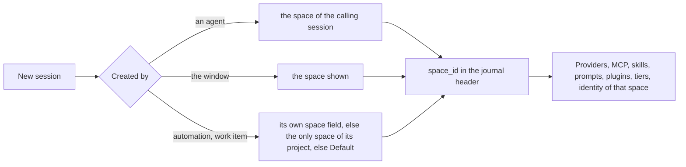

# Spaces become contained setups, and the rest of 1.9.0

Today a space only groups projects: chats show in every space, every provider, MCP server, skill and prompt is everywhere, and no session knows which space it belongs to. Once this work is done, each session belongs to one space for its whole life. Switching between Business and Personal then switches everything: chats, providers (including a second Claude account), tools, the default agent and model, and the Git, GitHub and Jira identity. A session that is running keeps its own space whatever the window shows.

## What changes

### 1. The rule: assign spaces to things, like projects

Every resource gets one optional list, `spaces`, written next to the definition it already has. There are no per-space folders, so one definition can be shared by several spaces.

| `spaces` on a resource | Available in |
| --- | --- |
| absent or empty | every space (shared) |
| `["business"]` | Business only, not Default |
| `["business", "default"]` | Business and Default |

The assignments live in the global `~/.alta/config.toml`, because built-in prompts and skills, Copilot files and the MCP files of other tools cannot be written:

```toml
[providers.claude-business]
type = "claude-code"
display_name = "Claude Business"
config_dir = "~/.claude-business"     # new: a second Claude account, no wrapper script
spaces = ["business"]

[plugins.mcp.servers.atlassian]       # the policy entry of an MCP server
spaces = ["business"]

[plugins.jira]
spaces = ["business"]

[skills.spaces]
terraform = ["business"]

[prompts.spaces]
reviewer = ["business", "default"]
```

A resource defined in a project (`<project>/.alta/mcp.json`, skills, prompts, plugins) follows its project, which is already assigned to spaces. The space filter is applied **before** project and global enablement, so a repository cannot bring a Business MCP server into Personal.

One resolver, `SpaceScope.IsAvailable(spaces, sessionSpaceId)` in `CodeAlta.Catalog`, is used by every kind. The places that build a skill catalog query today (three of them) are first factored into one, so that none of them leaks.

### 2. A session belongs to a space (#131)

The journal header of a session gets `space_id`. It is written at creation, and copied into the SQLite cache (a new column with a migration), `SessionViewDescriptor`, `WorkspaceSession` and `SpaceSessionActivity`.



- **Children and forks** inherit the space of their parent. An agent can only create sessions in its own space, which closes the "activate it from another space" bypass. The user can choose any space.
- **Runtime Context** gains `- Space: Business (business): <what it is for>`. `alta space current` answers the calling session's space first.
- **Old sessions** have no `space_id`. They read as Default, or as the space of their project when it is in exactly one. Journals are not rewritten.
- **Listing:**
  - A chat is listed in its own space only.
  - A project session is listed in its own space. Old project sessions are listed in every space of their project.
- **Default** hides projects and chats that belong to other spaces. **Settings > Spaces** has the option **Show what belongs to other spaces** (off), which shows them all again.
- **Move to space…** in the Explorer menu of an idle session rewrites its header (the model is `MoveSessionAsync`). The resources of the session change at its next turn, so the menu says so.
- **Deleting a space** moves its chats to Default; the confirmation popover says how many. A `space_id` that names no space is read as Default: the space may have been deleted by the other instance, so this never throws.
- **Statistics** count a chat in its own space.

### 3. A space is a contained setup (#132)

**Settings > Spaces** keeps the overview of the cards. A click on a card opens the page of that space, whose sections are each a component of their own:

```text
Settings > Spaces > Business                                   [Show]
  General        Name · icon · color · what it is for
  Projects       checklist (as today)
  Available here [Providers] [MCP servers] [Skills] [Agent prompts] [Plugins]
                 Claude Business      Only here           ● on
                 Codex                All spaces          ● on
                 atlassian (MCP)      Business, Default   ● on
                 personal-notes (MCP) Personal            ○ off
  New sessions   Agent prompt [Default ▾] · Model tiers [Use global ▾]
  Identity       Git · GitHub · Jira          (empty = your usual settings)
```

- **Available here** is a switch per resource. Turning off a shared resource for this space writes the list of the other spaces, Default included; the popover beside the row says that a new space will not get it.
- **On each resource page** (Providers, MCP servers, Skills, Agent prompts, Plugins), every row gets a chip with the icons of its spaces, or "All spaces". The editor of a row has the same multi-select. Both views edit the same field.
- **The space settings** live in the space's own file, beside its name:

```markdown
---
id: business
kind: space
name: Business
icon: briefcase
color: "#2d72d2"
order: 1
new_sessions:
  agent_prompt: default
identity:
  git: { name: A. Mutel, email: alex@contoso.example, sign: ssh, signing_key: ~/.ssh/contoso.pub, signoff: true, ssh_key: ~/.ssh/contoso }
  github: { config_dir: ~/.config/gh-contoso }
  jira: { site: contoso.atlassian.net, email: alex@contoso.example, token_env: CONTOSO_JIRA_TOKEN }
---
Projects of the Contoso contract.
```

- **Enforcement for agents:** these refuse a resource the session's space does not have, with a clear diagnostic:
  - `alta mcp activate`, `alta mcp server enable`;
  - `alta skill activate` (the space filter marks the skill disabled);
  - `alta session set_agent`, `alta session create --provider/--prompt-id`.

  No `alta` command writes `spaces`: only the user does, in the window or in the files.
- **Plugins** load once for the whole process. A space hides what a plugin adds to its sessions (prompt parts, tools, buttons, canvases); `PluginAdapterOperationOptions` gains `SpaceId`, and its existing per-project filter gains a space check. A plugin's background work still runs. **Canvases** follow their plugin's assignment, and their instances already live in a space.
- **The session info panel** shows the space and its effective resources, with no secrets.

### 4. Providers and accounts per space (#134, #136)

- **Several accounts.** Several Claude accounts are several provider entries, each with its own `config_dir`. It is passed as `CLAUDE_CONFIG_DIR` to the CLI and also used where CodeAlta reads the Claude folder itself (the API-key answer, moving a transcript). Today's wrapper scripts do not run on Windows (`.cmd` is refused), and read the wrong folder on macOS and Linux. Codex gets `codex_home` for its usage CLI. Copilot already has one credential per entry.
- **Settings > Providers:**
  - **Duplicate** creates `claude-code-2` with the same type and a new folder.
  - The Claude form edits `config_dir` and shows the login command to copy, with the folder in it:

```powershell
$env:CLAUDE_CONFIG_DIR="$HOME\.claude-business"; & "$HOME\.alta\cache\claude-code\2.1.300\win-x64\claude.exe"
# then type /login
```

- **Pinned Claude Code CLI (#136).**
  - CodeAlta pins one CLI version and one SHA-256 per platform in `CodeAlta.Agent.Claude`.
  - On first use it proposes the download from the GitHub release, with progress, the way speech models are downloaded. The file goes to `~/.alta/cache/claude-code/<version>/<rid>/`, with resume and a hash check.
  - Resolution order: the provider's `command`, then the pinned CLI, then the user's install (with a warning when its version differs).
  - Bumping the pin is a release-checklist step that runs the live CLI tests.
- **Space filter:** the composer, `alta session create` and the session admission (`WorkspaceCreateSessionRpc`) list and accept only the providers of the session's space. A session whose provider was taken out of its space cannot send until it switches: the provider chooser opens.

### 5. Model tiers and fallback (#133)

You asked for one way to say "my favorite models for complex, standard and quick work". Fallback is the same list, walked down. A **tier** is an ordered list of approved targets, and each target has its own ordered reasoning list:

```toml
[models.tiers]
complex  = ["claude-code:opus@high,xhigh", "codex:gpt-6.1@xhigh", "copilot:claude-opus-4.6@high"]
standard = ["claude-code:opus@medium", "codex:gpt-6.1@medium"]
quick    = ["claude-code:haiku@low", "codex:gpt-6.1-mini@low"]

[models.fallback]
enabled = false                 # opt-in
on = ["quota", "unavailable"]
```

- **Picking a model.** A tier gives the first target that is ready and available in the session's space.
  - New sessions start on `standard` when tiers are set (otherwise today's default provider).
  - The composer's model picker shows **Complex · Standard · Quick** at the top, with the model each one gives.
  - Agents use `alta session create --tier quick`, and the Runtime Context lists the tiers. The built-in prompts say "use `--tier quick` for plain search" where they say `--reasoning low` today.
  - A space can replace the global tiers (**New sessions** section). Targets outside the space are skipped anyway.
- **Fallback v1.**
  - **Failure kinds.** `AgentTurnFailure` gains a `Kind` (`QuotaExhausted`, `RateLimited`, `Unavailable`, `Auth`, `Other`) and `ResetsAt`. They are filled by the classifiers that already exist in Codex (`usage_limit_reached`…) and Claude (`rate_limit_event` rejected, `billing_error`), and by Copilot 402/429.
  - **The switch.** A `SessionFallbackCoordinator` in the session actor runs after the failed run has ended:
    - It takes the next target of the session's tier.
    - It skips the same provider when its quota is exhausted, so a lower reasoning of the same model is tried only when the provider was unavailable.
    - It switches through the existing provider-switch path, but **keeps the permission mode or narrows it**, never widens it.
    - It writes an update card in the timeline ("Claude Code quota reached until 18:00, continuing on Codex GPT-6.1 high") and sends a continuation prompt. That prompt asks the model to check the state before redoing an interrupted tool call; tool calls are never replayed.
    - It holds back the parent notification and the queue drain of the replaced error, so a sub-agent recovers on its own and its parent only sees the result.
  - **Never** on auth errors, tool or test failures, context overflow or a short 429.
  - **Approval.** Listing a target in a tier is the user's approval of that provider and account. Nothing else is ever chosen.

### 6. Identity per space (#134)

The **Identity** section of a space has three optional cards. Empty means "your usual settings", so a space without identity changes nothing.

| Card | Fields | Applied as |
| --- | --- | --- |
| Git | name, email, SSH key for fetch/push, signing (off/SSH/GPG + key), Signed-off-by | `GIT_AUTHOR_*`, `GIT_COMMITTER_*`, `GIT_SSH_COMMAND`, `GIT_CONFIG_COUNT/KEY_n/VALUE_n` (`user.signingkey`, `gpg.format`, `commit.gpgsign`); sign-off as a Runtime Context line ("commit with `--signoff`"), since Git has no setting for it |
| GitHub | `gh` profile folder, with its login command to copy | `GH_CONFIG_DIR` |
| Jira | site, email, token variable name | the Jira plugin's settings for sessions of the space (a project's own `[plugins.jira]` still wins) |

- **One environment per session.** The session's space environment is built when the session attaches, and passed to everything that starts a process for it:
  - `shell_command` (`AgentBuiltInToolOptions.Environment`);
  - the Claude CLI (so its Bash tool gets it too);
  - `alta job start` and automation commands (`ShellCommandProcess` gains an environment);
  - the Git plugin's issue lookup and the Jira CLI.
  - Desktop terminals take the shown space.
  - A running session never changes identity when the window changes space.
- **Secrets.** Only paths and variable names are stored, never secrets.
- **Check.** A **Check** button on each card runs `git var GIT_AUTHOR_IDENT`, `gh auth status` and the Jira sign-in check with that environment, and shows the effective identity or what is wrong with it.
- **Known limits, documented:**
  - an `env` block in a Claude profile's own `settings.json` can override what CodeAlta passes;
  - `acli` keeps one global login, so the Jira plugin serializes its account switches;
  - the GitHub HTTPS credentials of Git Credential Manager are not switched.

### 7. Other 1.9.0 items

- **PR #127** (fixes #103): correct and rebases cleanly.
  - Trim its two long comments and narrow the `catch`, on the contributor's branch.
  - Squash-merge as `Fix eager debug serialization of streamed OpenAI responses updates (#103)`, then thank the author.
- **Tests on a German machine** (111 failures, reported in #127): the TUI picks its language from the installed UI culture.
  - Set `en-US` in an `[AssemblyInitialize]` of each test project.
  - `SR.AutoDetect` reads `CultureInfo.DefaultThreadCurrentUICulture ?? InstalledUICulture`.
  - Config errors and text the model reads use the invariant culture.
  - Checked with a test that sets `de-DE`.
- **#130 exclude `shell_command`:**
  - `disabled_tools` in an agent prompt's front matter and in `[tools] disabled`, global or per space (`tools: { disabled: [...] }` in the space file), merged as a union.
  - `ShouldIncludeBuiltInTool` honors it. The prompt text that names `shell_command` is dropped. `alta job start` and automation commands are refused.
  - For Claude Code, `--disallowedTools Bash,…` (part of the launch key) plus a denial in its permission handler.
  - The translation of Copilot `.agent.md` `tools:` lists is left out.
- **#117 speech:** done on `main`. You check a dictation in French; then the speech plan is marked done and the issue is closed with a short comment linking `site/docs/speech.md`.

## Steps

Each workstream is one child session (Default agent, `claude-code` Opus 5.5 high) in its own worktree, branch `alta/<name>`, merged to `main` when its build, tests and UI check pass. **A1** lands first, because every other workstream builds on it.

- [x] 1. **G — Quick items**: PR #127 fixes on the contributor branch, squash-merge (this session); culture fix of the tests (child session). #117 stays open until you have checked a dictation in French (no question is asked: the user is away).
  - PR #127 merged as `4b6480ba` after CI (the fork run needed approval); #103 closed.
  - Culture fix merged as `baed80cd`: `SR` reads `DefaultThreadCurrentUICulture` before `InstalledUICulture`, every test project sets en-US; full suite 0 failures normally and with German simulated (108 failures reproduced before the fix).
- [x] 2. **A1 — Space foundation** (`alta/spaces-core`), merged as `4e3963b4`..`fcc1939e` (UI check done with A2). Work items, issues and guide questions take the shown space; TUI sessions write no space:
  - `space_id` in header, cache, descriptors and RPC; inheritance rules; `alta session create --space` and the own-space rule; Runtime Context line.
  - `SpaceScope` and the reader/writer of `spaces` in `config.toml` for all kinds.
  - The new fields of the space file (`new_sessions`, `identity`, `tools`, `tiers`), parsed and validated but not yet used.
  - The page of a space with empty sections, one file per section (`spaces/SpaceGeneral.tsx`, `SpaceAvailable.tsx`, `SpaceNewSessions.tsx`, `SpaceIdentity.tsx`).
  - Merged before B–F start.
- [x] 3. **A2 — Chats per space** (same session, after A1): listing rules, the Default option, Move to space, delete space with chats, activity marks, search, Statistics, `alta session list --space`. Merged up to `360541e7` (window check with A3).
- [x] 4. **B — Resources per space** (`alta/space-resources`): the MCP, skill, prompt and plugin filters and agent guards; chips on the five resource pages; the **Available here** section; default agent prompt per space; effective resources in session info. Merged up to `7c892d2b` (window check pending). Decisions: a prompt only in one space cannot be "turned off" (the popover says so); timeline cards a plugin already added stay; a session whose prompt left its space keeps showing it but cannot choose it again; `set_agent` is checked against the target session's space for every caller.
- [x] 5. **C — Providers, accounts, pinned CLI** (done: merged up to `e443aefc`; C2 window-checked: tabs wrap at 900 px, Spaces field placement, the reason of a blocked send visible with the chooser open, new-session chooser follows provider changes, sign-in hint names the account folder) (`alta/space-providers`): `spaces` and `config_dir`/`codex_home`; Duplicate; login command; provider filter and admission; the pinned CLI download (#136), after checking the archive layout of a release.
  - C1 merged up to `6dc2e315`: `config_dir`/`codex_home`, Duplicate, login command, pinned CLI 2.1.292 with download in Settings and at first use (composer card). UI-checked on an isolated profile (5 issues found and fixed). C2 merged up to `c5446360`: provider `spaces` (chips, Providers tab of Available here, new-session list, `alta session create` admission, work items and automations, fallback skips other spaces, a session whose provider left its space cannot send), the protocol-family fix at attach and the tolerance for 1.8 journals (move, switch, resume, Move to space). C2 window check pending.
- [x] 6. **D — Identity** (done: window-checked — Work chat commits as the Work author with the sign-off line, terminals follow the shown space, a running Work job keeps its identity while Personal is shown; card titles and a field label fixed, `b3ef0109`) (`alta/space-identity`): the session environment plumbing (shell, Claude CLI, jobs, automations, Git and Jira plugins); the **Identity** section with Check; the sign-off line.
  - Merged up to `5daa723d` (window check pending): identity environment for shell_command, the Claude CLI (launch key), jobs, automations, Git plugin (`gh` per profile), Jira plugin (space defaults, acli login serialized), terminals, stdio MCP servers (keyed per identity); Identity section with Check; sign-off line. Limits documented: automation event feed reads with the usual GitHub profile; key files have no browse button; TUI applies no identity.
- [ ] 7. **E — Model tiers and fallback** (`alta/model-tiers`): tiers in config and space; composer tiers; `--tier`; prompt text; failure kinds; `SessionFallbackCoordinator`; timeline card; permission carry-over.
  - E1 (global tiers, Settings > Models > Model tiers, composer tiers, `--tier`, failure kinds, fallback) merged as `fee959ff`..`a2d7adcb`. E2 (tiers per space) done and UI-checked with a fake quota server (fallback card, toast, parent sees only the child's answer); the check found and fixed: Claude Code answering twice after a fallback, sends refused after a fallback, a stale tier mark, stale tier views, boxed ✕ on effort tags.
  - E2 merged up to `ff58f93b` (fallback space scope unified with C2's provider filter).
  - E3: the timeline sometimes draws a prompt twice (after a fallback, and after "Load all messages"), task `2026-10-15-stop-the-timeline-drawing-twice-the-prompt-of-a-run-that-fel-swcd`.
- [x] 8. **F — Tool exclusion** (done; window-checked with a real Claude Code session: `--disallowedTools=…,Bash,PowerShell,Monitor`, 0 shell calls and no shell tool in Ask first and Bypass modes; fixes: the "other tool" field hidden under the list, narrow resource rows and tabs, the composer MCP count counting other spaces' servers) (`alta/disabled-tools`, #130), after B merges, since both touch agent prompts.
  - Merged up to `08560174` (window check pending): `[tools] disabled`, space `tools.disabled`, prompt `disabled_tools`, union; shell text dropped; `alta job`/automation commands refused; Claude Code `--disallowedTools=…,Bash,PowerShell,Monitor` in the launch key + permission denial; Tools card on Settings > Permissions, Tools section of a space, prompt editor field. Also fixes Session info listing no plugins in a window that starts none.
- [ ] 9. **Docs** in each workstream: `doc/desktop.md`, `doc/catalog-and-config.md`, `doc/live-tool.md`, `doc/providers.md`, `doc/mcp.md`, `doc/skills.md`, `doc/statistics.md`, `site/docs/spaces.md` (rewritten around "a space is a setup"), `site/docs/model-providers.md`, `troubleshooting.md`, the built-in plugin skill, `readme.md`.
- [ ] 10. **Final UX pass** (one session, after everything merges): the whole space journey on a fresh isolated profile, both themes, the narrow window; retake the spaces pictures of the site with the recipe of the site screenshots.
- [ ] 11. Close #130–#134, #136 and #137–#145 with a comment each; push `main` to origin; watch CI until it is green.

### Discovered tasks

- [x] 12. **H — Ask answers shown as not confirmed** (found 2026-10-14 during this plan's review): after the user answers the questions of an `alta ask` in a Claude Code provider session, the cards stay "Answer not confirmed · submitting" and "Answer not confirmed", although the answers reached the session as the next prompt. Regression test first, then fix (`alta/ask-confirmation`).
  - Cause: the host settled an answer only when the run it started ended, and the page gave up after 8 s and never took the later outcome of its ask list. Fixed (admitted when the carrying run starts; the page reads `latest`), merged as `4c6db51c`. Checked in an isolated window with Claude Code Haiku: no warning row during a 30 s answered run, with a second ask carrying a file, nor after a reload.
- [ ] 13. **I — Test stability** (after the spaces workstreams, to avoid conflicts): the pending tasks under `.alta/tasks/` about flaky tests, so that 1.9.0 ships with a quiet suite:
  - `2026-10-14-fix-the-landing-card-invalidation-test-racing-its-event-watc-n8jp` (found by G: the fixture registers its watcher on a `Task.Run`, the event is dropped);
  - `2026-10-10-stabilize-orchestration-lifecycle-tests-under-full-suite-loa-thb2`, `2026-10-13-find-why-orchestration-tests-time-out-when-the-whole-net-sui-6zqz`, `2026-10-13-stabilize-the-system-prompt-dialog-browser-test-under-load-9k4x` (failed again once under load during A1), and the canvas plugin reload test (`CanvasRpcSourcePluginTests…FollowsAReloadOfItsPlugin`, `not_watching` under load, task proposed by E), `ShellCommandTool_BoundsOutputCollectionAfterShellExits` (temp folder locked under load, task `…dn36` by B), `SessionRuntimeForwardingLifetimeTests.ParentDelivery_…` (thb2), `ToolCallsTheCliRunsAtTheSameTime_AreEachShownFromWhenTheyStart` (failed once under load after A2's rebase), `McpRuntimeServiceTests.Search_FailedServerDoesNotSuppressWorkingServer` (1 s server start under load, task `…5tsx`), `IsolatedRuntime_OrdinaryAskResponseAndClaimedQueueBindInputOnly`, `composerModelPicker.browser.test.ts` ("no canvas" while waiting for models, once), `sessionTabMenu.browser.test.ts` (menu key on a tab, once), `ParentAndHostRetention_QueuedWorkerOutlivesCanceledWaitAndRowRemoval`, Edge start timeouts in `projectFocus` and `selectedSessionMenu` browser tests.
  - Also found by C: attaching a session wrote the provider key as its protocol family, so sessions of providers whose key differs from their type looked "requires recovery" until their next turn (move/switch refused, Claude resume lost); fixed in C2 with tolerance for journals already written that way.
- [x] 15. **New 1.9.0 issues** (added to the milestone on 2026-10-14 evening), grouped to limit conflicts:
  - **A3 — #141** (done: merged up to `7d2b3134`; A1+A2+A3 window-checked on an isolated profile, which also fixed B's "Available here" reload loop, the ⚠ on children listed elsewhere, the empty Default space, space card titles and dialog margins) chat deletion and hidden descendants (session A after A2, since it owns listing across spaces): from the warning and the parent's menu, **View child sessions** across projects and spaces (hierarchy, counts, scope, status, navigation, parent backlinks); explicit parent-only semantics; **Delete session and all descendants** with a preview and its own confirmation; active descendants handled; tests.
  - **K1 — #138, #140, #142** (done: merged up to `68ecbc07`, window-checked on an isolated profile; the check found a clipped focus ring on the title bar buttons, fixed with a test) shell fixes (one session, after E's UI check frees capacity): Ctrl+Tab / Ctrl+Shift+Tab cycle every workspace tab with predictable direction and wrapping from any focus, without creating tabs, and the code editor's own file tabs keep precedence when it has focus; the activity rail stays reachable at the minimum and collapsed sidebar widths (responsive or an overflow button, Settings always visible); Ctrl+Shift+N really hides and shows the Notes, and the collapsed tab drags to the left edge (bounds of the visible tab). Browser tests for each.
  - **K2 — #137, #139** (done: merged up to `9149ae7b`; window-checked, which fixed the keyboard-focus tooltip relying on `:focus-visible`) reading fixes (after A2 merges, since #139 touches the Explorer rows): Ctrl+F / Cmd+F in the Documentation tab opens a find box for the current page (highlights, count, next/previous, Esc), `/` keeps the guide search; full text of truncated session titles and Settings navigation labels on hover and keyboard focus (the hidden `.session-tooltip` in the IDE shell, labels in French). Browser tests.
- [ ] 14. **J — Other pending tasks** worth 1.9.0, triaged after I: `2026-10-13-send-the-queued-prompts-of-a-session-whose-tab-was-closed-or-xgjx`, `2026-10-13-remove-the-pane-owners-of-sessions-that-no-longer-have-a-pan-fm5t`, `2026-10-11-handle-unavailable-codex-defaults-when-the-live-catalog-chan-p9zh`, `2026-10-11-allow-provider-refresh-after-synchronous-initialization-qbpw`, `2026-10-10-fix-the-native-split-right-crash-in-narrow-panes-6xsd`, and the doc corrections of 2026-10-10.

### The prompt surface, cache expiry and archived sessions (#145, #144, #143)

Added on 2026-10-15. The prompt surface is where people work all day, so #145 is designed with the owner in rounds, not built in one go.

**#145 — a prompt surface that uses its space well.** Today the composer has a status line above the editor and one long row of controls below it, which wraps into two or three rows on a laptop. The owner's sketch is the direction, for inspiration, not a spec: [comment with the sketch image](https://github.com/CodeAlta/CodeAlta/issues/145#issuecomment-6185880985) (and the laptop screenshot in [this comment](https://github.com/CodeAlta/CodeAlta/issues/145#issuecomment-6184792801)). Read it with `gh issue view 145 --repo CodeAlta/CodeAlta --comments` and download the images to look at them.

```text
┌─ ◌ Thinking · 4m 13s  ⚙ 2 jobs ───────────── [▣ CodeAlta ▾ │ ⑂ mellow… +94 −32 ▾ │ >_ ]  [☰ MCP 1/1 ● ▾] ┐
│                                                                                                        │
│   Ask CodeAlta to work on this project…            (editor with real inner padding)                   │
│                                                                                                        │
└─ [🤖 Default · ✳ Opus 5.5 · High · 🛡 ▾]                 ⑂● 3   ◔ 56% 563k/1M  ⏱ 37m   ⋯   [■] [➤ ▾] ┘
```

- **Above the editor:** the run status on the left, followed by the **background tasks** (jobs, sub-agents at work, providers working in the background), more compact and nicer than today; on the right, a **Workspace** chip (project, worktree or branch, changes) and the **MCP** chip. Each opens a popover:
  - Workspace: project, worktree, branch, changes, path with copy, **View changes**, **Open terminal**.
  - MCP: as today.
- **Below the editor:** on the left, one **Agent** chip (prompt · model · reasoning · permission shield). It opens the agent popover we already have, extended with **Permissions**. On the right:
  - sub-agents at work;
  - context as a ring with **used / total tokens always shown**;
  - the cache countdown (#144);
  - a `⋯` menu for reminders, compact, expand, queue, archive and remote control;
  - Stop, and Send with its menu.
- **Progressive:** labels shorten, then become icons, as the pane narrows, in a fixed order of what goes first. Nothing important disappears: what folds into `⋯` keeps its count or dot on the `⋯` button. Shown at 1600, 1200, 900 and a 600-px pane.
- **Iterations:**
  - Round 1: a first version on a branch, with screenshots at the four widths in both themes, sent to you for comments.
  - Round 2 and after: changes from your comments. It is merged only when you approve.

**#144 — when the prompt cache expires.** The API reports what each request wrote to the cache and for how long (`cache_creation` gives `ephemeral_5m_input_tokens` and `ephemeral_1h_input_tokens`). The time of the last request plus that lifetime gives the expiry.
- First, check what Claude Code's stream and the Anthropic provider actually give.
- Then show a small `⏱ 37m` beside the context ring. It turns into a warning colour in the last minutes and reads "expired" after. A tooltip explains what it means for cost.
- It is part of the #145 surface, so the same session builds both.

**#143 — archive and restore sessions.**
- **Menus:** **Archive** in the session menus. A session with children asks, with the same small popover as delete, with "Archive with its N child sessions" chosen by default (the owner's choice).
- **What archived means:** an archived session leaves the Explorer and the tabs, and is kept with all its history. Its space and project are kept.
- **Finding them:** the saved-sessions browser and the search get an **Archived** filter, with **Restore**.
- **Agents:** an agent cannot archive sessions outside its own space, and `alta session list` hides archived ones unless asked.
- **Storage:** the flag is stored like the other local state of a session (journal local state and the SQLite cache).

- [ ] 16. **L — Prompt surface (#145) and cache expiry (#144)**: inventory of every composer element and state, round-1 build with screenshots, rounds with the owner, then browser tests at the four widths, docs (`site/docs/workspace.md` composer section, `doc/responsive-composer.md`) and site pictures.
- [ ] 17. **M — Archive and restore sessions (#143)**: storage, `alta session archive/restore`, menus, Archived filter, tests, docs.
- [ ] 18. **E — finish**: merge the continuation wording fix (`98d8b924`), and fix the sessions that no space lists. These are sessions whose recorded space no longer contains their project; the space they record must still show them.

### How the work is run

- **Concurrency.** At most three implementation sessions run at once, to spare the usage limit: A first; then B, C and D; then E and F.
- **Provider.** Each child runs on `claude-code` Opus 5.5 high. If the 5-hour Claude limit comes within a few minutes, this session and the running children switch to `codex` GPT-6 Astra XHigh, and back after the reset.
- **One developer instance at a time.** A child asks this session for the window before it starts `alta --dev`, and exits it (`--dev --exit`) when done. This session hands it to the next.
- **Settings tests stay off your real setup.** The developer instance shares your `config.toml` and `spaces/`. So any test that changes assignments, space settings or providers runs on an **isolated profile** in `%TEMP%`: a synthetic `config.toml` with `claude-code` entries that use your CLI login (Haiku, low, tiny prompts) and synthetic spaces. The developer instance on your profile is used only to look and to send, never to save settings.
- **Merging.** A child rebases its branch on `main`, then this session reviews the diff, fast-forwards `main`, and removes the worktree and its branch. Discovered tasks are added to this plan and given to a session.

## How it is verified

- [ ] `dotnet build -c <cfg>` and `dotnet test -c <cfg>` of `src` pass after each merge (the configuration not used by the running CodeAlta), and `npm test` in `src/CodeAlta/frontend` passes.
- [ ] `lunet build` in `site` passes.
- [ ] Tests cover:
  - `SpaceScope` (absent, listed, default listed);
  - `space_id` inheritance (agent child, window, automation, fork) and old journals reading as Default;
  - the own-space refusal of `alta session create --space`;
  - each agent guard;
  - the provider filter;
  - `config_dir` reaching `CLAUDE_CONFIG_DIR`, the API-key answer and transcript relocation;
  - the session environment reaching `shell_command`, jobs and the Claude launcher;
  - fallback (quota → next provider, unavailable → lower reasoning, auth → no switch, permission never widened, parent not notified of the replaced error);
  - `disabled_tools`;
  - the tests under `de-DE`.
- [ ] On an isolated profile, in the window: create Business and Personal, assign a provider, an MCP server and a skill to each, and check:
  - a Business chat is not in Personal nor in Default (until the option is on);
  - the composer lists only Business providers;
  - `alta mcp activate` of a Personal server is refused in a Business chat;
  - a Business child created after switching to Personal stays Business;
  - **Check** of the Git card shows the Business email.
- [ ] A fallback is forced with a fake failing provider in a test fixture, and the timeline card and parent behavior are checked in the window.
- [ ] CI is green on the pushed `main`.

## Decisions

| Decision | Choice | Why |
| --- | --- | --- |
| A resource with no spaces | Available in every space | Your answer; a new space is usable at once |
| Where assignments live | `spaces` beside each definition in global `config.toml` | Works for read-only sources; one definition shared by several spaces |
| Where space settings live | Front matter of `spaces/<id>.md` | They are the space; deleting it removes them |
| Default space | Hides projects and chats of other spaces; an option shows them | Your answer on #131 |
| Project resources | Follow their project, filtered by space first | A repository cannot widen a space |
| Project sessions | Listed in their own space; old ones in every space of their project | A session of a shared project has one identity |
| Agents and spaces | An agent creates sessions only in its own space, and never writes `spaces` | Space-disabled resources cannot be reached by an agent (#132) |
| Tiers | `complex`, `standard`, `quick`; target = model + ordered reasoning list | Your "per-target reasoning list", and one notion for choosing and for fallback |
| Fallback approval | Only targets the user listed in a tier | No silent move to another account or to billing |
| #134 depth | Full, as optional cards; empty = usual settings | Full scope without making a simple space harder |
| Sign-off | A line of the Runtime Context | Git has no setting for `--signoff`; a hook would replace the repository's hooks |
| UI tests that save settings | Isolated profile with Claude CLI login | The developer instance writes your real `config.toml` |
| TUI | No space UI; its sessions are Default | AGENTS.md: desktop-only features; the TUI keeps working |

## Risks

- **Every workstream touches the space page.** A1 creates one file per section, so B, C, D and E each change their own file.
- **Fallback that reaches a running tool.** A Claude CLI that dies in the middle of a tool may have done the side effect. The continuation prompt asks the model to check first, and the switch only happens after the run's error event.
- **A second Claude profile starts empty.** It has no settings, memory or MCP until the user sets them up. The provider form says so in one line, and changing `config_dir` of a provider that has sessions asks first, since their transcripts stay in the old folder.
- **Upgrade surprise in Default.** Projects of other spaces disappear from Default. The option is one click away, and the first start of 1.9.0 shows a toast with a **Show all** button.

## Out of scope

- An OS-level sandbox: agents can still edit files with their file tools.
- Switching back to the primary provider when its quota resets, and switching before the quota runs out.
- Space UI in the TUI.
- The translation of Copilot `.agent.md` `tools:` lists (#130 follow-up).
- Secure storage of secrets in CodeAlta (only references are stored).

<details><summary>Evidence behind the main claims</summary>

- Sessions carry no space: `SessionViewJournalHeader` (`src/CodeAlta.Catalog/SessionViewJournalStore.cs`). Chats are kept in every space by `scopeSnapshot` (`src/CodeAlta/frontend/src/spaces/spaces.ts`).
- The backend only knows the shown space, in memory: `DesktopSpaceView._shown`.
- `.cmd` refused: `ClaudeCodeCliLocator.cs`. `CLAUDE_CONFIG_DIR` read from CodeAlta's own environment: `ClaudeCodeApiKey.cs`, `ClaudeCodeProjectFolders`.
- MCP policy per key in TOML: `McpPolicyOptions.cs`. Skill deny list: `CodeAltaConfigStore.cs`. Prompts have no enablement: `AgentPromptCatalog.cs`. Plugins are process-wide: `PluginRuntimeManager`, filtered per project in `PluginContributionRegistry.AppliesToProject`.
- One typed failure only: `AgentTurnFailure(Message, IsContextOverflow)`. Codex and Claude quota signals: `OpenAIResponsesTurnExecutor.cs`, `ClaudeCodeSession.Reducer.cs`. The manual provider switch resets `PermissionMode`: `SessionViewJournalStore.ProviderSelection.cs`.
- No environment hook today: `AgentBuiltInToolFactory.CreateProcessStartInfo` sets only `NO_COLOR`; `ShellCommandProcess.Start` has no environment parameter.
- German failures come from `SR.AutoDetect` reading `InstalledUICulture` when a TUI test builds `CodeAltaApp`.
- Claude releases ship `claude-<os>-<arch>.tar.gz` / `claude-win32-<arch>.zip` with `SHASUMS256.txt`, about daily.

</details>
