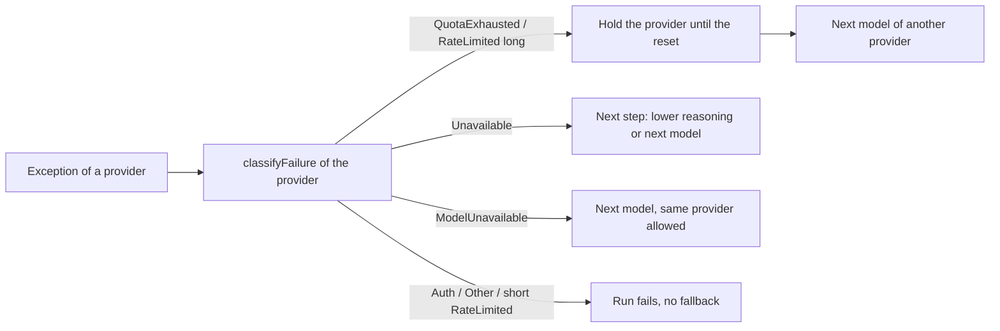

# Prompt cache expiry and failure classification across providers

The cache icon of the prompt bar already works for **Claude Code, the Anthropic API and Copilot's Claude models**. It works for any provider that fills `AgentSessionUsage.PromptCacheExpiresAt`: the frontend is provider-neutral. No other provider fills it. Live probes show that the OpenAI API and the Codex subscription document a cache lifetime that can be shown.

Several real failures never reach the fallback today:

- **Gemini:** no failure is classified, so a Gemini session never falls back and never retries an outage.
- **Mistral:** every 429 is taken for an exhausted quota.
- **OpenAI API:** new quota codes are missed, and a model the key cannot use ends as a sign-in failure.
- **Copilot:** its weekly rate limits are taken, on Claude models, for a 30-second limit.
- **Anthropic API:** a reached monthly spend cap and an empty credit balance never fall back.
- **Kimi for Coding:** its 5-hour usage limit ends as a sign-in failure.
- **OpenRouter:** an error inside a stream is ignored, and the turn ends as a silently cut success.

When this is done, the icon also shows for OpenAI and Codex, and no longer shows a guessed time for Kimi. Each of these failures gets the kind the fallback acts on, with the right reset time.

## What changes

### 1. Prompt cache expiry for OpenAI Responses and Codex

Where the lifetime of the cache is known, by provider:

| Provider | Cached tokens reported | Documented lifetime | Shown after this plan |
| --- | --- | --- | --- |
| Claude Code | yes | 5 min or 1 h, reported per request | already shown |
| Anthropic API | yes | 5 min or 1 h, the TTL we send | already shown |
| Copilot, Claude models | yes | 5 min (we send no TTL; Copilot honors `1h` too) | already shown |
| OpenAI API (`openai-responses`) | `cached_tokens`, `cache_write_tokens` | GPT-5.6+: "30 minutes after its most recent write or reuse"; `24h` retention: "around 30 minutes … up to 24 hours" | **30 min** |
| Codex subscription | `cached_tokens` | none for the ChatGPT backend; same models and cache as the API | **30 min** (open decision) |
| Copilot, GPT models | `cached_tokens` | none | no |
| xAI, Gemini, Mistral | yes | none documented | no |
| Kimi for Coding (`anthropic` type, third party) | reads only; ignores `cache_control` | none for this endpoint; hits seen after 16 min idle | **no** (today: a guessed 5 min) |
| OpenAI-compatible: DeepSeek, Z.ai, MiniMax, Alibaba, Xiaomi, OpenRouter | `cached_tokens` | "hours to days" (DeepSeek), "adjusted to system load" (MiniMax), none (others) | no |

Two changes make this work:

- `OpenAIProviderOptions` gets a `PromptCacheLifetime`. The runtime factory sets it to 30 minutes for `openai-responses` and `codex`, and leaves it null for xAI, Copilot and the Chat Completions providers.
- `OpenAIResponsesTurnExecutor.CreateUsage` (`src/CodeAlta.Agent.OpenAI/OpenAIResponsesTurnExecutor.cs`) then sets the expiry the same way `ChatClientTurnExecutor` does. It also passes on the cache writes it drops today (`InputTokenDetails.CacheWriteTokenCount`, GPT-5.6+).

```csharp
var cacheWrites = response.Usage.InputTokenDetails?.CacheWriteTokenCount;
// ... CreateOperationUsage(..., cacheWriteTokens: cacheWrites)
// A request that read or wrote the cache keeps it for the lifetime of the provider from its start: a read refreshes it too.
return provider.PromptCacheLifetime is { } lifetime && (cached is > 0 || cacheWrites is > 0)
    ? usage with { PromptCacheExpiresAt = requestStartedAt + lifetime }
    : usage;
```

30 minutes is the guaranteed minimum for GPT-5.6 and later. For the `24h`-retention models (gpt-5.5, gpt-5.4…) it is the typical lifetime. The icon may therefore say "expired" while OpenAI still holds the cache, never the reverse.

Two corrections to the expiry that exists today:

- **It starts from the request, not from the end of the answer.** Anthropic measures the lifetime "from the start of the request that writes or reads the cache entry". `ChatClientTurnExecutor.CreateUsage` uses the end of the answer when the client gives no `CreatedAt`, so a 2-minute answer shows 2 minutes too many. The executor records when the request started and uses it as the anchor. The OpenAI executor does the same.
- **A third-party Anthropic endpoint gets no expiry.** Kimi for Coding ignores our markers and keeps its cache for an undocumented time: the 5 minutes shown today are a guess.
  - An `anthropic` provider whose `base_url` is not the Anthropic API gets no expiry. This is decided in `ConfiguredModelProviderRegistryBuilder` (~L733).
  - It still sends the same markers.
  - Copilot's Claude models keep their 5 minutes: Copilot was measured to honor the TTL.

### 2. A failure kind for a model the account cannot use

Today, these failures are never moved to the next model of the tier:

- OpenAI `403`/`404` `model_not_found` ("Project … does not have access to model …"), which ends as `Auth`;
- Copilot `400` `model_not_supported`, which ends with no kind.

A new `AgentFailureKind.ModelUnavailable` covers them (`src/CodeAlta.Agent/AgentEvent.cs`). `SessionFallbackCoordinator` handles it like this:

- it falls back on it when `OnUnavailable` is on;
- it skips every step of the tier with the same provider **and model**, at any reasoning;
- it does not hold the provider: the other models of that provider stay usable;
- `Reason()` writes "`<provider>` has no access to `<model>`".

`SessionRuntimeService.ModelTiers.cs` lets the kind through its filter. The kind is not used by the frontend.



### 3. Gemini: classify its failures

`Google.GenAI.ApiException` derives from `HttpRequestException` but hides its status behind `new int StatusCode`. The inherited `StatusCode` is null, so `AgentFailureClassifier` sees nothing. This was checked on Google.GenAI 1.26.1.

`GoogleGenAIModelProviderRuntime` gets a `classifyFailure` that reads `ApiException.StatusCode`, `Status` and `Message`:

| Gemini answer | Today | After |
| --- | --- | --- |
| 400 `INVALID_ARGUMENT` "API key not valid" (observed) | none | `Auth` |
| 429 `RESOURCE_EXHAUSTED`, a per-minute limit | none | `RateLimited`, `RetryAfterSeconds` from `retryDelay` |
| 429 `RESOURCE_EXHAUSTED`, a per-day quota (`PerDay` in the quota id) | none | `QuotaExhausted` |
| 500, 503 `UNAVAILABLE`, 504, or the same as a mid-stream error chunk | none | `Unavailable` (also lets `ChatClientTurnExecutor` ask again once) |
| 404 unknown or retired model (observed) | none | `ModelUnavailable` |

Gemini's 429 always says "You exceeded your current quota", even for a per-minute limit. The generic `IsQuotaMessage` is therefore not used for it.

`CreateSdkClient` also sets `HttpOptions.RetryOptions` (3 attempts on 408, 500, 502, 503 and 504; not 429). Today a single 503 ends the turn.

### 4. Mistral: tell a rate limit from a quota

`MistralChatClient` builds every 429 message as "rate limit **or quota** was reached". `IsQuotaMessage` matches "quota", so every Mistral 429 becomes `QuotaExhausted`, with no reset.

`MistralModelProviderRuntime` gets a `classifyFailure` that reads `MistralApiException`:

- the status;
- `RetryAfter`, as `RetryAfterSeconds`;
- `ErrorType` and `ErrorCode`;
- the response body, not the message CodeAlta wrote.

A plain 429 becomes `RateLimited`, and stays it unless the body speaks of credits or quota. A `Retry-After` of 20 s makes it a short limit, which is waited out rather than left.

`MistralChatClient.ParseStreamingUpdate` also throws a `MistralApiException` for an `{"error": …}` chunk mid-stream. Today such a chunk is ignored and the stream ends silently.

### 5. OpenAI, Codex and Copilot's GPT models: `OpenAIResponsesTurnExecutor.ClassifyFailure`

| Input | Today | After |
| --- | --- | --- |
| 429 or stream error `credit_balance_exhausted`, `organization_spend_limit_exceeded`, `project_spend_limit_exceeded`, `organization_usage_limit_exceeded` | `RateLimited`, or retried 5 times on Codex | `QuotaExhausted`, not retried |
| 403 or 404 `model_not_found`; 400 `model_not_supported` (Copilot) | `Auth` / none | `ModelUnavailable` |
| 429 `user_weekly_rate_limited`, `user_global_rate_limited[:plan]`, `integration_rate_limited` (Copilot), HTTP or stream | `RateLimited` with no reset / none mid-stream | `RateLimited` with the reset from "Please wait N hours M minutes" |
| 429 `rate_limit_exceeded` with "try again in 6.2s", `retry-after-ms`, or `x-ratelimit-reset-*` | `RateLimited` with no delay, which falls back even for 1 s | `RateLimited` with `RetryAfterSeconds` |
| Codex 429: header `x-codex-primary-reset-at` before body `resets_at` | the 5-hour reset wins | the body's `resets_at` wins |
| 429 `rate_limit_exceeded` whose body links to `/account/billing` | `QuotaExhausted` (the word "billing") | `RateLimited` |

The last row needs a change of method. Today `ClassifyFailure` matches phrases in all response headers plus the body. Afterwards, the structured `error.code`, `error.type` and the HTTP status decide first. Phrases are looked for in the body and message only, never in the headers.

The reset parser ("Please wait N hours M minutes", "try again in X s/ms") goes into `AgentFailureClassifier` as `TryParseRetryDelay`. Both families use it.

### 6. Anthropic route (Anthropic API, Copilot's Claude models, Anthropic-compatible providers)

`AnthropicModelProviderRuntime.ClassifyFailure` gives every 429 that does not say "quota" a 30-second `RetryAfterSeconds` (`AsShortRateLimit`), which makes the fallback wait. That is right for Anthropic's per-minute limits. Copilot's weekly limits also arrive on this route, as "Please wait 5 hours 52 minutes" or a `user_weekly_rate_limited` code.

| Input | Today | After |
| --- | --- | --- |
| 429 `rate_limit_error`, `enforced_spend_limit_reached` ("You will regain access on 2026-09-01 at 00:00 UTC") | `RateLimited` 30 s: never falls back | `QuotaExhausted`, `ResetsAt` from the date |
| 400 "Your credit balance is too low…", 400 "You have reached your specified (workspace) API usage limits" | none | `QuotaExhausted` |
| SSE `billing_error` / SSE `timeout_error` / SSE `authentication_error`, `permission_error` | `Other` | `QuotaExhausted` / `Unavailable` / `Auth` |
| Copilot 429 "Please wait 5 hours 52 minutes", `user_weekly_rate_limited` | `RateLimited` 30 s | `RateLimited` with the parsed reset |
| Kimi 403 "You've reached your 5-hour usage limit…" (also weekly, monthly) | `Auth` | `QuotaExhausted` |
| Kimi 429 "The engine is currently overloaded" | `RateLimited` 30 s | `Unavailable` |

The 30-second default stays for a plain per-minute `rate_limit_error`, which the SDK has already waited out. The SDK's exception keeps no header, so the reset comes from the body only.

### 7. Chat Completions providers (DeepSeek, OpenRouter, Z.ai, MiniMax, Alibaba, Xiaomi)

`OpenAIChatTurnExecutor` reads neither an `error` object nor `finish_reason` in a streamed chunk. OpenRouter documents that a failure after the start of the stream comes inside it, after HTTP 200: `{"error":{"code":429,…},"choices":[{"finish_reason":"error"}]}`. Today:

- with no text before it, the turn ends as an unclassified protocol error;
- with text before it, the turn ends as a **success, silently cut**.

After the change, the executor reads both from each chunk:

- an `error` chunk ends the turn with a failure classified from its `code` (402, 429, 5xx, 401/403);
- `finish_reason` `error`, `insufficient_system_resource` or `aborted` (DeepSeek) ends it as `Unavailable`.

Provider codes that arrive as HTTP 429 with a numeric `error.code` are classified by that code. They apply only when the base URL is the provider's, since another provider's `1113` means something else.

| Provider and code | Today | After |
| --- | --- | --- |
| Z.ai `1113` balance empty, `1309` plan expired, `1308`/`1310`/`1316`–`1321` usage caps | `RateLimited` (or `QuotaExhausted` without reset) | `QuotaExhausted` |
| Z.ai `1311` plan lacks the model | `RateLimited` | `ModelUnavailable` |
| Z.ai `1305` overloaded | `RateLimited` | `Unavailable` |
| Alibaba 400 `Arrearage` | none | `QuotaExhausted` |
| Alibaba 429 `Throttling.RateQuota`, `Throttling.AllocationQuota`, `limit_requests` (per-second/minute throttles) | `QuotaExhausted` (the word "Quota") | `RateLimited` |

## Steps

Each step is one commit, with its tests in `src/CodeAlta.Tests` (classifiers, executors) or `src/CodeAlta.Orchestration.Tests` (fallback).

- [x] 1. Add `AgentFailureKind.ModelUnavailable`. Handle it in `SessionFallbackCoordinator` (`IsTrigger`, `FindNext`, `Reason`) and in `SessionRuntimeService.ModelTiers.cs`. Tests in `SessionFallbackTests`: it moves to the next model of the same provider, skips the same model at a lower reasoning, and holds no provider.
- [x] 2. Add `AgentFailureClassifier.TryParseRetryDelay` ("try again in 6.2s", "Please wait 5 hours 52 minutes", "463 hours"), with tests in `AgentFailureClassifierTests`.
- [x] 3. Rework `OpenAIResponsesTurnExecutor.ClassifyFailure` as in part 5:
  - structured code first; no phrase scan of the headers;
  - the new quota codes in the classifier and in `IsFatalResponsesStreamErrorCode`;
  - `model_not_found` / `model_not_supported`;
  - the Copilot rate-limit codes;
  - the retry delay;
  - the body's `resets_at` first.

  Tests are added to `OpenAIRawApiModelProviderRuntimeTests`, one per row of the table. The existing classification tests must keep passing.

  Also found and fixed: every Codex 429 was classified `QuotaExhausted` because the phrase scan read CodeAlta's own wrapper message ("ChatGPT/Codex rate limit or quota was reached"). That message is now left out of the scan, like the headers.
- [x] 4. Rework `AnthropicModelProviderRuntime.ClassifyFailure` as in part 6. A parsed delay, a spend cap or a Copilot code wins over `AsShortRateLimit`. Add the 400 credit and usage-limit bodies, the SSE types, and Kimi's 403 usage limit and 429 overload. Tests in `AnthropicFailureClassificationTests`, one per row.
- [x] 5. Read `error` and `finish_reason` from the chunks in `OpenAIChatTurnExecutor`, and add the Z.ai and Alibaba codes (scoped to their base URL) to the classification. Tests with a fake stream:
  - an error chunk after some text ends the turn classified, not as a success;
  - `finish_reason: insufficient_system_resource` ends it as `Unavailable`;
  - one test per Z.ai and Alibaba row.

  Deviation: the OpenAI SDK throws `ArgumentOutOfRangeException` on a finish reason it does not know (it knows five), so such a chunk already failed the turn, with no kind. The executor reads that exception for the finish reason. The silently cut success only happened for a chunk that carries an `error` object and no finish reason. The tests go through the real SDK client and an HTTP stub.
- [x] 6. Add a Gemini `classifyFailure` and retry options in `GoogleGenAIModelProviderRuntime`. Tests build `Google.GenAI.ClientError` / `ServerError` for 400 invalid key, 429 per-minute, 429 per-day, 503 and 404, and check the kind.
- [x] 7. Add a Mistral `classifyFailure`, and handle the mid-stream error chunk in `MistralChatClient`. Tests:
  - a 429 with `Retry-After: 20` gives `RateLimited`/20;
  - a 429 whose body speaks of credits gives `QuotaExhausted`;
  - an SSE error chunk ends the turn classified.
- [x] 8. Anchor the expiry at the start of the request in `ChatClientTurnExecutor.CreateUsage`, and give no lifetime to an `anthropic` provider with a third-party `base_url` (`ConfiguredModelProviderRegistryBuilder`). Tests:
  - a slow fake answer still gives `start + TTL`;
  - a provider on `api.kimi.com` gives no expiry;
  - the Anthropic API and Copilot Claude keep theirs.

  The provider option is `AnthropicProviderOptions.HonorsPromptCacheTtl`; the host check is `ConfiguredModelProviderRegistryBuilder.IsAnthropicApi`.
- [x] 9. Add `OpenAIProviderOptions.PromptCacheLifetime`, set to 30 min for `openai-responses` and `codex` in the runtime factory. Set the expiry (from the request start) and pass the cache writes in `OpenAIResponsesTurnExecutor.CreateUsage`. Tests mirror `AnthropicPromptCachingTests`:
  - a read or a write gives `start + 30 min`;
  - no cached tokens gives no expiry;
  - xAI and Copilot GPT give no expiry.

  `openai-responses` gets the 30 minutes only on the OpenAI API (`IsOpenAIApi`), not on another vendor's Responses endpoint. The Responses executor anchors the expiry at `created_at` of the response, which is the start of the request.
- [x] 10. Update the docs:
  - `site/docs/workspace.md` ("Prompt cache", ~L281): the providers that show the timer;
  - `site/docs/model-providers.md` ("Prompt caching and the cost of a request", ~L138): the lifetimes by provider;
  - `site/docs/model-tiers.md`: the fallback on a model the account cannot use.
  - Internal: `doc/providers.md` (failure kinds, classifiers by provider), `doc/runtime.md` (fallback on `ModelUnavailable`), `doc/desktop.md` (prompt cache expiry).

## How it is verified

- [x] `dotnet test -c Debug` from `src` passes (the running CodeAlta is the Release build).
- [x] `npm test` in `src/CodeAlta/frontend` passes. In the full run, `activityRail.browser.test.ts` failed once under load and passed alone; no frontend file changed.
- [x] `lunet build` in `site` passes.
- [x] In the developer instance (`alta --dev`), the cache icon appears with 30 minutes left:
  - after the second prompt of a session on `openai:gpt-5.5@low` (10,752 of 11,595 input tokens read from the cache);
  - after the second prompt of a session on `codex:gpt-6.1-sol@low` (11,392 of 11,551).
- [ ] ~~In the developer instance, a session on a tier whose first step is an OpenAI model the key cannot use moves to the next model of the tier.~~ Not run: the tiers and providers are shared with the user's real profile. Covered by `SessionFallbackTests` and the classifier tests.
- [ ] ~~In the developer instance, a session on Gemini with a wrong key fails as a sign-in failure.~~ Not run for the same reason. Covered by `GoogleGenAIFailureClassificationTests`.

## Decisions

| Decision | Choice | Why |
| --- | --- | --- |
| Cache settings sent to providers | Unchanged: no `prompt_cache_retention`, no `prompt_cache_options`, no new TTL. The plan only reads what the provider reports | A longer retention than the provider's default could change how the provider serves the request (slower hardware has been reported); the expiry is shown for the default |
| Lifetime shown for the OpenAI API | 30 min after the last request that read or wrote the cache | Guaranteed minimum for GPT-5.6+, the typical lifetime for the `24h` models; the icon errs toward "expired" |
| Providers with no documented lifetime (xAI, Gemini, Mistral, Copilot GPT, Chat Completions providers, Kimi) | No icon | An invented lifetime would be wrong in either direction |
| Numeric provider codes (Z.ai `1113`…) | Applied only when the base URL is that provider's | The same number means something else at another provider |
| A model the account cannot use | A new kind `ModelUnavailable` | `Unavailable` would hold or retry the same model at a lower reasoning; `Auth` does not fall back |
| Gemini SDK retries | 3 attempts on 408/5xx, none on 429 | A 429 carries its delay, and the fallback decides on it |
| Copilot's Claude models | Keep the 5-minute TTL | Same rule: switching to `1h` would change the cache, not just its display |

| Codex cache timer | 30 minutes, as for the API | Approved with the plan as written: the backend serves the same models; the timer can only say "expired" too early |

## Risks

- **A reworked OpenAI classifier can change what is classified today.** All existing classification tests stay green. The new structured-first order is checked against every shape in the tables.
- **The 30-minute lifetime is not exact for older OpenAI models** (5 to 10 minutes in memory, up to an hour). Those models are rarely used, and for them the icon errs the wrong way. If that matters, the lifetime can come from the model id; this plan does not do that.

## Out of scope

- Keeping the other Copilot models reachable after a Copilot quota failure. Today one quota failure holds the whole provider, including the 0× models.
- Sending `prompt_cache_key` on the plain OpenAI API to raise the hit rate.
- Gemini explicit `cachedContents`, which has a TTL we would set.
- Codex quota snapshot headers checked before a request is sent.
- Reset times written as text by Z.ai and MiniMax ("reset at …"), and OpenRouter's `X-RateLimit-Reset`: the time zone of Z.ai's text is unverified, and the provider stays held for the default 15 minutes.
- The `retry-after` and `anthropic-ratelimit-*-reset` headers of Anthropic, which the SDK's exception does not keep.
- A context overflow worded "Prompt is too long" (Z.ai) on the Chat Completions executor.

<details><summary>Evidence from the probes (2026-10-16)</summary>

**OpenAI API, gpt-5.5.**
- Second identical request: `cached_tokens` 3840 of 4021.
- `prompt_cache_retention: "24h"` is echoed on every response.
- No header says anything about the cache.

**OpenAI API, gpt-5.6-terra.**
- First request: `cache_write_tokens` 4022.
- Then: `cached_tokens` 4012.
- Source: <https://developers.openai.com/api/docs/guides/prompt-caching>.

**OpenAI API, model access.**
- `gpt-5-mini` on this key: 403 `model_not_found`.

**Codex, gpt-6.1-sol.**
- Second turn: `cachedInputTokens` 11392 of 11637.

**Copilot, Claude route.**
- With `ttl:"1h"` the write lands in `ephemeral_1h_input_tokens`.
- After 330 s, the 1h entry was read and the 5m entry was written again.
- Unknown model: 400 `model_not_supported`.
- Weekly limit shapes: <https://github.com/orgs/community/discussions/192485>.

**Gemini, gemini-3.5-flash.**
- Second request: `cachedContentTokenCount` 9625, no expiry.
- Invalid key: 400 `INVALID_ARGUMENT` / `API_KEY_INVALID`.
- `Google.GenAI.ApiException` declares `new int StatusCode`, checked by reflection.

**Mistral, mistral-small-latest.**
- Second request: `cached_tokens` 10992.
- Invalid key: 401 `{"detail":"Invalid API Key"}`.

**Anthropic API, claude-haiku-4-5, `ttl=1h`.**
- First request: `ephemeral_1h_input_tokens` 9611.
- Second request: `cache_read_input_tokens` 9611; a read does not say its TTL.
- Spend-cap and error shapes: <https://platform.claude.com/docs/en/api/rate-limits#reaching-your-spend-cap>, <https://platform.claude.com/docs/en/api/errors>.

**Kimi for Coding.**
- Reads are reported (`cache_read_input_tokens` 8507) with or without our markers, writes never.
- Hits after 6 and 16 minutes of idle time.
- Invalid key: 401 `invalid_authentication_error`.
- Usage limits: <https://www.kimi.com/code/docs/en/kimi-code/error-reference.html>.

**Chat Completions providers.**
- Second request: DeepSeek `cached_tokens` 8448, Z.ai 8704, MiniMax 8580, Alibaba 9216, Xiaomi 9792.
- OpenRouter on this account: 402 "Insufficient credits", with a numeric `code`.
- Error codes: Z.ai <https://docs.z.ai/api-reference/api-code>, Alibaba <https://www.alibabacloud.com/help/en/model-studio/error-code>, OpenRouter <https://openrouter.ai/docs/api-reference/errors>, DeepSeek <https://api-docs.deepseek.com/quick_start/error_codes>.

**Not reproduced:** real 429 and 5xx bodies were not forced (no load generation). Their shapes come from the official docs, the code of `codex-rs`, and community reports.

Probe scripts and notes are in `~/.alta/scratchpad/cache-fallback-probes/`.

</details>
