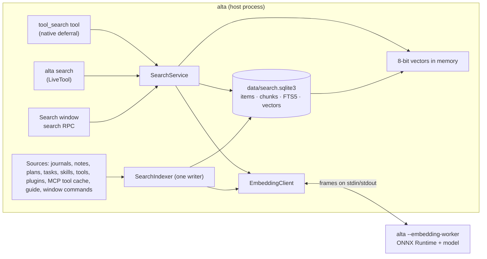

# Local search and tool search

Today CodeAlta finds a session by its title and a page of the guide by a substring. Nothing searches what was said in a conversation. Every skill, with its whole description, is sent with every prompt. An agent finds an MCP tool only by activating a whole server, or with `alta mcp tool search`, which starts every server.

After this work ([#118](https://github.com/CodeAlta/CodeAlta/issues/118)), one local index covers:
- the prompts and final answers of sessions, with their titles and notes;
- the plans and tasks of projects;
- the skills, the tools (built-in, plugin, UI, MCP) and the MCP servers;
- the plugins, the commands of the window and the user guide.

The search window (`Ctrl+P`) finds conversations and pages of the guide. Agents query the same index with `alta search`, scoped to a project, a session, a kind or a period. Keyword search works as soon as the version is installed. Search by meaning is the user's choice: a dialog explains it, a model is downloaded once, and everything runs on the computer. The same index is the tool search: agents find a skill or an MCP tool by what it does, and the prompt stops growing with every installed skill and server. A space or a project can be kept out of the index.

CodeAlta Desktop only. The TUI keeps working, and its `alta` has no `search` group.

Related issues:
- [#117](https://github.com/CodeAlta/CodeAlta/issues/117), speech to prompt: its ONNX Runtime and its worker process are reused here.
- [#176](https://github.com/CodeAlta/CodeAlta/issues/176), skill registries, and [#177](https://github.com/CodeAlta/CodeAlta/issues/177), a curated MCP registry: the index will serve them once they exist, and they are not part of this plan.

## In short

1. **Two layers.**
   - Keyword search (SQLite FTS5): always there, no download.
   - Search by meaning (embedding vectors): turned on by the user, with a model downloaded once.
2. **Exact comparison, no approximate index.** The query is compared with every vector in scope, as 8-bit vectors in managed SIMD code.
   - A million vectors take 3.7 ms on this Mac.
   - The heaviest profile known gives an estimated 10k to 50k chunks.
3. **One rebuildable file per instance:** `data/search.sqlite3`, beside `alta.sqlite3`, and not backed up.
4. **Models.**
   - **EmbeddingGemma 2 by default:** text only, 8-bit, 319 MB, Apache-2.0, the best on code of the small models.
   - **Granite 97M as the light preset:** 98 MB, about 4× faster.
   - Measurements on real sessions confirm the default before it ships.
5. **One ONNX Runtime on disk** for speech and search: the library sherpa-onnx already ships. Embeddings run in their own worker process.
6. **Tool search in layers.**
   - The prompt lists skills and tools in a short, stable form beyond a threshold.
   - Providers that defer tools natively (Anthropic API, OpenAI Responses, Claude Code) get them deferred.
   - The other providers find a tool with `alta search` and call it through `alta`.
7. **Offered, never imposed.** Search by meaning is proposed once a provider works and there is history to search, from a landing card or a hint in the search window. A single dialog says what it unlocks, downloads and costs. It is turned on or off at any time in Settings › Search.
8. **A Search canvas** shows what is indexed, explains why each result ranks where it does, and shows how search is used. Settings › Search keeps only the choices, and the Statistics canvas stays as it is.

## What the user sees

### 1. Being offered search by meaning

Nothing is offered at the first start, or while the provider setup guide is open. The offer appears only when **all** of these hold:

- A provider is configured and a turn has completed with it, so CodeAlta works.
- There is something to search: at least 10 sessions with messages, or 3 days since the first one.
- Search by meaning is off, and the user never turned it off themselves.
- It was not refused with **Don't ask again**, and not put off with **Not now** in the last 30 days.

It is offered in calm places, never as a modal at startup and never as a toast during work:

- **The Search card of the landing page** (see "The Search canvas"): "Search your work by meaning", with **Learn more** and **Not now**.
- **A line at the foot of the search window**, when a query reads like a sentence (4 words or more) and Conversations found little: "Find conversations by what they are about. **Turn on search by meaning…**"
- **Settings › Search**, where it is always offered.

Each of them opens the same dialog.

### 2. The dialog

Short at first sight, with details one click away:

```text
┌───────────────────────────────────────────────────────────────────┐
│  Search by meaning                                            ✕   │
│                                                                   │
│  Find past conversations, skills, tools and documentation from    │
│  what they are about, not only from the words they contain.       │
│                                                                   │
│  ◎  Search (Ctrl+P): "where did we fix the scroll jump?" finds    │
│     the conversation, whatever its wording or language.           │
│  ◎  Agents: `alta search` brings back earlier work and finds the  │
│     right skill or MCP tool among many.                           │
│  ◎  Private: the model runs on this computer. Nothing is sent.    │
│                                                                   │
│  What it takes                                                    │
│    Download   EmbeddingGemma 2 model · 319 MB, once               │
│               ONNX Runtime · 10 MB (already there with Speech)    │
│    Disk       about 15 MB of index for your 312 sessions          │
│    Time       about 15 min of indexing in the background; it      │
│               pauses while you dictate                            │
│                                                                   │
│  ▸ Details                                                        │
│                                                                   │
│  You can turn it off at any time in Settings › Search.            │
│                                                                   │
│            [ Don't ask again ]   [ Not now ]   [ Turn on ]        │
└───────────────────────────────────────────────────────────────────┘
```

**Details** (closed by default) holds:

- **Model:** EmbeddingGemma 2 (Google, Apache-2.0, 100+ languages, best for code, 319 MB) or Granite 97M (IBM, Apache-2.0, 98 MB, faster, less accurate on code), each with its license and languages.
- **Where the files come from and go:** the model from Hugging Face at a pinned commit, the runtime from nuget.org, both checked by SHA-256. The model goes to `~/.alta/cache/search/models/` and the index to `~/.alta/data/search.sqlite3`.
- **What is indexed:**
  - Indexed: the prompt and the final answer of each turn, session titles and notes, plans and tasks, skills, tools, MCP servers, plugins and the user guide.
  - Never indexed: steering messages, the assistant's intermediate messages, tool outputs, reasoning and the settings of MCP servers.
  - A link to keep a project or a space out of search.
- **What does not change:** keyword search already works without the model.

The dialog computes its estimates when it opens, from the number of sessions and a speed per preset. The speed is refined after the first batch.

### 3. After **Turn on**

A sticky toast follows the work, in the pattern of speech (`speech/InstallNotice.tsx`):

1. `Downloading EmbeddingGemma 2 — 120 MB of 319 MB`, with **Cancel**. A download that is canceled or interrupted resumes where it stopped.
2. `Installing…`: checksums and a first load in the worker.
3. `Indexing — 4,120 of 9,800 · about 25 min left`, with **Pause**. The toast can be closed: the progress stays in Settings › Search and in `alta search status`.
4. `Search by meaning is ready`.

The search works during indexing. Results by meaning cover what is already indexed, and the rest is found by its words.

### 4. Settings › Search

```text
Settings › Search
┌──────────────────────────────────────────────────────────────────────┐
│ Search index                                                  [ on ] │
│   Conversations, plans, skills, tools, MCP servers, plugins, guide   │
│   44 MB · 21,480 items · up to date                       [ Rebuild ] │
│   Kept out of search   2 projects, 1 space                 [ Edit… ] │
├──────────────────────────────────────────────────────────────────────┤
│ Search by meaning                                             [ on ] │
│   Model   [ EmbeddingGemma 2 · 100+ languages · 319 MB          ▾ ]  │
│           Downloaded · 319 MB                              [ Delete ] │
│   Indexing  14,200 of 21,480 · about 12 min left           [ Pause ] │
├──────────────────────────────────────────────────────────────────────┤
│ Skills and tools in the prompt                                       │
│   [ Automatic ▾ ]  All of them while there are few; beyond that, the │
│   names only, and agents find the rest with alta search.             │
└──────────────────────────────────────────────────────────────────────┘
```

- **Open Search** (a link under the first part) opens the Search canvas, where the index can be looked at and tried.
- **Search index off** means no index at all. The search window is what it is today, `alta search` answers `unavailable`, and the prompt lists skills in full.
- **Search by meaning off** stops the worker and the indexing at once. The model and the vectors stay, so turning it on again is immediate. **Delete** removes the model and its vectors.
- **Changing the model** builds the new vectors in the background. Search keeps using the old ones until the new set is complete.
- **Rebuild** deletes the index file and indexes everything again.

### 5. Keeping a project or a space out of search

- **Where it is set.** **Exclude from search** in the menu of a project and in the settings of a space. **Kept out of search › Edit…** lists them, with the reverse action.
- **What it removes.** Nothing of an excluded project or space is written to the index: messages, notes, plans, tasks, project skills or project MCP servers. Whatever was indexed is deleted at once.
- **Who is affected.** Results never include it, for the user or for any agent.
- **Moving sessions.** A session moved into an excluded project is removed from the index; a session moved out of one is indexed.
- **Inside an excluded project.** Sessions there can still use `alta search` for what is global (guide, global skills, tools). Their prompt keeps the full list of skills, since the short list relies on search.
- **Where it is stored.** In the catalog, not in the repository:
  - a project: `search: excluded` in `~/.alta/projects/<slug>.md`, read as `ProjectDescriptor.Search`;
  - a space: `search: excluded` in `~/.alta/spaces/<id>.md`, read as `SpaceSettings.Search`.
- **From the repository.** A project's own `.alta/config.toml` can also say `[search] enabled = false`, for everyone who opens it.

### 6. The search window (`Ctrl+P`)

The window (`frontend/src/search/GlobalSearch.tsx`, ranked in `searchResults.ts`) keeps its groups and its instant ranking of sessions, projects, files, commands and skills.

**New groups:**
- **Conversations**: the prompts and final answers of turns, notes, plans and tasks. A hit shows the session title, the project, who spoke, the date and a snippet with the matched words marked.
- **Docs**: sections of the user guide, including the pages of the built-in plugins.
- **Tools**: agent tools, MCP servers and their tools, and plugins.

**How they behave:**
- **Fetching.** They are fetched from the host (`search.query`) a moment after the last key, as files are today.
- **Two passes.** Keyword results come first. With search by meaning on, results by meaning are merged when they arrive. A hit found only by meaning is marked **≈** ("related") instead of showing marked words. The list does not jump: merged hits take their rank once, while the typing has stopped.
- **Better Skills and Commands.** The Skills and Commands groups also take hits by meaning from the index ("dark theme" finds the Appearance command). The window sends its command list to the host once per start (`search.registerCommands`) so that the index knows them.
- **What Enter does.**
  - On a message: opens the session at that message, through the navigation bookmarks already use.
  - On a guide section: opens the Documentation tab at its anchor.
  - On an MCP server or a plugin: opens its settings page.
  - On a tool: shows its description and its arguments.
- **Scoping to a project.** **Search sessions…** of a project, and `Ctrl+F`, also search the conversations of that project.

### 7. What agents get: `alta search`

The same query against the same index as the window:

```text
alta search "why did we change the journal fingerprint" --kind message --project .
alta search "post a message on slack" --kind tool,mcp,skill
alta search "worktree cleanup" --kind doc
alta search show msg:01a133f7-…/claude:msg_011C…:1 --context 2
alta search load mcp:slack/post_message
alta search status
```

- **`alta search <query>`** takes these options:
  - `--kind` is one or more of `message`, `session`, `note`, `plan`, `task`, `skill`, `tool`, `mcp`, `plugin`, `command`, `doc`.
  - `--project <id|path|.>` or `--all-projects`.
  - `--session <id>`, `--since 30d|<date>`, `--until <date>`, `--role user|assistant|agent`.
  - `--mode auto|keyword|meaning` and `--limit <n>`.
  - The default is every kind, in every project of the caller's space, without the calling session.
- **What a query returns.** One `alta.search.summary` record:
  - `mode`, and `meaning`: `ready`, `indexing` (with coverage), `warming`, `off` or `failed`;
  - the total, the scope used, and `truncated`.

  Then one `alta.search.hit` per result:
  - `kind`, `ref`, `title`, `snippet`, `at`, `score`;
  - `match`: `words`, `meaning` or `both`;
  - for a message: the session (`id`, `title`, `projectId`), `role`, `runId`, `contentId`;
  - for a tool: `state` (`loaded`, `available`, `disabled`, `needs_connection`);
  - `next`: the command that uses the hit (`alta search show …`, `alta skill activate …`, `alta mcp tool call …`, `alta documentation open …`).
- **`alta search show <ref> [--context n]`** reads a hit whole:
  - a message, with its turn: the prompt and the final answer. `--full` adds the steering and intermediate messages, read from the journal. `--context n` adds the *n* turns before and after it;
  - a skill, with the head of its `SKILL.md`;
  - a tool, with its full input schema;
  - a section of the guide.

  It is the name a hit needs, because `alta session message` already exists and sends a message to a session.
- **`alta search load <ref>…`** loads tools into the session (see "Tool search"). It changes the session, so it is refused when the user reviews commands, like `alta ui activate`.
- **`alta search status`** reports the index, the model, the coverage and the progress. **`alta search reindex [--kind k]`** reindexes; it changes state.
- **Where the group appears.** It appears where the service is registered, in the desktop. In the TUI the root is unknown, as `documentation` is there. `search` joins the roots plugins cannot take.
- **Visibility.** An agent sees what its space and project can see: never a session, skill or server of another space, and never anything of an excluded project or space.

### 8. The prompt with many skills and tools

While there are few skills, the prompt is what it is today. Beyond **12 skills**, `<available_skills>` lists each one with its one-line title only, without the description. Beyond **60**, it gives the count per scope, plus:

> Find skills, tools, MCP tools and documentation by purpose with `alta search --kind skill,tool,mcp,doc <need>`.

**Other changes to the prompt:**
- The MCP block keeps the server ids and gains the same hint.
- The tool guidance gains one line about `alta search`, and the description of the `alta` tool names it.

**How the lists are built:**
- They depend only on what is installed, sorted by scope and then by name.
- The prompt is byte-identical from turn to turn while nothing is installed or removed, so provider prompt caches survive. Nothing is reranked per turn.
- `[search] prompt_catalog` chooses `auto` (above), `full` (always the whole list) or `compact` (always the short form).

### 9. The Search canvas

Settings › Search keeps the choices. Looking at the index, trying a query and seeing how search is used need room, so they get a canvas of their own: **Search**, an application tab beside Statistics, drawn by the window's own build with its chart components.

- **Where it opens from:** **Open Search** in Settings › Search, `/search` in the search window, the card of the landing page, and `alta canvas open search`.
- **Per space.** Each space has its own tab, which shows what that space can see.

It has three pages: Overview, Explore and Activity.

```text
Search                                                  Overview · Explore · Activity
┌────────────────┬────────────────┬─────────────────┬────────────────┐
│ 21,480 items   │ 915 sessions   │ 92% by meaning  │ 52 MB          │
│ +312 this week │ 2 kept out     │ ▁▂▄▆█ filling   │ index, vectors │
└────────────────┴────────────────┴─────────────────┴────────────────┘
History                                     ■ words and meaning   ▨ words only
  Oct  ■ ■ ■ ■ ■ ■ ■ ■ ■ ■ ■ ■ ■ ■ ■ ■ ■
  Sep  ■ ■ ■ ■ ■ ■ ■ ■ ■ ■ ■ ■ ■ ■ ■ ■ ■
  Aug  ■ ■ ■ ■ ■ ■ ■ ■ ▨ ▨ ▨ ▨ ▨ ▨ ▨ ▨ ▨
  Jul  ▨ ▨ ▨ ▨ ▨ ▨ ▨ ▨ ▨ ▨ ▨ ▨ ▨ ▨ ▨ ▨ ▨
By kind                                     By project
  turns    ████████████████████ 18,940      ┌───────────────┬─────────┬──────┐
  plans    ██ 640                           │ CodeAlta      │ NeoAstra│ …    │
  docs     █ 520                            │               ├─────────┼──────┤
  tools    █ 310                            │               │ Tomlyn  │ ▨ out│
  skills   ▏ 42                             └───────────────┴─────────┴──────┘
```

- **Overview: what is indexed.**
  - **Tiles** (`StatTile`): items, sessions, the share searchable by meaning, and the size on disk, each with its change over the week.
  - **History** (`CalendarHeatmap`): a square per day, as dark as the turns indexed that day, hatched while that day is searchable by words only. During the first build it fills from today backward, so the progress can be seen.
  - **By kind** as bars, and **by project** as a treemap of the space's projects sized by their items. An excluded project is hatched and labeled "kept out".
  - **The state of each source:** its last check, its last error (an unreadable file, a worker that died), and the speed of embedding.
- **Explore: what a query finds, and why.**
  - **The same query as `alta search`**, with the same filters (kinds, project, period, role) and a switch **Words · Meaning · Both**, so the three can be compared on one query.
  - **Each hit explains its rank**: its rank by words, its rank by meaning and the matched words, as in "words #3 · meaning #1". Enter opens it, as in the search window.
  - **With an empty query**, it lists what is indexed, kind by kind. Tools show their state. An MCP server never listed (`needs_connection`) offers **List its tools**, which connects it once. That answers "why does the agent not find my Slack tool".
- **Activity: how search is used.**
  - **Searches.** Searches per day, from the window and from agents (stacked bars), the share with no result, and the median time by words and by meaning.
  - **Tool search.** Searches for tools and tools loaded. A `StatTile` with its line shows the tokens tool search kept out of prompts: the deferred tool definitions and the skill descriptions the short list left out, estimated as characters ÷ 4.
    - Each run records that estimate in its journal, and the indexer adds the runs up as it reads the journals.
    - The `ToolSearch` of Claude Code runs inside the CLI and is not counted.

**Why a canvas, and not more of Settings or of Statistics.**
- **Settings is for choices.** A tab that stays open, can be split and comes back after a restart suits looking and trying.
- **The Statistics canvas counts `alta` as one tool**, without its commands, so search shows nowhere there. Adding its numbers there would clutter pages about time, tokens and models, so search keeps its own facts in its own file.
- **It costs little.** The service, the RPC and the chart components exist already. The canvas is a page of the window's build, like Statistics and the landing page.

**The card of the landing page** appears only while there is something to say: the offer of search by meaning (section 1), the progress of a first build or of embedding, or a failure. Otherwise there is no card.

## How it works

### The parts



### Where the code goes

| Part | Where | Why |
| --- | --- | --- |
| Index store and schema, FTS5, vectors and their kernels, chunking, identifier splitting, ranking, scopes, the sources that read journals and files, the indexer, the query service | New project `src/CodeAlta.Search` (references `CodeAlta.Agent` and `CodeAlta.Catalog`) | Headless and testable. The name is free: the old folder holds only untracked `bin`/`obj`. |
| Pinned-file installer (`.part` files, range resume, SHA-256, lock, final rename), worker framing, worker process client | New small project `src/CodeAlta.NativeEngines`, referenced by `CodeAlta.Agent.Claude`, `CodeAlta.Search` and the desktop | Two near-copies exist already: `ClaudeCodeCliInstaller.cs` (521 lines) and `SpeechInstaller.cs` (580). `CodeAlta.Agent.Claude` cannot reference `Hosting`, which references it. The name is the one the development guide uses ("Native Engines And Worker Processes"). |
| The embedding worker: ONNX session, tokenizers, pooling | `src/CodeAlta/Desktop/Search/`, started as `alta --embedding-worker` and handled first in `Program.Main` | Only the worker touches the ORT and tokenizer types, as with speech. Desktop only. |
| Desktop service and RPC (`search`), the dialog, Settings › Search, the groups of the search window | `src/CodeAlta/Desktop/Rpc/SearchRpc.cs`, `frontend/src/search/` | Desktop only. The service is composed by `DesktopApplication` and closed in its close flow. |
| The Search canvas and its landing card | A built-in desktop plugin `search`, like `DesktopLandingPlugin`, declaring the canvas and the card. The page is `frontend/src/search/canvas.tsx` (`PluginScript.App("search")`), with the components of `src/charts/` | Like Statistics and the landing page: a module of the window's build, following the chart rules of the development guide. |
| `alta search` | `src/CodeAlta.LiveTool/BuiltInAltaCommandContributor.Search.cs`, gated on the service, plus `search` in the reserved roots (`PluginAltaCommandContributor.cs`) | The pattern of `documentation`. |
| `[search]` settings, paths, exclusions | `CodeAlta.Catalog`: `Search/SearchSettings.cs`, `CodeAltaConfigStore`, `CatalogOptions.SearchDatabasePath`, `SearchCacheRoot` and `RuntimeRoot`, `ProjectDescriptor.Search`, `SpaceSettings.Search` | As for `[speech]` and the space settings. |
| MCP tool-list cache, activation per tool | `CodeAlta.Plugin.Mcp` | MCP code stays inside the MCP plugin boundary (development guide). |
| The short skill list and the hints | `AgentInstructionTemplateProvider` (skills), `McpPlugin` (MCP block), `SystemPromptBuilder` (guidance), `AltaSessionToolFactory` (tool description) | Where those blocks are built. |
| Native deferral | `CodeAlta.Agent.Anthropic`, `CodeAlta.Agent.OpenAI`, `CodeAlta.Agent.Claude` | Protocol details stay in the providers. |

`ArchitectureGuardrailTests` and `doc/architecture.md` gain the two projects. `CodeAlta.LiveTool` references `CodeAlta.Search` for the service contract.

### The index

There is one file per instance, `<StateRoot>/data/search.sqlite3`. It is opened by a second `ApplicationDatabase`: owner `search`, table prefix `search_`, versioned migrations, and no `StartMaintenance()`, so no backups. A damaged file restarts empty, and the empty cursors cause everything to be read again.

```sql
CREATE TABLE search_source (            -- what is read as a whole or by cursor
  id INTEGER PRIMARY KEY, kind TEXT NOT NULL, key TEXT NOT NULL UNIQUE,   -- 'journal:<session>', 'skill:<path>', 'mcp:<server>', 'doc:<page>'…
  stamp TEXT, fingerprint BLOB, hash BLOB, offset INTEGER, state TEXT);  -- stamp: length and write time; fingerprint: first line of a journal; hash: content of a file
CREATE TABLE search_item (              -- what a hit names
  id INTEGER PRIMARY KEY, source_id INTEGER NOT NULL, kind INTEGER NOT NULL, ref TEXT NOT NULL UNIQUE,
  space_id TEXT, project_id TEXT, session_id TEXT, run_id TEXT, role INTEGER, at INTEGER,
  title TEXT, flags INTEGER NOT NULL DEFAULT 0, text_hash BLOB NOT NULL);
CREATE INDEX search_item_scope ON search_item(kind, project_id, at);
CREATE TABLE search_chunk (             -- the text that is matched: 1..n per item
  id INTEGER PRIMARY KEY, item_id INTEGER NOT NULL, ordinal INTEGER NOT NULL,
  title TEXT NOT NULL, text TEXT NOT NULL, words TEXT NOT NULL,           -- words: identifiers split
  embed_hash BLOB NOT NULL);
CREATE VIRTUAL TABLE search_fts USING fts5(title, text, words,
  content='search_chunk', content_rowid='id', tokenize='unicode61 remove_diacritics 2', prefix='2 3');
CREATE TABLE search_vector_set (        -- one per model, revision, width and prompt version
  id INTEGER PRIMARY KEY, model TEXT NOT NULL, revision TEXT NOT NULL, dims INTEGER NOT NULL,
  prompts TEXT NOT NULL, state TEXT NOT NULL);
CREATE TABLE search_vector (
  set_id INTEGER NOT NULL, embed_hash BLOB NOT NULL, scale REAL NOT NULL, code BLOB NOT NULL,
  PRIMARY KEY (set_id, embed_hash)) WITHOUT ROWID;
CREATE TABLE search_activity (          -- what the Activity page counts: 90 days, never the text of a query
  at INTEGER NOT NULL, origin INTEGER NOT NULL, session_id TEXT, kinds INTEGER NOT NULL, mode INTEGER NOT NULL,
  hits INTEGER NOT NULL, words_ms REAL, meaning_ms REAL);
```

- **What is stored.** The text of chunks is kept, so that `snippet()` works and the search window needs no journal read. It is about 15 MB for a heavy profile. The FTS table uses external content kept in step by the indexer.
- **Shared vectors.** Vectors are keyed by the hash of what was embedded, so a fork, a repeated tool description or an edit back to the same text costs no new embedding.
- **Renaming a session.** A rename changes the titles in the keyword index at once. The vectors keep the title they were made with: re-embedding a whole session for a new title is not worth its cost.
- **Size.** For the heavy profile, an estimated 25–130 MB without vectors (about 1% of its journals) and 10–40 MB more with them. About 2 MB for this machine today.

**Why a file of its own.** Inside `alta.sqlite3`, three things would go wrong:
- **Write contention.** The indexer's bulk writes would wait in the same write queue as the session list, Statistics and bookmarks; a write that holds that queue more than 2 s is already logged.
- **Bigger backups.** The daily backups would carry the index too.
- **Stale restores.** Restoring a backup would bring back an old index.

The index is derived data: a damaged or deleted file is rebuilt from the journals and files. It belongs to the instance, like the sessions it reads, so the developer instance has its own.

### Keyword search

- **Tokenizer.** `unicode61` with `remove_diacritics 2`, so accented letters match either way (`é` and `e`) and `_` separates words. No Porter stemmer (it stems English only); meaning covers word forms. No trigram until a measurement justifies its size.
- **Identifiers** are split into the `words` column: `SessionJournalSqliteCache` gives `session journal sqlite cache`, and paths give their segments. The whole identifier stays in `text`.
- **Ranking.** `bm25()` with column weights (title > text > words), tuned with the evaluation.
- **Queries.** A query is never passed to FTS5 as written: every term is quoted, `"…"` keeps a phrase, and `term*` keeps a prefix. Every word must match. When nothing matches, the query is relaxed to any word.

**Why words and meaning, both.**
- **Words** are what identifiers, error codes, file names and tool names need. A vector does not tell `SessionJournalSqliteCache` from a neighbor of similar meaning.
- **Meaning** is what paraphrases and other languages need: a question asked in one language finds an answer written in another.

Each layer covers what the other misses. The probe of the SQLite that CodeAlta ships (3.53.3, `e_sqlite3`) found everything the keyword layer uses: FTS5, `bm25()`, prefix indexes, `snippet()`, external-content tables and `contentless_delete`.

### Search by meaning

The query is embedded once, with the model's query prompt. It is then compared with every vector **in scope**:

- **Kernels.**
  - arm64: 8-bit vectors with `SDOT` (`Dp.DotProduct`).
  - x64: AVX2 (`MultiplyAddAdjacent` after widening), and AVX-VNNI where present.
  - Elsewhere: a portable `Vector128` path.
  - A scalar reference checks all of them in tests.
- **Data.** Vectors are kept in memory per vector set as columns: 8-bit codes, one scale per vector, the chunk id, and the filter columns (kind, project, session, time, role).
  - They are loaded from SQLite at start, on a worker.
  - Ingestion appends to them; a delete leaves a tombstone, and the columns are compacted beyond 20% of tombstones.
- **Execution.** The scope is applied first, then the comparison. It runs in parallel beyond about 50k rows and keeps the best k in a heap.
- **Memory.** 768 bytes per chunk: 8–38 MB for the heavy profile (10k–50k chunks).

Measured on this Mac (Apple M4 Pro, .NET 10.0.12; exact top 50, median per query, random vectors):

| Vectors | float32, 1 thread | float32, 10 threads | 8-bit, 1 thread | 8-bit, 10 threads |
| --- | --- | --- | --- | --- |
| 100k × 768 | 4.4 ms | 1.4 ms | 1.3 ms | 0.3 ms |
| 1M × 256 | 15.2 ms | 5.2 ms | 5.2 ms | 1.4 ms |
| 1M × 512 | 28.9 ms | 9.8 ms | 9.1 ms | 2.2 ms |
| 1M × 768 | 43.1 ms | 13.5 ms | 13.3 ms | 3.7 ms |

- **Without `SDOT`.** The 8-bit path is 2–3× slower on one thread (1M × 256: 14.6 ms) and about the same in parallel (1.7 ms).
- **Rows scattered across memory.** Rows of one scope spread over the whole set cost more (5% of 1M × 768: 6.6 ms, 8-bit), which is why rows are kept in insertion order and the order of sessions follows.
- **Not used.**
  - `TensorPrimitives.Dot`: a hand-written loop beat it by 1.3–1.8× per row, and `Dot<sbyte>` would add up in `sbyte`.
  - A 1-bit pass with float rescoring: 0.9 ms at 1M, but its quality depends on the model. It stays unused unless the evaluation shows it holds.

**Why compare with every vector instead of an approximate index.** These were considered:

| Option | What it is | Why not, for now |
| --- | --- | --- |
| SQLite `vec1` 0.8 | official SQLite extension, IVF with product quantization | Pre-1.0 and shipped as C source only, so 6 native builds to make and sign. Float32 only. Needs training, and a full rebuild to retrain. Memory-safety reports are open on its forum. |
| sqlite-vec 0.1.9 | SQLite extension | The stable release compares floats exhaustively: the author measured 192 ms for 1M × 192. Approximate search exists only in undocumented alphas. The NuGet package stops at 0.1.7-alpha, without `win-arm64`. |
| USearch 2.26 | HNSW library | The NuGet package covers 3 of the 6 platforms. Its C# binding cannot filter, so a scoped search can come back empty. |
| DuckDB with `vss` | HNSW inside DuckDB | Persistence is experimental, and it is a second database engine. |
| **Managed exact comparison** | SIMD loops over 8-bit vectors in memory | **Chosen.** Exact results, any scope filters for free, deletes are trivial, no native code, and under 4 ms at a million vectors. |

**Scale decides.** The heaviest profile known is the one in `doc/statistics.md`: 915 sessions and 10.4 GiB of journals in 6 months. Scaled from this machine (40 sessions, 105 MB of journals, 474 user and assistant messages), it holds about 11k messages by session count, or about 47k by journal size. Only prompts and final answers are kept, which gives an estimated 10k to 50k chunks. Years of such use stay within a few hundred thousand. Time grows linearly with the chunks in scope, and memory is 768 bytes per chunk:

| Chunks | Memory | 1 thread (this Mac) | 10 threads |
| --- | --- | --- | --- |
| 50k: the heavy profile | 38 MB | 0.7 ms | 0.2 ms |
| 200k: years of heavy use | 154 MB | 2.7 ms | 0.8 ms |
| 1M | 768 MB | 13.3 ms | 3.7 ms |

The 1M row is measured. The others are scaled from the measured 100k and 1M rows.

- **On other machines.** x64 is not measured yet: step 0.2 runs the benchmark on a Windows x64 machine. A weaker CPU may be several times slower and still take a few milliseconds, while embedding the query itself takes tens. An approximate index would save milliseconds on a query that costs ten times more.
- **Beyond a few hundred thousand chunks, memory is the limit, not time.** Three steps stay in .NET, with no new runtime:
  - **Memory-mapped codes** instead of private arrays, so the system pages them.
  - **A 1-bit first pass** with 8-bit rescoring of its best 1000: 0.9 ms at a million, measured, and 96 MB.
  - **Matryoshka 512 or 256.** At 256, EmbeddingGemma 2 loses about 1 point multilingual and 2.5 on code.

  Until then, vectors keep their full width. An approximate index stays possible behind `IVectorIndex` if a profile ever needs one.
- **Hierarchy is metadata.** Space › project › session, and kind, are filters applied before the comparison. A narrow scope makes the work smaller; it needs no second path.
- **An earlier prototype** (February 2026, removed in `d58ef3d7` with the 1.0 cleanup) used sqlite-vec and LLamaSharp. This design avoids both native dependencies.

### Ranking

1. **Resolve the scope:** kinds, the caller's space, projects, session, period, role, and the exclusions.
2. **Words:** the FTS5 match gives the best 100 chunks in scope.
3. **Meaning:** comparing the vectors in scope gives the best 100 chunks.
4. **Fuse** with reciprocal rank fusion (k = 60).
   - Chunks fold into their item, which keeps its best chunk.
   - At most 3 hits per session, unless the query is scoped to one session.
   - A query over several kinds gives each kind a quota before the rest is filled by score.
   - `--recent` adds a decay by age.
5. **Snippets:** `snippet()` for hits found by words; for hits found by meaning only, the window of the chunk that shares the most words with the query, or the start of the chunk.

Rank fusion was chosen because it needs no calibration between BM25 scores and similarities, which have no common scale. k = 60 is the usual constant (Cormack et al., 2009).

### What is indexed

All of it is indexed automatically, with no setting per source. How each kind is kept fresh is in the next section.

| Kind | An item is | Text matched | `ref` |
| --- | --- | --- | --- |
| `message` | the prompt of each turn (the user message that starts it; a prompt from another session, with `source_session_id`, gets the role `agent`) and its final answer (the last assistant message of the turn, taken when the turn ends) | the text, in chunks of about 350 tokens cut at paragraphs and code blocks; the document prompt adds "session title · project" | `msg:<sessionId>/<contentId>`, with `runId` and an offset hint |
| `session`, `note` | each session; its notes | title, first prompt; notes | `session:<id>`, `note:<sessionId>` |
| `plan`, `task` | `.alta/plans/*.md` and `.alta/tasks/*.md` of each project in the catalog | title, summary, sections by heading | `plan:<projectId>/<id>`, `task:<projectId>/<id>` |
| `skill` | each skill of each scope (project, user, built-in, plugin) | name, title, description; `SKILL.md` by heading | `skill:<scope>/<name>` |
| `tool` | built-in tools, plugin tools, UI tools, `alta` commands (from their help), agent prompts | name, description, argument names and descriptions; never the schema itself | `tool:builtin/<name>`, `tool:plugin/<plugin>/<name>`, `tool:ui/<name>`, `alta:<path>`, `prompt:<id>` |
| `mcp` | each configured MCP server; each tool of the MCP tool-list cache | key, title, origin; tool name, title, description, argument names and descriptions | `mcp:<server>`, `mcp:<server>/<tool>` |
| `plugin` | each plugin, built-in or not: Git, MCP, Statistics, Jira, Landing, UI and user plugins | name, description, its canvases and its commands | `plugin:<id>` |
| `command` | each command of the window, from the window's own list | title, category, description, shortcut | `command:<id>` |
| `doc` | each section of the shipped user guide (26 pages, the plugin pages included); the plugin API reference of `alta plugin api` | page title, path of headings, section text | `doc:<page>#<anchor>`, `doc:api/<type>` |

- **Never indexed:**
  - steering messages, and the assistant's messages between tool calls (see below);
  - reasoning, tool and command outputs: 11 of the 13 million characters of text on this machine, large, noisy and often secret;
  - images, and the values of MCP server settings (environment, headers, URLs with tokens).
- **Why only the prompt and the final answer.** A search wants back what was asked and what came of it.
  - **What the rest is.** Steering ("no, the other file") and the assistant's notes between tool calls are progress notes of a run. They mean something only next to that run, and the final answer often supersedes them.
  - **What they would cost.** They would about double the items and the embedding time.
  - **They stay reachable.** `alta search show --full` reads them from the journal around any hit.
- **Visibility is checked when a query runs.** Items carry their space and project, and a query applies the caller's `SpaceFilter` and the exclusions.

### Keeping the index up to date

Most of the index never changes: a prompt or a final answer, once written, stays as it is. Only a small part changes in place: skills, plans, the guide, tools and MCP servers. Each kind is checked as cheaply as it allows, and only what changed is redone:

| Content | How it changes | Detected by | Checked | Redone |
| --- | --- | --- | --- | --- |
| Prompts and final answers | Never, once written. A rewind, a move or a change of provider rewrites the journal | The journal cursor: offset, length, write time and a fingerprint of the first line | At the start and the end of each turn, every 5 minutes, and at start | The new bytes only. After a rewrite, the session again, keeping the vectors of unchanged texts |
| Titles and notes of sessions | Often | The records they append to the journal | The same | The `session` and `note` items of that session |
| Space, project and archive state of a session | Sometimes | The session list of the catalog | When a query runs | Nothing: read at query time |
| Plans, tasks, agent prompts, skills of the user and of projects | When edited | The stamp of the file, then a hash of its content | At start, every 5 minutes, at once after a write through CodeAlta (`alta plan`, `alta task`, the skill editor), and before a query of their kind checked more than a minute ago | The chunks whose text changed |
| The user guide, built-in skills, tools, `alta` commands and plugins | With a new version of CodeAlta | The stamps of the files, and the hashes of the items' texts, computed in memory in a few milliseconds | At start | The pages and items whose hash changed |
| User plugins: their tools, commands and skills | When a plugin is built or reloaded | The reload, then hashes | At start and at each reload | The items of that plugin |
| Commands of the window | With a new version or new plugins | A hash of the list the window sends | At each start of the window | The commands that changed |
| MCP servers | When their configuration changes | The stamps of the MCP files, then the fingerprint of each definition | At start and every 5 minutes | The item of that server |
| Tools of MCP servers | When a server changes its tools | The cache, written each time CodeAlta lists them, with the server's `ttlMs` | Whenever CodeAlta lists them, and on `alta search reindex --kind mcp` | The tools of that server |

**Stamps first, hashes second.**
- **Stamps are free but unreliable.** A stamp (length and write time) comes with the listing of a folder. It also changes when the content does not: a checkout, a copy, an update of CodeAlta that writes every file again.
- **So a changed stamp only leads to a hash.** The file is read and hashed (SHA-256). An equal hash stores the new stamp, and nothing else is done.
- **A different hash redoes only what changed.** The file is cut into chunks again, and the hash of each chunk decides the rest: new FTS rows for the chunks that changed, and new vectors only for texts never embedded before.
- **For the user guide, the hash saves embedding, not time.** Hashing its 26 pages (475 KB) takes about a millisecond. A new version of CodeAlta changes a few pages, and the hashes keep the others from being cut and embedded again. Dev builds, whose version does not change with every edit, are covered the same way. It costs nothing to build, since every item already has the hash of its text.

**No file watchers.**
- **Why not.** The folders are many (the `.alta` folder of every project, six skill roots, possibly network drives), and watchers miss or repeat events on some systems.
- **What instead.** Listing the known folders every 5 minutes takes milliseconds and catches everything.
- **Just-edited content.** The check before a query covers "I have just edited it", and a write made through CodeAlta is signaled at once.

**Bursts and priorities.**
- **Bursts.** Work is coalesced per key, and a file waits for 2 seconds of quiet, so a burst of saves makes one update.
- **Order.** Catalog content goes first (skills, tools, MCP servers, plugins): it is small, and tool search needs it. History follows, the newest sessions first.
- **Queries.** A query never waits for indexing, except for its own check: stamps, then a small changed source indexed again for its words, within about 100 ms. Its vectors follow.

**How it is done:**
- **One writer.** There is one `SearchIndexer` per host: a mailbox with a bounded queue of work keys, coalesced per key (`journal:<id>`, `skills`, `tools`, `mcp:<server>`, `docs`, `plans:<project>`). Only it writes to `search.sqlite3`.
- **Signals say what changed; the journals and files stay the authority.**
  - **What queues work.** Runtime events (a new prompt, the end of a turn), `SessionRuntimeService.SessionDeleted`, updates of the MCP cache, reloads of plugins and writes through CodeAlta queue their key.
  - **What catches the rest.** The start and the 5-minute pass compare stamps. That catches what the TUI or another process wrote, and what was removed outside CodeAlta's events.
- **Reading a journal** follows the Statistics plugin (`SessionCatchUp`, `JournalScanner`):
  - The cursor holds the offset, length, write time and a fingerprint of the first line.
  - Reading goes from the offset to the last complete line, in chunks of 64 MiB. It keeps only the prompt and the final answer of each turn, plus the header and state for the title, space and project.
  - **When each part is indexed.**
    - The prompt is indexed as soon as it is written.
    - The final answer is indexed when the turn ends: at the end of its run, found as `ReadTurnsAsync` finds turns, or at the next prompt. The cursor remembers the last assistant message of the turn in progress, so nothing is read twice.
    - A turn that never ends (CodeAlta closed during a run) gives its last assistant message once its session has been quiet for an hour, as Statistics closes interrupted runs.
  - A changed fingerprint or a shorter file (rewind, move, provider change) means reading from 0 again and upserting by `(session, contentId)`. Vectors whose text hash is unchanged are kept, and items no longer seen are deleted.
  - The rows and the cursor are written in one transaction.
  - A fork skips the records before `forked_from.counted_from`.
- **Deletion.** A deleted session, an excluded project or space, a journal that is gone, or a file or a definition that is gone loses its items, chunks and FTS rows in the same pass. Vectors that no item uses are removed at compaction.
- **Two speeds.** The keyword layer is written at once. Vectors follow through the embedding scheduler.

### What it costs

The keyword index is on by default because the best experience should be the default, and its cost is small. Its first build costs what the Statistics plugin already pays: reading every journal once.

| | Keyword index (on by default) | Search by meaning (after the dialog) |
| --- | --- | --- |
| First build, heavy profile (915 sessions, 10.4 GiB of journals) | Reading the journals took 16–24 s for Statistics on the same profile (`doc/statistics.md`; Windows, NVMe, warm cache; a cold disk is slower), plus a few seconds of FTS5 writes for 11–50 MB of text | 15 min to 2½ h of background CPU with EmbeddingGemma 2 on a laptop, 3–35 min with Granite (estimated; measured in phase 0) |
| Later starts | A check of the journals with nothing to read: 0.03 s for Statistics | Nothing until there is something new |
| Each new turn | Milliseconds | A fraction of a second in the worker |
| Disk, heavy profile | 25–130 MB: text, FTS and metadata, about 1% of the journals | 10–40 MB more for the vectors, plus the model (319 or 98 MB) |
| Memory | The working set of the reading (about 110 MiB at its peak for Statistics), then SQLite's cache | The vectors in the host (8–38 MB for 10k–50k chunks), and the worker while it works (400–600 MB with EmbeddingGemma 2) |

**How the first build stays out of the way:**
- **Timing.** It starts 20 seconds after the application, like the maintenance of the application database, on a background thread with a low priority.
- **Newest first.** Recent conversations are searchable within seconds; older ones follow.
- **Resumable.** A closed application resumes from the saved cursors.
- **Visible.** Its progress shows in Settings › Search and at the foot of the Conversations group ("Indexing conversations — 340 of 915 sessions"), so a missing old result is explained.

**The check.** Step 2.4 measures the first build on a real profile with an opt-in harness, as Statistics does with `RealProfileHistoryHarness`. If a heavy profile needs more than about 2 minutes of background work, the first build covers only the last 90 days and indexes the rest when the application is idle.

### The embedding worker and the shared ONNX Runtime

- **One runtime on disk.**
  - `~/.alta/cache/runtime/sherpa-onnx/<version>/<rid>/` holds `onnxruntime` and `sherpa-onnx-c-api` from the pinned package `org.k2fsa.sherpa.onnx.runtime.<rid>`: one download of 8–14 MB, SHA-256 pinned, as speech does today.
  - Speech uses both libraries; search uses `onnxruntime` only.
  - The present `cache/speech/runtime/<version>/<rid>/` is moved there by the first start that needs it, with hashes checked.
  - When both workers run, they map the same file and share its code pages. Each keeps its own threads and model memory.
- **The binding.**
  - `Microsoft.ML.OnnxRuntime.Managed` **1.28.0**.
  - `OrtEnv.DisableDllImportResolver = true`, then a resolver to the full path of the shared library. Never load by bare name: Windows can have its own `onnxruntime.dll` in `System32`.
  - A test enforces that the managed version is not newer than the native one.
  - Moving to a new sherpa-onnx moves the native library; the managed package stays until a matching or older version is chosen.
- **The process.**
  - `alta --embedding-worker`: no window, no profile, frames on its standard streams, built on the framing extracted from speech.
  - Requests: `Load(model folder, threads)`, `Embed(id, query|document, texts[])` answered by `Vectors(id, …)` (normalized, full width), `Error` and `Exit`.
  - It exits after 10 minutes without work, and when its input closes.
  - A dead worker fails its batch. The batch is retried once, then `meaning` becomes `failed` while keyword search goes on.
- **Settings of the ONNX Runtime session:**
  - intra-op threads `Clamp(cores / 2, 1, 4)`, sequential execution, one inter-op thread;
  - `session.intra_op.allow_spinning = 0`, memory pattern off;
  - CPU provider only, and a priority below normal while it indexes.
- **Scheduling.**
  - Batches of about 16 chunks without a vector in the active set, the newest first, sorted by length to waste less padding.
  - A query embedding always goes first, so the search window and `alta search` wait at most one batch.
  - Indexing pauses while a dictation runs and can be paused by the user. It publishes its count and an estimate of the time left.
- **Tokenizers.** `Microsoft.ML.Tokenizers` 2.0.1.
  - EmbeddingGemma 2: `LlamaTokenizer.Create` on `tokenizer.model`, with `<bos>` and `<eos>`.
  - Granite: `BpeTokenizer` byte-level on `tokenizer.json`.
  - Golden tests compare token ids with those of the Hugging Face tokenizer, kept as test data.
  - Chunks are cut at 512 tokens.
- **The model graphs.**
  - EmbeddingGemma 2 takes `input_ids` and `attention_mask` (int64) plus three empty float tensors `[0, 512]` (`image_features`, `video_features`, `audio_features`), and gives `sentence_embedding`, already pooled and normalized.
  - Granite gives `last_hidden_state`: take token 0, then normalize.

**Why this runtime.** The library sherpa-onnx ships was inspected in its packages for macOS arm64, Windows x64 and Linux x64:
- It is the unmodified upstream ONNX Runtime 1.28.2 (`git-commit-id=33ca962` in its build info).
- It exports `OrtGetApiBase`, so any binding can use it.
- It has the transformer operators: `SkipLayerNormalization`, `MatMulNBits`, `GroupQueryAttention` and others.

| Option | Why not |
| --- | --- |
| Microsoft's own ONNX Runtime packages | A second copy beside sherpa's: 17–45 MB per platform, from a 160 MB package, and no macOS x64 since 1.24. |
| llama.cpp with GGUF models | A second native runtime beside ONNX Runtime. |
| Static embeddings (Model2Vec: a lookup table and an average) | No native code at all, but far lower quality: 37.9 in MMTEB retrieval for the multilingual model. |
| sherpa-onnx itself | It has no text embeddings, only speech and speaker embeddings. |

**Why this binding.**

| Version of `Microsoft.ML.OnnxRuntime.Managed` | Against the native 1.28.2 |
| --- | --- |
| 1.31.0, the latest | Refuses it: it asks for API 31. |
| 1.29, 1.30 | Read past the end of 1.28's function table: undefined behavior. |
| **1.28.0** | **Chosen.** The same API level. The rule "managed ≤ native" is enforced by a test. |
| A binding of our own over the C function table | The fallback: about 25 functions, and any newer runtime works. |

**Why a worker process of its own.**
- **In the host.** A crash of the native library would end CodeAlta, and the model's memory would stay until exit.
- **In a worker.** A crash fails one batch, and the memory is given back when the worker is idle.
- **Not the speech worker.** sherpa-onnx ends its process (`_Exit`) on a bad speech model, and the indexer must not die with a dictation.

### Models

`EmbeddingModelCatalog` holds the presets as frozen data, like `SpeechModelCatalog`: Hugging Face repository and commit, files with size and SHA-256, tokenizer, prompts, pooling, width and license. A vector set is identified by the model, its revision, its width and the version of its prompts.

| Preset | Download | Width | Languages | MTEB Code v1 | Speed on a laptop (estimated) | License |
| --- | --- | --- | --- | --- | --- | --- |
| `embeddinggemma-2` (default) | 314 MB model + 5 MB tokenizer | 768 (Matryoshka 512/256/128) | 100+ | 78.7 | about 6–12 chunks/s | Apache-2.0, with Gemma's prohibited-use policy |
| `granite-97m-multilingual-r2` (light) | 98 MB + tokenizer | 384 | 200+ (52 enhanced) | 60.4 | about 25–60 chunks/s | Apache-2.0 |

- **EmbeddingGemma 2 prompts.**
  - Queries: `task: search result | query: {q}`, or `task: code retrieval | query: {q}` for a `--kind tool` query.
  - Documents: `title: {session title, skill or file name, or none} | text: {chunk}`.
- **Granite** takes plain text both ways.
- **Its cost.** The text model of EmbeddingGemma 2 is 270M parameters, but only 130M of them are a transformer; the other 140M are embedding tables.
- **The default** is decided in step 0.4. If EmbeddingGemma 2 gives less than about 5 chunks/s on a mid-range laptop with 4 threads, or no measurable gain on the user's own queries, Granite becomes the default. For the heavy profile (10k–50k chunks), that is 15 minutes to 2½ hours of background work once with EmbeddingGemma 2 on a laptop, against 3–35 minutes with Granite. After that, a new turn costs a fraction of a second.

**The candidates considered.** Scores are the vendors' own and their benchmarks differ, so the evaluation of step 0.3 decides on the user's own queries:

| Model | 8-bit size | Width | MTEB Code v1 | License | Verdict |
| --- | --- | --- | --- | --- | --- |
| EmbeddingGemma 2 (2026-10-06) | 314 MB | 768 | 78.7 | Apache-2.0 | **Default.** The best on code, and multilingual (61.4 on MTEB multilingual v2). |
| Granite 97M multilingual r2 | 98 MB | 384 | 60.4 | Apache-2.0 | **Light preset.** About 4× cheaper per token, and trained on code. |
| EmbeddingGemma (v1) | 309 MB | 768 | 68.8 | Gemma terms | Replaced by v2, which has a better license and code score. |
| Granite 311M multilingual r2 | 313 MB | 768 | 63.8 | Apache-2.0 | As heavy as EmbeddingGemma 2 and weaker on code. Its ONNX build is AVX2-only. |
| Qwen3-Embedding-0.6B | 614 MB | 1024 | 75.4 | Apache-2.0 | Twice the size and the compute, for less on code. |
| multilingual-e5-small | 118 MB | 384 | — | MIT | Fast but weak on code: 50.9 in multilingual retrieval. |
| harrier-oss-v1-270m | 344 MB | 640 | — | MIT | No published code score; built on Gemma 3. |
| jina-embeddings v3, code | — | — | — | CC-BY-NC | Its license excludes it. |
| Model2Vec potion-multilingual | 512 MB (tables) | 256 | — | MIT | No runtime needed, but far below the others. |

### Tool search

**The catalog.** The index knows every built-in tool, plugin tool, UI tool, `alta` command, skill, MCP server and cached MCP tool. For the calling session, each one has a state:

| State | Meaning |
| --- | --- |
| `loaded` | in the session's tools now |
| `available` | can be called or loaded |
| `disabled` | turned off by policy |
| `needs_connection` | a server never listed, found by its name only |

What the session's space hides is never returned.

**The MCP tool-list cache** (new, in the MCP plugin):
- **What it keeps, per server.** A fingerprint of its definition (command, arguments, URL, names of environment variables), and per tool the name, title, description, argument names and descriptions, and a hash of the schema.
- **When it is written.** Every time CodeAlta lists a server's tools: activation, **Test**, `alta mcp tool search`, a run.
- **What it never does.** It never starts every server by itself. `alta search reindex --kind mcp` (user-visible) connects to each enabled server once, with the usual timeouts.
- **Freshness.** It honors the `ttlMs` of the 2026-07-28 MCP specification when a server gives one.

**Three ways to use a tool that was found**, depending on the provider:

1. **Native deferral**, where the provider has it: the tools are in the request but out of the context, and the provider brings in what the model asks for, without breaking the cache.
   - **What is offered.** "Available" means every tool of every enabled MCP server that is visible in the session's space and present in the cache, not only the activated servers. A deferred MCP tool connects its server at its first call, so `alta mcp activate` is no longer needed with these providers.
   - **Anthropic API, first party, Claude 4.5 or later.**
     - Every available tool is sent with `defer_loading: true`, except a few that stay loaded (`alta` and the built-ins), with a small non-deferred `tool_search` tool of CodeAlta backed by the index.
     - Its result is rewritten into `tool_reference` blocks by a decorator over the raw `MessageCreateParams`.
     - The cache breakpoint moves to the last tool that is not deferred.
   - **OpenAI Responses, gpt-5.4 or later.**
     - The tools are grouped in namespaces (one per MCP server, fewer than 10 functions each), with `defer_loading`.
     - CodeAlta answers a client-executed `{"type": "tool_search", "execution": "client"}` from the index.
     - The ChatGPT-subscription endpoint, which already wraps its tools in one `codealta` namespace, is probed live before it is relied on.
   - **Claude Code.**
     - CodeAlta offers the cached tools of every enabled server. It stops marking the tools of MCP servers with `_meta["anthropic/alwaysLoad"] = true` and keeps it for `alta`, so the CLI's own `ToolSearch` defers them. `alwaysLoad: false` needs CLI 2.1.285 or later; the pinned CLI is checked.
     - The CLI ranks those tools itself. CodeAlta's index still serves `alta search` there.
2. **Call through `alta`**, everywhere, with no change to the tool list:
   - `alta search show mcp:s/t` gives the schema, then `alta mcp tool call --server s --tool t --arguments '{…}'` calls the tool.
   - It is the default for providers without deferral (Gemini, Mistral, xAI, OpenAI Chat, untested gateways) and for a single call.
3. **Load into the session** with `alta search load <ref>…`:
   - **Granularity.** It works per tool: the MCP activation state keeps `(server, tool)` pairs instead of whole servers, so a server of 50 tools no longer brings 50 schemas.
   - **Timing.** Tools are registered through `RunTools`, so an API provider has them at its next request. Claude Code gets `list_changed`; its `select:` loads them in the turn, and they are listed from the next prompt. The result says `toolsAvailable: now | next_run`, as `alta mcp activate` does.
   - **Persistence.** It is kept in the session state, so a resumed session gets the same tools again. Today activation is in memory only and lost at a restart.

**Provider switching.** The journal records loads in a provider-neutral form: "these tools are loaded from this point". Each adapter renders that in its own terms at request time. Provider-specific items (`tool_reference`, `tool_search_call`, namespaces) are never the canonical history, so switching provider in a session still replays cleanly.

**Policy.** Which tools stay loaded is a policy of the MCP plugin. It reuses the keys that exist and are not wired today (`direct_exposure`, `direct_tools`, `direct_tool_threshold`) instead of adding new ones. Search is read-only and needs no approval. Loading follows the session's review of commands.

**Why this way.** What each provider offers, checked in its documentation in October 2026:

| Provider | Native mechanism | Used as |
| --- | --- | --- |
| Anthropic API | Tools with `defer_loading`, found by a server-side regex or BM25 search, or by a client tool returning `tool_reference` blocks. Deferred tools stay out of the cached prefix; at most 10,000. | Deferral with CodeAlta's own search tool |
| OpenAI Responses | `defer_loading`, namespaces, and a hosted or client-executed `tool_search`. Loaded tools are appended at the end, so the cache is kept. | Deferral with CodeAlta's search, after a probe |
| Claude Code | Defers MCP tools behind its `ToolSearch`, unless a tool says `alwaysLoad` | Let the CLI defer MCP tools |
| Gemini, Mistral, xAI, OpenAI Chat | None: Gemini refuses `defer_loading`, and xAI accepts at most 350 tools | Call through `alta`, or load |

- **Why it pays.** Anthropic measured 85% fewer tokens with many tools, and selection accuracy going from 49% to 74% (Opus 4) and from 79.5% to 88.1% (Opus 4.5). Its guidance is to defer from about 10 tools or 10k tokens and keep 3–5 tools loaded; the threshold of 12 skills follows it.
- **Why a stable prompt.** A list chosen per turn would change the start of the prompt at every turn, and providers cache that start. Discovery happens through tool calls instead, whose results come after the cached part.
- **Why no tool changes during a run on Anthropic.** There, any change of tool definitions invalidates the whole cache; deferral avoids the change.
- **Why CodeAlta's own search tool** rather than the providers' regex or BM25 ones. It ranks with the same index, meaning included. It is also an ordinary tool call that replays like any other, without server-side blocks that must be replayed exactly.
- **Why CodeAlta indexes the tool lists itself.** MCP has no search of its own: the proposal of a `query` on `tools/list` (SEP-1821) was closed unmerged.

### Settings and files

```toml
[search]
enabled = true                 # the index: keyword search, Conversations in Ctrl+P, alta search, tool search
sessions = true                # index the messages of sessions
semantic = false               # search by meaning: set by the dialog or Settings › Search
model = "embeddinggemma-2"     # a preset id
prompt_catalog = "auto"        # auto | full | compact
```

```text
~/.alta/data/search.sqlite3                     the index of the normal instance (rebuildable)
~/.alta/dev/data/search.sqlite3                 the index of the developer instance
~/.alta/cache/runtime/sherpa-onnx/<v>/<rid>/    onnxruntime and sherpa-onnx-c-api, shared with speech
~/.alta/cache/search/models/<id>/               model files and model.json
~/.alta/cache/search/models/<id>.partial/       a download in progress, with its lock
```

- **The offer.** Its state (when it was last offered, and the answer) is a desktop preference (`DesktopPreferences`).
- **The Storage page** shows the index and the models. Settings › Search deletes them.

### Privacy

- **Sensitivity.** The index holds what the journals hold, and it is treated the same way. It lives under the instance's state root and never leaves the computer.
- **Network.** The only network use is the model download.
- **Deletion.** Deleting a session, excluding a project or space, or turning off **Index the messages of sessions** removes the matching items in the same pass. **Rebuild** and **Delete** remove the rest.
- **Spaces.** A query is always cut to the caller's space and to what is not excluded. The window applies the space it shows.
- **Activity.** The Activity page keeps counts and timings for 90 days, never the text of a query typed in the window.

## Decisions

| Decision | Choice | Set aside | Why |
| --- | --- | --- | --- |
| Kinds of search | Keywords and meaning, merged by rank | One of them alone | Identifiers need words; paraphrases and other languages need meaning. |
| Keyword layer | On by default, no offer (**confirmed by the user**) | Everything behind the dialog | The best experience is the default. It needs no download and stays local. Its cost is measured in step 2.4, with a fallback to the last 90 days. |
| Search by meaning | Turned on by the user from the dialog | On by default | It downloads 100–320 MB and costs CPU while it indexes. |
| Vector search | Compare with every vector in scope, 8-bit, in managed code | `vec1`, sqlite-vec, USearch, DuckDB `vss` | Measured under 4 ms at a million vectors, exact, any scope, no native builds. |
| Index file | `<StateRoot>/data/search.sqlite3`, a second `ApplicationDatabase`, no backups | Tables in `alta.sqlite3` | Its own write queue; rebuildable; per instance. |
| Default model | EmbeddingGemma 2 text 8-bit, Granite 97M as the light preset (**confirmed by the user**, subject to step 0.4) | Qwen3 0.6B, Granite 311M, e5-small, EmbeddingGemma v1 | The corpus mixes code and prose in several languages, and the cost is paid once. |
| ONNX Runtime | The library sherpa-onnx ships, in a neutral folder for both workers | Microsoft's packages, llama.cpp, static embeddings | One file on disk, and no second runtime. |
| Binding | `Microsoft.ML.OnnxRuntime.Managed` 1.28.0, never newer than the native library | 1.29 and later | Newer versions refuse or misread 1.28.2. |
| Worker | A separate process, `alta --embedding-worker` | In the host; inside the speech worker | Crash isolation and memory given back. |
| Placement | `CodeAlta.Search` and `CodeAlta.NativeEngines`, composed by the desktop; TUI agents get no `alta search` (**confirmed by the user**) | A TUI counterpart | New features are desktop only; the group appears where its service is. |
| Using a found tool | Native deferral where the provider has it; elsewhere, calling through `alta`, then loading | Adding tools to the list during a run | Provider caches survive. |
| Prompt | The full list while there are few; a short, stable list beyond 12 skills | A list chosen per turn | Prompt caching, and the guidance to defer from about 10 tools. |
| Looking at the index | A Search canvas (Overview, Explore, Activity); Settings › Search keeps the choices | Everything in Settings; search numbers in the Statistics canvas | Looking and trying need a tab that stays. Statistics counts `alta` as one tool, and search numbers would clutter it. |
| The offer | After a provider works and there is history; a landing card and a hint in the search window | At first start; a modal | Asked when it can help, never in the way. |
| Exclusions | Per project and per space, in the catalog; per project also in its own `config.toml` | Per session only | User-owned by default; a repository can opt out for everyone. |
| Keeping it fresh | Cursors for the journals; stamps then hashes for files; hashes of the texts for built-in content; signals for what CodeAlta writes; a pass every 5 minutes, and a check before a query | File watchers; stamps alone; hashing everything at every pass | History is written once and read once. What changes in place is small: a stat of known folders finds it, and a hash keeps a touched but unchanged file from being redone. |
| Messages indexed | The prompt and the final answer of each turn | Every message, steering and intermediate ones included | A search wants the question and its outcome. The rest are progress notes of a run, which would double the items and the embedding time; `alta search show --full` still reads them. |
| Not indexed | Reasoning, tool outputs, the settings of MCP servers | Everything | Noise, size and secrets. |

## Steps

Each step is one commit with its tests, on the branch of the work. Phase 0 writes no product code, only results in this plan.

**Phase 0: measure before building**

- [ ] 0.1 **Evaluation set.**
  - About 50 real queries over the user's sessions: in the languages the user writes in, identifiers, "why did we…", finding a tool or a skill, narrow scopes. The expected refs come from bookmarks or are picked by the user.
  - Kept in `~/.alta/search-eval/` and never committed.
  - A synthetic corpus for CI (invented sessions in several languages, with identifiers) is committed.
- [ ] 0.2 **Embedding spike** on macOS arm64, Windows x64 and Linux x64:
  - the shared ORT 1.28.2 with Managed 1.28.0 loads EmbeddingGemma 2 text q8 and Granite 97M int8;
  - token ids equal Hugging Face's on 200 sample texts;
  - vectors match reference vectors (cosine ≥ 0.999);
  - chunks/s at 128, 256 and 512 tokens with 2 and 4 threads; query latency warm and cold; memory of the worker;
  - the scan benchmark of the evidence, with the AVX2 kernel, on a Windows x64 machine at 50k, 200k and 1M chunks.
- [ ] 0.3 **Ranking spike** on the evaluation: keywords alone, meaning alone (float32 against 8-bit), hybrid; recall@10 and MRR per model. Check that 8-bit codes keep at least 98% of float32's top 10.
- [ ] 0.4 **Decide and record:** default preset, chunk size, 8-bit or float16 storage, `bm25()` weights. Update this plan.

**Phase 1: shared mechanics, with no change of behavior**

- [x] 1.1 **`CodeAlta.NativeEngines`: the pinned-file installer.** Extracted from `SpeechInstaller` and `ClaudeCodeCliInstaller`, both moved onto it, with their tests (progress, resume, wrong hash, cancel, lock held by another instance).
- [x] 1.2 **Worker framing and process client.** Extracted from `SpeechWorkerProtocol`, `SpeechWorker` and `SpeechWorkerClient` (frames, reader loop, idle exit, death into an error), with speech on top. The speech tests still pass.
- [x] 1.3 **The shared runtime folder.** `CatalogOptions.RuntimeRoot` and `cache/runtime/sherpa-onnx/<v>/<rid>/`, moving an existing speech runtime there, with speech loading from there. Tests, then one run of `SpeechEngineIntegrationTests`.

**Phase 2: the index and keyword search**

- [x] 2.1 **The `CodeAlta.Search` foundations.**
  - `[search]` in Catalog, and `CatalogOptions.SearchDatabasePath`.
  - The store on a second `ApplicationDatabase`.
  - Chunker, identifier splitter, FTS5 query builder, scopes, ranking.
  - Tests: schema round trip, recovery to empty, query escaping, splitting, chunk boundaries.
- [x] 2.2 **Sessions.**
  - The journal cursor and catch-up: the prompt and the final answer of each turn, restart on a new fingerprint, forks, the `agent` role, deletion, exclusions.
  - Tests on synthetic journals: append, a last line without its end, steering and intermediate messages left out, the final answer taken at the end of the turn and at the next prompt, a turn left open, rewind, move, fork, delete, 64 MiB chunks, an excluded project.
- [ ] 2.3 **The other sources.**
  - Skills, built-in, plugin and UI tools, `alta` commands, agent prompts, plugins, window commands, the user guide by section, the plugin API, plans, tasks and notes.
  - Visibility per space and exclusions.
  - Stamps then hashes for files, and hashes of the items' texts for built-in content.
  - Tests:
    - a guide page added in a later version;
    - a file touched without change, where nothing is redone;
    - a page changed by a new version, where only its chunks are redone and the other vectors are kept;
    - a file deleted;
    - a dev build whose guide changed without a new version.
- [ ] 2.4 **The indexer and the query service.**
  - `SearchIndexer` (mailbox, coalescing, signals, 5-minute reconciliation) and `SearchService` (query, show, status).
  - Composed by `DesktopApplication` and closed in its close flow.
  - Tests with fakes: ordering, coalescing, the 2-second wait after a burst of saves, cancellation at line ends, deletion promptness, the check before a query within its budget (a skill edited and searched at once).
  - An opt-in harness on a real profile (`CODEALTA_SEARCH_SESSIONS`, like `RealProfileHistoryHarness`): time of the first build, size of the index, peak memory, and the check at the next start. The numbers are recorded in "What it costs", and the rule there is applied.
- [ ] 2.5 **`alta search`.**
  - `alta search`, `show`, `status` and `reindex`, gated on the service, with policies, the reserved root, help, and the `alta` tool description.
  - Tests: records, scopes, visibility, `unavailable` without the service, exit codes.
- [ ] 2.6 **Exclusions.**
  - `ProjectDescriptor.Search`, `SpaceSettings.Search`, and a project's `[search] enabled = false`.
  - The menu entries and the list in Settings.
  - Tests: excluded content is removed and never returned; moving into or out of an excluded project.
- [ ] 2.7 **The window.**
  - The search window gets Conversations, Docs and Tools, `search.registerCommands`, opening a message, and the `search` RPC with its delay after the last key.
  - Settings › Search gets the index part.
  - Browser tests: groups, keyboard, opening a message, the narrow layout.
- [ ] 2.8 **The Search canvas, words only.**
  - The built-in plugin `search` with the canvas and its landing card, the module `frontend/src/search/canvas.tsx`, and the `search` RPC calls it needs (overview, sources, query with ranks).
  - Overview: tiles, history, kinds, projects, sources. Explore: query, filters, ranks, browsing by kind, **List its tools**.
  - Opened from Settings, `/search`, the card and `alta canvas`.
  - Browser tests in both themes and at 900×650; option builders tested as pure functions, as for Statistics.

**Phase 3: search by meaning**

- [ ] 3.1 **Models and their installer.** `EmbeddingModelCatalog` (the two presets: commits, files, sizes and hashes read from the Hugging Face API), the installer on the shared mechanics, `[search] semantic` and `model`. Tests: every preset complete, resume, wrong hash, delete.
- [ ] 3.2 **The worker.**
  - `alta --embedding-worker` with the ORT resolver, tokenizers, and the graphs of both presets.
  - A client with a priority queue, idle exit, death handling, and a pause during dictation.
  - Tests with a fake engine, plus golden token tests.
  - An opt-in test with the real model (`CODEALTA_SEARCH_TEST_MODEL_ROOT`).
- [ ] 3.3 **Vectors.**
  - Vector sets, 8-bit storage in SQLite and in memory, the kernels, scope-first comparison, compaction, and a change of model built in the background.
  - Tests: each kernel equals the scalar reference; scopes, deletes, a model change.
- [ ] 3.4 **Hybrid ranking.** `match` per hit, the state of `meaning` in each answer, the evaluation run again, the tuning recorded here.
- [ ] 3.5 **The activation.**
  - The offer (landing card, hint in the search window, conditions, preference), the dialog with its details, the progress toast, and Settings › Search for the model (download, delete, pause, change).
  - Browser tests: dialog states, details, both themes, a 900×650 window.
- [ ] 3.6 **The canvas, by meaning.** The share searchable by meaning in the tiles and in the history (hatched days), the switch **Words · Meaning · Both** and the ranks by meaning in Explore, the speed of embedding among the sources.

**Phase 4: tool search**

- [ ] 4.1 **The MCP tool-list cache.** The cache (fingerprint, written on every listing, `reindex --kind mcp`) and the `mcp` source. Tests with `CodeAlta.Tests.TinyMcpServer`.
- [ ] 4.2 **Loading tools.** Activation per tool and `alta search load` (MCP, UI and plugin tools), kept in the session state and replayed on resume, refused while commands are reviewed. Tests.
- [ ] 4.3 **The prompt.**
  - `prompt_catalog` for skills, the MCP hint, the guidance line.
  - A test that the system prompt is byte-identical across turns with the same installation.
  - `doc/skills.md` and `doc/mcp.md`.
- [ ] 4.4 **Claude Code.** No `alwaysLoad` on MCP tools, kept for `alta`. A live CLI test with the pinned CLI (`ClaudeCodeLiveCliTests`).
- [ ] 4.5 **Anthropic API.** Deferred tools, the `tool_search` tool with `tool_reference` results, and the cache breakpoint on the last loaded tool, behind a capability of the provider profile (`IsClaudeApi`, like `SupportsCacheControl`). Tests on recorded requests, plus one live opt-in test.
- [ ] 4.6 **OpenAI Responses.** Client-executed `tool_search` with namespaces, journaled in the provider-neutral form, behind a capability. A live probe of the ChatGPT-subscription endpoint first. Tests on recorded requests.
- [ ] 4.7 **Activity.**
  - The `search_activity` table: the window, agents and the `tool_search` tool; 90 days; no query text.
  - The estimate of what tool search kept out of each run's prompt, recorded in the journal and added up by the indexer.
  - The Activity page of the canvas.
  - Tests: counting, the 90 days, an estimate added up once per run, rebuilding from the journals.
- [ ] 4.8 **The older search commands.** `alta mcp tool search` and `alta documentation search` read the index when it is there, with the same output, and their help points to `alta search`.

**Phase 5: documentation and the last check**

- [ ] 5.1 **Docs.**
  - `readme.md` (features), and `site/docs`: a Search page with the dialog, the window, exclusions, `alta search` and `[search]`, linked from the menu.
  - `doc/desktop.md` (search window, settings, dialog, the Search canvas, service, worker), `doc/live-tool.md` (the `search` group), `doc/mcp.md`, `doc/skills.md`, `doc/catalog-and-config.md` (`[search]`, the files, exclusions).
  - `doc/development-guide.md` (native engines: two workers, the shared runtime, the managed-version rule, the shared installer) and `doc/architecture.md`.
- [ ] 5.2 **Full verification** (next section).

### Progress and deviations

- **Phase 0.2, macOS arm64 (M4 Pro, 2026-10-17).** The ONNX Runtime of sherpa-onnx 1.13.8 (1.28.2) with `Microsoft.ML.OnnxRuntime.Managed` 1.28.0 loads both presets.
  - **Tokens.** `Microsoft.ML.Tokenizers` 2.0.1 gives Hugging Face's token ids on 8 sample texts (several languages, code, an empty text):
    - EmbeddingGemma 2 through `LlamaTokenizer` on `tokenizer.model`, with `<bos>` and `<eos>`; the one difference, the empty text, is answered `<bos><eos>` by the worker;
    - Granite through `BpeTokenizer` with `ByteLevel` and the pre-tokenizer regex of its `tokenizer.json`, then `<|startoftext|>` … `<|return|>`.
  - **Granite's vectors against Python's ONNX Runtime 1.19.** Cosine 0.96–0.99 per text: versions of the runtime do not give identical 8-bit vectors, so **a vector set is also keyed by the version of the runtime**.
  - **Ranking sanity.** 5/5 top-1 for both, across languages.
  - **Speed, 4 threads, batch of 8.**

    | Preset | 128 tokens | 256 tokens | 512 tokens | Query, warm |
    | --- | --- | --- | --- | --- |
    | Granite | 103 chunks/s | 51 | 22 | 2 ms |
    | EmbeddingGemma 2 | 33 chunks/s | 17.7 | 8.6 | 62 ms |

  - **Memory.** The worker grows by about 900 MB with EmbeddingGemma 2 and about 350 MB with Granite. Turning off the memory arena or prepacking does not lower it.
  - **Still to do.** Windows x64 and Linux x64 have no machine here and remain to be run.
- **Phase 0.1.** The private evaluation set needs the user's own queries. The synthetic corpus is committed with the tests of phase 2, and the harness reads `~/.alta/search-eval/` when it exists.
- **Phase 2, exclusions.** The excluded projects and spaces are kept in the global `config.toml` (`[search] excluded_projects`, `excluded_spaces`), not in the front matter of the project and space files: one writer (`CodeAltaConfigStore`) and no new editor of front matter. They stay the user's, out of the repository; a project's own `.alta/config.toml` can still say `[search] enabled = false`.
- **Phase 2, this profile (40 sessions, 120 MB of journals).** First build 0.34 s: 208 messages and 39 sessions in 792 chunks, an index of 2.8 MB. A pass with nothing new: 21 ms. A query: 3.5 ms (`SearchRealProfileHarness`, `CODEALTA_SEARCH_SESSIONS`).
- **Phase 1.** Steps 1.1 to 1.3 are one commit: the downloader, the frames, the process and the runtime folder share their tests and the move of the speech engine. `PinnedDownloader.ReadAsync` reports `too_large`, which speech maps to `unsupported_model` as before.

## How it is verified

- [ ] **Builds and tests.** `dotnet build` and `dotnet test` of the solution, in the configuration the running CodeAlta does not use (an installed `alta` runs here, so `Release`). `npm test` and `tsc --noEmit` in `src/CodeAlta/frontend`, and `lunet build` in `site`.
- [ ] **The real model.** The opt-in tests on macOS arm64, Windows x64 and Linux x64, with the numbers recorded in this plan.
- [ ] **Time budgets.**
  - A keyword query under 30 ms at the 95th percentile on a synthetic index of 200k chunks.
  - A query by meaning under 150 ms with a warm worker. A cold start is reported as `meaning: warming`, never as a wait without an answer.
  - The search window shows keyword results without waiting for vectors.
- [ ] **Invariants.**
  - The system prompt is byte-identical across turns.
  - Nothing of another space or of an excluded project comes back.
  - A deleted session disappears from results at once.
  - Provider switching replays a session that loaded tools.
- [ ] **The developer instance:**
  - the conditions of the offer; the dialog with its details, in both themes and at 900×650;
  - a real download, canceled once and resumed; the toast and the indexing progress; Settings › Search;
  - the new groups of the search window and opening a message;
  - the Search canvas: its three pages during a first build and once it is done, in both themes and at 900×650;
  - excluding a project; `alta search` from a session;
  - tool search with the tiny MCP server: find, call through, load, resume.
- [ ] **With the user:** queries in their own words and languages over their own sessions, and a look at the dialog.

## Risks

- **EmbeddingGemma 2 on a slow laptop.** Up to about 2½ hours of indexing for the heavy profile, more with 2 threads. Mitigations: the estimate in the dialog, the light preset, pausing, newest first, and keyword search meanwhile.
- **The model graph and ORT 1.28.2.** The 8-bit graph uses `MatMulNBits`, `RotaryEmbedding` and `SkipSimplifiedLayerNormalization`. That it loads on the three platforms is step 0.2, not a given.
- **Tokenizer parity.** `LlamaTokenizer` on Gemma's `tokenizer.model` is not tested upstream, and Granite's byte-level BPE had a whitespace bug fixed in September. Golden tests decide; porting the BPE is the fallback (a few hundred lines).
- **The Anthropic and OpenAI shapes.** The SDKs (Anthropic 12.58.0, OpenAI 2.14.0) may not carry `tool_reference` or the `tool_search` items. A decorator over the raw request is planned, and each provider stays behind a capability with eager tools as the fallback.
- **Memory while dictating.** The speech worker with Parakeet (about 700 MB) and the embedding worker with EmbeddingGemma 2 (about 400–600 MB) can run together. Indexing pauses during a dictation, and both workers exit when idle.
- **Large journals.** A rewrite of a 1.5 GB journal means reading it again from 0. It runs in the background in 64 MiB chunks, and only message records are kept.
- **macOS library validation** of downloaded libraries: the same situation as speech today, so what works for speech works here.
- **Desktop only.** Agents in the TUI do not get `alta search`. That follows the rule for new features; adding it later is a composition change.

## Out of scope

- The TUI: no `search` group, no dialog, no window.
- **Registries of skills and MCP servers**: [#176](https://github.com/CodeAlta/CodeAlta/issues/176) (skills from GitHub repositories, and a curated built-in set) and [#177](https://github.com/CodeAlta/CodeAlta/issues/177) (a CodeAlta-owned MCP registry, a JSON file kept up to date locally). Each registry will be a local file that the indexer reads by its stamp, like the skills: one more source and one more kind, with nothing else in this design to change.
- A map of topics (clusters of the vectors, named by their most telling words) and related sessions: the Search canvas can host them later.
- Images and audio of sessions, which EmbeddingGemma 2 supports; the documentation folders of projects as collections; code search.
- Embeddings from a cloud API (Gemini Embedding 2 and others), GPU or CoreML providers, approximate indexes.
- A custom embedding model from a URL: a model needs a manifest (prompts, pooling, width) that cannot be guessed from its files.
- Sync across computers.

<details><summary>Evidence behind the main claims</summary>

**Measurements on this Mac** (`/tmp/alta-vecbench.3Cabij/bench.cs`, a .NET 10 file-based app; Apple M4 Pro, 14 cores, 48 GB; `dotnet run -c Release bench.cs -- 10`). Exact top 50 over contiguous buffers:

| Vectors | float32 1t / 10t | 8-bit (`SDOT`) 1t / 10t | 1-bit 10t | 1-bit top 1000 + float32 |
| --- | --- | --- | --- | --- |
| 1M × 256 | 15.2 / 5.2 ms | 5.2 / 1.4 ms | 0.35 ms | 0.9 ms |
| 1M × 512 | 28.9 / 9.8 ms | 9.1 / 2.2 ms | 0.33 ms | 0.8 ms |
| 1M × 768 | 43.1 / 13.5 ms | 13.3 / 3.7 ms | 0.41 ms | 0.9 ms |

**The code**
- **Data volume.** This machine: 40 sessions and 105 MB of journals; 128 user messages (363k characters), 346 assistant messages (290k), 2,029 reasoning blocks (1.2M), 3,011 tool outputs (11M). The heavy profile is described in `doc/statistics.md` (915 sessions, 10.4 GiB). Scaled from this machine, it holds about 11k messages by session count and about 47k by journal size.
- **SQLite.** `Microsoft.Data.Sqlite` 10.0.13, then `SQLitePCLRaw.bundle_e_sqlite3` 2.1.13, then SQLite 3.53.3. FTS5, trigram, `contentless_delete` and extension loading probed; no vector module.
- **The application database.** `ApplicationDatabase` with its write queue (`ApplicationDatabase.cs:71`), migrations (`:319`), recovery (`:883-929`); created in `CodeAltaHost.cs:337-343`.
- **The cursor pattern.** `src/CodeAlta.Plugin.Statistics/Facts/SessionCatchUp.cs:51-130` and `Journal/JournalScanner.cs`. Journals are rewritten by `FileSystemAgentSessionStore.Branch.cs:101-167` (rewind) and `SessionViewJournalStore.Move.cs:30-60` (move).
- **Message identity.** `Bookmarks.cs:36-52`; `FindContentRecordAsync`. Deletion signal: `SessionRuntimeService.SessionDeleted`.
- **Tools.** Tools for a turn: `AgentSession.cs:1569-1610`; mid-run additions through `AgentRunTools` (`:597-610`).
- **Claude Code.** `--mcp-config` with the `sdk` server `codealta` (`ClaudeCodeLauncher.cs:20-156`); `alwaysLoad` forced on every tool (`ClaudeCodeSession.Requests.cs:407-445`); `list_changed` (`ClaudeCodeSession.cs:998`).
- **MCP.** Activation per server, in memory only (`McpActivationState.cs`, `McpCommandFactory.cs:58-135`). No tool-list cache; `alta mcp tool search` is a substring search that connects to every server (`McpRuntimeService.cs:158, 1443`). Unwired policy keys: `ListDirectToolsAsync` (`:215`).
- **Skills.** Listed in full on every turn with no limit (`AgentInstructionTemplateProvider.cs`, part 550 of `SystemPromptBuilder.cs:148-151`).
- **`alta` groups.** Gated by their service (`BuiltInAltaCommandContributor.cs:122-232`); template `BuiltInAltaCommandContributor.Documentation.cs`; reserved roots `PluginAltaCommandContributor.cs:15-32`.
- **Speech.** Resolver `SherpaSpeechEngine.cs:36-49`; installer `SpeechInstaller.cs:386-529`; frames `SpeechWorkerProtocol.cs:76-119`; client `SpeechWorkerClient.cs:134-473`; threads `Clamp(cores / 2, 2, 4)`.
- **The removed prototype.** Commit `d58ef3d7` (2026-05-06), and `fc37a9c2` (2026-02-28, sqlite-vec).

**Outside sources** (checked 2026-10-17)
- **vec1:** [sqlite.org/vec1.html](https://sqlite.org/vec1.html), [vec1doc.html](https://sqlite.org/vec1doc.html), and the forum threads on v0.7 and the memory-safety reports.
- **sqlite-vec:** [releases](https://github.com/asg017/sqlite-vec/releases) (0.1.9 stable, 0.1.10-alpha.4); the NuGet package `sqlite-vec` 0.1.7-alpha.2.1.
- **USearch:** NuGet `Cloud.Unum.USearch` 2.26.2 (linux-x64, osx-arm64, win-x64 only); [NativeMethods.cs](https://github.com/unum-cloud/USearch/blob/main/csharp/src/Cloud.Unum.USearch/NativeMethods.cs) has no filtered search.
- **Quantization:** [Hugging Face, embedding quantization](https://huggingface.co/blog/embedding-quantization). **Fusion:** Cormack et al. 2009 (reciprocal rank fusion, k = 60).
- **EmbeddingGemma 2:** [blog](https://blog.google/innovation-and-ai/technology/developers-tools/embeddinggemma-2/), [model card](https://gemma.ai/models/embeddinggemma/model-card-v2/), [ONNX](https://huggingface.co/onnx-community/embeddinggemma-2-ONNX) (`model_quantized.onnx_data` 313,724,928 bytes; prompts in `config_sentence_transformers.json`).
- **Granite:** [granite-embedding-97m-multilingual-r2](https://huggingface.co/ibm-granite/granite-embedding-97m-multilingual-r2) and [its ONNX](https://huggingface.co/onnx-community/granite-embedding-97m-multilingual-r2-ONNX) (`model_int8.onnx` 97.9 MB).
- **Other candidates:** [Qwen3-Embedding-0.6B](https://huggingface.co/Qwen/Qwen3-Embedding-0.6B), [granite-embedding-311m-multilingual-r2](https://huggingface.co/ibm-granite/granite-embedding-311m-multilingual-r2), [multilingual-e5-small](https://huggingface.co/intfloat/multilingual-e5-small), [harrier-oss-v1-270m](https://huggingface.co/microsoft/harrier-oss-v1-270m), [potion-multilingual-128M](https://huggingface.co/minishlab/potion-multilingual-128M).
- **Throughput figures:** the Bekko model card (Ryzen 9 7950X): e5-small 226 docs/s, granite-97m 125, granite-311m 38.
- **ONNX Runtime:**
  - sherpa-onnx `cmake/onnxruntime-*.cmake` at `v1.13.8`, giving ORT 1.28.2; in the binaries, `ORT Build Info: git-commit-id=33ca962`.
  - `Microsoft.ML.OnnxRuntime.Managed` versions and `ORT_API_VERSION` in `NativeMethods.shared.cs` (14 up to 1.30, 31 in 1.31); `GetApi` in `onnxruntime_c_api.cc` at v1.28.2.
- **Microsoft.ML.Tokenizers** 2.0.1 (2026-10-15).
- **Tool search by provider:**
  - Anthropic: [tool search](https://platform.claude.com/docs/en/agents-and-tools/tool-use/tool-search-tool), [caching with tools](https://platform.claude.com/docs/en/agents-and-tools/tool-use/tool-use-with-prompt-caching), [advanced tool use](https://www.anthropic.com/engineering/advanced-tool-use).
  - OpenAI: [tool search](https://developers.openai.com/api/docs/guides/tools-tool-search).
  - Claude Code: [MCP tool search](https://code.claude.com/docs/en/mcp), [environment variables](https://code.claude.com/docs/en/env-vars).
  - Gemini has no deferral ([python-genai#2185](https://github.com/googleapis/python-genai/issues/2185)); xAI's limit is in its [function-calling guide](https://docs.x.ai/docs/guides/function-calling).
- **MCP:** [specification 2026-07-28](https://modelcontextprotocol.io/specification/2026-07-28/changelog) (`ttlMs`, no search), and [SEP-1821](https://github.com/modelcontextprotocol/modelcontextprotocol/issues/1821), closed.

</details>
