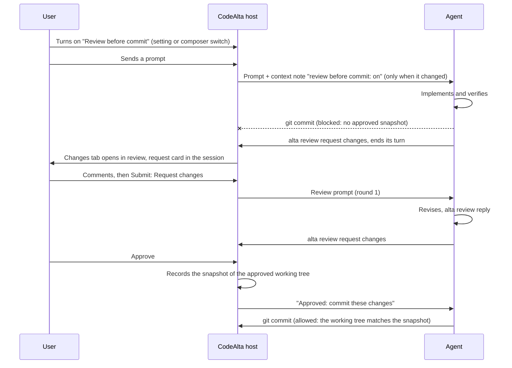

# Review and annotate plans and changes before the agent goes on

Today the user can comment single lines of one file, only when an agent asks (`alta ask` with a `file`). They cannot comment on a diff, select a range, see all their comments at once, or ask an agent to wait for their review before it commits. The comments are lost if the app restarts.

When this work is done, review is a core part of CodeAlta:

- **Annotate anything an agent produced.** The user can comment on a plan or any Markdown file in its rendered view, on any text file, and on the uncommitted changes of the project folder or a worktree. A comment can cover a block, a line or a range, and can propose replacement text. Comments are kept until they are resolved and follow their text when the file changes.
- **One review, one verdict.** Comments stay drafts until the user submits the review as **Approve**, **Request changes** or **Comment**. The agent receives one structured prompt and answers each comment by its id. Its answers show up under the comments.
- **The agent can ask.** `alta review request changes` or `alta review request file <path>` opens the review for the user and gives the result back to the agent as its next prompt. `alta review` owns reviews and `alta ask` only asks questions; a review request can carry questions, so one panel collects both.
- **Review before commit.** A setting, and a switch in the composer that can be turned on mid-session, make the agent request a review instead of committing. The commit is also blocked by CodeAlta where it can see the command. Turning the switch on or off never changes the system prompt.

## What changes

### One model: reviews, threads and rounds

Everything the user reviews is a **review target** of one checkout (the project folder or a worktree):

| Target | What is shown | Unit of a comment |
| --- | --- | --- |
| `changes` | The **Changes** tab, **Uncommitted changes** scope: the diff of the checkout against `HEAD`, with untracked files | A line or range of one side (`old` = `HEAD`, `new` = working tree), or the whole file |
| `branch` | The **Changes** tab, **Since base** scope: the commits of a worktree branch (or any branch ahead of its base) | A line or range of one side, as for `changes` |
| `file:<path>` | A Markdown file (plans included) rendered, or any text file in the editor | A rendered block or a range of blocks; a line or range in the source view; or the whole file |

A **thread** is a comment with its replies. A **round** is one submission of a review: its verdict, an optional overall comment, the threads it sent, the session it went to and, for `changes`, a snapshot of the working tree.

A thread moves through these states:

```text
draft ──submit──▶ open ──agent replies──▶ addressed ──user resolves──▶ resolved
  ▲                 ▲                         │                           │
  └ edit / delete   └──── user replies ───────┘           user reopens ───┘
```

- **Only the user resolves.** The agent replies and marks a thread `addressed`. **Resolve all addressed** in the review bar, and an **Approve** verdict, close the addressed threads in one click, so the extra step costs nothing.
- **Anchoring.** A thread stores its file, side, line range and the text of those lines (its anchor). Each time the host reads the review, it looks for the anchor again. It keeps the lines when the text is still there, moves the thread to the nearest match when the text moved, and marks the thread **outdated** when the text is gone. An outdated thread still shows, in a separate list, with the text it was about. It is sent again until resolved.
- **Suggestions.** In the comment editor, **Suggest** inserts the selected lines in a `suggestion` block that the user edits. For a rendered plan block, **Suggest edit** and **Delete block** are one-click shortcuts that create the same kind of suggestion. The agent receives the exact replacement text.

```json
{
  "version": 1,
  "nextThread": 13,
  "threads": [{
    "id": "c12", "target": "changes", "path": "src/Shop/PriceService.cs",
    "side": "new", "startLine": 15, "endLine": 18,
    "anchor": "catch (Exception)\n{\n    return 0m;\n}",
    "body": "Don't swallow the exception: log it and rethrow.",
    "suggestion": null, "state": "addressed", "outdated": false,
    "replies": [{ "author": "agent", "sessionId": "01a1…", "body": "Logs and rethrows now.", "at": "2026-10-20T09:12:00Z" }],
    "round": "r3", "createdAt": "2026-10-20T09:00:00Z"
  }],
  "rounds": [{ "id": "r3", "target": "changes", "verdict": "changes_requested", "overall": "Good direction.", "sessionId": "01a1…", "snapshot": "4f2a9c1…", "at": "2026-10-20T09:05:00Z" }],
  "viewed": { "src/Shop/PriceService.cs": "<file revision>" },
  "requests": [{ "id": "q7", "sessionId": "01a1…", "target": "changes", "title": "Price cache" }]
}
```

The store is `ReviewService` in `src/CodeAlta.Catalog/Reviews/`. It keeps one JSON file per checkout in the CodeAlta state folder, `<state root>/reviews/<project id>/<checkout key>.json`. The file is never inside the checkout: a file there would show up in the very diff under review, and an agent's `git add -A` would commit it. - **Where.** The state root is `~/.alta`, and `~/.alta/dev` for the developer instance, so the two instances keep separate reviews, as they keep separate sessions. The folder is a path property of `CatalogOptions`, so tests can override it.
- **Writes** are atomic (a temporary file, then a move). One lock per file serializes the writers of the process. The service reloads the file when its time stamp changes, so the window and `alta` callers see the same state.
- **Newer or broken files.** A file of a newer version, or a malformed one, is never overwritten. Its review shows read-only, with a message that says why.
- **Limits.**
  - 500 threads per checkout;
  - 16 KiB per comment or suggestion;
  - 50 replies per thread.

  Paths are checked like every project path: relative, no `..`, inside the checkout.
- **Storage.** The **Storage** page lists `reviews/` as a category of its own.
  - A store whose checkout is missing, such as a removed worktree or an unplugged drive, is marked orphaned. It is never deleted by itself: the user deletes it there.
  - Deleting a project deletes its reviews.

### Annotating in the window

**The Changes tab becomes the review surface for `changes`.** The tab keeps its file tree, its one-file and all-files views and its scopes. In the **Uncommitted changes** scope it adds four things:

1. A **+** in the glyph margin of both sides of the diff. A click comments on a line. A drag, or a click and then a Shift-click, comments on a range. `c` comments on the line of the cursor.
2. Threads drawn under their last line, in Monaco view zones.
3. A **review bar** at the top of the tab.
4. A **Comments** tab beside **Files** in the side list, with every thread of the review.

```text
┌ Changes · CodeAlta ───────────────────────────────────────────────────────────────────┐
│ Review · Price cache · round 2   4 comments · 3/7 files viewed   [Resolve addressed]  │
│                                                              [Submit review ▾]        │
├────────────────────────┬──────────────────────────────────────────────────────────────┤
│ Files   Comments 4     │ src/Shop/PriceService.cs  modified +14 −3          ☑ Viewed  │
│ ▾ src/Shop             │  14   + try                                                  │
│   M PriceService.cs 2  │  15 ▌ + catch (Exception)                                    │
│   A PriceCache.cs   1  │  18 ▌ + }                                                    │
│ ▾ tests                │  ┌ You · lines 15–18 · draft ─────────────── Edit · Delete ┐ │
│   M PriceTests.cs      │  │ Don't swallow the exception: log it and rethrow.        │ │
│                        │  └─────────────────────────────────────────────────────────┘ │
└────────────────────────┴──────────────────────────────────────────────────────────────┘
```

```text
Comments 4                         Open ▾
▾ src/Shop/PriceService.cs
  ● L5      Use ConcurrentDictionary        draft
  ● L15–18  Don't swallow the exception     draft
▾ src/Shop/PriceCache.cs
  ✓ L22     Name the constant               addressed · "Renamed to MaxEntries"
⚠ Outdated 1
  ● L40 old Keep this comment               open
```

- **The Comments tab** groups threads by file. It can filter by state (open, addressed, resolved, outdated). A click reveals the thread: it selects the file, scrolls the diff, and unfolds a hidden unchanged region when needed. `n` and `p` move to the next and previous thread across files.
- **File rows** show the number of open threads.
- **Viewed.** The **Viewed** check of a file records its revision. It clears itself when the agent changes the file again, so "3/7 files viewed" stays true.
- **Inline diff.** Below 780 px, or when side-by-side is off, the diff is inline. New-side lines still take comments there. Threads on deleted lines are listed in the Comments tab, with **Show side by side**.
- **Refresh.** The diff refreshes as it does today. Drafts survive because they live in the store, not in the editor, and are re-anchored on each read.

**Markdown files and plans are annotated in their rendered view.** The renderer gives each block its source lines. This covers headings, paragraphs, list items, table rows, code blocks, quotes and front matter. Hovering a block shows a **+** in a gutter on its left. A click comments on the block, and a Shift-click extends the comment to a range of blocks. Commented blocks get a colored bar. Their threads show after the block. The source view (Monaco) takes line comments like the diff, and both views show the same threads. This comment layer is turned on in three places:

- the review panel of an agent's request (below);
- the code editor's **Preview** and source views, for any Markdown file;
- the plan details of **Work items**, for a plan that is not done.

Other text files take line comments in the code editor's source view.

```text
   │ ## Steps
 + │ - [ ] 1. Add the store under src/CodeAlta.Catalog/Reviews     ← hover: + in the gutter
 ▌ │ - [ ] 2. Add `alta review`
   │ ┌ You · step 2 · draft ───────────────── Suggest edit · Delete block ┐
   │ │ Also add `alta review status`, so the agent can check the switch.  │
   │ └────────────────────────────────────────────────────────────────────┘
```

**Submitting.** **Submit review ▾** opens a small form:

```text
┌ Submit review ─────────────────────────────────────┐
│ Overall comment (optional)                         │
│ ┌────────────────────────────────────────────────┐ │
│ └────────────────────────────────────────────────┘ │
│ ( ) Approve            the agent goes on / commits │
│ (•) Request changes    the agent revises           │
│ ( ) Comment            the agent answers, no verdict│
│ To  Price cache (this session) ▾                   │
│                               [Submit 4 comments]  │
└────────────────────────────────────────────────────┘
```

- **Where it goes.** When an agent requested the review, it goes to that agent. Otherwise the user picks the session: the sessions that work in the checkout come first, then **New session**, which starts in Plan mode for a plan. The prompt is queued when the session is busy and never steers.
- **What the user sees afterwards.** The prompt shows in the timeline as a compact review card ("Changes requested · 4 comments · Open"), not as raw text.
- **Where drafts show.** The composer status of the session shows "Review · 2 draft comments" while drafts exist, with **Open**.

**Keys**, scoped to the review surfaces:

| Key | Action |
| --- | --- |
| `c` | Comment the line or block |
| `Ctrl+Enter` | Save the comment |
| `Esc` | Cancel |
| `n` / `p` | Next / previous thread |
| `]` / `[` | Next / previous file |
| `v` | Toggle viewed |

### What the agent receives

One prompt per submitted round. Files are in path order and threads in line order. Threads sent before and still open come last, with the agent's earlier reply:

````markdown
# Review of your changes: changes requested

Round 2 · 3 comments · snapshot `4f2a9c1`

Good direction. Keep the cache, fix the error path.

## src/Shop/PriceService.cs

### c12 · lines 15–18 (new)
```diff
+    catch (Exception)
+    {
+        return 0m;
+    }
```
Don't swallow the exception: log it and rethrow.

### c13 · line 5 (new) · suggestion
```suggestion
    private readonly ConcurrentDictionary<string, decimal> _cache = new();
```

## Still open from earlier rounds

### c4 · line 40 (old) · outdated
> Your earlier reply: Removed because the retry is gone.

Keep this comment.

---
Address each comment, then answer them in one call: `alta review reply --stdin`. Do not commit before a review approves the changes.
````

- **Header.** For a Markdown file it says "Review of `<path>`", and a heading block anchors each thread.
- **Verdict.**
  - **Approve** says what may happen next: commit the approved changes, or carry out the approved plan.
  - **Comment** asks for answers without a verdict.
- **Size.** The prompt is capped at 32 KB. When it would be larger, the snippets are shortened first, then the comments past the cap are listed by id. The agent reads them in full with `alta review list`.

### `alta review` for reviews, `alta ask` for questions

Each need has exactly one command:

| The agent needs | Command | What the user gets |
| --- | --- | --- |
| Answers to questions | `alta ask --stdin` | The questions panel (unchanged) |
| A review of a file or of the changes | `alta review request file <path>` / `changes` | The review surface with a verdict |
| A review plus answers (a plan with open decisions) | `alta review request file <path> --stdin` with `questions` | One panel: the review and the questions, submitted together |

`alta ask` loses its `file` field and only asks questions. A payload that still has `file` is refused with `ask.fileMoved`, which names the replacement (`alta review request file <path>`), so an agent with an old habit corrects itself in one call. The questions schema is shared: `alta review request` accepts the same `questions` array, validated by the same code, and the answer to both arrives in one prompt. Under the hood both commands put one pending request on the session's existing ask queue: a request has questions, a review target, or both.

The `review` group lives in `src/CodeAlta.LiveTool/BuiltInAltaCommandContributor.Reviews.cs`. It is registered when the host has a `ReviewService`, on the work-items pattern.

```text
alta review request changes [--title <t>] [--stdin]
alta review request file <path> [--title <t>] [--stdin]
alta review status
alta review list [--all] [--file <path>]
alta review reply --stdin
```

- **`request`** opens the review for the user and returns at once:

  ```json
  {"type":"alta.review.queued","requestId":"q7","target":"changes","files":7,"openThreads":0,
   "shouldYield":true,"recommendedAction":"stop","nextStep":"End your turn; the review comes back as your next prompt."}
  ```

  - The optional stdin takes `{ "message": "…", "questions": [ … ] }`, the questions in the schema of `alta ask`, for example the open decisions of a plan.
  - It reuses the ask queue, the `AskPanel` and the delivery of the answer as a prompt, with the same rule: one request per run, from a run of the window. An agent that needs a review and answers makes one `alta review request` with questions, not an ask and a review.
  - **Queue changes:**
    - A request may have zero questions when it has a target. Both validators change: `AltaAskValidator`, and `OwnedSessionAskTool.Restrict` with its page mirror in `sessionAsks.ts`.
    - The answer action carries the round, and the text the agent receives is composed by `ReviewPromptComposer`, not the line-comment formatter of asks, which fits neither verdicts nor suggestions.
    - Settled asks are pruned. Today the service keeps every ask of the app's life and refuses all asks after 256.
  - **Sessions without the full `alta` tool.** The restricted per-send tool (`OwnedSessionAskTool`) stays questions-only: it is deliberately free of services, and it never accepted a file to review, so nothing is lost. *(Deviation found while implementing: the plan first proposed to extend it.)*
  - **Two parts, two jobs.** The queue only carries the request while it is pending. The review itself (threads, rounds, the request record) lives in the review store. If the app restarts before the user answers, the review is still waiting in the Changes tab or the file, and submitting it sends the round to the session as a normal queued prompt.
  - `alta.review.nothingToReview` is returned for `changes` when the checkout has no change.
- **`status`** is the agent's way to know the state without any prompt change:

  ```json
  {"type":"alta.review.status","beforeCommit":true,"source":"session","pendingRequest":null,
   "openThreads":2,"lastVerdict":"changes_requested","approvedSnapshotMatches":false}
  ```

- **`reply`** answers threads in one call: `[{ "id": "c12", "reply": "Logs and rethrows now." }]`. A reply marks the thread `addressed`; `"addressed": false` answers a question without claiming a fix.
- **`list`** gives the threads of the caller's checkout, re-anchored, with their snippets.
- **Scope.** Every command works on the caller's checkout: its worktree when it has one, else the project folder.

**How the request shows.** For a `file:` target, the existing ask panel takes the place of the timeline, as plan reviews do today. It now has the rendered view with block comments, the review bar and the questions. For `changes`, the ask panel shows a compact card, "Review requested · 7 files · Open review", and the Changes tab opens on the session's checkout, bound to the request. Submitting in either place answers the request.

**The TUI keeps working, without new UI.** Its plan mode reviewed plans through `alta ask` with a file. It now receives `alta review request file` instead and shows it with its existing file view (`AskFileReviewView`, line comments). It adds the verdict as one more choice question (Approve / Request changes / Comment), and its line comments become threads of the same store. A `changes` request from a TUI session is refused with `review.unavailable`, since the TUI has no diff surface.

### Review before commit, without touching the system prompt



The behavior comes from three layers. None of them changes the system prompt.

1. **Stable guidance.** A new section, *Review by the user*, goes in `content/prompts/agents/default.prompt.md`. It is the same text whether the switch is on or off:

   ```markdown
   ## Review by the user
   - When a CodeAlta context note says that the user reviews changes before commit, never commit by yourself:
     when the work is done and verified, run `alta review request changes` and end your turn.
     Commit after a review approves the changes, and only what it approved; changes made after an approval need a new review.
   - When you receive a review, address every comment, then answer them all with one `alta review reply --stdin`.
   - `alta review status` tells you at any time whether review is required and what is pending.
   - As a sub-agent, never request a review: leave changes uncommitted and report them to your parent.
   ```

   The existing commit bullet ("requests review or approval before committing") points to this section. `plan.prompt.md` asks for plan approval with `alta review request file <plan> --stdin` instead of `alta ask` with a file. These are one-time text changes: they cost one cache miss on release, not one per toggle. A user who replaced the built-in Default prompt with a copy of their own does not get the section. The note, `alta review status` and the gate still work for them, and the docs say how to add the section.

2. **A context note on the user's message.** The host adds a short note to the prompt it sends. It does this only when the effective state differs from what this session was last told, and again after a compaction:

   ```text
   <codealta-context>Review before commit: on. Do not commit; request a review with `alta review request changes` when the work is done.</codealta-context>
   ```

   - **A new input kind.** The note is an `AgentInputItem` of a new kind, `HostContext`. The provider receives it as text, inside the user message, so the cached prefix is unchanged. `AgentSession.RenderUserInput` keeps it out of the user's own text. The journal records it as a tagged part of the message, the timeline shows it as a small chip ("Review before commit: on"), and the search index skips it. A plain text item would not work: it would be saved and shown as words the user typed.
   - **Where it is added.** In one place every owned run goes through: `SessionRuntimeService.SendOwnedBodyAsync`, at the start of the run. Window sends, queued prompts, `alta session send`, reminders and automations all get it. A note computed when the run starts cannot be stale for a prompt that waited in the queue.
   - **What was last told** is kept in the session's local state, so a resumed session is not told twice.
   - **A switch flipped during a run** sends nothing into the run: the commit gate (below) reads the switch at each command and its refusal text says what to do. The note goes with the next prompt.

3. **A commit gate.** While review is required, CodeAlta refuses a command that runs `git commit` unless the current working tree matches the snapshot of the last approved round. The refusal text tells the agent what to do: *"The user reviews changes before commit: run `alta review request changes` and end your turn."*
   - **The snapshot.** A new `GitSnapshot` class in `src/CodeAlta.Catalog/Reviews/` writes a git tree of the working tree:
     - it copies the checkout's index (`git rev-parse --git-path index`) to a temporary file;
     - it runs `git add -A` and `git write-tree` with `GIT_INDEX_FILE` set to that file;
     - it runs under a timeout and deletes the file in `finally`.

     `GitWorktreeService.RunGitAsync` removes `GIT_INDEX_FILE` from the environment, so this needs a runner that accepts environment variables. The real index, the working tree and the refs are untouched. Git does write loose objects into the repository, which its garbage collection removes later.
   - **Several commits.** The agent can still split the approved work into several commits, since committing does not change the working tree. Any edit after the approval requires a new review.
   - **One guard, read at each command.** A `CommandGuard` delegate, modelled on the existing `AgentWriteGuard`, is passed to the agent tools. It reads the session's switch and the approved snapshot each time it is called, so turning the switch on mid-session needs no reattach. It returns a refusal text or nothing.
   - **Where the gate applies:**
     - the in-process shell tool (`AgentBuiltInToolFactory.ShellCommandAsync`), which every in-process command goes through before any permission handler, whatever the permission mode;
     - Claude Code, through a third `PreToolUse` hook entry with the matcher `Bash|PowerShell`, which calls the same guard. The CLI runs `PreToolUse` hooks before its permission check, bypass included; a live test proves it. The gate also covers the commands of Claude Code's own sub-agents.
   - **Where it does not.** Providers that run their own shell without asking CodeAlta (the Codex CLI app server, ACP agents) get layers 1 and 2 only.
   - **What it is.** The gate matches `git … commit` in the command text, in the session's checkout, so it is a guardrail, not a sandbox.

**The setting and the switch.**

- **Setting.** `[review] before_commit = true|false` in `config.toml` (default `false`). It is shown under **Settings → Sessions** as *Review changes before commit*.
- **Switch.** Each session has a switch in the composer's selection row. The session's own value is kept in `SessionViewLocalState.ReviewBeforeCommit`; when it has none, the setting applies.
  - **Mid-session.** It can be turned on while changes are already on disk: those changes are reviewed with the rest at the next request.
  - **Before the first prompt.** A new session's draft composer has it too.
  - **Children.** A child session takes the effective value of its parent when it is created.

```text
[ Default ▾ ] [ Opus 5.5 ▾ ] [ Ask first ▾ ] [ ◉ Review before commit ]   ⋯
 Review · 2 draft comments · Open        ← composer status, only when there is something
```

The switch's tooltip says where the value comes from ("On, from Settings" / "On for this session"). The composer status also says "Changes waiting for your review" when review is on, a turn ended with uncommitted changes, and no request is pending, so the user can open the review by themselves.

### Reviews in Work items: every review in flight

The **Work items** tab lists the reviews in flight beside the tasks and the plans: one place for what waits for the user or for an agent, in the projects of the space the window shows, with no new tab and no new icon.

```text
┌ Work items ───────────────── [ All | Tasks | Plans | Reviews ] ─────────────────────┐
│ Waiting for you 3 · Waiting for the agent 2 · Done                                  │
│ ▾ CodeAlta                                          │ Changes · worktree alta/fiery  │
│   👁 Changes · worktree alta/fiery   requested · 12m │ Requested by "Price cache"     │
│   👁 .alta/plans/2026-10-20-x.md     2 drafts        │ 7 files · 3 open · 1 addressed │
│   ◆ Plan: Price cache               approved         │ Last: changes requested, 1 h   │
│ ▾ Tomlyn                                            │ [Open review] [Resolve addr.]  │
│   👁 Changes · project folder        approved · 2h   │                                │
│ ⚠ 1 review of a worktree that is gone                │ [Delete]                       │
└─────────────────────────────────────────────────────────────────────────────────────┘
```

- **Kind.** The kind selector gets **Reviews**. A row is a review target of a checkout: the uncommitted changes or the branch of a checkout, or a file such as a plan.
- **Stage.** The stage tabs count it: **waiting for you** (a request, addressed threads to resolve, drafts not submitted), **waiting for the agent** (threads sent and not answered), **done**.
- **Plans.** A plan with a review in flight shows a review badge on its own row.
- **Detail.** The detail pane shows the request and its session, the counts, the last verdict and when it was given. **Open review** opens the review where it lives: the Changes tab on that checkout, or the file in the review panel or the editor. **Resolve addressed** is there too.
- **Orphaned stores.** Reviews of a checkout that is gone are listed with **Delete**.
- **Opening it.** The composer's "Review · N" chip and the review bar (**All reviews**) open Work items on **Reviews**.
- **Data.** It reads `reviews.overview` (the reviews of the projects of a space, bounded) and follows the existing `reviews.watch`.

### Desktop plumbing

- **RPC.** A new `reviews` service in `src/CodeAlta/Desktop/Rpc/ReviewsRpc.cs`:
  - Calls: `list`, `addThread`, `updateThread`, `deleteThread`, `resolve`, `reply`, `setViewed`, `submit`, `counts`, and one `watch` channel.
  - Every call carries the epoch, the project id and the checkout, and gets a bounded answer, on the `WorkItemsRpc` pattern.
  - The page's channel budget is counted with a test before the channel is added.
- **Frontend.** The shared parts live in `frontend/src/review/`:
  - the thread logic (pure, unit tested);
  - the Monaco comment layer (glyph **+**, ranges, view zones that follow the active model);
  - the thread card;
  - the Markdown block layer;
  - the review bar, the submit form and the Comments tab.

  `AskFileReview.tsx` moves onto these parts.
- **Markdown source lines.** `markdown.ts` writes the source lines (`token.map`) of each block as a renderer-owned attribute. `markdownBoundary.ts` keeps only the attributes the renderer wrote, so raw HTML in a document cannot fake a range.

## Steps

The work lands as four milestones. Each one is useful on its own and passes the full build and tests.

**M1: Reviews of files (plans, Markdown, text)**

- [x] 1. Add the review store: `src/CodeAlta.Catalog/Reviews/` (`ReviewThread`, `ReviewRound`, `ReviewRequest`, `ReviewFiles` with its source-generated JSON context, `ReviewAnchoring`, `ReviewPromptComposer`, `ReviewService` with a `Changed` event). Tests in `CodeAlta.Catalog.Tests` cover:
  - create, edit and delete threads; ids;
  - the state rules (only the user resolves; a user reply clears `addressed`);
  - anchoring (moved, gone, back, nearest of two matches);
  - suggestions; prompt text for each verdict, the cap, outdated threads;
  - atomic writes, a malformed or unknown-version file left unwritten and read-only, and two writers;
  - the limits and path checks;
  - the store kept under the state root, outside the checkout, and the store of a missing checkout marked orphaned, not deleted.

  Add the `reviews` category to `ProfileStorageScanner` and the Storage page, and delete a project's reviews with the project.
- [x] 2. Split ask and review in the contracts and `alta`:
  - in `AltaAskContracts.cs`, move the file out of the ask request into a review target of the pending request, so a request has questions, a target, or both; share the questions validation;
  - remove `file` from `alta ask` (`HandleAskAsync`, `AskPayloadSchema`, help text): a payload with `file` gets `ask.fileMoved`;
  - add `alta review request file|status|list|reply` in `BuiltInAltaCommandContributor.Reviews.cs`, with policies and help text, on the same queue (`OwnedSessionAskTool`, `OwnedSessionAskService`);
  - accept zero questions when a target is set, in `AltaAskValidator`, `OwnedSessionAskTool.Restrict` and `sessionAsks.ts`;
  - let the answer action carry a review round, composed by `ReviewPromptComposer` together with the answers into one prompt;
  - prune settled asks and actions in `OwnedSessionAskService`, so the 256 limit counts pending requests only;
  - register the service in `DesktopAltaTools` and in the TUI composition (`CodeAltaFrontendComposition.cs`), and move the TUI's plan review (`AskModeCoordinator`, `AskFileReviewView`) onto file review requests, with the verdict as a choice question. A `changes` request is refused there.

  Tests:
  - `AltaLiveToolTests.cs`, `OwnedSessionAskServiceTests.cs` (pruning included), `AltaAskQueueTests`, `AltaAskResponseTests`;
  - the TUI's `AskResponsePresentationPolicyTests` and its ask view tests;
  - `sessionAsks.test.ts`.
- [x] 3. Add the `reviews` RPC with its stub, its `DesktopJsonContext` entries, the regenerated contract and its demo fake. The budget of 35 page channels is only written in `doc/development-guide.md`: count the channels a page opens today, and add a test that fails when a page opens more than the budget, before adding `reviews.watch`. Tests in `CodeAlta.Desktop.Tests` cover the RPC and `alta` on one store, `watch` on an agent reply, and a stale epoch.
- [x] 4. Before changing the shared comment code, add `review/lineComments.browser.test.ts`, which covers today's `AskFileReview` behavior. Then build `frontend/src/review/`:
  - `reviewThreads.ts` (pure logic, with tests);
  - `useLineCommentLayer.tsx` (glyph **+**, ranges, view zones, keys);
  - `ReviewThreadCard.tsx` (Markdown body, replies, suggestion as a mini diff, state chip, actions);
  - `ReviewBar.tsx`, `SubmitReviewForm.tsx`, `ReviewCommentsList.tsx`.

  *(Done: `FileReview.tsx` replaced `AskFileReview.tsx` directly, without a test of the old one first; the new browser tests cover the layers.)* Move `AskFileReview.tsx` onto them. Thread cards are focusable and labeled for screen readers ("Comment on lines 15 to 18 of PriceService.cs"), and `Esc` gives the focus back to the line. Every step that adds text adds it in the six languages of `localization.ts`, and host-side text in `SR.yml`.
- [x] 5. Add source lines to the Markdown renderer (`markdown.ts`, `markdownBoundary.ts`, `MarkdownContent.tsx`, behind an option that leaves other renders unchanged). Add `review/useMarkdownBlockComments.tsx`, with the hover **+**, block ranges, **Suggest edit** and **Delete block**. Tests: `markdown.test.ts` for every kind of block, front matter, CRLF and BOM; a browser test where raw HTML cannot fake a range and cards stay after a re-render.
- [x] 6. Turn the comment layers on in the ask panel (file review requests, with their questions under the file), in the code editor's Preview and source views, and in Work items plan details for plans that are not done. Adding is disabled while the editor has unsaved edits. Add the submit flow with its session picker (target session, sessions of the checkout, **New session** in Plan mode for a plan), the review card in the timeline, and the "Review · N draft comments" composer status.
- [x] 7. Update `plan.prompt.md` to request plan reviews with `alta review request file <plan> --stdin`, and add the *Review by the user* section to `default.prompt.md`.

**M2: Reviews of changes**

- [x] 8. Spike in a browser test, before relying on them: view zones on one side of the Monaco diff keep the two sides aligned; a zone inside a hidden unchanged region shows once the region is revealed; inline mode reports new-side lines. Write the results into `doc/review.md`.
- [x] 9. Extend `monaco/DiffEditor.tsx` (opt-in glyph margin, access to both editors, inline detection, `reveal(side, line)` that unfolds) and `CodeEditor.tsx` (for added or deleted files).
- [x] 10. Add the review mode of `changes/ProjectChangesPanel.tsx` and `changes/AllChanges.tsx`:
  - the review bar, the Comments tab, counts on file rows, the **Viewed** check;
  - zones rebuilt when a section mounts;
  - section height estimates that include the threads;
  - the `n`/`p`/`]`/`[`/`v` keys.

  Also add the **Review changes** command and the **Review changes** entry of a session's menu, which open the session's checkout.
- [x] 11. Add `alta review request changes`: the request card in the ask panel, the Changes tab opened on the checkout and bound to the request, and `alta.review.nothingToReview`.

**M3: Review before commit**

- [x] 12. Add the `[review] before_commit` setting:
  - the config document class and the load and save methods in `CodeAltaConfigStore` (the default is omitted when saved), with a round-trip test;
  - the config recovery path, which must accept the new section;
  - the `GlobalConfigRpc` calls;
  - the switch in `SessionSettings.tsx`.
- [x] 13. Add the session value:
  - `ReviewBeforeCommit` (and the last state told to the agent) in `SessionViewLocalState`, its YAML field and its column in the SQLite session cache, kept on forks and branches;
  - a setter that runs on the session actor, on the `SetOwnedPermissionModeAsync` pattern;
  - `setReviewBeforeCommit` in the session RPC;
  - the composer switch in `OwnedSessionPanel.tsx` and in the draft composer of `main.tsx`;
  - inheritance by child sessions.
- [x] 14. Add the `HostContext` input kind and the context note:
  - `AgentInputItem.HostContext`, sent to providers as text, kept out of `AgentSession.RenderUserInput`, recorded as a tagged part of the journal's user message, skipped by the search index, and drawn as a chip by the timeline;
  - the note added in `SessionRuntimeService.SendOwnedBodyAsync` at the start of the run, only when the state changed and after a compaction.

  Tests:
  - the note is absent while nothing changed;
  - window sends, queued prompts and `alta session send` all get it;
  - the user's text in the journal does not contain it;
  - the system and developer instructions are byte-identical before and after a toggle.
- [x] 15. Add the approved snapshot and the commit gate:
  - `GitSnapshot` (copy of the index, `git add -A` and `git write-tree` with `GIT_INDEX_FILE`, timeout, temporary file removed), recorded on **Approve**;
  - `CommandGuard` on `AgentBuiltInToolOptions`, `AgentSessionCreateOptions` and `AgentTurnRequest`, modelled on `AgentWriteGuard`, checked in `AgentBuiltInToolFactory.ShellCommandAsync`;
  - the same guard passed to `ClaudeCodeSession`, behind a third `PreToolUse` hook entry with matcher `Bash|PowerShell`.

  Tests:
  - `git commit`, `git -C x commit` and `git commit -am` are refused while no snapshot matches, then allowed after an approval, in every permission mode;
  - an edit after the approval refuses again;
  - nothing is refused while review is off;
  - a snapshot leaves the index and the refs as they were;
  - a live Claude Code test, run only with `CODEALTA_TEST_CLAUDE_CLI`, shows the hook refusing under `bypassPermissions`.
- [x] 16. Add the "Changes waiting for your review" composer status, and fill `approvedSnapshotMatches` of `alta review status`.

**M4: Rounds and branches**

- [ ] ~~17. **Since last review** scope~~: postponed by the user, to exercise the normal review workflow first. The snapshots stay: the commit gate uses them.
- [x] 18. Add the `branch` target: comments in the Changes tab's **Since base** scope (the commits of a worktree branch, or of any branch ahead of its base), `alta review request branch`. Review before commit applies in worktrees too: commits on a worktree branch wait for an approved review like any other, unless the user turns the switch off for that session.

**M5: The Reviews page**

- [x] 19a. Add `ReviewService.Overview(project)` (per checkout and target: request, counts, last round, missing checkout) and `reviews.overview(spaceId)`, with tests.
- [x] 19b. Add **Reviews** to the Work items tab (`frontend/src/workItems/`): the kind, the stages, the rows and the detail pane, **Open review**, orphaned stores with **Delete**, a review badge on plans; open it from the composer chip and the review bar. Add tests and check both themes in the developer instance.

**Docs** (with each milestone)

- [x] 19. Write `doc/review.md`: the model, the store (separate per instance), anchoring, the prompt, the note, the gate and its limits. Update:
  - `doc/live-tool.md` (the `review` group, `alta ask` without `file`, `ask.fileMoved`);
  - `site/docs/prompts.md` (how a custom Default prompt adds the *Review by the user* section);
  - `doc/desktop.md` (Changes review, Markdown comments, the switch, keys);
  - `doc/catalog-and-config.md` (`[review]`);
  - `doc/development-guide.md` (comments go through `frontend/src/review/`; Markdown source lines are renderer-owned);
  - `site/docs/review.md` with `site/docs/menu.yml` (read `site/AGENTS.md` first), `site/docs/work-items.md`;
  - `readme.md`.

Deviations recorded during the work:
- A round is recorded before the session gets it (`ReviewService.RecordRound`), and undone (`RevertRound`) when the send fails: an agent that answers at once found its comments still drafts when the round was recorded after the send.
- The restricted per-send ask tool was not extended to reviews: a review request goes through the session's normal `alta`.
- Work items reviews open from the **Reviews** command and the eye of the review bar; the composer status opens the review itself.

## How it is verified

- [x] `dotnet build` and `dotnet test` pass in the configuration chosen by AGENTS.md "Debug or Release". `npm test` passes in `src/CodeAlta/frontend`. `lunet build` passes in `site/`.
  *Done 2026-10-20: Release; all .NET tests pass except `ClaudeCodeSessionTests.ToolCallsTheCliRunsAtTheSameTime_AreEachShownFromWhenTheyStart`, which times out under load on `main` too (1 of 12 runs there). `npm test` 1956/1956, `lunet build` clean.*
- [x] Without the window, run `alta review request file|changes`, `status`, `list` and `reply` from a session of the developer instance, in the project folder and in a worktree. Each checkout keeps its own threads.
  *Covered by `AltaLiveToolTests` and `ReviewHostTests` on one store per checkout; in the developer instance an agent answered a round in the `open-ocelot-jjgg` worktree with one `alta review reply`.*
- [x] In the developer instance, driven through `codealta-dev`, in both themes and in a 900×650 window:
  - comment a block, a range of blocks and a source line of a plan; submit **Request changes**; the agent's replies show under the threads; **Approve** resolves them;
  - comment new, deleted and range lines in the one-file and all-files views, and check the Comments tab, **Viewed**, `n`/`p`, an outdated thread after the agent rewrites its lines, and inline mode;
  - turn on **Review before commit** mid-session after edits; the agent's `git commit` is refused, the agent requests the review, approval lets it commit, a later edit is refused again;
  - restart the app with drafts and a pending request: the drafts are there and submitting still reaches the session.
  *Checked in the final build: a line comment and its draft count, **Comment** submitted to the worktree session, the agent's replies under the threads within seconds, **Resolve addressed**, the eye of the review bar opening Work items on Reviews, both themes, the composer status in a 496 px status line, and an unapproved `git commit` refused by the hook. Not rechecked in the window: plan block comments (covered by the Markdown and line comment browser tests), approval letting the agent commit (covered by `ReviewBeforeCommitRuntimeTests` and the live Claude Code test), and the restart with drafts (the store is a file; `ReviewServiceTests`).*
- [x] `alta ask` with a `file` returns `ask.fileMoved`. A plan review with open decisions is one `alta review request file … --stdin` and comes back as one prompt with the round and the answers.
- [x] The TUI builds and its tests pass. Its plan mode still reviews a plan (line comments and verdict), and `alta review list` works from a TUI session.
  *The TUI builds and its tests pass; its plan review was not run interactively.*

## Decisions

| Decision | Choice | Why |
| --- | --- | --- |
| Built-in or plugin | Built-in: Catalog service, `alta review`, desktop RPC, `frontend/src/review/` | It needs the Changes tab, the editor, the ask panel, the send path and the permission path |
| Who resolves | The user only; the agent marks threads addressed | One rule is easy to follow; **Resolve addressed** and **Approve** make it one click |
| Draft until submitted | Comments are drafts, sent together with a verdict | One prompt per round, and a clear signal to commit or revise |
| Where threads are stored | CodeAlta state folder, one file per checkout | A file in the checkout would show in the diff and be committed by `git add -A` |
| One command per need | `alta ask` asks questions only; `alta review request` reviews a file or the changes, with optional questions; `ask` with `file` is refused with `ask.fileMoved` | One way to do each thing; a plan review with open decisions stays one panel and one answer |
| How the agent waits | Both commands put one request on the existing ask queue, and the result is the next prompt | Reuses the proven queue and delivery; the store keeps drafts across restarts |
| How "review required" reaches the agent | Stable prompt text + a context note on the user message when the state changes + `alta review status` + a commit gate | The system prompt stays byte-identical, so the cache is kept |
| Strength of the gate | Refuse `git commit` until the working tree matches the approved snapshot, where CodeAlta sees commands | Lets the agent split commits after approval and catches edits made after it; providers with their own shell rely on the guidance |
| A switch flipped during a run | Nothing is steered into the run; the gate reads the switch at each command, the note goes with the next prompt | A steer is a visible user message and exists only for some providers |
| The note in the conversation | A new `HostContext` input kind, shown as a chip | A plain text item would be saved and shown as words the user typed |
| Setting scope | Global setting + per-session switch; children inherit | Covers "always" and "this time"; a per-project value can be added later |
| Inline diff | New-side comments inline; deleted-line threads in the Comments tab | Monaco gives deleted lines no model line in inline mode |
| TUI | `alta review` works; file reviews use its existing file view; no new UI; `changes` requests refused | New features are for the desktop, but its plan mode must keep working (AGENTS.md) |
| Rounds | **Since last review** is postponed | Exercise the normal review workflow first; rounds already record a snapshot, so it can be added without changing the model |
| Worktree branches | The `branch` target is in; review before commit applies in worktrees too | A branch with commits holds changes the user wants to review, unless they say otherwise |
| Agent walkthrough notes, comments on agent answers | Follow-ups | Not needed for the first version |

## Risks

- **Monaco view zones in the diff editor.** The alignment of the two sides with zones on one side, and zones inside hidden regions, are not verified yet. Step 8 checks them before steps 9–10 rely on them.
- **Refactoring the ask file review.** `AskFileReview.tsx` has no UI test today. Step 4 writes one first.
- **Line drift while the agent edits.** The diff refreshes every few seconds. Threads are re-anchored by text on the host at every read and never stored in Monaco decorations.
- **Shared project folder.** Without a worktree, the uncommitted diff also holds the user's edits and those of other sessions. The review bar names the checkout, and the docs recommend a worktree for parallel sessions.
- **A gate that misses a commit.** The gate is a guardrail and is documented as such; the guidance and the note are the main mechanism. It can be missed by:
  - aliases and scripts;
  - a `git -C` to another folder;
  - one command that edits and then commits;
  - a provider's own shell.

  The snapshot ignores ignored files, and it assumes the same line-ending settings on both sides.
- **Two sessions in one checkout.** They share its review. Submitting asks which session gets the round, and the snapshot is taken at the moment of the submit, so edits made while the user writes are not approved by mistake.
- **`alta ask` with `file` stops working.** User prompts, skills or plugins that use it break. `ask.fileMoved` names the replacement, the commit uses the `Breaking Change` prefix, and the release notes and `doc/live-tool.md` say it.
- **Asks are once per run and not persisted.** A pending request is lost on restart, but its drafts and the review are not. Submitting them still reaches the session as a normal prompt.

## Out of scope

- Comments on past commits, and on the per-turn file changes of the timeline.
- Region comments on images and screenshots.
- A **Since last review** scope of the Changes tab (the diff from the snapshot of the last round): postponed, see Decisions.
- Agent walkthrough notes on a diff (`alta review note`), and comments on paragraphs of an agent's answer: follow-ups.
- A per-project value of the setting.
- Any review UI in the TUI.
- Applying a suggestion from the window: the agent applies it.
- Telemetry or statistics about reviews.
- Sharing reviews between the normal and the developer instance.

<details><summary>Existing code this builds on</summary>

- **Ask file review:**
  - `alta ask` with `file`: `BuiltInAltaCommandContributor.HandleAskAsync`, `AltaAskContracts.cs` (`AltaAskFileReview`, `AltaAskAnswerMarkdownFormatter`), `OwnedSessionAskService.cs` and `OwnedSessionAltaAskService.cs` (once per run, in memory).
  - Frontend: `AskPanel.tsx`, `AskFileReview.tsx` and `askReview.ts` (one comment per line, Monaco view zones, `Ctrl+K`/`Ctrl+N`/`Ctrl+P`).
- **Changes tab:**
  - Frontend: `changes/ProjectChangesPanel.tsx` (scopes `head`/`branch`/`commit`, checkout, 5 s refresh), `changes/AllChanges.tsx` (sections mounted near the viewport), `monaco/DiffEditor.tsx` (`glyphMargin: false`, `hideUnchangedRegions`, inline below 780 px).
  - Host: `ProjectGitRpc.cs` (`changes`, `file` with both texts, 1 MiB per side).
- **System prompt:** `SystemPromptBuilder.Build` and `PreparedInstructions.Matches` rebuild the instructions only when the agent, model, folder or space changes. The title mode appends developer instructions on each run, which is why it is not the pattern for the switch. The plugin per-turn context (`PluginOrchestrationBridge.AppendAdditionalMessages`) is.
- **Session state and setting:** `SessionViewLocalState` (`permission_mode`, `title_mode`), `SetOwnedPermissionModeAsync`, `CodeAltaConfigStore` session settings, `GlobalConfigRpc`, `SessionSettings.tsx`, `PermissionModeSelect` in `OwnedSessionPanel.tsx`.
- **Commands:**
  - In-process `shell_command` goes through `AgentCommandPermissionRequest`.
  - Claude Code has `PreToolUse` hook callbacks (`ClaudeCodeSession.Host.cs`) that already deny with a reason in Plan mode.
- **Pattern for the service and RPC:** `WorkItemService`, `BuiltInAltaCommandContributor.WorkItems.cs`, `WorkItemsRpc.cs` (epoch, bounded answers, one-slot `watch`).

</details>
