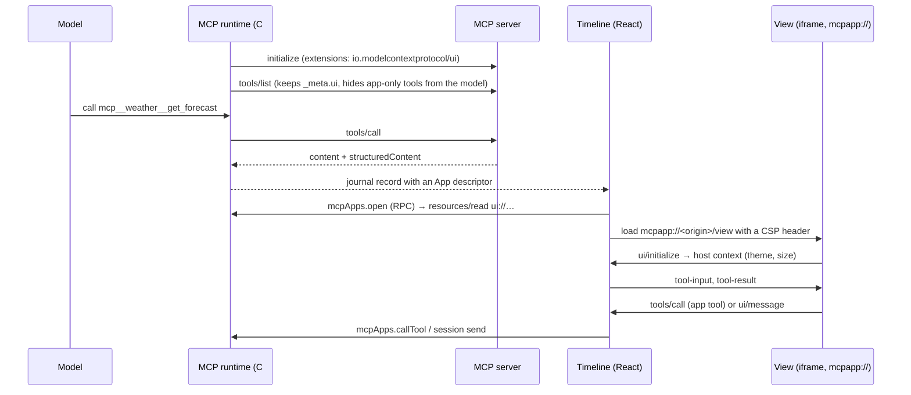

# Show MCP Apps in the timeline of CodeAlta Desktop

Today an MCP tool that ships an interactive view (a chart, a form, a dashboard) shows only its text in CodeAlta: the view is never fetched, and tools meant only for the view are even offered to the model. Once this is done, CodeAlta Desktop tells MCP servers that it can show views. A tool call that has one shows it under its row in the timeline, styled like the app, and the view can refresh itself through its server and send a message to the session. This implements issue #200 against the stable MCP Apps spec (2026-01-26).

## What changes

CodeAlta runs every MCP server itself, for every provider: the `codex` provider talks to the Codex endpoint directly, and Claude Code calls MCP tools through CodeAlta's in-process `codealta` server. So the work happens in one place, CodeAlta's MCP runtime (`src/CodeAlta.Plugin.Mcp`), plus a host for the view in the desktop frontend. The only MCP servers left out are the ones a user configures directly in the Claude Code CLI: CodeAlta never sees those results.



### 1. The MCP runtime advertises the extension and keeps what views need

In `McpRuntimeService.CreateClientOptions` (it returns `null` today), the desktop host advertises the extension. The TUI does not, and neither does Linux (see "Platforms"):

```csharp
new McpClientOptions
{
    Capabilities = new ClientCapabilities
    {
        Extensions = new Dictionary<string, object>
        {
            ["io.modelcontextprotocol/ui"] = new JsonObject { ["mimeTypes"] = new JsonArray("text/html;profile=mcp-app") },
        },
    },
}
```

`ConvertTool` reads `McpClientTool.ProtocolTool.Meta` into two new fields of `McpRuntimeTool`: `UiResourceUri` (from `_meta.ui.resourceUri`, then the deprecated flat `_meta["ui/resourceUri"]`) and `Visibility`. `McpCachedTool` and the cache file store them too, otherwise deferred tools (Anthropic API) lose them.

Visibility follows the spec. A tool whose `visibility` lacks `"model"` is left out of the tool list of the model, in `McpPlugin.OnBeforeAgentRunAsync` and `CreateCachedToolsAsync`, for every host. A call from a view is refused unless the tool is on the same server and its visibility has `"app"`.

Two runtime methods are added beside `CallToolAsync`. Both go through the same checks as a model call (space, `enabled`, `allowed_tools`, `disabled_tools`, timeouts):

```csharp
// McpPlugin (public, XML-documented: the desktop assembly calls it)
Task<McpAppResource> ReadAppResourceAsync(McpAppRequest request, string server, string uri, CancellationToken ct);
Task<McpRuntimeToolCallResult> CallToolForViewAsync(McpAppRequest request, string server, string tool, JsonElement arguments, CancellationToken ct);
```

`ReadAppResourceAsync` accepts only `ui://` URIs with the MIME type `text/html;profile=mcp-app`, caps the size (2 MB), and returns the HTML with its `_meta.ui`. It reads that metadata from the content item, falling back to the `resources/list` entry. The HTML is kept in memory per session and server, never in the journal.

### 2. The tool result carries an App descriptor into the journal

`AgentToolResult` gains an optional init-only property, so existing `new AgentToolResult(ok, items, error)` calls keep compiling:

```csharp
public sealed record AgentToolAppResult(
    string Server, string Tool, string ResourceUri,
    JsonElement? StructuredContent, JsonElement? Meta);

public AgentToolAppResult? App { get; init; }
```

`McpPlugin.InvokeDirectToolAsync` fills it when the tool has a `UiResourceUri`. `AgentSession.CreateToolResultDetails` already serialises the whole result, so the journal keeps it for all providers. The model still sees only `Items`. `HistoryToolProjection` adds an `app` marker to the row of the call, so the timeline knows a view exists without reading the record.

The `structuredContent` kept for the view is stored as the server sent it, not passed through `McpRedactor`, which would replace any property whose name contains `key` or `token`. It has its own cap of 1 MB. The text the model sees stays redacted as today.

### 3. The view is served on an origin of its own, with the CSP the server declared

The app page is `app://codealta`, and its RPC bridge trusts that origin. A view must never be on it. CodeAlta registers a second NeoAstra scheme, `mcpapp`, served by a new `DesktopMcpAppResources` provider. Each view is loaded from `mcpapp://<hash of session and server>/view/<token>`: an origin that is not in `BridgeOrigins`, so the RPC bridge ignores it, and that is cross-origin to the page.

```html
<iframe src="mcpapp://3f9c…/view/9b2e…"
        sandbox="allow-scripts allow-same-origin allow-forms"
        allow=""
        title="Weather forecast (weather)"></iframe>
```

The provider answers only tokens that `mcpApps.open` created, with a `Content-Security-Policy` header built from `_meta.ui.csp`. Without `csp`, the header is the spec's restrictive default:

```text
default-src 'none'; script-src 'self' 'unsafe-inline'; style-src 'self' 'unsafe-inline';
img-src 'self' data:; media-src 'self' data:; font-src 'self'; connect-src 'none';
frame-src 'none'; object-src 'none'; base-uri 'none'
```

Declared domains are added to their directives after dropping quotes, `;` and whitespace. `permissions` (camera, microphone, geolocation, clipboard) are not granted in this version. The app's own CSP in `neoastra.json` gains `frame-src mcpapp:`.

This needs two changes in NeoAstra (`C:\code\NeoAstra`), released before the CodeAlta work:

- A public `NeoResourceResponse` factory that takes response headers. Today only `FromBytes`, `FromFile` and `Empty` are public, and they take none.
- Proof that a frame on another origin cannot reach the RPC bridge. The transport bootstrap is injected into every frame (`AddScriptAsync(..., MainFrameOnly = false)`), and on Windows every web message is reported as coming from the main frame. The check by source URI should reject `mcpapp://`, but this is not verified. If it fails, the bootstrap becomes main-frame only.

### 4. The frontend hosts the view and speaks its protocol

A new feature folder, `src/CodeAlta/frontend/src/mcpApps/`, holds `McpAppFrame.tsx` and a small JSON-RPC bridge over `postMessage`. It is written in CodeAlta, not taken from `@modelcontextprotocol/ext-apps`, whose `AppBridge` brings the MCP TypeScript client and zod while the MCP connection lives in C#. A message is accepted only when `event.source` is the frame's own window.

| Message | What CodeAlta does |
| --- | --- |
| `ui/initialize` | Answers with host info, capabilities and context; after `initialized`, sends `tool-input`, then `tool-result` |
| `tools/call` | `mcpApps.callTool`: same server, `"app"` visibility only |
| `resources/read` | `mcpApps.readResource`: same server only |
| `ui/message` | Sends the text to the session as a user message, queued if a run is busy |
| `ui/open-link` | The existing safe link opener (system browser) |
| `ui/request-display-mode` | `inline` or `fullscreen`; `pip` is refused with the current mode |
| `ui/notifications/size-changed` | Sets the frame's height, up to 600 px inline |
| `notifications/message`, `ping` | Logged; answered |
| `ui/update-model-context` | Refused: not in the host capabilities of this version |

The host context gives `theme`, the CSS variables of the spec resolved from CodeAlta's theme (`--panel` → `--color-background-primary`, `--text` → `--color-text-primary`, `--code-font` → `--font-mono`, …), `displayMode`, `containerDimensions` (fixed width of the timeline column, `maxHeight` 600), `locale`, `timeZone` and `platform: "desktop"`. A change of theme or color scheme sends `ui/notifications/host-context-changed`.

The view mounts under the row of its tool call, in the slot plugin cards use (`.timeline-inline-preview` in `TimelineMessage.tsx`):

- A call that completes while the window is open shows its view once the row becomes visible.
- A call from history, or after a restart, shows a **Show view** button: opening it starts the MCP server again, so it is not done just by scrolling.
- At most four views are live per window. Past that, the oldest gets `ui/resource-teardown` and goes back to its button.
- `fullscreen` opens the view in a large `AppWindowSurface` window over the session; closing that window returns it to `inline`.
- Views have a thin border with the server's name, so a view cannot pass for CodeAlta's own interface. `prefersBorder: false` removes only the background.

### 5. A desktop RPC service connects the frame to the runtime

`McpAppsRpc` (`[NeoRpcService("mcpApps", Version = 1)]`) in `src/CodeAlta/Desktop/Rpc`, registered beside `mcpServers`, follows the epoch and bounded-input conventions:

```csharp
Task<McpAppOpenResult> OpenAsync(string expectedEpoch, string sessionId, string offset, string? outputOffset);
// → { status, frameUrl, toolInput, toolResult, tool, prefersBorder }
Task<McpAppCallResult> CallToolAsync(string expectedEpoch, string viewToken, string tool, string argumentsJson);
Task<McpAppReadResult> ReadResourceAsync(string expectedEpoch, string viewToken, string uri);
void Close(string viewToken);
```

The `viewToken` names one open view: it binds the session, the project, the space and the server, so a view cannot name another server. Every call made by a view is written to the application log with its server, tool and duration. Views do not add timeline entries.

### Platforms

The extension is advertised only where the frame can be isolated from the bridge. With NeoAstra 1.9.0 that is Windows, macOS and Linux (the work found and NeoAstra fixed frames reaching the bridge under `TrustEntireView` on Linux). The TUI never advertises it, but it applies the visibility filter.

## Steps

- [x] 1. NeoAstra: add a public `NeoResourceResponse` factory with headers, with a test that the header reaches the page. (Done by a session of the NeoAstra project: `FromBytes(bytes, mimeType, headers)`, and `NeoCustomScheme.Create(name, provider)` for a scheme that is not the application.)
- [x] 2. NeoAstra: spike on Windows and macOS. A page on `app://` frames a sandboxed page on a second custom scheme. That page calls `chrome.webview.postMessage` (and the macOS equivalent) and tries `window.top`; assert that the bridge ignores the message. Make the bootstrap main-frame only if it does not. Release NeoAstra and bump `NeoAstra` in `src/Directory.Packages.props`. (NeoAstra 1.9.0. Windows was safe; on Linux every frame reached the bridge, now fixed; macOS now refuses any message not of the top-level page. Verified on Windows locally, on Linux in WSL and CI, on macOS in CI.)
- [x] 3. Test server: `CodeAlta.Tests.TinyMcpServer` gains `MCP_TEST_UI_TOOLS=1`: a `ui://tiny/view` resource, a model tool and an app-only tool that point at it, and a log of the client capabilities it received. (Also `MCP_TEST_UI_HOSTILE=1`, a view that tries what a view must not do; `TinyMcpView.cs`.)
- [x] 4. Runtime: advertise the extension behind a host flag set by CodeAlta Desktop on Windows and macOS; read `_meta.ui` into `McpRuntimeTool` and `McpCachedTool`; tests in `McpRuntimeServiceTests` and `McpConfigCacheTests`. (The flag is `McpPluginOptions.ShowsApps`, carried by `McpSessionConnections` to every runtime the plugin, its commands and its management service create; a list made with the extension has its own cache variant. Tests in `McpAppsTests.cs`.)
- [x] 5. Visibility: filter app-only tools out of `OnBeforeAgentRunAsync` and `CreateCachedToolsAsync`; tests with the tiny server, including deferred tools. (Filtered in the runtime: search, direct and session listings, cached tools, and a model call is refused with `tool_app_only`.)
- [x] 6. Result: add `AgentToolResult.App` and fill it in `InvokeDirectToolAsync` with unredacted, capped `structuredContent` and `_meta`; tests that the journal keeps it and the model text does not change, for a direct provider and for Claude Code. (Kept on the completed activity record only, not on the tool message nor the output record. Claude Code runs its calls through the same `AgentSession.RunToolCallAsync`, `ClaudeCodeSession.Host.cs:317`.)
- [x] 7. Runtime: `ReadAppResourceAsync` and `CallToolForViewAsync` with the `ui://`, MIME, size, same-server and `"app"` checks; tests for each refusal. (Public on `McpPlugin`: `OpenAppViewAsync`, `CallAppToolAsync`, `ReadAppResourceAsync`, on the session's connections through `McpSessionConnections.UseForViewAsync`.)
- [ ] 8. Desktop: `DesktopMcpAppResources` on the `mcpapp` scheme, CSP builder (unit-tested for the default, declared domains and hostile values), `frame-src mcpapp:` in `neoastra.json`.
- [ ] 9. Desktop: `McpAppsRpc` with its tests in `CodeAlta.Desktop.Tests`; fixture exports in `demo-api.ts` and `projectFocus.neoastra.mount.ts`.
- [x] 10. History: `app` marker in `HistoryToolProjection` and `timeline.ts`.
- [x] 11. Frontend: the bridge in `mcpApps/` with unit tests per message, and a browser test where a real ext-apps example view (vendored as a test fixture) initializes, gets its input and result, calls an app tool, and resizes. (Deviation: no minified ext-apps bundle is vendored. `mcpAppView.browser.test.ts` drives the real `McpAppSlot` under StrictMode with a view written to the spec on another origin, and checks that the page's `frame-src` refuses a frame that leaves for another origin. The real ext-apps example is checked in the developer instance.)
- [x] 12. Frontend: `McpAppFrame` in the timeline row (live, **Show view**, cap of four, teardown), `fullscreen` window, theme mapping and `host-context-changed`. (The cap is per session pane. `fullscreen` opens a new instance of the view in an `AppWindow`, because moving a frame reloads it.)
- [x] 13. Docs: `doc/mcp.md` (remove MCP Apps from "not implemented"), `site/docs/plugins/mcp.md` (what a view can do, Linux, Claude Code CLI servers), `doc/development-guide.md` for the `mcpapp` origin rule.

## How it is verified

- [x] `dotnet test` and `npm test` pass; `lunet build` in `site/` passes.
- [x] In the developer instance, with the tiny server: the view appears under the call, follows a switch between light and dark, grows with its content, refreshes through its app-only tool, and its **Send** button posts a message to the session. (Checked 2026-10-23 with Codex GPT-6.1 Sol: the server logged `CLIENT_UI yes`, the view showed the unredacted structured content, Refresh called `view_refresh`, Send added "Hello from the tiny view." to the session and the agent answered, the fullscreen window opened and closed back to the row.)
- [x] The model's tool list of that session has no app-only tool (checked through the request log of the provider). (Checked by the runtime tests on every listing; in the window, the model was never offered `view_refresh`.)
- [x] In the developer instance, with `examples/basic-server-react` of ext-apps (or another example server): it renders and stays usable. (`@modelcontextprotocol/server-basic-vanillajs@2.0.3`: the view rendered, and **Get Server Time** called its tool through CodeAlta.)
- [x] A hostile view (the tiny server with `MCP_TEST_UI_HOSTILE=1`) cannot reach the RPC bridge, `window.top`, a domain it did not declare, or a tool of another server; each refusal is logged. (`window.top` and `fetch` blocked, `model_only` refused and logged as `tool_not_for_app`; frames reaching the bridge are covered by NeoAstra 1.9.0's tests on every platform.)
- [x] After a restart, a call from history shows **Show view**, and opening it starts the server and renders the recorded result.
- [x] The TUI builds, its tests pass, and the tiny server logs no `io.modelcontextprotocol/ui` capability from it. (`Apps_AreAdvertisedOnlyByAHostThatShowsThem`: a runtime without the flag logs `CLIENT_UI no`.)

## Decisions

| Decision | Choice | Why |
| --- | --- | --- |
| Spec version | Stable 2026-01-26; also reads `_meta.ui` from `resources/list` (draft) | The views in use target it; the draft adds app-provided tools only |
| SDK package | Not referenced; CodeAlta has its own small model of `_meta.ui` (confirmed in review) | `ModelContextProtocol.Extensions.Apps` is server-side, experimental (`MCPEXP003`), pulls the full `ModelContextProtocol` package into `Plugin.Mcp`, and its resource models do not match the spec (`baseUris` vs `baseUriDomains`, `permissions.allow` vs `{camera:{}…}`) |
| Bridge | Written in CodeAlta, about 300 lines | The connection lives in C#; `AppBridge` would bring the MCP TS client and zod |
| Origin | `mcpapp://` per session and server, `allow-same-origin` | Cross-origin to the app and outside the bridge's trusted origins, while views keep storage like in the reference host |
| A single frame | No sandbox proxy | The proxy exists so a web host can put a CSP header on an HTML string; NeoAstra can serve the view with its header |
| Calls from a view | No confirmation; same server, `"app"` visibility, logged | The model's MCP calls are not confirmed either; the spec allows it |
| `ui/message` | Sent to the session as a user message, queued if a run is busy (confirmed in review); only after a press in the view (its frame has the keyboard, or had it in the last 15 s), at most one every 2 s | Most views send on a click of the user; putting it in the composer would break their flow. The press is checked so that a view cannot send prompts on its own (found by the code review) |
| `structuredContent` for the view | Kept unredacted, 1 MB cap, with the server's content blocks and `_meta` | Redaction by property name corrupts app data; the model text stays redacted |
| Linux | Advertised, as on Windows and macOS (changed during the work) | NeoAstra 1.9.0 fixed the hole found there: under `TrustEntireView` the bridge now answers the top-level page only, frames excluded |

## Risks

- **The bridge spike fails on a platform.** NeoAstra then needs a main-frame-only bootstrap. Until that ships, the extension is not advertised on that platform, and servers fall back to text.
- **One connection per session, one call at a time.** A long model call delays a view's refresh. This is accepted for now, and a view shows its pending state.
- **Weight.** Each view is a document. The cap of four live views, and **Show view** for history, bound it.
- **Spec drift.** The extension is young (ext-apps is at 2.0.3). The protocol version answered in `ui/initialize` is pinned, and unknown messages get a JSON-RPC "method not found".

## Out of scope

- MCP servers run by the Claude Code CLI itself: CodeAlta never sees their results.
- `ui/update-model-context`, `tool-input-partial`, `pip`, `ui/download-file`, sampling from a view, and app-provided tools (draft).
- Camera, microphone, geolocation and clipboard permissions, and the `domain` field.
- The TUI.
- Codex `app-server`: it supports MCP Apps (`mcpAppResourceUri`, `mcpServer/resource/read`, `mcpServer/tool/call`), but CodeAlta does not use it as a provider.

<details><summary>Evidence: state of the C# SDK, Codex and CodeAlta</summary>

- **C# SDK** (`C:\code\modelcontextprotocol\csharp-sdk`, 2.3.0). `src/ModelContextProtocol.Extensions.Apps/Server/` has 10 files, all `[Experimental("MCPEXP003")]`. It contains the `McpApps` constants (`ExtensionId`, `HtmlMimeType`) and `GetUiCapability`, `SetAppUi`/`SetResourceUri` for server tools and resources, `McpAppUiAttribute`, `WithMcpApps`, and the models `McpUiToolMeta`, `McpUiResourceMeta`, `McpUiResourceCsp` (`baseUris`) and `McpUiResourcePermissions` (`allow`). There is no client or host code. The package has existed since v2.0.0, and the csproj references `ModelContextProtocol`, not `Core`. Core 2.2.0 already has what a host needs: `ClientCapabilities.Extensions`, `Tool.Meta`, `ReadResourceAsync`, and the notification handlers.
- **Codex** (`C:\code\codex`). Its MCP client forwards `io.modelcontextprotocol/ui` to servers when the app-server client declares it (`codex-mcp/src/client_capabilities.rs`). It filters visibility in `connection_manager/tool_catalog.rs`. Its `ThreadItem::McpToolCall` has `mcpAppResourceUri`, and it offers `mcpServer/resource/read` and `mcpServer/tool/call`. The flag `enable_mcp_apps` is under development and off by default. Its TUI does not render views. CodeAlta only uses `codex app-server` for account usage (`CodexAccountUsage.cs`).
- **CodeAlta**:
  - `CreateClientOptions` sets no capabilities.
  - `ConvertTool` and `McpToolListCache` drop `_meta`.
  - `ConvertToolResult` redacts `structuredContent` and drops it beyond 120 000 characters.
  - No code reads resources.
  - Claude Code calls go through `RunNativeToolAsync` to the same handler.
  - The frontend has no `<iframe>`. Plugin HTML is sanitized inline in the page.
  - The page CSP has no `frame-src`.
- **ext-apps reference host** (`examples/basic-host`). An outer proxy frame on another origin applies the CSP as a header, and an inner frame with `allow-scripts allow-same-origin allow-forms` holds the view. The spec requires the proxy only for hosts that are web pages, to attach a CSP to an HTML string.

</details>
