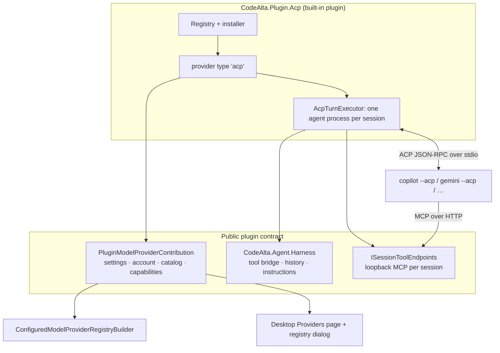
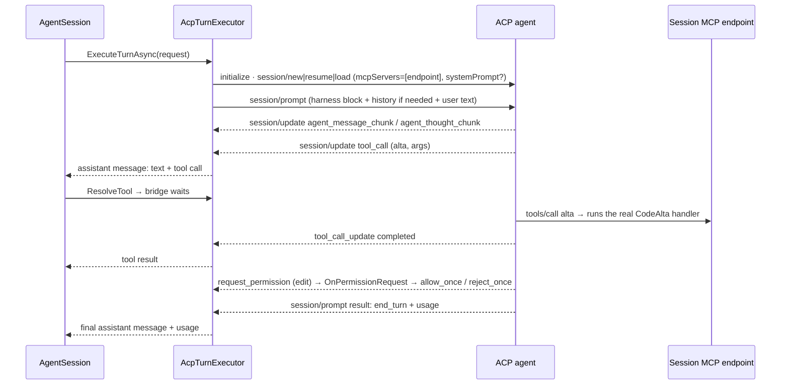

# ACP agents as providers, through a built-in plugin

Today CodeAlta cannot use an agent that only speaks the Agent Client Protocol. This matters for subscriptions such as Cursor or the Copilot CLI that are reachable only through their agent CLI. The protocol library (`src/CodeAlta.Acp`) was kept when the prototype was removed (#26), but no provider uses it.

Once this work is done:

- A user opens **Settings > Providers > Add provider > Agents from the ACP registry…**, picks an agent and installs it.
- The agent then shows up like any other provider: model chip, new session, tiers, and the provider switch in a session.
- It runs with CodeAlta's instructions and calls `alta` and the plugin tools.
- A session started on an ACP agent continues on Codex or Claude Code, and the reverse.
- The integration is a built-in plugin (`CodeAlta.Plugin.Acp`), built on a new public contract that lets a plugin contribute a model provider.

## What changes

The work has five layers. Each one is usable and tested before the next one starts.



### 1. Protocol layer refresh (`src/CodeAlta.Acp`)

The generated types come from an April snapshot of `schema.unstable.json` taken before the `schema/v1` layout existed. Since then the spec (`C:\code\agent-client-protocol`, v1.12.0, protocol version 1) made several changes:

- `session/set_model` was replaced by config options (`category: model | thought_level | mode`).
- `env_var` auth was dropped.
- NES (next-edit suggestions) was removed.
- The unstable `systemPrompt` was added (`sessionCapabilities.systemPrompt`, `{ mode: "append", content: [...] }`).

Work in this layer:

- Make the generator's source resolver handle `schema/v1/schema.unstable.json`, and pin the tag it was generated from in `AcpClient.Metadata.gen.cs`.
- Regenerate, then fix the hand-written partials (`AuthMethod`, `McpServer`, `RawJsonValue`).
- Fix three defects in the library:
  - drain the agent's stderr to the log (the pipe can fill and stall the agent);
  - add a per-request timeout;
  - make the cancel path send `session/cancel`.

```powershell
dotnet run --project src/CodeAlta.Acp.Generator -- --schema-file C:\code\agent-client-protocol\schema\v1\schema.unstable.json --surface unstable
```

### 2. Plugin model providers (public contract)

`PluginBase` gains one contribution, read once per activation and removed on deactivation, like the others:

```csharp
public virtual IEnumerable<PluginModelProviderContribution> GetModelProviders() => [];

public sealed record PluginModelProviderContribution(
    string ProviderType,                                  // "acp"
    string DisplayName,                                   // "ACP agent"
    IReadOnlyList<PluginProviderSetting> Settings,        // typed fields of [providers.<key>]
    Func<PluginModelProviderContext, IAgentModelProviderRuntime> CreateRuntime)
{
    public Func<PluginProviderSettings, IReadOnlyList<string>>? Validate { get; init; }
    public IPluginProviderAccount? Account { get; init; }   // status, sign-in methods, sign-in, sign-out
    public IPluginProviderCatalog? Catalog { get; init; }   // entries the Add provider dialog lists and installs
}
```

- **Settings.** A `PluginProviderSetting` has a key, label, kind (`text`, `path`, `list`, `env`, `select`, `bool`), a default, and whether it is advanced. Values live in `[providers.<key>]` next to the common keys (`display_name`, `model`, `enabled`, `spaces`, `icon`). `CodeAltaProviderDocument` gains a bag of plugin-owned keys (`PluginSettings`), so they are typed when the plugin is present and kept as written when it is not. A provider whose type no plugin contributes stays in `UnsupportedProviders`, as it does today.
- **Registration.** `ConfiguredModelProviderRegistryBuilder` checks the contributed types before its `default:` branch. `NormalizeProviderType` and the field validation accept them. `GlobalConfigRpc.ProviderTypes` lists them. The host registers providers again when the plugin runtime reports a change (`ApplyProviders` already rebuilds the registry), so enabling the plugin or editing an agent needs no restart.
- **Lifecycle.** When a plugin that owns providers stops (disabled, reloaded, application exit), its running turns are aborted, its runtimes are disposed (which ends their processes), and its providers are unregistered. Their sessions show the provider as unavailable and can switch to another one, as for a removed provider. The Plugins page asks in a popover before it stops a plugin whose sessions run.
- **Capabilities.** `ModelProviderDescriptor` gains `Capabilities` (`ProviderCapabilities`):
  - `SupportsSteering`: when false, a steer input is queued; the dispatch planner already queues when steering is unsupported;
  - `InstructionsDelivery` (`system`, `appended`, `first-prompt`);
  - `CodeAltaTools` (`yes`, `no`);
  - `Images`;
  - `ProviderCompaction`;
  - `LocalCompaction`.

  The Providers page shows these as small tags, without prose. The journal's system-prompt event records the real delivery instead of the constant `native-system-and-developer`.
- **Provider catalog.** `IPluginProviderCatalog` lists entries (id, name, description, version, icon SVG, install kind, whether the entry can run here). It installs one with progress and returns the settings of the new provider. The desktop dialog renders any plugin's catalog; ACP is the first.

### 3. Harness toolkit (`CodeAlta.Agent.Harness`, public)

An outside assembly has to reach the seams that let a provider run its own agent loop. These are currently internal:

- `AgentProviderRunContext`
- `IAgentProviderToolHost`
- `IAgentProviderSessionCleanup`
- `IAgentProviderCompaction`
- `IAgentProviderPermissionMode`
- `AgentTurnFailure` / `AgentTurnExecutionException`

These become public, documented, and grouped under `CodeAlta.Agent.Harness`. The Claude-only seams stay internal: remote control, prompt suggestions, background tasks, and initiated turns.

The reusable code of the Claude Code provider is extracted. Claude Code is moved onto it with no change in behavior.

| New type | Taken from | Does |
| --- | --- | --- |
| `HarnessHistoryRenderer` | `ClaudeCodePrompts.CreateHistoryPreamble` | Renders the CodeAlta conversation as `<codealta_previous_conversation>`. |
| `HarnessInstructions` | `ClaudeCodePrompts` hash / update | Hashes the instructions and builds the `<codealta_instructions_update>` diff. |
| `HarnessConversationBinding` | `ClaudeCodeSession.BindConversation` | Decides resume vs. new conversation from recorded counts, and merges unanswered trailing prompts. |
| `HarnessToolCallBridge` | `ClaudeCodeSession.Host` / `Requests` | Waits for an external tool result, runs a CodeAlta tool for an MCP call, and matches calls by id, then name and arguments, then name. |
| `CodeAltaMcpToolServer` | `HandleMcpMessage` | `initialize`, `tools/list`, `tools/call` and `list_changed`, independent of the transport. |

### 4. Session tools as an MCP endpoint (`ISessionToolEndpoints`)

An ACP agent receives CodeAlta's tools as an MCP server in `session/new` / `load` / `resume`. A host service, `ISessionToolEndpoints` in `CodeAlta.Hosting`, runs one loopback Kestrel listener per process, as `DesktopMcpServer` and the Mobile plugin already do. Through `PluginModelProviderContext`, it opens an endpoint for a session:

```csharp
await using var endpoint = await context.ToolEndpoints.OpenAsync(sessionId, server, cancellationToken);
// endpoint.Url     = http://127.0.0.1:53817/s/9f2c…/mcp
// endpoint.Headers = [ Authorization: Bearer <random per endpoint> ]
```

- The path token and bearer secret are random for each endpoint. The endpoint serves only the tools of that session's current turn, through `CodeAltaMcpToolServer`, and closes with the agent process.
- Tools are the same set Claude Code receives: `alta`, plugin agent tools, and activated MCP servers, minus CodeAlta's own file and shell tools (the agent has its own). The same activation and permission policies apply.
- HTTP only for now. An agent without `mcpCapabilities.http` runs without CodeAlta tools, and its card and provider tags say so. A stdio relay comes later.

### 5. The ACP plugin (`src/CodeAlta.Plugin.Acp`)

The plugin is listed in `DesktopPlugins.cs` and `CodeAltaBuiltInPlugins.cs` and enabled by default. It references `CodeAlta.Acp` and has no code specific to any one agent.

**Registry and install.**

- `AcpRegistryClient` reads `https://cdn.agentclientprotocol.com/registry/v1/latest/registry.json` and keeps the last copy for offline use in `~/.alta/cache/acp/registry.json`. That cache is shared by the normal and dev instances, like the `claude-code` cache.
- Icons are fetched by the host and rebuilt with the `PluginIcons` allowlist. They are cached and served as data URLs drawn as a mask in the text color.
- Install by distribution kind:
  - `binary`: downloaded to `~/.alta/cache/acp/<id>/<version>/<rid>/` behind a `.partial` folder and lock, like `ClaudeCodeCliInstaller`;
  - `npx` / `uvx`: nothing to download. The entry needs `npx` or `uvx` on `PATH`, and the card says when it is missing.
- An update is offered when the registry version is newer than the installed `agent_version`.

**Configuration.** Adding Copilot from the registry writes:

```toml
[providers.github-copilot-cli]
type = "acp"
display_name = "Copilot"
agent = "github-copilot-cli"      # registry id; empty for an agent added by hand
agent_version = "1.0.103"
# optional, for a hand-made agent or the user's own install:
# command = 'C:\Users\me\AppData\Local\Microsoft\WinGet\Links\copilot.exe'
# arguments = ["--acp"]
# env = { SOME_VAR = "value" }
```

Legacy `[acp]` blocks from the removed prototype stay preserved and ignored.

**A turn.** `AcpTurnExecutor` keeps one agent process per CodeAlta session. The process is closed after 10 idle minutes and on dispose; the next turn resumes it.



**Mapping to CodeAlta.**

- **Text.** `agent_message_chunk` maps to text deltas; `agent_thought_chunk` maps to reasoning (already guarded when another provider replays it).
- **Tools.** `tool_call` / `tool_call_update` map to tool calls and results under the agent's names. A diff in the content becomes a file change. `plan` becomes the plan card.
- **Usage.** `usage_update` gives the context size, which feeds the model's context window. `PromptResponse.usage` gives the token counts.
- **Permissions.** `request_permission` maps to `AgentCommandPermissionRequest` (kind `execute`), `AgentFileChangePermissionRequest` (kind `edit`, with the diff) or `AgentGenericPermissionRequest`. Answers map from AllowOnce / AllowForSession / Deny / Cancel to the agent's `allow_once` / `allow_always` / `reject_once` options, and to `cancelled` plus `session/cancel`.
  - Calls to CodeAlta's own endpoint are allowed at once, because those tools ask through CodeAlta themselves.
  - CodeAlta's permission modes (`default`, `acceptEdits`, `bypassPermissions`) decide which requests are answered without asking. The agent's own modes are left at its default.
- **Models.** The `model` config option lists the models. Duplicate ids are kept once. `thought_level` gives the reasoning efforts of the selected model, read again after each change because the option comes and goes. The selection is applied with `session/set_config_option`, with no restart. The probe opens one short session to read the models (closed with `session/close` when the agent has it) and caches the list for each provider.
- **Instructions.**
  - When the agent advertises `sessionCapabilities.systemPrompt`, they go in `systemPrompt` (`append`) on new / load / resume.
  - Otherwise they go in a `<codealta_harness>` block at the start of the first prompt, with the instruction to keep it.
  - The block is sent again after a `compaction_update`, after a resume through a new agent session, and as an update diff when the instructions change.
  - `ProviderState` records the delivery and hash.
- **Resume and continuation.** `ProviderState` holds `{ kind: "acp", agentSessionId, userCount, assistantCount, instructionsHash, delivery }`.
  - With matching counts, the executor uses `session/resume`, else `session/load` (its replayed updates are not journaled), else a new session.
  - When the counts do not match (another provider wrote part of the conversation) or nothing can be resumed, a new agent session starts with `<codealta_previous_conversation>`. That is how Codex → ACP works.
  - ACP → Codex works because the journal holds ordinary messages and tool results.
- **Sign-in.**
  - `agent` methods: a **Sign in** button calls `authenticate`.
  - `terminal` methods: opens the integrated terminal on the method's command (for example `copilot login`), with the command also copyable.
  - An `auth_required` error fails the turn as signed out, and the provider shows **Sign in**.
- **Failures.** A process that exits, a start timeout (longer for `npx`, which may download), JSON-RPC errors and `auth_required` map to `AgentFailureKind` for the tier fallback.
- **Compaction.** Local compaction is off. Manual compaction sends `/compact` when the agent lists that command, and the harness block is re-sent after it.
- **Steering.** Not supported by ACP, so a steer input waits for the end of the turn.

### 6. Desktop experience

- **Add provider** gets an item **Agents from the ACP registry…**, which opens a dialog drawn from the plugin's catalog. It has a search field and a grid of cards, each with icon, name, description, version and a distribution tag. The card's **Add** button installs in place with a progress bar (`watch` channel, as in `claudeCli`). A missing `npx`/`uvx` and "no CodeAlta tools" show as tags. The dialog closes on a click outside. A failed fetch shows the cached list with **Retry**.
- **The agent's form** uses the same `Section`/card layout as the other types, generated from the plugin's settings:
  - a "Command" box shows what runs (registry install, `npx …`, or the user's command), with **Update to x.y.z** when the registry is newer;
  - **Sign in** comes from the plugin's `Account`;
  - capability tags (`System prompt` / `First prompt`, `CodeAlta tools`, `Images`) sit in a single row;
  - Arguments, environment and working folder sit under **Advanced**.
- **Everywhere else** (model chip, `ProviderChooser`, new-session popover, tiers, Browse models) ACP providers appear with no difference except their logo, plus a discreet `ACP` tag on the Providers card. Known brands (Copilot, Gemini, Cursor) match their existing logos through `brands.ts` words; other agents use the registry icon.
- `providerForm.ts` reasons (`providerProblem`, `isSignedOut`) become generic for plugin providers.

## Steps

- [x] 1. Generator: support the `schema/v1` layout and record the source tag. Update `AcpGeneratorTests`. Commit `Fix ACP generator for the v1 schema layout`.
- [x] 2. Regenerate `src/CodeAlta.Acp/generated` from v1.12.0 `schema.unstable.json`. Fix the partials and existing tests. Commit separately.
- [x] 3. `CodeAlta.Acp`: drain stderr, per-request timeout, `session/cancel`. Add tests with in-memory streams (`AcpClient.ConnectAsync`). Also: pending requests fail with the exit code and stderr tail when the agent exits (they hung before).
- [ ] 4. Fake ACP agent for tests (`src/CodeAlta.Tests` helper, revived from `AcpTestHarness` at `4fb5404b^`). It scripts initialize / session / prompt / updates / permission requests / MCP calls over in-memory or stdio streams.
- [x] 5. Extract `CodeAlta.Agent.Harness`: make the listed seams public with XML docs, add `HarnessHistoryRenderer`, `HarnessInstructions`, `HarnessConversationBinding`, `HarnessToolCallBridge`, `CodeAltaMcpToolServer`, and move Claude Code onto them. All existing Claude Code tests pass unchanged.
  - Deviation: the seams stay in `CodeAlta.Agent.Runtime` (made public there, no namespace churn). `HarnessHistory` and `HarnessInstructions` are extracted and Claude Code delegates to them. `HarnessToolCallBridge` and `HarnessMcpToolServer` are new shared code used by ACP; Claude Code keeps its own bridge, which is entangled with transcripts, hooks and its own turns, to avoid a risky rewrite. The conversation binding is small and lives in the ACP executor.
- [x] 6. `ProviderCapabilities` on `ModelProviderDescriptor`. Set it for every built-in type. Record the real instructions delivery in the system-prompt journal event. Wire `SupportsSteering` to the dispatch planner. Add tests.
  - Deviation: steering needs no flag. Like Claude Code, the ACP executor holds a steer message until the agent's prompt ends, then sends it (`RequiresProviderFollowUp`). The planner is unused. What an agent supports depends on the agent, so it is reported by the probe (`ModelProviderProbeResult.Capabilities`, step 13), not by the descriptor. The instructions delivery is recorded through the new `IAgentProviderInstructionsChannel` (Claude Code: `appended-system-prompt`).
- [ ] 7. `ISessionToolEndpoints` in `CodeAlta.Hosting` (loopback Kestrel, per-endpoint token and bearer, session-scoped tools). Add tests: unauthorized request refused, tool listed and called, closed endpoint gone.
- [ ] 8. Plugin model-provider contract in `CodeAlta.Plugins.Abstractions`: `GetModelProviders`, settings, account, catalog, context (tool endpoints, logger, state roots). Plugin runtime keeps contributed types. Add tests.
- [ ] 9. Catalog/config: `PluginSettings` bag on `CodeAltaProviderDocument`, plugin types accepted by normalization and validation, round-trip preserved without the plugin. Extend the config store tests.
- [ ] 10. Hosting: the builder consults contributed types, providers are applied again on plugin changes, and the stop policy (abort, dispose, unregister) is implemented. Add tests with a fake plugin provider.
- [ ] 11. Desktop RPC: provider types and settings schema from plugins in `GlobalConfigRpc`, a generic plugin account in `providerLogin`, and a `providerCatalog` service (`list`, `install`, `cancelInstall`, `watch`). Lift or check the 32-provider caps.
- [ ] 12. `CodeAlta.Plugin.Acp`: registry cache and icon sanitizing, installer (binary/npx/uvx), `acp` provider type and settings, update detection. Add tests against a local registry fixture.
- [ ] 13. `AcpModelProviderRuntime` + `AcpTurnExecutor`:
  - process per session, idle close;
  - update mapping, tool bridge with the session endpoint, permissions and permission modes;
  - instructions delivery (`systemPrompt` or first-prompt block, re-send rules);
  - resume / load / new with `<codealta_previous_conversation>`;
  - models and reasoning from config options, usage, failures, `/compact`, sign-in.

  Cover each path with the fake agent.
- [ ] 14. Cross-provider tests: a fake-agent ACP session continued by a scripted OpenAI-style executor, and the reverse (history rendering sent to the agent).
- [ ] 15. Register the plugin in `DesktopPlugins.cs` and `CodeAltaBuiltInPlugins.cs`. The TUI builds and its tests pass, with no new TUI screen.
- [ ] 16. Frontend:
  - registry dialog from Add provider;
  - schema-driven form section for plugin providers;
  - generic account panel and capability tags;
  - `ACP` tag;
  - data-URL logos in `BrandIcon`/`ProviderIcon`;
  - `brands.ts` rules.

  Add frontend unit and browser tests.
- [ ] 17. Docs:
  - rewrite `doc/acp.md`;
  - `doc/plugins.md` (model providers, catalog, tool endpoints, lifecycle);
  - `doc/providers.md`, `doc/desktop.md`, `doc/development-guide.md` (regeneration command);
  - `site/docs/model-providers.md` ACP section, `getting-started.md` line, `model-tiers.md` mention.
- [ ] 18. Live check in the dev instance with Copilot:
  - install from the registry and also use the existing `copilot.exe`;
  - run a session that calls `alta`;
  - get an edit permission and answer it;
  - switch the session to Codex and continue, then back to Copilot;
  - resume after the idle close;
  - check both themes and a narrow window.
- [ ] 19. Retake `alta-desktop-model-providers.webp` and `alta-desktop-add-provider.webp`. Add a picture of the registry dialog.

## How it is verified

- [ ] `dotnet build -c <Configuration>` and `dotnet test -c <Configuration> --no-build`, with `npm test` alongside: all green, including the new fake-agent, endpoint, plugin-provider and config round-trip tests.
- [ ] `lunet build` in `site/` passes.
- [ ] Claude Code sessions behave as before after the harness extraction: its existing tests pass, plus a live send in the dev instance.
- [ ] In the dev instance, a Copilot ACP session shows streaming text, reasoning, tool cards, an `alta session list` tool call answered by CodeAlta, and the permission popover. The session's system-prompt event shows `first-prompt`, because Copilot 1.0.x does not advertise `systemPrompt`.
- [ ] The same session continues on Codex with the full history visible to Codex, and continues again on Copilot (the agent receives `<codealta_previous_conversation>`).
- [ ] Disabling the ACP plugin while a Copilot turn runs asks first, then aborts the turn. The provider shows as unavailable and re-enabling restores it.

## Decisions

| Decision | Choice | Why |
| --- | --- | --- |
| Where ACP lives | Built-in plugin on a new public plugin model-provider contract | Your answer; it matches #211 and opens providers to plugins. |
| Internal harness seams | Made public under `CodeAlta.Agent.Harness`; Claude-only seams stay internal | A plugin assembly cannot use internals, and the issue requires a public, documented contract. |
| Tools for stdio-only agents | HTTP endpoint now; stdio relay later | Your answer; Copilot, Gemini and the Claude/Codex ACP adapters support HTTP. |
| Importing agent sessions made outside CodeAlta | Later | Your answer; CodeAlta's own ACP sessions resume. |
| ACP `fs/*` and `terminal/*` client methods | Not advertised in this version | The agent uses its own tools, which go through `request_permission`. Serving them correctly needs the project-scope and terminal boundaries (the prototype bypassed them). |
| Process per session | One agent process per CodeAlta session | Isolation. Model changes need no restart thanks to `set_config_option`. |
| Agent modes (`agent` / `plan` / `autopilot`) | Not exposed; CodeAlta permission modes answer permission requests | One way to set what is asked, the same for every provider. CodeAlta's Plan mode is its own prompt. |
| Model listing | One short probe session, closed when possible, list cached per provider | ACP only reports models inside a session. |
| Legacy `[acp]` config | Kept preserved and ignored | It belongs to the removed prototype; nothing to migrate. |

## Risks

- **Making harness seams public freezes contracts that still change.** Mitigated by exposing only the five seams ACP needs and documenting them as the harness API.
- **Matching MCP calls to ACP tool calls is heuristic** (name and arguments; ACP carries no shared id). It falls back to running the call as a detached CodeAlta tool card, as Claude Code does for calls without an owner.
- **Agents report some errors as answer text.** Copilot answers an unsupported reasoning effort with "Error: …" and `end_turn`. Reading efforts again after each model change avoids the known case; other cases look like answers.
- **Probing creates sessions in the agent's own store** (Copilot lists them in `session/list`). Kept to one probe per provider, closed when supported, with the result cached.
- **Kestrel in the TUI process.** `ISessionToolEndpoints` brings the ASP.NET Core shared framework into `CodeAlta.Hosting`. The desktop already loads it. The TUI must still build and start; check its publish settings in step 7.
- **First start through `npx` can download for minutes.** The start timeout is longer for `npx`/`uvx`, and the session shows "Starting <agent>…".

## Out of scope

- The stdio MCP relay for agents without HTTP MCP.
- Listing and importing sessions made outside CodeAlta (`session/list`).
- `session/fork`, elicitation, `providers/*`, MCP-over-ACP, protocol v2.
- ACP `fs/*` / `terminal/*` client capabilities.
- New TUI screens (the TUI keeps working and can use a configured `acp` provider).
- CodeAlta as an ACP server.

<details><summary>Evidence from the live Copilot probe (2026-10-24)</summary>

- `copilot.exe` 1.0.94-3 (winget) runs `--acp` signed in, with no `authenticate` needed. The registry has 1.0.103 as `npx @github/copilot@1.0.103 --acp`.
- `initialize`:
  - `loadSession: true`
  - `mcpCapabilities: { http: true, sse: true }`
  - `promptCapabilities: { image: true, embeddedContext: true }`
  - `sessionCapabilities: { close, list }`; no `resume`, `fork` or `systemPrompt`
  - `authMethods: [copilot-login (terminal: copilot login)]`
- `session/new`: 26 models through the `model` config option (`auto` appears twice); `thought_level` low…max; modes with URL ids; a `permissions` option.
- Updates seen: `available_commands_update`, `session_info_update`, `usage_update {used,size}`, `agent_thought_chunk`, `agent_message_chunk`. The result has `usage` token counts.
- Timings: initialize 0.4 s, session/new 1.2 s, first token 3.3 s.
- The probe script is at `~/.alta/scratchpad/acp-probe/probe.mjs`.

</details>

<details><summary>Registry facts</summary>

The registry has 42–43 agents: 21 npx-only, 19 binary-only, 2 uvx-only, and 2 offering both binary and npx. Every agent has an SVG icon at `…/registry/v1/latest/<id>.svg`. Binary targets are `{windows,darwin,linux}-{x86_64,aarch64}`.

</details>
