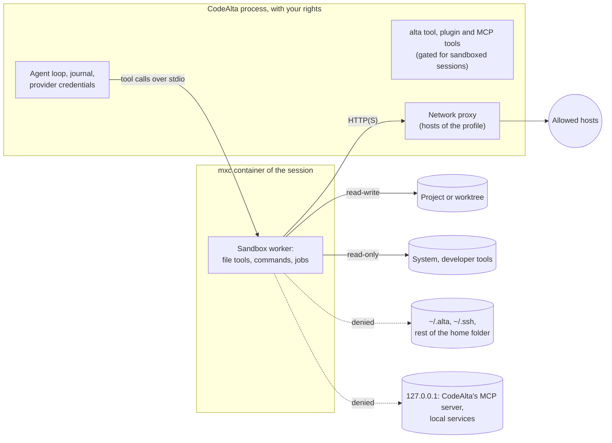

# Run agent sessions in an optional OS sandbox (#80)

Today an agent runs with your rights: its read tools can open `~/.alta/auth/`, `webget` can send what they read to any host, and its commands can write a git hook or a plugin that runs later, outside any session. Once this plan is done, a session can be **sandboxed**: everything it runs or reads on the computer goes through a worker inside an OS container (Microsoft's [mxc](https://github.com/microsoft/mxc)), which sees the project and the developer tools, never CodeAlta's credentials or your secrets, and reaches only the hosts its profile allows. The agent loop, the journal and the credentials stay in CodeAlta, so a sandboxed session works in CodeAlta Desktop like any other.

It is off by default, and a session that is not sandboxed works exactly as today. You turn it on for every session, a space, a project, a provider, a model, or one session.

## What changes

### The boundary: a sandbox worker per session

The session keeps running in CodeAlta (Desktop, TUI or `altacli`). When it is sandboxed, its built-in tools (`shell_command`, `read_file`, `list_dir`, `grep`, `view_image`, `write_file`, `replace_in_file`, `apply_patch`, `delete_file_or_dir`, `rename_file_or_dir`) and its `alta job` commands go over stdio to a **sandbox worker**. That is the same executable started with `--sandbox-worker`, as the speech and embedding workers are, inside an mxc container built from the session's profile. The programs it starts are its children: the container keeps them (a job object on Windows, namespaces on Linux, the Seatbelt profile on macOS), and they end with it.



Why this split:

- **The credentials never enter the sandbox.** Providers keep calling their endpoints from CodeAlta. The worker gets an environment built from scratch, so no `api_key_env` variable reaches a command (today every shell inherits them).
- **The OS enforces every tool, not only commands.** The file tools run in the worker too, so a link from the project to `~/.ssh` gives nothing, and CodeAlta checks no paths in software for a sandboxed session. Codex moved `apply_patch` into a sandboxed helper process for the same reason.
- **Nothing else changes for the session.** Queue, steer, permissions, `alta ask`, reviews, child sessions and the live timeline work as before: CodeAlta still owns the session (principle 1); only where its tools run has moved.
- **One long-lived process per session is what every mxc backend supports.** None of the default backends can run a new process inside an existing container, but all of them can spawn one process with streamed stdio.

You suggested running the session itself in a sandboxed `altacli` (#216). That would put the credentials inside the sandbox, or need an authenticating proxy for each provider family, including those that refresh their tokens themselves. It would turn Desktop into a remote client of a session it does not own: steer, queue, permissions, questions, reviews and the live display are all missing from ACP. And the sandbox would write the journal that Desktop projects. The worker gives the containment without those costs, and `altacli` gets the sandbox too, as `altacli run --sandbox <profile>`. The comparison is in the details at the end.

### mxc as the only backend

`Microsoft.Mxc.Sdk` (MIT, `net8.0`, AOT-compatible) runs a process under one policy on all three platforms:

| Platform | Backend | Needs |
| --- | --- | --- |
| Windows | ProcessContainer: the native `CreateProcessSecurityEnvironment` API, network filtered per container (WFP), in a job object | Windows 11 24H2/25H2 with the August 2026 update (build 26100/26200.9278) or later. No admin rights, no setup, no change to file permissions. A server listening inside the container needs build .9550. This computer has 26200.9457. |
| macOS | Seatbelt | macOS 15 or later, Apple silicon (the package has no `osx-x64` library) |
| Linux | Bubblewrap | `bwrap` 0.5+ and unprivileged user namespaces; `slirp4netns` and `iptables` for the network through the proxy |

Where the backend is missing, a sandboxed session runs no commands. The tool fails with the reason and the way to fix it; it never runs the command unsandboxed. CodeAlta does not write a sandbox of its own: Codex's own Windows sandbox needs local users, firewall rules, permanent ACL entries and an uninstall command. Copilot CLI builds on mxc, and Codex offers it as its newest Windows backend.

Two conditions before shipping:

- **A package newer than 1.0.1** (NuGet has 1.0.0 and 1.0.1). On older Windows builds, 1.0.1 falls back to changing the permissions of your folders, and its .NET API cannot turn that off. mxc's `main` removed the fallback on 2026-10-22.
- **No telemetry.** mxc emits nothing unless a request enables it; a test checks that CodeAlta never does.

The worker of a session, as CodeAlta starts it:

```csharp
// CodeAlta.Sandbox: the request comes from the policy resolved for the session.
var request = new ContainerRequest(SandboxWorker.CommandLine(installFolder))
{
    WorkingDirectory = policy.WorkingDirectory,
    Environment = policy.Environment,   // built from scratch: neither CodeAlta's nor the user's profile block
    Filesystem = new FilesystemPolicy
    {
        ReadwritePaths = { policy.Project, policy.GitDirectory, policy.Scratchpad, policy.Temp, policy.Caches },
        // System and developer tools, CodeAlta's install folder, and the protected entries of the project
        // (.git/hooks, .git/config, .alta but plans and tasks, .vscode...), read-only inside the writable tree.
        ReadonlyPaths = { policy.Toolchains, policy.InstallFolder, policy.Protected },
        DeniedPaths = { policy.Secrets },   // where a folder the profile grants contains one
    },
    Network = policy.Network.ToMxc(proxyEndpoint),   // off, through the proxy, or on; host loopback denied
    Ui = new UiPolicy { Clipboard = ClipboardPolicy.None },
};
using MxcProcess worker = await MxcContainer.SpawnAsync(request, cancellationToken);
```

### Profiles: what a sandbox allows

Every sandbox gets the following, whatever its profile:

- **Read-write:**
  - the session's folder (the project or its worktree, with the git folder a worktree writes to);
  - a scratchpad folder of its own;
  - a private temp folder;
  - caches of its own (`NUGET_PACKAGES`, `npm_config_cache`...), in CodeAlta's local data folder (`%LOCALAPPDATA%\CodeAlta\sandbox` on Windows).

  Your own caches are read-only fallbacks where the tool supports one, so nothing the sandbox downloads runs later in your own builds.
- **Read-only:** the system, the folders on `PATH`, the developer tools (the .NET root, git, node, Python, `~/.dotnet/tools`, `~/.gitconfig`; mxc's policy helpers find them), and CodeAlta's install folder.
- **Read-only inside the project:** the files that other programs run later: `.git/hooks`, `.git/config`, `.alta` (except `plans` and `tasks`), `.vscode`, `.claude`, `.codex`, `.cursor`, `.mcp.json`.
- **Never reachable:**
  - the rest of the home folder;
  - `~/.alta`, with its credentials, settings and other sessions, apart from the session's own worktree and scratchpad folder;
  - the clipboard;
  - the loopback and local network of the computer, where CodeAlta's own MCP server listens.
- **Environment:**
  - what tools need (`PATH`, `SystemRoot`, `TEMP`, `HOME`, `LANG`...);
  - the identity of the session's space (git author, CLI profiles);
  - `CODEALTA_SESSION_ID`, plus `CODEALTA_SANDBOX=<profile>`.

  Never CodeAlta's own variables, nor the ones `api_key_env` names.

A profile adds to that. Two profiles are built in. A table with the same name changes a built-in profile, and `extends` builds a new profile on an existing one:

```toml
[sandbox]
all_sessions = "workspace"   # unset (the default): only the sessions a rule or you sandbox

[sandbox.profiles.workspace] # built in; these are its defaults
write = []                   # more folders, read-write
read = []                    # more folders, read-only
deny = []                    # never readable, also inside `write` and `read`
network = "hosts"            # off | hosts | on (on: the internet, never this computer's own addresses)
hosts = ["nuget.org", "*.nuget.org", "registry.npmjs.org", "pypi.org", "files.pythonhosted.org", "*.crates.io"]
local_ports = []             # ports of this computer it may reach, such as a database; never CodeAlta's
env = []                     # variables of your environment it receives, by name
mcp_servers = []             # the MCP servers its sessions may use
outside = "ask"              # ask | never: a command the agent asks to run outside the sandbox

[sandbox.profiles.strict]    # built in: no network, nothing runs outside
network = "off"
outside = "never"

[sandbox.profiles.lib-feed]  # one of yours
extends = "workspace"
read = ["~/code/XenoAtom"]
hosts = ["pkgs.dev.azure.com"]
```

Two things are deliberately not offered:

- **Commands that always run outside the sandbox.** A text rule such as `docker *` gives away the whole computer.
- **Credentials inside the sandbox.** This comes later, as masked tokens that the proxy fills in for `git push` and `gh`.

### Where it is turned on

Each scope names a profile, or `off`. The most specific scope that says something decides, and the session's own choice is the most specific of all:

| Scope | Set in | Stored in |
| --- | --- | --- |
| One session | **Sandbox** in the Agent chip and the new-session form, `alta session create --sandbox` | The local state of its journal, like the permission mode. Null follows the scopes |
| A model | The provider editor, per model | `[providers.<key>.models."<id>"] sandbox = "strict"` |
| A provider | The provider editor | `[providers.<key>] sandbox = "strict"` |
| A project | **Sandbox…** in the project row actions of the Explorer | `sandbox: workspace` in `~/.alta/projects/<slug>.md`: your file, not the repository's |
| A space | **New sessions** on the page of the space | `new_sessions.sandbox` in `~/.alta/spaces/<id>.md` |
| Every session | Settings > Sandbox | `[sandbox] all_sessions` in `~/.alta/config.toml` |

The rules:

- **When it is decided.** A session without its own choice resolves its sandbox at each turn. A change in the settings applies from its next turn, and a provider switch or a fallback onto a sandboxed provider sandboxes it before that provider runs. A fallback skips a target whose provider type cannot run in a sandbox yet.
- **What agents can do.** An agent never makes a session less sandboxed: it cannot turn a sandbox off or change the profile of a session; only you do that, from the window. Sessions that a sandboxed session creates or forks get its sandbox, and `--sandbox` from it is refused. An unsandboxed session may give a sandbox to a session that has none, for example to hand risky work to a `strict` child.
- **What a repository can do.** A project's `.alta/config.toml` never changes the sandbox: a `[sandbox]` table there is ignored, with a warning. A repository would otherwise loosen its own sandbox; Copilot CLI refuses such files too.

### Network through a proxy of CodeAlta

mxc filters by address and port only, never by host name; host names are left to a loopback proxy that the application runs. `SandboxNetworkProxy` is one such proxy per worker, and mxc lets the container reach that port alone:

- it allows the host patterns of the profile (`*.nuget.org`; a bare `*` is refused);
- it resolves names itself, and refuses loopback, private, link-local and cloud-metadata addresses, except the `local_ports` of the profile;
- it answers a refused host with a 403 that names the host.

mxc also sets the system proxy of the container and `HTTP(S)_PROXY`, so .NET, git, npm and curl go through it without being configured. A program that ignores the proxy (`ssh`, raw sockets) cannot connect. With `network = "off"` there is no proxy and no network at all. The in-process `webget` of a sandboxed session follows the same host list.

### What a sandboxed session can do with CodeAlta itself

The `alta` tool, plugins and MCP servers run in CodeAlta, with your rights, so a sandboxed caller is gated as a session without `shell_command` is today (`CommandRefusalAsync`, `RefuseWiderToolsAsync`, `RefuseSettingsChangeAsync`):

| What | In a sandboxed session |
| --- | --- |
| Built-in file tools, `shell_command`, `alta job` | Run in the worker |
| `webget` | Runs from CodeAlta, to the hosts of the profile only, never this computer's own addresses |
| `alta session create`, `fork` | The new session gets the same sandbox; `--sandbox` is refused |
| `alta session send`, `queue`, `steer`, `request`, `message`, `tail`, `events`, `result`; conversations in `alta search` | Only the sessions it created |
| `alta terminal`, `alta ui`; building or reloading plugins; automations; MCP server changes; agent prompts, skills, spaces, projects | Refused: each of them runs a program, or changes what runs outside the sandbox |
| Plugin tools | Only the tools a plugin marks as safe in a sandbox (a new flag of `PluginToolActivationPolicy`). Tools that start programs or use your accounts are refused |
| MCP tools | Only the servers the profile lists. A stdio server defined by the project (a command named by the repository) is never started otherwise |
| `alta issue`, `alta jira` | Reads the issues of its project; changes are refused |
| `alta ask`, `notes`, `plan`, `task`, `review`, `reminder`, `diff`, `editor` | As today; `diff` and `editor` only for paths the sandbox can read |

### For the agent

The runtime context of a sandboxed session says what the sandbox allows. A change during the session reaches the agent as a host-context note of the next prompt, so the system prompt stays the same:

```text
Sandbox: on, profile `workspace`. Commands and file tools run in a container: they write in the project,
its worktree, the scratchpad and temp, read the system and the developer tools, and reach nuget.org,
registry.npmjs.org and the other hosts of the profile. A command that needs more can run outside with
`outside_sandbox: "<why>"`: the user is asked.
```

`shell_command` gets the `outside_sandbox` parameter only in a sandboxed session whose profile has `outside = "ask"`. Such a request is asked in every permission mode, Bypass included. `altacli`, which has no user, refuses it. A failed command gets a note naming the profile and, when it can be told, what was blocked. Cursor found that telling the agent what blocked it stops repeated blocked retries.

```text
error: could not lock config file C:/code/Lib/.git/config: Permission denied
[sandbox: workspace] `.git/config` is read-only in the sandbox: git configuration can run programs.
Ask the user, or run the command with `outside_sandbox`.
```

`alta session` supports the sandbox like the permission mode:

```text
alta session create --project Lib --sandbox strict --title "Review PR #42"
alta session choices <id>   ->  "sandbox": {"current": "strict", "source": "session", "choices": ["off", "workspace", "strict"]}
```

`send` and `queue` take `--sandbox`, and `info`, `status` and `list` show it.

### In CodeAlta Desktop

**Settings > Sandbox** is a new page after Permissions:

```text
Settings › Sandbox
  Status          ● Available: Windows process container                     [Check]
  Every session   (•) Not sandboxed   ( ) Sandboxed with [workspace ▾]
  Profiles        workspace · strict · + New profile
                  Folders      always: the session's folder, its scratchpad, temp   + Add (read / write / never)
                  Network      (•) Allowed hosts  ( ) Off  ( ) On      nuget.org, *.nuget.org, …
                  MCP servers  none   + Add
                  Outside      (•) Ask me  ( ) Never
  Where it applies  Provider Ollama → strict · Space Open source → workspace · Project scratch-clone → strict
```

- **Check** starts a test sandbox and shows the result of each step as it comes: `dotnet --version`, `git --version`, a write in a temp project, a read of `~/.alta` that must fail, the network through the proxy. Choosing a sandbox for the first time runs the check, and the page says what to install or update when the sandbox is not available.
- **Where it applies** lists the scopes, each linked to the place where it is set: the provider editor, the page of a space, the row of a project. A setting is edited in one place only.
- **The Agent chip and the new-session form** get a **Sandbox** row (Off, then the profiles, with where the current one comes from), and the chip shows a small mark when the session is sandboxed.
- **The timeline** marks a command that ran outside the sandbox, and shows the blocked path or host under a failed command.
- **A request to run outside** is a card of its own:

```text
Run outside the sandbox?
  dotnet nuget push bin/Lib.1.2.0.nupkg --source nuget.org            in C:\code\Lib
  "Publishing needs the API key in your NuGet.Config, which the sandbox cannot read."
  [Allow once]  [Deny]
```

### Providers that run their own tools

Claude Code and the ACP agents run their tools in their own process, so a sandboxed session on them runs that process in the session's container:

- **Its account folder is read-write**, because it holds the agent's login. The agent can therefore read its own credential, but none of CodeAlta's.
- **Its vendor's hosts are reached through the proxy.**
- **CodeAlta's tools reach it as today**: over the control protocol for Claude Code, and through the proxy to the harness MCP endpoint for ACP agents.

Their native sandboxes are not the boundary. Claude Code's covers only its shell, and does nothing on native Windows; Copilot's file tools check paths in software. Until a provider type is supported, a session that must be sandboxed cannot run on it: the composer says so, and nothing runs unsandboxed.

## Steps

### Spike: decides whether the rest goes ahead

- [x] 1. **Windows spike on this computer** (25H2, build 26200.9457), in a throwaway console app outside the solution. Run a long-lived worker in a ProcessContainer, with a sample project read-write, toolchains read-only and private caches.
  - Use a package newer than 1.0.1 if one is out, or mxc built from `main` (it needs the Rust 1.93 toolchain). Do not use 1.0.1: it may change the permissions of the folders it grants.
  - Record what `dotnet restore`, `build` and `test`, `git status` and `commit`, `npm install` and `pwsh -NoProfile` need: parent-folder walks, the `LOCALAPPDATA` rewrite, `ui.disable`.
  - Record the start time and memory of the worker, and whether HTTPS from .NET works through a loopback proxy.
  - Check the protections:
    - read-only subfolders inside the writable project;
    - protected paths that do not exist yet;
    - `~/.alta/auth` and `~/.ssh` unreadable;
    - `127.0.0.1:2582` and CodeAlta's single-instance pipe unreachable;
    - a detached child gone with the worker;
    - no ETW telemetry event.

  Write the findings and a go or no-go as a task under `.alta/tasks/`. Stop and report if a blocker shows.

  **Done: go.** The findings are in "Spike findings" below; what could not be checked here (macOS, Windows .9550+) is the task `2026-10-25-verify-the-sandbox-on-macos-and-on-a-windows-build-9550-or-l-6kq6`.
- [x] 2. **The same basics on macOS (Seatbelt) and on Linux in WSL (Bubblewrap).** Measure the size the mxc native libraries add to `alta`, `altatui` and `altacli`, and choose between shipping them and a pinned download on first use, as the speech engine does.

  **Done, except macOS** (no Mac here: in the task above). Linux in WSL Ubuntu 24.04 with `bwrap` 0.9.0 passes the basics. Shipping wins: the tool packages are per RID, and each gains about 5 MB (`mxc_ffi`) once the WSLC and `plm` assets mxc also ships are left out.

### Core, for every frontend

- [ ] 3. **`src/CodeAlta.Sandbox`** (no UI; uses `CodeAlta.Agent` contracts and `Microsoft.Mxc.Sdk`):
  - `SandboxProfile`, with the built-in `workspace` and `strict`;
  - `SandboxPolicy`: the folders, network and environment resolved for one session;
  - `ISandboxBackend`, with the mxc backend;
  - `SandboxAvailability`: status, reason and setup hint, from `MxcPlatform` and `Probe`.

  Tests: the policy of a project session and of a worktree session, protected paths, an environment without secrets. Add the project to `doc/architecture.md` and to `ArchitectureGuardrailTests`.
- [ ] 4. **Settings:**
  - the `[sandbox]` table and its profiles in `CodeAltaConfigDocument` and `CodeAltaConfigStore` (a Load/Save pair; defaults not written);
  - `sandbox` on providers and models;
  - `new_sessions.sandbox` on spaces;
  - `sandbox` in project files.

  A `[sandbox]` table in a project's `.alta/config.toml` is ignored with a warning. Tests.
- [ ] 5. **The sandbox of a session.** `sandbox` goes into the local state of the journal and its SQLite projection, like `PermissionMode`. `SandboxResolver` applies the precedence at each turn, plus the rules for sessions that agents create, fork or switch, and for fallback. Tests.
- [ ] 6. **The worker.** `--sandbox-worker` is dispatched first in `Program.Main` of `alta`, `altatui` and `altacli`. It speaks a framed protocol over stdio (`WorkerFrames`):
  - the file tools, with the handlers of `AgentBuiltInToolFactory` and `AgentWriteGuard` on;
  - commands, with streamed output, cancellation and timeout;
  - jobs.

  Tests run the protocol with a plain-process backend. The container tests are skipped where the sandbox is not available, as the browser tests are without Edge.
- [ ] 7. **Routing.**
  - `AgentSession.BuildAvailableTools` gives a sandboxed session the tools backed by its worker, and `SessionJobService` starts its jobs in the worker.
  - The worker starts on the first tool call, stops when the session detaches or idles, and starts again when the profile changes.
  - Without a worker, the tool fails with the reason.

  Tests.
- [ ] 8. **`SandboxNetworkProxy`**, as described above. The `webget` of a sandboxed session follows the same host list. Tests for the patterns and for each refused kind of address.
- [ ] 9. **Gates for sandboxed callers** in `BuiltInAltaCommandContributor`, the plugin bridge and the MCP plugin, as in the table above, with a test for each refusal. Add the sandbox-safe flag to `PluginToolActivationPolicy`.
- [ ] 10. **The agent's side.**
  - The sandbox paragraph of the runtime context, and the host-context note when it changes.
  - `outside_sandbox` on `shell_command`: an `AgentCommandPermissionRequest` marked as outside the sandbox, which every mode asks and `FullTrust` refuses, the TUI included.
  - The note after a failed command.

  Tests.
- [ ] 11. **`alta session` and `altacli`.**
  - `alta session`: `create --sandbox`, `send` and `queue --sandbox`, `sandbox` in `choices`, `info`, `status` and `list`, and their help texts.
  - `altacli run` and `acp` take `--sandbox <profile>`.

  Tests.

### CodeAlta Desktop

- [ ] 12. **Settings.**
  - An RPC `sandboxSettings` (availability, check, profiles, where it applies) and the **Settings > Sandbox** page.
  - **Sandbox** in the provider editor (provider and models) and on the page of a space.
  - A **Sandbox…** popover in the project row actions.

  Browser tests.
- [ ] 13. **The session side.**
  - The **Sandbox** row of the Agent chip and of the new-session form, and the mark on the chip.
  - The timeline marks and blocked-path notes.
  - The request card.

  Browser tests. Look at both themes and at a 900×650 window in the developer instance.
- [ ] 14. **Documentation.**
  - User guide: `site/docs/sessions/sandbox.md` (and its entry in the folder's `menu.yml`), with what it protects and what it does not, where to turn it on, profiles, platforms and setup. Link it from Tool permissions in `workspace/settings.md` (replacing its caution), from the Agent chip, the spaces page and provider configuration.
  - Architecture: `doc/sandbox.md` (boundary, worker, resolution, invariants) and "Tools and permissions" in `doc/runtime.md`.
  - The feature list of `readme.md`.

### Providers that run their own tools

- [ ] 15. **Claude Code in the session's container.**
  - Its account folder read-write, and Anthropic's hosts through the proxy.
  - CodeAlta's MCP server over the control protocol, as today.
  - Decide keychain access on macOS.

  Run the live tests (`ClaudeCodeLiveCliTests`).
- [ ] 16. **ACP agents in the container**: their home folder and runtime (Node, the `npx` cache), and the harness MCP endpoint through the proxy.

## How it is verified

- [ ] `dotnet test -c <Configuration>` and `npm test` pass; the .NET tests also pass on Linux in WSL.
- [ ] **Escape suite** (container tests, on this computer):
  - from `shell_command` and from the file tools, `~/.alta/auth/*`, `~/.ssh/*` and a link in the project pointing to them cannot be read;
  - `.git/hooks/pre-commit`, `.git/config`, `.alta/plugins/x/plugin.cs` and `.vscode/tasks.json` cannot be written;
  - `curl http://127.0.0.1:2582/mcp` fails;
  - a host outside the list gets the proxy's 403;
  - `env` shows none of the `api_key_env` variables;
  - a process started with `Start-Process` is gone once the worker ends.
- [ ] **Transparency suite**, in a sandboxed session of the developer instance (Codex, GPT-6.1 Sol, low effort):
  - with `workspace`, `dotnet build` and `dotnet test` of a small solution, `git commit` and `npm install` succeed;
  - with `strict`, `dotnet restore` fails, with a note that names the network.
- [ ] **Desktop**, in the developer instance:
  - **Check** passes on Settings > Sandbox;
  - a session sandboxed by a provider rule shows it on its chip;
  - a request to run outside is asked in Bypass permissions;
  - both themes and a 900×650 window look right.
- [ ] `lunet build` passes.

## Decisions

| Decision | Choice | Why |
| --- | --- | --- |
| Where the boundary is | A worker per session in an mxc container; the agent loop, journal and credentials stay in CodeAlta | Credentials never enter it, every Desktop feature works unchanged, principle 1 holds |
| Sandbox technology | mxc only, one backend per platform; where it is unavailable, no commands rather than a weaker sandbox | It is the OS-level answer on Windows, without admin rights or ACL changes; Copilot CLI builds on it, and Codex offers it |
| Default | Off; turned on by a scope or for one session | As asked; new safety features are off by default |
| Precedence of scopes | Session, model, provider, project, space, every session; `off` allowed in each | The most specific scope wins; the provider comes before the project, because distrust of a model follows it everywhere |
| Settings of a repository | A project's `.alta/config.toml` never changes the sandbox | A repository would loosen its own sandbox |
| Agents | Never make a session less sandboxed; an unsandboxed one may give a sandbox to a session that has none | Same rule as for tools turned off |
| Home folder | Not readable, except the developer tools and what a profile lists | Secrets live in too many places to list; Claude Code and Codex read nearly the whole disk |
| `.git` | Writable, except `hooks` and `config` | Commits keep working, as in Claude Code; Codex makes `.git` read-only, so every commit asks |
| Network of `workspace` | Package registries only; you add git hosts | Restores work; any host that accepts uploads is a way out for data |
| Permission modes | Unchanged | The mode decides what you are asked; the sandbox decides what a command reaches |
| Running outside | `ask` in `workspace` (asked in every mode); `never` in `strict` and in `altacli` | The only way out is your yes |
| Terminals | Refused to sandboxed agents | ProcessContainer has no PTY, and terminals run your own shell |
| MCP servers | Only those the profile lists | They run outside the sandbox, and a repository can name their command |
| Providers that run their own tools | Their process in the container, after the Desktop UI (steps 15–16); until then, refused to sandboxed sessions | Their native sandboxes cover only their shell, and none of them works on native Windows |

## Risks

- **mxc is young**, and its Windows sandbox depends on an API new in the August 2026 update. 1.0.0 shipped on 2026-10-06 and 1.0.1 on 2026-10-16. Limits: one backend interface, a pinned version, the spike first, and a release without the permissions fallback before shipping.
- **Many Windows computers are below the floor** (Windows 10, unpatched Windows 11). They see why, and which update is needed; there is no weaker fallback.
- **Toolchains may need grants the spike does not foresee**: NuGet and npm, MSBuild walking parent folders, `LOCALAPPDATA` rewritten by the container, HTTPS through the proxy. Private caches, a note naming what was blocked, and `outside_sandbox` limit this.
- **A server listening inside the container needs build .9550 on Windows**, so tests that start a local server, CodeAlta's own included, may fail below it. The spike measures it, and the user guide says so.
- **On Windows, what was blocked is guessed for now.** mxc's denial capture needs an OS feature validated only on Insider builds so far, so the note gives the profile and the likely cause read from the output.
- **Data can still leave** through an allowed host (a registry accepts uploads) and through DNS. `strict` has no network, and the user guide says that allowed hosts limit leaks; they do not prevent them.
- **A sandbox cannot stop changes in the project that you run later yourself**: an MSBuild target, a package script, a test. Review before commit and the diff are the protection; the user guide says so.
- **A sandboxed child's answer still reaches an unsandboxed parent**, as a peer message that could talk it into something. It is marked as peer content, as today.
- **One worker per sandboxed session** costs memory and a start. It starts on the first tool call and stops when idle; the spike measures both.

## Out of scope

- Sandboxing CodeAlta Desktop itself. A sandbox of your own around it stays possible.
- Virtual machines and Linux containers (mxc's WSLc, Windows Sandbox, micro-VMs).
- Credentials inside the sandbox, as masked tokens that the proxy fills in for `git push` and `gh`: a later plan.
- MCP stdio servers and integrated terminals inside the container.
- A sandbox chosen by an agent prompt (the Plan prompt in a read-only sandbox, so that Plan mode is enforced), or required by a repository: later, built on the same profiles.
- Screens in CodeAlta TUI. Sessions sandboxed by a setting run sandboxed there too, and a request to run outside is always asked.
- CPU and memory limits: mxc has only a timeout.

<details open>
<summary>Spike findings (step 1, 2026-10-25)</summary>

Windows 11 25H2, build 26200.9457, mxc from `main` and the 1.0.1 package (same behavior here: `Probe` gives tier 1, `NeedsDaclAugmentation: false`, deny paths and the identity-less loopback proxy supported, enumerate paths not). The spike app is in `tmp/sandbox-spike/` (ignored).

Confirmed:

- A worker (.NET, 30 MB working set) is ready **~100 ms** after `SpawnAsync`; a one-shot container takes 0.3–0.5 s. The environment is only what the request gives.
- `~/.alta/config.toml`, `~/.alta/auth`, `~/.ssh`, the home folder, the user's temp, a denied file inside the project, a junction to `~/.alta` (made before or inside the sandbox): all denied.
- `.git/hooks/pre-commit` and `.git/config` read-only inside the writable project, and `git status` and `git commit` work.
- `dotnet --version`, `build`, `restore` through the proxy, `npm install` through the proxy, HTTPS from .NET `HttpClient` through the proxy; a host outside the list gets the proxy's 403; direct internet and a loopback service of the host are refused.
- A detached child process ends with the worker.
- Linux (WSL Ubuntu 24.04, Bubblewrap): home hidden, project writable, git, dotnet, loopback inside, network off; `/tmp` is private.

Design changes they force (to apply in steps 3 to 8):

- **Parent folders.** git and node resolve a path one folder at a time from the volume root, and fail on a folder that is not granted ("Unable to read current working directory"). A read-only grant of `C:\` **cascades to the whole disk** (it opened `~/.alta`): never grant it read-only. What works: `C:\` in `ReadwritePaths` (a volume root does not cascade there, and nothing can be written in it), each parent folder of the read-write grants read-only, and every other entry of those folders denied (612 entries for the spike project, built in milliseconds). Entries created later in those folders stay readable until the worker restarts; names of entries can be listed, not read. Files the system holds open (`NTUSER.DAT`) cannot be denied and fail the request: skip them (nobody else can read them). Chain only the read-write grants, not the tool folders (98 folders, 2,988 entries otherwise). When `Probe` reports `BaseContainerSupportsEnumeratePaths`, `EnumeratePaths` replaces the denied entries.
- **Protected paths.** One that exists is read-only; one that does not exist yet goes in `DeniedPaths`, which blocks its creation without creating it. A read-only grant of a missing path protects nothing.
- **UI.** `UiPolicy.Disable` must be false: the default (true) stops processes at start (`STATUS_DLL_INIT_FAILED`). The clipboard stays `none`.
- **Loopback inside the container.** With the network off, egress limited to `127.0.0.0/8` with host loopback denied lets processes of the container listen and connect to each other (vstest `dotnet test` passes in 2 s), while listeners of the host stay unreachable. In proxy mode (`hosts`), on this build, nothing inside can listen and connect: vstest `dotnet test` fails. mxc says build .9550 is needed; the user guide must say it. With network `on` (egress allowed, host loopback denied), it works.
- **The proxy** forwards plain HTTP too (certificate revocation: NuGet fetches OCSP and CRL from `ocsp.digicert.com`, `crl3/crl4.digicert.com` over HTTP); refusing them only slows restore. The default `hosts` list adds the revocation hosts of the common certificate authorities.
- **Environment.** PSEC moves `TEMP` into `<LOCALAPPDATA>\Packages\sandbox.{id}\AC\Temp` when the request gives `LOCALAPPDATA`; the worker sets `TEMP`/`TMP` to its private temp itself.
- **Linux** needs `slirp4netns` for any network but `off` (mxc refuses the request otherwise): the availability check reports it.
- **Package.** 1.0.1 behaves as `main` where `Probe` gives tier 1 without DACL augmentation, so CodeAlta takes the 1.0.1 package now and refuses to start a sandbox whose request probe reports another tier or `NeedsDaclAugmentation`; shipping still waits for the next release. ETW telemetry was not traced (it needs an elevated session); CodeAlta never sets `Telemetry`, and a test checks the requests it builds.

</details>

<details>
<summary>Why not the whole session in a sandboxed <code>altacli</code></summary>

Running a Desktop session in a sandboxed `altacli` would need:

- **A remote-client mode in Desktop** for send, queue, steer, abort, compaction, rewind and provider switches. Today a session that `altacli` holds is read-only in Desktop, followed from its journal about once a second, with no streaming and no permission prompts.
- **A live channel** for the display.
- **Answers sent back to the runner**: permissions, questions and user input. `altacli` runs with `FullTrust`, without interactive UI.
- **The host-side `alta` commands routed back**: review, reminders, UI, windows, terminals, search.
- **A way to call providers without the credential**:
  - API-key providers could go through an authenticating loopback proxy, since `api_url` exists;
  - nothing exists for sign-in providers (Copilot, xAI, the Codex subscription refresh their tokens in-process) or for Claude Code.
- **Trust in journals the sandbox writes.** The sandbox would write into a date folder it shares with other journals, and Desktop would then project them, which makes that folder a trust boundary.
- **A revision of principle 1.**
- **One .NET host per session**, estimated at about 1 s to start and 100–200 MB.

What it would give that the worker does not: plugin tools and the agent loop inside the container. For providers that run their own loop, putting their process in the container (steps 15–16) gives the same for less.

</details>

<details>
<summary>What other agents do</summary>

| Product | Boundary | Files | Network | Credentials | Windows |
| --- | --- | --- | --- | --- | --- |
| Claude Code (`sandbox-runtime`) | Each shell command; its file tools, MCP and hooks are outside | Writes in the folder and temp; reads nearly everything; protects `.git/hooks`, `.git/config`, `.claude`, `.vscode` | Proxy with a domain list | Masking, experimental | Native: not sandboxed; WSL2 |
| Copilot CLI and VS Code | Shell commands, local MCP servers and LSPs; file tools checked in software | Denied by default; the folder and `.git` read-write | Host rules, with deny first | Placeholders that a proxy swaps for git and `gh` | mxc, on patched Windows 11 25H2/26H1 |
| Codex | Each command, plus a sandboxed helper for edits | Profiles with `extends`; `.git`, `.codex`, `.agents` read-only | Proxy with a domain list | Filter of secret variables, off by default | Its own (sandbox users, firewall, ACLs) or mxc |
| Cursor | Terminal commands | Seatbelt, Landlock | Asks to leave the sandbox | Not addressed | WSL2 |
| Docker Sandboxes, OpenShell, nono | A micro-VM or namespace per agent | Mount or clone | Proxy | Injected by the proxy, never inside | WSL2, or planned on mxc |

Lessons that recur:

- the filesystem and the network go together;
- fail closed when the sandbox is unavailable;
- settings come from the user, never from the repository;
- protect the files that later programs run, even before they exist;
- enforce in the OS, or resolve links on the host;
- avoid broad hosts.

Sources: Claude Code and Copilot sandboxing docs, the Codex source (`C:\code\codex`), Cursor's sandboxing blog, the Docker Sandboxes and OpenShell docs.

</details>

<details>
<summary>Today's exposure, which sandboxed sessions close</summary>

- The read tools ask nothing and take absolute paths, so `~/.alta/auth/` can be read today. The write tools take absolute paths too; the `GrantRoot` of their request is informative only.
- `webget` reaches any host, `localhost` included.
- Shells inherit CodeAlta's whole environment: `AgentProcessEnvironment` only adds variables.
- `AgentWriteGuard` is on only when `shell_command` is turned off.
- CodeAlta starts MCP stdio servers from the project's own definitions, with its environment. Plugins run in-process. Worktrees are created with git hooks on.
- Desktop's MCP server on `127.0.0.1:2582` answers any program of the computer, and runs `alta` commands without a calling session.

Unsandboxed sessions keep this behavior.

</details>
