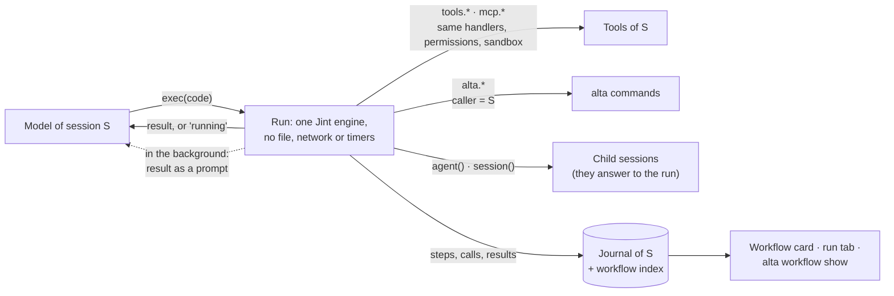

# Code Mode: scripts, workflows and a script library (#229)

Today an agent works one tool call at a time. Each call is a model round trip, and each intermediate result passes through its context. A job for several agents (three reviewers, then a merge) is a string of `alta session` commands and prompts that only that agent understands. The user sees a list of tool calls, not the shape of the work, and nothing of it can be kept and run again.

Once this plan is done:

- **An agent writes a script instead of a string of calls.** One `exec` call runs JavaScript inside CodeAlta. Every tool of the session is a typed async function in it (`await alta.session.list()`, `tools.grep(...)`, `mcp.github.list_issues(...)`). Loops and parallel calls run without model turns, and only what the script returns reaches the context.
- **A script that starts sub-sessions is a workflow.** It moves to the background when it runs long. Its sub-sessions are real CodeAlta sessions. The timeline draws it as a live graph: a box per step and per sub-session, and a click on a box opens that session. Another session can read what it is doing (`alta workflow show`).
- **Scripts that work are kept.** A script library (project, global, per space) holds scripts with a descriptor: name, parameters, steps. Agents call them (`workflow("review-pr", { pr: 231 })`), the user runs them from a form, and automations run them instead of a prompt, with no model turn to drive them.
- **It is measured before it is turned on.** An evaluation runs the same tasks with and without Code Mode on each model. Code Mode is on by default only where it helps.

The name is the one the field already uses (Cloudflare, Codex, pi, OpenClaw), so it is familiar to people who come to CodeAlta. The script helpers follow the two shapes models already know: Codex's `exec` tool, and the workflow scripts of Claude Code. Three things are CodeAlta's own: sub-sessions as clickable workflow steps, the live graph, and a library of scripts with typed parameters that agents, the user and automations all run.

## What it looks like

**A composition.** The user asks: "summarize what my sub-agents answered, by model". The agent sends one `exec`:

```js
// @exec: {"title": "Answers of the sub-agents, by model"}
const children = await alta.session.children()            // of the calling session
const results = await Promise.all(children.map(c => alta.session.result({ session: c.sessionId })))
const byModel = {}
for (const r of results) {
  (byModel[r.modelRef] ??= []).push({ title: r.title, answer: r.finalMessage?.slice(0, 300) })
}
return byModel
```

The model receives only this, instead of nine tool calls and their outputs:

```text
Script completed · 1.8 s · 9 calls, 8 at once
Result:
{"codex:gpt-6.1-sol@high":[{"title":"Plan research: codex","answer":"I read Codex at commit 30587d7885…"}],
 "claude-code:opus@high":[{"title":"Plan research: Jint","answer":"…"}]}
```

**A workflow.** `.alta/scripts/review-pr.js` in the library:

```js
export const meta = {
  name: "review-pr",
  description: "Reviews a pull request from three angles, then merges the findings into one review.",
  params: { pr: { type: "integer", description: "Number of the pull request" } },
  steps: [
    { id: "fetch",  title: "Fetch the pull request" },
    { id: "review", title: "Review", detail: "one session per lens", each: true },
    { id: "merge",  title: "Merge the findings" },
  ],
}

const FINDINGS = { type: "object", properties: { findings: { type: "array", items: { type: "string" } } } }

const pr = await step("fetch", () => alta.issue.show({ id: args.pr }))
const reviews = await parallel(["correctness", "security", "tests"].map(lens => () =>
  agent(`Review pull request #${args.pr} for ${lens}. Do not edit files.\n\n${pr.markdown}`,
        { step: "review", label: lens, tier: "standard", schema: FINDINGS })))
return await agent(`Merge these reviews into one, most important first:\n${JSON.stringify(reviews)}`,
                   { step: "merge", tier: "complex" })
```

Three callers can run it:

- an agent, with `return await workflow("review-pr", { pr: 231 })`;
- the user, from the Workflows tab;
- an automation, on each new pull request.

The timeline of the session shows a card that follows the run:

```text
╭ ◆ review-pr · pr=231 ──────────────────────────────────── ⠿ running · 4m12s ╮
│  ✓ Fetch ──▶ ┌ Review ─────────────────────────── 2/3 ┐ ──▶ ○ Merge          │
│    0.8 s     │ ⠿ security     sonnet@high  41k  $0.12 ↗│                      │
│              │   › reading src/auth/middleware.ts      │                      │
│              │ ✓ correctness  haiku  1m02s  12k       ↗│                      │
│              │ ✓ tests        haiku  1m40s  18k       ↗│                      │
│              └─────────────────────────────────────────┘                      │
│  3 sessions · 71k tokens · $0.31                      [Script] [⤢] [■ Stop]   │
╰───────────────────────────────────────────────────────────────────────────────╯
```

A click on a session box (↗) opens that session. ⤢ opens the run in a tab of its own.

## What changes



The script runs in CodeAlta, beside the agent loop (Armin Ronacher's "brain"), not on the computer it works on (the "hands"). It can do nothing by itself: it has no file, network, timers or .NET access. **Every effect is a call through the tools that S already has, with the same permissions.** That is why it is safe in any session, a sandboxed one included.

| Where | What |
| --- | --- |
| `src/CodeAlta.CodeMode` (new, no host and no window, like `CodeAlta.Search`) | Engine, limits, script prelude, declarations, the descriptor parser, the formatting of results. It defines the bindings a run receives: LiveTool supplies `alta`, Orchestration the tools and the sessions, so no project references one above it. |
| `CodeAlta.Agent` | `IAgentRunToolInvoker` (a script calls the run's own tools), nested calls journaled, tool exposure and parallel flags, `AgentWorkflowEvent`, `AgentPromptProvenance.Workflow`. |
| `CodeAlta.LiveTool` | The `exec` and `wait` tools, typed bindings of `alta`, the `alta workflow` and `alta script` groups. |
| `CodeAlta.Orchestration` | `WorkflowRunService`: runs owned by sessions, child steps, background runs, settlement, resume. |
| `CodeAlta.Catalog` | The script library, settings, the workflow index tables. |
| `src/CodeAlta` (desktop) | Workflow card, run tab, Workflows tab, automations that run a script. |

### 1. The engine: Jint, one per run

Each run gets a fresh [Jint](https://github.com/sebastienros/jint) engine (BSD-2), with its parser Acornima (BSD-3). Jint is an interpreter written in .NET:

- it has no native parts;
- a new engine costs microseconds;
- a call from the script to the host costs about half a microsecond;
- its limits are built in.

LLMs write JavaScript better than any other script language, which is why the engine is not Scriban or a language of our own. A research spike (`~/.alta/scratchpad/jint-spike/`) checked what follows on Jint 4.17.0, the current release, and on the 5.0 previews. It builds without trimming warnings under `IsAotCompatible`.

- **One class holds Jint.** `CodeModeEngine` is the only code that knows Jint. CodeAlta starts on 4.17.0 and moves to 5.0 once it is on nuget.org; about 15 lines differ between the two. 5.0 brings:
  - a thread-safe promise API;
  - a profile for untrusted code, with a check of the configuration;
  - a sampling profiler.
- **Nothing but one bridge.** A default engine has no `console`, timers, `fetch`, `require`, files, network or .NET access. CLR interop stays off, and so does string compilation (`eval`, `new Function`).
  - **One function reaches the host:** `__host(name, json)`. A prelude generated from the session's tools builds the frozen `tools`, `alta` and `mcp` objects on top of it, and is prepared once per tool set.
  - **Arguments and results cross as JSON strings,** in a `{ ok, value | error }` envelope.
  - **A .NET exception never crosses:** JavaScript cannot catch one, so it becomes an error the script can catch.
  - **`console.*` writes to the run's log**, which is bounded.
  - **The bridge is frozen,** its globals are read-only and `__host` lives in a closure. The built-in prototypes stay writable, because freezing them breaks `this.name = …` in an `Error` subclass. Each run has its own engine, so a script can only break its own globals.
- **Limits:**
  - strict mode;
  - a memory limit;
  - a statement limit and a CPU time limit per synchronous slice; time spent awaiting does not count;
  - a recursion depth limit, with the stack overflow guard;
  - a regular-expression timeout and a largest array;
  - cancellation by the run's token, which also ends a script that waits on a host call.
- **Three settings that 4.17 needs:**
  - `StackOverflowGuard = true`. Without it, deep recursion kills the whole process, and the desktop app with it.
  - `PromiseTimeout = Timeout.InfiniteTimeSpan`. The default, 10 s, fails any await of a sub-session that takes longer; the run's token bounds the wall time instead.
  - Task interop for host promises. On 4.17, a promise settled from another thread through the public API never wakes the script.
- **One thread at a time runs the script, and host work runs in parallel.** A host call returns a promise backed by a .NET `Task`, and `EvaluateAsync` resumes the script when one settles, never on two threads at once. In the spike, three host calls of 300 ms under `Promise.all` took 358 ms in all. Host handlers never touch the engine; they only settle promises. The run stays the only writer of its state.
- **No bottleneck across sessions.**
  - **One engine per run, not per session.** A Jint engine is not thread-safe, so one per session would queue two runs of the same session behind each other, and an engine costs about 5 µs to create.
  - **One `CodeModeHost` per session attachment,** built once and rebuilt only when the session's tools change. It holds the bindings, the prepared prelude and the declarations of the session's tools.
  - **Engines share nothing that changes:** the prepared preludes and library scripts they read are immutable. Runs of different sessions, and several runs of one session, execute at the same time on the thread pool.
  - **A run that awaits holds no thread.**
  - **There is no pool of engines and no process-wide lock.** Pi caps its workers at two per process, and had to bound a deadlock that came from it. The limits of section 4 count runs; they never make a run wait behind another session.
- **The script is the body of an async function.**
  - CodeAlta wraps it on its own first line, so the line numbers stay those of the source, and top-level `await` and `return` work.
  - The parser reads `export const meta` (section 5) and removes its `export` in place.
  - ES `import` is not supported yet; scripts compose with `workflow()` (section 5).
  - The returned value is JSON. A value too long for the output budget is cut by structure: same shape, longest values cut first, a marker where something was cut.
- **Mistakes LLMs often make are corrected before the script runs.** Markdown fences are stripped, an `export default` is unwrapped, a lone function is called, and a final expression becomes a `return`. TypeScript syntax is refused with its line and the fix ("remove the type annotation"), as opencode and Claude Code do. Nobody strips types with regular expressions.
- **`Date.now()`, `new Date()` and `Math.random()` are recorded.** The clock comes from Jint's time system, and `Math.random` is replaced before the built-ins are frozen. Both give values the run journals, so a replay sees the same ones (section 10).
- **Prepared scripts.** Library scripts and preludes are prepared once per content hash, in a cache owned by the service, never in a static. A prepared script is thread-safe, and several engines share it.

### 2. Two tools for the model: `exec` and `wait`

```text
exec  { code: string }             JavaScript; an optional first line sets options:
                                   // @exec: {"title": "…", "yield_ms": 30000, "max_output_tokens": 4000, "timeout_ms": 3600000}
wait  { run: string, yield_ms?: number, terminate?: boolean }
```

- **The names, the first-line options and the result header are Codex's.** Pi and OpenClaw use them too, so models trained on Codex already know them. Unknown option keys are refused, as in Codex.
- **`exec` waits up to `yield_ms`** (30 s by default). A script that ends in time returns its result. A script still running returns `Script running as run-7f3c…` and goes on in the background (section 4).
- **`wait`** waits up to 10 minutes per call and returns the new log lines, or the result. If the turn ends without a `wait`, the result comes back to the session as a prompt, as a job's result does. The model is never asked to poll.
- **The model reads one plain text format.** The header gives the status, time and calls. The result, the log and the profile line follow. A failure shows the source line, and lists the calls made before it, which are not undone:

  ```text
  Script failed at line 4:62 · 0.6 s · 3 calls
  TypeError: Cannot read properties of undefined (reading 'slice')
     4 |   (byModel[r.modelRef] ??= []).push({ title: r.title, answer: r.finalMessage.slice(0, 300) })
  Calls made before the failure (not undone): alta.session.children ✓, alta.session.result ✓ ×2
  ```

- **Each run keeps its source as a file** in the session's scratchpad, named in the result (`Source: …/run-7f3c.js`). The model fixes a long script with its file tools and runs it again, instead of sending it whole a second time (section 8).
- **The descriptions do not change during a session.** The descriptions of `exec` and `wait` are resource files: what scripts can do, the helpers, and a short index of the namespaces. MCP and plugin tools are never listed there, and scripts find them with `codemode.search()`. When tools come or go, the agent learns it from a host-context note of its next prompt. The prompt cache holds (principle 7).
- **The script can be sent as raw text on OpenAI.** Providers of the OpenAI Responses API can receive `exec` as a freeform tool with a grammar: raw source, no JSON escaping. Escaping is the failure mode the 2026 BFCL study found on older models. The evaluation decides whether it becomes the default there.

### 3. Every tool as a typed function

| In a script | What it is | What a call returns |
| --- | --- | --- |
| `tools.<name>(args)` | The tools of the session: built-in, plugin, the UI tools once activated | A structured value when the tool declares an output schema (`shell_command` → `{ exitCode, output, truncated }`), else its text |
| `alta.<group>.<command>(…)` | The `alta` tree, typed | The main record (`SessionCreated`), or `{ records, warnings }`. A failure throws an `AltaError` with `code` and `exitCode` |
| `mcp.<server>.<tool>(args)` | Tools of the MCP servers the session may use; a server starts at its first call | `structuredContent` when the tool has an `outputSchema`, else its text |
| `codemode.search(q)`, `.describe(path)`, `.help(path?)` | Discovery through the local search index | The TypeScript declarations of what was found |
| `store(key, value)`, `load(key)` | JSON values kept for the later scripts of the session, on its branch | |
| `text()`, `log()`, `console.*` | Output for the model and the card | |

**Types the model can read.** Declarations are generated from the schemas the tools already have. A schema is bounded at 16 KB and expands its references a limited number of times (Codex's limits); beyond that, a type becomes `unknown`. Arguments are checked before the call. An error shows the expected shape, and a misspelled name gets a "did you mean":

```text
tools.raed_file is not a function. Did you mean tools.read_file?
  read_file(args: { path: string; offset?: number /* @integer @minimum 1 */; limit?: number }): Promise<string>
```

**A typed `alta`.** The command tree knows names, arguments and help, but not value types, required options, enums, defaults or the shape of its records. Records are anonymous objects today.

- An option table beside each registration adds what is missing.
- The commands scripts use most move to `sealed record` types with a JSON context: session `create`, `send`, `status`, `result`, `report`, `list`, `children` and `current`; job `start`, `status` and `output`; project `current` and `list`; `mcp tool *`; `search`. This also suits trimming.
- A test walks the tree and fails on a leaf without a policy, or on an option without a type.

```ts
declare namespace alta.session {
  /** Create a session. @mutating */
  function create(options?: { project?: string; title?: string; tier?: "complex" | "standard" | "quick";
    model?: string; worktree?: boolean; sandbox?: string }): Promise<SessionCreated>;
}
```

A binding turns `{ project: "CodeAlta", tier: "quick" }` into `--project=CodeAlta --tier=quick` and a `stdin` key into `--stdin`. The model never quotes arguments for a shell.

**The same path as a direct call.** This is how the safety of a session holds inside a script:

- `IAgentRunToolInvoker` (`CodeAlta.Agent`) gives a script the run's own tool handlers. Sandbox routing, disabled tools, plugin hooks and permission prompts are unchanged; `AgentSession` keeps the tool map of its run there, instead of in a local.
- `alta` calls go through `AltaCommandRegistry.InvokeAsync` with the identity of the session (`Kind = agent`, `SourceSessionId = S`). Every gate keys on that identity. The host adds `ScriptRunId` and `StepId`; a script can never set them.

**What a tool shows, and to whom.** Each tool declares:

- **an exposure:**
  - `direct`: the model and scripts;
  - `scripts`: scripts only;
  - `deferred`: found by search;
  - `model`: never from a script, such as `exec` itself or `request_user_input`.

  `scripts` lets plugins add functions without lengthening any prompt: Git status as data, Statistics queries.
- **a `parallel` flag.** Tools that read run at the same time; tools that change files run one at a time. Without the flag, `Promise.all` would quietly run in sequence, as Codex found.

### 4. Runs: inline, then in the background

Every `exec` starts a **run** that belongs to its session, with an id such as `run-7f3c`. One model covers the short script and the workflow of an hour:

- **While it is short, the turn waits for it.** `exec` returns the result.
- **Past `yield_ms` it goes on in the background.** The turn can end, and the session shows "1 in the background", as it does for a job. The result comes back as a prompt titled **Workflow**, unless a `wait` already collected it.
- **A background run is background work of its session**, like `SessionJobService` jobs:
  - `WhenSettledAsync` waits for it, so `altacli run` ends only after it;
  - retention keeps the session;
  - CodeAlta asks before exiting;
  - `AbortTreeAsync` stops it.
- **Stop.** Stopping the turn stops an inline run and the sessions it started. A background run is stopped from its card or with `alta workflow cancel`.
- **Permissions in the background.** A background run has no turn to ask in. Until milestone 5, a call that would need a review is refused with the reason, as for jobs; from milestone 5 on, the card asks.
- **Limits** (settings, with these defaults):
  - 4 runs per session and 32 per host;
  - 8 calls in flight per run;
  - 8 sessions at work and 50 sessions in all per run;
  - 5,000 calls per run;
  - an output budget of 4,000 tokens, and 64 KB of log.

  They guard against runaways, not throughput: a run over a limit is refused with the limit's name, never queued behind another session's. Jobs that scripts start count against the job caps.
- **Unawaited calls.** When the script returns, calls still pending are cancelled, and the result lists them. A script that awaits something with no call pending fails at once: nothing could ever resume it (pi's stall check).

### 5. Workflows: sub-sessions, steps and the descriptor

The helpers of Claude Code's workflow scripts are kept by name and meaning (`agent`, `parallel`, `pipeline`, `phase`, `log`, `args`, `workflow`, `meta`), so Claude writes them out of habit. CodeAlta adds steps, typed calls, and sub-sessions you can open.

```ts
agent(prompt, { step?, label?, title?, tier?, model?, effort?, agent?, project?, worktree?, sandbox?, schema?, timeout? }): Promise<string | T>
session(options): Promise<SessionHandle>     // several turns: run(prompt, { schema }), send(text), cancel(), id
parallel(thunks, { limit? }): Promise<(T | null)[]>   // a barrier; a failure is null in the array, and listed in the result
pipeline(items, ...stages): Promise<T[]>      // no barrier between stages: the default for multi-stage work
step(id, fn): Promise<T>                      // a step boundary: start, end, status, duration, and its key for resume
workflow(name | { scriptPath }, args): Promise<T>     // a library script, or a file, as a nested workflow
phase(title), log(text), args, budget
```

- **Real child sessions.** `agent()` creates a child session of S, sends it the prompt and resolves with its final answer.
  - **Answers go to the run.** The child's answer is not forwarded to S as a prompt. A `parent_delivery` choice in the child's local state sends it to the run (`workflow:<run>/<step>`); otherwise S's model would get every answer twice, or be woken by each one. S keeps the lineage: nesting, retention family, abort tree.
  - **Labels.** A session that a run creates is recorded as created by kind `workflow`, and the prompts the run sends it carry the provenance `workflow`. Its timeline labels them **Workflow**, never **You**.
- **Typed answers.** With `schema`, the child gets a `submit_result` tool with that schema, and the answer is the validated object. A wrong answer gets one corrective prompt, then fails the step (OpenClaw's Swarm does the same).
- **Waiting without polling.** The await is the composition the headless driver already uses: `AdmitSend`, then its completion, then `WhenSettledAsync` of the child, then `ReadOutcomeAsync`. It becomes a public `SessionRuntimeService.RunChildStepAsync`.
- **Parallel edits.** `worktree: true` gives a child a worktree of its own. A sample script shows the merge step.
- **A budget.** `budget` caps the tokens (and the cost, where providers report it) of the sessions of a run. Once it is spent, `agent()` throws; sessions already running finish. The card shows spent against budget.

**The descriptor** is `export const meta = { … }` at the top of a script. It must be a pure literal, so that CodeAlta can read it without running anything: the parser (Acornima, which Jint uses) reads the literal and validates it.

- `name`, `description` and `whenToUse` list the script in the library and in search.
- `params` is a map of JSON Schema properties. It validates `args`, types `workflow("name", { … })` in the declarations, and builds the Run form.
- `steps` (`id`, `title`, `detail`, `after`, `each`) draws the graph before anything runs.
  - Without `after`, steps run in sequence. Steps with the same `after` are parallel branches.
  - `each` marks a fan-out whose instances appear at run time.
  - Claude Code's `phases: [{ title, detail }]` is accepted, with the slug of the title as id.
- **Binding steps.**
  - A call made inside `step("fetch", …)` belongs to that step, also after `await`s and in parallel branches. Jint carries the current step through its job callbacks, which the spike verified.
  - A call can also name its step (`{ step: "review" }`).
  - The host takes the line and column of each call from the engine's stack.
  - A step that is not declared appears under **Other steps**, and the layout does not break.
- **Scripts without `meta`.** An ad-hoc `exec` needs no descriptor. Its card lists its calls, and draws the steps, phases and sessions it meets as it runs.

### 6. The trace: journal, inspection, profile

**Where a run is recorded.** All records go in S's journal, the session's truth, written through one runtime method as notes are:

- **`AgentWorkflowEvent`**, a new event type: `RunStarted` (script hash, descriptor, arguments, mode), `StepStarted` (step key, kind, child session), `StepEnded` (status, duration, usage totals, a result of at most 8 KB) and `RunEnded`.
  - Larger values and the source of inline scripts go to `<session>.attachments/workflows/<run>/`.
  - Records of a background run carry the run's id, never the `RunId` of the turn that started it. Otherwise Statistics would reopen that turn.
- **Nested calls** are `AgentActivityEvent`s whose `ParentActivityId` is the `exec` call, with bounded arguments and output.
  - The field and its readers exist already (timeline groups, the TUI, Statistics); only the session never sets it today.
  - They write no conversation messages, so resume, forks and compaction are unchanged.
  - Statistics count them by tool name as "inside a script", without counting their time twice.
- **Two index tables in the application database**, `session_journal_index_workflow` and `session_journal_index_workflow_step`, projected forward from the appended lines. Listing runs never reads a journal (principle 2).

**Another session can read a run:**

```text
alta workflow list [--session <id>] [--running]
alta workflow show <run> [--steps] [--script] [--profile] [--format json|mermaid]
alta workflow result <run>        alta workflow cancel <run>        alta workflow resume <run>
```

- Reads reach the runs of the sessions of the caller's space.
- Cancel and resume reach only the caller's own runs and those of its descendants, as send and steer do.
- A sandboxed caller reaches only the runs of sessions it created.
- `altacli` has these commands too: settlement includes runs, so a headless run waits for its workflow.

**Profile.** Every result ends with where the time went, computed from the trace:

```text
Profile: 6m10s · critical path review/security 3m02s (49%) → merge 1m40s · queued 0 s
         sessions 231k tokens ($1.21) · slowest tool grep 14 s ×9 · script 18 ms
```

The engine is idle while it awaits, so the profile is a log of host spans plus the script's own CPU time, not an interpreter profile. Each span has its step, tool, line, start, end and overlap. `alta workflow show --profile` gives the detail per step and per call. On Jint 5.0, `// @exec: {"profile": true}` adds a sampling profile of the script's own code; its cost was negligible in the spike. The debugger hooks cost 3.5× and are not used for this.

### 7. In CodeAlta Desktop

**The workflow card.**

- **Where it sits.** It takes the slot of the timeline where MCP App views go: outside the folded activity line, at the place of its `exec` call (`activityViews`, `TimelineActivity.tsx`). The tool tile stays small and reads `review-pr · pr=231`, not the first line of JavaScript.
- **What it draws.** It draws the descriptor from the start, with dim boxes for what has not run, so the card never jumps.
- **What a step box shows:**
  - its status: running, waiting, done, failed, skipped, or not started;
  - its duration, with one shared ticker per card;
  - for a session: its model, tokens and cost;
  - while it runs: the last line of its output.

  A click opens the session (`SessionReference`); a step that is not a session opens the inspector. A session waiting for a permission is amber, and links to the waiting panel above the composer.
- **Large fan-outs fold.** Above 6 instances, a group shows its counters, a strip of dots (one per instance, colored by status), and only the failed or waiting instances:

  ```text
  ┌ Fix each failing test · 48 sessions ──────── 31 ✓  9 ⠿  2 ✗  6 ○ ┐
  │ ●●●●●●●●●●●●●●●●●●●●●●●●●●●●●●●◉◉◉◉◉◉◉◉◉✗✗○○○○○○                   │
  │ ✗ test_parser_unicode   AssertionError: expected 'é' …           ↗ │
  │ ✗ test_cache_evict      timeout after 600 s                      ↗ │
  └──────────────────────────────────────────────── Show all 48 ▾ ────┘
  ```

- **Narrow windows.** In a narrow conversation (container query, below about 520 px), the card becomes an outline, like a tree. It never scrolls sideways, and it never pans or zooms inside the timeline.
- **Nested calls** are in the card's inspector and in the **Calls** tab, not in the timeline. One script that makes 200 calls stays one card.
- **The tool window** of the `exec` call has the tabs **Workflow**, **Script** (the source, highlighted), **Console** and **Details**. A window is an app region, so the card there only changes paint, never layout.

**The run tab** (`workflow:<session>/<run>`) opens from ⤢, from the menu of the session, from search and from `alta workflow open`.

```text
┌ ◆ review-pr — in "Fix parser" · ⠿ running 4m12s · 3 sessions · 71k · $0.31   [■ Stop] [Script] [Copy as Mermaid] ┐
│ [ Graph | Timeline | Steps ]                                                                                       │
│ ┌ Graph (scroll; Ctrl+wheel zoom) ─────────────────────────────┐ ┌ security ─────────────────── [↗ Open session] ┐ │
│ │  the whole graph: nothing folded below 12 instances           │ │ ⠿ running · 2m31s · claude sonnet@high         │ │
│ │                                                               │ │ 41k in / 3k out · $0.12                        │ │
│ │                                                               │ │ ▸ Prompt  ▸ Last output  ▸ Result  ▸ Calls     │ │
│ └───────────────────────────────────────────────────────────────┘ └────────────────────────────────────────────────┘ │
│ Timeline: the steps as bars over time (ECharts), split into queued, model and tool time; a click selects the step    │
└──────────────────────────────────────────────────────────────────────────────────────────────────────────────────────┘
```

**The Workflows tab** is opened like the Automations tab. It lists the scripts of the library with their graph drawn small, and the runs of the space, running and recent, with their status and current step. **Run…** opens a form built from `meta.params` and starts the script in a new session, as **Run now** does for an automation.

**Live updates.** The live view of a session (`SessionDisplayView`) gains one small entry per running run: activity id, run id, revision, status. When a revision changes, the page reads only what changed through a new `workflows` service (`read` with `sinceRevision`, `list`, `stop`). Each step box subscribes to its own step, so a change repaints one box, never the timeline. No new RPC channel is added until a measurement asks for one: there are 35 today, and a test counts them.

**The drawing.** A layout of our own for sequences, parallel lanes and fan-out groups: plain TypeScript, HTML boxes and one SVG layer for the connectors, colored only with CSS variables, so both themes and every color scheme apply. There is no graph library. React Flow would trap the wheel in the timeline, elkjs weighs 1.4 MB, and the dagre that Mermaid pulls in is not ours to import. The timeline view uses ECharts, which is already there.

**The look** is that of the app, "desktop, modern and futuristic":

- the running box glows softly (paint only, off under reduced motion);
- the edge into a running step flows;
- the TUI's dot spinner marks running work;
- numbers use tabular digits.

The text a script writes (titles, labels, output lines) is shown as text, never as HTML.

### 8. The script library

- **Where scripts live.** Built-in samples come first, then your scripts, then the project's, which win on a name clash (the precedence of prompts):
  - built-in samples: `content/scripts/`;
  - your scripts: `~/.alta/scripts/<name>.js`, limited to some spaces by a `spaces` list in `config.toml`, as skills and prompts are;
  - the project's scripts: `.alta/scripts/<name>.js`, committed with the repository.
- **Not skill scripts.** These are not the `scripts/` folders of skills, which hold shell scripts.
- **A library script** is a `meta` and a body, run with `args` checked against `meta.params`.
- **Commands:**

  ```text
  alta script list [--scope project|global|builtin]      alta script show <name> [--declarations]
  alta script edit <name>                                alta script check <name> | <path> | --stdin
  alta script save <name> (--from <path> | --from-run <run> | --stdin)
  alta script delete <name>                              alta script run <name> [--arg key=value]…
  ```

- **`check`** parses the script, validates its `meta` and lints it without running anything: unknown functions (with "did you mean"), unknown step ids, TypeScript syntax, a `Promise.race` over steps.
- **Discovery.** The local search index gets the kind `script` (`alta search --kind script`), `codemode.search()` finds scripts, and `workflow("name", args)` runs one from another script, up to 3 levels deep. A library script whose `meta.tool` is `true` is also offered to the project's sessions as a deferred tool (`review_pr`). A team gets a tool without writing a plugin.
- **For callers,** `codemode.describe("workflow:review-pr")` and `alta script show review-pr --declarations` give the declaration of a library script: `workflow("review-pr", args: { pr: number }): Promise<…>`.
- **Built-in samples:**
  - `review-pr`;
  - `compare-models`: the same task on several models, then a judge;
  - `fix-failing-tests`: one worktree per failure;
  - `triage-issues`;
  - `research`: a fan-out over a question, then a synthesis.

**Writing and editing scripts.** Agents edit scripts with the file tools they already know (`replace_in_file`, `apply_patch`, `write_file`), never with a second editing API.

- **The source of a run is a file.** Every run keeps its source in the session's scratchpad, and its result names the file. To fix a long script, the model changes that file and runs it again with `return await workflow({ scriptPath: "…/run-7f3c.js" })`, instead of sending the whole script a second time. The host reads the file with the session's own `read_file`, so the sandbox applies. Line numbers in errors are those of the file. Claude Code's workflow scripts work the same way.
- **A library script is edited through a copy.**
  - `alta script edit <name>` copies the script into the scratchpad, and returns the path and the hash it started from.
  - The agent edits the copy with its file tools, checks it (`alta script check <path>`) and runs it (`workflow({ scriptPath })`).
  - `alta script save <name> --from <path>` publishes it: the descriptor is validated, a change made to the library copy in the meantime is refused, and a card shows the diff.
  - `save` is a mutating command: asked like a file write in a reviewing mode, and refused in a sandbox.
- **Agents do not edit `.alta/scripts` in place.** The write guard and the sandbox keep `.alta` out of agents' file tools on purpose: a script runs later with the tools of whoever runs it, an automation at night included. Publishing through one command keeps that line, and lets an automation know that its script changed (section 9).
- **The user** edits library scripts in the code editor of CodeAlta Desktop (**Edit** in the Workflows tab), like any file of the project.
- **From a run to a script.** A finished run card has **Save as script…**: the agent turns the run's fixed values into `params` and saves it.

### 9. Automations that run a script

- **What runs.** An automation runs either a **prompt**, as today, or a **script** with arguments. For a script, its run creates the session as today, then starts the script on it, with no model turn unless the script asks for one. The event that started the automation (the issue, the pull request, the output of a command) is in `args`.
- **What it runs with.** **Runs with** applies as today: model, permission mode, sandbox. Nobody answers a permission at night, so what would need a review is refused, as for jobs.
- **Trust.**
  - An automation keeps the hash of the script it was allowed with. A change saved by an agent (`alta script save`) or brought by someone else (a `git pull`) makes it wait for **Allow** before its next run. A change the user saves in CodeAlta's editor allows it again.
  - An automation that came with a project already waits for **Allow**; its fingerprint now includes the content hash of its script.
- **The editor.** A **Prompt | Script** choice, with the parameter form of the chosen script. The templates gain a script variant.

### 10. Resume after a restart

A run ends with CodeAlta, as jobs do. At the next start, a run without `RunEnded` is **interrupted**: its card says so, with **Resume**, and the session gets one note. Jint cannot save a suspended script, so a resume runs the script again from the start, over what the run recorded:

- **A step that completed** returns its recorded result. Steps match by key (`step` id or `key`, label, occurrence) as long as the order up to them is unchanged, which combines Inngest's tolerance with the predictability of Claude Code's longest-unchanged-prefix rule. A step that does not match is reported ("diverged at step merge") and runs live from there.
- **A child session that answered** gives its answer from its journal. One that was cut gets "continue", or fails, according to the step's `retry`.
- **A tool call that was in flight** has an unknown outcome. It runs again only if the tool is declared idempotent, such as reads, `alta session list` and searches. Otherwise the run stops and asks: run again, skip with a value, or cancel.
- **Never automatic.** A changed script (hash) or a new Code Mode version refuses the resume. `altacli` does not resume: its database is throwaway.

The same record gives two practical actions on a run:

- **Rerun from this step:** a new run that keeps the steps before it.
- **Rerun with recorded results:** a run that replays every recorded step and runs only the changed code. This is how a script's post-processing is fixed without paying for its sessions again.

### 11. Safety

- **Approval is per call.** Approving a script approves none of its calls: each call asks as it would if the model made it directly (MCP's own guidance for code mode). The questions of one run come one at a time.
- **The engine has no I/O.** A sandboxed session can use Code Mode. Its calls go through its worker and its `alta` calls through the sandbox gate.
- **The existing rules hold unchanged:**
  - space containment;
  - no wider tools;
  - the permission mode of the sessions a session creates;
  - shell turned off;
  - the review policy.

  `exec` is a known tool name: `[tools] disabled` and `disabled_tools` turn it off, and a session without it cannot give it to a session it creates.
- **MCP tools have no permission prompt today**, called directly or from a script. Code Mode changes nothing there; it is stated so that nobody assumes otherwise.
- **The library is code.** A project's scripts are as trusted as its automations: they run with the tools of whoever runs them, under that session's permission mode. `save` is refused in a sandbox, and the descriptor is never executed to be read.

### 12. Which models get it: modes and the evaluation

- **Modes.**
  - `off`;
  - `on`: `exec` and `wait` beside the usual tools;
  - `only`: `exec` and `wait`, plus the few direct-only tools whose results cannot pass through JSON, such as `view_image`.

  The default comes per model, from the evaluation. It can be changed in Settings > Code Mode, per space, per agent prompt, and per provider or model (`[providers.<key>] code_mode`, `model_overrides`), as the sandbox is. The BFCL study of 2026 found Code Mode much better on recent models and much worse on older ones, and every mature product turns it on per model.
- **Claude Code and ACP agents run in `on`.**
  - They keep their own file and shell tools, which their loop and their models are built around.
  - `exec` and `wait` reach them as tools of CodeAlta's MCP server, beside `alta`. Inside scripts, `tools.*` are CodeAlta's own implementations, with CodeAlta's permissions, write guard and sandbox.
  - The CLI's own sub-agent and workflow tools stay off, as today (`SubagentTools` in `ClaudeCodeLauncher.cs`: `Agent,Task,Workflow`). The kind of script Claude would have written for its `Workflow` tool therefore goes to `exec`, and its agents become sessions you can open.
- **The evaluation** (`src/CodeAlta.Evals`, run by hand, never in CI: it spends real tokens).
  - **Tasks** come in families. Each is a prompt, a fixture project and a checker (a script, or a judge model):
    - chaining;
    - fan-out over data;
    - fan-out over sub-sessions;
    - finding and using an MCP tool;
    - recovering from a failing call;
    - writing and saving a library script;
    - running one with arguments;
    - explaining another session's workflow;
    - a sequential control, where Code Mode should not help.
  - **The grid.** Each task runs per model and per mode (`off`, `on`, `only`), several times, through the headless runtime in an isolated state root.
  - **Measures:**
    - success;
    - whether the tools were really called (models answer from memory);
    - tokens and cost, turns and wall time;
    - script failures by kind: syntax, TypeScript, literal `\n`, unknown function, wrong arguments, unawaited call, timeout, misused `wait`.
  - **A judge model reads each failed or costly transcript** and names the friction. That is what changes the descriptions, the declarations and the error texts. The report goes to `tmp/evals/<date>/`.

## Steps

### Milestone 0: spikes that decide the rest

- [x] 1. **Jint in CodeAlta's conditions.** Done while planning, on 4.17.0 and the 5.0 previews (`~/.alta/scratchpad/jint-spike/`; findings in "Jint, as the spike found it" at the end). Go, on 4.17.0 with three settings.
- [x] 2. **The edges of the providers.**
  - The timeout of the Claude Code CLI for MCP tool calls (`MCP_TOOL_TIMEOUT`, never set today), against `exec`'s yield.
  - Freeform tools with a grammar in `CodeAlta.Agent.OpenAI`, on the Responses API and the ChatGPT plan endpoint.
  - Whether Jint 5.0 is on nuget.org yet.

  **Done.**
  - The CLI (2.1.292) defaults `MCP_TOOL_TIMEOUT` to 1e8 ms (about 27.8 h), and SDK servers follow it. The 30 s yield is far below it, so CodeAlta sets nothing.
  - A grammar tool needs about 60 lines in `OpenAIResponsesTurnExecutor`: `ResponseTool.CreateCustomTool` with `CustomToolGrammarFormat`, `CustomToolCallItem` parsed, replayed and answered. The ChatGPT plan normalizer already passes `custom` tools through. This stays the decision of step 11, with Codex's grammar (a `// @exec:` first line, then any source).
  - Jint 5.0 is not on nuget.org: 4.17.0 is the latest, stable and prerelease.

### Milestone 1: Code Mode

- [x] 3. **`src/CodeAlta.CodeMode`:**
  - `CodeModeEngine` on Jint 4.17.0, with the settings of section 1;
  - the `__host` bridge and the generated, frozen prelude;
  - `CodeModeHost` per session attachment;
  - the normalizer and the TypeScript refusal;
  - the result and error formatter, with structural truncation;
  - the declarations generator (JSON Schema → TypeScript, bounded);
  - the `meta` parser (Acornima);
  - the prepared-script cache.

  Tests:
  - deep recursion ends the run, not the process;
  - an await of 15 s on a host call succeeds;
  - `Promise.all` runs host calls at once;
  - a call is attributed to its `step()` across awaits and parallel branches;
  - a .NET exception in a handler becomes an error the script can catch;
  - the built-ins cannot be patched.

  A benchmark in `src/CodeAlta.Benchmarks` runs 50 sessions with 4 scripts each, at once, on a fake provider. Wall time must scale with the cores, lock contention stay near zero, and allocations per run stay bounded.

  Add the project to `doc/architecture.md` and to `ArchitectureGuardrailTests` (it knows no host).

  **Done** (`src/CodeAlta.CodeMode`, 46 tests in `src/CodeAlta.CodeMode.Tests`; `doc/codemode.md` started). Deviations:
  - **The built-ins stay writable; only the bridge is frozen.** Freezing the prototypes breaks common code: `this.name = …` in an `Error` subclass throws (the "override mistake"). Each run has its own engine, so a script can only break its own globals. The globals of the bridge are read-only, and `__host` lives in a closure. The test checks that the bridge cannot be patched.
  - **The namespace functions are plain functions that call the host at once.** An async function between the script and `__host` hides the script's frames from Jint's stack, which gives the host the line of each call.
  - **The 15 s await is an 11 s one,** just past Jint's 10 s default.
  - **The benchmark of sessions moves to step 7,** where the fake provider can call `exec`. An engine test runs 40 runs at once.
- [x] 4. **`CodeAlta.Agent`:**
  - `IAgentRunToolInvoker` on `AgentToolInvocation`, implemented by `AgentSession` over the run's tool map;
  - nested calls journaled as activity events with `ParentActivityId`, without conversation messages;
  - file changes of scripts counted in the turn's diff;
  - `Exposure` and `Parallel` on tool definitions;
  - output schemas for the built-in tools (`shell_command` structured).

  Tests: a nested call goes through permissions, the sandbox router and the disabled tools exactly as a direct call does.

  **Done.**
  - **Invoker.** `IAgentRunToolInvoker` (`AgentToolInvocation.Tools`) runs a nested call with the run's handler, found in the run's map or among the tools a call added since the last request.
  - **Journal.** The call is an `AgentActivityEvent` with `ParentActivityId` and id `<call>/<n>`, plus a bounded `ToolOutput`. Arguments and output are cut at 16 KB, the step goes in `details.script`, and the call writes no conversation message.
  - **Diff.** The turn's diff takes the files a script changes, behind a gate shared with the calls of the model.
  - **After the turn.** A call made after the turn ended belongs to no run, so Statistics does not reopen the turn, and it adds nothing to the diff.
  - **Tool flags.** `AgentToolSpec` gains `Exposure` (`Direct`, `Scripts`, `Model`), `RunsInParallel` and `OutputSchema`, and `AgentToolResult` gains `Structured`.
    - Tools of scripts only are never in a turn request; tools of the model only, and the calling tool itself, refuse a nested call.
    - The read tools (`read_file`, `view_image`, `list_dir`, `grep`, `webget`) run in parallel.
    - `shell_command` gives `{ exitCode, stdout, stderr, workingDirectory }`, also on a non-zero exit.
    - `Structured` crosses the sandbox worker with the rest of a result, and is neither sent to the model nor journaled.
- [x] 5. **A typed `alta`:**
  - the option table (type, required, enum, default, stdin kind);
  - typed records for the commands listed in section 3;
  - `AltaCommandRegistry.Describe(context)`, which builds the tree under a retention lifetime;
  - the binding (arguments, stdin, results, `AltaError`), with the host-set `ScriptRunId` and `StepId` on `AltaCallerIdentity`;
  - the test that walks the tree.

  **Done** (`src/CodeAlta.LiveTool/Scripts`). Deviations:
  - **One object per call.** Every function takes one object: positional arguments are properties named after their prototype (`<prompt-id>` → `promptId`), as tools take theirs.
  - **TypeScript declarations instead of C# record types.** The records keep their anonymous types, and the 19 commands of section 3 have TypeScript declarations in `AltaScriptAnnotations`. A test walks the tree:
    - every built-in command declares a policy (`session choices` had none);
    - each annotation names a command, options and arguments that exist;
    - each result type is declared.

    It does not compare the declared records with what the commands write. That stays a risk until the records become types.
  - **Commands that wait for the user are left out** (`ask`, `review request`): a script's run would go on without the answer. Older names (`note`, `skills`, `issues`) are left out too.
  - **What a script receives.** The single record, or the list of records, without `version` and `correlationId`. A failure is an `AltaError` with the command's code, and its `data` holds the exit code, the usage hint and any records written, such as those of an MCP tool that answered an error.
  - **Groups that run themselves.** A path that is both a command and a group (`alta.search`, `alta.search.show`) is a function that carries members, declared with a call signature.
- [x] 6. **MCP and plugin tools in scripts, and discovery:**
  - `mcp.<server>.<tool>`, a server started at its first call, under the sandbox's server list;
  - plugin tools through their wrappers;
  - deferred tools callable without loading them;
  - `codemode.search/describe/help` over `SearchService`;
  - the host-context note when the catalog changes.

  **Done** (`ToolScriptBinding`, `CodeModeDiscovery` in `src/CodeAlta.LiveTool/Scripts`). Deviations:
  - **One binding for every tool of the run.** `tools.<name>` holds the session's tools and the tools of plugins, `mcp.<server>.<tool>` the tools of MCP servers (the plugin gives each its server as `Group` and its own name as `ScriptName`). A call runs the run's handler, so a deferred tool needs no loading, and a server starts at its first call as for the model.
  - **Results.** A tool that gives a structured value (`AgentToolResult.Structured`: `read_file`, `shell_command`, the `structuredContent` of an MCP tool) gives it to the script, also when the call failed; otherwise the script receives the text.
  - **Discovery reads the API of the run, not `SearchService`.** `codemode.search` scores the paths and descriptions of the run's own functions: it finds exactly what the script can call, without the index.
  - **No host-context note.** Discovery answers from the run's own functions, read when the script starts, so a change of the catalog reaches the next script without a note.
- [x] 7. **`exec` and `wait` in every host:**
  - the desktop (`DesktopAltaTools.CreateSessionTools`), the TUI and `altacli` (with `run --code-mode`);
  - Claude Code and ACP agents through CodeAlta's MCP server;
  - the tool names known to `AgentToolPatterns`;
  - the description resources;
  - the `[code_mode]` settings with their scopes.

  Also in this step:
  - the benchmark of step 3: 50 sessions with 4 scripts each, at once, on a fake provider in `src/CodeAlta.Benchmarks`;
  - `store`/`load`: journal entries per branch, kept only when the script succeeds;
  - the source of each run kept in the session's scratchpad and named in its result;
  - `workflow({ scriptPath })`, which runs a file read with the session's `read_file`.

  **Done.** `CodeModeToolFactory` and `CodeModeSessionTools` (`src/CodeAlta.LiveTool/Scripts`), `CodeModeRunRegistry` owned by `CodeAltaHost` (`src/CodeAlta.Orchestration/Runtime/Scripts`). Deviations:
  - **Where the tools come from.** The desktop, the TUI and the sessions that `alta session create` makes take `exec` and `wait` from one `CodeModeSessionTools` service, which reads `[code_mode] mode` at each send: a change of the setting reaches a session at its next send. `altacli run` and `acp` take `--code-mode`, or the setting. Claude Code and ACP agents get them as they get `alta`, through CodeAlta's MCP server; a call the bridge matches to the session's pending call runs with the session's tools.
  - **`[code_mode]` has `off` and `on` only, for the whole profile.** The `only` mode and the scopes per model or provider wait for the measures of milestone 2.
  - **Not in `AgentToolPatterns.KnownToolNames`.** That list names tools outside a session's own; `exec` and `wait` are the session's own tools, which `[tools] disabled` and the agent prompts already match by name.
  - **`store`/`load` move to step 12**, with the journal entries of `WorkflowRunService`: kept per branch, they need its records.
  - **The background run before milestone 3.** A run past its yield goes on in the background and its result comes back as a prompt of provenance `workflow`; a `wait` that waits when it ends takes it instead. Settlement, retention, the exit question and the abort tree learn about runs in step 12.
  - **Measured: the session's journal was the bottleneck, not the engine.** The benchmark (`CodeAlta.Benchmarks --script-calls N`) first gave 27 MB and 273 ms of CPU per script of 8 calls, 175 MB at 32 calls, and sessions that stalled. The engine alone costs 0.5 ms and 230 KB per run, and the `alta` binding of an `exec` 2 ms and 1.5 MB. The cost was in the session: every journal write of a nested call (two per call) updated the cache row by reading the journal back, and each completed content scanned the whole history. Now the records of nested calls are shown at once and written together, every 200 ms and before the call of the model ends, and only a content that streamed deltas scans the history. After: 50 sessions with 4 scripts of 8 calls each (400 scripts, 3,200 calls) take 5.4 s, against 4.6 s for 400 direct calls, with 5.3 MB and 102 ms of CPU per script; 32 calls per script cost 8.5 MB.
- [x] 8. **CodeAlta Desktop, first card.**
  - The script card: title, status, the live rows of nested calls, and the **Script**, **Console** and **Details** tabs of the tool window.
  - Settings > Code Mode.

  The TUI shows the text of the call and builds and passes its tests; it gets no new screen.

  **Done** (`frontend/src/scriptCard/`, `CodeModeSettings.tsx`, `codeModeSettings`/`saveCodeModeSettings` on `globalConfig`). Checked in an isolated profile with Claude Code (Haiku): the script ran through CodeAlta's MCP server, its card showed its title and its two `read_file` calls, and the tool window its console, its code and its details, in both themes. Deviations:
  - **The calls of a script come from the journal, not from live rows.** `buildTimelineItems` folds the calls whose parent is a call of the window into `scriptCalls` of that call; a call made after its run ended has no run, so the parent is found by session, provider and identifier. The live display leaves out the calls of scripts (`<call>/<n>`), so they never take the two live slots of a session nor evict the call that runs the script; their records reach the card with the batched journal writes (step 7), at most 200 ms late.
  - **The card lists six calls**: the running and failed ones first, then the last ones, with the counts of the others. A line opens nothing yet: a call of a script has no row of its own to open.
  - **Console** shows the calls and the text the model read (result, output, profile); the log lines are not a stream of their own yet.
- [x] 9. **Documentation:**
  - `site/docs/sessions/code-mode.md` (menu entry, linked from Delegation and Tool permissions);
  - `doc/codemode.md` (engine, boundary, invariants), and "Tools and permissions" in `doc/runtime.md`.

  **Done**, with a line in `readme.md`. `doc/codemode.md` gains "Hosts" (the tools, the binding, who owns runs and who takes a result); `doc/runtime.md` gains "Calls of scripts" (nested calls take the run's handler, are activities of their call, and reach the journal in batches).

### Milestone 2: measure and tune

- [ ] 10. **`src/CodeAlta.Evals`:**
  - the task families and fixtures of section 12;
  - the runner, on the headless runtime with an isolated state root;
  - the measures read from the journals;
  - the judge;
  - the Markdown and JSON report.
- [ ] 11. **Run it and act on it.**
  - Run it in `off`, `on` and `only` on every model the user makes available: the user restarts CodeAlta with more providers for this run.
  - Set the default mode per model.
  - Rewrite the descriptions, declarations and error texts where the judge found friction.
  - Decide the freeform `exec` for OpenAI.

  Run it again after milestones 3 and 4.

### Milestone 3: workflows

- [ ] 12. **`WorkflowRunService` in `CodeAlta.Orchestration`:**
  - runs owned by sessions, inline then in the background, with their caps;
  - `RunChildStepAsync`;
  - `parent_delivery` read by `TakeParentNotifications` on every path, errors and held fallbacks included;
  - `AgentWorkflowEvent` and its attachments;
  - the two index tables;
  - the hooks in settlement, retention, the exit question, the abort tree and background tasks (`IsWorkflow`);
  - the result delivered as a **Workflow** prompt;
  - `AgentPromptProvenance.Workflow`.

  Tests, including a child answer that never reaches the parent and a run aborted with its children.
- [ ] 13. **The helpers:**
  - `agent`, `session`, `parallel`, `pipeline`, `step`, `phase`, `log`, `args`, `budget` and `workflow` (inline scripts at first);
  - `meta` with steps, and the binding of calls to steps;
  - `schema` with `submit_result`.
- [ ] 14. **The `alta workflow` group**, with the `altacli` roots and their help texts.
- [ ] 15. **The live view:**
  - `RuntimeWorkflowProjection`, bounded, fed by the child sessions' events for status and usage;
  - the `SessionDisplayWorkflow` entry;
  - the `workflows` RPC service, added to the fixture exports `demo-api.ts` and `projectFocus.neoastra.mount.ts`;
  - the `Workflow` marker in `HistoryToolProjection`.
- [ ] 16. **The card with its graph, and the run tab.**
  - `frontend/src/workflows/`: layout, merge, hub, card, graph, step and group boxes, inspector, tab, the ECharts timeline, Copy as Mermaid.
  - Browser tests in both themes and at narrow width, under StrictMode.
  - Checks in the developer instance: a fan-out of 50 children, the CPU before and after, a 900×650 window.
- [ ] 17. **The profile** in results and in `alta workflow show --profile`.

### Milestone 4: library and automations

- [ ] 18. **The script catalog:**
  - `ScriptCatalog` (built-in < global < project, `spaces` lists);
  - `alta script list|show|edit|check|save|delete|run`; `save --from <path>` refuses a library copy that changed since `edit`, and shows the diff on a card;
  - `workflow(name)` resolved through the library, with `params` checked;
  - the search index kind `script`;
  - `meta.tool` as a deferred tool;
  - the built-in samples.
- [ ] 19. **The Workflows tab**: the library with small graphs, the runs of the space, **Run…** with the form from `params`, and **Save as script…** on a run card.
- [ ] 20. **Automations:**
  - a script in `AutomationDefinition` and the runner;
  - the hash of the allowed script: a change saved by an agent or brought by someone else waits for **Allow**, and the script's hash goes into the fingerprint of a project automation;
  - the **Prompt | Script** editor;
  - templates with a script.
- [ ] 21. **Documentation:** the library and the Workflows tab in the user guide, and a script section in `site/docs/automations.md`.

### Milestone 5: durable runs and the human in the loop

- [ ] 22. **Resume:**
  - memoized steps (key and order), the divergence report, the idempotent flag on tools;
  - interrupted runs at startup;
  - `alta workflow resume` and **Resume**;
  - **Rerun from this step** and **Rerun with recorded results**.
- [ ] 23. **Questions inside scripts:** `ask(question)`, which resolves with the user's answer inside the script. Permission questions of a background run appear on its card, with the session's waiting mark and a toast.
- [ ] 24. **`sleep(duration)`** as a durable timer, and calls to MCP servers that answer with a task (the Tasks extension) as promises whose task id is recorded.

## How it is verified

- [ ] `dotnet test -c <Configuration>` and `npm test` pass; `lunet build` passes.
- [ ] **Parallel runs.** The benchmark of 50 sessions with 4 scripts each shows no contention: the wall time scales with the cores, and lock contention stays near zero.
- [ ] **Safety suite.** A script cannot do through a call what its session cannot do:
  - a disabled tool is missing;
  - a sandboxed session's script cannot read `~/.alta`;
  - in a mode that reviews changes, each write of a script asks;
  - `alta session create` from a script cannot widen tools or lower the permission mode;
  - the engine reaches neither .NET, the files nor the network;
  - frozen built-ins hold.
- [ ] **Limits.**
  - A runaway loop, an allocation loop, deep recursion and a slow regular expression each end the run with their own message.
  - 1,000 nested calls stay one card and one bounded record.
  - The 51st session of a run is refused.
- [ ] **Workflows, with a scripted fake provider:**
  - three children in parallel answer to the run, not to the parent;
  - Stop cancels the inline run and its children;
  - a background run keeps `altacli run` alive until it ends;
  - a run interrupted by an exit is marked so at the next start;
  - a resume reuses the completed steps.
- [ ] **Desktop, in the developer instance:**
  - the card of `review-pr` live: boxes that open their sessions, a fan-out of 50 that folds;
  - the run tab;
  - the Workflows tab with **Run…**;
  - an automation that runs a script;
  - both themes, a 900×650 window, and the CPU of the window during a 50-child run, measured before and after.
- [ ] **The evaluation report**, with every model the user made available in the three modes, and the defaults it led to.

## Decisions

| Decision | Choice | Why |
| --- | --- | --- |
| Engine | Jint 4.17.0 behind `CodeModeEngine`, moving to 5.0 once it is on nuget.org; in-process | .NET, no native parts, limits built in, verified by the spike. In-process is safe because the engine has no I/O: every effect is a tool call with the session's rights |
| Parallelism | One engine per run, one `CodeModeHost` per session attachment; no engine pool, no process-wide lock | Runs of all sessions execute at once; an engine is not thread-safe and costs microseconds; a run that awaits holds no thread |
| Language | Plain JavaScript in strict mode; TypeScript only in the declarations shown | LLMs write JavaScript best; opencode and Claude Code also refuse TypeScript syntax rather than strip it |
| Tools for the model | `exec` and `wait`, with Codex's first-line options and result header | The shape of Codex, pi and OpenClaw: models are trained on it |
| Helpers | Claude Code's workflow helpers kept by name and meaning, plus `step`, `session` and the typed namespaces | Claude writes them by habit; CodeAlta adds what they lack |
| Lifetime | One run model: inline up to the yield, then in the background, its result as a prompt | No choice to get wrong, and never a polling loop |
| Sub-sessions | Real child sessions whose answers go to the run | Clickable, resumable, any model, worktree or sandbox; the parent is not woken by each answer |
| Descriptor | `export const meta` as a pure literal, read without running | The graph, the library and the Run form need it before any code runs |
| Records | S's journal, attachments for large values, two index tables | Journals are the truth, and the database is a projection |
| Resume | Re-run over recorded steps; never automatic; the outcome of a call in flight is unknown | Jint cannot save a suspended script; anything more would promise what cannot be kept |
| Drawing | A layout of our own; no graph library; ECharts for the timeline | Sequences, lanes and fan-outs are all a workflow needs; no wheel trap, no new dependency |
| Library | `.alta/scripts`, `~/.alta/scripts` (spaces lists), built-in samples; written by agents only through `alta script save` | The same scopes as prompts and skills; scripts run later with someone's tools |
| Editing scripts | The agent's own file tools on a file in the scratchpad (the source of a run, or a copy from `alta script edit`), then `alta script save --from` | Models are trained on their file tools; a second editing API would be a weaker copy, and `.alta` stays out of reach |
| Claude Code and ACP | `on`, their own tools kept, `exec` through CodeAlta's MCP server, their sub-agent and workflow tools off as today | Their loop is built around their tools; agents they start must be sessions the user can see |
| Approvals | Per call, through the session's normal path; no blanket approval of a script | MCP's guidance, and the same rules for scripts and direct calls |
| Default mode | `on` for the models the evaluation shows gaining, `off` for the others; `only` is an opt-in | Decided in review: Code Mode helps recent models and hurts older ones |
| Permissions of a background run | Refused with the reason, as for jobs, until the card can ask (milestone 5) | Decided in review: a background run has no turn to ask in |
| Order of the milestones | Measure and tune (milestone 2) before workflows (milestone 3) | Decided in review: the API is tuned on real models before workflows build on it |

## Risks

- **Engine fidelity and async interop.** Jint's bridge between promises and `Task`s is the core of `Promise.all` over tools, and opencode spent about 70 commits on edge cases of its own interpreter.
  - The spike verified the bridge on 4.17, with its three settings; tests pin them, since forgetting one ends the process or every long await.
  - A test262 subset with a support table follows the engine.
  - The move to 5.0 stays inside `CodeModeEngine`.
- **Models that write bad scripts.** Older or smaller models lose 20 to 27 points with programmatic calling, and strictly sequential work costs about 8% more (τ²-bench). The per-model default and the `off` mode limit this.
- **The timeline flooded or slowed** by nested calls or by 50 streaming children. Nested calls stay inside the card. Revisions are throttled (status at once, output lines about 4 times a second). Each box repaints alone. The CPU is measured before and after.
- **Double delivery of a child's answer** if a path of `TakeParentNotifications` ignores `parent_delivery`. Tests cover the error and fallback paths.
- **Cost runaways** from fan-outs without a model turn in between. Sessions per run, sessions at work, the `budget`, and the existing rules on the tools and permission mode of the sessions a session creates all cap them.
- **Side effects replayed by a resume.** Only idempotent tools rerun; anything else stops and asks.
- **Untrusted text in the card.** Titles and output lines come from scripts and models: they are rendered as text only.
- **The Claude Code CLI's own MCP timeout** may cut a long `exec`. The yield (30 s by default) returns before it; the spike measures it.
- **Typing debt.** Typed records and options must be added per command, and the test that walks the tree keeps them from drifting.

## Out of scope

- A visual editor of workflows. The graph shows scripts; it does not write them.
- TypeScript type checking, and type stripping.
- Running scripts outside CodeAlta's process (a V8 host, a container): the engine has no I/O, so it gains nothing.
- One-shot model calls without a session (`models.ask()` for classification), statistics per script and per step, and skills that ship scripts: they come after milestone 4.
- Screens in CodeAlta TUI. The TUI runs scripts and shows their text; it gets no card.
- MCP servers that bring their own code mode. They are called like any server.

<details>
<summary>What others do</summary>

| | Engine | Model sees | Sub-agents in scripts | Descriptor or graph | Library | Durable |
| --- | --- | --- | --- | --- | --- | --- |
| Codex (`C:\code\codex`, `code-mode*`) | V8 in a host process | `exec` (freeform, `// @exec:` options) and `wait`; modes per model | No: its collaboration tools are kept out of scripts on purpose | An offline trace for debugging only | No | No |
| pi (`C:\code\pi-mono`, `packages/codemode`) | QuickJS in WASM, 2 workers per process | One `codemode` tool, compatible with Codex's `exec`; tool exposure per tool; `searchTools` in scripts | Through an experimental durable harness | A live task graph from ownership, no descriptor | No | Experimental: virtual clock, seeded random, a journal per result |
| opencode (`C:\code\opencode`, `packages/codemode`) | An interpreter of its own, checked against test262 | `execute`; the catalog in the instructions, sent as diffs | No | Nested calls listed in the row | No | No |
| OpenClaw | Node `vm` or QuickJS | `exec {title, code}` and `wait`; `auto` only for preferred models | Swarm: `agents.run(prompt, {schema, phase})`, a progress widget | Phases | No | No |
| Cloudflare | V8 isolates | One `codemode` tool, `search` and `describe` in code | No | No | Snippets saved from finished runs | Replay of recorded calls; approvals pause; rollback |
| Claude Code `Workflow` | In the CLI | A script with `meta`, `agent`, `parallel`, `pipeline`, `phase` | Yes: subagents inside the CLI | `meta.phases`, a progress tree | Saved workflows by name | Longest unchanged prefix of `agent()` calls |
| Anthropic programmatic tool calling | Python in their container | Tools opted in with `allowed_callers` | No | No | No | No |

Measured gains and limits:

- Anthropic: −37% tokens with programmatic tool calling, and −85% context with tool search. τ²-bench was unchanged and about 8% more expensive: strictly sequential work does not gain.
- "The Bitter Lesson of Tool Calling" (BFCL v4, 2026): programmatic calling matches or beats JSON in 11 of 14 models.
  - GPT-5.6 Sol and Terra gain 10.6 points.
  - Sonnet 5 goes from 80.8% to 96.2% on chaining.
  - GPT-4o, GPT-4.1 and GPT-5.4-mini lose 19.7 to 26.9 points, mostly through literal `\n` in their code.
- CodeAct: up to 20% higher success than JSON actions, and the gap grows with model capability.

What CodeAlta adds that none of them has together: sub-sessions as steps you can open, a descriptor drawn before and during the run, typed parameters that the library, the agent, the user's form and automations share, and inspection of a run from another session.

</details>

<details>
<summary>Jint, as the spike found it</summary>

The spike (`~/.alta/scratchpad/jint-spike/`, built against 4.17.0 and 5.0 previews; clones in `C:\code\jint`, `C:\code\jint-4x`, `C:\code\acornima`):

| Measure (4.17 / 5.0) | Value |
| --- | --- |
| `new Engine` and `Evaluate("1")` | 4 / 5 µs, 11 / 14 KB |
| Preparing a 50-line script | 395 / 431 µs |
| A new engine running a 50-line script, from source / prepared | 1.63 / 1.36 ms, and 1.12 / 0.91 ms |
| One call from the script to the host | 463 / 545 ns |
| `Promise.all` over 3 host calls of 300 ms | 358 / 354 ms |
| JSON of 143 KB (2,000 records): `JSON.parse` in the script, serializing back | 3.5 ms, 1.4–1.7 ms |
| Statement limit / CPU time limit / memory limit / regex timeout | caught after 6 ms / 200 ms / 15 ms / 110 ms |
| Cancellation of a busy loop, and of an await on a host call that never ends | about 200 ms each |

- **4.17 hazards, all reproduced:**
  - `StackOverflowGuard` is off by default, and deep recursion killed the process.
  - `PromiseTimeout` is 10 s, and bounds the whole `EvaluateAsync`.
  - `Advanced.RegisterPromise()`, settled from a pool thread, never woke the script; Task interop did.
- **Settings that hold:**
  - a host task of 1.5 s did not trip a 1 s CPU time limit, since awaited time does not count;
  - `console`, timers, `fetch`, `require` and `structuredClone` are absent by default;
  - with string compilation off, `eval` and `new Function` throw.
- **Step attribution.** `Options.Host.JobCallbacks` carries the current step across awaits. Parallel branches kept their own step, and a call after `Promise.all` had none. The innermost frame of the engine's stack trace gives the line and column of each host call.
- **Debugger and profiler.** The debugger's step hook costs 3.5× on a tight loop. 4.17 has no profiler. 5.0's sampling profiler cost 132 → 135 ms, and found the hot line.
- **Top-level `await`.** A script refuses it and a module accepts it. Wrapping the body on the first line keeps every line number, and moves only the columns of line 1.
- **5.0's profile for untrusted code** clears every limit the host set. Its defaults suit request handlers (a promise timeout of 500 ms), so CodeAlta raises them. `ValidateSecurityConfiguration` checks the result in a test.
- **Alternatives:**
  - ClearScript V8 needs native binaries for every target, and its host calls are 3.4–11× slower.
  - YantraJS and Jurassic generate IL.
  - QuickJS in WASM isolates best, but makes async host calls hard.

</details>

<details>
<summary>Where this attaches in CodeAlta today</summary>

- **`alta` gates** key on `AltaCallerIdentity.SourceSessionId`, which `AltaSessionToolFactory` builds from the invocation. A caller without a session has the user's power, so a script must never run without one.
- **The run's tool map** (`allTools`, `toolMap`) is local to `AgentSession.RunAsync`. `AgentToolInvocation` carries only `RunTools`, which knows names, not handlers. That is the gap `IAgentRunToolInvoker` fills.
- **`AgentActivityEvent.ParentActivityId`** exists, and the desktop's tool groups, the TUI's `ToolCallPresenter`, Statistics and `alta session events` already read it. The session always passes `null`.
- **The headless await.** `HeadlessSessionDriver.RunAsync` already chains `AdmitSend`, its completion, `WhenSettledAsync` and `ReadOutcomeAsync`: the await of `agent()`.
- **Parent delivery.** `TakeParentNotifications` and `DeliverParentNotificationAsync` forward every child's answer to its parent, steered into a running turn or queued. That is why `parent_delivery` is needed.
- **Jobs.** `SessionJobService` (8 per session, 32 per host) and its hooks in settlement, retention and the exit question are the model for background runs.
- **Automations.** `AutomationRunner` creates a session and sends the prompt, and `AutomationDefinition.Fingerprint` decides when a project automation asks again.
- **The desktop's live view.** `SessionDisplayView` is bounded at 256 KiB, with only 2 tool rows per session. It carries revisions, not workflow state.
- **The precedent for the card.** MCP App views sit outside the activity fold (`activityViews`), marked by `HistoryToolProjection`.
- **Claude Code.** `ClaudeCodeLauncher` disallows `Agent,Task,Workflow` when the session delegates to CodeAlta sessions (`delegatesToSessions: hasGateway`). `ClaudeCodePrompts.ReplacedTools` keeps CodeAlta's built-ins out of the CLI's list.
- **Tool search.** It already works through `AgentToolSearch` and `SearchService` (the 2026-10-17 plan): `codemode.search()` reuses it.

</details>
