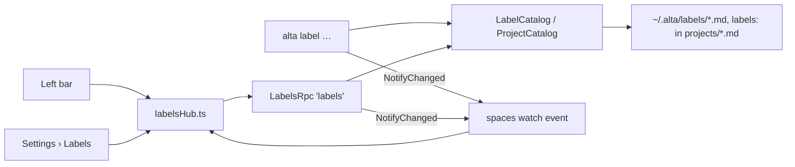

# Organize projects with nested labels

A space with many projects becomes a long flat list in the left bar: only favorites and "Other projects" split it. After this work a user gives projects **labels** (`Infra`, `Helm charts`, `Client X`), and the left bar shows them grouped under each label, with the label badge as the group header. Labels nest, but projects never move right: the session indentation stays as it is today. Agents can create, assign and query labels, so "work on the projects labeled *infra*" is one command away.

## What changes

### A label, and where it is kept

A label is one Markdown file under `~/.alta/labels/`, as spaces are under `spaces/`. The file name is the id: a slug of the first name, never changed afterwards (renaming changes `name` only; a collision gets `-2`). A label carries a name, an icon, a badge color, its order among its siblings, an optional parent, a favorite flag and an optional space. The body is an optional description, which agents read.

```yaml
# ~/.alta/labels/helm-charts.md
---
id: helm-charts
kind: label
name: Helm charts
icon: cube
color: "#238551"
order: 2
parent: infra        # absent = top-level label
favorite: false
space: work          # only on a top-level label; absent = every space
---
Helm charts deployed by the platform team.
```

A project lists its labels by id in its own file, beside `spaces`, edited one line at a time as `spaces` is (`ProjectCatalog.UpdateLabelsAsync`, copied from `UpdateSpacesAsync`):

```yaml
# ~/.alta/projects/backup-helm-chart.md
spaces: [work]
labels: [helm-charts]
```

- `LabelDescriptor` and `LabelCatalog` in `src/CodeAlta.Catalog/` are modeled on `SpaceDescriptor` and `SpaceCatalog`: the same id allocation across processes (`TryCreateAsync`), the same validation of name, icon and color, a gate, revision-checked writes, and invalid values that are dropped without hiding the file.
- **Space.** Only a top-level label has a `space`. Its sub-labels belong to that space. A label is shown in a space when its root has no space or has this one (`SpaceScope.IsAvailable`). Assignments are global, like the project file: a project labeled `infra` shows that label only in spaces where `infra` exists.
- **Nesting.** The depth is capped at 4. A cycle or a missing parent is read as a top-level label. Moving a label writes its own file, then renumbers only its new siblings.
- **Delete.** Deleting a label removes its id from the projects, and its sub-labels move up to its parent. Deleting a space deletes its labels too: they were made for it, and a label left pointing at a missing space would be hidden everywhere. The space's delete confirmation says so.
- The existing free-text `tags` field of projects stays as it is. Labels need ids, a tree and colors, and reusing `tags` would give one field two meanings.

### The left bar groups projects under label badges

**Group by labels** is on by default and toggled in the **…** menu of the PROJECTS header, next to "Sort projects". It is a preference of the window, like the sort. A label is a section header, like FAVORITES today, not a parent row. Projects stay flush left, so a project row and its sessions sit exactly where they sit now.

```text
PROJECTS 27                              ⧉  …  +
★ FAVORITES
▾ 📁 brain  ≡10
     Branch                       2 days ago
     Prompt crafter               2 days ago
[◆ Infra] 4                          ★
▸ 📁 azdo-iac  ≡5
▸ 📁 cloud-management  ≡5
  [◆ Helm charts] 3                      ← sub-label: the header alone steps in, 12 px
▸ 📁 backup-helm-chart
▸ 📁 cluster-helm-chart
[◆ Terraform] 3
▸ 📁 terraform-core-naming  ≡1
OTHER PROJECTS
▸ 📁 hal9k  ≡42
```

- **Header.** It shows the label as a badge (its icon, its name, a tint of its color), then the number of projects, and a chevron that folds the group. Folding a label also folds its sub-labels. Folded labels are kept with the other rail state of the window (`ProjectTree`, a new `collapsedLabels` list).
- **Sub-labels.** A sub-label header steps in once by 12 px, and deeper levels do not step in further. Where a sub-label is shown away from its parent (as a favorite, or in a filtered list), it shows its path, with the parent dimmed: `Infra › Helm charts`.
- **Order.** Favorite projects stay in FAVORITES on top, as today. Favorite labels come next, in their order. A favorite sub-label moves up alone with its own sub-labels, under its path, and its parent stays in place. The other labels follow in tree order. **Other projects** holds the projects without a label of this space. Projects inside a group follow the sort of the window (name or recent).
- **A project with several labels** is listed under each of them. The primary use is one label per project.
- **Empty labels** are shown, with a count of 0, so that a label just created is a place to drop projects into.
- **Filter.** The sidebar filter keeps the groups that have a match and opens them.
- **Flat mode** is today's list (FAVORITES, OTHER PROJECTS). Each project row shows its labels as small badges after its name: at most two, then `+n`, and the full path in a tooltip. The badges shrink before the name does.

### Labels are edited where they are shown

In the left bar, without opening Settings:

| Where | What |
| --- | --- |
| Label header, on hover | ★ favorite, **…** menu: *Edit…* (popover with name, icon and color, the pickers of the space dialog), *New sub-label…*, *Move up / Move down*, *Delete* (the small confirmation popover beside the row) |
| Label header, drag | Reorders it among its siblings. Dropping it in the middle of another header nests it there. |
| Project row, drag onto a label header | Adds that label to the project (the drop pattern of `useProjectDrag`) |
| Project **…** menu | **Labels ›** a checklist of the space's labels, and *New label…* |
| PROJECTS **…** menu | *New label…*, *Group by labels* |

Drags use the existing pointer hooks (WebView2 ends a native HTML5 drag at once), with Escape to cancel and a scroll of the list at its edges. The menu items give the same moves without a mouse.

### A Labels page in Settings

A new **Labels** page sits beside **Spaces**. It shows the labels of the shown space and the labels of every space as one tree. Each row has a grip, the badge, a space chip, a star and its number of projects. Rows reorder and nest by drag (before, after, into), with *Move up / down / in / out* buttons as the keyboard path. Selecting a label opens its form: name, icon, color, space (top-level only), description, and its projects, with a picker to add projects. The page uses the `run()` notice pattern of `SpaceSettings.tsx`.

### `alta label` for agents

A new `label` group in `src/CodeAlta.LiveTool/` (a `BuiltInAltaCommandContributor.Labels.cs` partial, on the model of `.Spaces.cs`). Labels are referred to by id, by name or by a unique id prefix.

```text
alta label list [--space <s>]                        tree order; records carry their path
alta label show <label>                              the label and its projects (sub-labels included)
alta label create <name> [--parent <l>] [--icon <i>] [--color <#hex>] [--space <s>] [--favorite]
alta label set <label> [--name <n>] [--icon <i>] [--color <#hex>] [--favorite|--no-favorite] [--description <text>]
alta label move <label> [--parent <l>|--root] [--before <l>|--after <l>]
alta label delete <label>
alta label assign <label> <project>...
alta label unassign <label> <project>...
alta project list --label <l> [--direct]            sub-labels included unless --direct
```

```json
{"type":"alta.label.detail","version":1,"id":"helm-charts","name":"Helm charts","path":"Infra › Helm charts","parent":"infra","icon":"cube","color":"#238551","favorite":false,"space":"work","order":2,"projects":[{"id":"…","slug":"backup-helm-chart","name":"backup-helm-chart","path":"C:\\ops\\backup-helm-chart","archived":false}]}
```

- `list` and `show` are reads and run in a sandboxed session: they are added to the allowed set of `AltaSandboxGate`. Every other subcommand is refused there, as `space` mutations are.
- A session sees the labels of its own space and those of every space. Changing a label of another space is refused, as `space.notOwnSpace` refuses for spaces.
- `create` without `--space` creates the label in the calling session's space. In the default space it creates a label available in every space.
- `delete` is a disruptive command, and the help asks agents to delete only labels they created or that the user asked to delete, as `alta space` does.
- Each change calls the existing `NotifyChanged()` of the space view, so open windows reload at once.

### How a change travels



`LabelsRpc` (`src/CodeAlta/Desktop/Rpc/`) offers `list`, `create`, `update`, `delete`, `assign`, `move` and `favorite`. It mirrors `SpacesRpc`: epoch checks, and `ok` / `not_found` / `conflict` / `invalid` outcomes. Items carry `projectIds`, as `SpaceItem` does.

## Steps

- [x] 1. **Model.** Add `LabelDescriptor`, `LabelCatalog` (`CatalogOptions` path `labels/`) and its YAML front matter in `CatalogYamlSerializer`. Read rules: depth cap, cycles, missing parent, sub-label space. Add tests in `CodeAlta.Catalog.Tests`.
- [x] 2. **Project labels.** Add `ProjectDescriptor.Labels` and `ProjectCatalog.UpdateLabelsAsync`. Add `Labels` to every hand copy so that no save drops it: `ProjectCatalog.Copy`, both serializer directions, the reread guards of `ProjectCatalog.Spaces.cs`, the TUI `ProjectDetailsDialog.CloneProject` and `NavigatorActionCoordinator`. Add a regression test: a TUI save keeps `labels`. *Done as one `ProjectDescriptor.Copy()` that the catalog and both TUI copies call, with a test that a copy keeps every property.*
- [x] 3. **Cascades.** Deleting a label cleans the projects and moves its sub-labels up. Deleting a space deletes its labels. Add tests.
- [x] 4. **`alta label`** and `project list --label`, with policies (read, mutating, disruptive), the sandbox allow-list, own-space containment, help text and `NotifyChanged`. Add tests beside `AltaSpaceCommandsTests.cs`.
- [x] 5. **`LabelsRpc`**, registered with the desktop host, with tests beside `SpacesRpcTests.cs`. Add the service to `demo-api.ts` and `projectFocus.neoastra.mount.ts`.
- [ ] 6. **Rail grouping as a pure function.** `projectRailGroups` in `explorer/projectRail.ts` turns the projects (after the sidebar filter), the labels, the favorites and the sort into ordered groups. Add unit tests for favorite sub-labels, several labels, empty labels and the filter.
- [ ] 7. **Rail rendering.** `ProjectRailRows` takes the groups; label headers, folding (`collapsedLabels` in `ProjectTree`), flat-mode badges, the *Group by labels* item in `windowPreferences`, and keyboard row navigation that includes the headers. Add SSR tests in `ProjectRailRows.test.ts`.
- [ ] 8. **Editing in the rail.** The header menu and its popovers, the project **Labels ›** submenu, a project dropped on a header, and header drag to reorder or nest (a new pointer hook beside `projectDrag.ts`). Add a browser test for the drags.
- [ ] 9. **Settings › Labels page**: the tree, drag and buttons, the form, the project picker. Add a browser test.
- [ ] 10. **Docs.** A new `site/docs/labels.md` in `menu.yml` (left bar, Settings, agents), a link from `spaces.md`, and `labels/` in `doc/catalog-and-config.md` (files table and Projects section). Add `label` to the command table in `doc/live-tool.md`, and a line on labels to `readme.md`.

## How it is verified

- [ ] `dotnet test -c <Configuration>` and `npm test` pass, and `lunet build` in `site/` succeeds.
- [ ] In the developer instance, with a temporary project set: create `Infra` and `Infra › Helm charts` in the rail, drag projects onto them, fold, reorder by drag, favorite the sub-label (it moves up alone, with its path), and switch to flat mode (the badges show). Check both themes and the 900×650 window.
- [ ] `alta label create Demo --space work`, then `alta label assign demo <project>`: the open window updates without reloading, and `alta project list --label demo` lists the project.
- [ ] A label of the `work` space is not listed in `personal`, and deleting a temporary space deletes its labels.
- [ ] Saving a project in CodeAlta TUI keeps its `labels:` line.

## Decisions

| Decision | Choice | Why |
| --- | --- | --- |
| Storage | One file per label under `labels/`, ids in the project file | Same pattern, locks and tooling as spaces; a hand edit stays easy |
| Rail shape | Labels are section headers, projects never indent | The session tree already indents twice |
| Favorite label | Kept in the label file (`favorite: true`) | Agents can set it, and every window agrees. Favorite *projects* stay a preference of the window, as today. |
| Space of a sub-label | Inherited from its top-level label | A tree split across spaces has no sensible display |
| Several labels per project | Listed under each label | A label answers "which projects are X", and agents query it that way |
| Group or flat | Preference of the window, grouped by default | Same place and storage as the sort |
| Space deleted | Its labels are deleted with it | Otherwise they are hidden everywhere |
| CodeAlta TUI | No label UI. Labels are kept on save. | New features are desktop only |

The review approved the three choices that were open: a project is listed under each of its labels, the favorite flag is kept in the label file, and deleting a space deletes its labels.

## Risks

- **Older builds.** An older CodeAlta (another instance on the same profile) ignores `labels:`. A full rewrite of a project file by it would drop the line, as it would drop `sandbox:`. Most project edits write one line, which limits this.
- **Tree drag is new UI.** Nothing in the app reorders by drag yet. The menu and button moves give a path that does not depend on the drag.
- **Reorders touch several files.** A concurrent reader can see half a renumbering, as with spaces. The reader tolerates duplicate orders by falling back to the name.

## Out of scope

- Labels in CodeAlta TUI, and in `altacli`, which never writes the catalog.
- Labels on sessions, or filters of Statistics and Search by label.
- Migrating the free-text `tags` of projects to labels.

<details><summary>Evidence behind the choices</summary>

- The rail is one non-virtualized list: `ProjectRailRows.tsx` splits it at `favorites` into FAVORITES and OTHER PROJECTS, and `projectRailProjection` in `projectRail.ts` orders it. Indentation exists only in `.project-session-branch` (`style.css`) and `sessionRowIndent` (`ExplorerSessions.tsx`).
- Project favorites are window-local (`ProjectTree.favorites` in the page's storage). No C# code knows them.
- Spaces have no file watcher: `alta space` calls `IAltaSpaceView.NotifyChanged()`, which `DesktopSpaceView` publishes to the `watch` loop of `spacesHub.ts`.
- Drags are pointer-based (`spaces/projectDrag.ts`, `sessionDrag.ts`), because a native HTML5 drag ends immediately under WebView2. Spaces reorder with buttons only.
- The icon and color pickers are `ProviderIconPicker` and `SpaceColorChoice` (`spaces/SpaceDialog.tsx`, `SpaceGeneral.tsx`), and `SpaceIcon` renders the result.
- `AltaSandboxGate` allows only `project list|show|resolve|current` and `space list|show|current`.
- Project `tags` are read only by the TUI details dialog and echoed in `alta project` records.

</details>
