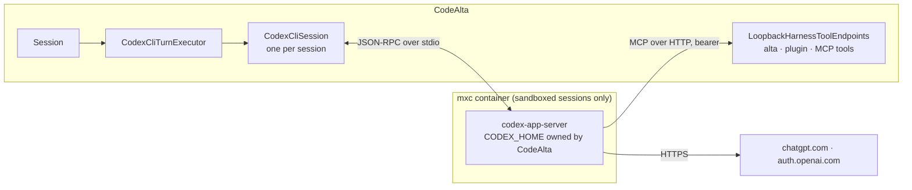

# Codex CLI provider (`codex-cli`) over `codex-app-server` (#250)

ChatGPT Business users cannot use Codex in CodeAlta today. The `codex` type signs in with OpenAI's sign-in for third-party apps (`dynamic_agent_client`, scope `chatgpt.tokens.use.direct`). Business workspaces refuse it with `3p_delegated_access_policy_denied`, and admins have no setting to allow it. The Codex CLI signs in with its own client and works for the same accounts.

Once this work is done:

- **Settings > Providers > Add provider** offers **Codex CLI**. The first time it is needed, CodeAlta downloads the `codex-app-server` package of the pinned Codex release. The pin is the latest stable release on GitHub, the one whose protocol CodeAlta validated. A `codex` or `codex-app-server` the user installed can be named instead.
- **Sign in** happens in CodeAlta, as for the `codex` and Copilot types: **Sign in with ChatGPT** opens the browser, and **Sign in with a device code** shows a code to enter. The app-server runs Codex's own sign-in (`account/login/start`), which works for Business workspaces. Codex keeps the token in its home, and CodeAlta never reads it.
- A Codex CLI session works like a Claude Code session:
  - model and effort, send, steer, stop, compaction, fork;
  - CodeAlta's instructions, and the `alta`, plugin and MCP tools;
  - permission modes and CodeAlta's sandbox;
  - plan usage.
- The `codex` type stays as it is. The two types are separate choices, and the user guide says when to pick which.

## What changes

CodeAlta starts one `codex-app-server` per session and speaks its JSON-RPC over stdio. Codex keeps the model loop and the coding tools its models are trained on. Everything around that loop is CodeAlta's, as it is for Claude Code.

- **CodeAlta takes over:** the instructions, the tools, delegation, skills, plugins, hooks, approvals and the sandbox.
- **Codex keeps:** `exec_command`/`write_stdin`, `apply_patch`, `view_image`, its hosted web search and its compaction.



The work is in two new projects and a few small changes to shared code. The size is about 5–6k hand-written lines, about 220 generated protocol types, and about 3k lines of tests.

### 1. The protocol library: `src/CodeAlta.CodexAppServer`

This is a protocol-only library, like `src/CodeAlta.Acp`:
- generated types;
- a JSON-RPC transport over stdio, with stderr drained to the log and a timeout per request;
- a typed client;
- a process launcher that also starts through `IAgentProcessHost`.

It holds no CodeAlta runtime type.

The types come from the schema that Codex checks into its repository (`codex-rs/app-server-protocol/schema/json/`), at the tag of the pinned release. Nothing is downloaded or run to generate them. The generator ports the removed one (`0f68f504^:src/CodeAlta.CodexSdk.Generator`):
- the old `SchemaWalker` merges the 25 files the v2 bundle lacks, such as server requests and `initialize`;
- the emitter takes the fixes of `CodeAlta.Acp.Generator`;
- it records `--source-ref` without a machine path.

A list checked into the generator scopes it to what CodeAlta calls. That is about 220 types instead of 746:
- the requests and their responses;
- every notification and server request of a turn.

Unions accept an unknown `type`, because Codex often adds `ThreadItem` kinds. No experimental surface is used, so `capabilities.experimentalApi` stays off.

```sh
dotnet run --project src/CodeAlta.CodexAppServer.Generator -- --codex-repo-dir ../codex --source-ref rust-v0.165.0
```

`--source-ref` is always the tag of the pinned release.

### 2. The plugin: `src/CodeAlta.Plugin.CodexCli`, type `codex-cli`

This is a built-in plugin that uses only the public plugin contracts and the harness toolkit (`CodeAlta.Agent/Harness/`), as `doc/providers.md` asks for "an agent with its own loop". It is listed with the other built-in plugins in `src/CodeAlta/Desktop/DesktopPlugins.cs`, `src/CodeAlta.Tui/App/CodeAltaBuiltInPlugins.cs` and `src/CodeAlta.Cli/CliHost.cs`.

Its `PluginModelProviderContribution` has these parts:

- **Settings:**
  - `command`: the executable to run. Empty means the pinned package. A program the user installed runs only when this setting names it, and its status says when its version is not the pinned one:
    - a file named `codex-app-server` runs as it is;
    - any other name is the `codex` CLI (npm, Homebrew), started with `app-server` as its first argument.
  - `codex_home`: empty means `~/.alta/plugin-data/codex-cli/<provider key>`. Several providers are several accounts.
  - `env`: extra variables.
- **Permission modes:** `default`, `acceptEdits` and `bypassPermissions`, as ACP has them.
- **Account:** the sign-in runs in CodeAlta through a short-lived app-server in the provider's home, never in a terminal. See "Sign-in from CodeAlta" below.
- **Catalog and pinned release:** the Codex release as `ClaudeCodePinnedCli` pins Claude Code. It records the version, and the size and SHA-256 of the `codex-app-server-package-<target>.tar.gz` asset for each of the six targets:
  - `aarch64-apple-darwin` and `x86_64-apple-darwin`;
  - `aarch64-unknown-linux-musl` and `x86_64-unknown-linux-musl`;
  - `aarch64-pc-windows-msvc` and `x86_64-pc-windows-msvc`.

  The package is the standalone app-server: the whole `codex` CLI with its TUI is not needed. For 0.165.0 on `aarch64-apple-darwin` it is 105 MB. It unpacks to:
  - `bin/codex-app-server`, the executable, signed by OpenAI on macOS;
  - `codex-path/rg`, which Codex expects on the `PATH` of its commands, so the launcher puts `codex-path` first on `PATH`;
  - `codex-package.json`, holding `version`, `target` and `entrypoint`, which the installer checks against the pin;
  - `bin/codex-code-mode-host`, unused since Codex's code mode is off.

  Each platform package is downloaded automatically into `~/.alta/cache/codex-cli/<version>/<target>/` the first time a provider without `command` needs it:
  - when the provider is added from the type's catalog entry (**Add provider > Codex CLI**), with its progress;
  - otherwise at the first probe or session start, if it is still missing.

  One download runs at a time, for all providers and both instances, under a file lock. The hash is checked before the files are used. A download that fails gives `codex-cli-not-found` with the reason.
- **The pin is the latest stable release.** That means the newest GitHub release of `openai/codex` that is not marked as a pre-release, ignoring the `-alpha` tags that appear several times a day. Today that is `rust-v0.165.0` (2026-10-27). Bumping the pin is a release step, as it is for Claude Code:
  - take the latest stable tag;
  - copy the hashes from the release's `digest` fields or its `codex-package_SHA256SUMS` asset;
  - regenerate the protocol types at that tag;
  - run the live tests.

  `gh release list -R openai/codex --exclude-pre-releases --limit 1` names the tag. The bump is checked again at the start of step 1, and once more before the work is released.
- **Runtime:** the probe starts the app-server in a probe folder and calls:
  - `initialize`;
  - `account/read`, which gives the categories `codex-cli-signed-out`, `codex-cli-not-found` and `codex-cli-unavailable`;
  - `model/list`, for the models, their efforts, the default model and the hidden ones.

  The executor implements the same contracts as ACP's:
  - `IAgentProviderToolHost`, `IAgentProviderKeptConversation`, `IAgentProviderPermissionMode`;
  - `IAgentProviderInstructionsChannel`, `IAgentProviderSessionCleanup`.
- **Session:** `CodexCliSession` owns one app-server process and one Codex thread.
  - The process starts again when the working folder, the sandbox host or the environment changes.
  - It closes after 10 idle minutes, as Claude Code's does.
  - Its provider state records the thread id, how much of the conversation the thread holds, and the hash of the instructions.

### Sign-in from CodeAlta

Unlike Claude Code, the app-server signs in by itself through stable requests (`codex-rs/app-server-protocol/src/protocol/v2/account.rs`), so CodeAlta drives the whole sign-in.

The plugin has two methods:
- **Browser:** `account/login/start {type: "chatgpt"}` returns an `authUrl`. The app-server listens for the browser's return on `localhost:1455` (`codex-rs/login/src/server.rs:79`), and falls back to another port when that one is taken.
- **Device code:** `account/login/start {type: "chatgptDeviceCode"}` returns a `verificationUrl` and a `userCode`. This is for remote or headless computers.

For both methods:
- The process stays alive until the `account/login/completed` notification arrives.
- Codex then writes `auth.json` in the provider's home (`cli_auth_credentials_store = "file"`).
- Cancel sends `account/login/cancel`.
- `{type: "apiKey"}` is left out. An API key is the `openai-responses` type.

This was checked on 2026-10-28 with the pinned 0.165.0 and a ChatGPT account:
- The `authUrl` uses Codex's own client id (`app_EMoamEEZ73f0CkXaXp7hrann`) with `originator=codealta`.
- The browser sign-in completed, and Codex wrote `auth.json` (mode 600).
- `account/read` then reported the `chatgpt` account and its plan.

**Fallback: the terminal, as Claude Code does.** If OpenAI's terms or a refusal ever rule out the sign-in from CodeAlta, the methods become terminal commands (`PluginProviderSignInMethod.TerminalCommand`) with `CODEX_HOME` set: `codex login` and `codex login --device-auth`. The standalone package has no `login` command, so that fallback needs the `codex` CLI: the user's own, or the release's `codex-package-<target>` asset. Nothing found so far points that way. The app-server's login requests are a documented client API, and OpenAI's binary runs the sign-in with its own client id.

**The plugin contract cannot show a prompt today.** `IPluginProviderAccount.SignInAsync(settings, methodId, ct)` returns nothing to show, and `pluginProviderSignIn` only waits for it. Built-in sign-ins already have that path: `ConfiguredProviderLogin.LoginAsync` reports a `ProviderLoginPrompt(Uri, UserCode, ExpiresAt)`, `ProviderLoginRpc.login` streams `ProviderLoginEvent`s, and `ProviderAccount.tsx` opens the browser or shows the code. The plan reuses that path for plugins:
- **Contract.** `CodeAlta.Plugins.Abstractions` gets `PluginProviderSignInPrompt(Uri Uri, string? UserCode, DateTimeOffset? ExpiresAt)`. `IPluginProviderAccount` gets an overload, `SignInAsync(settings, methodId, Func<PluginProviderSignInPrompt, CancellationToken, ValueTask> onPrompt, ct)`. It is a default interface method that calls the current one, so the ACP plugin and third-party plugins keep compiling. It has XML docs.
- **Desktop.** `pluginProviderSignIn` becomes a channel of the same events as `providerLogin.login`. The provider form shows the plugin's prompt with the component the built-in sign-ins use: the browser is opened, or the code is shown with a copy button, plus a cancel button.
- **TUI.** No new screen. The TUI offers no plugin sign-in today, and that stays the case. A user of the TUI signs in once from the desktop app; the home is shared.

### 3. A `CODEX_HOME` owned by CodeAlta

Before it starts a process, CodeAlta writes the home's `config.toml`. The user's `~/.codex` is never read, so none of their MCP servers, hooks, `notify`, skills, plugins or AGENTS.md apply. Every key below was checked against the Codex source.

```toml
sandbox_mode = "danger-full-access"         # Codex's own sandbox is always off
approvals_reviewer = "user"                 # approvals come to CodeAlta, no automatic reviewer
cli_auth_credentials_store = "file"         # auth.json in the home: the keychain is out of reach in the sandbox
mcp_oauth_credentials_store = "file"
project_doc_max_bytes = 0                   # CodeAlta passes AGENTS.md in its own instructions
include_permissions_instructions = false    # its sandbox text would be wrong: CodeAlta's note says what applies
include_apps_instructions = false
include_collaboration_mode_instructions = false
analytics = { enabled = false }
feedback = { enabled = false }
otel = { exporter = "none", trace_exporter = "none", metrics_exporter = "none" }
agents = { enabled = false }                # with multi_agent off: delegation goes through CodeAlta sessions
skills = { include_instructions = false, bundled = { enabled = false } }

[features]
multi_agent = false
multi_agent_v2 = false
apps = false
plugins = false
remote_plugin = false
plugin_discovery_prefetch = false
hooks = false
tool_suggest = false
guardian_approval = false
goals = false
image_generation = false
browser_use = false
computer_use = false
in_app_browser = false
skill_search = false
skill_mcp_dependency_install = false
memories = false
```

Each thread gets what depends on the session through `thread/start`, and gets it again with each `thread/resume` and `thread/fork`, since Codex does not keep it:

```json
{
  "cwd": "/Users/me/code/project",
  "model": "gpt-6.1-sol",
  "approvalPolicy": "never",
  "sandbox": "danger-full-access",
  "developerInstructions": "# CodeAlta\n…",
  "config": {
    "web_search": "live",
    "mcp_servers": { "codealta": {
      "url": "http://127.0.0.1:53111/<session path>",
      "http_headers": { "Authorization": "Bearer <session secret>" },
      "default_tools_approval_mode": "approve",
      "tool_timeout_sec": 3600,
      "required": true } },
    "projects": { "/Users/me/code/project": { "trust_level": "untrusted" } }
  }
}
```

Each of these values is there for a reason:
- **`developerInstructions` adds to Codex's prompt; it never replaces it.** A later change goes as `HarnessInstructions.CreateUpdate` with the next prompt, as it does for Claude Code.
- **`default_tools_approval_mode = "approve"`:** CodeAlta's permissions decide for its own tools. With Codex's default, every tool without a read-only hint would be asked, or refused under `never`.
- **`trust_level = "untrusted"` set explicitly:** Codex otherwise marks the project trusted in `config.toml` when the thread runs with full access. Untrusted also skips the project's `.codex/config.toml` and AGENTS.md.
- **`web_search = "disabled"`** replaces `"live"` when the session turns off web tools.

### 4. How a turn maps

| CodeAlta | Codex app-server |
| --- | --- |
| New conversation, or a journal the thread does not hold | `thread/start`; the first `turn/start` begins with `HarnessHistory`'s `<codealta_previous_conversation>` |
| Same conversation, new process | `thread/resume {threadId}`, with the per-thread values again |
| Send, steer, stop | `turn/start`, `turn/steer {expectedTurnId}`, `turn/interrupt` |
| Compaction (the agent's; local compaction is off) | `thread/compact/start` |
| Fork and rewind | `thread/fork {threadId, lastTurnId}`, so the prompt cache is still read |
| Text and reasoning | `item/agentMessage/delta`, `item/reasoning/*Delta` |
| Codex's own tools | `item/started`/`item/completed` for `commandExecution`, `fileChange`, `webSearch` and `imageView`, through `HarnessToolCallBridge`; `item/commandExecution/outputDelta` is the progress |
| CodeAlta's tools | `mcpToolCall` items of the `codealta` server, run by the session's MCP server |
| Approvals | `item/commandExecution/requestApproval` becomes `AgentCommandPermissionRequest`, and `item/fileChange/requestApproval` becomes `AgentFileChangePermissionRequest`. `item/permissions/requestApproval` is declined, since Codex's sandbox is off. Unknown requests get a JSON-RPC error. |
| Usage and failures | `thread/tokenUsage/updated`. `turn/completed` failures are classified from `codexErrorInfo`: `usageLimitExceeded` is `QuotaExhausted`, `unauthorized` is `Auth`, `contextWindowExceeded` is `Other`. `error` with `willRetry` is a retry notice. |

Permission modes become the `approvalPolicy` of each `turn/start`:
- `bypassPermissions` becomes `never`;
- `default` and `acceptEdits` become the policy that makes Codex ask for commands and patches, with `acceptEdits` accepting patches in CodeAlta.

The live test of step 6 settles that policy: `untrusted` is the candidate.

### 5. The sandbox

A sandboxed session starts the app-server in its own container, as Claude Code and ACP agents do. `SandboxedProviders.StartsInSandbox` gets `codex-cli` beside `acp`. The `AgentProcessLaunch` holds:

| | |
| --- | --- |
| Read-only | the unpacked package (`bin/`, `codex-path/`), or the folder of the `command` the user named and the target of its link |
| Read-write | the `CODEX_HOME` of the provider |
| Protected (read-only, never created) | `config.toml`, `AGENTS.md`, `AGENTS.override.md`, `.env`, `rules/`, `hooks.json`, `skills/`, `plugins/` |
| Hosts | `chatgpt.com`, `auth.openai.com`, `api.openai.com` |
| Local ports | the port of the MCP endpoint, opened before the process starts |

Codex's commands and patches are children of that process, so they stay in the container. Sessions that are not sandboxed run the same way, without a container, and CodeAlta's permission modes decide.

### 6. Desktop and shared code

- **Problem texts:** `ModelCatalogRpc.cs` and `providerForm.ts` know only the `claude-code-*` and `acp-*` codes today. They accept `codex-cli-*` too, including the signed-out banner with its sign-in button.
- **Plugin sign-in prompts:** the contract overload and the channel of `pluginProviderSignIn`, as "Sign-in from CodeAlta" describes.
- **Plan usage:** `ConfiguredProviderUsage` gets a `codex-cli` case that calls the existing `CodexAccountUsage.ReadAsync` with the provider's `CODEX_HOME` and the resolved executable. `CodexAccountUsage` always adds `app-server` today (`src/CodeAlta.Agent.OpenAI/Codex/CodexAccountUsage.cs:276`). It learns the standalone `codex-app-server`, which takes no subcommand. The home is computed by one helper in `CodeAlta.CodexAppServer`, shared with the plugin. `subscriptionUsage.ts` and the usage label get the type.
- **Icon:** the plugin's `GetIconSvg`.

## Steps

- [x] 1. **Generator and protocol library.** Check the latest stable Codex release first, and move the pin if a newer one than 0.165.0 is out. Port the generator into `src/CodeAlta.CodexAppServer.Generator` with the scope list, then generate `src/CodeAlta.CodexAppServer/generated/` from the pinned tag. Write the transport, client and process. Add both projects to `CodeAlta.slnx`. Tests: port the old generator tests, add ACP's pattern, and add a round trip of captured app-server JSON lines with an unknown `ThreadItem` kind.
  - Done: 0.165.0 is still the latest stable release (2026-10-28). The generator reads the schema with `git archive` at the tag (no checkout, paths combined segment by segment for Windows) and keeps the 215 types the 47 methods of `codex-app-server-methods.json` reach. Beyond the plan, enums read an unknown value as `UnrecognizedValue`, and the pinned package, its installer and the command resolution are in the library already (step 4 uses them).
- [x] 2. **Fake app-server for tests.** Add `CodexAppServerFake.cs`, a scripted JSON-RPC peer like `AcpFakeAgent.cs`, that records what it receives.
  - Done: `CodexAppServerFake` scripts turns (text, reasoning, commands, file changes, approvals, MCP calls over HTTP, plans, steers, failures) and keeps its threads for resume and fork.
- [x] 3. **Plugin skeleton.** Contribution, settings and validation, registration in the three hosts, the `CODEX_HOME` helper, and the `config.toml` writer. Tests: registration, validation, and the exact `config.toml` written.
  - Done: the `codex-cli` plugin, its settings (`command`, `codex_home`, `env`; `~/.codex` and `CODEX_HOME` refused), the three hosts, and the `config.toml` writer. A live check found `features.plugin_discovery_prefetch` unknown to 0.165.0: it is left out.
- [ ] 4. **Probe, models, sign-in and download.**
  - Probe categories and `model/list`.
  - The pinned package with its hashes, and its automatic download from the catalog entry and at first use, with the `codex-path` folder put on `PATH`.
  - The sign-in prompt contract and the browser and device-code sign-ins over `account/login/*`.
  - The `--session-source` value the app-server is started with. Its default is `vscode`, and it "derives product restrictions" (`codex-rs/app-server/src/main.rs:51`). The candidate is a custom `codealta`. With the test home on 2026-10-28, `model/list` (8 models, `gpt-6.1-sol` the default) and `account/rateLimits/read` gave the same answers with `vscode` and with `codealta`. Turns are still to check.

  Tests:
  - the probe against the fake: signed in, signed out, not found;
  - the download: verified by hash, refused on a wrong hash or a `codex-package.json` that does not match, done once when two providers start together, and reported when offline;
  - the sign-in against the fake: the prompt for each method, completion, cancel and failure;
  - the default overload of the contract.
- [x] 5. **Session and executor.** Start or resume the thread, turns, steer, stop, the event reducer, the tool bridge, the MCP endpoint, instructions and their updates, and the provider state. Tests with the fake: a turn with text, reasoning, a command and an MCP call; a resume after a new process; an instructions update; a journal the thread does not hold.
  - Done: one app-server and thread per session; resume in a new process, a new thread told the conversation when Codex lost the thread, instruction updates, steering of the running turn (its next turn when Codex refuses the steer).
- [x] 6. **Approvals and permission modes.** The approval mapping and the `approvalPolicy` of each mode. Tests with the fake for each mode. A live test settles the policy that asks for commands and patches.
  - Done: `untrusted` for `default` and `acceptEdits`, `never` for `bypassPermissions`. The live test confirms that Codex asks before a command that writes a file under `untrusted` with its sandbox off.
- [x] 7. **Fork, rewind, compaction and failures.** `thread/fork`, `thread/compact/start`, and failure classification. Tests with the fake for each.
  - Done: a rewind or a fork forks the thread at the turn the point ends (`lastTurnId`), from the last 100 turns kept in the provider state. The live test confirms that the developer instructions survive the compaction of Codex: they are part of its turn context, rebuilt at each turn.
- [ ] 8. **Sandbox.** `StartsInSandbox`, plus the launch with its folders, protected paths, hosts and port. Tests: a sibling of `SessionSandboxTests` for `codex-cli`. A manual run of a sandboxed session on macOS.
- [ ] 9. **Desktop.** Problem codes, the signed-out banner, the plugin sign-in prompt in the provider form, plan usage with the standalone executable, and the icon. Tests: siblings in `ProviderUsageRpcTests`, `ConfiguredProviderUsageTests`, `PluginsRpcTests` (the sign-in channel) and `providerForm.test.ts`.
- [ ] 10. **Live tests.** `CodexCliLiveTests`, gated by:
  - `CODEALTA_TEST_CODEX_CLI`: the path of the pinned `codex-app-server`;
  - `CODEALTA_TEST_CODEX_HOME`: a home for the tests, signed in once through the app-server's sign-in. On this Mac that is `~/.alta/plugin-data/codex-cli/_live-tests`, signed in on 2026-10-28. The pinned 0.165.0 is unpacked, with its hash checked, in the ignored `tmp/codex-cli/0.165.0/`. That home is never `~/.codex`: the provider writes its `config.toml` there, and a copied `auth.json` would sign the user's own Codex out when its single-use refresh token rotates;
  - `CODEALTA_TEST_CODEX_TURN=1` for turns, which cost a little. They cover: probe and models; a turn that calls `alta`; steer, stop and compaction; and whether the instructions survive Codex's compaction.
- [ ] 11. **Docs.**
  - User guide:
    - a "Codex CLI" section in `site/docs/model-providers/setup.md`, next to "Codex (ChatGPT)", that says when to choose which;
    - a fields row in `configuration.md` and a row in the providers table of `readme.md`;
    - `sessions/sandbox.md`;
    - a `troubleshooting.md` entry for `3p_delegated_access_policy_denied`.
  - Architecture: a "Codex CLI" part in `doc/providers.md`, the project table and "The process of an agent" in `doc/sandbox.md`.
  - The features list in `readme.md`.
- [ ] 12. **Full validation.** As in "How it is verified".

## How it is verified

- [ ] `dotnet test -c <Configuration>` and `npm test` pass, and `lunet build` succeeds.
- [ ] The live tests pass on this Mac with the pinned `codex-app-server` and a signed-in test home.
- [ ] In the developer instance:
  - add **Codex CLI** and see the pinned package download;
  - sign in with the browser, then with a device code on a second provider, and see the models;
  - run a turn that edits a file and calls `alta session list`;
  - steer, stop, compact, fork and switch to Claude Code and back;
  - see the plan usage.
- [ ] A sandboxed session on Codex CLI: commands run in the container, a write outside the project fails, and `alta` works.
- [ ] The TUI runs a `codex-cli` session, and its Providers dialog leaves the provider's table unchanged.
- [ ] After a release: the reporter of #250 signs in with a Business workspace and runs a turn.

## Decisions

| Decision | Choice | Why |
| --- | --- | --- |
| Type name | `codex-cli`, shown as "Codex CLI" | Chosen by the user. `codex` stays the API type. An `openai-*` name would be treated as driven by CodeAlta. |
| Built-in project or plugin | Built-in plugin, like ACP | `doc/providers.md` sends agents with their own loop to plugins. Plugin types already get the MCP endpoints. The Claude-only features (shared transcripts, Remote Control) are not needed. |
| Processes | One app-server per session | One sandbox per session, a single writer per thread, and a crash affects only one session |
| Codex executable | The standalone `codex-app-server` package of the pinned release, downloaded automatically the first time it is needed. A `codex` or `codex-app-server` the user installed runs only when `command` names it. | Chosen by the user: the pinned version is the one whose protocol CodeAlta validated. OpenAI publishes the app-server on its own, so the CLI's TUI is not needed. |
| Pinned version | The latest stable GitHub release, now `rust-v0.165.0`, checked again at step 1 and before release | Chosen by the user. Pre-releases (`-alpha`) are skipped. |
| Home | A `CODEX_HOME` per provider, owned by CodeAlta, at `~/.alta/plugin-data/codex-cli/<provider key>` by default | Chosen by the user. It is shared by the normal and the developer instance. The user's config, MCP servers, hooks and skills never load. Several accounts are several providers. |
| Sign-in | In CodeAlta: browser or device code through the app-server's `account/login/start`, with a prompt contract for plugins. Codex stores the token; CodeAlta never reads it. | Suggested by the user. Codex's own sign-in works for Business. The app-server runs it, so the agent still signs itself in (`doc/providers.md`), and no terminal is needed. |
| Codex's sandbox | Always off; CodeAlta's container holds the process | Chosen by the user. Nested sandboxes are unreliable on Linux and Windows. |
| Codex features | Off, except its coding tools, web search and compaction | Chosen by the user. Its models are trained on those tools. |
| Instructions | `developerInstructions`, updates with the next prompt | CodeAlta adds and never replaces |
| CodeAlta's tools | The loopback MCP endpoint in the thread's `config` | Stable. `dynamicTools` is experimental. |
| Protocol types | A generated subset from Codex's checked-in schema, at the pinned tag | About 3 protocol commits a day upstream. No binary needed to generate. |
| Client name | `initialize.clientInfo.name = "codealta"` | CodeAlta must not present itself as Codex (`doc/providers.md`, Credentials) |
| Plan usage | A `codex-cli` case in `ConfiguredProviderUsage` | `CodexAccountUsage` already asks the app-server. There is no plugin usage contract yet. |

## Risks

- **Business admins can refuse full access.** Admin requirements (`requirements.toml`, MDM, the workspace's cloud bundle) can forbid `danger-full-access`. `thread/start` then fails with `failed to load configuration`. The session shows that message and the guide explains it. Codex's `external-sandbox` value may be a way out later; it is not traced yet.
- **OpenAI's policy on the client name.** If OpenAI's servers ever refused turns from a client that names itself `codealta`, #250 would not be fixed. Only the Business check after release proves it.
- **Approval policy.** No policy that makes Codex ask for commands and patches with its sandbox off is confirmed yet. Step 6 settles it with a live test. If none fits, `default` asks for commands only.
- **Instructions after compaction.** Codex may drop the developer instructions when it compacts. If the live test shows that, they are sent again after a `contextCompaction` item, as ACP does after `/compact`.
- **Windows.** Codex's PowerShell in the container is untested. The fallback is Claude Code's: turn off `features.shell_tool` and give the model CodeAlta's `shell_command`.
- **The sign-in is readable in the container.** Codex's commands can read `auth.json`, as with Claude Code's account folder. The proxy limits where it could be sent.
- **Protocol churn.** The pin, the generated subset, unions that accept unknown kinds, and the live tests run at each bump of the pin. Stable releases come about every few days (0.164.0 on 2026-10-23, 0.165.0 on 2026-10-27), so the pin falls behind quickly. A `codex` that the user installed and named in `command` can be newer than the pin, and its status says so.
- **The browser sign-in port.** The callback listens on `localhost:1455`. When the user's own Codex is signing in at the same moment, the app-server falls back to another port. The live check confirms that the fallback works.

## Out of scope

- Sharing conversations with the user's own Codex CLI or VS Code (`~/.codex`), and importing them.
- Turning off Codex's shell and `apply_patch`. That needs a replacement model catalog (`model_catalog_json`).
- Keeping the sign-in outside the container through Codex's `exec-server`, which is experimental.
- Any change to the `codex` type or its sign-in.
- Generic plugin contracts for plan usage and for starting in the sandbox. The type is named in both places, as `acp` is.
- TUI screens. Background terminals, Codex's review mode and realtime.

<details><summary>Evidence behind the choices</summary>

- **The sign-in.**
  - CodeAlta's `codex` type uses `ClientId = "dynamic_agent_client"` with the scope `chatgpt.tokens.use.direct` (`src/CodeAlta.Agent.OpenAI/Codex/OpenAICodexSubscriptionOAuthDefaults.cs`), since `c36769cd` (2026-10-02).
  - pi gets the same denial with that sign-in. Its "OpenAI Codex (legacy)" login, the Codex CLI's client id `app_EMoamEEZ73f0CkXaXp7hrann`, works for the same Business accounts (earendil-works/pi#10953, #11033).
  - Nothing in the Codex source checks for third parties. `clientInfo.name` only becomes the `originator` header (`codex-rs/login/src/auth/default_client.rs`).
- **The release.**
  - `rust-v0.165.0` is the latest release that is not a pre-release (`gh release list -R openai/codex`, checked on 2026-10-28).
  - It has a `codex-app-server-package-<target>.tar.gz` for six targets, with a SHA-256 `digest` on each asset and a `codex-package_SHA256SUMS` file.
  - The macOS arm64 package was downloaded and its hash checked. `bin/codex-app-server --version` prints `codex-app-server 0.165.0`. It takes `-c`, `--listen stdio://` (the default) and `--session-source`, and has no `login` command.
- **The prompt.**
  - `thread/start`, `thread/resume` and `thread/fork` take `baseInstructions` and `developerInstructions`, and neither is experimental (`codex-rs/app-server-protocol/src/protocol/v2/thread.rs`).
  - The removed integration replaced the base prompt. This plan appends.
- **Resume.** It works in a new process by thread id (`codex-rs/app-server/tests/suite/v2/thread_inject_items.rs`). The per-thread `config` and the instructions are not restored, so they are sent again (`thread_processor.rs`).
- **Config.** The per-thread `config` map is merged over `config.toml` as one layer (`codex-rs/config/src/merge.rs`). No key is refused per thread.
- **Nested sandboxes.**
  - Seatbelt inside a permissive Seatbelt profile works on macOS; that was checked here. It is untested under mxc's restrictive profile.
  - Linux bubblewrap needs user namespaces, which the outer container denies.
  - Codex's Windows sandbox changes permissions or creates users, which the container refuses.
- **What was removed before.**
  - `0f68f504` removed `CodeAlta.Agent.Codex`, 4.7k lines on the old `IAgentBackend`, which is gone.
  - It also removed the generator, 2.8k lines, which this plan ports.
  - That integration rejected CodeAlta's tools outright, which this plan fixes with the MCP endpoint.

</details>
