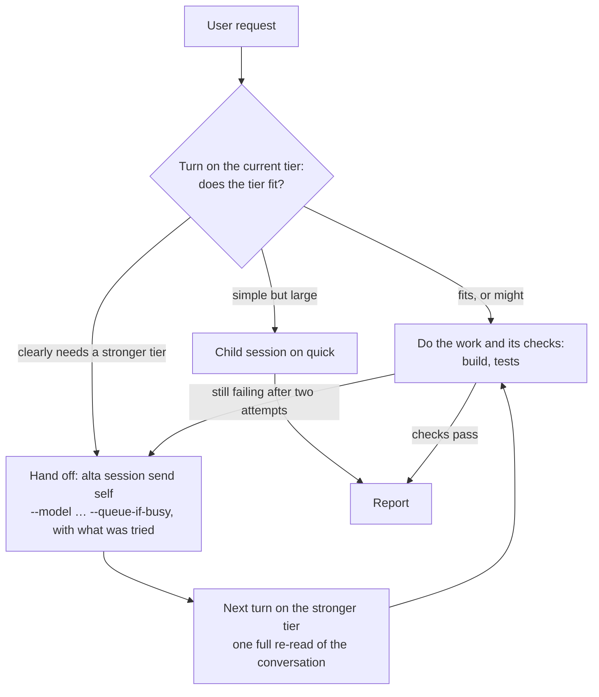

# Try an Adaptive mode that fits the model to each request (#273)

Today a session runs on the model the user chose until they choose another: people pay for a strong model on simple requests, or get a weak one on hard work. GitHub Copilot Fusion, generally available since 2026-10-28, picks the model of each request by itself (#266). CodeAlta has most of the pieces for its own version, with any provider: model tiers, a model change between turns, prices, usage per request.

This plan is an experiment. At its end we have:

- an `adaptive` agent prompt that anyone can try on real work, written without changing CodeAlta;
- numbers that compare it with Default: success, cost with the cache counted, switches, wasted turns;
- a decision backed by those numbers: make it a built-in mode, add a router to CodeAlta, or stop.

## What decides the design: a switch re-reads the conversation

Every request of a turn sends the whole conversation again. On a warm cache it is read at a tenth or a twentieth of the input price, but a cache belongs to one model: the first request after a switch reads it all at full price, and pays for writing the new cache.

For a conversation of 100k tokens, with the prices CodeAlta has from models.dev today and a 5-minute cache:

| Request on | Warm cache (read) | First request after a switch (write) |
| --- | --- | --- |
| Opus 5.5 ($4 in, $20 out per million) | $0.02 | $0.50 |
| Sonnet 5.5 ($2 in, $10 out) | $0.01 | $0.25 |
| Haiku 5.5 ($0.10 in, $0.50 out) | $0.001 | $0.0125 |

A turn is many requests: the planning turn that wrote this plan made 22 of them, which read 3 million input tokens, 96% from the cache. So:

- **A big step down is almost free.** Opus → Haiku costs less than one warm Opus request.
- **A small step down pays back slowly.** Opus → Sonnet costs $0.23 more than staying, and saves about $0.02 per request (input and 1k tokens of output): about a dozen requests to pay back.
- **Every step up pays a full write**: $0.50 for Opus at 100k, $2.50 at 500k. Going back and forth pays it again: the reasoning of the other model is replayed as text, so the old cache is unlikely to match.
- **Claude Code pays the most.** A change of model or of effort starts a new process that resumes the conversation, and it may use the 1-hour cache, which writes at 2× the input price instead of 1.25×. Codex keeps its thread and takes the model with each turn.
- **A change of effort alone is a switch too** (measured, see the spike below): on the Anthropic API only the system prompt and the tools stay cached, on Codex only a shared prefix of 4k tokens.

Billing changes what "cost" means. It is per token on the APIs and on Copilot (credits since 2026-06-01). On Claude and ChatGPT subscriptions it is a usage window, which a cheaper model stretches a lot: ChatGPT Plus gives 5–45 messages per 5 hours on GPT-6 Astra, 350–3,000 on GPT-6 Luna.

Fusion follows the same economics: it "keeps the main conversation on the same model when possible to preserve cached tokens", and gives helper models only the context they need. Artificial Analysis measured Fusion Max at 60 on its Coding Agent Index, against 62 for Claude Code on Opus 5.5 Max, at $5.59 per task instead of $11.42.

## What changes

### 1. The `adaptive` prompt, without code

A project prompt, `.alta/prompts/agents/adaptive.prompt.md` in this repository: it can be tried on CodeAlta's own work from both instances, it is reviewed like code, and the evaluation copies it into its fixtures. It inherits Default and adds one section:

```markdown
---
name: Adaptive
description: Default workflow that fits the model tier to each request (quick for simple asks, complex for hard work) and keeps switches rare.
inherit: [default]
---
## Adaptive model choice
Your session runs on one of the model tiers of your runtime context. Do each request on the cheapest tier that does it well.

Judge the request before your first tool call:
- `quick`: an answer from what the conversation holds, a lookup, a rename, a typo, a command to run, a commit.
- `standard`: an ordinary change with its tests and docs.
- `complex`: a design decision, a bug whose cause is unknown, concurrency, security or data loss, a change across several areas, the review of a large diff, a request that already failed once.

Going up: when the request clearly needs a stronger tier, do not start it: hand it off. When it might fit yours, do it, with its checks (build, tests) as the gate: when they still fail after two attempts, or the cause stays unknown, hand it off with what you tried and what fails. To hand off, `alta model resolve --tier <tier>` gives the model and the effort the tier gives now; run `alta session send <your session id> --model <model> --reasoning <effort> --queue-if-busy --stdin` (`alta session current` gives the id) with `Continue with the request above.` and that state, say in one line which tier and why, and end your turn. Stay on that tier until the hard part is done.

Going down: do a simple request yourself when it takes a few tool calls; hand it down the same way when it is larger, or when simple requests follow one another. Give a large piece of simple work (many mechanical edits, a wide search) to a child session on `quick` instead: this session keeps its cache.

Each switch re-reads the whole conversation at the full price of the new model, and the longer the conversation, the more it costs. Switch when the kind of work changes, never for one small request, never back and forth.

Stay on the provider of your session: `--model` takes only its models. Reach a tier of another provider through a child session.
```

The text is a starting point: the spike and the evaluation tune it. It keeps quality on a cheaper tier in two ways: the checks of the work decide when to go up, which misjudges less than a guess of the difficulty, and variant C adds a review by another model. Three variants are measured:

- **A, switch:** the prompt above.
- **B, delegate:** the session never switches. It stays on its tier and gives the work that needs another tier to a child session. It tells whether the savings come from switching at all.
- **C, review:** A, plus a review of each risky change in a child session, which costs the diff instead of the conversation (`adaptive-review.prompt.md`, `inherit: [adaptive]`):

```markdown
## Review of a risky change
Before you report a risky change (a design, concurrency, security or data, several areas), have it reviewed: a child session created with `--no-sub-sessions`, on a model of another provider when your tiers list one (`--model-ref`), else with `--tier complex`, briefed read-only with the request and the diff only. Fix what it finds, once, then report.
```



### 2. A spike that measures the mechanics

Before the evaluation, a few scripted sessions measure, on Claude Code (the other providers come with the grid the user runs later on another machine): `altacli run --isolated --session-id <id>` for the first turn, then `--resume <id> -m <model>` for each next one.

- The cache write of a model switch, of an effort-only switch, and of a switch back to the first model.
- The time Claude Code takes to restart on a switch.
- That a hand-off queued with `--queue-if-busy` runs on the new model, and that `altacli` waits for it.
- What the tier of the session says after a hand-off. `session send --model` does not touch it, so a fallback could follow the old tier.

In the developer instance, for what the window shows: the `Model · …` card of the switch, and a composer that shows the model the agent chose and does not send its old choice back with the next prompt.

Where a measure contradicts the table above, the prompt follows the measure. An effort-only switch that keeps the cache on Codex, for example, becomes the first lever there.

### 3. The evaluation: scenarios of several turns in `CodeAlta.Evals`

`src/CodeAlta.Evals` runs one prompt per task. It gets scenarios: a fixture project and several turns in one session, each turn with its check. They run with `altacli run --isolated`, a turn per run with `--resume`, and with the tiers given by `-c models.tiers...`, so the user's settings stay untouched.

| Scenario | Turns | A good Adaptive run |
| --- | --- | --- |
| `small-steps` | explain a function, rename, fix a typo, add a test case, commit | stays on `quick` or `standard` |
| `easy-then-hard` | two small requests, a failing test whose cause is hidden, commit | goes up once, at the third turn |
| `hard-then-easy` | a feature across three files with tests, then three small follow-ups | starts strong, delegates or comes down once |
| `long-context` | a wide reading turn (100k+ tokens), then a mix | switches at most once |
| `one-big-task` | one substantial, well-scoped request: a small feature with its tests | does it on `standard` and passes, or goes up once when its checks keep failing |

The fixtures are small JavaScript projects, like the existing tasks. A turn is checked with `node --test` and with tests the session does not see, so that passing its own checks is not enough.

- **Configurations:** Default on `complex`, Default on `standard`, and Adaptive A, B and C started on `standard`; three runs each. They differ only by their agent prompt and their first tier: same fixtures, tools, efforts per tier, time limit and prices.
- **Every leg counts:** the cost of a run includes its hand-off turns, its child sessions (delegation, review), its retries and its fallbacks. Without them, delegation and review would look free.
- **Measures, per leg:** its role (work, hand-off, delegation, review), the model of each request, the number of requests, fresh input, cache read, cache write, output, time, and the check of the turn. Every request is priced from one models.dev snapshot, written in the report; the provider's own cost stays beside it as a check.
- **Invalid runs:** a run that fails for the harness or the provider (an outage, a limit, a fault of the harness) is marked invalid and run again, never counted as a failure of the mode.
- **Report:** per scenario and configuration, the success, the total cost, the switches, and the cost of the hand-off turns, of the children and of the cache writes the switches caused. A judge model reads the Adaptive transcripts and names each wrong choice: too strong, too weak, a switch that did not pay back, a review that missed a defect.
- **Tuning:** the runs of Default are a frozen baseline, made once. The prompt is tuned for general rules, never for one scenario, and the final candidate runs the whole grid again. Days of use on CodeAlta's own work then check that the tuning holds on real sessions.

It spends real tokens: it runs by hand, never in CI, like the Code Mode evaluation. Results go to `tmp/evals/<date>/`.

### 4. The decision

The results go into this plan and a comment on #273. Then one of:

- **Ship the prompt** as the built-in `adaptive` mode, with the review of C when it raises success for its cost, and with the user guide, when it meets the bar (see Decisions).
- **Add host support** when the prompt alone falls short. Candidates, smallest first:

  | Shortfall | Host support |
  | --- | --- |
  | Hand-offs fail, or the agent resolves a tier to the wrong model | `--tier` on `alta session send`, and a command that sets the model of the next turn without a prompt |
  | The current model misjudges requests, or the hand-off turns eat the savings | A router before each user prompt: a `quick` call reads the request and a short state, and picks the tier. `PluginBeforeAgentRunResult.ModelHint` exists for this, but nothing reads it |
  | Plan sessions should adapt too | **Adaptive** as a choice of the model list beside the tiers, instead of an agent prompt |
  | The choice is not visible enough | The tier on the prompt bubble, with a way to pin it |
  | C's review pays, but the agent asks for it unevenly | A reviewer the host runs by itself after a risky change: read-only, without tools, on another provider |

- **Stop**, and document the manual way: tiers, and children created with `--tier`.

Host support gets a plan of its own.

## Results

Codex tiers: `complex` GPT-6.1 Sol (medium), `standard` GPT-6.1 Terra (medium), `quick` GPT-6 Luna (low). Anthropic API tiers: Opus 5.5 (medium), Sonnet 5.5 (medium), Haiku 5.5 (low). Costs are priced per request from the models.dev prices of CodeAlta (`tmp/evals/`), children and hand-off turns included; on Codex they are what the subscription would cost on the API.

**Codex, prompt v2, 3 runs per cell** (`grid-codex-final`, `race-codex`): cost is the sum over the scenarios of the average run.

| Configuration | Success, 5 scenarios | Cost | Of the baseline | With `race-condition` | Of the baseline |
| --- | --- | --- | --- | --- | --- |
| Default on `complex` | 15/15 | $1.15 | 100% | $1.25 | 100% |
| Default on `standard` | 12/15: `easy-then-hard` 0/3 | $0.36 | 32% | $0.39 | 31% |
| A, switch, on `standard` | 15/15 | $0.50 | 43% | $0.60 | 48% |
| B, delegate, on `standard` | 15/15 | $0.53 | 47% | $0.66 | 53% |
| C, review, on `standard` | 15/15 | $0.36 | 32% | $0.55 | 44% |
| A on `quick` | 12/15 | $0.08 | 7% | $0.08 | 6% |

**Anthropic API, prompt v2** (`grid-anthropic-r1`, `race-anthropic`): every configuration passed every scenario; per 5 scenarios, Default on `complex` $1.18, Default on `standard` $0.57 (48%), A on `standard` $0.46 (39%), B $0.58 (49%), A on `quick` $0.04 (3%); on `race-condition` the same order. No session switched. The spend of the whole work on the Anthropic API was about $4.

What the numbers say:

- **The cheap tiers do most of the work well.** Luna and Haiku passed almost everything, multi-file features and 100k tokens of reading included. The savings come from the tier a request runs on, much more than from the switches.
- **One kind of failure separates the tiers:** a bug whose cause is in a shared helper. Terra fixed it at the caller in 3 runs of 3 and passed its own tests, where Sol fixed the helper; the hidden tests caught it. Luna did the same once in 3.
- **Prompt v1** (go up when a request "clearly needs it") never switched: the current model judged that it could do the request. **Prompt v2** sends a request of the `complex` list up before starting: Terra followed it and passed `easy-then-hard`, but also sent up the concurrency bug it could fix alone, for 4 times its cost; Sonnet and Haiku did not follow it at all, and did not need to.
- **Delegation (B) costs more than a switch (A)**: the child reads the code again, and the parent checks its work.
- **The judge** (Sol, `grid-codex-final/report.md`) found mostly tiers too strong: lookups, commits, specified features and wide reading done on `standard` or kept on `complex` after the hard part; and one missed escalation, the caller workaround. Its rules: route each request afresh with `quick` as the default, go up on evidence (failed checks, competing hypotheses, an invariant the checks do not cover), fix a shared helper at the helper, come back down for mechanical follow-ups, delegate only large independent work, try a tool before saying it is unavailable. Prompt v3 is made of them.

## Steps

### Milestone 0: prompt and spike

- [x] 1. Start from `main` on a branch of its own, such as `feature/adaptive-mode`.
- [x] 2. Write `.alta/prompts/agents/adaptive.prompt.md` (variant A), `adaptive-delegate.prompt.md` (variant B: `inherit: [default]`, the delegation rules only) and `adaptive-review.prompt.md` (variant C: `inherit: [adaptive]` and the review section).
- [x] 3. Run the spike (section 2) on Claude Code; write its measures in the evidence of this plan, and correct the table above where they differ. *Run on the Anthropic API and Codex instead, the providers the user gave for this work (Claude Code is not used).*
- [x] 4. Adjust the prompts to the spike.

### Milestone 1: measure

- [x] 5. `CodeAlta.Evals`: scenarios with turns (`EvalScenario`), `--prompts` with the agent prompt ids, a tier per configuration and the tiers given through `-c`; the prompts copied from `.alta/prompts/agents/` into each fixture.
- [x] 6. The measures per leg from the JSONL: the model and usage updates of each request, cache read and write, the role of the leg, the hand-off turns; the child sessions counted with their run (check whether `_codealta/result` includes them, else add their usage updates); every request priced from one models.dev snapshot; invalid runs marked and run again; the section of the report, and the judge prompt for wrong choices.
- [x] 7. The five scenarios with their fixtures and their checks, tests the session does not see included; `--list` shows them. *A sixth, `race-condition`, was added when every tier passed the five on the Anthropic API.*
- [x] 8. Run the grid on Claude Code. *Run on Codex (3 runs per cell) and on the Anthropic API (1 run per cell, 3 for `race-condition`), the providers the user gave.* The user runs it later on another machine with more providers: nothing of this machine (a path, a provider key) is written in the harness or its scenarios, only in the options of a run.
- [ ] 9. Tune the prompt for general rules from what the judge found, against the frozen baseline of Default; run the whole grid again with the final candidate.
- [ ] 10. Use the final prompt for a few days on CodeAlta's own work, and note each choice the timeline shows to be wrong.

### Milestone 2: decide

- [ ] 11. Put the results table and the recommendation in this plan; comment the summary on #273, with the CodeAlta footer line.
- [ ] 12. Carry out the decision: make `adaptive` a built-in (`src/CodeAlta.Orchestration/content/prompts/agents/`, `BuiltInPromptContentTests`, the modes table of `site/docs/prompts.md`, a line in `site/docs/model-tiers.md`), or write the plan of the host support, or document the manual way.

## How it is verified

- [ ] The spike shows a hand-off that runs on the new model, its `Model · …` card, and the cache write it caused.
- [ ] `dotnet build` passes, and `dotnet test` for the changed projects; `CodeAlta.Evals --list` lists the scenarios; one scenario run on `quick` completes.
- [ ] The report gives, per scenario and configuration: success, cost, requests, cache writes, switches, hand-off turns.
- [ ] On one run, the cost the report gives matches the metrics of each of its sessions added up, children and hand-off turns included.
- [ ] If `adaptive` becomes built-in: every .NET test, `npm test` and `lunet build` pass.

## Decisions

| Decision | Choice | Why |
| --- | --- | --- |
| First try | An agent prompt alone | Asked in #273; the cheapest to try; it shows which host support is needed, if any |
| Where the prompt lives during the trial | A project prompt of this repository | Usable on real CodeAlta work, reviewed like code, copied into fixtures; a built-in only once it passes |
| What the agent chooses from | The user's tiers | The user already ordered them; models.dev gives prices but no measure of strength |
| Artificial Analysis index | Not used | Its API needs a key and attribution, and redistribution needs an agreement |
| Another provider within a session | No | `session send` keeps the provider; another one loses the cache and the native session; a child reaches it |
| Moving down | Delegate first | The session keeps its warm cache, and the child starts small |
| Going up | Before starting when the request clearly needs it; else when its checks still fail after two attempts | The checks of the work misjudge less than a guess of the difficulty |
| The review of variant C | A read-only child with the request and the diff only, on another provider when the tiers have one | It costs the diff, not the conversation, and another family of models sees other defects |
| The cost of a run | Every leg counted, each request priced from one models.dev snapshot | The configurations compare on the same assumptions; delegation and review would look free otherwise |
| Bar to ship the prompt | The variant to ship (A, or C with its review) passes the checks that Default on `complex` passes (within the three runs), for at most 60% of its cost | Chosen by the user; Fusion was measured at about half the cost for nearly the same score |
| Providers of the grid | Claude Code here; more providers later, run by the user on another machine | Chosen by the user: the grid spends the tokens or the quota of each provider |

## Risks

- **The current model misjudges a request:** a cheap model starts hard work and does it badly. The `complex` signals and the checks as the gate for going up limit it; `easy-then-hard` and `one-big-task` measure it.
- **Thrashing:** each switch back and forth pays a full re-read. The prompt forbids it, and the report counts the switches.
- **The hand-off turn is waste:** the current model reads the conversation once more only to hand off. The spike and the report price it; if it eats the savings, a router is the answer.
- **A failed attempt stays:** its edits are in the workspace and in the conversation, and the stronger tier continues from them, possibly on the wrong track. The hand-off says what was tried, and the stronger tier may revert it.
- **A reviewer of the same family:** on Claude Code alone, the review of C comes from the same family of models, which shares more of the defects it should find. The grid on the user's other machine measures a reviewer of another provider.
- **Synthetic scenarios:** small fixtures do not show long real sessions. `long-context`, and the days of use of step 10, complement them.

## Out of scope

- Supporting Copilot Fusion itself.
- Drafts made in parallel, or held back from the user: each leg is a turn or a session the user can open.
- Changing the provider of a session to adapt.
- A trained router (as RouteLLM), or a table of model strength shipped with CodeAlta.
- CodeAlta TUI.

<details><summary>Evidence</summary>

**CodeAlta today**

- Agent prompts compose with `inherit` (`site/docs/prompts.md`, "Inherit other prompts").
- The runtime context lists the tiers (`ModelTierResolver.DescribeForAgents`). `SetSessionTierAsync` records the tier the fallback follows; it does not change the model.
- A running session sends itself a prompt only queued (`session.selfSendDenied`, `src/CodeAlta.LiveTool/BuiltInAltaCommandContributor.cs:3560`). With `--model` and `--reasoning`, the model is chosen for the new turn, among those of the session's provider (`ResolvePromptSelectionAsync`, line 3902). `OwnedSessionSelection` carries no tier.
- A change of model or effort replaces the attachment of the session (`RuntimeSessionEntry.Matches`, `src/CodeAlta.Orchestration/Runtime/SessionRuntimeService.cs:6243`). Reasoning is replayed only to the same model (`AgentReasoningReplay.IsCompatible`), else as text.
- Claude Code: model and effort are part of `ClaudeCodeLaunchKey` (`src/CodeAlta.Agent.Claude/ClaudeCodeSession.cs:505`); a change starts a new CLI with `--resume`.
- Codex CLI: model and effort go with each `turn/start` (`src/CodeAlta.Plugin.CodexCli/CodexCliSession.cs:579`), on the same thread.
- Copilot and the raw APIs are stateless: each request sends the conversation again.
- Usage per request (`AgentOperationUsageSnapshot`): model, input, cache read and write, output, reasoning, cost. `alta session metrics` sums it without a split per model; the Statistics plugin splits by model, effort and agent prompt.
- Cost comes from Claude Code (`total_cost_usd`), Copilot (AI credits) and ACP agents; not from the raw APIs or Codex, where it is priced from models.dev (`alta model show <ref>`).
- `altacli run` waits for queued prompts before it exits, and takes `--prompt-id`, `--tier`, `--resume`, `--session-id` and `-c`. With `--format jsonl` it ends with `_codealta/result`: usage with cache read and write, and a cost estimated from the public price when the provider gives none (`_meta.codealta.estimated`).
- `alta model resolve --tier <tier>` gives the provider, the model and the effort a tier gives now.
- `PluginBeforeAgentRunResult.ModelHint` (`src/CodeAlta.Plugins.Abstractions/PluginPrompting.cs:633`) is declared and never read.

**Spike** (2026-10-30, `tmp/spike/`, a conversation of about 18k tokens: 14k of system prompt and tools, then a file read; `altacli run --isolated`, a turn per run with `--resume` and `-m`)

| Step | Anthropic API: read / written | Codex: read of the input |
| --- | --- | --- |
| Same model, next turn | 14.4k / 3.4k, then 17.8k / 0.4k | 13.4k of 14.7k |
| Model switch (Haiku 5.5 → Sonnet 5.5, Luna → Terra) | 0 / 18.2k: all written again | 4.1k of 20.3k |
| Effort only (low → medium) | 14.4k / 4.2k: system and tools kept, the conversation written again | 4.1k of 20.5k |
| Back to the first model | 14.4k / 4.1k: its old cache of the conversation not used | 13.4k of 20.5k: partly used |

- The turn of the switch cost $0.049 on Sonnet against $0.0008 for a turn of Haiku: the write is the cost of a switch, and it grows with the conversation.
- Codex reports no cache write (`cachedWriteTokens` null): its requests are priced with the uncached input at the input price.
- A hand-off works without host support: on `quick` (Luna), the agent ran `alta session current`, `alta session model`, `alta model resolve --tier complex` and `alta session send <self> --model gpt-6.1-sol --reasoning medium --queue-if-busy`, and ended its turn; the queued turn ran on Sol in the same `altacli run`, which waited for it, and the next `--resume` kept Sol. The hand-off leg was 5 requests of Luna, and the first request of Sol read 4k of 15.6k from the cache.
- Told of a failing test whose cause is hidden, Luna on `quick` did not hand off: it judged that the request might fit, found the cause (a memoization key that joined objects) and fixed it in 9 requests, its tests as the gate.
- `alta session send --model` keeps the tier the session records (`OwnedSessionSelection` carries none): after a hand-off from `quick`, a fallback would follow `quick`. Harmless in the evaluation (no fallback), a host-support candidate otherwise.
- Two `altacli` runs at once on one state root failed to start: the log was archived at the start of each run (fixed: they append to it). `altacli alta --isolated session list` does not see the sessions `altacli run --isolated` wrote (a follow-up task).

**Outside** (fetched 2026-10-30)

- Copilot Fusion ([docs](https://docs.github.com/en/copilot/concepts/models/copilot-fusion), [VentureBeat, 2026-10-28](https://venturebeat.com/orchestration/github-copilot-fusion-mixes-models-to-achieve-near-opus-5-5-coding-performance-at-half-the-per-task-cost)): it routes each request among Opus 5.5, Sonnet 5.5, GPT-6 Astra and GPT-6 Sol, as one model, a cascade or a critique; it shows the model in use; it starts no sub-agents; it bills the rates of the models it used.
- Other routers: Copilot Auto routes "along cache boundaries" ([changelog, 2026-07-01](https://github.blog/changelog/2026-07-01-copilot-cli-auto-model-selection-routes-based-on-task)); OpenRouter Auto keeps the model for the rest of a conversation ([docs](https://openrouter.ai/docs/model-routing)); Claude Code `opusplan` switches between planning and execution ([docs](https://code.claude.com/docs/en/model-config)); Cursor Router classifies each request and hides its choice by default; RouteLLM reached 95% of GPT-4 quality with 26% of the calls on GPT-4 on MT Bench ([LMSYS, 2024](https://lmsys.org/blog/2024-07-01-routellm/)).
- Caching: Anthropic writes at 1.25× (5 minutes) or 2× (1 hour) and reads at 0.1×, 0.05× on Opus and Sonnet 5.5 ([docs](https://platform.claude.com/docs/en/build-with-claude/prompt-caching)); OpenAI GPT-5.6 and later write at 1.25× (30 minutes) or 2.5× (12 hours) ([docs](https://developers.openai.com/api/docs/guides/prompt-caching)).
- Billing: Copilot is usage-based since 2026-06-01 ([announcement](https://github.blog/2026-05-01-github-copilot-is-moving-to-usage-based-billing/)); ChatGPT plans give messages per model ([pricing](https://learn.chatgpt.com/docs/pricing)).
- The Artificial Analysis data API needs a key and attribution on every tier, and redistribution needs an agreement ([docs](https://artificialanalysis.ai/data-api/docs)).

</details>
