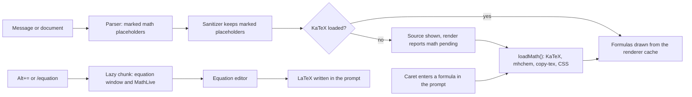

# LaTeX math, chemistry and footnotes in Markdown, with an equation editor in the prompt (#272)

Today a formula in a message is raw text (`$\frac{a}{b}$`), a footnote stays `[^1]`, and a `.tex` file opens as plain text. Once this work is done, CodeAlta Desktop does four things:
- It draws math and chemistry wherever it renders Markdown.
- It links footnotes to their notes.
- It previews a formula while you type it in the prompt, and lets you build one visually.
- It highlights LaTeX and BibTeX sources.

Someone who never writes math loads none of it.

## What changes

### Math in Markdown

The parser recognizes math and emits placeholders. The sanitizing boundary draws them with KaTeX once KaTeX is loaded, the same way `mermaid` blocks wait for Pele today.

`src/CodeAlta/frontend/src/markdownMath.ts` is a markdown-it plugin, used by `createMarkdownParser`. It recognizes:

| Written | Shown as |
| --- | --- |
| `$x^2$`, `\(x^2\)`, `` $`x^2`$ `` | inline math |
| `$$…$$` or `\[…\]` (on one line or several), a ```` ```math ```` block, a bare `\begin{equation}` / `align` / `gather` / `multline` (and `*`) … `\end{…}` block | display math |
| `$5 and $10`, `$HOME`, `\$`, anything in code | text, as today |

- The `$` rules are Pandoc's, ported from `@mdit/plugin-tex` (MIT): no space just inside the dollars, and a closing `$` is not followed by a letter, a digit or another `$`.
- A `$$` or `\[` that is not closed yet stays text, so a message being written does not flash half a formula.
- Placeholders carry the renderer's random mark (`data-math="<mark>"`), as file links do, so HTML written in a message cannot fake one. Display math also carries `data-source-lines`.

```html
<!-- Parser output for "Energy $E=mc^2$." -->
<p>Energy <span data-math="6f1c…">E=mc^2</span>.</p>
<!-- After dressing, once KaTeX is loaded -->
<p>Energy <span class="markdown-math"><span class="katex">…</span></span>.</p>
```

The library lives in `src/CodeAlta/frontend/src/mathLibrary.ts`, a chunk of its own. It is loaded through `loadMath()` of `math.ts`, as Pele is in `diagrams.ts`. It contains:

- **`katex` 0.19.1**, with these options:
  - `trust: false`;
  - `throwOnError: false`, so a bad formula shows its source, with KaTeX's message as its title;
  - `strict: "ignore"`;
  - limits on `maxExpand` and `maxSize`.

  Its output is sanitized again, as Pele's SVG is.
- **`katex/contrib/mhchem`** for `\ce{…}` and `\pu{…}`.
- **`katex/contrib/copy-tex`**, so a copied selection holds the LaTeX of its formulas.
- **KaTeX's CSS and fonts.** NeoAstra serves the fonts as `font/woff2`, and the browser fetches only the font families a formula uses.
  > **Deviation:** the 24 KB stylesheet is imported by the two entries (`main.tsx`, `mobile/main.ts`), as every stylesheet of the app is, and not by the lazy chunk: the components are bundled by esbuild in the browser tests, where a stylesheet with fonts cannot be imported. Its rules are all under `.katex`, and its fonts still load only when a formula is drawn.
- **Macros**:
  - Each message has one macro set, so a `\newcommand` in one formula serves the formulas after it.
  - A few commands that models write and KaTeX lacks are added: `\DeclareMathOperator`, `\label` (ignored), `\abs`, `\norm`, `\dv`, `\pdv`.
  - A `\newcommand` for a name KaTeX already has (`\R`) redefines it instead of failing.

Each renderer keeps a bounded cache of drawn formulas, owned by the renderer, so a streaming message draws only its new formula.

A displayed equation scrolls sideways when it is wider than the message. On hover it shows two buttons, **Copy LaTeX** and **Copy MathML**, placed like the copy button of a code block.

`render(source, timelineCodeBlocks, undrawn, options)` in `markdownBoundary.ts` now reports everything it could not draw yet in one value, instead of the `undrawn` array:

```ts
/** What a render could not draw yet: the diagrams to draw, and whether its math waits for the math library. */
export type MarkdownPending = { diagrams: string[]; math: boolean };
```

When `math` is set, `MarkdownContent` and the phone page's `markdownView.ts` load the library and then render again. This is the loop they already run for diagrams.

### Chemistry and footnotes

Chemistry comes from the mhchem extension above, for example `$\ce{2H2 + O2 -> 2H2O}$`.

Footnotes come from `markdown-it-footnote` 4.0.0: the markdown-it organization's plugin, MIT, with no dependency. Its renderer rules are replaced so that its output goes through the boundary, marked like math. The boundary turns that output into:

- **A superscript number button.** Its title is the text of the note. Clicking it scrolls to the note in the same message and highlights it.
- **A list of notes at the end of the message**, under a thin rule. Each note has a ↩ button back to its reference.

Inline notes (`^[a note]`) work too. Navigation stays inside the message: no ids and no `#` links.

### Writing math in the prompt

The Monaco prompt editor (`PromptEditor.tsx`, so the large `F6` editor too) gets two helpers.

**Live preview.**
- When the caret is inside a formula, a small panel under it draws the formula as you type, or shows KaTeX's message.
- The formula is found by `mathSpanAt(text, offset)` of `markdownMath.ts`, which uses the same delimiter rules as the parser.
- The panel loads KaTeX the first time it is needed.
- It has a ✎ button that opens the equation editor on that formula.
- Formulas in the prompt are tinted.
- It is implemented in `src/CodeAlta/frontend/src/promptMath.ts`, as a Monaco content widget plus a decorations collection.

**Equation editor.** `src/CodeAlta/frontend/src/EquationEditor.tsx` is an `AppWindow` that holds:
- MathLive's `<math-field>` for visual editing (`/` makes a fraction, `^` a superscript, `sqrt` a root, `alpha` a Greek letter…), with its virtual keyboard;
- the LaTeX source, kept in sync below the field;
- an **Inline / Display** choice;
- **Insert** (`Ctrl+Enter`) and **Cancel** (`Esc`).

If it opens with the caret in a formula, it edits that formula, and **Insert** replaces it.

```text
Insert equation   Alt+=   /equation   ⋯ menu > Insert equation

inline   →  $\frac{a}{b}$
display  →  on lines of its own:
            $$
            \frac{a}{b}
            $$
```

The window and `mathlive` 0.111.1 are one lazy chunk, imported the first time the window opens. MathLive is set up as follows:

- **It shares KaTeX's fonts.** Its twelve `KaTeX_*` font families are the same files, so `MathfieldElement.fontsDirectory = null` is set after `loadMath()` and before the first field exists.
- **It plays no sounds.** `soundsDirectory = null` also removes its only network requests.
- **Its virtual keyboard sits inside the window** (`mathVirtualKeyboard.container`), because a modal `dialog` makes the rest of the page inert.

The command `insertEquation` joins `commandRegistry.ts`, under the slash name `/equation`:
- Its key is `Alt+=`, Word's key for a new equation, and free in Monaco.
- On macOS the key is `Ctrl+Alt+=` (`macKeys`), because `Option+=` types `≠` there.

`main.tsx` dispatches the command the way it dispatches `expandPrompt`: it clicks the **Insert equation** item of the composer's `⋯` menu (`#insert-equation`). No button is added to the composer, so someone who does not use math sees nothing new.

`PromptInput` gains `replaceText(start, end, text)`: the replacement is one undo step, and the caret ends after the text.

> **Deviation:** the prompt editor hosts the equation window itself, so PromptInput gains `editEquation()` (what the `⋯` item calls) instead of `replaceText`; the editor writes the equation back as one undo step. `Alt+=` is also a Monaco keybinding of the prompt editor, so it works in the large `F6` editor, where the shortcuts of the window are off.

### LaTeX and BibTeX sources

- **Two grammars of the app in `monaco/monacoGrammars.ts`:**
  - `latex`: commands, environments, `%` comments and math delimiters;
  - `bibtex`: entry types, keys, fields, and braced or quoted values.

  `monacoLanguages.ts` registers them on demand, as it does `toml`.
- **File types in `fileLanguage.ts`:** `.tex`, `.sty`, `.cls`, `.ltx` and `.dtx` open as **LaTeX**, and `.bib` as **BibTeX**.
- **Code blocks in messages:** `codeHighlight.ts` adds highlight.js's `latex` grammar, so ` ```latex ` and ` ```tex ` blocks are colored.

### What loads when



The entry chunk grows only by:
- the tokenizers;
- KaTeX's stylesheet (24 KB, no font);
- the footnote plugin;
- the prompt's formula scan;
- highlight.js's `latex` grammar.

## Steps

- [x] 1. **Dependencies.**
  - Pin `katex` `0.19.1`, `markdown-it-footnote` `4.0.0` and `mathlive` `0.111.1` in `src/CodeAlta/frontend/package.json`.
  - Add a one-line module declaration for `markdown-it-footnote`, which ships no types.
  - Every commit of this work ends its subject with `(#272)`.
- [x] 2. **Math tokenizer.**
  - Write `markdownMath.ts`: the inline and block rules, ```` ```math ```` kept as a `language-math` fence, and `mathSpanAt`.
  - Wire it into `createMarkdownParser` in `markdown.ts`, and add `math_block` to the blocks that carry source lines.
  - `markdownMath.test.ts` covers each row of the table above, unclosed blocks, code spans and escapes.
- [x] 3. **Math library.**
  - `math.ts`: `loadMath`, `loadedMath` and the `MathLibrary` type.
  - `mathLibrary.ts`: the KaTeX options, macros, mhchem, copy-tex, CSS, and output sanitization.
- [x] 4. **Drawing in the boundary.**
  - In `markdownBoundary.ts`: the math mark in the sanitizer hooks, `dressMath` (and `language-math` in `dressFences`), and the per-renderer cache.
  - `MarkdownPending` replaces `undrawn` in `markdownBoundary.ts`, `MarkdownContent.tsx` and `mobile/markdownView.ts`.
  - `MarkdownContent`'s click handler handles **Copy LaTeX** and **Copy MathML**.
  - Styles in `style.css`: size matched to the text, sideways scroll, error color, both themes.
  - Browser tests in `markdownContent.browser.test.ts`:
    - inline and display math drawn after the library loads;
    - `\ce`;
    - a bad formula;
    - a `data-math` written in HTML left as text;
    - both copy buttons writing LaTeX and MathML, with the clipboard stubbed.
- [x] 5. **Footnotes.**
  - The plugin and its marked renderer rules in `markdown.ts`.
  - `dressFootnotes` in the boundary.
  - Scrolling and highlighting in `MarkdownContent.tsx` and `markdownView.ts`.
  - Styles and translated labels.
  - Tests: references and notes, navigation, inline notes, and footnote markup written in HTML left alone.
- [x] 6. **LaTeX and BibTeX.**
  - Grammars in `monacoGrammars.ts`, loaders in `monacoLanguages.ts`, extensions and names in `fileLanguage.ts`.
  - `latex` (with the alias `tex`) in `codeHighlight.ts`.
  - New cases in `fileLanguage.test.ts` and `codeHighlight.test.ts`.
- [x] 7. **Prompt preview.**
  - `promptMath.ts` (the tint, the preview widget, the ✎ button), attached in `PromptEditor.tsx`.
  - `replaceText` on `PromptInput`.
  - A browser test: the preview appears when the caret is in `$\frac{a}{b}$` and disappears when it leaves.
- [x] 8. **Equation editor.**
  - `EquationEditor.tsx`, imported lazily.
  - The `insertEquation` command in `commandRegistry.ts` and `main.tsx`.
  - The `⋯` menu item in the composers that have **Expand prompt editor**: `OwnedSessionPanel.tsx` and `ReadOnlyComposer.tsx`.
  - New strings in `localization.ts`, five translations each.
  - Tests:
    - in `commandRegistry.test.ts`, `Alt+=` resolves in the prompt, and `Ctrl+Alt+=` on macOS;
    - a browser test that opens the editor, sets a formula, inserts it, then edits it.
- [ ] 9. **User guide.**
  - `site/docs/workspace/prompt.md`: math, chemistry and footnotes in the timeline, plus a short **Equations** section covering the preview, the editor and `Alt+=`.
  - `site/docs/workspace/code.md`: math and footnotes on the Markdown page, and LaTeX and BibTeX highlighting.
  - `readme.md`: the features.
  - One picture of the equation editor over a session with math, following `doc/site-screenshots.md`.

## How it is verified

- [ ] In `src/CodeAlta/frontend`, `node node_modules/typescript/bin/tsc --noEmit` and `npm test` pass, including the new tests.
- [ ] `dotnet build -c <Configuration>` then `dotnet test -c <Configuration> --no-build` pass, with the configuration `AGENTS.md` prescribes, and `lunet build` passes in `site/`.
- [ ] **Lightweight.**
  - After the build, `rg -l "KaTeX parse error" src/CodeAlta/frontend/dist/assets` lists one lazy chunk and not the entry chunk; so does `rg -l "math-field" src/CodeAlta/frontend/dist/assets`.
  - In the developer instance, a session without math loads neither chunk (`performance.getEntriesByType("resource")`).
- [ ] **Developer instance**, in both themes and in a 900×650 window:
  - a message with inline and display math, `\ce`, a footnote and a bad formula;
  - a wide equation scrolls sideways;
  - a copied selection gives LaTeX;
  - the prompt preview appears;
  - `Alt+=` inserts a formula and then edits it, with the virtual keyboard usable inside the window;
  - a `.tex` file and a `.bib` file are highlighted.

## Decisions

| Decision | Choice | Why |
| --- | --- | --- |
| Renderer | KaTeX 0.19 | Best typesetting in WebView2, the same look on all three engines, fonts shared with MathLive; chosen by the user |
| Math on or off | Always on, no setting | A stray `$…$` in an old message is an acceptable change (user's call) |
| Delimiters | `$`, `$$`, `\(…\)`, `\[…\]`, ```` ```math ````, bare `\begin{equation}` blocks | What models write: dollars for Claude, brackets for GPT models |
| Tokenizer | Own plugin, with rules ported from `@mdit/plugin-tex` | An unclosed `$$` must stay text while streaming, and placeholders must carry the mark and source lines |
| Footnotes | `markdown-it-footnote` | A block grammar with continuation lines, maintained by the markdown-it organization |
| Editing | Live preview plus a MathLive window | The preview serves people who type LaTeX, MathLive those who don't; both load only when used |
| Entry points | `⋯` menu, `/equation`, `Alt+=` | No new button for people who never write math |
| Loaded library | Kept like Pele in `diagrams.ts` (a memoized import); each renderer owns its formula cache | It is a module, not session state, and there is no static mutable collection |

## Risks

- **MathLive's popups outside the window.** Its virtual keyboard goes inside the window through `mathVirtualKeyboard.container`. If its menu still opens on `document.body`, which a modal `dialog` makes inert, the menu is turned off (`menuItems = []`) rather than left broken.
- **KaTeX gaps** (`\eqref` numbering, siunitx). The macros cover the common cases; anything else shows its source with KaTeX's message.
- **KaTeX class names changed in 0.18** (they are now prefixed). The styles and the output sanitizer target the pinned version, and the browser tests catch a change at the next upgrade.
- **Untrusted formulas.** `trust: false`, `maxExpand` and `maxSize` apply, and the output is sanitized again. No link, image or request comes from a formula.

## Out of scope

- The TUI, which shows formulas and footnotes as written.
- LaTeX completions in the prompt, equation numbering with `\eqref`, Copy as image, Jupyter notebooks, a PDF viewer, and citations from `.bib` files.
- A line in system prompts telling models that math renders.

<details><summary>Evidence behind the choices</summary>

- **Sizes**, measured from npm on 2026-10-30:
  - `katex` 0.19.1: 267 KB minified (62 KB brotli), CSS 24 KB, and 20 woff2 fonts totalling 254 KB;
  - `mhchem`: 7.5 KB brotli;
  - `mathlive` 0.111.1: 823 KB (183 KB brotli); its 20 font files are byte-identical to KaTeX's, and its sounds weigh 232 KB;
  - `markdown-it-footnote` 4.0.0: no dependency.
- **Speed and coverage.** On 30 formulas typical of models, in Node, KaTeX takes 44 µs and produces about 3 KB of HTML per formula. It lacks `\label`/`\eqref`, `\DeclareMathOperator`, `\qty` and `\SI`, and fails on `\newcommand{\R}`.
- **Look.** Side by side in headless Edge (the engine of WebView2), Temml's MathML placed subscripts loosely, drew `\sqrt[3]` with a crooked radical, and flattened `\underbrace`. KaTeX matched LaTeX in both themes.
- **Security and serving.**
  - The page's CSP (`neoastra.json`) allows inline styles and fonts from `'self'`.
  - NeoAstra serves `.woff2` as `font/woff2`.
  - Neither library evaluates code. KaTeX makes no request; MathLive only fetches its sounds, which are turned off.
- **Types.** `markdown-it` 15 ships its own types. KaTeX ships `types/katex.d.ts` and exports `katex/contrib/mhchem` and `katex/contrib/copy-tex`.

</details>
