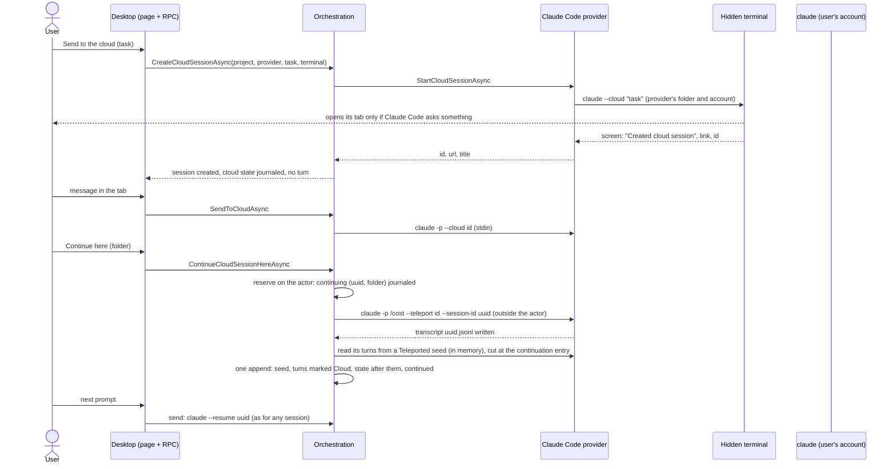

# Run Claude Code sessions in the cloud

Today CodeAlta runs Claude Code sessions on this computer only. Remote Control lets claude.ai follow one, but only while CodeAlta runs. Claude Code can also run a session in the cloud: it keeps working while the computer sleeps, and it can be brought back to the computer later.

Once this is done, **Cloud** is a third choice of **Where to work** for a new session, beside **Project folder** and **New worktree**. The session is listed in the Explorer with a cloud mark. Its tab has the claude.ai link and a QR code for the phone, and the messages written there go to the cloud session. **Continue here** brings the whole conversation and its branch back into the same session, which then goes on locally. Issue [#280](https://github.com/CodeAlta/CodeAlta/issues/280).

## What changes

### What the user sees

**Starting.** The new session of a project in a git repository already has a **Where to work** chip above its prompt. It gains **Cloud**, shown when the space has a Claude Code provider:

```text
 [ CodeAlta ▾ ][ ☁ Cloud ▾ ]                                  ← the Workspace chip, in sky blue

 Work in   [ Project folder | New worktree | ☁ Cloud ]

 Claude Code runs this session on Anthropic's machines, from main as it is on GitHub.
 It goes on while this computer sleeps: follow it on claude.ai or in the Claude app,
 then continue it here when you want. It counts against your Claude plan.

  ✓ Claude Code (Max), signed in with claude.ai
  ⚠ 2 commits of main are not on GitHub: the cloud session starts without them
  ⚠ 3 files have uncommitted changes: they stay here, unless Claude Code cannot clone
    the repository and uploads it with them
  Learn more
```

- **Cloud** is not shown in a space without a Claude Code provider.
- **The account:**
  - choosing **Cloud** while the prompt is on another provider switches it to a Claude Code provider of the space: the one last used for the cloud, else the first;
  - with **Cloud** chosen, the provider chip lists only the Claude Code accounts of the space, and choosing another kind of provider goes back to **Project folder**, with a note that says so;
  - a **Cloud** choice kept for a project reads as **Project folder** when its space no longer has Claude Code.
- With **Cloud** chosen:
  - the welcome reads "Next session will run in the cloud, from main of CodeAlta";
  - the model, effort and permission chips are hidden, the account chip stays (the cloud session picks its own model);
  - attachments are off;
  - the send button reads **Send to the cloud**.
- **Sending** shows the steps under the welcome, as making a worktree does: "Starting Claude Code…", then "Claude Code asks a question: answer it in the terminal tab", then "Cloud session created". They come with:
  - **Show the terminal**; the terminal tab also opens by itself when Claude Code asks something (whether it trusts the folder, a sign-in);
  - **Stop**, which ends Claude Code; a cloud session created in the meantime is kept and shown.
- **On a failure**, the prompt is kept, the steps show Claude Code's own sentence, and no session is created. If Claude Code created the cloud session but CodeAlta could not record it, the steps keep its link, with **Open on claude.ai** and **Bring it here**, so that sending again does not start the same work twice.

**A session in the cloud.** Its tab shows a card in place of a conversation, and the prompt sends messages to the cloud session:

```text
 ☁ In the cloud · Fix the flaky login test           [Open on claude.ai]  [📱 Phone]
 Started 21:11 from main · Claude Code (Max)
 Claude works on Anthropic's machines and goes on while this computer sleeps. Follow it
 on claude.ai or your phone; continue it here to get the conversation and its branch.
                                                                   [Continue here…]
 You · 21:11  Fix the flaky login test in src/auth/login.ts…        ✓ Sent to the cloud
 You · 21:40  Also add a regression test                             ✓ Sent to the cloud
 ──────────────────────────────────────────────────────────────────────────────────
 [ Message the cloud session…                                                    ➤ ]
   Claude answers on claude.ai and in the Claude app.
```

**Continue here.** A small dialog says what will happen and where, then brings the session back:

```text
 Continue "Fix the flaky login test" on this computer

 Claude Code brings back the whole conversation and checks out the branch the cloud
 session worked on. The cloud session stays on claude.ai; what you do next stays here.

 Where   (•) New worktree      recommended: the project folder has uncommitted changes
         ( ) Project folder    C:\code\app — switches it to the branch of the session
                                                          [Cancel]  [Continue here]
```

- Afterwards the card shrinks to one line ("Started in the cloud · Open on claude.ai"). The conversation follows it, each prompt subtitled **in the cloud** as imported prompts are subtitled **in VS Code**, and the next prompt runs on this computer.
- If Claude Code refuses (another repository, a branch it cannot fetch), the dialog shows its words and offers **Try in a terminal**. It runs `claude --teleport <id> --session-id <the same uuid>` in a terminal tab of that folder. Once the user is done there, **Bring it into this session** adds the cloud turns, then the turns made in the terminal, subtitled **in a terminal**.
- **Bring a cloud session here…** does the same for a session started on claude.ai or the phone: paste its link.

**Where it is found:**
- the **Where to work** chip of every new session;
- **New cloud session…** in the menu of a project in the Explorer;
- the commands `/new_cloud_session`, `/continue_here` and `/open_on_claude_ai`;
- a cloud mark on the row of the session, with **Open on claude.ai** and **Continue here…** in its menu;
- a section of the Claude Code page of the user guide.

### Only Claude Code's documented commands

You decided that CodeAlta must not read cloud sessions, to stay clear of the terms of Anthropic's subscriptions. That matches `doc/providers.md`: "a subscription belongs to the vendor's own client and its terms". So CodeAlta runs the user's own Claude Code CLI, signed in to the user's account, with documented commands only:

| The user does | CodeAlta runs | Terminal needed |
| --- | --- | --- |
| Send to the cloud | `claude --cloud "<task>"` in the project folder | yes: Claude Code refuses without one, so the desktop gives it a hidden pseudo-terminal |
| Send a message | `claude -p --cloud <id> --output-format json`, the message on stdin | no |
| Continue here | `claude -p /cost --teleport <id> --session-id <new uuid> --output-format json` in the chosen folder | no |

- **Never done:**
  - reading Claude Code's credentials;
  - calling `api.anthropic.com/v1/sessions`;
  - the CLI's `@internal` control requests `list_cloud_sessions` and `get_cloud_session_transcript`.
- **What follows from that:**
  - CodeAlta knows only the cloud sessions it started or was given a link to;
  - it does not show their status or answers: claude.ai and the Claude app do;
  - **Continue here** gets the whole conversation through `--teleport`, the documented way to bring a cloud session to a computer.
- **Why `/cost`:** it is a local command and makes no model call (cost 0, API time 0). It is enough for teleport to write the conversation, and CodeAlta then reads it from the CLI's own transcript, as it already reads the ones of VS Code.

### How it fits CodeAlta



- **A session in the cloud has no turns.** Its link, title, task, the messages sent and when it came back are its *cloud state*: a new `Cloud` member of `SessionViewLocalState`, journaled with its other settings and projected for the Explorer. The prompts sent to the cloud are not turns, because the teleported transcript holds them. Bringing it back therefore shows each prompt once, and the turn counts the next `--resume` checks stay right.
- **Bringing back reuses the reader and the writer of the catch-up**, the code that adds the turns made in VS Code: `ClaudeCodeExternalTurns`, then `AgentExternalTurnJournal`, without the catch-up command itself, which takes the session actor. A new `Teleported` flag of `ClaudeCodeProviderState` makes the reader:
  - read the new transcript from its start;
  - stop before Claude Code's continuation entry ("This session is being continued from another machine…"), a cut made on the entries of the transcript before turns are built;
  - mark the turns with the new origin `AgentExternalTurnOrigin.Cloud`.

  After `/cost`, the state records the true end of the transcript, so the `/cost` lines are never added. After **Try in a terminal**, it records the continuation entry, so the next catch-up adds what was done in the terminal as turns made **in a terminal**.
- **Continue here is reserved, then committed.**
  - The reservation (`continuing`, with the uuid and the folder) is journaled first. While it holds, a send, a second **Continue here** or a delete answers `busy`.
  - Claude Code runs outside the session actor.
  - The reader's result is validated, then the seed, the turns, the state after them and `continued` are written in one append.
  - A failure clears the reservation and leaves the session in the cloud. A restart that finds a reservation resumes it: it reads `<uuid>.jsonl` if it exists, else runs teleport again with the same uuid.
- **The pseudo-terminal comes from the desktop.** `IAgentInteractiveTerminal` (CodeAlta.Agent) is implemented over `DesktopTerminals`. The TUI and `altacli` give none, so starting a cloud session there is refused; their sessions in the cloud refuse prompts with a sentence that says why.
- **While in the cloud**, nothing can start a local conversation:
  - the check that refuses with status `in_cloud` is made where the runtime attaches a session to its provider, which every send passes through: the window, the TUI, `alta`, automations, the phone, the fallback and Adaptive coordinators, a resume;
  - the changes that do not attach are refused too: queue, steer, fork, rewind, compaction, change of provider, move, Remote Control.

| Project | Gains |
| --- | --- |
| `CodeAlta.Agent` | `ModelProviderDescriptor.SupportsCloudSessions`, `IAgentProviderCloudSessions` (beside `IAgentProviderRemoteControl`), `IAgentInteractiveTerminal`, origin `Cloud`, the account kind of a probe |
| `CodeAlta.Agent.Claude` | `ClaudeCodeCloud` (the three commands, the parse of what `--cloud` prints), the teleport mode of the reader, `Teleported` state |
| `CodeAlta.Catalog` | `SessionCloudState` in `SessionViewLocalState`, its projection |
| `CodeAlta.Orchestration` | create (catalog-only, cancellable), send, and the reserved continue, placement in a worktree, the `in_cloud` check at attachment |
| `CodeAlta` (desktop) | the program terminal, the RPCs, the page (`frontend/src/cloudSessions/`) |

## Steps

- [x] 1. Work on branch `feature/claude-code-cloud-sessions`, in a worktree made from `main` (`git worktree add <folder> -b feature/claude-code-cloud-sessions main`). The project folder holds another session's uncommitted changes (`SessionRuntimeService.cs`, two test files, `.alta/config.toml`), which stay out of this work. Build and test in `Release`, since the running CodeAlta is the installed 3.2.0, and start the developer instance from `Debug` (AGENTS.md, "Debug or Release"). Commit after each step with an AGENTS.md prefix and `(#280)`.
- [x] 2. Add the Claude Code cloud commands in `src/CodeAlta.Agent.Claude/ClaudeCodeCloud.cs`:
  - **Start launch:** the provider's executable with `--cloud <task>` (at most 16 KB of text), under the environment rules of `ClaudeCodeLauncher.Create`: the inherited session variables removed, OpenTelemetry hidden, the decision of `ClaudeCodeApiKey`, the provider's `env`, `CLAUDE_CONFIG_DIR`. No stream-json arguments, no SDK-only variables.
  - **`ParseStart(screen rows, exit code)`:** created (`Created cloud session: <title>`, the `https://claude.ai/code/session_…` link, the `session_…` id, rows wrapped by the terminal joined back), the `Branch … is not on GitHub…` note, asking (a question on the screen), or failed (the last lines of the screen, Claude Code's own words).
  - **`SendAsync`:** reads `{ok, session_id, url}` or `{ok: false, error}` into codes (`archived`, `not_found`, `needs_claude_ai`, `policy`, `failed`) and keeps the text of Claude Code.
  - **`TeleportAsync`:** succeeds when the exit code is 0, the result is not `is_error`, and `<config root>/projects/<folder>/<uuid>.jsonl` exists.
  - **Validation:** ids `^(session|cse)_[A-Za-z0-9]{8,64}$`; only `https://claude.ai/` links are kept.
  - **Tests** (`ClaudeCodeCloudTests`): the launch environment, as `ClaudeCodeProviderTests` checks the provider's; the parse of recorded screens (created, wrapped link, folder-trust question, error); the JSON of a send; a teleport by `ClaudeCodeFakeCli`, taught `--teleport` to write a teleported transcript.
- [x] 3. Bring back through the catch-up:
  - **Origin:** `Cloud` in `AgentExternalTurnOrigin` (`src/CodeAlta.Agent/Runtime/AgentExternalTurns.cs`); `external:cloud:` and "in the cloud" in `AgentExternalTurnJournal`; the text of `ClaudeCodeSession.Held.cs`.
  - **`ClaudeCodeProviderState.Teleported`** (record in `ClaudeCodeSession.cs`, its `Read` and `ToJson`).
  - **Teleported read in `ClaudeCodeExternalTurns.Read`:** with the flag and no leaf, read the whole chain (`ReadAfter(path, null, null)`), force the origin `Cloud`, and let `Follow` clear the flag.
  - **The cut is in the reader:** a teleport mode of `ClaudeCodeTranscriptReader.ReadWhole` keeps, between `ReattachSiblings` and `BuildTurns`, only the entries before the continuation entry (fallback: the first meta user entry after the last cloud message). After `BuildTurns`, that entry is gone: it drops meta entries.
  - **Where the state ends:** at the true end of the file after `/cost`; at the continuation entry after **Try in a terminal**, so that the ordinary catch-up adds the terminal's turns next.
  - **Seed:** the session's own counts, `Imported: true`, so that the first CodeAlta prompt gives its instructions.
  - **Tests** (`ClaudeCodeExternalTurnsTests`, `ClaudeCodeImportTests`):
    - the cloud turns are appended in order and marked cloud;
    - no `/usage` turn;
    - the next prompt starts the CLI with `--resume=<uuid>`;
    - a leafless state without the flag still reads nothing;
    - the recorded teleport transcript of the trial, a transcript without the continuation entry, and an ordinary catch-up afterwards (after `/cost`: nothing more; after the terminal: the terminal's turns).
- [x] 4. Add the provider-neutral contracts:
  - **`ModelProviderDescriptor.SupportsCloudSessions`**, true for `claude-code`.
  - **`IAgentProviderCloudSessions`** (internal, in `AgentTurnContracts.cs`): start, send, bring back.
  - **`IAgentInteractiveTerminal`** (public, with XML docs): runs a program in a pseudo-terminal of the host, reports its screen, can show it to the user, ends on exit or cancel.
  - **What the account allows, as data:** the probe of a Claude Code provider gives a non-secret account kind with its time (`subscription`, `api_key`, `platform`, `signed_out`, `unknown`), from `ClaudeCodeInspection`. The window reads it from the provider state it already gets. It never parses `StatusMessage`, which is for people.
  - **`ClaudeCodeTurnExecutor`** implements the provider interface. Without a terminal, a start answers `terminal_unavailable`.
  - **Tests** of the executor with the fake CLI, and of the account kind of the probe.
- [x] 5. Keep the cloud state of a session in `CodeAlta.Catalog`:
  - **`SessionViewLocalState.Cloud`:** `SessionCloudState { Id, Url, Title, Task, StartedAt, Note, Sent (text and time, the last 50), Continuing (uuid, folder, mode), ContinuedAt }`, written by `AppendStateAsync`, kept by `CompactForJournal`, cached and projected through `AgentSessionViewStateMetadata`, so that a listing never reads a journal (`doc/development-guide.md`, rule 1).
  - **Forks and rewinds** of a session brought back keep its `Cloud` as provenance: the whitelist of `SessionViewJournalStore.Branch.cs` (~171-193) copies it when `ContinuedAt` is set. A session still in the cloud cannot be forked.
  - **Cache schema:** raise the schema version of `SessionJournalSqliteCache` if the local state is stored in columns.
  - **Tests:** round trip, compaction, rebuild of the cache from the journal, projection, fork and rewind; a listing and a resume with the journals held locked, as the existing tests of rule 1 do.
- [x] 6. Add the orchestration commands, in new partial files `OwnedSessionCommandService.Cloud.cs` and `SessionRuntimeService.Cloud.cs`; leave `SessionRuntimeService.cs` alone where possible:
  - **`CreateCloudSessionAsync`** (request id, project, provider, space, title, task, terminal, progress) starts Claude Code first.
    - **On success**, it creates the session by a catalog-only path that attaches no coordinator: the header, the draft's model selection and the cloud state in one write, as the import makes a session from its events and local state (`SessionViewJournalStore.Import.cs`). The session is listed only once it has its cloud state. The ordinary creation is not used: it ends by attaching a local coordinator (`SessionRuntimeService.cs` ~1822).
    - **On failure**, no session is created.
    - **`CancelCloudStartAsync`** (request id) ends Claude Code. The wait of the RPC ending does not, since a creation goes on when its caller stops waiting (`WorkspaceCreateSessionRpc.cs` ~201). A success that comes first wins and is kept.
    - **A cloud session created but not recorded** (the write failed, or a cancel came too late) comes back with its id and link (`cloud_unrecorded`), so that the window offers it instead of a second paid start.
    - **The outcome** is kept by request id, like the outcome of a creation today, so that a lost answer never starts the work twice.
  - **`SendToCloudAsync`** (session, text): admitted by the session actor; on success it adds the text to `Sent`.
  - **`ContinueCloudSessionHereAsync`** (session, place) follows the reservation protocol of "How it fits CodeAlta":
    - it refuses a folder with tracked files changed (`uncommitted_changes`, with their count), since teleport then fails with no output;
    - it reserves `Continuing` on the actor;
    - Claude Code runs outside the actor;
    - the reader runs on a `Teleported` seed held in memory, with `ProviderSessionId` set to the new uuid;
    - one append on the actor writes the seed, the turns, the state after them, `ContinuedAt`, and clears `Continuing`;
    - a failure clears `Continuing` and leaves the session in the cloud with the error; a reservation found at start or on the next attempt is resumed.

    The actor-based catch-up command is not called while the actor is held.
  - **The `in_cloud` check** says "This session runs in the cloud: write to it from its tab in CodeAlta Desktop, or continue it here first." It is made:
    - on the actor, where the runtime attaches a session to its provider, the point every send passes through: the coordinator attachment (`SessionRuntimeService.cs` ~1874), reached by the window, the TUI (`RuntimeSessionOrchestratorAdapter.cs:31`), `alta`, automations, the phone, the fallback and Adaptive coordinators and resume;
    - at the changes that do not attach: queue and its dispatch (`alta` queues directly, `BuiltInAltaCommandContributor.cs` ~3700), steer, compaction (~4211), fork, rewind, provider selection, move, Remote Control.

    Each is one call to a check in `SessionRuntimeService.Cloud.cs`, so that `SessionRuntimeService.cs` changes by a few lines. Archive and delete stay allowed, except during `Continuing`.
  - **Tests** in `CodeAlta.Orchestration.Tests`, with a fake provider implementing `IAgentProviderCloudSessions` and `IAgentProviderExternalTurns`, as `SessionCatchUpTests` does:
    - one test per path that must be refused, each caller above included;
    - creation: lost answer, success after **Stop**, failure of the write;
    - **Continue here**: a failure at each boundary (Claude Code, the read, the append), a restart with a reservation, overlapping send, continue and delete.
- [x] 7. Give the desktop terminal a program to run:
  - **`DesktopTerminals.Create(TerminalRequest, TerminalProgram)`:** a file, arguments and an environment delta over `TerminalEnvironment.Create`, with `Keep: true`.
  - **`DesktopInteractiveTerminal : IAgentInteractiveTerminal`** (`src/CodeAlta/Desktop/Terminals/`): 220 columns, titled "Claude Code: <project>", reads `ReadScreen()` on a short tick.
    - It calls `Reveal` when Claude Code asks: still running, the screen quiet for 2 s without a result, or a known question.
    - It closes the terminal after a success and keeps it after a failure, for **Show the terminal**.
    - It ends the program on cancel, and never logs the screen.
  - **Tests** with the injected `PseudoTerminal` (as `AltaTerminalCommandsTests` does): created, question shown, failure kept, cancel.
- [x] 8. Add the desktop RPCs:
  - **Session creation:** `WorkspaceCreateSessionRequest.Cloud` (the task) runs `CreateCloudSessionAsync`.
    - Its steps are `WorkspaceCreationStep`s of kinds `cloud_start`, `cloud_question` and `cloud_created`, read as the steps of a worktree are, and its outcome is read again by request id after a lost answer.
    - Its statuses are `cloud_failed` (the words of Claude Code and the terminal id), `cloud_unrecorded` (the id and the link), `needs_claude_ai` and `terminal_unavailable`.
    - `cancelCloudStart` (request id) is **Stop**.
  - **`workspace.cloudReadiness`** (project, provider) answers:
    - the git repository, its branch and unpushed commits;
    - the tracked files changed;
    - whether there is a GitHub remote;
    - the account kind of the provider's last probe (step 4), `unknown` when there is none or it is old: Claude Code then decides at the start;
    - the platform, for the note about uploads on Windows.
  - **`sessionOperations`:** `sendToCloud`, `continueHere` and `cloudSession` (the details of the card).
  - **`WorkspaceSession.Cloud`** (`url`, `title`, `continued`). `ProviderConversation` stays false while in the cloud.
  - **Fixtures:** `demo-api.ts` and the fixture mounts get the new methods.
  - **Tests** in `CodeAlta.Desktop.Tests`.
- [x] 9. Build the start in the page, in a new feature folder `src/CodeAlta/frontend/src/cloudSessions/` (logic in plain functions, components, `messages.ts`, CSS, tests):
  - **`WorkPlace`** gains `cloud`. `WorkPlaceChoice` shows the third choice under the rules above (`providerHasCloudSessions(type)`, as `providerHasRemoteControl`), and it is kept per project as the worktree choice is.
  - **The account:** choosing **Cloud** moves the prompt to a Claude Code provider (the last one used for the cloud, else the first). The provider chip then lists only Claude Code accounts, and another kind of provider returns to **Project folder** with its note. A restored **Cloud** without a Claude Code provider in the space reads as **Project folder**.
  - **With Cloud chosen:** the readiness lines and the changed chips, welcome and send button. The draft sends the task in the creation request instead of a first prompt, and shows the steps with **Show the terminal** and **Stop**. After `cloud_unrecorded` it shows the link with **Open on claude.ai** and **Bring it here** (step 14).
  - **Tests:** unit (labels, the account rules, readiness lines, a restored choice); a browser test of the chip and the steps.
- [x] 10. Show the session in the cloud:
  - **The card:**
    - at the top of the timeline, with the messages sent;
    - **Open on claude.ai**, **Phone** (a QR code with `RemoteLinkQr` and Copy link), **Continue here…**;
    - the prompt in cloud mode.
  - **Errors of a send**, in words: "The cloud session is archived on claude.ai: it takes no more messages. You can still continue it here."
  - **Session info:** a **Cloud session** row with the link.
  - **Tests:** unit (the view of the card), browser (card, send, errors), in both themes.
- [x] 11. Add **Continue here**:
  - **The dialog:**
    - the place;
    - the note about the branch;
    - the project folder disabled with its reason when it has changes;
    - the progress;
    - on failure, **Try in a terminal**: a terminal tab of that folder, typing `claude --teleport <id> --session-id <the reserved uuid>` with the account folder, as **Run in terminal** does. A **Bring it into this session** button reads `<uuid>.jsonl` once Claude Code has left it, in the terminal mode of step 3; when that file is not there, the button says so, and the conversation is in the **From Claude Code** group, where it can be imported.
  - **Afterwards:**
    - the one-line card;
    - the subtitle **in the cloud** (`timeline.ts`: origin `cloud`, the `external:` pattern, the subtitle, its translations).
  - **Tests:** unit and browser.
- [x] 12. Make it found:
  - **Explorer:**
    - the cloud mark (tooltip "Runs in the cloud") and the two menu lines;
    - **New cloud session…** in the menu of a project, which opens the draft with Cloud and puts the keyboard in the prompt;
    - the delete question of such a session adds "The cloud session stays on claude.ai: archive or delete it there."
  - **Commands:** `new_cloud_session`, `continue_here` and `open_on_claude_ai` in `commandRegistry.ts`, available where they apply.
  - **Translations:** every new string in es, fr, de, ja and zh.
  - **Tests:** the search of commands, the menu (`explorerSessionMenu.browser.test.ts`).
- [x] 13. Continue in a new worktree:
  - **The worktree:** made with `GitWorktreeService`, detached at the commit of the project folder if the service allows it, else on `alta/<name>`.
  - **Placing the session there:** a new actor-owned operation, `PlaceCloudSessionAsync` in `SessionRuntimeService.Cloud.cs`, with a `SessionViewJournalStore` method beside the move. The ordinary move cannot be used: it refuses a move within one project (`SessionRuntimeService.Move.cs` ~50), and the `in_cloud` check refuses it. This operation is allowed only during the `Continuing` reservation of a session without turns, and is part of it (`mode` = worktree, so that a restart finds where it was going). The session is then teleported there.
  - **Cleanup:** an `alta/<name>` branch that teleport left, with no commit of its own, is deleted.
  - **Default place:** the new worktree when the project folder has changes or other sessions work in it.
  - **Tests:** orchestration and desktop.
- [x] 14. Bring a cloud session here: **Bring a cloud session here…** in the menu of a project, and `/bring_cloud_session`.
  - It takes a claude.ai/code link or a `session_…` id, creates the session in the cloud state, then runs **Continue here** at once.
  - A session of another repository shows Claude Code's refusal.
  - **Tests.**
- [x] 15. Update the documentation:
  - `site/docs/sessions/claude-code.md`: `## Run in the cloud` and `## Continue a cloud session here`, with two pictures that follow `doc/site-screenshots.md` (the **Where to work** popover with Cloud, a session in the cloud);
  - one line each in `site/docs/worktrees.md` (the third choice) and `site/docs/workspace/prompt.md` (Remote Control or a cloud session);
  - a bullet in `readme.md`;
  - the Claude Code section of `doc/providers.md`: documented commands, nothing read from the service, bringing back through the catch-up.
- [ ] 16. Merge and push:
  - **Rebase and validate:** rebase on `main`, then the whole verification below.
  - **Merge:** check `git status` of the project folder again just before, then fast-forward `main` there, but only if the merge touches no file another session left changed; otherwise stop and report. Never stash or commit someone else's changes.
  - **Push:** `git push origin main`. If SSH is refused here, as it was during the investigation, push once over HTTPS with `gh`'s credential: `git -c credential.helper= -c "credential.helper=!gh auth git-credential" push https://github.com/CodeAlta/CodeAlta.git main`.
  - **Clean up:** remove the worktree and the branch.

## How it is verified

- [x] The worktree builds: `dotnet build -c Release` from `src`, with no new warning.
- [x] Targeted tests: `ClaudeCodeCloudTests`, `ClaudeCodeExternalTurnsTests`, `ClaudeCodeImportTests`, the cloud tests of `CodeAlta.Orchestration.Tests` and `CodeAlta.Desktop.Tests`, the `cloudSessions` tests of the page.
- [x] Full: `dotnet test -c Release --no-build` and `npm test` as two background jobs, then `lunet build` in `site/`.
- [x] CodeAlta TUI builds, and a test shows that a session in the cloud refuses a prompt with the sentence of `in_cloud`.
- [x] In the developer instance, live, with a throwaway repository added as a project for the check and removed after (a few turns of the user's plan):
  - **Where Cloud is offered:**
    - with another provider in the prompt, choosing it moves the prompt to a Claude Code account;
    - choosing another kind of provider returns to **Project folder** with its note;
    - absent in a space without Claude Code.
  - **Start:**
    - the folder-trust question opens the terminal tab;
    - once answered, the session shows its card, link and QR code;
    - the link opens claude.ai.
  - **Message:** a message is shown as sent, and claude.ai shows it in the session.
  - **Continue here:**
    - it is refused with the reason while a tracked file is changed;
    - then it brings the conversation back, prompts subtitled **in the cloud**;
    - the next prompt runs locally and knows what was done in the cloud;
    - the new worktree place works too.
  - **Finding it and layout:** the Explorer mark, the menus and the three commands; both themes; a 900×650 window.
- [ ] Gated live CLI test (not written: the live check ran the same teleport through the developer instance; to add when the pin moves) (`ClaudeCodeLiveCliTests`, with `CODEALTA_TEST_CLAUDE_CLI` and a new `CODEALTA_TEST_CLAUDE_CLOUD=<session id>`): teleport with `-p`, `--session-id` and `/cost` writes the transcript. It is run again whenever the pinned CLI moves.

## Deviations from the plan

- **No `Teleported` flag in `ClaudeCodeProviderState`** (step 3): the reader is given the teleported seed in memory (`ReadTeleported`, `ReadBroughtBack`), so nothing new is persisted in the provider state.
- **A service of its own, `cloudSessions`** (step 8), instead of new members of `workspace` and `sessionOperations`: `readiness`, `start`/`startState`/`cancelStart` (the start is followed by its request id), `bringHere`, `details`, `send`, `continueHere`.
- **The worktree of Continue here** (step 13) is made by the RPC with `GitWorktreeService` on `alta/<name>`, then the reserved return moves the session there through `SessionViewJournalStore.MoveSessionAsync`; the `alta/` branch is deleted when teleport checked out another one.
- **Start in the page** shows its own card (`CloudStartProgress`) in the place of the welcome rather than `WorkspaceCreationStep`s; **Show the terminal** is offered on a failure, since the terminal shows itself when Claude Code asks.
- **The draft's selection chip** is replaced, with Cloud chosen, by an account chip that lists only the Claude Code accounts, with "Another provider: work on this computer".
- **Review by GPT-6.1 Sol (codex, max)** of the first three commits: 19 findings, all fixed in `015ab83d9` (one append for the return, refusals on every path, a start that always ends and survives a reload, the id from the address only, worktrees reused or removed, the provider's executable in the terminal).
- **The live check** used a repository without a GitHub remote: the conversation came back, not the branch (the cloud session cannot push). The readiness and the guide say so; a branch checkout is checked at the first use with a GitHub repository.
- **Schema 11** of the session cache: the `local_cloud` column is added by the migration (found in the live check: without the version bump an existing cache failed every read).

## Decisions

| Decision | Choice | Why |
| --- | --- | --- |
| Read the cloud sessions (list, status, answers) | No: documented commands only | Your decision: the terms of the subscription, `doc/providers.md` ("Credentials"); the service and the `@internal` control requests are not contracts |
| What a cloud session is in CodeAlta | A session with no turn, its cloud state journaled with its settings | The journal stays the truth; nothing is shown twice when it comes back |
| Bringing back | Teleport with `/cost`, then the reader and writer of the catch-up, reserved first and committed in one append | No model call; reuses tested code; same session, same tab; a failure or a restart leaves no half-imported session |
| Starting | `claude --cloud` in a hidden terminal, shown when Claude Code asks; a catalog-only creation; **Stop** a host command | Claude Code refuses without a terminal; its questions stay its own; paid remote work is never started twice |
| Entry point | A third choice of **Where to work** | It is where a user chooses where a session runs |
| Space without Claude Code | **Cloud** not shown | No dead choice for users of other providers |
| Account of a cloud session | **Cloud** moves the prompt to a Claude Code account; the account chip stays | No dead end between the place and the provider |
| Where the `in_cloud` check is made | On the actor, where a session is attached to its provider, and at each change that does not attach | The TUI and `alta` reach the runtime without the command service |
| Default place of **Continue here** | New worktree when the project folder has changes or other sessions | Teleport switches the branch of the folder it runs in |
| TUI, phone page, `alta` | Nothing new; prompts refused with the reason | AGENTS.md: new features are for the desktop; starting cloud work stays a user action |
| Go-ahead | Built once this plan is validated (checked against the code, then reviewed by GPT through the `codex` provider, its seven findings folded in), without waiting | You asked to implement, merge and push after the validation (2026-10-31) |

> **Open:** checking a branch the cloud session pushed needs a GitHub repository the cloud can push to. Without one, the live check uses a repository without a remote (no branch). The branch checkout is then left to Claude Code's own teleport and checked at the first real use.

## Risks

- **What `claude --cloud` prints is for people, not a contract.** Seen with 2.1.292; the pinned 2.1.309 is checked in the live check before anything relies on it. If it changes, the parse fails and the terminal is shown with Claude Code's own words, so the user is never stuck; recorded screens test the parse.
- **Untested combination.** Bringing back relies on facts verified with the pinned 2.1.309: teleport with `-p`, an honored `--session-id`, a local command being enough. Each flag is documented, the combination is not. The gated live test checks it when the pin moves. A failure leaves the session in the cloud, with **Try in a terminal**.
- **`/cost` must reach Claude Code as written.** Git Bash turned the argument into `C:/Program Files/Git/cost`, and that run was a model turn ($0.07). CodeAlta starts the CLI directly, never through a shell, and a test checks the arguments; a result with `num_turns` above 0 is logged.
- **Uploads.** Without a clone from GitHub, Claude Code uploads the repository; on Windows, the uncommitted changes of tracked files go as they are, `.env` included. The readiness lines warn whenever files are changed.
- **Usage.** Cloud sessions count against the user's plan, and CodeAlta's statistics do not see them: the popover and the guide say so.

## Out of scope

- Listing or following cloud sessions CodeAlta did not start or was not given, and showing their status or answers before **Continue here**.
- Sending an existing local session to the cloud: Claude Code cannot.
- Choosing a cloud or self-hosted environment (`--environment`), scheduled cloud tasks, auto-fix of pull requests.
- CodeAlta TUI and the phone page, beyond showing such a session and refusing its prompts.
- An `alta` command that lets agents start cloud sessions: that is remote work on the user's account, the user's decision.

<details><summary>Evidence: the trial with real cloud sessions (2026-10-31)</summary>

Claude Code 2.1.292 (the `claude` on the PATH) and 2.1.309 (pinned by CodeAlta), account folder `~/.claude-max5` (Max). The test was a throwaway repository without a remote, so Claude Code uploaded it.

- `claude -p "…" --cloud`: "Error: --cloud cannot be combined with --print. Starting a new cloud session with --cloud is interactive only."
- `claude --cloud "…"` without a terminal: "Error: --cloud requires an interactive terminal."
- In a terminal of CodeAlta: first the folder-trust question. The terminal also needs the account's `CLAUDE_CONFIG_DIR`, else Claude Code shows its first-run setup. Then, after about 12 s, it exits with code 0:
  ```text
  Created cloud session: Cloud ok C
  View: https://claude.ai/code/session_01QK5u8xRwDmhdvgs5BDTzPp?from=cli&m=0
  Resume with: claude --teleport session_01QK5u8xRwDmhdvgs5BDTzPp
  ```
- `claude -p "…" --cloud <id> --output-format json` gives `{"ok":true,"session_id":"session_…","url":"https://claude.ai/code/session_…"}`. A bad id gives `{"ok":false,…,"error":"invalid session ID…"}` and exit code 1.
- `claude -p --input-format stream-json --output-format stream-json --verbose --teleport <id>` with one user message works. The new local transcript holds both cloud turns (entrypoint `sdk-cli`), then the meta entry "This session is being continued from another machine…", then the local turn.
- With `--teleport <id> --session-id <uuid>` and `/cost` as the only message (2.1.309), sent on stdin in stream-json or as the prompt of `claude -p "/cost" … --output-format json`: `total_cost_usd` 0, `duration_api_ms` 0, `num_turns` 0. The transcript is `<uuid>.jsonl`: the cloud turns, the continuation entry, a `system/informational`, then `<local-command-caveat>`, `<command-name>/usage</command-name>` and a `system/local_command`.
- Teleport with no message writes nothing. With a tracked file changed: exit 1, no output, nothing stashed.
- `claude agents --json` lists the sessions of this computer only.

</details>
