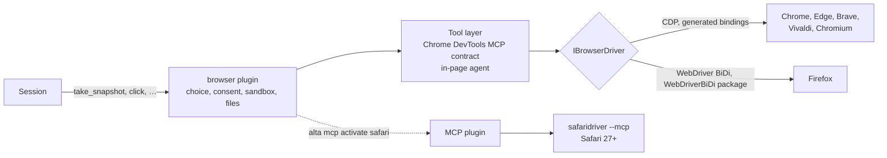

# Drive Chrome, Edge, Firefox and Safari from CodeAlta sessions

Today a session can drive only CodeAlta's own window (`alta ui activate`). To use a web browser, the user has to add a browser MCP server by hand, and those need Node.js. Once this plan is done, a session asks for a browser with `alta browser activate`. It gets the tools agents already know from Chrome DevTools MCP, on Windows, macOS and Linux, with Chrome, Edge and the other Chromium browsers, Firefox, and Safari 27 or later. The browser is the one the user names, the one they prefer in Settings, or else the one they use on this computer. It works in a fresh profile that leaves no trace, in a profile CodeAlta keeps for agents, or in the user's own browser with their sign-ins, but only after the user agrees. Everything is .NET: no Node.js, npm or npx at any point. Issue [#281](https://github.com/CodeAlta/CodeAlta/issues/281).

## What changes

### What a session gets

The agent turns the tools on, and they join the running turn, as the UI tools do:

```text
alta browser activate
{"type":"alta.browser.activate","browser":"chrome","version":"156.0.8078.80","source":"auto","profile":"isolated","toolsAvailable":"now",
 "tools":["click","close_page","drag","emulate","evaluate_script","fill","fill_form","get_console_message", …]}
```

`alta browser activate [--browser chrome|edge|firefox|safari|<id>] [--profile isolated|persistent:<name>|user] [--headless]` picks the browser and the profile. Without `--browser`, CodeAlta chooses one as described below; without `--profile`, the profile of Settings applies. The browser starts at the first call, in a window the user sees, or headless on request and in `altacli`. The tools have the names, the arguments and the result text of Chrome DevTools MCP, and Code Mode scripts call them like any other tool of the session (`tools.take_snapshot({})`):

```text
navigate_page {"type": "url", "url": "http://localhost:5173/login"}

Successfully navigated to http://localhost:5173/login.
## Latest page snapshot
uid=1_0 RootWebArea "Sign in · Demo"
  uid=1_1 heading "Sign in" level="1"
  uid=1_2 textbox "Email" focusable
  uid=1_3 button "Continue" focusable
```

| Group | Tools | Browsers |
| --- | --- | --- |
| Pages | `list_pages`, `new_page`, `select_page`, `close_page`, `navigate_page`, `wait_for` | all |
| Reading | `take_snapshot`, `take_screenshot`, `evaluate_script`, `list_console_messages`, `get_console_message`, `list_network_requests`, `get_network_request` | all |
| Acting | `click`, `hover`, `drag`, `fill`, `fill_form`, `type_text`, `press_key`, `upload_file`, `handle_dialog` | all |
| Emulation | `resize_page`, `emulate` (viewport, color scheme, user agent, location, offline) | all |
| Chromium extras | `emulate` with CPU and network throttling, `performance_start_trace`, `performance_stop_trace`, `take_heapsnapshot` | Chromium |

A session sees only the tabs it opened and the popups they open, never another session's. The UI tools have the same names, so a session has one set or the other: activating one gives the other back.

### Which browser a session gets

The first of these that names a browser wins:

1. **The user names one.** "Check it in Firefox" makes the agent pass `--browser firefox`. The guidance tells the agent to pass `--browser` only when the user or the task names a browser.
2. **The preferred browser in Settings**, when the user chose one there.
3. **Automatic**, the default: the browser the user uses on this computer.

Automatic weighs two kinds of evidence, each a few file reads:

- **The last use**, from the files each browser writes while the user browses:

  | Browser | Files |
  | --- | --- |
  | Chrome, Edge, Brave, Vivaldi, Chromium | The `active_time` of each profile in `Local State`, which Chrome refreshes at most once an hour while the profile is used, and the times of the profile's `History` and `Sessions/` |
  | Firefox | The times of `places.sqlite` and its `-wal`, of `sessionstore-backups/recovery.jsonlz4`, which Firefox rewrites every 15 seconds while it runs, and of `prefs.js`, in the profiles of `profiles.ini` |
  | Safari | None: macOS protects `~/Library/Safari`. Safari counts as used while it runs |

- **The system's default browser.** On Windows, the `ProgId` of `HKCU\Software\Microsoft\Windows\Shell\Associations\UrlAssociations\https\UserChoiceLatest` (else `UserChoice`), resolved to its program through `HKCR\<ProgId>\shell\open\command`. On macOS, the Launch Services handler of `https`. On Linux, `x-scheme-handler/https` in the `mimeapps.list` files that `xdg-mime` reads.

The rule:

- The browser used last wins.
- When the default browser was used less than 24 hours before it, the default browser wins instead: Windows and Office open some links in Edge whatever the default is.
- Only browsers that can do what the session asks count. The `persistent` and `user` profiles leave Safari out, and the `user` profile needs Chrome or Edge 144+, or Firefox.
- With no evidence at all, the default browser wins, then the first one found of Chrome, Edge, Firefox and Safari.

For Firefox's `user` profile, the same evidence picks which profile; Chrome and Edge use the profile the running browser has. Automatic reads file times and the profile entries of `Local State` only, never a history, a cookie or a page, and sends nothing anywhere. Where the system refuses a read (macOS privacy), that browser counts by its default status alone.

`alta browser list` shows the evidence and the choice, so a wrong guess is easy to see, and easy to fix with a preferred browser in Settings:

```text
alta browser list
{"type":"alta.browser","id":"chrome","name":"Google Chrome","version":"156.0.8078.80","engine":"chromium","default":true,"lastUsed":"2026-11-01T09:12:00Z"}
{"type":"alta.browser","id":"edge","name":"Microsoft Edge","version":"156.0.3485.54","engine":"chromium","lastUsed":"2026-11-01T10:05:00Z"}
{"type":"alta.browser","id":"firefox","name":"Firefox","version":"159.0","engine":"firefox","lastUsed":"2026-09-02T08:03:00Z"}
{"type":"alta.browser.choice","browser":"chrome","source":"auto","reason":"the default browser, used within a day of Edge"}
```

### One tool layer, and the protocol each browser speaks



- **Chromium browsers use the Chrome DevTools Protocol (CDP).** Chrome and Edge have no WebDriver BiDi endpoint of their own. BiDi there needs either chromedriver (a native binary that must match each Chrome version) or Google's 1 MB JavaScript mapper loaded into a hidden tab. CDP needs neither and works with any recent Chromium. It gives what only Chromium has: performance traces, CPU and network throttling, heap snapshots. It also lets CodeAlta attach only to the tabs it opened, which matters in the user's own browser. CodeAlta generates the bindings it uses from the protocol files, as it already does for ACP and Codex.
- **Firefox uses WebDriver BiDi**, through the `WebDriverBiDi` package (webdriverbidi-net: MIT, ready for AOT, tested against real Chrome and Firefox). It connects to the endpoint Firefox opens itself (`--remote-debugging-port`), so no geckodriver is needed. Firefox removed CDP in version 141.
- **Safari 27 and later use their own MCP server.** Safari has no CDP and no usable BiDi yet; `safaridriver --mcp` drives a window that Safari marks as controlled. CodeAlta knows it as a built-in MCP server on macOS: `alta browser activate --browser safari` activates it, and its tools keep Apple's names (`navigate_to_url`, `get_page_content`, `page_interactions`…). Safari moves to the BiDi driver once safaridriver speaks BiDi.

The tools sit on a small driver interface, `IBrowserDriver`, with a CDP and a BiDi implementation. It covers pages, navigation, script in an isolated world, real input, screenshots, dialogs, console and network events, the viewport and emulation. One in-page agent reads every browser's page: the snapshot, its uids, and what `fill` needs for selects and checkboxes. It starts from NeoAstra's `automation-agent.js`, which already gives the UI tools their snapshot, and runs in an isolated world so the page can neither see it nor change it. Clicks and keys are real browser input, not synthesized DOM events, so a page reacts as it does to a user.

### Three profiles

| Profile | What it is | Chrome, Edge | Firefox | Safari |
| --- | --- | --- | --- | --- |
| `isolated` (default) | A new private profile per session, deleted when the session ends | One browser with a temporary `--user-data-dir`, and a browser context per session | A temporary `-profile`, a user context per session | Always: Safari's automation windows are private |
| `persistent` | A profile CodeAlta keeps for agents: the user signs in once from Settings, and sessions reuse those sign-ins | `<state root>/browser/profiles/<name>`, a window per session | the same | – |
| `user` | The user's own browser, profile and sign-ins | Chrome and Edge 144+ once the user turns on `chrome://inspect/#remote-debugging`. Chrome asks on each connection, so CodeAlta keeps one open. | Firefox restarted on the user's profile with its remote port, after the user closes it | – |

In the `user` profile, the agent's tabs open in a window of their own, and the agent sees only those. A tab of the user's reaches the agent only when the user shares it. With Chrome before 144, the `persistent` profile is the way to work on the user's behalf.

How CodeAlta starts the browsers of the first two profiles:

```text
chrome  --user-data-dir=<state root>/browser/temp/<id> --remote-debugging-port=0 --no-first-run --disable-sync
        --password-store=basic --use-mock-keychain --disable-search-engine-choice-screen --enable-automation [--headless=new]
firefox -profile <state root>/browser/temp/<id> -no-remote --remote-debugging-port 0 [-headless]
```

Chrome writes its port to `DevToolsActivePort` in the profile folder. Firefox prints `WebDriver BiDi listening on ws://127.0.0.1:<port>` on its standard error.

### Consent and safety

- **The user's browser takes three yeses.**
  - A switch in Settings, off by default.
  - The user's agreement for each session. It is a permission request that no permission mode answers, like a command outside the sandbox.
  - The user's agreement for each site the session loads there: "Act on github.com with your sign-ins?", for this session, always, or no.

  Sites allowed or blocked are kept in Settings. The site is checked on every document the session's tabs load, so following a link does not get around it. A project cannot turn this on, and `altacli`, which has no user, never uses it.
- **In every profile:**
  - `file:` URLs only inside the session's folders.
  - Uploads only from those folders, and never credential-like files (`.env`, `*.pem`, `.ssh/`).
  - Downloads go to the session's folder and are never opened.
  - The browser cannot reach CodeAlta's own ports: its MCP server, the mobile view, the endpoint of agent CLIs.
  - The model never gets raw CDP.
  - `evaluate_script` can be turned off.
- **Page content is data.** The guidance says so, and every result that carries page text says where it comes from.
- **No telemetry** and no outbound calls besides what the page itself loads.
- **The user sees what happens:**
  - A visible window that the browser marks itself (Chrome's automation bar, Firefox's robot icon, Safari's banner).
  - The screenshots in the timeline.
  - A status item on the session, "Chrome · isolated · 2 tabs", whose button stops the session's browser.

### Sandboxed sessions

A sandboxed session gets the `isolated` profile only:

- **Network:** its browser context goes through a `SandboxNetworkProxy` with the hosts and local ports of its sandbox profile. With `network = "off"` it reaches only its local ports.
- **Files:** the sandbox's own folders.
- **Where it runs:** the browser process runs outside the container, as plugin tools do. Because of these limits, the tools are marked `SafeInSandbox`, and `alta browser` joins the `AltaSandboxGate` allow list.

### Chromium extras without Node

chrome-devtools-mcp analyzes traces, heap snapshots and audits with the JavaScript of DevTools and Lighthouse. Without Node, CodeAlta keeps what .NET does well:

- **`emulate`** with CPU throttling and network presets (Slow 3G, Fast 4G…).
- **`performance_start_trace` / `performance_stop_trace`:** a trace with DevTools' categories, saved as `.json.gz`, which opens in the DevTools Performance panel. It comes with a summary computed in .NET: LCP, CLS, long tasks, main-thread time by category, the slowest requests.
- **`take_heapsnapshot`:** a `.heapsnapshot` file for the DevTools Memory panel.

### Where the code goes

| Project | What it holds |
| --- | --- |
| `src/CodeAlta.Browser` (new) | Headless. Finding and choosing browsers, launching and attaching to them, the CDP connection and its generated bindings, the BiDi driver over `WebDriverBiDi`, the in-page agent, the tools and their texts |
| `src/CodeAlta.Browser.Cdp.Generator` (new) | Writes `src/CodeAlta.Browser/Cdp/generated/*.gen.cs` from the CDP protocol files at a pinned revision, through a method map, as `CodeAlta.CodexAppServer.Generator` does |
| `src/CodeAlta.Plugin.Browser` (new) | The built-in plugin `browser`, for the desktop and `altacli`: `alta browser`, a session's tools, consent, the sandbox rules, settings, the status item |
| `src/CodeAlta` | The Settings > Extensions > Browser page, and the permission card of the new request |
| `src/CodeAlta.Agent` | `AgentBrowserPermissionRequest` |

The settings are the user's own, kept by the plugin in `~/.alta/plugin-data/browser/settings.json`, so a repository cannot change them. `browser` is `auto` or the id of a browser that `alta browser list` shows:

```json
{
  "browser": "auto",
  "profile": "isolated",
  "headless": false,
  "evaluateScript": true,
  "userProfile": { "enabled": false, "allowedSites": ["github.com"], "blockedSites": [] }
}
```

## Steps

Chromium and the tools:

- [x] 1. **CDP generator.** `src/CodeAlta.Browser.Cdp.Generator` reads `browser_protocol.json` and `js_protocol.json` of `ChromeDevTools/devtools-protocol` (BSD-3) at a pinned revision, from a checkout or a folder, as `CodexSchemaSource` does. It takes a method map, `cdp-methods.json`, over Target, Page, Runtime, DOM, Input, Network, Fetch, Emulation, Browser, Log, Tracing and HeapProfiler. It writes records, enums, a `CdpJsonSerializerContext`, typed commands and events, and `Cdp.Metadata.gen.cs` with the revision. It reuses the emitter pieces of the Codex generator, with a new walker for CDP's domain format. Tests as for the Codex generator.
- [x] 2. **CDP connection.** `CdpConnection` in `src/CodeAlta.Browser/Cdp`:
  - A WebSocket to `ws://127.0.0.1:<port>/devtools/browser/<id>`, with flattened sessions.
  - One read loop that dispatches events in order for each session, with bounded queues, cancellation, and no static state.
  - Tests with a fake endpoint: event order, a session that detaches, a socket that closes in the middle of a command.
- [x] 3. **Finding and launching browsers.**
  - `BrowserCatalog` finds each browser with its version and profiles, without starting it: Chrome (with Beta, Dev and Canary), Edge, Brave, Vivaldi, Chromium and Firefox on each system (standard paths, Windows `App Paths`, `PATH`, Snap and Flatpak folders), and Safari on macOS. The version comes from the program (its file version on Windows, `Info.plist` on macOS) or from `Last Version` and `application.ini`; the profiles come from `Local State` and `profiles.ini`.
  - `ChromiumLauncher` starts a browser:
    - a temporary `--user-data-dir` under `<state root>/browser/temp`;
    - `--remote-debugging-port=0`, with the port read from `DevToolsActivePort`;
    - Puppeteer's automation flags, and headless on request.
  - It removes the folder when the browser exits, and leftover folders at startup.
  - Tests: discovery on fixtures of each system, and a launch wherever a browser is installed.
- [x] 4. **Choosing the browser.** `BrowserChoice` in `src/CodeAlta.Browser/Discovery`:
  - `BrowserUsage` reads the evidence of each browser found: its last use, from the files of the table above, and whether it is the default browser. One small reader per system gives the default: the registry on Windows, Launch Services on macOS, `mimeapps.list` on Linux.
  - The rule: the session's `--browser`, then the preferred browser of Settings, then Automatic. It gives the reason for its choice.
  - Tests on fixture folders whose file times the test sets, with fake readers of the default browser: the newest wins, the default wins within 24 hours, Safari counts while it runs, `user` leaves Safari out, and no evidence falls back to the default browser.
- [x] 5. **Driver and in-page agent.**
  - `IBrowserDriver`/`IBrowserPage` and `CdpBrowserDriver`:
    - a browser context per session;
    - only the session's own targets and the popups they open;
    - script in an isolated world (`Page.createIsolatedWorld`);
    - real input (`Input.dispatchMouseEvent`, `dispatchKeyEvent`, `insertText`);
    - screenshots, dialogs, console, network with bodies, file inputs, viewport.
  - `browser-agent.js` (an embedded resource):
    - builds the snapshot and keeps its uids;
    - gives the box of an element;
    - does what `fill` needs.

    Frames from other origins are read by their own agent and joined into one snapshot.
- [x] 6. **The tools.** `BrowserTools` in `src/CodeAlta.Browser/Tools`, with Chrome DevTools MCP's arguments and texts:
  - The texts: pages list, snapshot format, `reqid` and `msgid`, pagination, and the caps (10,000 characters of body, the last 3 navigations kept).
  - After each action, a wait: a navigation that starts within 100 ms, then a quiet DOM, for at most 3 s.
  - One task at a time per page, and the tools a dialog blocks stay blocked until it is answered.
  - Tests over a fake driver for each text, then against headless Chrome and Edge on pages the test serves.
- [ ] 7. **The plugin.** `src/CodeAlta.Plugin.Browser` (`[Plugin("browser")]`, desktop and `altacli`):
  - `alta browser list|activate|status|close|deactivate`. `list` gives each browser with its evidence, and the choice with its reason. `activate` says where its browser came from: `user`, `settings` or `auto`.
  - The tools come from `OnBeforeAgentRunAsync` and are registered in the running turn with `AgentRunTools.Set`. The desktop wires the session sets of this plugin and `DesktopUiPlugin`, so that activating one turns the other off.
  - The guidance line works like `DesktopUiPlugin.Guidance`, and tells the agent to pass `--browser` only when the user or the task names a browser. The session's files work like `DesktopUiFiles`.
  - The guards: `file:` URLs, CodeAlta's ports, uploads.
  - Contexts close after 15 idle minutes and when CodeAlta exits.
  - Registered in `DesktopPlugins.BuiltIns` and `CliHost.BuiltInPlugins`.

Firefox:

- [ ] 8. **BiDi driver.** `BiDiBrowserDriver` over `WebDriverBiDi`, pinned in `src/Directory.Packages.props` and wrapped behind `IBrowserDriver`.
  - `FirefoxLauncher`: a temporary `-profile` with a `user.js` of Puppeteer's preferences, `-no-remote`, `--remote-debugging-port 0`, and the address read from its standard error.
  - A user context per session, and the agent in a sandbox realm.
  - `input.performActions`, `network.addDataCollector`/`getData`, `log.entryAdded`, `browsingContext.userPromptOpened`, `input.setFiles`.
  - The tests of step 6 also run against Firefox.

Profiles and consent:

- [ ] 9. **Persistent profiles.** Stored under `<state root>/browser/profiles/<name>`, with one browser per profile and a window per session. **Open to sign in** in Settings opens the profile with no agent.
- [ ] 10. **The user's browser.**
  - Chrome and Edge 144+: read `DevToolsActivePort` in their user data folder, and keep one connection for as long as CodeAlta runs. The session's tabs open in a window of their own, and CodeAlta attaches to those only. When the switch is off, the tool's answer says how to turn it on (`chrome://inspect/#remote-debugging`, `edge://inspect/#remote-debugging`).
  - Firefox: find the profile in `profiles.ini`. When the profile is locked, ask the user to close Firefox, then start it on that profile with its remote port.
  - The user's browser is never closed, only detached from.
- [ ] 11. **Consent.**
  - `AgentBrowserPermissionRequest` in `CodeAlta.Agent` asks about a browser and profile, or a site. No permission mode answers it. It is refused where there is no user, and for a sandboxed session.
  - The window's permission card shows it: this session, always for this site, or deny.
  - Every document the session's tabs load is checked against the sites the user allowed: `Fetch.requestPaused` for documents in Chromium, `network.addIntercept` in Firefox.
  - The session's status item, with **Stop**.

Sandboxed sessions:

- [ ] 12. **Sandboxed sessions get `isolated` only.**
  - The context gets a `SandboxNetworkProxy` of the sandbox profile: the `proxyServer` of `Target.createBrowserContext` in Chromium, the `proxy` of a BiDi user context in Firefox.
  - Files are limited to the sandbox's folders.
  - The tools are marked `SafeInSandbox`, and the before-run result sets `AdditionalToolsFollowSandbox`. `alta browser` goes into `AltaSandboxGate`.
  - Tests: with the network off, only the local port is reached; a host outside the list is refused; a `file:` URL outside the sandbox is refused.

Chromium extras:

- [ ] 13. **Chromium-only tools.**
  - `emulate` gets CPU throttling and network presets.
  - `performance_start_trace` and `performance_stop_trace` write the trace file and the .NET summary (`TraceSummary`, tested on recorded traces).
  - `take_heapsnapshot` writes the file.
  - They are offered to Chromium sessions only.

Safari:

- [ ] 14. **Safari's MCP server.** On macOS with Safari 27 or later:
  - A built-in MCP server `safari` (`/usr/bin/safaridriver --mcp`) among the MCP plugin's definitions, listed in Settings > MCP.
  - `alta browser activate --browser safari` activates it with `alta mcp activate safari`.
  - When Safari refuses, the session is told how to turn on **Allow remote automation and external agents**.

Settings and documentation:

- [ ] 15. **Settings > Extensions > Browser.** A `PluginCanvasPlacement.Settings` page, an app module like `mobile-settings`, with:
  - the browsers found, with their evidence;
  - the browser: Automatic (with what it picks and why), one of the browsers found, or a program path with its engine;
  - the default profile and the headless setting;
  - persistent profiles (open, delete);
  - the user's browser (the switch, how to turn on remote debugging, the allowed and blocked sites);
  - the `evaluate_script` switch.

  Frontend tests, and both themes and a narrow window checked in the developer instance.
- [ ] 16. **Documentation.**
  - The user guide page `site/docs/browser.md`, listed in `menu.yml` and linked from `ui-tools.md` and the readme.
  - `doc/browser.md`: the drivers, how the browser is chosen, who owns the browsers, consent, the sandbox rules.
  - The lines for the browser in `doc/architecture.md`, `doc/plugins.md` and `doc/sandbox.md`.

## How it is verified

- [ ] `dotnet build -c <Configuration>`, `dotnet test -c <Configuration> --no-build`, `npm test` and `lunet build` pass. The browser tests ran against Chrome, Edge and Firefox on this computer, and are skipped where a browser is missing.
- [ ] On this computer, `alta browser list` shows the installed browsers with their versions, last use and default status, and Automatic picks the browser the user uses. A session told "use Firefox" gets Firefox, and with Edge preferred in Settings, a session gets Edge.
- [ ] In the developer instance, a session is asked to open the fixture page, sign in with `test@example.com` and give the title. It does so in Chrome, Edge and Firefox (`isolated`), with screenshots in the timeline, and leaves no profile folder behind.
- [ ] Two sessions browse at the same time without seeing each other's tabs or cookies, and a child session does not see its parent's tabs.
- [ ] A sandboxed session with `network = "off"` loads only its own `localhost` server. `file:///` of the user's home and `http://127.0.0.1:2583/mcp` are refused.
- [ ] The user's browser with Chrome:
  - CodeAlta asks first, then Chrome asks once.
  - The agent's window opens, and `list_pages` lists only its tabs.
  - A link to a site not allowed waits for the user.
  - **Stop** closes the agent's window and leaves the user's tabs alone.
- [ ] A Chromium trace opens in the DevTools Performance panel, and its summary gives the page's LCP and long tasks.
- [ ] On a Mac with Safari 27, `alta browser activate --browser safari` activates Safari's tools, and a session reads a page with them.

## Decisions

| Decision | Choice | Why |
| --- | --- | --- |
| Protocol for Chromium | CDP, with bindings CodeAlta generates | No BiDi endpoint in Chrome or Edge. CDP needs no extra binary or JavaScript, has the Chromium-only features, and attaches only to CodeAlta's own tabs |
| BiDi library | `WebDriverBiDi`, pinned, behind `IBrowserDriver` | MIT, ready for AOT, covers every module, tested on real browsers. It is 0.x with one main author, so it is wrapped, and a fork stays possible |
| CDP library | None: generated | `dotnet-chrome-protocol` is not AOT-compatible, can reorder events, and has no license file |
| Safari | Its own MCP server, through the MCP plugin | Apple maintains it. Safari has no CDP and no usable BiDi yet |
| Tool names | Chrome DevTools MCP's, so a session has either the UI tools or the browser tools | Models know these names, and a session drives one target at a time |
| Snapshot | One in-page agent, in an isolated world | The same text on every browser. BiDi has no accessibility tree, and Playwright works the same way |
| Browser processes | One per browser and profile, with a context or window per session | Sessions run in parallel without one browser each. Contexts keep their cookies apart |
| Default | `isolated`, in a visible window | Nothing of the user's is reachable unless asked for, and the user sees what the agent does |
| Choosing the browser | The session's `--browser`, then the preferred browser of Settings, then Automatic | The user's words come first, a choice made in Settings holds, and Automatic needs no setup |
| Automatic | The last use from file times, with the default browser winning within a day of it | A few file reads, nothing of what the user browsed. The default browser corrects for the links that Windows and Office open in Edge |
| Consent in the user's browser | Per session and per site, in every permission mode | The user's sign-ins are at stake, and no one has solved prompt injection |
| Session without `shell_command` | The browser tools stay | They run no program the model chooses, as with `webget`. `[tools] disabled` can still turn them off |
| Applications | Desktop and `altacli`, not the TUI | New features go to the desktop. `altacli` uses `isolated` only |
| Getting a browser | Installed browsers only | Edge is on every Windows, and a download has to be pinned by hash and kept current |

The review of 2026-11-01 confirmed four of these choices: CDP for Chromium, Chrome DevTools MCP's names with one target per session, Safari's own MCP server first, and a question for each new site in the user's browser. It also added the choice of the browser: named by the user, preferred in Settings, or Automatic.

## Risks

- **Prompt injection with the user's sign-ins.** No one has solved it: Anthropic measured 1.4 to 2 % attack success even after its mitigations. What limits it: the user's browser is off by default, it needs consent per session and per site, page text is marked as data, and the window is visible. That is not a guarantee, and the guide says so.
- **Automatic can guess wrong.** File times say when a browser was last used, not how much it is used. What limits it: the default browser settles close cases, `alta browser list` shows the evidence and the reason, and the user's words or a preferred browser in Settings come first.
- **Chrome's consent flow can change.** Today Chrome shows one dialog per connection, and one report says the switch applies only at the next launch. What limits it: CodeAlta keeps one connection open, and the `persistent` profile works without that switch.
- **`WebDriverBiDi` is 0.x, with one main author.** What limits it: the version is pinned and wrapped, a fork is allowed (MIT), and PuppeteerSharp depends on it too.
- **CDP methods change.** What limits it: only the method map's methods, mostly from stable domains, and tests against the installed stable browsers.
- **The in-page snapshot is not the browser's accessibility tree.** Some roles and names can differ, and closed shadow roots stay hidden. What limits it: the same agent already serves the UI tools, it is tested on real pages, and Chromium's tree can be added later.
- **Linux packages and macOS privacy.** A snap Firefox cannot read a profile under `/tmp`, so profiles go under the state root. Reading Chrome's `DevToolsActivePort` on macOS may need CodeAlta to have the Files & Folders permission, and the error says so.
- **A sandboxed session's browser runs outside the container.** A page that exploits the browser gets out, as it would in the user's own browsing. The session's network and files stay limited.

## Out of scope

- Lighthouse audits, DevTools performance insights, heap snapshot analysis, `get_css_styles` and CrUX field data: they need the JavaScript of DevTools or calls to Google.
- An extension in the user's browser, as Claude in Chrome uses, with a native messaging host.
- Downloading Chrome for Testing or Firefox when no browser is installed.
- Running the browser inside the OS container of a sandboxed session.
- Safari with the same tools as the other browsers (once safaridriver speaks BiDi), WebKitGTK, Android through adb.
- A live view of the browser inside CodeAlta.
- A preferred browser per project or per space.
- New screens or commands in CodeAlta TUI.
- The extension, PWA, WebAuthn and WebMCP tools of Chrome DevTools MCP.

<details>
<summary>What each browser offers (research of 2026-11-01)</summary>

| | Chrome, Edge, other Chromium | Firefox | Safari 27 |
| --- | --- | --- | --- |
| CDP | yes | removed in Firefox 141 | no |
| WebDriver BiDi | Only through chromedriver or Google's JavaScript mapper (chromium-bidi). 95 to 100 % of the BiDi tests pass that way | Native, on `--remote-debugging-port`. 65 to 100 % per module | Early: Safari Technology Preview 253 and 254 add the first commands |
| The user's own profile | Chrome 136+ refuses a debugging port on the default profile. Chrome and Edge 144+ let the user allow it in `chrome://inspect/#remote-debugging`, with a dialog per connection and a bar while connected | Only by restarting Firefox on the profile with the port. An "Allow remote control?" prompt is in Firefox's source, behind an experimental preference | Never: `safaridriver` and `--mcp` drive private automation windows |
| Only here | traces, CPU throttling, heap snapshots, the accessibility tree | | an MCP server with 17 tools |

Sources: [wpt.fyi BiDi results](https://wpt.fyi/results/webdriver/tests/bidi), [Chrome remote-debugging change](https://developer.chrome.com/blog/remote-debugging-port), [Chrome 144 flow](https://developer.chrome.com/blog/chrome-devtools-mcp-debug-your-browser-session), [Edge DevTools MCP guide](https://learn.microsoft.com/microsoft-edge/web-platform/devtools-mcp-server), [MDN: BiDi connection](https://developer.mozilla.org/en-US/docs/Web/WebDriver/How_to/Create_BiDi_connection), [Firefox CDP retirement](https://fxdx.dev/cdp-retirement-in-firefox/), [Connecting an AI agent to Safari](https://developer.apple.com/documentation/safari-developer-tools/connecting-an-ai-agent-to-safari), [About WebDriver for Safari](https://developer.apple.com/documentation/webkit/about-webdriver-for-safari), [WebKit features in Safari 27](https://webkit.org/blog/18325/webkit-features-for-safari-27-0/).

</details>

<details>
<summary>The evidence Automatic reads</summary>

- **Chromium's `active_time`.** It is a double of seconds since 1970, in `profile.info_cache.<profile folder>` of `Local State`. `ProfileAttributesEntry::SetActiveTimeToNow` writes it at most once an hour ([source](https://github.com/chromium/chromium/blob/main/chrome/browser/profiles/profile_attributes_entry.cc)). Background starts of Edge (startup boost) open no window, so they do not refresh it, and neither do they write `History` or `Sessions/`.
- **The Windows default.** Windows keeps it in `UserChoiceLatest`, or in `UserChoice` on older builds. Its protection driver blocks writes to these keys, not reads ([Firefox's notes on the default browser](https://firefox-source-docs.mozilla.org/widget/windows/shell/set-default.html)).
- **What is never read:** a history database, cookies, saved passwords, the pages of a session. File times and the profile entries are all Automatic needs.

</details>

<details>
<summary>The .NET libraries</summary>

| Library | Verdict | Why |
| --- | --- | --- |
| `WebDriverBiDi` 0.0.63 ([webdriverbidi-net](https://github.com/webdriverbidi-net/webdriverbidi-net)) | depend on it | MIT. net10 with no extra dependencies. `IsAotCompatible`, a source-generated context and an AOT test app. Every BiDi module, a pipe connection, CI against Chrome Canary and Firefox Nightly, and PuppeteerSharp depends on it. Its one static field is a diagnostic counter. 0.x, written almost entirely by Jim Evans |
| [dramaturge](https://github.com/webdriverbidi-net/dramaturge) 0.0.3 | read it, do not depend on it | A month old, by the same author. A Playwright-like API, an MCP tool, and download of browsers. It reaches Chrome through the JavaScript mapper, and its consent model is not CodeAlta's |
| [dotnet-chrome-protocol](https://github.com/seclerp/dotnet-chrome-protocol) 2.2.0 | avoid | netstandard2.0, reflection over every loaded assembly (not AOT), events dispatched with `Task.Run` (so they can be reordered), no license file, domains ten months old |
| PuppeteerSharp | not chosen | A page-level API with open AOT issues. Its BiDi reaches Chrome through the mapper |
| Microsoft.Playwright | ruled out | A 214 MB package with its Node driver, and patched Firefox and WebKit rather than the user's |
| Selenium .NET BiDi | not chosen | A heavy package that brings classic WebDriver and Selenium Manager, with nothing over `WebDriverBiDi` |

</details>

<details>
<summary>What other agents do</summary>

Everything that ships today speaks CDP, directly or through Puppeteer or Playwright. BiDi appears only in servers made for Firefox.

- **Chrome DevTools MCP:** a persistent profile of its own by default, `--isolated`, and `--autoConnect` to the user's Chrome 144+. Usage statistics and CrUX calls are on by default.
- **Gemini CLI:** `persistent`, `isolated` and `existing` modes. It blocks `file:`, `javascript:` and `data:text/html`, and its seatbelt sandbox forces isolated and headless.
- **VS Code:** the agent's pages are in a private session, and a tab of the user's reaches the agent after **Share with Agent**.
- **Claude in Chrome:** an extension in the user's profile, with permissions per site. It always asks before purchases, permanent deletions and account creation.
- **Codex:** switches per origin (access, downloads, uploads, full CDP), set by an administrator.
- **Playwright MCP:** an accessibility snapshot with refs, and `--extension` to attach to the user's browser. It says lists of origins are not a security boundary.
- **Cloudflare agents:** the host owns the browser, with one tab per conversation. A child never drives its parent's tab, and popups are reported, not followed.

</details>

<details>
<summary>Alternatives left out</summary>

- **BiDi everywhere, with Chrome reached through Google's mapper, as Dramaturge does.** It means one driver instead of two. The cost: a 1 MB JavaScript file from Google to pin and keep matched to Chrome versions, a hidden tab in the user's browser, and a mapper that tracks every tab. It stays the way back to one driver if Chrome ever opens BiDi itself.
- **chromedriver or msedgedriver for BiDi.** A native binary for each browser version, downloaded without a pinned hash, that cannot attach to the user's running browser.
- **Running Chrome DevTools MCP or Playwright MCP.** Both need Node.js.
- **An extension in the user's browser.** It allows sharing tab by tab and needs no restart, but means one extension per browser to publish and maintain, plus a native messaging host.
- **Automatic from the system's records of program use** (UserAssist on Windows, app usage on macOS). Encoded registry keys and protected databases, for a signal the browsers' own files give plainly.

</details>
