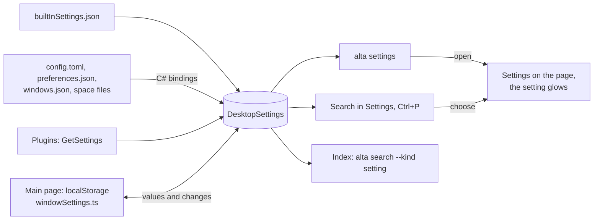

# Find, read and change every setting

Settings has about 30 pages and no search, so finding a setting means browsing them ([#227](https://github.com/CodeAlta/CodeAlta/issues/227)). Nothing in CodeAlta knows the settings as a whole either. Each page reads its values from its own store: the window's `localStorage`, `preferences.json`, `config.toml`, the space files, or a plugin's files. So neither the global search nor an agent can find a setting, read it, or show it to the user.

When this is done, one catalog describes every setting:

- **In Settings:** typing shows the matching settings of every page at once, grouped by page and editable where they are shown.
- **In `Ctrl+P`:** settings are found too.
- **For agents:** `alta search` finds settings, and a new `alta settings` command lists them, reads them, changes them, and opens them for the user with a short glow.
- **For plugins:** they declare their settings the same way and get all of the above.

## What changes

### One catalog, declared where each value lives

A setting gets a stable id, a label, a help text, a type, a default, the page and section where it is shown, and who may change it. Each owner declares its own settings:

| Settings | Declared in | Values read and written by |
| --- | --- | --- |
| Built-in, kept by the host (`config.toml`, `preferences.json`, `windows.json`, space files) | `builtInSettings.json` | the host, through the stores the pages already use (`CodeAltaConfigStore`, `DesktopShell`, `DesktopWindows`, `SpaceCatalog`) |
| Built-in, kept by the window (`localStorage`: theme, language, fonts, counts, confirmations...) | `builtInSettings.json` | the main page: it reports their values to the host and applies the changes the host passes on |
| Of a plugin | `PluginBase.GetSettings()` | the host, in `[plugins.<id>]` of `config.toml` |

`src/CodeAlta/frontend/src/settings/builtInSettings.json` is one data file. The page reads it for search, and the host embeds it for agents and the index. Its texts are the page's own English texts, so the page translates them with its dictionaries, and agents read them in English:

```json
{
  "id": "sessions.prompt_suggestions",
  "page": "sessions",
  "section": "Prompt suggestions",
  "label": "Suggest the next prompt",
  "help": "After a turn, the model suggests what you may write next, in the empty prompt: Tab or → takes it.",
  "keywords": ["autocomplete", "next prompt", "suggestion"],
  "kind": "boolean",
  "default": true,
  "owner": "host",
  "scopes": ["user"],
  "agents": "readWrite"
}
```

- **Ids.** A `config.toml` setting has its key path as id: `sessions.prompt_suggestions` is `[sessions] prompt_suggestions`. Other settings are named after their page (`general.keep_awake`, `appearance.theme`). A plugin's settings are `plugins.<id>.<key>`, which is also where they are stored.
- **Kinds.**
  - Scalar values that `get` and `set` handle: `boolean`, `choice`, `integer`, `number`, `text`, `path` and `list`. A choice whose values change (color schemes, speech models) gets them from its binding.
  - `complex`: a value with a structure of its own, such as model tiers, a color scheme, fonts or the external editor. It is listed, read and opened, and changed on its page.
  - `collection`: items that already have commands of their own (providers, MCP servers, prompts, skills, plugins, spaces, labels, windows). It is listed and opened, and `managedBy` names its commands, so `alta settings` never competes with `alta mcp`, `alta prompt` or `alta window`.
- **The registry.** `DesktopSettings` (`src/CodeAlta/Desktop/Settings/`) merges the three sources and is the one place that answers what exists, what each setting holds, and who may change it. The page reads it through a new `settings` RPC service. `alta settings` and the search index read it in-process.



### Search in the Settings window

A search field heads the navigation of Settings. When the user opens Settings, the focus is in that field, so they can type at once. Typing replaces the page with one page made of the matching parts of every page, which is the "canvas on the fly" that #227 asks for:

```text
Search settings: title                                   3 results
Agent & models › Sessions                                Open page
  Session titles
    Title of a session you did not name     [ first prompt     ▾ ]
    A title you give stays.
  Session tabs
    Single tab for sessions                 [ off ]
Personalization › Windows                                Open page
```

- **Matching.** A query matches the label, help, section and page title, in the shown language and in English, plus English keywords. The label weighs most, as in `rankCommands`.
- **Result rows.** Each row is a `SettingControl` drawn from the descriptor (`Switch`, `HTMLSelect`, `NumericInput`, `InputGroup`, `TagInput`) and saved at once through the same binding as the page.
  - A value that differs from the default shows **Reset**.
  - A setting with a project scope shows the Global/Project choice, as the pages do.
  - Complex and collection entries show **Open**.
- **Navigation.** Pages without a match are dimmed, and pages with matches show their count. A page whose title or keywords match is a result of its own.
- **Keyboard.** `Enter` opens the first result on its page. `↓` moves into the results. `Esc` clears the field; a second `Esc` closes Settings.
- **The pages themselves.** They do not change, except for the anchors below.

### Open a setting, with a glow

Every way to a setting leads to the same place: a result, `Ctrl+P`, `alta settings open`, or the toast of a change. Each one opens Settings on the setting's page and makes the setting glow for about two seconds.

- **Anchors.** `SettingsField` takes a `setting` id and writes `data-setting="<id>"`, and a section card gets `data-settings-section`. Each page passes the ids of its fields, one attribute per field.
- **Opening.** `settingsNavigation.open({ page, setting })` replaces the fixed list of `openSettingsPage` and takes any page: `sessions`, `spaces/<id>/<section>` or `plugin/<key>/<canvas>`. It waits for the field, because pages read their values first, then scrolls it into view with `scrollIntoView({ block: "nearest" })` and sets `data-glow` for 2.4 s. When the field is not drawn, the section or the page heading glows instead.
- **Requests from the host.** `alta settings open` reaches the main window, which holds Settings, through `DesktopPageWatchers`, as `alta documentation open` does, and brings that window to the front.
- **Animation.** The glow animates paint only. The Settings dialog is a window region, which must never move a box (`doc/desktop.md`, Performance):

```css
[data-glow] { border-radius: 8px; animation: settings-glow 2.4s ease-out; }
@keyframes settings-glow {
  0%, 35% { box-shadow: 0 0 0 2px var(--accent), 0 0 18px -2px color-mix(in srgb, var(--accent) 60%, transparent); }
  100% { box-shadow: 0 0 0 0 transparent; }
}
```

### The global search and `alta search`

- **`Ctrl+P`** gets a **Settings** group after the commands, with five results shown under All. It is ranked in the page from the catalog, as commands are, so it is instant, follows the shown language, and works with the index turned off. Settings pages are results too ("Settings › Providers"). Choosing a result opens it with the glow. The existing `{ kind: "settings", page }` target of `contentResults.ts` gains a `setting`.
- **The index** gets `SearchKind.Setting` (13) and a `settings` source over the registry.
  - Documents hold English text and never a value: a value in the text would re-embed the setting at every change.
  - `next` is `alta settings get <id>`.
  - Settings stay out of `tool_search`.
  - A space that hides a plugin hides that plugin's settings.
  - The source is read again when plugins change.

```text
alta search "stop renaming my sessions" --kind setting
{"type":"alta.search.hit","ref":"setting:sessions.title","kind":"setting","title":"Sessions › Title of a session you did not name","next":"alta settings get sessions.title"}
```

### `alta settings`

```text
alta settings list [<words>] [--page <page>] [--changed] [--detailed]
alta settings get <id>... [--project <ref>] [--space <id>]
alta settings set <id> <value> [--project <ref>] [--space <id>] [--show]
alta settings reset <id> [--project <ref>] [--space <id>]
alta settings open [<id>] [--page <page>]
```

```jsonl
{"type":"alta.settings.ref","id":"sessions.title","label":"Title of a session you did not name","page":"Agent & models › Sessions","kind":"choice","agents":"readWrite"}
{"type":"alta.settings.ref","id":"mcp.servers","label":"MCP Servers","page":"Extensions › MCP Servers","kind":"collection","managedBy":"alta mcp server"}
{"type":"alta.settings.value","id":"sessions.title","value":"first_prompt","default":"first_prompt","source":"default","choices":["first_prompt","last_message","model"]}
{"type":"alta.settings.changed","id":"sessions.prompt_suggestions","value":false,"previous":true,"scope":"user","applies":"next prompt"}
{"type":"alta.settings.opened","id":"sessions.title","page":"sessions","shown":true}
```

- **Values** are JSON. `set` reads `true`, `false`, `on`, `off`, numbers, a choice value or `default`, and a list as a JSON array through `--stdin`. `--show` opens the setting after the change.
- **Sources.** `source` says where a value comes from: `default`, `user`, `project`, `space` or `window`.
- **Errors.**
  - `settings.notFound` (exit 3).
  - A value that does not fit the setting is a usage error (exit 2).
  - `settings.readOnly` (exit 4) names the page where the user changes the setting.
  - `settings.managedByCommand` (exit 7) names the commands to use instead.
  - `settings.unavailable` (exit 5): no window for a setting of the window, a stopped plugin, or not on this platform.
- **Where the group exists.** Only in the desktop, where the host registers `IAltaSettings`, as with `alta appearance`. It is not in the TUI, and not in `altacli`, which never writes settings and does not have the group on its allow-list. `settings` is a reserved root, so no plugin can claim it.

### Who may change what

`doc/live-tool.md` says commands never change a global setting of the user. `alta settings set` is the exception asked for here, so it has bounds, and they apply to every caller of the live tool (agents, plugins, the MCP server):

- **Agent access.** Each setting has an agent access, `readWrite` or `read`. It is `read` for what protects the user, widens what agents may do, exposes the computer, or deletes data:
  - Permissions: the default mode, sessions created by agents, tools turned off, and the confirmations before a delete or a stop.
  - Sessions › Review changes before commit.
  - Sandbox and Code Mode.
  - CodeAlta MCP: turning the server off would also cut the caller.
  - General › Turn Remote Control back on.
  - Storage: session retention and scratchpad cleanup.
  - Search › Search by meaning and its model, which download a model after a consent dialog.
  - The settings of a space: agent prompt, sandbox, tiers, tools, identity.

  Everything else is `readWrite`: looks, language, titles, suggestions, worktrees, work items, speech and logging.
- **Help text.** The help of `set` says "Only when the user asks for it."
- **Sandboxed sessions.** `set` is refused for a sandboxed session (`settings.sandboxed`): the window is outside its sandbox, as for the UI tools.
- **Space containment.** `--space` names only the caller's own space, and `--project` only a project of that space. Plugin settings are reachable only for plugins of that space.
- **Every change is visible.** A change made by a caller other than the window shows a toast in the main window, with **Show** and **Undo**, for example "Fix login bug changed Sessions › Suggest the next prompt to Off". The change is also written to the application log.
- **Concurrency.** Writes take the stores' locks (`ConfigFileLock`, the preferences writer), as the pages' writes do. The last writer wins.

### Plugins declare settings

```csharp
public override IEnumerable<PluginSettingContribution> GetSettings()
{
    yield return Setting.Integer("poll_minutes", "Check every", "How often new builds are looked for, in minutes.",
        defaultValue: 5, minimum: 1, maximum: 120) with { Group = "Builds", Keywords = ["refresh", "interval"] };
    yield return Setting.Choice("notify", "Tell me when a build", "Which builds raise a toast.",
        ["failed", "always", "never"], defaultValue: "failed") with { Agents = PluginSettingAccess.ReadWrite };
}

// Read when the value is used; told when Settings or an agent changed it.
var minutes = Services.Settings.GetInt64("poll_minutes");
Services.Settings.Changed += OnSettingChanged;
```

- **Kinds.** `boolean`, `choice`, `integer`, `number`, `text`, `path` and `list`. There is no secret in this version.
- **Storage.** The host keeps the values in `[plugins.<id>]`:
  - `Scope = User` (the default) writes `~/.alta/config.toml`.
  - `Scope = Project` writes the project's `.alta/config.toml`. This is the only scope of a project plugin.
  - Writes go through `ConfigTableSyntax`, so comments stay.
  - `enabled`, `required` and `spaces` are reserved keys, and saving `enabled` keeps the other keys.
- **Agent access.** It is `Read` unless the plugin says `ReadWrite`.
- **Changes.** `Changed` fires after a write through Settings or `alta settings`. A hand edit of the file is read at the next `Get…`, so a plugin reads a value when it uses it.
- **In Settings.** A plugin with settings gets an Extensions entry and the gear on its row in **Plugins**. Its page shows the settings as a generic form grouped by `Group`, above its settings canvas when it has one. Its settings are found by the search, `Ctrl+P`, `alta settings` and `alta search`.
- **Limits.** At most 64 settings per plugin, with bounded texts. An invalid setting is dropped with a diagnostic, as other contributions are. A value the plugin no longer declares stays in the file.
- **`alta plugin api`** shows the new types without further work, since it reflects the abstractions.

### What agents are told

The session context of the desktop gets one line beside the Search line. It is the prompt contribution of a built-in `DesktopSettingsPlugin`, as the Search line is `DesktopSearchPlugin`'s:

```text
Settings: `alta settings list <words>` finds a setting of CodeAlta and its id, `alta settings get <id>` reads it and `alta settings open <id>` shows it to the user; change one with `alta settings set` only when the user asks.
```

## Steps

Four milestones, each a series of commits that builds and passes the tests on its own. Milestone 2 closes #227.

**Milestone 1: the catalog, the registry, and opening a setting**

> Done as planned, with two refinements: the catalog also declares the pages of Settings (`groups`), so `settingsPages.ts` reads it too; and a row can stand for several settings (`data-setting` holds a space-separated list, matched with `~=`), as the storage retention and the model fallback rows do. The settings of a space are not entries of their own yet: `spaces.list` points to `alta space` and the page of each space.

- [x] 1. Move the list of Settings pages (`destinations` in `SettingsOverlay`, `main.tsx`) unchanged to `src/CodeAlta/frontend/src/settings/settingsPages.ts`, with English `keywords` per page. `SettingsOverlay`, the catalog test and the search read it from there.
- [x] 2. Write `src/CodeAlta/frontend/src/settings/builtInSettings.json` with every setting of the inventory (see the details at the end), the collections with their `managedBy`, and the complex entries. Embed it in `src/CodeAlta/CodeAlta.csproj`.
- [x] 3. Add `IAltaSettings` and its records (descriptor, value, change, target, origin) in `src/CodeAlta.LiveTool/AltaSettings.cs`.
- [x] 4. Add `DesktopSettings` in `src/CodeAlta/Desktop/Settings/`. It reads the embedded catalog and binds the host's ids to the existing typed methods of `CodeAltaConfigStore`, `DesktopShell`, `DesktopWindows` and `SpaceCatalog`. It validates values by kind and reports what is unavailable on this host or platform.
- [x] 5. Add the `settings` RPC service (`src/CodeAlta/Desktop/Rpc/SettingsRpc.cs`), and its exports in `demo-api.ts` and `projectFocus.neoastra.mount.ts`. It offers:
  - `catalog`: host and plugin descriptors, with availability.
  - `get`, and `set` with the window as origin.
  - `reportWindow`.
  - `watch`: show requests, changes made by others, window writes, and catalog changes.
- [x] 6. Bind the window's settings in `src/CodeAlta/frontend/src/settings/windowSettings.ts`, over `useWindowPreferences` and the preferences of the features (fonts, timeline emphasis, welcome page, confirmations). The main page reports their values at start and on each change, and applies the writes the host passes on.
- [x] 7. Anchors. Add the `setting` prop of `SettingsField` (writes `data-setting`) and `data-settings-section` on section cards, and pass the ids on every page of the catalog.
- [x] 8. Opening. Add `settingsNavigation.open({ page, setting })` and the shell's `openSettingsAt`: any page, then the wait, the scroll, the glow and the fallback. Add the `[data-glow]` style to `style.css`.

**Milestone 2: search in Settings and in `Ctrl+P` (#227)**

- [x] 9. Rank settings in `src/CodeAlta/frontend/src/settings/settingsSearch.ts`, in the shown language and in English, with keywords and pages.
- [x] 10. Build the results view (`settings/SettingsSearchResults.tsx`) and the generic `settings/SettingControl.tsx`. Add the field, the focus on open, the match counts and the keyboard to `SettingsOverlay`. Put the texts in `settings/messages.ts` and the styles in `settings/settings.css`, imported from `main.tsx`.
- [x] 11. In `Ctrl+P`, add a `setting` result kind and a Settings group (`search/searchResults.ts`, `search/GlobalSearch.tsx`), make Settings pages results, and add the `setting` of `contentResults.ts`.

**Milestone 3: `alta settings`, its safety, and what agents find**

- [x] 12. Add `alta settings` in `BuiltInAltaCommandContributor.Settings.cs`:
  - `list`, `get`, `set`, `reset` and `open`.
  - Policies: `set` and `reset` are mutating.
  - Help text and errors.
  - `settings` in the reserved roots of `PluginAltaCommandContributor`.
  - `list`, `get` and `open` admitted by `AltaSandboxGate`; `set` and `reset` refused there.
- [x] 13. Enforce the safety rules in `DesktopSettings`: agent access, space containment, and the change event. Make the main page show that event as a toast with **Show** and **Undo**.
- [x] 14. Add `SearchKind.Setting` (`src/CodeAlta.Search/SearchModel.cs`) and a `settings` source in `src/CodeAlta/Desktop/Search/DesktopSearchSources.cs`, signalled on plugin changes. In `alta search`, add the kind to `--kind`, `next` and `SourceMayHold`, and filter plugin settings by space. Add the kind's labels to the Search canvas.
- [x] 15. Add the built-in `DesktopSettingsPlugin` (`src/CodeAlta/Desktop/Settings/`) with the guidance line.

**Milestone 4: plugin settings**

- [ ] 16. In `src/CodeAlta.Plugins.Abstractions`, add:
  - `PluginSettingContribution`, `PluginSettingKind`, `PluginSettingAccess` and the `Setting` factories.
  - `PluginBase.GetSettings()`.
  - `IPluginServices.Settings`, with typed `Get…` methods and `Changed`.
  - `PluginPoint.Settings`.
- [ ] 17. In `src/CodeAlta.Plugins`, add `PluginSettingValidation.Filter` (keys, kinds, limits), and wire it into the registry of contributions and the activation.
- [ ] 18. In the host, add the plugin source of `DesktopSettings`: values stored in `[plugins.<id>]` through `ConfigTableSyntax`, `Changed` run with the bounded admission of plugin callbacks, and a catalog change on reload. `SavePluginEnabled` must keep the other keys of the table.
- [ ] 19. In the window, add the Extensions entry and the generic page of a plugin with settings, above its settings canvas, and the gear on its row in **Plugins**.
- [ ] 20. Document it for plugin authors: the `codealta-plugin-runtime` skill and its sample, and `site/docs/plugins/developers.md`.

**Documentation, with the milestone it describes**

- [ ] 21. In the user guide, `site/docs/workspace/settings.md` covers searching, opening a setting from `Ctrl+P`, and asking an agent; `site/docs/search.md` covers settings in the global search. Add a picture of Settings with a search, as `doc/site-screenshots.md` says.
- [ ] 22. In the architecture docs:
  - `doc/live-tool.md`: the `settings` group, and the amended rule "User settings stay the user's".
  - `doc/desktop.md`: the catalog, and who owns which values.
  - `doc/plugins.md`: the settings contribution.
  - `doc/catalog-and-config.md`: plugin settings in `[plugins.<id>]`.

## How it is verified

- [ ] **`AltaSettingsCommandsTests`** (fake `IAltaSettings`) covers:
  - `list`, `get`, `set`, `reset` and `open`, and values of every kind.
  - Errors and exit codes.
  - `read` settings refused, sandboxed callers refused, space containment.
  - Collections refused, naming their commands.
  - The group absent from the CLI and TUI registries, and the reserved root.
- [ ] **`DesktopSettingsTests`** checks:
  - Every host entry of the catalog has a binding, and every binding has an entry.
  - On an empty profile, each binding reads the catalog's default. This catches drift such as the Code Mode default, which the page and the document disagree on today.
  - `set` then `get` writes the file and keeps its comments.
  - A window write ends in `settings.unavailable` when no page answers.
- [ ] **Plugin settings tests** check validation, values in `[plugins.<id>]`, the toggle of `enabled` keeping them, `Changed` firing once per write, and a project plugin writing the project file.
- [ ] **`settingsCatalog.test.ts`** checks that every text of the catalog is a key of the dictionaries, every `page` is in `settingsPages.ts`, and every window entry has a binding in `windowSettings.ts`.
- [ ] **`settingsSearch.test.ts`** checks ranking in English and in French, keywords, and page results.
- [ ] **Browser tests** in the settings shell (`settingsOrganization.neoastra.mount.ts`) check:
  - Every `.settings-field` with a control, on every page, carries a `data-setting` the catalog knows, so a new field without an entry fails.
  - Typing shows editable results, and a change made there is saved.
  - Opening a setting makes it glow.
  - `Ctrl+P` lists a setting and opens it.
- [ ] **Search tests** (`DesktopSearchTests`, `AltaSearchCommandsTests`) cover the `setting` document, its `next`, and a plugin hidden by its space.
- [ ] **In the developer instance** (`codealta-dev`), check in both themes and in a 900×650 window:
  - Typing "title" in Settings shows results from Sessions and Windows, and one can be changed in place.
  - `Ctrl+P` "keep awake" opens General with the glow.
  - From a session, `alta settings set sessions.prompt_suggestions false` shows the toast, and **Undo** restores the value.
  - `alta settings set permissions.default_mode ask` is refused with exit 4.
  - `alta settings open appearance.theme` shows the glow.
- [ ] `dotnet test`, `npm test` and `lunet build` pass.

## Decisions

| Decision | Choice | Why |
| --- | --- | --- |
| Where built-in settings are declared | One JSON catalog, read by the page and embedded in the host | One list for the window, the search and agents. The page tests that its texts are translated; the host tests that each has a binding and the right default |
| Settings kept in `localStorage` | Stay in the window: the page reports them and applies the changes the host passes on | The page owns presentation (`doc/desktop.md`), and the user's preferences need no migration |
| Search results | The matching settings of every page, editable in place, grouped by page and section | What #227 asks: no page to open and then search through |
| The pages | Unchanged except for the anchors; results use a generic control | Search needs no rewrite of 30 pages, and a page can adopt the control later |
| Focus when Settings opens | In its search field | Typing is the quickest way in (#227) |
| `Ctrl+P` | Ranked in the page from the catalog, as commands are | Instant, in the shown language, and works with the index off |
| `alta search` | A `setting` kind with English text and no values | Search by meaning for agents, without re-embedding when a value changes |
| Lists (providers, MCP servers, prompts, skills, plugins, spaces, labels, windows) | Listed and opened, changed with their own commands | `alta mcp`, `alta prompt` and `alta window` already do it, with their own rules |
| Agent writes | Allowed for preferences, refused for what protects the user | The user asked for `set`; permissions, review, sandbox, tools and exposure stay the user's |
| After an agent's change | Applied, then a toast with **Show** and **Undo** | The user sees every change and can take it back in one click; chosen in review over asking before each change |
| Where plugin settings are stored | `[plugins.<id>]` of `config.toml` | It is the one settings file, it is visible in **Configuration file**, and a project can carry its own values |
| Default agent access of a plugin setting | `Read` unless the plugin says `ReadWrite` | A plugin author opts in to agent writes |
| TUI and `altacli` | No `alta settings` | New features are desktop-only, and `altacli` never writes settings |

## Risks

- **The catalog drifts from the pages.** A field added without an entry is not found. The browser test that every field carries a known `data-setting` catches this, and the binding tests catch it on the host's side.
- **Window settings need the main page.** Until the page has reported, `get` and `set` of those settings answer `settings.unavailable`.
- **An agent's change can surprise the user.** Every change shows a toast with **Undo**, and settings that protect the user cannot be changed by agents.
- **Rendering cost.** Results draw generic controls only, never whole pages, and the glow animates paint only, so the region churn rule holds.

## Out of scope

- Finding list items by name in the Settings search (a provider, an MCP server, a skill). A follow-up can add them to the same results view.
- Typed settings for the built-in Browser and Mobile plugins, which keep their canvases and their `settings.json`. A follow-up can move them to `GetSettings()`.
- Rebuilding the pages on `SettingControl`.
- Secrets in plugin settings.
- New commands for the lists, such as enabling a skill or a plugin. Those belong to their own groups.
- The TUI.

<details><summary>The inventory behind the catalog</summary>

Four read-only research sessions read every page, its store, and the commands that touch it.

| Store | Settings | Examples |
| --- | --- | --- |
| `localStorage` of the window | about 22 | theme, darker, color scheme, fonts, language, welcome page, counts, rail, focused timeline, changes view, confirmations (3), single session tab, model picker rows |
| `preferences.json` (host) | 9 | session width, close behavior, keep awake, Remote Control, external editor, MCP server, Tailscale, review and inherit permissions |
| `config.toml` (user) | about 40 | `[sessions]`, `[review]`, `[commits]`, `[worktrees]`, `[work_items]`, `[models.fallback]`, `[models.adaptive]`, `[code_mode]`, `[tools]`, `[sandbox] all_sessions`, `[speech]`, `[search]`, `[storage]`, `[logging]` |
| `config.toml` with a project override | `[search] enabled`, and the collections of skills, plugins and MCP policy | |
| `windows.json` | 1, plus the windows (a collection of `alta window`) | restore windows at startup |
| Space files | about 14 per space | agent prompt, sandbox, tiers, tools, identity; name, icon and color go through `alta space update` |
| Collections | 12 | providers, MCP servers, prompts, skills, plugins, spaces, labels, windows, color schemes, pull request kinds, sandbox profiles, downloaded models |
| Plugin canvases | Browser, Mobile | no declared values today; their pages are found by title |

Existing commands that read or write any of this: `alta appearance` (one session's width), `alta window`, `alta space`, `alta label`, `alta mcp server`, `alta prompt`, `alta skill`, `alta plugin`, and read-only `alta provider`, `alta model` and `alta sandbox`. No command writes a scalar setting today.

Alternatives ruled out:

- **Moving the `localStorage` preferences to the host:** it would migrate the user's preferences, and the page owns presentation.
- **Declaring built-in settings in C# only:** the page could then not check from its own tests that every text is translated, and search would quietly fall back to English.
- **Mounting every matching page in the results, with the other cards hidden:** it would show the exact controls, but it loads every page's data and makes each page aware of the filter. Generic controls cover every scalar setting and the plugins' settings too.

</details>