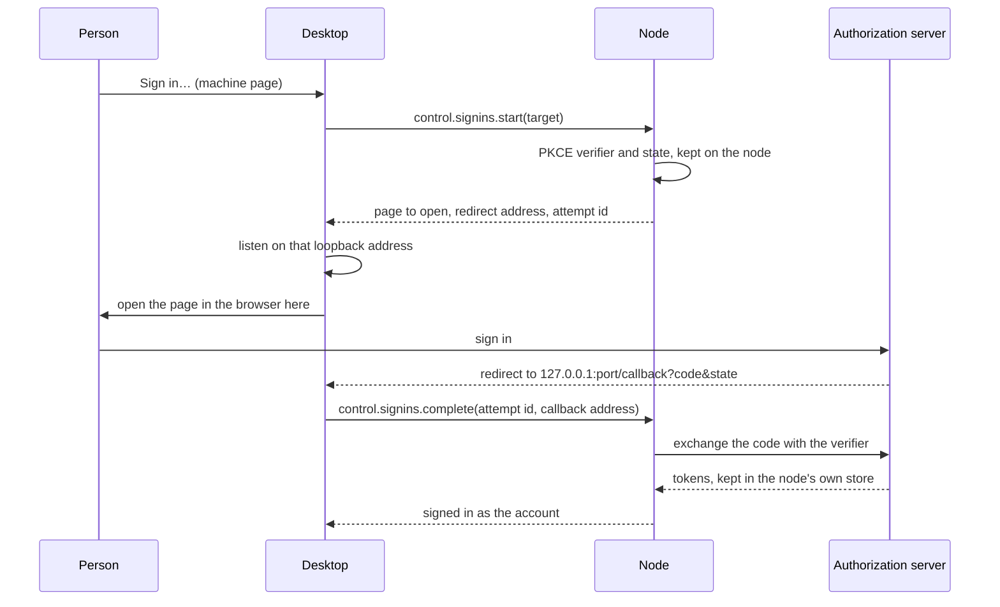

# Sign in on a machine from the desktop in one click

Today the desktop can sign a node in for Copilot and xAI only, the two providers with a device code (`control.providers.signin`). The rest needs SSH and a terminal on the machine:
- Codex and Mistral Vibe sign in only through a browser, and the node refuses them ("sign in there, or over SSH", `NodeProviders.StartSignInAsync`).
- MCP OAuth waits for the browser on the node's own loopback, so it cannot finish on a headless machine.
- `gh`, `az`, Codex CLI and Claude Code sign in through their own login, run on the machine.

Once this plan is done, the machine page lists, per space, every sign-in the machine has and lacks, and **Sign in…** does each in one click. The browser opens on the person's computer; the node exchanges the code and keeps the token. The rule of the fleet stays: no credential crosses machines. What crosses is an authorization code useless without the node's verifier, or a device code the person reads. On team machines, other people's sessions keep to account credentials, as the design already requires.

## What changes

### The forwarded browser sign-in

The pattern exists twice in the code already:
- the desktop's sign-in to a server (`DesktopFleetServers.SignInThroughBrowserAsync`): a `FleetLoopbackRedirect` on the desktop, `StartSignInAsync(redirectUri)`, then `CompleteSignInAsync(code, state)`;
- Codex's login, which already separates its start (`BeginBrowserLoginAsync`) from its completion with the callback address (`CompleteBrowserLoginAsync(login, callbackUri)`).

The node becomes the party that starts and completes:



- **The node names the redirect address**, a loopback address of the desktop, and keeps it per target. Most flows accept any loopback port (RFC 8252; Codex: "Dynamic registrations permit the loopback port to vary"). An MCP client registered with an exact redirect keeps working with the same address. A fixed address stays fixed: xAI's `127.0.0.1:56121`, or an MCP server whose `redirect_uri` is configured.
- **The desktop listens there and forwards the whole callback address**, path and query: Codex reads `client_id` from it, not only `code` and `state`. When another program holds the port, the desktop says so and nothing is half done.
- **The desktop never sees a token**, only the page and the callback; without the verifier the code is worthless to anyone else.
- `FleetLoopbackRedirect` learns to listen on a given loopback address and path, and to return the callback address.

### One family of node methods

Modeled on `control.providers.signin` and its `wait`. The records are named `FleetMachineSignIn…` to stay apart from the server's sign-in protocol (`FleetSignIn…`):

```csharp
// src/CodeAlta.Fleet/NodeApi/FleetNodeContracts.cs
public const string ControlSignInsList = "control.signins.list";         // per space: what can be signed in, as whom
public const string ControlSignInsStart = "control.signins.start";       // a target; answers what the desktop does next
public const string ControlSignInsComplete = "control.signins.complete"; // the callback address, or a pasted code
public const string ControlSignInsWait = "control.signins.wait";         // the end of a device code or a CLI
public const string ControlSignInsCancel = "control.signins.cancel";
public const string ControlSignInsSignOut = "control.signins.signout";

// What to sign in: a provider, an MCP server or a CLI profile, in a space.
public sealed record FleetMachineSignInTarget(string Kind, string Key, string? Space);

// What the desktop does next: open a page and catch its redirect, show a device code, or ask for a pasted code.
public sealed record FleetMachineSignInPrompt(string AttemptId, string Way, Uri? Page, Uri? Redirect,
    string? UserCode, string? Ask, DateTimeOffset ExpiresAt);
```

`control.providers.signin` stays, since 4.0 desktops call it, and becomes a shortcut of the new family.

### What can be signed in

| Target | How | Where the token stays on the node |
| --- | --- | --- |
| Codex subscription, Mistral Vibe | Forwarded browser: their logins get the start/complete split Codex already has | `~/.alta/auth/` |
| Copilot, xAI | Device code, as today | `~/.alta/auth/` |
| MCP server with OAuth | Forwarded browser: `McpRuntimeService` takes the node's redirect and a forwarded `AuthorizationCallbackHandler` in place of its `HttpListener`; the SDK still runs dynamic registration and PKCE on the node | `~/.alta/auth/mcp/` |
| Codex CLI, ACP agents | Their plugin sign-in (`IPluginProviderAccount.SignInAsync` with prompts; Codex CLI has a device method) | Their own home |
| `gh` | `gh auth login` with the space's `GH_CONFIG_DIR`: device code | `gh`'s profile of that space |
| `az` and the other CLI profiles of a space | The profile's `Login` command, checked by its `Check` command (`SpaceCliProfile`) | The CLI's own store |
| Claude Code | `claude setup-token` run on the node: the desktop opens its page and sends back the code the person pastes; the node keeps the printed token as a secret, referenced by the provider's `CLAUDE_CODE_OAUTH_TOKEN` | The node's secrets store |

### CLI sign-ins without a terminal

- **An allowlist of commands, never a shell**: `gh`, `az`, `codex`, `claude`, and the `Login` commands of the space's CLI profiles. They run with the identity environment of the space, under a pseudo-terminal only for a CLI that refuses to prompt without one.
- **The node reads and writes for the person**: it reads the page and the code from the CLI's output, and writes what the person gives (a pasted code, Enter) to its input.
- **A CLI that waits on its own loopback** (`az login` without `--use-device-code`) gets a loopback relay: the desktop listens on the same port and the node replays the callback to the CLI's listener on the machine.
- **A CLI whose output the node cannot read** ends with "run this command on the machine" and the exact command.

### On the machine page

Per space, a **Sign-ins** section replaces the provider-only sign-in of `MachineProviders.tsx`:

```text
Work space on build-mac
  Codex               not signed in                  Sign in…
  GitHub (gh)         alex-contoso                   Sign out
  Azure (az)          not signed in                  Sign in…
  Linear (MCP)        signed in, expires in 23 days  Sign out
  Claude Code         token set on 2026-11-07        Replace…
```

The readiness of an automation ("Why can't this machine run it?") names a missing sign-in and links to it.

### Who may sign a machine in, and team machines

- **Who.** The owner on the machine, and a device paired with `manage`. Never a member reached through a server's relay, as for providers and secrets today (`FleetNodeService.Providers.cs`: "a device trusted only through the list of an organization never sets one").
- **Limits.** One attempt per target at a time; an attempt expires after 15 minutes, as `NodeProviders` sign-ins do, and can be cancelled. Each start, completion and sign-out is logged with the device, never with a token.
- **Team machines keep to account credentials for other people's sessions.** Today the node checks the credential kind of a provider for automations only (`NodeAutomations.cs`). A session started on a team machine by someone else than its owner is recorded as not the owner's work (`FleetNodeService.cs`), but that only keeps the owner's secrets from it (`SessionIdentity.cs`). Such a session can run on any provider of the machine, including a personal plan the person who enrolled it signed in. Example: Alex signs in his Copilot seat on his Mac mini, gives the machine to his team, and Bea's session runs on Alex's plan. The design says any run on a shared machine uses account credentials only (`doc/fleet/security-and-privacy.md`, "Subscriptions are personal"). The node now refuses a personal plan to such a session, and to its sub-sessions, fallbacks and model tiers. The start dialog lists only the account providers of such a machine, and its **Sign-ins** section offers no personal plan, since none would serve anyone.

## Steps

- [x] 1. Team machines, regression test first: a session another person starts on a team machine with a provider of the personal kind is refused with the reason, and so are its sub-sessions, fallbacks and tiers. Then refuse it at the node (`FleetNodeService` start and prompt paths, reusing `NodeAutomations.CredentialKindOf`), and list only account providers in the desktop's start dialog for such a machine. Tests in `TeamMachineSessionsTests`. Independent of the rest; can land first.
- [ ] 2. `FleetLoopbackRedirect`: listen on a given loopback address and path, return the whole callback address; ports of 1024 and up on loopback only. Tests in `FleetLoopbackRedirectTests`.
- [ ] 3. Node API:
   - contracts (`FleetNodeContracts.cs`), client methods (`FleetNodeClient.cs`), JSON context;
   - handlers in `FleetNodeService.SignIns.cs`, with the access of providers and secrets, logging;
   - `control.providers.signin` kept as a shortcut;
   - the node side in `src/CodeAlta.Node/NodeSignIns.cs`, which dispatches by kind;
   - tests in `FleetNodeManagementTests`.
- [ ] 4. Providers: forwarded browser sign-in for Codex (an overload of `OpenAICodexSubscriptionLoginManager.BeginBrowserLoginAsync` that takes the redirect and starts no listener) and Mistral Vibe (`MistralVibeLogin`). `ConfiguredProviderLogin` gains the forwarded mode. Tests with fake authorization servers.
- [ ] 5. MCP: `McpRuntimeRequest` takes a redirect and a forwarded authorization; overload of `McpManagementService.LoginOAuthAsync`; the node lists its servers and their token state (`RefreshSnapshot`, `OAuthTokenCached`). Tests with a fake authorization server with dynamic registration (built like `FakeOidcProvider` of `CodeAlta.Server.Tests`) and `CodeAlta.Tests.TinyMcpServer`.
- [ ] 6. Plugin providers: Codex CLI and ACP agents sign in through `IPluginProviderAccount.SignInAsync` with prompts.
- [ ] 7. CLI sign-ins: first record, for `gh`, `az`, `codex` and `claude`, the flags and what each prints without a terminal. Then the allowlist runner with the space's identity environment, the parsing, the input relay and the loopback relay. Tests with fake CLIs that print what the real ones print.
- [ ] 8. Claude Code: `claude setup-token` on the node; the token kept as a secret of the node and referenced from the provider's environment (`${secret:NAME}` resolved there); masked.
- [ ] 9. Desktop: `MachinesRpc.SignIns.cs` (list, start, open the page, listen, forward, wait, cancel, sign out). Tests in `MachineManagementTests`.
- [ ] 10. Machine page: the **Sign-ins** section (`MachinePage.tsx`, `machines.ts`); the automation readiness links to a missing sign-in. Tests in `machinePage.browser.test.ts` and `machines.test.ts`.
- [ ] 11. Docs:
   - `site/docs/fleet/machines.md`: signing a machine in;
   - `doc/mcp.md`: OAuth on a node;
   - `doc/fleet/node.md`: credentials on a node, now from the desktop;
   - `doc/fleet/security-and-privacy.md`: what crosses machines during a sign-in, and team machines.

## How it is verified

- [ ] Build in the configuration "Debug or Release" of `AGENTS.md` gives, then `dotnet test --no-build` and `npm test` as two jobs, and `lunet build` in `site/`: all pass.
- [ ] A Linux node in a VM, with no SSH session open. From the desktop, sign in Codex, an MCP server with OAuth and dynamic registration, `gh`, `az` and Claude Code. The tokens are on the node only (`~/.alta/auth/`, `gh`'s profile); neither the desktop's files nor its log hold one.
- [ ] A fixed address whose port another program holds on the desktop: a clear message, and the node keeps no half-done attempt.
- [ ] A member's device reached through a relay cannot start a sign-in.
- [ ] Team machine: another person's session on a personal plan is refused with the reason, and one on an account provider runs.
- [ ] The **Sign-ins** section in both themes and in a 900×650 window.

## Decisions

| Decision | Choice | Why |
| --- | --- | --- |
| Where the code is exchanged | On the node | The token never exists on the desktop |
| Redirect address | Named by the node, a loopback address of the desktop | Exact-match registrations and fixed addresses keep working |
| What the desktop forwards | The whole callback address | Codex reads `client_id` from it |
| CLI sign-ins | An allowlist of commands, not a terminal | A remote terminal is a much larger power, audited apart |
| `control.providers.signin` | Kept, as a shortcut | 4.0 desktops call it |
| Team machines | Personal plans refused for other people's sessions | The design's rule and the vendors' terms |

> **Open:** Claude Code. CodeAlta would keep the token `claude setup-token` prints, where today "CodeAlta does not handle the credentials of Claude Code" and the person pastes the token into the provider's environment. Accept it, or let the CLI keep its own login on the node (fine on Linux and Windows, not under a macOS LaunchDaemon)? Recommendation: keep it as a secret of the node, since it is the token the person would paste anyway.

> **Open:** may a team machine's maintainers sign it in through the server's relay, with the team's identity (account providers, `gh` and `az` as the team's accounts), audited? Recommendation: yes, account credentials and tool identities only.

> **Open:** a personal machine that lets other people in (`control.people`): account credentials only for their sessions too? Recommendation: yes; the design says a person's own machine hosts no sessions of anyone else.

> **Open:** add or remove MCP server definitions from the machine page in this plan, or later with the distribution of configuration (#360)? Recommendation: later; this plan signs in the servers a machine already has.

## Risks

- CLIs change their prompts and output. Each CLI's parsing is tested against recorded output, and an unreadable one ends with the command to run on the machine.
- Port conflicts for fixed redirects on the desktop: said plainly; where the flow allows it, the node names another address.
- Device-code phishing: the desktop shows only what the node sent over the paired channel, with the machine's name.
- Step 1 can refuse sessions that run today on a team machine with a personal plan. The refusal names the provider and the account providers that would work.

## Out of scope

- Credentials leased from the person's device to their sessions on other machines: the next step after this plan.
- Distributing MCP and provider definitions, model tiers and plugins (#360, #315).
- A general remote terminal from the desktop.
