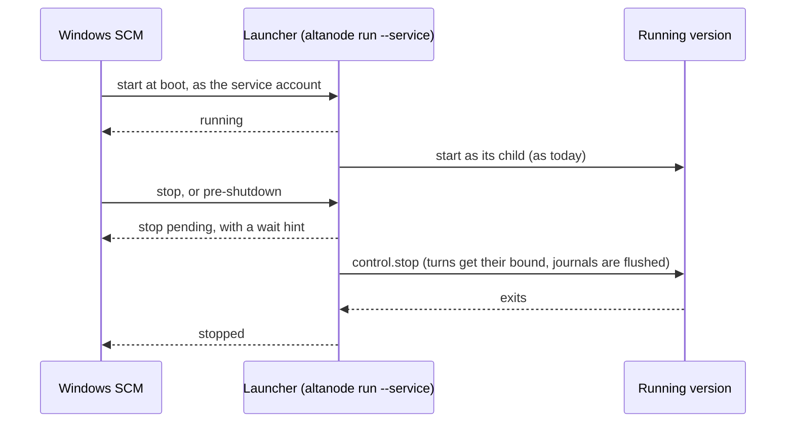

# Start nodes and servers at boot on every OS

Today only Linux runs a node or a server at boot without a login (`systemd --user` with lingering). On Windows the service is a Task Scheduler task at logon, and on macOS a LaunchAgent: after a restart (Windows Update, a power cut) nothing runs until someone signs in, and signing out stops it. The desktop's SSH setup cannot reach a Windows machine at all, and it installs the server as a user service too, though the server holds no personal login.

Once this plan is done:
- a machine set up as **Always on** comes back by itself after a restart, on every OS;
- a server set up from the desktop always does;
- the machine page answers "Will this still run after a restart or a sign-out?", with the action that fixes it.

## What changes

### What each OS gets

| OS | Today (`install --user`, what the desktop sets up) | Added: starts at boot, nobody logged in |
| --- | --- | --- |
| Windows | Task at logon (`InteractiveToken`); `install --system` refused | A Windows service, under a dedicated account or the person's own account ("at boot as me") |
| macOS | LaunchAgent in `gui/<uid>` | The LaunchDaemon that `install --system --account` already writes, now offered by the desktop |
| Linux | `systemd --user` with lingering: already starts at boot | Unchanged; whether lingering is really on is checked and reported |

The user-session services stay. They are right for a workstation that also serves as a node, and for a Mac that signs iOS builds, which needs its login keychain.

A server needs no personal login, so the desktop always sets it up as a boot-time service. On Windows and macOS that means the system service; on Linux its `systemd --user` unit with lingering already starts at boot.

### Windows: a service that fits the launcher

The process a service manager starts is the launcher (`UpdateLauncher`): it runs the version `altanode update` selected as its child and never exits during an update. On Windows the Service Control Manager (SCM) needs that process to answer it:



- `ServiceScope.System` on Windows plans a Windows service instead of being refused (`ServiceManager.PlanWindows`). It is registered through the SCM API (`CreateServiceW`; `ChangeServiceConfig2W` for delayed automatic start, recovery actions and the pre-shutdown time), never through a command line that would carry a password.
- The launcher answers the SCM when started with `--service`. It turns a stop into a graceful stop of the version through its local control (`control.stop` for a node, the server's own stop for a server), and kills it only after `ServiceDefinition.StopTimeoutSeconds`. Today on Windows the launcher can only kill the version ("Windows has no graceful request to send", `UpdateLauncher.cs`).
- The SCM cannot start the `.cmd` shim of a .NET tool, because `cmd.exe` is not a service. An archive install registers its `altanode.exe`. A tool install registers a launcher copied into a stable folder of the state root (`fleet/service/`), refreshed by each `install`. That copy only supervises: it starts the installed entry point, found through the shim as `LocalServerSetup.Resolve` already does, or the version `altanode update` selected. `dotnet tool update` keeps working.

Who the service runs as:

| Choice | Command | Needs | Its credentials |
| --- | --- | --- | --- |
| Dedicated account | `altanode install --system` (a virtual account, `NT SERVICE\altanode`) or `--account <name>` | An administrator; no password for the virtual account | Its own profile, filled from the desktop |
| At boot as me | `altanode install --system --account <me> --password-stdin` | An administrator; the person's Windows password, once | The person's: DPAPI, Credential Manager and the network work in a logon with a stored password, unlike "Do not store password" (S4U) |
| Server | `altaserver install --system` | An administrator | A virtual account (`NT SERVICE\altaserver`), its data root under `%ProgramData%\CodeAlta\Server` |

The password goes to Windows (it keeps it as an LSA secret) and nowhere else: no file, no log, no command line. After a password change the service cannot log on: `altanode status` and the machine page say "Windows refused the stored password", and running the same `install` again fixes it.

### macOS: the LaunchDaemon, from the desktop

`install --system --account` already writes a LaunchDaemon with `UserName`. What changes:

- The desktop's SSH setup offers it as **Always on**, as the person (`--account <me>`) or as a dedicated account.
- A LaunchDaemon has no unlocked login Keychain. The device key and `~/.alta/auth` are files already, but a secrets store made in a login session keeps its key in the Keychain (`MasterKeySecretProtector`). So `install --system` for the same person re-protects the store with a key in a file only the account reads (`FileSecretKeyStore`), after reading the old key through the Keychain. The same applies on Linux to a store made in a desktop session with libsecret.
- FileVault: a Mac with FileVault starts nothing until its disk is unlocked. Since macOS 26, an Apple Silicon Mac with Remote Login on can be unlocked over SSH before it boots; the LaunchDaemon then starts. The guide explains it.

### The desktop's setups

- **Windows over SSH.** `SshRunner` runs `sh -s` with the script on its standard input, so a Windows host (OpenSSH starts `cmd` or PowerShell) fails at the check today. The probe tries `sh -s` and falls back to PowerShell when the host answers as Windows:

  ```text
  ssh -o BatchMode=yes … box powershell -NoProfile -NonInteractive -ExecutionPolicy Bypass -Command -
  ```

  with PowerShell versions of the probe (`win-x64`/`win-arm64`, user, elevated session, .NET, CodeAlta Desktop running, Tailscale), install, service and pair scripts.
- **Root and administrator over SSH.** The runner uses `BatchMode=yes` and never asks a password. A system service needs `sudo` (macOS, Linux) or an elevated session (Windows OpenSSH elevates an administrator; to check). The setup checks this first and says what is missing.
- **The server** set up over SSH or on this computer is a boot-time service (see decisions).
- **Lingering.** After `install`, the SSH setup reads lingering again. Today `SshNodeInstaller.ServiceDetail` says "lingering on" from the probe even when `loginctl enable-linger` was refused.

### Will it still run after a restart?

`ServiceManager.Describe` already answers that question, but only `altanode status` prints it. The node adds the facts to `control.status` (`FleetNodeStatus.Service`), and the machine page shows them with **Start at boot…**. That action either runs the setup over SSH again, prefilled with the SSH destination the setup used (no credential is kept), or shows the one command to run on the machine. The server's page in Settings > Fleet does the same.

```text
Service: a Windows service run as NT SERVICE\altanode (altanode).
After a restart: it starts at boot, without a sign-in.
After a sign-out: it keeps running.
```

### Credentials in each mode, until plan 2

Plan 2 (`2026-11-07-fleet-sign-in-on-a-machine-from-the-desktop`) makes every sign-in of a machine possible from the desktop. Until then:

| | User session (today) | At boot, as the person | At boot, dedicated account |
| --- | --- | --- | --- |
| Secrets store, device key, `~/.alta/auth` | ✅ | ✅ (macOS and Linux after re-protection) | Its own, filled from the desktop |
| Copilot, xAI | ✅ | ✅ | Device code from the desktop |
| Codex subscription, Mistral Vibe | ✅ signed in on the machine | ✅ if signed in before | Plan 2 (they sign in through a browser only) |
| `gh`, `az`, Git credential helpers | ✅ | Windows: to check (step 2); macOS: those in the Keychain ✗; Linux ✅ | Their own sign-in, over SSH until plan 2 |
| Claude Code login | ✅ | Windows, Linux ✅ (a file); macOS ✗ (Keychain) | `CLAUDE_CODE_OAUTH_TOKEN` in the provider's environment |
| SSH agent | ✅ | ✗ (no login session) | ✗ |

## Steps

- [x] 1. Mac check: run the SSH setup on a Mac nobody is logged in to and record whether `launchctl bootstrap gui/<uid>` fails. If it does, keep the plist and report "starts at the next login" (launchd loads `~/Library/LaunchAgents` at login) instead of failing. Regression test in `SshNodeInstallerTests`.
- [ ] 2. Windows check: a service as the same person with a stored password, and as a virtual account. Verify DPAPI (secrets store, device key, `~/.alta/auth`), Credential Manager (`gh`, Git Credential Manager), the `az` token cache, and the elevation of an administrator over OpenSSH. Fill the table above.
- [x] 3. `ServiceManager` and `ServiceDefinition`: Windows service plan (name, display name, account, delayed start, recovery, pre-shutdown time). On Windows `--system` without `--account` means the virtual account; `--account` stays required on macOS and Linux. Add `--password-stdin`, the query (installed, enabled, logon failure) and the `Describe` lines. Tests in `NodeServiceTests` and `ServerServiceTests`, with `FakeServiceMachine` recording SCM calls.
- [x] 4. SCM interop in `src/CodeAlta.Fleet.Update/Service/` (`LibraryImport`, AOT-safe): create, change, delete and query a service; grant SeServiceLogonRight to a named account.
- [x] 5. Launcher as an SCM service (`run --service`): state reporting, stop and pre-shutdown turned into `control.stop` with wait hints, kill after the bound. Test with a fake process runner (`IUpdateProcessRunner`).
- [ ] 6. Stable launcher copy for tool installs on Windows (`fleet/service/`), refreshed by `install`; `status` warns when it is older than the installed tool.
- [x] 7. `altaserver install --system` on Windows: virtual account, `%ProgramData%` data root with its ACL, copy of an existing user data root with the backup API; `altaserver status`.
   > **As built (steps 1 to 7).**
   > - Step 1: the Mac checked had someone logged in at its screen (macOS 27.0.1, FileVault on), so the `gui` domain existed and the failure could not be reproduced; it is guarded anyway: without a `gui` domain, the plist is written and the agent starts at the next login (`ServicePlan.SessionProbe`).
   > - Steps 3 and 4: the service is registered with `sc.exe` (create, config, description, failure, start); only the logon of a named account goes through the API (`WindowsServiceLogon`: `ChangeServiceConfigW` and `SeServiceLogonRight`), so that a password is never on a command line. A virtual account gets its data root under `%ProgramData%\CodeAlta` and its ACL (`icacls`).
   > - Step 5: the service host is `System.ServiceProcess.ServiceBase` (`WindowsServiceHost`, AOT-compatible) rather than hand-written interop; the launcher's `GracefulStop` asks the node through its local control and the server through its stop file.
   > - Step 6 is not done: a tool install registers the program its batch file starts, in the folder of the tool, and the install says to stop the service before `dotnet tool update` and to install again after it (`altanode update` keeps working under the service).
   > - Step 7: an existing user data root is not moved; `--data-root <it>` keeps it, and the virtual account is given its ACL.
- [ ] 8. Re-protection of the secrets store by `install --system` for the same person on macOS and Linux. Test in `LocalSecretStoreTests`.
- [x] 9. `FleetNodeStatus.Service`, and the same facts in the server's status, filled from `ServiceManager.Query`. Contract tests.
   > **As built.** The node reads its Windows service with `sc qc` (`ServiceManager.QueryWindowsService`, no administrator needed), else its user service; `ServiceManager.StartsAtBoot` decides. The machine page shows the lines and the command for its OS (the part of step 12 that shows them). The server keeps `altaserver status`: the desktop has no status call to a server yet.
- [ ] 10. SSH setups: PowerShell path (probe, install, service, pair), elevation and `sudo` check, **Always on**, the server as a boot-time service, lingering read again after install. Tests in `SshNodeInstallerTests`, `SshServerInstallerTests`, `OpenSshRunnerTests`.
   > **As built (all but the PowerShell path).** The probe reads how a command runs as root (`sudo=root|nopassword|password`). **Always on** (`AlwaysOn`, `SudoPassword` on the node and server requests): on macOS the LaunchAgent is uninstalled and `sudo altanode|altaserver install --system --account "$ME"` runs the person's tool; on Linux, `sudo loginctl enable-linger` when `install` could not. The check stops with `sudo_password_needed` (the page asks it once), or `sudo_missing` with the command; a wrong password is `sudo_refused`. The password goes in the script on the SSH channel, to `sudo -S` through `printf` (a builtin): never on a command line, never kept. After install, the service step shows the "After a restart" line of `status` instead of assuming lingering. Checked on pc-ai: the probe reads `sudo=password`, `linger=no`. **Windows over SSH (PowerShell) is not done.**
- [ ] 11. Server on this computer (`LocalServerSetup`): the service kind the open decision settles. Tests in `LocalServerSetupTests`.
- [ ] 12. Desktop:
   - the machine page shows the service lines and **Start at boot…** (`MachinePage.tsx`, `machines.ts`, `MachinesRpc.Management.cs`);
   - the Add machine dialog offers **Always on** and accepts Windows hosts (`AddMachineDialog.tsx`, `addMachine.ts`, `MachinesRpc.Setup.cs`);
   - the setup records the SSH destination it used with the paired machine (`PairedMachineStore`);
   - frontend tests (`machinePage.browser.test.ts`, `addMachine.test.ts`).
   > **As built (partly).** The machine page shows the service lines and the command that makes the node start at boot (step 9). The Add machine and Create my server dialogs offer **Always on** (ticked by default for a server) and ask the sudo password only when the check says so (`sudo_password_needed`, `sudo_refused`), forgotten once sent. Not done: Windows hosts in Add machine (no PowerShell path), and **Start at boot…** re-running the setup with an SSH destination the desktop would remember.
- [ ] 13. Docs:
   - `site/docs/fleet/machines.md` and `server.md`: service tables, **Always on**, Windows over SSH, FileVault;
   - `doc/fleet/node.md`: running as a service, credentials in each mode;
   - `doc/fleet/deployment.md`: home recipes.

## How it is verified

- [ ] Build in the configuration "Debug or Release" of `AGENTS.md` gives, then `dotnet test --no-build` and `npm test` as two jobs, and `lunet build` in `site/`: all pass.
- [ ] Windows VM: a node as a virtual account and one "as me"; restart with nobody signing in. The paired desktop reaches the node, and `altanode status` says it starts at boot. Stopping the service lets running turns end and resume.
- [ ] From the desktop, **Add a machine** over SSH reaches a Windows host, installs the node, pairs it.
- [ ] Mac: **Always on** over SSH, then restart; with FileVault on macOS 26, unlock over SSH and see the node come back.
- [ ] Linux: when `loginctl enable-linger` needs `sudo`, the setup says lingering is off and gives the command.
- [ ] The machine page shows the service lines in both themes and in a 900×650 window.

## Decisions

| Decision | Choice | Why |
| --- | --- | --- |
| Windows service host | SCM interop in the launcher, not `Microsoft.Extensions.Hosting.WindowsServices` | The launcher is a plain process, not a generic host; a few `LibraryImport` calls stay AOT-safe |
| Graceful stop on Windows | Through the local control of the running version | The only graceful request a Windows process gets here |
| Dedicated account on Windows | A virtual account by default | No password to create or keep |
| Server account on Windows | A virtual account and a `%ProgramData%` data root | The server needs no person's login |
| User-session services | Kept | Workstations and the iOS build Mac need the login session |

> **Open:** how does the desktop get `sudo` on macOS and Linux over SSH: require passwordless `sudo`, ask the password once and pipe it to `sudo -S` (never stored), or show the one command to run? Recommendation: ask once and pipe it, with the command as the fallback.

> **Open:** "at boot as me" on Windows sends the person's Windows password from the desktop to the machine once, over SSH. Accept it, or offer only the virtual account over SSH and "as me" only on the machine itself? Recommendation: accept it; the password goes to Windows only.

> **Open:** the server set up on this computer: a system service with an elevation prompt, or the user service as today (the desktop's own computer runs while its person is signed in)? Recommendation: the system service, since others depend on a server.

> **Open:** an **Unlock** action for FileVault in the desktop (SSH with the account's password before boot) now, or only the guide? Recommendation: the guide now, the action later.

## Risks

- A stored password expires or changes: the service stops at the next restart. The status says so, and one command restores it.
- The stable launcher copy gets old: `install` refreshes it and `status` warns. It only starts the installed entry point or the selected version, so an old copy runs no old node.
- Moving a server data root to `%ProgramData%`: copied with the backup API; the old root stays until the new service confirmed its trial.
- Re-protection lowers a store's protection from the Keychain to a file on macOS: the dialog says so, and FileVault covers the file at rest.

## Out of scope

- Credentials that follow the person to a machine, and sign-ins from the desktop (plan 2, then the leases discussed with this plan).
- Unlocking FileVault without a person.
- Installers (winget, Homebrew, apt) and container images.
- One OS user per person on shared machines.
