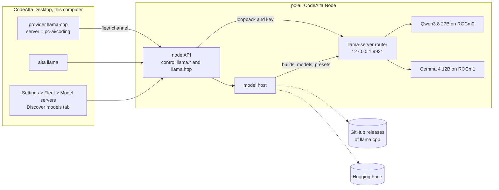
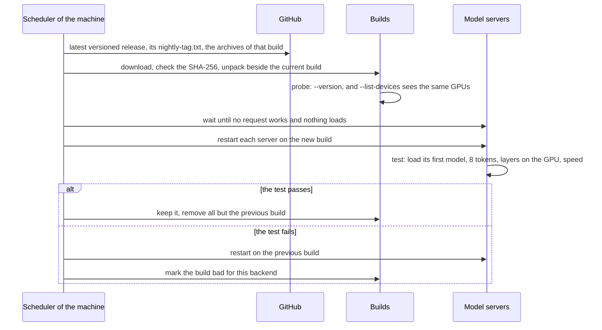

# llama.cpp model servers on the machines of the fleet

Today a local model is manual work on each machine. On `pc-ai` (two Radeon AI PRO R9700), four llama.cpp builds sit in the home folder, one shell script per model holds its flags and sampling values, and the server has run in a terminal for ten days. It listens on the network with no API key, and its own log warns about it. 184 GB of models fill the Hugging Face cache, and nothing says which ones are still used. CodeAlta reaches the server through a provider whose address was typed by hand.

After this work, CodeAlta Desktop manages llama.cpp on every machine of the fleet, this computer included:

- It installs the build that fits each machine's GPUs, and keeps it up to date on a schedule, with a test and a rollback.
- It downloads models from Hugging Face with a progress bar, a speed and the time left, shows what each model takes on disk, and removes one in a click.
- It runs the model servers each machine needs, several per machine if wanted.
- It adds each server as a provider on the machines whose sessions use it.

Agents do the same through `alta llama`, within the rules of the fleet.

llama.cpp needs no Python stack, ships prebuilt binaries for every GPU family, and its server now loads several models on demand. Nobody manages it across machines yet: none of the twenty open-source projects studied manages builds, models, disk and servers for one person's mixed machines, with AMD first and agents that can do the work (the comparison is at the end of this plan).

## What changes

Each machine of the fleet gets a **model host**: CodeAlta Node, or CodeAlta Desktop while it runs. The model host knows the machine's GPUs, installs llama.cpp builds, keeps the models on disk, downloads new ones, and runs `llama-server` processes. CodeAlta Desktop manages the model hosts of its machines through the node API, as it manages their projects and providers today, and its agents do so through `alta llama`. Sessions reach the servers through their providers: on loopback on the same machine, and through the fleet's encrypted channel from another one.



| Word | What it is | Example |
| --- | --- | --- |
| **Build** | A version of llama.cpp for one GPU family, installed on a machine | `b12110` for ROCm |
| **Model** | One quantization of a Hugging Face repository on a machine's disk, with its parts: the shards of a split file, the vision projector | `unsloth/Qwen3.8-27B-GGUF:UD-Q4_K_XL`, 18.5 GB |
| **Model server** | A `llama-server` on a machine that serves one model or several | "Coding" on pc-ai, port 9931 |

The interface always says "model server", never "server" alone, which is CodeAlta Server.

### Each machine knows its GPUs

The model host learns the GPUs in two steps, without any vendor SDK:

1. **What the system says.**
   - Windows: the DXGI adapters. WMI's `AdapterRAM` stops at 4 GB, so it is wrong for the 12 and 16 GB cards of this computer.
   - Linux: `/sys/class/drm` and the KFD topology (`gfx_target_version` 120001 is gfx1201).
   - macOS: `sysctl`.
   - NVIDIA: the CUDA version the driver supports, read by loading `nvcuda` or `libcuda.so.1` in a child process with a time limit.
   - Also the ROCm, HIP SDK and Vulkan libraries present, and glibc on Linux.
2. **What a build sees.** `llama-server --list-devices` of each installed build, such as `ROCm0: AMD Radeon AI PRO R9700 (32624 MiB, 32548 MiB free)`. These device names are what a server is given (`--device ROCm0`).

What is not known stays unknown: CodeAlta never guesses a value (the rule of llama-swap's hardware snapshot). The machine page shows, for example:

| Machine | GPUs | Libraries | llama.cpp sees |
| --- | --- | --- | --- |
| pc-ai, Ubuntu 24.04 | 2× Radeon AI PRO R9700 (gfx1201, 32 GB), Radeon iGPU (gfx1036) | ROCm 7.2.1, glibc 2.39 | `ROCm0`, `ROCm1` |
| This computer, Windows 11 | GeForce RTX 4070 (12 GB), Radeon RX 7600 XT (gfx1102, 16 GB), Radeon iGPU | CUDA driver, HIP SDK 6.2 | `CUDA0` with the CUDA build, `ROCm0` with the ROCm build |

### The right llama.cpp build, kept up to date

Builds come from the GitHub releases of `ggml-org/llama.cpp`:

- Every merged change gets a build `bNNNNN`, 6 to 20 a day, each with one archive per system and GPU family.
- Every week or two, a versioned release (`v0.9.0`) names one of those builds in its `nightly-tag.txt`.
- GitHub's "latest" release is that pointer and holds no binary. CodeAlta therefore lists the releases itself.
- A release exists before its archives are uploaded. CodeAlta takes a build only once all its archives are there.

**Choosing.** For each GPU family of the machine, CodeAlta takes the archive of its system and checks it in two steps:

- **Hard rules first.** The system and its architecture. glibc 2.38, needed by the Linux CUDA and ROCm archives. The CUDA version the driver supports. The gfx targets the ROCm archive was built for. The libraries it needs: ROCm 7 on Linux, the `hipblas.dll` of a HIP SDK on Windows.
- **Then a probe of the unpacked build:** `--list-devices` must list the GPU.

A machine can have several builds. This computer gets the CUDA build for the RTX 4070 and the ROCm build for the RX 7600 XT. A build that does not fit says why, in the words of LM Studio's runtime survey: no GPU for it, driver too old, a library missing, system too old.

| GPUs | Build | Otherwise |
| --- | --- | --- |
| NVIDIA | CUDA 13.5 when the driver supports it (Turing and newer); else CUDA 12.4 on Windows, 12.8 on Linux. Each comes with its CUDA runtime archive | Vulkan |
| AMD, in the targets of the ROCm archive | ROCm: `win-rocm-10.0` with a HIP SDK on Windows, `ubuntu-rocm-10.0` with ROCm 7 and glibc 2.38 on Linux | Vulkan, or a ROCm build of Lemonade (bundled ROCm) when the person allows it |
| Apple Silicon | `macos-arm64` (Metal) | |
| Intel, other AMD, unknown | Vulkan | CPU |
| None | CPU: llama.cpp picks the best CPU variant itself | |

**Installing.** An archive is downloaded and checked against the SHA-256 GitHub publishes for it. It is unpacked whole into `~/.alta/llama/builds/<build>/<backend>/`, with the CUDA runtime archive merged in. A new build goes beside the builds already there, never over one that a server runs, since Windows locks its DLLs. The current and the previous build of each backend are kept; the others are removed.

**Channels**, per machine:

- **Stable** (the default): the build of the latest versioned release.
- **Every build**: the newest build at least a day old.
- **This build**: a build the person chose, which stays.
- **My own build**: a folder the person built, such as `~/code/llama.cpp/build/bin` on pc-ai. It is never updated.

The ROCm builds of `lemonade-sdk/llamacpp-rocm` are an option the person turns on per machine. They bundle ROCm, which suits Strix Halo (gfx1151) and Linux without glibc 2.38.

**Three ways to update**, for one machine, the machines selected in the llama.cpp tab, or all of them:

| Way | What it does |
| --- | --- |
| **Update now** | The desktop updates the machines one after the other. The first machine's test gates the others: a build that fails there goes no further |
| **Update at…** | Once, at a time chosen, such as tonight at 03:00 in each machine's time zone. Each machine keeps the instruction and does it by itself, across its restarts, so the desktop need not be on |
| **Policy…** | What each machine does from then on: **When I click Update** (the default: the tables say an update is there), **Every day**, or **Every week on** a chosen day, at a time |

Each way takes the newest build of each machine's channel, or one build chosen for all of them. Choosing an older build is how a fleet goes back to it.

An update waits until no server is working, for an hour at most. **Update now** then says which machines still wait; the other two ways try again at their next time.



**The test after a switch** passes when all of these hold:

- The server starts and its first model loads.
- 8 tokens come at temperature 0.
- The log says the layers are on the GPU.
- The speed is at least half of the previous build's.

It catches a build that crashes, slows down, or quietly falls back to the CPU. ROCm does that when a bundled HIP DLL hides the driver's (Lemonade #3213).

ROCm can also give wrong output at normal speed:

- past about 5,000 tokens on gfx1151;
- a resident model broken by a load beside it on gfx1201.

A short test cannot see these. For them, the page of a server has **Reload this model**, and **Back to the previous build** is one click away.

**When a test fails on a machine**, the build is marked bad there, for that backend. The desktop then drops that build from the instructions it has given other machines and not yet run, and says so.

### Models on disk

**Where models live.** A machine keeps its models in its **Hugging Face cache** (`HF_HUB_CACHE`, else `$HF_HOME/hub`, else `~/.cache/huggingface/hub`). llama.cpp's own `-hf` downloads go there too. So the 184 GB of pc-ai show up as they are, and what CodeAlta downloads is also found by `llama-server -hf` and by the `hf` tool. **Keep models in…** chooses another folder per machine, for a larger disk.

**What a model is.** One quantization of a repository at a revision, with its parts. The parts are the shards of a split file, and the vision projector (`mmproj`) that the quantizations of a repository share. A model's size counts each file once. The Models tab shows, for each model:

- the machine;
- the size;
- the parameters;
- the context it was trained for;
- whether it reads images;
- the servers that use it, and when it was last used;
- its state: ready, downloading, paused, unfinished, update available.

On pc-ai today, that is 8 repositories and 184 GB. The running server uses only Qwen3.8 27B (18 GB). Qwen3.6 27B and Qwen3.6 35B A3B take 51 and 52 GB.

**Removing.**

- **Clean up…** offers what can go, each with its size: models no server uses (by last use), unfinished downloads, older revisions.
- **Remove** asks in a popover beside the row, and says what it frees.
- A part that another model still uses stays, such as a shared `mmproj`.
- A model that a running server serves goes only through **Stop and remove**.
- Files are removed under the cache's locks (`.locks/`), which llama.cpp and `huggingface_hub` take too.
- On Windows without the right to create symbolic links, the cache holds copies instead of links, as llama.cpp does. CodeAlta reads both.

**Models get updates too.** Publishers fix their files: unsloth uploads quantizations again when a chat template is fixed. A model whose file changed in the repository shows **Update available**.

- **Update** downloads the new revision. The servers take it when they next load the model, and the older revision is then offered in **Clean up…**.
- The Models tab offers **Update now** and **Update at…** for the models selected, on any machines.
- **Policy…** can also let a machine update its models by itself. This is off by default, since each update downloads gigabytes.

### Downloads with real progress

CodeAlta downloads models itself, on the machine that will serve them, rather than through `llama-server`. That makes the feedback right and the files trustworthy:

- It works with no server running, and one queue per machine serves all its servers.
- Each file is checked against the SHA-256 of the repository's file list. llama.cpp checks none.
- The disk is checked first: a download that would not fit, with a margin, does not start.
- Only the GGUF files chosen are fetched. llama.cpp would download a `preset.ini` found at the root of a repository and apply it with any option, including ones that start commands. CodeAlta never applies one.
- Gated repositories use the machine's `HF_TOKEN` secret, which goes to Hugging Face only.

How it downloads:

- The revision and the file list come from the Hub API.
- Each file comes from `/resolve/<revision>/<path>`. CodeAlta follows its redirect to the CDN itself, so the token never goes there.
- Each file comes in four ranges at once, 1.65 times faster in a test.
- A journal records what is done, so a stop, a restart or a network failure resumes where it was.
- An expired address is asked for again, and a rate limit is waited out.
- The file is checked, then becomes `blobs/<sha256>`, with its link in `snapshots/<revision>/`.

`PinnedDownloader` already resumes and checks hashes. It gains the free-space check, the parallel ranges with their journal, the manual redirect and the rate limits.

How it looks:

- The row of the model shows its bar, the size done, the speed and the time left, with **Pause** and **Cancel**. What is downloaded stays for later.
- A toast shows the downloads while they run:
  1. `Downloading Qwen3.8 27B · UD-Q4_K_XL to pc-ai — 7.2 GB of 18.5 GB · 92 MB/s · 2 min left`
  2. then `Checking…`
  3. then `Ready on pc-ai`, with **Serve it…**

  Several downloads share one toast.
- The Fleet button of the title bar shows that downloads are running.
- A download belongs to its machine. It goes on when the window closes, and the page finds it again.
- An agent that started a download gets the result as a prompt when it ends.

Two downloads run at a time per machine; the others wait their turn.

### Discover models on Hugging Face

A **Discover models** tab browses the Hub. It opens from the Models tab, from the search (`Ctrl+P`), and as `alta llama hub` for agents.

- **Search** by words. The filters are:
  - what the model does: chat, vision, embeddings, rerank;
  - its size: up to 8B, 8 to 35B, 35 to 120B, larger;
  - its publisher: unsloth, ggml-org, bartowski, lmstudio-community, the makers of the models;
  - **Fits on** a machine.

  Results sort by trending, downloads, likes or last update. Only GGUF repositories are listed.
- **A card per model** shows its name, publisher, parameters, context, downloads and likes, last update and licence, and marks for vision, tools and reasoning. **Gated** shows when Hugging Face asks for a licence first.
- **The page of a model** starts with the machine it is for and that machine's GPUs. Then comes the table of its quantizations: name, bits per weight, size, and whether it fits:
  - **Fits on GPU 0 with 217k context**
  - **Fits on both GPUs**
  - **Partly on the CPU: slow**
  - **Too large**

  The quantization CodeAlta recommends is marked, and so are those already on the machine.
- **The model card** comes below, through the window's Markdown boundary (`markdown-it`, `dompurify`). Its images show on a click, and its links open in the system browser.
- **Download to…** sends the model to a machine. **Serve on…** does three things in one step: downloads it, adds it to a server of that machine (or creates one), and adds the provider.

**Will it fit.** Before a download, CodeAlta reads the GGUF header of the file over HTTP ranges, 6 to 7 MB. The header gives the layers, the key-value heads and their sizes, and the context. The estimate is the weights, plus the KV cache at that context, plus 1 GB. It is marked approximate, and it is only made for the architectures CodeAlta knows. For a sliding-window or hybrid model such as Gemma 3 or Qwen3.8, that formula would be several times too large, so those show **Measured on the machine**. Once the model is on the machine, `llama fit-params` measures it there, and the server's `--fit` decides what actually runs.

Hugging Face allows 500 API calls in 5 minutes per address without an account. The tab keeps what it has read, and the `HF_TOKEN` secret of this computer doubles that limit.

### Model servers

A **model server** is a `llama-server` on a machine. By default it serves **several models**, with llama.cpp's router mode:

- It starts one process per model when a request names it.
- It keeps up to a set number of models loaded.
- It unloads the least recently used model, or the one that frees enough GPU memory for the next.

A server can also serve **one model**, always loaded. That suits an embedding or rerank model, or a model that must have its GPUs to itself.

What the person sets is kept in `server.toml` in the server's folder:

```toml
name = "Coding"
kind = "several"            # or "one"
port = 9931
devices = ["ROCm0", "ROCm1"]
loaded_at_once = 2
access = "my-computers"     # or "this-machine"

[[models]]
model = "unsloth/Qwen3.8-27B-GGUF:UD-Q4_K_XL"
devices = ["ROCm0"]
context = "fit"             # or a number of tokens
reasoning_effort = "medium"
sampling = { temperature = 1.0, top_p = 0.95, top_k = 20, min_p = 0.0, presence_penalty = 0.0 }

[[models]]
model = "unsloth/gemma-4-12B-it-GGUF:UD-Q8_K_XL"
devices = ["ROCm1"]
sampling = { temperature = 1.0, top_p = 0.95, top_k = 64 }
free_gpu_after_minutes = 30
```

Sampling values come first from the model's `generation_config.json` (or its base model's), and the person changes them.

What CodeAlta runs from it on pc-ai:

```sh
llama-server --host 127.0.0.1 --port 9931 --api-key-file <server>/keys \
  --models-preset <server>/preset.ini --models-max 2 --models-memory-margin 1024 \
  --offline --no-ui --metrics
# environment: LLAMA_CACHE=<server>/cache, an empty folder
```

```ini
version = 1

[unsloth/Qwen3.8-27B-GGUF:UD-Q4_K_XL]
model = /home/xoofx/.cache/huggingface/hub/models--unsloth--Qwen3.8-27B-GGUF/snapshots/4ca7207…/Qwen3.8-27B-UD-Q4_K_XL.gguf
mmproj = /home/xoofx/.cache/huggingface/hub/models--unsloth--Qwen3.8-27B-GGUF/snapshots/4ca7207…/mmproj-BF16.gguf
device = ROCm0
reasoning-effort = medium
temp = 1.0
top-p = 0.95
top-k = 20
min-p = 0.0
presence-penalty = 0.0
```

Why it runs that way:

- **Only what it was given.** The preset names every model by its path in the store, and the server's own cache is an empty folder, with `--offline`. A server serves the models it was given and never downloads anything.
- **Locked down.**
  - It listens on loopback only.
  - Its API key is in a file only CodeAlta reads, since keys on a command line are visible to every process.
  - It shows no chat page unless asked (**Chat page**), and CORS is limited to that page.
- **The options of the build that runs.** CodeAlta writes only the options of that build, because llama.cpp renames flags and its presets refuse unknown keys.
- **Never written**, also not through **Extra arguments**:
  - the options that make llama.cpp run commands or open the network: `tools`, `agent`, `mcp-servers-*`, `ui-mcp-proxy`, `connect`;
  - those that read or write files: `media-path`, `slot-save-path`;
  - those that download: `model-url`, `hf-repo`.

**Several servers per machine.** Each server has its port (from 9931), its GPUs, its build and its access. Typical reasons:

- one server per GPU family, as on this computer: CUDA and ROCm;
- an embedding server beside a chat server;
- a model that needs both R9700 beside one that needs a single GPU.

CodeAlta adds up what the servers of a GPU may load, and warns before that GPU runs out.

**Running.**

- The model host starts and stops servers.
- It restarts a server that fails, after 1 s, 5 s, 30 s and 2 min. After that the server stays **Failed**, with the end of its log.
- It says why when it can, such as **Not enough GPU memory: lower the context or choose a smaller quantization**.
- One model loads at a time per GPU.
- **On a node**, a server goes on through a version switch or a crash of the node: the node takes it back at its next start, when the server's process, port and key answer. It stops with the node otherwise.
- **CodeAlta Desktop** stops its servers when it quits, unless **Keep running after CodeAlta quits** is on.
- **On Windows**, a server and its model processes are in one job object that stops them together. llama.cpp only handles Ctrl+C there, so a stop unloads the models first.

**What a server says.**

- The router's `/models` and its events give each model's state (downloading, loading 64 %, loaded, sleeping, unloaded, failed) and its memory per GPU.
- `/props` gives the build and the context.
- `/slots` gives how many requests are working.
- `/metrics` gives the tokens per second. Only the model host reads it, because its gauges are averaged between two reads, so two readers would disturb each other.
- The log gives the rest: the context `--fit` chose (217,088 of 262,144 tokens on pc-ai) and what the weights and the KV cache take on each GPU.

**Bring what runs today.**

- **Import a command line…** turns a `llama-server` command, such as pc-ai's `run_Qwen38_27B.sh`, into a server. It takes the model, the GPU (`HIP_VISIBLE_DEVICES` becomes `--device`), the sampling values and the options, and lists what it did not take.
- A `llama-server` that CodeAlta did not start shows on the page of its machine, with its port and its model. **Take over…** imports it, then stops it and starts the managed one.

**What a server can serve:**

| Kind | llama.cpp gives | In CodeAlta |
| --- | --- | --- |
| Chat, tools, reasoning | `/v1/chat/completions`, `/v1/responses`, Anthropic's `/v1/messages` | Sessions, through the provider |
| Vision, audio and video input | the vision projector and `/v1/chat/completions` | Pasted images, as today |
| Embeddings | `--embedding`, `/v1/embeddings` | An address to copy; search by meaning on it later |
| Rerank | `--rerank`, `/v1/rerank` | An address to copy |
| Fill in the middle | `/infill` | An address to copy; completion in the code editor later |
| Speech | `/v1/audio/transcriptions`, `/v1/realtime`, `/tts` for the models that have them | Later |
| Images | nothing: stable-diffusion.cpp is another program | Later, as another engine of the same host |

### Sessions use the servers

A server is a provider like any other. The `llama-cpp` type gets `server` in the place of `api_url`:

```toml
[providers.pc-ai-coding]
type = "llama-cpp"
server = "pc-ai/coding"   # the machine and the server: CodeAlta finds the address and the key
```

- **Created for you.** **Use in sessions on** lists the machines whose sessions may use the new server: this computer and pc-ai by default. CodeAlta adds the provider on each one, on a remote machine through the provider methods the node API already has. No key is written in a file; the model host gives it.
- **Unchanged otherwise.** The machine is recorded by its id, so renaming it keeps its providers. A provider with `api_url` works as it does today.
- **One path per place.**
  - On the same machine, the provider uses loopback with the key.
  - From another machine, it uses the fleet's channel. The provider's HTTP goes as `llama.http` to the node, which checks the device and calls its server on loopback.
  - The channel is direct when the machine is reachable and relayed by a CodeAlta Server otherwise. Either way it is encrypted end to end, and the machine opens no port for its servers.
- **Who reaches a server by default.**
  - The server of a node: the person's computers (**My computers**).
  - The server of CodeAlta Desktop: this machine only, unless the desktop lets the person's other computers pair with it.
- **A new device permission, Models**: what a paired computer may use of the machine's servers.
  - On for the person's own computers when they pair; off for anyone else.
  - The page of the machine has its switch.
  - **Models** alone lets a computer use the servers, not change them; changing them takes **Manage**.
- **The models** listed are all the server's models, loaded or not. Each has:
  - a friendly name, such as `Qwen3.8 27B · UD-Q4_K_XL`;
  - the context it had when it last loaded, which is what compaction needs;
  - whether it reads images;
  - **Loads on first use** when it is not loaded.
- **No personal plan** is behind a model server, so its provider counts as an account credential for the automations of the fleet.
- Statistics count the tokens of these sessions as for any provider, at no cost.

### Agents do all of it

`alta llama` gives agents every operation of the screens. It works on this computer by default, and on a machine named with `--machine`:

| Command | What it does |
| --- | --- |
| `alta llama machine list`, `machine show <machine>` | GPUs, builds, servers, models and free disk; the detail with the candidate builds and why each one fits or not |
| `alta llama build list`, `install`, `use`, `remove` | The builds of a machine |
| `alta llama update status`, `run`, `set` | Where each machine stands and its last updates. `run` updates now, or once with `--at 03:00`; it takes several `--machine`, or `--all`, and `--build` for one build. `set` changes the policy |
| `alta llama hub search <words>`, `hub show <repo> [--fit <machine>]` | Hugging Face models; the quantizations with their size and their fit |
| `alta llama model list`, `download`, `update`, `remove` | The models on disk |
| `alta llama download list`, `pause`, `resume`, `cancel` | The downloads in progress |
| `alta llama server list`, `show`, `create`, `set`, `remove`, `start`, `stop`, `restart`, `load`, `unload`, `test`, `logs`, `import` | Model servers |

```text
alta llama model download unsloth/Qwen3.8-27B-GGUF:UD-Q4_K_XL --machine pc-ai
```

```jsonl
{"type":"alta.result","version":1,"exitCode":0,"recordCount":1}
{"type":"alta.llama.download.started","machine":"pc-ai","download":"dl-7f3c","model":"unsloth/Qwen3.8-27B-GGUF:UD-Q4_K_XL","files":2,"bytes":18479306240,"notificationExpected":true,"nextStep":"End your turn: the result comes back as a prompt when the download ends."}
```

The rules, written in the help of each command:

- **The person's access, no more.** Every command acts with the access of the person of this computer: changing a machine takes **Manage** there.
- **Starting programs is declared.** `build install`, `server create`, `start`, `restart` and `update run` download native code or start a program. They are refused for a session without the shell (`llama.shellDisabled`), and for one whose commands the person reviews (`llama.startDenied`), as `job start` is.
- **Sandboxes.** A sandboxed session only reads, and one whose sandbox denies the fleet reads only this computer.
- **Only when the person asks:** `model remove`, `server remove` and `update set`. A model that a running server serves is not removed without `--stop`.
- **Long work returns a receipt.** For downloads, installs and updates, the result comes back to the session as a prompt, as for `job start`.
- **Never by an agent:** exposing a server to the network, or changing a device permission. A person decides those, in the window.

A built-in skill, `codealta-model-servers`, teaches the work: pick a machine and a quantization that fits, download, serve, add the provider, test, update. It also teaches the rules, and sends the agent to `alta llama --help` for the rest, as `codealta-fleet` does.

### The screens

The tables are the fleet console's own: `DataTable` and `FilterBar` of `frontend/src/fleet/console`, so sorting, filters, the details of a row, the keyboard and **Show more** work as on **Machines**. The pages go in **Settings** > **Fleet** > **Model servers**, which has three tabs. Browsing goes in its own tab.

**Servers** tab:

| Column | Shows |
| --- | --- |
| State | Ready, Loading 64 %, Sleeping, Stopped, Updating, Failed (with why) |
| Name | Coding |
| Machine | pc-ai |
| Models | Qwen3.8 27B (loaded) +1 |
| GPUs | 2× Radeon AI PRO R9700 · ROCm |
| Memory | used of total, as a bar |
| Activity | 1 of 4 requests · 38 tokens/s |
| llama.cpp | b12110, **update available** |
| Reached by | This machine, your computers |

- The filters: **Filter**, **State**, **Machine**, **GPU family**, **Model**.
- **The details of a row** show the address, the models with **Load** and **Unload**, the memory per GPU, and the last lines of the log, with **Start**, **Stop**, **Restart**, **Test** and **Open its page**.
- **Add a model server…** asks for:
  1. the machine, with its GPUs;
  2. the models: a Hugging Face name with a quantization picker, or the models already on the machine;
  3. the GPUs;
  4. **Use in sessions on**.

  **Import a command line…** sits beside it.

**The page of a server** has these sections: models (each with its settings), GPUs and memory, access, build, **Extra arguments** (checked), the log (live) and activity.

**Models** tab:

- One row per model, as described in [Models on disk](#models-on-disk).
- Above the table, a bar per machine: what models take and what is free (`pc-ai: models 184 GB · free 1.5 TB`), and **Clean up…**.
- **The details of a row** show the files with their sizes, the revision, the path, and whether CodeAlta downloaded the model or found it in the cache. They have **Serve…**, **Download to another machine…** and **Remove**.

**llama.cpp** tab:

| Column | Shows |
| --- | --- |
| Machine | pc-ai |
| GPUs | 2× R9700 (gfx1201) |
| Build | b12110 · ROCm, tested 2 hours ago |
| Latest | b12110 (v0.9.0), or the newer one the channel offers |
| Updates | When I click Update, Every day at 04:00…, and an update planned once, such as **Tonight at 03:00** |
| Last change | Updated, Rolled back, Failed |

**The details of a row** show:

- the installed builds with their sizes;
- the devices each build sees;
- the candidates with their verdicts (ROCm: in use; Vulkan: works, kept as a fallback; CUDA: no NVIDIA GPU);
- the libraries found (ROCm 7.2.1 in `/opt/rocm-7.2.1`, glibc 2.39);
- **Update now**, **Update at…** and **Policy…**, for that machine. With several rows selected, or **Select all**, the same three buttons act on those machines.

**Discover models** is a tab of the window, not part of Settings: it is browsed beside the work, and a dialog would close on a click outside it.

Elsewhere:

- The page of each machine gets a **Model servers** section: GPUs, build, servers and the disk the models take. It links to the tabs, filtered to that machine.
- The Fleet overview gets a tile, such as `Model servers: 2 ready · 1 download`.
- The llama.cpp form of **Settings** > **Providers** offers the model servers of the fleet in place of an address.
- The downloads have the toast described in [Downloads with real progress](#downloads-with-real-progress).

### Security

- **Builds.**
  - Builds come from `ggml-org/llama.cpp` only, unless the person adds a source.
  - Every archive is checked against GitHub's SHA-256. Its SLSA provenance can be checked too: `gh attestation verify` passed on `macos-arm64`.
  - A build older than b8146, which fixed a bypass of the GGUF parsing fix (CVE-2026-27940), is not offered.
- **Remote changes are remote code execution.** Installing a build or starting a server on another machine needs a device with **Manage**, as `control.update` does today. A member of an organization reached through a server's relay never has **Manage**.
- **Models.**
  - Every file is checked against its SHA-256.
  - A repository's `preset.ini` is never applied.
  - CodeAlta's own GGUF header reader bounds every length and count it reads.
- **Servers.**
  - They listen on loopback, with a key file that only the owner can read.
  - They have no chat page unless asked, and their CORS is limited.
  - The options that run commands are never written.
  - The model processes of a router listen on loopback without a key, by llama.cpp's design. On a machine that several people log in to, the machine page says so.
- **llama.cpp's own `config.ini`.** A stray one, of the user or of the system, changes every server it starts. The machine page shows it, and the environment of the servers keeps the user's out (checked in step 0.1).
- **Logs are sensitive.** CodeAlta never sets `LLAMA_SERVER_SLOTS_DEBUG`, which adds the text of prompts to `/slots`, and starts servers at the default log level. Their logs stay on the machine and are treated as journals are.

### Where the code goes

| Where | What |
| --- | --- |
| `src/CodeAlta.ModelServers` (new) | Everything that runs on the machine: the hardware inventory; the release list, the build choice, the installer and its probe; the model store (hub layout); the Hugging Face client; the GGUF header reader and the estimate; the downloads; server definitions, presets, arguments and their refusals; the supervisor; the update scheduler. It knows neither host nor window, as `CodeAlta.NativeEngines`. |
| `src/CodeAlta.NativeEngines` | `PinnedDownloader` gains the free-space check, the parallel ranges with a journal, the manual redirect and the rate limits |
| `src/CodeAlta.Fleet` | Contracts and methods of the node API (`FleetNodeService.ModelServers.cs`, `IFleetNodeModelServers`), both sides of `llama.http`, the `models` permission, `FleetNodeInfo.ModelServers` |
| `src/CodeAlta.Node` | `NodeModelServers.cs`: the model host of the node, which keeps servers through its version switches |
| `src/CodeAlta/Desktop/ModelServers` | The model host of this computer, the RPC service of the page, the toasts, the console across machines |
| `src/CodeAlta.Catalog` | The `[llama]` settings in `config.toml`, the `server` key of `llama-cpp` providers, the skill in `BuiltinSkills/codealta-model-servers` |
| `src/CodeAlta.Hosting`, `src/CodeAlta.Agent.OpenAI` | `server` resolved to an address, a key and a transport by a resolver the host gives; providers never know the fleet |
| `src/CodeAlta.LiveTool` | `alta llama` (`BuiltInAltaCommandContributor.Llama.cs`, `IAltaModelServers`) |
| `src/CodeAlta/frontend/src/modelServers` | The tabs, the pages, Discover, the toasts |

It is not a plugin: it needs methods of the node API and a transport for providers, which plugins cannot add today. The TUI runs no model server and gets nothing new; it builds and its tests pass.

| On disk | What |
| --- | --- |
| `~/.alta/llama/builds/<build>/<backend>/`, `builds/state.json` | Installed builds, whole folders side by side; the current, previous and bad build of each backend |
| The machine's Hugging Face cache, or the folder of **Keep models in…** | Models, in the hub layout |
| `~/.alta/llama/downloads.json` | Download jobs, resumed after a restart |
| `~/.alta/llama/update.json` | An update planned once, kept until it runs or is cancelled |
| `<state root>/llama/servers/<id>/` | `server.toml`, the generated `preset.ini`, `keys` (owner only), `run.json` (process, port, build), `logs/` |
| `[llama]` in `config.toml` | The models folder, the channel, the schedule, the downloads at once |

Server definitions are in the state root, so a developer instance (`--dev`) has its own servers but shares builds and models.

| Node API method | Access | What |
| --- | --- | --- |
| `control.llama.status` | View | GPUs, builds, policy, servers, models and downloads, in one record |
| `control.llama.watch`, event `llama.changed` | View | What changed, coalesced; download progress at most twice a second |
| `control.llama.builds.install`, `use`, `remove`; `control.llama.updates.run` (now, or once at a time), `cancel`; `control.llama.settings.set` | Manage | Builds, updates, the folder and the policy |
| `control.llama.downloads.start`, `pause`, `resume`, `cancel`; `control.llama.models.remove`, `update` | Manage | Models |
| `control.llama.servers.set`, `remove`, `start`, `stop`, `restart`, `load`, `unload`, `test`, `logs`, `import` | Manage | Servers |
| `llama.servers.list` | Models | The servers and models this device may use |
| `llama.http` | Models | An inference request to a server of the machine, streamed with credits. Only the inference paths are allowed; management paths are refused |

## Steps

Spikes first: their answers change the code.

- [ ] 0.1 **Router spike** on this computer, with the CUDA and ROCm builds of the current stable release, and on pc-ai, with ROCm and two GPUs. Use a preset that names models by path, an empty `LLAMA_CACHE`, `--offline` and `--api-key-file`. Record:
  - whether `/models` lists only the preset's models;
  - whether model processes get or need the key;
  - whether stopping the router (a job object on Windows, a process group on Linux) ends its model processes;
  - whether `device` and `sleep-idle-seconds` work per model;
  - how Ctrl+C behaves on Windows;
  - whether `APPDATA` or `XDG_CONFIG_HOME` keep a user `config.ini` out.

  Write the findings into this plan.
- [ ] 0.2 **Store spike.** Check that files CodeAlta places in the hub layout are found by `llama-server -hf <repo>:<tag> --offline`: as links, and as copies on Windows without the symbolic-link right. Also check paths over 260 characters on Windows.
- [ ] 0.3 **Detection spike** on this computer: the DXGI adapters, and the CUDA driver version from a child process. Find the gfx of the RX 7600 XT on Windows, from a PCI id table or from the log of the candidate build.

This computer:

- [ ] 1. Create `src/CodeAlta.ModelServers`, in `CodeAlta.slnx`, with a guardrail test: no host and no window. Its `Hardware/` reads the inventory on Windows, Linux and macOS; what is not known stays unknown. Tests use recorded DXGI lists and sysfs trees, pc-ai's included.
- [ ] 2. `LlamaCpp/Releases`:
  - the release list: stable through `nightly-tag.txt`, every build, complete archives only, conditional requests;
  - the selection rules per system and GPU family, with their verdicts.

  Tests use recorded GitHub answers.
- [ ] 3. `LlamaCpp/Builds`:
  - download, and check the SHA-256 digest;
  - unpack whole, with the CUDA runtime merged in;
  - probe with `--version` and `--list-devices`, in a child process with a time limit;
  - keep `builds/state.json` per backend, and the previous build.

  Tests use a fake release and a fake `llama-server`.
- [ ] 4. `Store/` reads the hub layout: blobs counted once, links or copies, unfinished downloads, revisions. It gives sizes and removes under `.locks`, keeping shared parts. Tests use synthetic trees.
- [ ] 5. `HuggingFace/`: refs, the paginated tree, model info, the README, the rate-limit headers, and gated and missing repositories (401 with `X-Error-Code`). Tests use recorded answers.
- [ ] 6. `Downloads/`, over `PinnedDownloader` with its new free-space check, parallel ranges with a journal, manual redirect, and handling of 403 and 429:
  - jobs kept in `~/.alta/llama/downloads.json`, two at a time;
  - pause, resume, cancel;
  - events.

  Tests run against a loopback fake of the Hub and its CDN.
- [ ] 7. `Servers/`:
  - `server.toml`;
  - the preset and arguments for the running build, with the refused options;
  - ports and the key file;
  - start and stop, with a job object and a process group;
  - taking a running server back, and restarts with back-off;
  - log files and the reasons they give;
  - status from `/models` and its events, `/props`, `/slots` and `/metrics`;
  - **Import a command line**.

  Tests use a fake `llama-server`: a test executable that answers like the router, as `CodeAlta.Tests.TinyMcpServer` does for MCP.
- [ ] 8. The model host of the desktop (`src/CodeAlta/Desktop/ModelServers`):
  - its composition;
  - the RPC service of the page, with `demo-api.ts` and the fixture exports;
  - the toasts;
  - stopping servers when CodeAlta quits, unless they are kept.
- [ ] 9. Providers:
  - `server` for `llama-cpp` in `CodeAltaConfigStore`;
  - its resolution in `ConfiguredModelProviderRegistryBuilder`, through a resolver the host gives;
  - the models with their friendly names and last context, in `LlamaCppModelCatalog`;
  - **Use in sessions on** for this computer.

  Tests.
- [ ] 10. The page, in `frontend/src/modelServers`:
  - **Settings** > **Fleet** > **Model servers** with its three tabs;
  - the page of a server;
  - **Add a model server…** with a Hugging Face name and a quantization picker;
  - **Import a command line…**;
  - the download toast.

  Unit and browser tests.
- [ ] 11. `alta llama` for this computer: machine, build, model, download and server commands, with what each declares, their refusals and their receipts. LiveTool tests.
- [ ] 12. Docs:
  - `site/docs/fleet/model-servers.md`, listed in `menu.yml`;
  - the llama.cpp section of `site/docs/model-providers/setup.md`;
  - `doc/model-servers.md`, and the projects table of `doc/architecture.md`;
  - `readme.md`;
  - pictures per `doc/site-screenshots.md`, once the page is checked.

Every machine:

- [ ] 13. The node API: `FleetNodeService.ModelServers.cs`, its contracts and `IFleetNodeModelServers`. It has `control.llama.*` (**View** to read, **Manage** to change), the watch with `llama.changed`, and `FleetNodeInfo.ModelServers`. Tests run over the in-memory transport.
- [ ] 14. `altanode`, in `NodeModelServers.cs`:
  - the model host of the node;
  - servers kept through a version switch;
  - the machine kept awake while a server works;
  - `altanode llama status` for the owner on the machine.
- [ ] 15. `llama.http`:
  - **On the node:** the allowed paths (the OpenAI and Anthropic APIs, `/health`, `/props`); management paths refused; the key added; the body bounded; the stream with credits; cancellation.
  - **On the client:** `FleetModelServerHandler`, an `HttpMessageHandler`.
  - **The `models` permission:** its default at pairing, the switch of the page, `altanode permissions --allow models`.

  Tests cover streaming, cancellation, refusal and bounds.
- [ ] 16. Providers across machines:
  - the resolver goes through the fleet client;
  - **Use in sessions on** writes providers on other machines, with `control.providers.set`, which gains `server`;
  - a machine that is offline makes its providers unavailable, with why.
- [ ] 17. The console across machines:
  - the three tables for every machine;
  - the **Model servers** section of the machine page;
  - the Fleet overview tile;
  - **Copy to…** for a server, which downloads its models there;
  - actions on several selected rows.

  Browser tests.
- [ ] 18. `alta llama --machine`, and the built-in skill `codealta-model-servers`.
- [ ] 19. Docs for machines.

Updates:

- [ ] 20. The updates themselves:
  - `[llama]` in `config.toml`: channel, policy, the age a build must have, models folder, downloads at once;
  - the scheduler on desktop and node, in the machine's time zone;
  - an update planned once (`control.llama.updates.run` with a time and a build), kept by the machine across its restarts in `~/.alta/llama/update.json`, and `control.llama.updates.cancel`;
  - waiting for idle servers, the switch, the test, the rollback, the bad builds, and dropping a bad build from the instructions not yet run;
  - Lemonade's ROCm builds as an option;
  - model updates: now, at a time, or by policy.

  Tests use a fake clock and fake builds.
- [ ] 21. Their screens and commands:
  - **Update now**, **Update at…** and **Policy…**, for one machine, the selected ones or all, with one build for all as a choice;
  - **Update now** one machine after the other, the first one gating the others;
  - a planned update shown on its rows, with **Cancel**;
  - the history of a machine's updates, and **Back to the previous build**;
  - `alta llama update run` with `--at`, `--build` and `--all`.

  Docs.

Discover:

- [ ] 22. The **Discover models** tab:
  - search, filters, sorting and cards;
  - the page of a model: the sanitized card, images on a click, the quantization table;
  - the header read over ranges, the estimate for the architectures CodeAlta knows, and `llama fit-params` on the machine after a download;
  - **Download to…** and **Serve on…**;
  - `alta llama hub`.

  Browser tests, docs and pictures.

## How it is verified

- [ ] Build with `dotnet build -c <Configuration>`. Then run `dotnet test --no-build` and `npm test` as two jobs, and `lunet build` from `site/`. All pass.
- [ ] `ArchitectureGuardrailTests` holds: `CodeAlta.ModelServers` references no host, window or runtime project.
- [ ] An opt-in live test, with `CODEALTA_TEST_LLAMA_BUILD` and `CODEALTA_TEST_LLAMA_MODEL` naming a real build and a model under 200 MB:
  - the router starts with its preset;
  - the model loads;
  - a turn of the provider answers;
  - the server stops with its model processes.
- [ ] This computer, in the developer instance:
  - the three GPUs show;
  - the CUDA and ROCm builds install and pass their test;
  - a server on the RTX 4070 and one on the RX 7600 XT run at once, and a session answers on each;
  - a 4 GB download is cancelled, resumed and checked, then the model is removed;
  - both themes and a 900×650 window look right.
- [ ] pc-ai, through the fleet:
  - its GPUs and ROCm 7.2.1 show, and its 184 GB show with what uses them;
  - `run_Qwen38_27B.sh`, imported, gives a server that answers a session of this computer through `llama.http`;
  - `ss -ltnp` on pc-ai shows that nothing beyond the node listens on its network;
  - an update to the current stable build passes its test;
  - a build made to fail its test is rolled back.
- [ ] Updates across this computer and pc-ai:
  - **Update now** of both stops at the first machine whose test fails;
  - **Update at…** a few minutes ahead runs on pc-ai with CodeAlta Desktop closed;
  - one older build chosen for both takes them back to it;
  - **Cancel** drops a planned update.
- [ ] Agents:
  - with `alta llama` only, a session puts a model on pc-ai, serves it, and adds its provider here;
  - its download comes back to it as a prompt;
  - a session without the shell is refused the install and the start;
  - a sandboxed session only reads.
- [ ] Security:
  - `tools = true` in **Extra arguments** is refused;
  - a server answers 401 without its key, and refuses another origin;
  - by default nothing listens beyond loopback.

## Decisions

| Decision | Choice | Why |
| --- | --- | --- |
| Engine | CodeAlta drives `llama-server` itself, in router mode by default, with one-model servers beside it. No llama-swap: an external endpoint (llama-swap, Lemonade, Ollama) stays a plain provider | The router now does what llama-swap did for llama.cpp. A second binary to ship and update on every platform would add none of the actual plan: builds, downloads, disk |
| Where builds come from | The official GitHub releases, checked against GitHub's SHA-256. Not pinned in CodeAlta's source, unlike Codex CLI | The person chooses versions and wants them updated. A pin in the source would need a CodeAlta release for each llama.cpp build |
| Default channel | Stable: the build named by llama.cpp's versioned releases | 6 to 20 builds a day, any of which can break one backend. A versioned release comes every one or two weeks |
| Updating a fleet | Three ways for one machine, a selection or all: **Update now** (one after the other, the first gating the rest), **Update at…** (kept and done by each machine), **Policy…** (recurring). **When I click Update** by default | The person chooses when updates happen. A planned update must not need the desktop to be on |
| How a build is chosen | By probe on the machine (`--list-devices`, then the test), not by name | ROCm on Windows can list a GPU and still run on the CPU; names of GPUs are not reliable |
| Where models live | The machine's Hugging Face cache, with another folder possible | The existing 184 GB show up at once, and llama.cpp and `hf` share the files. Nothing is downloaded twice |
| Who downloads models | CodeAlta, on the machine that serves them | Real progress, SHA-256 checks, a disk check first, gated repositories, and never a repository's `preset.ini` |
| What a server serves | Exactly the models its preset names by path, offline, with an empty cache folder | A server never downloads, and never serves a model nobody chose for it |
| Between machines | The fleet channel (`llama.http`); loopback on the same machine | No port opened, encrypted end to end, relayed when the machine is away, and checked per device |
| Who may use a server | A new device permission, **Models**, on for the person's own computers | Using a model is less than **Start**, which runs agents, and much less than **Manage** |
| Lifetime | A server goes on through a node's version switch or crash; it stops with the node or the desktop otherwise. The desktop can keep it running | Loading a 27B model takes a minute and loses its prompt cache. A server nobody supervises must not hold a GPU |
| Screens | **Settings** > **Fleet** > **Model servers** (three tabs, as **Machines**); browsing in a **Discover models** tab | The same tables as the fleet. Browsing is long work beside a session, which a dialog would interrupt |
| Agent commands | A root of their own, `alta llama`, with `--machine` | They work on this computer without a fleet too, and on a node for its own sessions |
| Fit before download | An estimate for the architectures CodeAlta knows, marked approximate; the measure on the machine after the download | The plain formula is several times too large for sliding-window and hybrid models |

The owner approved the plan in its review of 2026-11-08 and confirmed what it proposed:

- the Hugging Face cache of each machine as the store of its models;
- **When I click Update** as the default policy;
- **Models** on at pairing for the person's own computers;
- the screens, and the order of the steps;
- the network address for other programs, later.

The review also asked for the choice of how a fleet is updated: manually or on a schedule. That is the **Updating a fleet** row above, and the three ways to update in [The right llama.cpp build, kept up to date](#the-right-llamacpp-build-kept-up-to-date).

## Risks

- **llama.cpp changes fast.** It renames flags, and its presets refuse unknown keys. CodeAlta writes the options of the build that runs; a build that fails its test is not switched to; the previous build stays.
- **Router mode is young.** Open issues include a race on the ports of model processes, a HIP build that spins when idle, and image requests that fail only in router mode. A model can go to a one-model server instead. **Reload this model** and **Back to the previous build** are one click away.
- **ROCm fails quietly.** Wrong output at normal speed on gfx1151, a model broken by a load beside it on gfx1201, and a bundled HIP DLL that hides the driver's. The test catches the CPU fallback, and one model loads at a time per GPU. Vulkan stays installed as the fallback.
- **The archives need what the machine may not have.** The Linux CUDA and ROCm archives need glibc 2.38, so not Ubuntu 22.04 or Debian 12. The Windows ROCm archive needs the `hipblas.dll` of a HIP SDK. CodeAlta says so and falls back to Vulkan, or to Lemonade's ROCm builds when the person allows them.
- **Models are huge.** Disks fill up and downloads take long. The disk is checked before each download, **Clean up…** shows what can go, and downloads resume.
- **Several servers share a GPU.** CodeAlta adds up what they may load and warns. The router's memory margin and `--fit` keep each one within what is free.
- **Hugging Face rate limits.** 500 API calls in 5 minutes per address without an account. The Discover tab keeps what it read, and a token raises the limit.
- **Stopping on Windows.** llama.cpp only handles Ctrl+C there. CodeAlta unloads the models, then ends the job object.

## Out of scope

- Building llama.cpp from source. A folder of one's own build is supported; CodeAlta does not build it.
- The Docker images of llama.cpp.
- One model across several machines with llama.cpp RPC, which its documentation calls a fragile and insecure proof of concept.
- Spreading the requests of one model over several servers (Paddler's balancer). Later, on these foundations.
- Image generation (stable-diffusion.cpp) and speech servers (whisper.cpp). Later, as other engines of the same model host.
- vLLM, SGLang and every Python stack.
- Quantizing or fine-tuning models.
- Model servers shared with the people of an organization through grants. Later; the person's own fleet comes first.
- A network address for other programs (Open WebUI, editors, scripts), with a key per program. Later, as the review confirmed.
- Fleet updates through a CodeAlta Server, as campaigns of the server. The desktop and each machine do them for now.
- CodeAlta's own features on embedding, rerank and fill-in-the-middle servers: search by meaning, completion in the code editor.
- The TUI.

<details><summary>pc-ai today</summary>

- **Machine.**
  - Ubuntu 24.04.5, kernel 6.8.
  - Ryzen 9 7950X, 64 GB of RAM, 1.5 TB free.
  - 2× AMD Radeon AI PRO R9700 (device 0x7551, gfx1201, 32,624 MiB GDDR6 each), and the Radeon iGPU of the CPU (gfx1036, 512 MB).
  - ROCm 7.2.1 in `/opt/rocm-7.2.1`, with `rocminfo`, `amd-smi` and `rocm-smi`.
- **Builds.**
  - Four builds in the home folder: `llama-b9505-rocm`, `llama-b9724-rocm`, `llama-b11209`, `llama-b11981`, and their archives (`llama-b11981-bin-ubuntu-rocm-10.0-x64.tar.gz`, 252 MB).
  - `LLAMA_HOME` still points to b11209.
  - `libggml-hip.so` (1.19 GB) loads `libamdhip64.so.7`, `librocblas.so.5` and `libhipblaslt.so.1` from `/opt/rocm-7.2.1`.
  - The archive holds 15 CPU variants (`libggml-cpu-zen4.so`…), `llama-server`, `llama`, `llama-fit-params`, `llama-tts` and `ggml-rpc-server`.
  - A build of the user's own is in `~/code/llama.cpp/build/bin`, used for diffusion Gemma.
- **Scripts.** One per model (`run_Qwen38_27B.sh`, `run_gemma-4-31B-it-GGUF.sh`…). Each holds the flags and sampling values of its model: `-hf unsloth/Qwen3.8-27B-GGUF:UD-Q4_K_XL --temp 1.0 --top-p 0.95 --top-k 20 --presence_penalty 0.0 --min-p 0.0 --host pc-ai.home.arpa --reasoning-effort medium`. The GPU is chosen with `HIP_VISIBLE_DEVICES=0`, or `0,1` for Gemma 4 31B on port 8081. Some scripts use MTP speculative decoding (`--spec-type draft-mtp`) and q4_0 KV caches.
- **The server that runs**, b11981, has been up for 10 days on `pc-ai.home.arpa:8080`.
  - Its log warns: "no API key is set and CORS allows all origins".
  - `--fit` took the context from 262,144 down to 217,088 tokens, to keep 2 GB free on the GPU. It used 15,718 MiB for the weights and 13,568 MiB for the KV cache: Qwen3.8 is a hybrid model, with KV cache on 16 of its 64 layers.
  - The vision projector `mmproj-BF16.gguf` (888 MiB) came with `-hf`.
  - 4 slots, a prompt cache of 8 GB in RAM.
  - `/metrics` answers 501 (off), and `/slots` is on.
- **Models.** `~/.cache/huggingface/hub` holds 184 GB in 8 repositories:
  - Qwen3.6 35B A3B: 52 GB
  - Qwen3.6 27B: 51 GB
  - Qwen3.8 27B: 18 GB
  - Qwen3.6 27B MTP: 18 GB
  - two Qwen3.6 27B fine-tunes: 16 GB each
  - Gemma 4 12B: 13 GB
  - Gemma 4 E2B: 3 GB

  `~/.cache/llama.cpp` is empty.
- **This computer**, for comparison:
  - GPUs: RTX 4070 (12 GB), RX 7600 XT (16 GB), and the Radeon iGPU of a Ryzen 9 9950X.
  - 62 GB of RAM, HIP SDK 6.2, `nvidia-smi`.
  - WMI reports 4 GB for both cards.

</details>

<details><summary>What llama-server gives a manager</summary>

From the checkout `C:\code\llama.cpp` at b12211 (2026-11-08), version 0.9.0-dev.

- **The default port is 9931** since 2026-10-09, and the default address is `127.0.0.1`.
- **Without a model it is a router.**
  - Its sources: the hub-layout cache, `--models-dir`, `--models-preset` (INI: `[*]`, one section per model, `load-on-startup`, `stop-timeout`).
  - It starts one child process per model on a free loopback port.
  - `--models-max` (4 by default) limits the loaded models, with least-recently-used eviction. `--models-memory-margin` evicts by the device memory it measures.
  - Its API: `GET /models` (state, arguments, memory per device, modalities), `POST /models/load` and `/models/unload`, `POST /models` and `DELETE /models` (download and delete in its cache), `GET /models/sse` (downloads, load stages, states), `GET /models?reload=1`.
  - Its states: downloading, incomplete, unloaded (with failed and exit code), loading, loaded, sleeping.
  - `sleep-idle-seconds` frees the weights and the KV cache but keeps the process.
- **`--fit` is on by default.** It chooses the GPU layers, the context and MoE offload to fit free memory. `llama fit-params` prints the arguments it would use, and `--fit-print` the memory.
- **APIs.**
  - OpenAI: chat completions, completions, Responses, embeddings, models, audio transcriptions, realtime.
  - Anthropic: `/v1/messages`.
  - Native: `/completion`, `/infill`, `/rerank` with `--rerank`, `/tokenize`, `/apply-template`, `/props`, `/slots`, `/metrics` with `--metrics`, `/tts`.
  - No image generation.
- **Version.** `--version` prints `version: 0.9.0-dev (build 12211, commit 7d7f028)` on stderr, and `/props` has `build_info: b12211-7d7f028`.
- **`--list-devices`** prints `  CUDA0: NVIDIA GeForce RTX 4070 (12281 MiB, 11106 MiB free)` and exits 0. It runs in about 0.9 s.
- **Security.**
  - The API key is `Authorization: Bearer` or `X-Api-Key`, and `--api-key-file` takes one key per line.
  - CORS reflects any origin by default.
  - The model processes of a router listen without a key.
  - A repository's `preset.ini` is applied with no list of allowed keys: a remote preset may set `--tools` or `--mcp-servers-json`, which start commands.
  - `--tools`, `--agent`, MCP servers, `--ui-mcp-proxy` and `--connect` are off by default and must stay off.
  - A `config.ini` in `%APPDATA%\llama.cpp`, `~/.config/llama.cpp` or `/etc/llama.cpp` applies to every start.
- **Downloads by `-hf`.** It calls `api/models/<repo>/refs`, then `tree/<commit>?recursive=true`, matches the tag as a whole token, and takes `mmproj` and draft models along. It writes the hub layout under `.locks`. It checks no SHA-256. It gives machine-readable progress only in router mode.

Full report: `C:\code\llm-research\reports\llama-server.md`.

</details>

<details><summary>llama.cpp builds and how to choose one</summary>

- **Releases.**
  - `bNNNNN` is the number of commits of `master`, and the builds are pre-releases, 6 to 20 a day.
  - `vX.Y.Z` releases are made by hand every one or two weeks (v0.2.0 on 2026-08-21 … v0.9.0 on 2026-11-04). Their only file is `nightly-tag.txt` (`b12110` for v0.9.0).
  - Each archive has a SHA-256 `digest` in the GitHub API, which matched the file downloaded.
  - `gh attestation verify` passes: SLSA provenance of `release-publish.yml`.
  - Unauthenticated GitHub API calls are limited to 60 an hour, so CodeAlta uses conditional requests.
- **Archives of b12211** (38 files, 5 GB in all):

  | Archive | MiB | Notes |
  | --- | ---: | --- |
  | `win-cpu-x64` | 24 | 14 CPU variants |
  | `win-vulkan-x64` | 36 | |
  | `win-cuda-12.4-x64`, `win-cuda-13.5-x64` | 276, 163 | Plus a `cudart` archive (373, 407 MiB). 12.4 has no Blackwell code; 13.5 drops sm_50, 61 and 70 |
  | `win-rocm-10.0-x64` | 255 | Bundles `amdhip64_7.dll`, `amd_comgr.dll`, `rocm_kpack.dll`; needs `hipblas.dll`. Targets gfx1010–1012, 1030–1036, 1100–1103, 1150–1153, 1200, 1201 |
  | `win-sycl-x64` | 149 | Intel |
  | `macos-arm64`, `macos-x64` | 16, 12 | Metal on arm64 only |
  | `ubuntu-x64`, `ubuntu-vulkan-x64` | 22, 34 | glibc 2.34 |
  | `ubuntu-cuda-12.8-x64`, `ubuntu-cuda-13.5-x64` | 180, 162 | Plus `cudart`; glibc 2.38 |
  | `ubuntu-rocm-10.0-x64` | 244 | ROCm 7 libraries from the system; glibc 2.38. Targets gfx908, 90a, 942, 950, 1010–1012, 1030–1036, 1100–1103, 1150–1152, 1200, 1201 |

  ARM64 archives exist for Windows and Linux.
- **The layout.** `llama-server` is a 17 KB launcher beside `libllama-server-impl` and the backend libraries, so a build is always installed as a whole folder.
- **How others detect GPUs.**
  - The official installer (`ggml-org/llama-install.sh`, llama.app) probes CUDA, then ROCm, then Vulkan, then the CPU with small native probes. It is the best reference.
  - Lemonade reads the KFD on Linux, `nvidia-smi` and DXGI, and matches AMD names to gfx families on Windows.
  - Ollama starts `llama-server` briefly and reads its log.
  - Jan now links one pinned llama.cpp into its app.
- **Lemonade's ROCm builds** (`lemonade-sdk/llamacpp-rocm`):
  - They bundle ROCm, come per gfx family (gfx1151, 110X, 120X…) once a day, and have a `checksums.txt` and a qualification report.
  - Their build numbers are their own.
  - Only gfx1151 is tested on hardware.

Full report: `C:\code\llm-research\reports\llama-builds.md`.

</details>

<details><summary>Hugging Face</summary>

| Call | What it gives |
| --- | --- |
| `GET /api/models?search=…&filter=gguf&pipeline_tag=…&sort=trendingScore\|downloads\|likes\|lastModified&limit=30` | The list. The next page is the `Link: rel="next"` header, and there is no total. Do not ask for `expand[]=gguf` here: it embeds every chat template (184 KB for 30 models) |
| `GET /api/models/<repo>?expand[]=cardData&expand[]=gguf&expand[]=gated&expand[]=baseModels…` | The page of a model. `gguf.total` is the number of parameters; `gguf.totalFileSize` is the size of one file, not of the repository |
| `GET /api/models/<repo>/tree/<revision>?recursive=true` | The files, with `size`, `lfs.oid` (the SHA-256) and `xetHash`, paginated by `Link` |
| `GET /<repo>/resolve/<revision>/README.md` | The card: YAML front matter, Markdown and raw HTML |
| `GET /<repo>/resolve/<revision>/<file>` | A 302 with `X-Linked-ETag` (SHA-256), `X-Linked-Size` and `X-Repo-Commit`, to a signed CDN address valid for about an hour that supports ranges. Xet storage needs no client of its own |

- **Gated repositories.** Their page and files list read without an account, but a download answers 401 with `X-Error-Code: GatedRepo`. The licence is accepted on the website, not by an application.
- **Limits.** 500 API calls and 3,000 downloads in 5 minutes per address without an account; 1,000 and 5,000 with a free token. The `RateLimit` header says what is left.
- **A test download.** A 396 MB file matched its `X-Linked-ETag`. Four ranges were 1.65 times faster than one connection.
- **The GGUF header** of Qwen3-30B-A3B, Gemma-3-27B and Qwen3-Next-80B read in 6 or 7 ranges of 1 MiB. Gemma 3's header has no key for its sliding-window pattern, so the plain KV formula is about six times too large there.
- **GGUF CVEs.** CVE-2025-53630 (an overflow in `gguf_init_from_file_impl`) and CVE-2026-27940 (a bypass of its fix, fixed in b8146).

Full report, with real answers: `C:\code\llm-research\reports\huggingface.md`.

</details>

<details><summary>The market</summary>

| Project | What it manages | What CodeAlta takes |
| --- | --- | --- |
| llama.cpp router | The engine: models on demand, memory-aware eviction, downloads with events, presets | Drive it directly |
| llama-swap (Go, MIT, v271) | A supervisor and proxy for any server: groups, TTL, profiles, peers. No builds, downloads or disk | Its vocabulary (TTL, exclusive, persistent), the "never invent a value" hardware rule, reading capabilities from the running server |
| Lemonade (AMD, Apache-2.0) | Backends with pinned versions and SHA-256, hardware to gfx, download jobs, disk use, NPU | The closest peer: the backend page, download jobs that outlive the window, the disk bar |
| llamactl (Go, MIT) | Several instances per machine, a port range, limits, idle timeout, a downloader that checks SHA-256, remote nodes | The port allocator; limits that apply to automatic starts only |
| Paddler (Rust, Apache-2.0) | A balancer with agents that converge on a desired state | The desired state each machine converges to, and reports on |
| LM Studio (closed; `lms` is MIT) | Runtimes per GPU family, with a compatibility survey | The words that say why a build does not fit |
| Jan, Docker Model Runner | A pinned llama.cpp (Jan links it in; Docker ships it as an OCI artifact) | Pinning by build and commit, an older build kept |
| GPUStack v2 | vLLM and SGLang clusters on Linux; llama-box was dropped in 2.0 | Avoid; its file manager reports byte progress |
| Ollama, LocalAI, KoboldCpp, llamafile, RamaLama, Foundry Local, Olla, LiteLLM, exo, Harbor | Their own engines, registries, containers or gateways | Avoid as engines. An Ollama or LM Studio server stays a plain provider |

The traps they hit:

- `releases/latest` of llama.cpp has no binary.
- Bundled HIP DLLs hide the driver's, so llama.cpp runs on the CPU.
- ROCm gives silently wrong output.
- Wrapper scripts cannot be stopped.
- Configuration is hand-written YAML.
- Capacity numbers are declared by the user, not measured.

Full report: `C:\code\llm-research\reports\market.md`. Shallow clones: `C:\code\llm-research\`.

</details>
