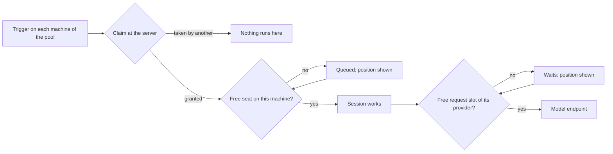

# Fleet: run targets and concurrency limits

Today an automation runs on this computer or on one named machine, a machine starts every session it is given at once, and nothing bounds how many requests go to a model endpoint. A person with a DGX Spark that serves three sessions well cannot say so: the fourth session starts anyway and all four slow down.

Once this is done:

- an automation runs on **a machine or a pool** of machines chosen by labels, as a GitHub Actions job chooses its runner;
- a machine runs **at most N sessions at once**; the others wait in a queue that the person, the agents and the placement all see;
- a provider takes **at most N requests at once**, for any endpoint: a vLLM or LiteLLM gateway, or a `llama-server` CodeAlta manages.

The Azure DevOps trigger filters of the same report are handled apart.

## The idea: limit where the work already passes

The hard question was who holds the limit, and what happens when that machine goes down. The plan never shares a counter between machines. Each limit lives in the memory of the one process that the work passes through anyway:

| Limit | Set on | Enforced by | A lease is | When that process dies |
| --- | --- | --- | --- | --- |
| Sessions at work | A machine | That machine, before a run starts | A run in progress | Its runs died with it: nothing to release |
| Requests at once | A provider | The process that sends the requests | An open request | Its requests died with it |
| Requests to a model server | A `llama-server` | The machine that hosts it, which already relays every request of the other machines | An open relayed request | The server is unreachable through it anyway |
| One run per event | A pooled automation | The CodeAlta Server, with the claim it already grants per due time | A claim, never taken twice | Members do not run without a claim |

So there is no lease table to expire and no transaction across machines. The one case this does not cover is an endpoint that several machines call directly by its address: each machine then holds its own share of the limit (see [Decisions](#decisions)).



## What changes

### 1. Sessions at work on a machine

A machine gets one setting: how many sessions work at once. Its owner, or a computer that manages it, sets it on the page of the machine (**Limits** > **Sessions at work at once**), or on the machine:

```sh
altanode limits sessions 3      # at most three sessions work at once
altanode limits sessions off    # no limit (as today)
```

It is kept in `fleet/limits.json` of the machine, beside `automation-policy.json`, and read before each run.

What takes a seat: a prompt sent from another computer, a session an agent of another machine starts, a run of an automation, and a queued prompt when its turn comes. These are the three places that already pass the budget gate (`FleetNodeService.Budgets.cs`, `AutomationRunner`, `SessionRuntimeService.QueuedRunGate`). The seat is asked after the budgets and the policy, so a run that waits for **Continue anyway** holds no seat.

- **The work a person starts at the computer itself counts, and never waits.** It takes seats, so work from elsewhere queues behind it, but it starts at once.

- **A session and its sub-sessions share one seat.** A parent that waits for its child therefore never waits for a second seat. What bounds the requests of five parallel sub-agents is the limit of the provider (part 2).
- **A session that waits for a person holds no seat.** It goes on at once when answered, even if the machine is briefly one over.
- **The queue is first in, first out, and survives a restart.** A queued prompt is kept as a held one is (`held-sends.json`, with the reason `queue`), and sent once its turn comes.
- **Start now** lets the owner, or a computer that manages the machine, start a queued run at once. **Cancel** drops it.

What the caller gets, and what the others see:

```jsonc
// The answer to a prompt that waits (node API), where "held" is today's answer for a budget
{ "status": "queued", "code": "queued", "position": 2 }

// alta fleet machine list
{ "name": "dgx-spark", "readiness": "ready", "working": 3, "queued": 2, "sessionLimit": 3, "labels": ["gpu", "linux"] }
```

- The row of the session says **Queued on dgx-spark (2 before it)**; its tab says so above the prompt, with **Start now** and **Cancel**.
- A run of an automation reads **Waits for its turn** in its list of runs.
- **Run on** and the Fleet canvas show the load of each machine: `3 of 3 at work, 2 queued`.
- A full machine stays `ready`: it takes the work and queues it. The `codealta-fleet` skill tells agents to prefer a machine with a free seat, then the shortest queue.

### 2. Requests at once to a provider

`max_concurrent_requests` exists today for the `codex` type only. It becomes a setting of every provider, in the configuration and in the provider form of Settings (**Requests at once**, empty for no limit):

```toml
[providers.spark-vllm]
type = "openai-chat"
api_url = "http://dgx-spark:8000/v1"
max_concurrent_requests = 2
```

One gate per provider, first in first out, held for one model request with its stream and released when it ends. It wraps `IModelProviderTurnExecutor.ExecuteTurnAsync`, the one seam every provider type passes, and its state is owned by `ModelProviderRegistry`, keyed by the provider: saving the settings changes the limit in place instead of starting a second count.

A session that waits says so in its timeline, with its place, until it gets its slot: **Waits for a free request of spark-vllm (1 before it)**. The existing notice of the Codex guard says it once and never ends; the new one is updated and removed.

For a provider whose requests CodeAlta does not see (Claude Code, Codex CLI, ACP agents), the unit is the turn.

### 3. Model servers: the limit is the slots, the queue is visible

What `llama-server` does by itself (checked in `C:\code\llama.cpp`, see the details at the end): beyond its slots it never refuses a request, it queues it, without bound, without timeout and without telling anyone. So nothing breaks today; the problems are a session that hangs with no explanation, and three sessions on two slots that reprocess their whole prompt at each turn.

- A `llama-cpp` provider that names a server takes its limit from the server: the slots of its model (`ServerModel.Parallel`, else what `/props` reports as `total_slots`). No setting to keep in step.
- The gate of a server lives in its `ModelHost`, on the machine that hosts it. Both ways in take it: the sessions of that machine (`LocalModelServerHandler`) and the requests of the other machines (`FleetNodeService.LlamaHttpAsync`, which already tracks them). That machine therefore has the whole queue, across the fleet, in order.
- A request of another machine that waits gets `llama.http.queued` events with its place, so its session says **Waits for a free slot of pc-ai/coder (2 before it)** and its connection is not taken for dead.
- The **Servers** tab shows `2 of 2 busy, 3 waiting` for a model.

### 4. Runs on: a machine, or labels

**Runs on** offers, besides **This computer** and each machine, **Machines with labels…**. All the labels must match, as with `runs-on` of GitHub Actions:

```toml
runs_on = "9f3c…"                            # one machine, as today
runs_on = { labels = ["gpu", "linux"] }      # any machine that has both labels
max_runs = 3                                 # runs of this automation at once on a machine (1 today)
```

```sh
alta fleet automation place <automation-id> --label gpu --label linux
```

How a run reaches one machine, without a dispatcher:

1. This computer gives the automation to **every** machine of its server that has the labels, each copy signed and sealed for its machine as today (the server already keeps a version per machine). The placement loop does it again when a machine gains or loses a label.
2. Each machine fires the triggers itself, as today, and **claims** each due time or event at the server before it runs it. The claim exists and is atomic (`FleetAutomationService.ClaimAsync`): one machine gets it.
3. A machine with a free seat claims at once. A full machine first lets the others look: 30 seconds for a schedule, one look of the trigger (five minutes) for an issue or a pull request.
4. A machine checks its own labels against the signed labels before it claims. One that lost a label takes no more runs, also while this computer is closed.

Two rules keep it at most once. A pool needs a **CodeAlta Server**: it is the arbiter. And a member that cannot reach the server does **not** run (today a machine alone runs after ten seconds without an answer, which is right for one machine and wrong for a pool); an event is looked at again later, a due time is recorded as skipped with the reason.

**Run now** asks the member with the most free seats. The runs of all members are listed together, each with its machine.

Triggers a pool takes: schedules, cron, issues, pull requests, Jira. Not yet: a hook of a server and Slack (bound to one machine), a command (this computer only), project and automation events (those of one machine). The editor says which trigger keeps it from a pool.

### 5. Find Runs on

The person who reported this did not find **Runs on**. It shows only when a machine is listed and the automation is kept in **My configuration**. It becomes always visible:

- no machine yet: **This computer** alone, with **Add a machine…** beside it;
- stored in the project: disabled, with why (**An automation of the project runs on the machines that have the project**).

## Steps

Each phase ships alone, in this order.

**Phase 1: sessions at work on a machine**

- [ ] 1. `FleetMachineLimits` (`src/CodeAlta.Fleet/Server/`, as `FleetMachineLabels`): reads and writes `fleet/limits.json`. `altanode limits` in `NodeCommandLine.cs`. Node API `control.limits.get/set` for the owner and a managing device (as `FleetNodeService.Labels.cs`).
- [ ] 2. `FleetSessionSeats` (`src/CodeAlta.Fleet/NodeApi/`): the seats and the queue of one machine. Occupancy is the root sessions with a session of their tree at work and not waiting for a person, plus the runs admitted that did not start yet; it is woken by the session state changes the node already watches. Instance-owned by `FleetNodeService`, no static state.
- [ ] 3. Ask a seat after the budgets at the three entry points: `WithinBudgetAsync` (answer `queued` with the position, kept in `FleetHeldSends` with a reason), `AdmitQueuedAsync`, and a new `IAutomationRunGate.AdmitSeatAsync` called by `AutomationRunner` after `AdmitBudgetAsync`. Wire it in both hosts of the service (`NodeFleet.Start`, the embedded node of the desktop). Check the kill switch again after the wait, as the budgets do.
- [ ] 4. Publish the load: `Load` (working, queued, limit) and `Labels` on `FleetNodeInfo`; `QueuedSessions` and `SessionLimit` on `FleetPresenceUpdate`; a watch event when the queue changes. Older peers ignore the new fields.
- [ ] 5. Desktop: `MachineView` and `AltaFleetMachine` get labels, working, queued and the limit. The `queued` answer in `runOn.ts`; the row, the notice with **Start now** and **Cancel** (node API `sessions.queue.start/cancel`), **Run on**, the Fleet canvas, the **Limits** section of `MachinePage.tsx`. `AutomationRun.Queued` and its label in `AutomationsPanel.tsx`.
- [ ] 6. `alta fleet machine list` and `show` report the load; `alta session create --machine` reports `queued` and the position. Update `codealta-fleet/SKILL.md`.
- [ ] 7. Docs: `site/docs/fleet/machines.md` (Limits), `site/docs/fleet/sessions.md` (the queue), `doc/fleet/node.md` (the limit exists, where it is enforced).

**Phase 2: requests at once to a provider**

- [ ] 8. `ProviderRequestGate` in `CodeAlta.Agent`, owned by `ModelProviderRegistry` and keyed by provider: first in first out, cancellable, with the place of each waiter. A decorator of `IModelProviderTurnExecutor` takes it around `ExecuteTurnAsync` (verify first that one call is one model request for the API providers, and wrap the attempt if it is the whole loop).
- [ ] 9. Accept `max_concurrent_requests` for every provider type in `CodeAltaConfigStore` (validation, copy, overlay); `codex` keeps its default of 16 and its own account guard. Pass it in `ConfiguredModelProviderRegistryBuilder`.
- [ ] 10. The wait as a session update that is replaced when the place changes and removed when the slot is taken.
- [ ] 11. **Requests at once** in the provider form (`GlobalConfigRpc`, `providerForm.ts`, `ProviderSettings.tsx`) and for a provider of a machine (`FleetProviderSetParams`, `NodeProviders.cs`). No new screen in the TUI; its editor keeps the field it does not show.
- [ ] 12. Docs: `site/docs/model-providers/configuration.md`.

**Phase 3: model servers**

- [ ] 13. A gate per model of a server in `ModelHost`, sized by its slots; `LocalModelServerHandler` and `LlamaHttpAsync` take it for the paths of inference. Released when the answer ends or its connection closes.
- [ ] 14. `llama.http.queued` events with the place; `FleetModelServerHandler` turns them into the session update of step 10. A `llama-cpp` provider with `server` refuses `max_concurrent_requests`, since its server decides.
- [ ] 15. Start servers with `--metrics`, read `llamacpp:requests_deferred` in `ServerSupervisor`, and show waiting requests in `ServerModelStatus`, `llama.servers.list`, the **Servers** tab and `alta llama`.
- [ ] 16. Docs: `site/docs/fleet/model-servers.md`, `doc/fleet/model-servers.md` (who owns the gate).

**Phase 4: runs on labels**

- [ ] 17. `AutomationDefinition.RunsOn` becomes a target (a machine or labels) with `max_runs`; parse, validate, write and fingerprint both forms in `AutomationConfig`/`AutomationModel`. `Trigger` compares the runs in progress with `max_runs`.
- [ ] 18. `FleetAutomationVersion` carries the signed labels, in a format an older node refuses (as `VersionFor` did for autonomy). The node checks its labels before it arms and before it claims, never runs a pooled time without the server's claim, gives back its local claim when the server did not answer, and waits before it claims while it has no free seat (`NodeAutomations.Server.cs`).
- [ ] 19. `DesktopAutomationPlacement` keeps its records by automation and machine: resolves the members from the machines of the server and their labels, gives each its copy through the server, removes it from those that left, reads the runs of all. The wait for a machine to take its copy away stays for a single machine; among members the claim arbitrates.
- [ ] 20. Editor: **Machines with labels…** with the labels the machines have and the members that match now; the triggers a pool does not take; `max_runs` under **More options**. The card and the runs name the machine of each run. **Run now** picks the member with the most free seats.
- [ ] 21. `alta fleet automation place --label`, `alta fleet automation list` with the members; skill text.
- [ ] 22. **Runs on** always visible (part 5).
- [ ] 23. Docs: `site/docs/automations.md`, `site/docs/fleet/sessions.md`, `doc/fleet/orchestration.md` (what exists: the pool by copies and claims, where it differs from the server that picks).

## How it is verified

- [ ] `FleetSessionSeats` tests: a limit of 2 starts two and queues the third in order; a sub-session takes no second seat; a session waiting for a person frees its seat; a cancelled waiter leaves the queue; **Start now** starts one over the limit.
- [ ] Node tests (`FleetNodeApiTests`, `NodeAutomationTests`): a third prompt answers `queued` with its position and is sent when a run ends; a queued prompt survives a restart of the node and is sent once; a run of an automation reads `queued`, then runs.
- [ ] `ProviderRequestGate` tests: order, cancellation, a limit changed while requests wait, the gate kept across `RegisterOrReplace`; a turn executor test that the gate is held for the stream and released on failure.
- [ ] Model server tests (`FleetNodeModelServersTests`): two machines and a local session on a one-slot model are served one at a time in order; a relayed request whose connection closes frees its place.
- [ ] Pool tests (`DesktopServerAutomationPlacementTests`, `NodeServerAutomationTests`, `AutomationServerTests`): two members and one due time give one run; a member without the label does not claim; a member that cannot reach the server does not run; a member that loses its label gets a removal.
- [ ] Frontend tests for the queued row and notice, the load in **Run on**, **Requests at once**, and the label target of the editor.
- [ ] In the developer instance with a node on the same computer (`altanode --data-root`), limit 1: start two sessions on it, see the second queued with its place, then start when the first ends. Screenshots in both themes.
- [ ] `dotnet test -c <Configuration>`, `npm test` and `lunet build` pass.

## Decisions

| Decision | Choice | Why |
| --- | --- | --- |
| Who enforces a limit | The process the work passes through; no shared counter | A node that goes down takes its leases with it; nothing to expire or repair |
| An endpoint several machines call directly | Each machine has its own `max_concurrent_requests`; their sum is the person's to set | No process sees all the requests. Exact across the fleet needs them to pass one machine, as model servers do |
| Unit of a seat | A root session with its sub-sessions | A parent waiting for a child cannot block itself |
| A session waiting for a person | Holds no seat | A question left overnight must not block a machine |
| Dispatch in a pool | Every member holds a copy and claims each run at the server | The server cannot read a sealed automation, so it cannot evaluate triggers; the claim already exists |
| A pool without a server | Not offered | Paired machines have no arbiter: two would run the same event |
| Server away | Members of a pool do not run | Agents change things: at most once comes before availability |
| Labels are not signed | Accepted | Only machines the person already gives automations to get a copy, and the labels are in the signed version each machine checks |
| Label matching | All of them | What `runs-on` does; environments keep their any-of rule |
| Model servers | Limit from the slots, gate on the host (phase 3 stays in the plan) | `llama-server` already queues safely; what is missing is the order across machines and the place in the queue |
| Work a person starts at the computer itself | Counts against the limit of that machine, and is never queued | The capacity is the machine's, and a person at the keyboard does not wait behind unattended work |
| Sharing a provider that is not a model server (a vLLM gateway) through its machine | Left out; a later plan | A feature of its own size. Until then each machine holds its own limit for such a gateway |

## Risks

- **Two full machines whose sessions wait for each other's children.** Each parent holds a seat while its child is queued on the other machine. Rare; the queue shows it and **Start now** ends it.
- **A turn that is the whole agent loop.** If `ExecuteTurnAsync` covers several requests for some provider, its gate would be held between them; step 8 checks it before wrapping.
- **Older nodes.** A node that does not know labels refuses the pooled version rather than run it alone; it shows as a member that refused, with the reason.
- **Polling by every member.** N machines look at the same repository every five minutes. Fine for a handful; a server that polls once is the answer for more, and is not part of this.

## Out of scope

- Trigger filters for Azure DevOps (a tag, an assignee): done separately.
- A machine sharing a provider that is not a model server (a vLLM or LiteLLM gateway) with the other machines, which would make the limit of such a gateway exact across the fleet: a later plan.
- An automation kept in the configuration of a project still runs on every machine that has the project, with no claim between them, so two machines can run the same event today. It deserves its own fix.
- The server choosing the machine of a run, retries of a run whose machine was lost, and what a due time does while another run works (skip, queue or replace), as `doc/fleet/orchestration.md` describes them.
- Pools for hooks of a server and Slack triggers.
- Limits per person or per team on a shared machine, and priorities in a queue.
- The TUI: no new screen or setting there.

<details><summary>What llama-server does with concurrent requests (llama.cpp at 7d7f028, 2026-11-08)</summary>

- `--parallel` defaults to automatic, which gives 4 slots sharing one context (`tools/server/server.cpp:126`). An explicit `-np N` gives each slot the context divided by N.
- With every slot busy, a request is deferred inside the server: the queue is an unbounded `std::deque`, with no timeout, served oldest first (`server-context.cpp:3044`, `server-queue.h:25`). The HTTP request blocks; a client that disconnects is taken out. A completion never gets 429 or 503 for being busy.
- `/slots` is on by default and gives `is_processing` per slot, not the queue. `/metrics` needs `--metrics` and gives `llamacpp:requests_processing` and `llamacpp:requests_deferred`. `/props` gives `total_slots`.
- In router mode each model is a child process with its own slots; a request for a model that is not loaded waits, without timeout, until an idle model can be unloaded. A busy model is never evicted.
- A turn that lands on a slot holding another conversation reuses only their common prefix. The host memory cache (`--cache-ram`, 8 GiB by default) restores a parked prompt when it still has it.

</details>

<details><summary>Alternatives ruled out</summary>

- **Leases at the CodeAlta Server for provider requests**, as budgets hand out allowances. The server is not on the path of a request, so it can only trust what machines report; a lease needs a time to live and a heartbeat, and a machine offline either blocks the others or exceeds the limit. Allowances work for tokens because a token spent stays spent; a request slot must come back.
- **Gating requests of a model server in each client only.** Each machine would count alone, and the sum would exceed the slots. Safe, since `llama-server` queues, but the order and the place in the queue would be unknown.
- **A dispatcher on the desktop.** A placed automation must run while this computer is closed.
- **Counting every sub-session as a seat.** A limit of one would deadlock a parent that waits for its child.

</details>
