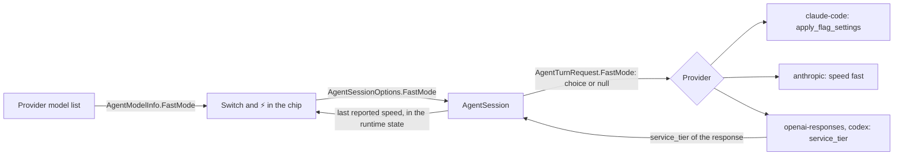

# Fast mode per session

Anthropic and OpenAI run some models faster at a higher price per token, but in CodeAlta the only way to use it is `service_tier` in `config.toml`, for Codex, and for every session at once. Once this is done, a **Fast mode** switch under **More options** turns it on or off for one session. Until it is used, the switch shows what the provider runs, read from the provider where it says it, and the chip shows a colored ⚡ before the model name while fast mode is on, so the higher cost is visible.

## What changes

### What you see

The switch sits under **Private**, with the monochrome lightning of the other icons of the form. It is there only when the model of the session has a fast mode with its provider.

```text
More options
  (●) Sub-sessions
  ( ) Private
  (●) ϟ Fast mode            ← lucide `Zap`, monochrome, like the shield of Private
      Faster output, at a higher price per token.
  Context size  [922k · Default]
```

The collapsed chip puts a colored ⚡ (the emoji) right before the model name, after its logo, and its tooltip gets a `Fast mode: On` line:

```text
Before:  Default · Codex / GPT-6-Astra · XHigh · 🛡
After:   Default · Codex / ⚡GPT-6-Astra · XHigh · 🛡
```

Nothing changes in **Settings → Providers**.

### What each provider does

A session that never used the switch sends nothing new: each provider keeps doing what it does today, and the switch shows that state. Once the switch is used, the session sends its value with every turn.

| Provider type | Switch shown for | Shows before it is used | Not used: sends | On: sends | Off: sends |
| --- | --- | --- | --- | --- | --- |
| `claude-code` | models the CLI marks `supportsFastMode` | the CLI's `fast_mode_state`: your saved `fastMode` of Claude Code | nothing | `apply_flag_settings` `fastMode: true` | `apply_flag_settings` `fastMode: false` |
| `anthropic` | Claude Opus 5.5 on the Claude API | off: fast mode is asked per request | nothing | `"speed": "fast"` | nothing |
| `openai-responses` | models on `api.openai.com` | the tier the last response reported; off before the first | nothing: the project's default tier applies | `"service_tier": "priority"` | `"service_tier": "default"` |
| `codex` | models whose discovery lists `priority` | `[providers.codex] service_tier` in `~/.alta/config.toml` | that `service_tier`, as today | `"service_tier": "priority"` | nothing |
| `copilot`, ACP, others | never | — | — | — | — |

```jsonc
// anthropic: Messages API (SDK 13.6.0: MessageCreateParams.Speed)
{ "model": "claude-opus-5-5", "speed": "fast", "messages": [ … ] }

// openai-responses and codex: Responses API (SDK 2.15.0: CreateResponseOptions.ServiceTier)
{ "model": "gpt-6-astra", "service_tier": "priority", "input": [ … ] }
// openai-responses, switch off: standard speed even on a project whose default tier is fast
{ "model": "gpt-6-astra", "service_tier": "default", "input": [ … ] }
// every OpenAI response names the tier that ran: the switch of a session that did not choose shows it
{ "id": "resp_…", "service_tier": "priority", … }

// claude-code: a control request to the running CLI, before a turn, only when the value changes.
// No restart, unlike a change of model or context size.
{ "type": "control_request", "request_id": "…",
  "request": { "subtype": "apply_flag_settings", "settings": { "fastMode": true } } }
```

Where a provider can say what it runs, the switch takes it from there:

- **Claude Code.** Its `initialize` answer gives `supportsFastMode` for each model and `fast_mode_state` (`on`, `off`, `cooldown`). When it gives a `fast_mode_disabled_reason` (no usage credits, the organization turned it off), no model offers the switch.
- **OpenAI API.** A request that names no tier gets the project's default tier, which can be fast. No API call reads that setting beforehand. Every response gives the tier that ran, though: the session keeps the last one, and the switch shows it until it is used.
- **Anthropic API and Codex** have nothing to read. On the Anthropic API, fast mode is asked per request, and its Models API lists no speed. Codex discovery lists the tiers a model takes (`service_tiers`), not a default for the account, so CodeAlta's own `service_tier` is the starting value.

### One value from the switch to the request

The choice is a session option, beside **Private** and **Context size**, and follows their path: saved with the session, kept on resume and fork, used from the next prompt. The switch's value is saved once it is used; a session that never used it saves nothing and keeps following its provider.

```csharp
// AgentModelInfo: null for a model without a fast mode with this provider; else whether it runs fast before any
// response says otherwise (Claude Code's state, Codex's service_tier, off for the two APIs).
public bool? FastMode { get; init; }

// AgentSessionOptions (and AgentSessionCreateOptions): the switch's value once used; null follows the provider.
[JsonPropertyName("fast_mode")]
public bool? FastMode { get; init; }

// AgentSession sets AgentTurnRequest.FastMode for a model that has a fast mode:
// null keeps what the provider does by itself; true and false are sent as the table says.
_fastMode = model?.FastMode is not null ? _options.FastMode : null;

// AgentOperationUsageSnapshot gets a last parameter: the speed the provider reports the request ran at
// (the service_tier of an OpenAI response); null when it says nothing. AgentSession keeps the last one.
bool? FastMode = null
```

The switch and the ⚡ show the session's choice, else the speed last reported for the session, else the model's default.



## Steps

- [x] 1. **Contracts.** Add `FastMode` to `AgentModelInfo`, `AgentSessionOptions` (`fast_mode`, counted by `IsDefault`), `AgentSessionCreateOptions`, `AgentTurnRequest` and `AgentOperationUsageSnapshot` (`src/CodeAlta.Agent/`). Pass it from the session's options in `SessionRuntimeService` where `ContextSize` is passed. In `AgentSession`, beside `_contextSize`, give the request the session's choice for a model that has a fast mode, and keep the last `FastMode` its usage reports. Tests: null when the switch was not used; the choice for a model with fast mode; null for a model without; the last reported value kept; JSON round trip; an old session without the field.
  - Done: the last reported speed is kept by the runtime entry of the session (`SessionRuntimeService.ObserveAdmittedUsage`), beside its last observed usage, rather than by `AgentSession`: that is where the runtime state reads it. Tests in `SessionOptionsRuntimeTests`.
- [x] 2. **Desktop RPC.** Add `FastMode` to `SessionOptionsChoice` (`SessionProviderContracts.cs`). Project `AgentModelInfo.FastMode` on the models of a session's choices (`OwnedSessionSelection.cs`, `SessionOperationsRpc.cs`) and of the catalog for a new chat (`ModelCatalogRpc.cs`), next to `ContextSize`. Carry the session's last reported speed in its runtime state (`SessionRuntimeCurrentEntry` → `SessionRuntimeStateRpc.cs`), as the captured reasoning effort is. Tests: choice round trip, model projection, reported speed in the runtime state.
- [x] 3. **Claude Code.** In `ClaudeCodeModelCatalog.ReadModels`, read `supportsFastMode`, `fast_mode_state` and `fast_mode_disabled_reason`. In `ClaudeCodeSession`, record `fast_mode_state` from the session's own `initialize`. Before a turn whose `request.FastMode` is set and differs from it, send `apply_flag_settings`, beside `SwitchPermissionModeAsync`. A CLI that refuses the request runs at its own speed, with a warning. Tests with `ClaudeCodeFakeCli`: request sent once; not sent when equal, when the switch was not used, or when the model has none.
  - Found while checking the real CLI (2.1.309, `initialize` and `apply_flag_settings` only, no prompt): a CLI driven by an SDK answers `fast_mode_state: off` with `fast_mode_disabled_reason: sdk_opt_in_required`, whatever the saved `/fast` setting of Claude Code. Its code lifts that reason once the flag settings of the process say `fastMode: true`, the layer `apply_flag_settings` writes, and a launch with `--settings '{"fastMode":true}'` answers `on` with no reason. So in CodeAlta a Claude Code session starts off, and the switch is the opt-in; `sdk_opt_in_required`, `pending` and `network_error` do not hide the switch, the other reasons do.
- [ ] 4. **Anthropic API.** Mark Opus 5.5 models `FastMode = false` when the endpoint is the Claude API (`IsClaudeApi`), in `AnthropicModelProviderRuntime`. When `request.FastMode` is true, set `Speed = Speed.Fast` through the `RawRepresentationFactory` chain of `AnthropicAdaptiveThinkingChatClient`, beside its fallback and thinking changes. Tests on the recorded request body: `speed` present only for Opus 5.5 on the Claude API, absent on another endpoint (`kimi-for-coding`, `minimax`).
- [ ] 5. **OpenAI API and Codex.** Mark models `FastMode = false` on the official endpoint (`IsOfficialOpenAIResponsesEndpoint`), and mark Codex models whose discovery lists `priority`, with the provider's `service_tier` as their default. In `OpenAIResponsesTurnExecutor`, set `ServiceTier` from `request.FastMode` as the table says:
  - `openai-responses`: true sends `priority`, false sends `default`, null sends nothing.
  - `codex`: true sends `priority`, false sends nothing, null keeps `codexOptions.ServiceTier` as today (`ApplyCodexSubscriptionRequestCustomizationAsync`). Its "does not advertise priority" warning fires only for a model without fast mode, not for a session that turned it off.
  - In `CreateUsage`, read the `service_tier` of the completed response into the usage's `FastMode`: `priority` or `fast` is true, any other tier is false, none is null.

  Tests in `OpenAIRawApiModelProviderRuntimeTests` and `OpenAICodexSubscriptionPipelineTests`:
  - `openai-responses`: switch not used sends no `service_tier`; off sends `default`; on sends `priority`; a response with `priority` reports fast.
  - `codex`: on; off over a `priority` config; not used with a `priority` config; a model without `priority`.
- [ ] 6. **Popup and chip.** Add `fastMode: Zap` to `AppIcon.tsx`. Add the switch under Private in `SessionOptionsFields.tsx`, showing the choice, else the reported speed from the runtime state, else the model's default. Extend `sessionOptions.ts`:
  - the model type takes `fastMode`;
  - `storedSessionOptions` keeps `fastMode` once the switch is used;
  - `changedSessionOptions` counts a choice that differs from the model's default.

  Add the ⚡ and the tooltip line in `ComposerSelection.tsx` from a `fastMode` of the summary built in `OwnedSessionPanel.tsx` and `main.tsx`, with the same rule, and their translations in `messages.ts`. Tests: `sessionOptions.test.tsx`, and a scenario in `composer.browser.test.ts` covering the switch position, the ⚡ before the name and its removal, and a reported speed turning the ⚡ on for a session that did not choose.
- [ ] 7. **User guide.** In `site/docs/workspace/prompt.md`, under More options, say:
  - what the switch does, and for which providers;
  - that until it is used it follows the provider: your Claude Code setting, Codex's `service_tier`, and for the OpenAI API the project's default tier, shown after the first response;
  - that turning it on mid-conversation reads the conversation again at the fast price.

  In `site/docs/model-providers/setup.md`, next to `service_tier`, say that a session can override it.

## How it is verified

- [ ] Focused tests of steps 1–6 pass.
- [ ] Following "Debug or Release" in `AGENTS.md`: `dotnet build` from `src`, then `dotnet test --no-build` and `npm test` as two background jobs; `lunet build` from `site`.
- [ ] Developer instance (`codealta-dev`), light and dark, large and 900×650 windows. The switch shows for a supported model and not for Copilot. The ⚡ appears before the name and goes when turned off. The choice is still there after reopening the session.
- [ ] Optional, paid, by you: one short prompt with fast mode on for each provider.
  - The Anthropic response's `usage.speed` should be `fast`, and the OpenAI response's `service_tier` should be `priority`.
  - On an OpenAI project whose default tier is fast, a session that did not choose should show the ⚡ after its first response.

## Decisions

| Decision | Choice | Why |
| --- | --- | --- |
| Where the choice lives | A session option, like Private and Context size | Fast mode is chosen for a piece of work; resume, fork and next-prompt application already exist |
| What the switch shows | The choice, else what the provider reports or is configured with, else off | "Disabled by default, but the current state": the switch must say what runs |
| What a turn sends | The session's choice; nothing while the switch was not used | Each provider keeps its own default; the OpenAI project's default tier stays in force |
| What is saved | The switch's value once used | A used switch means what it shows, and is sent with every turn |
| OpenAI API off | `service_tier: "default"` | Off must mean standard speed, also on a project whose default tier is fast |
| OpenAI API state | From the `service_tier` of each response | It is the only place the API gives it |
| Claude Code | `apply_flag_settings` on the running CLI | No restart for a toggle; same approach as the permission mode |
| Anthropic models | Opus 5.5 only | Generally available, no beta header. Opus 5 needs waitlist access, and Opus 4.8 loses fast mode on 2026-11-30 |
| OpenAI API models | Every model on `api.openai.com` | The API lists no tier per model; the response says which tier ran |
| Sessions started by an agent | Start at the provider's default | An agent should not multiply a premium choice silently |
| Change of model | The choice stays, applied where the model has fast mode | What Claude Code does too; the ⚡ shows when it applies |
| Codex starting value | `[providers.codex] service_tier` in `~/.alta/config.toml` only; `~/.codex/config.toml` is not read | Approved in review: Codex sessions keep starting as they run today |

## Risks

- **OpenAI support per model is not published by the API.** A model without fast mode runs at standard speed; the request does not fail, and the response says `default`. OpenAI's own fast-mode page could not be read (403) to confirm this, hence the optional paid check.
- **On an OpenAI project whose default tier is fast, a new session shows off until its first response.** The reported speed is not saved with the session, so a reopened session also waits for a response.
- **Fast mode has its own rate limits on the Anthropic API.** A `429` is retried by the SDK after its `retry-after`. There is no automatic fallback to standard speed in this plan.
- **Changing speed mid-conversation misses the prompt cache** at Anthropic. The user guide says it, and the switch is visible enough to choose at the start.
- **The Claude Code state comes from the CLI's default model.** If your saved `fastMode` is on but that model has no fast mode, a session that did not choose shows off, while the CLI may run Opus fast. Nothing is forced: using the switch sends its value.

## Out of scope

- Copilot: its fast variants are separate models.
- ACP/Cursor: it keeps its existing provider-wide `fast` option.
- The `codex-cli` plugin: a follow-up. Its app-server takes `serviceTier` on `turn/start` and gives the thread's tier on `thread/start`.
- Azure OpenAI, and the Anthropic research-preview models.
- Ultrafast.
- The speed actually used at Anthropic and in Claude Code (`usage.speed`, the cooldown).
- Provider settings and the TUI.

<details>
<summary>SDK and API surface (checked 2026-11-09)</summary>

| Surface | Fast mode | Current state | Source |
| --- | --- | --- | --- |
| Anthropic Messages API | `speed: "fast"`; Opus 5.5 GA, Opus 5 and 4.8 with beta `fast-mode-2026-02-01`; `usage.speed` says what ran; separate rate limits, separate prompt cache | none: per request. The Models API capabilities of SDK 13.6.0 (batch, citations, code execution, context management, effort, image and PDF input, server tools, structured outputs, thinking) have no speed | [Fast mode](https://platform.claude.com/docs/en/build-with-claude/fast-mode); `Anthropic` 13.6.0 has `MessageCreateParams.Speed`, `Usage.Speed` |
| Claude Code CLI | `--settings '{"fastMode": true}'` in `-p` mode; `apply_flag_settings` applies `fastMode` from the next turn | `fastMode` user setting, persisted across sessions unless `fastModePerSessionOptIn`; `initialize` gives `fast_mode_state`, `fast_mode_disabled_reason`, `supportsFastMode` per model | [Claude Code fast mode](https://code.claude.com/docs/en/fast-mode), [Agent SDK reference](https://code.claude.com/docs/en/agent-sdk/typescript); strings found in the installed CLI 2.1.309 (CodeAlta pins 2.1.318) |
| OpenAI Responses API | `service_tier: "priority"` (or `"fast"`); `"default"` for standard | the project's default tier when no tier is sent (`auto`), which no API call reads; each response's `service_tier` gives the tier that ran | [Responses reference](https://developers.openai.com/api/reference/python/resources/responses); `OpenAI` 2.15.0 `ResponseServiceTier` |
| Codex (CodeAlta's `codex` provider) | sends `service_tier: "priority"` when the model's discovery lists it | `[providers.codex] service_tier` in `~/.alta/config.toml` (not set in yours); discovery gives `service_tiers` per model, no account default | `OpenAIResponsesTurnExecutor.ApplyCodexSubscriptionRequestCustomizationAsync`, `CodexSubscriptionModelDiscoveryClient` |
| Codex CLI and app | `/fast`; `service_tier = "fast"` and `[features] fast_mode = true` in `~/.codex/config.toml`; app-server `serviceTier` on thread and turn, `Model.serviceTiers` | `~/.codex/config.toml` (yours: `"priority"`); app-server `thread/start` answers the thread's `serviceTier` | [Codex speed](https://learn.chatgpt.com/docs/agent-configuration/speed); `src/CodeAlta.CodexAppServer/generated/Protocol` |

</details>
