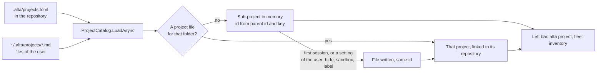

# Sub-projects of a monorepo, declared in the repository

Today a team that works in a big monorepo sets CodeAlta up by hand, each person on each machine: add `services/billing` as a project, then `apps/web`, then label them. Nothing in the repository says which folders are projects, and a folder added that way does not see the skills, prompts or MCP servers of the repository root.

After this work the repository carries its own map. A person adds the monorepo once and gets all its sub-projects, grouped and labeled as the team decided, each one a real project: its own sessions, plans, tasks, skills and agents, on top of what the repository shares. A change of the map arrives with `git pull`.

Tracked by [#398](https://github.com/CodeAlta/CodeAlta/issues/398), milestone `5.0.0`.

## What exists already

A folder inside a repository can already be a project, and most of the product follows it. This is why the plan adds a declaration and a grouping, not a second kind of project.

| Already works for a project in a subfolder | Where |
| --- | --- |
| A worktree is a checkout of the whole repository, and the session works in the same subfolder of it | `GitWorktreeService` (`GitWorktreeCreation.Folder`) |
| Changes knows the folder of the project inside its checkout | `ProjectGitRpc` (`Prefix`) |
| Another machine matches it by repository and relative path | `RepositoryKey.ReadLocationAsync` |
| `AGENTS.md`, `CLAUDE.md` and `.github/copilot-instructions.md` are read in every folder from the root down to the project | `SystemPromptBuilder`, `SessionDiscoveryScope.GetInstructionAncestors` |
| Its own `.alta/` (config, skills, prompts, MCP, plans, tasks) and `.claude/` are read from its folder | every reader takes `ProjectPath` |

What is missing: the shared declaration, the link between a sub-project and its repository, the grouping in the window, and the setup of the root (`.alta/skills`, prompts, MCP servers) reaching the sub-projects.

## What changes

### The project map of a repository

One file at the root of the monorepo, committed with it. It names the sub-projects and the labels that organize them. Paths are relative to the root and stay inside it.

```toml
# <repository>/.alta/projects.toml

[labels.backend]
name = "Backend"
icon = "server"
color = "#2d72d2"

[labels.payments]
name = "Payments"
parent = "backend"

[labels.frontend]
name = "Frontend"

[projects.billing]                # the key is the identity: the folder can move
path = "services/billing"
name = "Billing"
description = "Invoices and payment collection."
labels = ["payments"]

[projects.web]
path = "apps/web"
labels = ["frontend"]

[projects.legacy-reports]
path = "tools/reports"
optional = true                   # listed only for those who add it
```

- A sub-project is an ordinary folder. What it holds decides how it behaves, as for any project: its `.alta/`, `.claude/`, `AGENTS.md`.
- The file can only arrange folders of its repository. It cannot name a folder outside, choose a space, set a sandbox or add folders of skills: those stay in the files of the user.
- It is bounded (2,000 projects, 512 KB) and read as data: a path with `..`, an absolute path, a link that leaves the repository or a duplicate key is a problem shown to the user, never a failed start.
- Entries are explicit. A pattern such as `services/*` is expanded when the map is written (`alta project manifest scan`, below), not each time it is read: the list of projects is read with every prompt and must not walk a repository.

### Sub-projects are computed, not copied

The catalog (`ProjectCatalog`) reads the map of every project it lists and adds its entries to the projects it returns. Nothing is written to `~/.alta/projects/` until the user does something that needs a file, which is the rule the catalog already has for a folder CodeAlta was started in.



- **Identity.** The id of a sub-project is derived from the id of its repository project and its key in the map, so it is the same before and after its file is written, and favorites, sessions and statistics hold. Across machines a sub-project is its repository and its relative path, as today.
- **A folder already added by hand** is recognized by its path: its file, its sessions and its settings stay, and it gains the link to its repository. Nothing is migrated.
- **An entry that leaves the map**: a sub-project nobody used disappears. One with a file stays a plain project in a subfolder, as it would be today, and the user archives or removes it.
- **Spaces.** A sub-project is in the spaces of its repository, always. The sandbox and the added folders of skills the user chose for the repository apply to its sub-projects unless they say otherwise.
- **Which map counts.** The map of the project folder (the main checkout). A worktree on another branch never changes the list of projects.
- **Labels of the map** are served by `LabelCatalog` beside the labels of the user, read-only (`source`: the repository project). The user still puts their own labels on a sub-project.

```csharp
// ProjectDescriptor: computed when the catalog loads, never written to the project file.
public string? ParentId { get; set; }   // the repository project
public string? SubPath { get; set; }    // "services/billing"
```

### The left bar: a repository is a group

The grouping reuses what labels brought: a section header, projects flush left, folding kept per window. The repository is the header; its own row holds the sessions at the root; the labels of the map nest under it.

```text
PROJECTS 9                               ⧉  …  +
[▣ contoso] 5
▸ 📁 contoso  ≡2                          ← sessions at the root of the repository
  [◆ Backend › Payments] 1
▸ 📁 Billing  ≡4
  [◆ Frontend] 1
▸ 📁 Web  ≡1
  + 14 more…                              ← optional sub-projects: opens the picker
[◆ Infra] 2                               ← a label of the user, as today
▸ 📁 azdo-iac
OTHER PROJECTS
▸ 📁 hal9k  ≡42
```

- The group goes where its repository goes: under a label of the user, in FAVORITES, in another space.
- In the flat list, a sub-project shows its repository before its name, dimmed: `contoso › Billing`.
- The menu of the repository gets **Sub-projects…**: every entry of the map with a filter and its labels, a switch to show or hide each one (hidden = archived, in a file of the user), the optional ones to add, and the problems of the map. **Edit the project map** opens the file.
- Adding a folder: a repository with a map says "contoso declares 18 projects" with **Choose…**. A folder that is an entry of a known map is recognized as that sub-project. A repository that looks like a monorepo without a map (`pnpm-workspace.yaml`, `go.work`, a Cargo or npm workspace, `nx.json`, several `.sln`) offers **Set up as a monorepo…**, which starts a session with the skill below.
- The Workspace chip of the composer names both: `contoso › Billing`. A new worktree is a checkout of the repository, and the session works in `services/billing` of it (already so).

### A sub-project inherits the setup of its repository

Instructions already come from every parent folder. The rest follows the same rule, nearest first, through one helper (`ProjectResourceRoots`: the sub-project, then the declared projects above it, then the root).

| Resource | A session of `services/billing` gets |
| --- | --- |
| `AGENTS.md`, `CLAUDE.md`, `.github/copilot-instructions.md` | Root, then each folder down to its own (today) |
| Skills (`.alta/skills`, `.agents/skills`, `.github/skills`) | Its own, then those of the root; the nearest wins on a name |
| Agent and system prompts (`.alta/prompts`) | Its own, then those of the root |
| MCP servers (`.alta/mcp.json`, `.mcp.json`) | Both, its own winning on a name |
| `.alta/config.toml` | Root, then its own on top; what the root disables stays disabled |
| `.alta/issues.toml` | Its own views, else those of the root |
| Plugins (`.alta/plugins`) | Those of the root apply to its sub-projects |
| Plans, tasks, automations | Its own only: `services/billing/.alta/plans` |
| `.claude/` | What Claude Code itself reads from the working folder upward |

The Runtime Context of a sub-project session gains one stable line, so that an agent knows where it is and how to reach its neighbours:

```text
- Repository: contoso (C:\code\contoso); this project is its folder `services/billing`. Other projects of the repository: `alta project list --parent contoso`.
```

Sessions of the repository and of its sub-projects already create and message each other (`alta session create --project`): they are projects of the same space.

**What a session may write.** The folder of a sub-project is where it works, not a wall: file tools and the sandbox allow the whole checkout, because a change in a monorepo often crosses folders, and a worktree session already has the whole worktree. A project of the map can narrow itself with `write = "folder"`. The write guard keeps `.alta`, `.claude` and `.git` out of reach at any depth; the sandbox policy must protect those folders for every declared sub-project inside what a session writes.

### `alta project` and a skill to set a monorepo up

```text
alta project list [--parent <project>] [--declared]   sub-projects carry parent and subPath
alta project show <project>                           adds its repository, its sub-projects, its entry of the map
alta project manifest show [<project>]                the map as read, with its problems
alta project manifest scan [<project>] --glob "services/*" [--marker package.json]   candidates; writes nothing
alta project manifest add <path> [--key <k>] [--name <n>] [--label <l>]... [--optional]
alta project manifest set <key> [--name <n>] [--path <p>] [--label <l>]... [--write folder|repository]
alta project manifest remove <key>
alta project manifest label <key> [--name <n>] [--parent <l>] [--icon <i>] [--color <#hex>]
```

```json
{"type":"alta.project.item","version":1,"id":"…","slug":"contoso-billing","name":"Billing","path":"C:\\code\\contoso\\services\\billing","parent":"contoso","subPath":"services/billing","labels":["contoso.payments"]}
```

- Agents cannot write under `.alta/` with file tools, so the `manifest` commands are how a session edits the map. They change a file of the repository, which the user reviews in Changes and commits; a sandboxed session reads only.
- The built-in skill **`codealta-monorepo`** holds the judgment: read the workspace files of the repository (pnpm, npm, Cargo, Go, Nx, Turborepo, Bazel, .NET solutions), `CODEOWNERS` for the teams, propose projects and labels, ask the user what is a project and what is only a package, write the map with the commands, and offer an `AGENTS.md` per sub-project. Parsing every build system in C# would be more code and less adaptable.

## Challenges

| Challenge | What the plan does |
| --- | --- |
| Hundreds of projects in one repository | Nothing is written per project until it is used; groups fold; `optional` entries and **Sub-projects…** keep the list to what a person works on; `alta project list` stays within its caps |
| The list of projects is read on every prompt | The map is parsed once and kept until the file changes (`ParsedFileCache`); no folder is walked |
| Branches and worktrees have different maps | Only the main checkout defines the projects. A worktree whose branch lacks the folder fails at creation with a clear message |
| One checkout, many sessions | As today for one project: sessions that change files in parallel take a worktree. The cost of a checkout of a huge repository is a follow-up (sparse checkout) |
| Things that belong to the repository, not to a folder | Branches, worktrees and pull requests stay those of the repository. Issues can be narrowed by the views of the sub-project. Triggers on repository events fire per repository until they get a path filter (follow-up) |
| A repository that changes the user's window | The map only arranges folders of a repository the user added: no path outside, no space, no sandbox, no skill folder, labels read-only and scoped to the repository |
| Nested settings folders | A root session can reach `services/billing/.alta`: the guard already refuses, the sandbox policy must too |
| A folder that moves | The key gives the id, so sessions follow the new path (`FindMovedSessionProject`) |
| Older builds on the same profile | They ignore the map and see only sub-projects that have a file, as plain projects |

## Steps

**Phase 1: declare and list**

- [ ] 1. `ProjectManifest` and its reader in `src/CodeAlta.Catalog/` (Tomlyn): the model, the bounds, path validation with links resolved, problems reported and never thrown. Tests in `CodeAlta.Catalog.Tests`.
- [ ] 2. `ProjectCatalog`: read the maps of the listed projects through a `ParsedFileCache`, add the declared sub-projects (derived id and slug, `ParentId`, `SubPath`, spaces of the repository), link a project file of the same folder, keep the id when `EnsurePersistedAsync` writes the file. `ProjectDescriptor.Copy` carries the new properties. Tests: identity before and after a file, a folder added by hand, an entry removed, a moved folder, an archived repository, a read-only catalog (`altacli`).
- [ ] 3. Sandbox and skill folders of the user fall back to the repository project (`SandboxScopes`, `SkillCatalogQuery.ForSession`). Tests.
- [ ] 4. `LabelCatalog`: serve the labels of the maps, read-only, hidden in a space where they hold no project; `alta label` and `LabelsRpc` refuse to change them. Tests.
- [ ] 5. `alta project list --parent/--declared`, `show` and the record fields (`AltaScriptAnnotations` included). Tests beside `AltaSpaceCommandsTests.cs`.
- [ ] 6. `WorkspaceProject` gains `parentId` and `subPath`; `projectRailGroups` builds the repository group, with its labels and the flat-mode prefix. Unit tests in `projectRailGroups.test.ts`, rendering in `ProjectRailRows`.
- [ ] 7. The Runtime Context line, byte-stable. Test in `SystemPromptInfrastructureTests`.

**Phase 2: one setup for the repository**

- [ ] 8. `ProjectResourceRoots` in `CodeAlta.Catalog`, then one resource per commit, each with tests: skills (`otherProjectRoots` exists for this), prompts (`AgentPromptCatalog`), MCP servers, `config.toml` overlay (`CodeAltaConfigStore.LoadProject`), issue views (`IssueViewStore`), plugins (`PluginContributionRegistry.AppliesToProject`).
- [ ] 9. Write scope: the project roots of a sub-project session include its checkout, `write = "folder"` narrows; `SandboxPolicyBuilder` protects the settings folders of the declared sub-projects. Tests in `AgentWriteGuardTests` and `SessionSandboxTests`.

**Phase 3: set up and maintain**

- [ ] 10. `alta project manifest` (`BuiltInAltaCommandContributor.Manifest.cs`) with a writer that edits the file under `ConfigFileLock` and keeps its comments; policies (mutating, refused in a sandbox). Tests.
- [ ] 11. The skill `src/CodeAlta.Catalog/BuiltinSkills/codealta-monorepo/SKILL.md`.
- [ ] 12. Desktop: **Sub-projects…** dialog, the notice when a repository with a map is added, **Set up as a monorepo…**, the Workspace chip. Browser tests.
- [ ] 13. Docs: a new `site/docs/monorepos.md` (in `menu.yml`, linked from `labels.md`, `spaces.md` and `worktrees.md`), `doc/catalog-and-config.md` (Projects, project-local state), `doc/skills.md` (precedence), the command table of `doc/live-tool.md`, a line in `readme.md`.

## How it is verified

- [ ] `dotnet test -c <Configuration>` and `npm test` pass, and `lunet build` in `site/` succeeds.
- [ ] In an isolated profile, with a synthetic monorepo of 300 declared projects: adding the repository lists them grouped within a second, `~/.alta/projects/` holds one file, and a prompt reads no folder of the repository (counted, not timed).
- [ ] A session created in `Billing` works in `services/billing`, lists a skill of the root and one of its own, and writes a file of `libs/` but not `services/billing/.alta/config.toml`. Then `write = "folder"` refuses the file of `libs/`.
- [ ] A worktree session of `Billing` works in `services/billing` of the new checkout, and is still listed under `Billing`.
- [ ] Removing `[projects.web]` from the map: `Web` leaves the list when unused, and stays as a plain project once it has a session.
- [ ] `alta project manifest add apps/admin --label frontend` in a session: the group updates, and Changes shows the edit of `.alta/projects.toml`.
- [ ] Both themes and the 900×650 window for the group, the flat list and the dialog.

## Decisions

| Decision | Choice | Why |
| --- | --- | --- |
| What a sub-project is | An ordinary project with a link to its repository | About 390 files read `ProjectPath`; nothing else has to learn a second kind |
| Where the declaration lives | One `.alta/projects.toml` at the root | One file to review, to scan and to cache; the whole map on one page |
| Stored or computed | Computed at each load, a file only once used | Scales to thousands, follows `git pull`, no reconciliation of copies |
| Labels of the map | Read-only labels scoped to the repository | The team owns them; the user's labels stay the user's |
| Patterns (`services/*`) | Expanded when written, not when read | The catalog is read on every prompt |
| Workspace files (pnpm, Cargo…) | A suggestion and a skill, never automatic projects | A package is not always a project; a committed map is the same on every machine |
| Spaces | A sub-project is in the spaces of its repository | A repository cannot place itself, and a split group has no sensible display |
| CodeAlta TUI | No new UI: sub-projects are listed as projects | New features are desktop only; the shared catalog keeps working |

> **Open:** one map at the root, or each folder declaring itself (`services/billing/.alta/project.toml`, found through the git index)? The second suits `CODEOWNERS` better and needs a scan to list the projects.
>
> **Open:** may a sub-project session write the whole checkout by default (proposed), or only its folder unless the map widens it?
>
> **Open:** are all declared sub-projects listed unless `optional` (proposed), or only those a person adds?

## Risks

- **Inheritance changes sessions that exist.** A project in a subfolder of a repository that gets a map starts to see the skills and MCP servers of the root: its system prompt changes once, and its prompt cache is lost once.
- **The sandbox grows.** Granting the checkout to a sub-project session is a wider grant than its folder. It ships with the protection of nested settings folders, in the same step, or not at all.
- **Bounded catalog scans.** `ReadBoundedOwnershipAsync` stops at 128 project files. A person who uses more than a hundred sub-projects reaches it: step 2 measures it and raises the bound if needed.
- **A map with mistakes.** A wrong path or a duplicate key must cost one entry, not the list. The reader keeps what is valid and shows the rest in **Sub-projects…** and `alta project manifest show`.

## Out of scope

- Projects of other repositories in the map (a workspace of several repositories). Clone on demand of the fleet is the base for it later.
- Sparse-checkout worktrees for sub-project sessions, and path filters on repository triggers: their own plans once this one is used.
- Statistics and Search grouped by repository; the list of the phone grouped by repository.
- Sub-project UI in CodeAlta TUI.
- Publishing the declared sub-projects of a node to the fleet before anyone opens them there (`FleetProjectKeys`): a follow-up, since matching by repository and relative path already works for the ones in use.

<details><summary>Evidence behind the choices</summary>

- A project is one `~/.alta/projects/<slug>.md` with an absolute path; a session belongs to the project whose folder is its working directory, compared exactly (`ProjectCatalog.ResolveSessionProject`), with the worktree recorded beside it.
- The catalog already lists projects that have no file: the transient projects of `GetOrAddTransientAsync`, "kept in memory only", which "a project file for the same folder takes their place". Declared sub-projects follow that lifecycle.
- `ProjectCatalog.LoadAsync` lists the folder at each call and parses a file again only when its stamp changed (`ParsedFileCache`, "Reads and the cache of the parsed files" in `doc/catalog-and-config.md`).
- Worktrees: `GitWorktreeService` runs `rev-parse --show-toplevel` in the project folder and keeps `below`, the folder of the project inside its checkout.
- Fleet: "A monorepo's subfolder project is matched by key plus relative path" (`doc/fleet/sessions-across-machines.md`), `RepositoryKey.ReadLocationAsync` reads `rev-parse --show-prefix`.
- Skills are read from `<project>/.alta/skills` of the project folder only (`doc/skills.md`); `SkillCatalogQuery.ForSession` has an unused `otherProjectRoots` ("More folders whose skills the session sees; their configuration is not read").
- `AgentWriteGuard.ProtectedSegment` refuses `.alta` (except plans and tasks), `.claude`, `.git` at any depth below the folder of the session, so agents cannot edit `.alta/projects.toml` with file tools.
- File tools are limited to "the session's working directory, worktree, project roots and scratchpad" (`doc/runtime.md`), and `AgentInstructionTemplateProvider` gives one project root, the project folder: a sub-project session without a worktree cannot write outside its folder today, while one in a worktree can.
- Labels: `LabelCatalog`, one file per label of the user, depth capped at `LabelDescriptor.MaximumDepth` (4), a space only on a top-level label; the rail groups with `projectRailGroups` (`explorer/projectRail.ts`).
- `ProjectId` accepts any non-empty GUID, so a derived id is valid.

</details>
