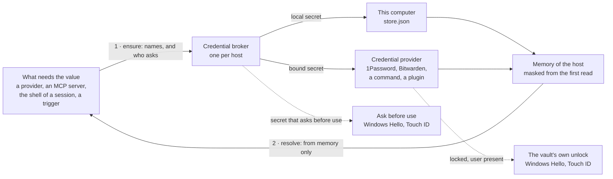
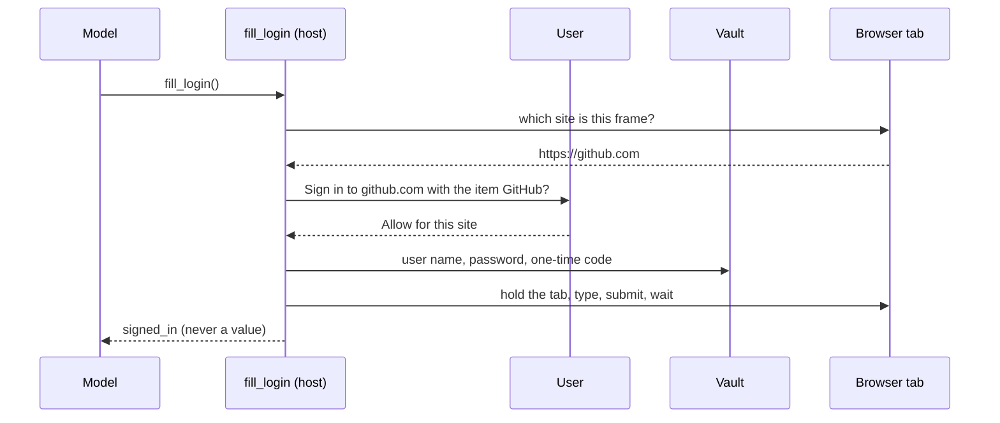

# Credential providers for secrets kept in 1Password, Bitwarden and other vaults (#413)

Today the value of a secret is typed into **Settings > Secrets** and kept in `~/.alta/secrets/store.json`, encrypted for the user of the computer. People who keep their keys in a password manager copy them by hand, and nothing asks them again when a key is used.

Once this work is done, a secret keeps its name and every `${secret:NAME}` works as before, but its value can come from an item of a vault: 1Password first, then Bitwarden, KeePassXC, pass, the keychain of the system, a secret manager, any command, or a provider a plugin brings. Several vaults work side by side. A vault is unlocked once, not at every read, and a secret can ask for Windows Hello or Touch ID each time it is used.

The last phase uses the same vault items to sign in to websites in the browser of a session, which is what [#413](https://github.com/CodeAlta/CodeAlta/issues/413) asked for first.

## What changes

### A secret gets a source

A secret is still a name. What changes is where its value is: on this computer, as today, or in an item of a vault. The configuration does not change, so nothing that names a secret has to be edited:

```toml
# ~/.alta/config.toml: unchanged
[providers.anthropic]
api_key_secret = "ANTHROPIC_API_KEY"
```

The link between the name and the vault item is a *binding*, written by **Settings > Secrets** in a new file beside the store:

```jsonc
// ~/.alta/secrets/bindings.json
{
  "ANTHROPIC_API_KEY": {
    "provider": "personal",                          // a credential provider of config.toml
    "ref": "op://Private/Anthropic/credential",      // what that provider reads
    "label": "Private › Anthropic › credential",     // what the user picked, for the list
    "ask_before_use": "15m",                         // optional, see "Ask before use"
    "version": 1, "set_by": "alice (CodeAlta Desktop)", "set_at": "2026-11-12T09:14:00Z"
  }
}
```

Two rules follow from it:

- **A configuration file never names a vault item.** Only the user's own store maps a name to an item, so the `mcp.json` or the settings of a cloned repository cannot choose what is read from a vault.
- **`store.json` does not change.** An older CodeAlta on the same profile (the normal instance beside a developer instance) rewrites that file whole and would drop fields it does not know.

### Credential providers

A credential provider reads values from one vault. The user adds as many as they need, each with an id that secrets name:

```toml
# ~/.alta/config.toml
[credentials.personal]                     # several providers of one type are fine
type = "1password"
account = "my.1password.com"

[credentials.ci]
type = "1password"
service_account_token = "${secret:OP_CI_TOKEN}"    # a secret of this computer, never of a vault

[credentials.team]
type = "command"
read = ["vault", "kv", "get", "-mount=secret", "-field={field}", "{item}"]
sign_in = ["vault", "login", "-method=oidc"]
```

Providers only read: CodeAlta never writes into a vault.

| Provider | `type` | Reached through | Unlocked how | Without a user | Phase |
| --- | --- | --- | --- | --- | --- |
| This computer | always there | `store.json`: DPAPI, Keychain, libsecret | nothing to unlock | yes | exists |
| 1Password | `1password` | the `op` CLI | The 1Password app asks Windows Hello, Touch ID or the system password, once. Never a master password in CodeAlta | a service account | 1 |
| A command | `command` | a command line the user writes | whatever the tool does; an optional sign-in command | yes | 1 |
| Bitwarden, Vaultwarden | `bitwarden` | the `bw` CLI | The biometrics of the Bitwarden app where the CLI has them, else the master password once per run of CodeAlta, kept as a session key in memory | no | 3 |
| Bitwarden Secrets Manager | `bitwarden-secrets` | the `bws` CLI | an access token, itself a secret of this computer | yes | 3 |
| KeePassXC | `keepassxc` | `keepassxc-cli` | the password of the database once per run, in memory; a key file | with a key file | 3 |
| pass, gopass | `pass` | `pass`, `gopass` | gpg-agent keeps the passphrase | while it keeps it | 3 |
| Keychain of the system | `keychain` | Windows Credential Manager, macOS Keychain, Secret Service | the session of the user | yes | 3 |
| HashiCorp Vault, OpenBao | `vault`, `openbao` | `vault`, `bao` | the sign-in of the CLI | with a token | 3 |
| AWS, Azure, Google secret managers | `aws-secrets-manager`, `azure-key-vault`, `google-secret-manager` | `aws`, `az`, `gcloud` | the sign-in of the CLI | with the identity of the machine | 3 |
| Doppler, Infisical | `doppler`, `infisical` | their CLI | the sign-in of the CLI | with a token | 3 |
| Anything else | `<prefix>/<name>` | a plugin | its own | its own | 3 |

Proton Pass, Keeper, Dashlane, LastPass and Passbolt have a CLI: they work through `command` from phase 1, and get a provider of their own when asked for.

Each provider shows the logo of its vault. The icon packages of the frontend already hold most of them (`1password`, `bitwarden`, `keepassxc`, `vault`, `openbao`, `gnuprivacyguard`, `apple`, `googlecloud`, and `aws`, `azure`, `microsoft`); the others get a Lucide icon.

A missing CLI is not downloaded by CodeAlta. The provider says how to install it with the package manager of the system (`winget install 1password-cli`, `brew install 1password-cli`) and offers to run that command in a terminal of CodeAlta, where the user sees it.

### How a value reaches what uses it

A vault can take seconds to answer and may need the user. So reading is split in two: an asynchronous step that makes values available, and the resolution of `${secret:NAME}`, which stays synchronous and reads memory only.



- **Ensure** (`CredentialBroker.EnsureAsync`) says which secrets are needed and by what: `provider anthropic`, `MCP server grafana`, `the shell of a session of the space Work`. It reads each secret once, whoever asks at the same time, and never prompts when no user is present.
- **Resolve** is today's `SecretReferenceResolver`. A bound secret that is not in memory is an error that names it and its vault, never an empty value and never the value of another source.
- **Every value the broker gives is told to the masking first** (`AgentSecretMasker.Retain`), so it is `***` in tool results, journals, logs and telemetry from its first read.

What a secret can be, and what the user sees where it is used (a provider, an MCP server, the composer):

| State | Meaning | Action shown |
| --- | --- | --- |
| Ready | in memory, or readable without a prompt | none |
| Locked | its vault must be unlocked | **Unlock** |
| Sign-in needed | the CLI of its vault has no account | **Sign in…** opens a terminal on the vault's own command |
| Not installed | the CLI of its vault is not found | how to install it |
| Waits for you | it asks before use | **Confirm…** |
| Not found | the item or the field is gone | **Change…** |

When a vault is asked:

- **At start**, CodeAlta reads what each vault gives without a prompt. Then the normal desktop instance asks each locked vault to unlock, once, after the window is shown. A prompt the user dismisses is not shown again until they click **Unlock**, and a switch of each provider turns the prompt at start off (`unlock_at_start`, on by default).
- **While CodeAlta runs**, what was read stays in memory until it closes or the user clicks **Lock** (`cache`, per provider: until CodeAlta closes, a duration, or never). Nothing prompts again, and an automation that runs at night still has its values.
- **The developer instance, `altacli` and `altanode` never prompt.** What is locked stays locked, and what needs it says why.

### Ask before use

A secret can be marked **Ask before use**, whatever its source. CodeAlta then gives its value only after the system verified the user: Windows Hello (PIN, fingerprint, face) on Windows 11, Touch ID or the password of the account on macOS.

```text
Windows Security

  CodeAlta
  Use the secret ANTHROPIC_API_KEY for the provider anthropic?

  [ PIN  ••••••  ]                                   [ Cancel ]
```

- The answer is kept for **that secret and what uses it**: each use, 15 minutes (the default), 1 hour, or until CodeAlta closes. Something else that asks for the same secret, such as an MCP server added a minute later, asks the user again and is named in the prompt.
- **Without a user**, the secret is not given: an automation, a node or a start of the developer instance says that it waits for a confirmation.
- Where the system cannot verify the user (Windows Hello not set up, Linux), the option is off, with one line that says why. CodeAlta adds no password of its own.
- It is off by default, and set per secret.

### Settings > Secrets

The page gains the providers above the secrets, and each secret says where it is kept:

```text
Settings › Secrets

Credential providers                                             [ Add a provider… ]
  [key] This computer    Windows data protection                    Ready
  [1P]  personal         1Password · my.1password.com               Locked     [ Unlock ]
  [>_]  team             Command · vault kv get …                   Ready      [ Lock ]

Secrets                                                            [ Add a secret… ]
  ANTHROPIC_API_KEY   ${secret:ANTHROPIC_API_KEY}   [1P] personal › Private › Anthropic › credential   Asks before use
  GRAFANA_TOKEN       ${secret:GRAFANA_TOKEN}       [key] This computer · version 3        [ Rotate ]
  DEPLOY_KEY          ${secret:DEPLOY_KEY}          [>_] team › deploy/prod#token
```

The first run with 1Password:

1. **Add a provider…** lists the types with their logo. Choosing 1Password finds `op`, or says how to install it, and says to turn on **Integrate with 1Password CLI** in the 1Password app.
2. **Add a secret…** takes a name and a source. With a vault, a picker lists its vaults, items and fields by name; a value never reaches the page. In **Settings > Providers**, **Use a vault item…** beside **Keep as a secret…** does the same for the key of a provider.
3. From then on, 1Password asks Windows Hello once when CodeAlta starts, and nothing else while it runs.

### Plugins bring providers

The built-in providers are written on the contract plugins get, in `CodeAlta.Plugins.Abstractions`:

```csharp
public interface ICredentialProvider
{
    /// Whether it can answer now: ready, locked, sign-in needed, not installed.
    ValueTask<CredentialProviderStatus> GetStatusAsync(CancellationToken cancellationToken);

    /// Unlocks with the user present: the vault shows its own prompt, or asks the host for what it needs.
    ValueTask<CredentialProviderStatus> UnlockAsync(CredentialUnlockContext context, CancellationToken cancellationToken);

    /// Reads one field of one item. With interactive false it never shows a prompt: it answers Locked.
    ValueTask<CredentialValue> ReadAsync(CredentialReference reference, bool interactive, CancellationToken cancellationToken);

    /// Lists vaults, items and fields for the picker of Settings: names, never values. Optional.
    ValueTask<CredentialBrowsePage> BrowseAsync(CredentialBrowseRequest request, CancellationToken cancellationToken);

    /// Forgets what it holds in memory: a session key, an open database.
    void Lock();
}
```

```csharp
[Plugin(DisplayName = "Acme Vault")]
public sealed class AcmeVaultPlugin : PluginBase
{
    public override IEnumerable<PluginCredentialProviderContribution> GetCredentialProviders()
    {
        yield return new()
        {
            Type = "acme.vault/secrets",                 // [credentials.<id>] type = "acme.vault/secrets"
            DisplayName = "Acme Vault",
            Icon = "vault",                              // a brand or Lucide icon, or IconSvg
            Settings = [new("address", "Address", PluginCredentialProviderSettingKind.Text)],
            ReferenceHint = "team/item#field",
            Create = context => new AcmeVaultProvider(context),
        };
    }
}
```

The host owns everything around a provider: the bindings, the memory and its duration, the masking, **Ask before use**, the states and the settings form. A plugin only answers "is it unlocked" and "read this". Only built-in plugins and the plugins of the user (`~/.alta/plugins`) contribute providers, never the plugin of a project folder.

### Agents, `alta` and the sandbox

Agents work with names and states. They never get a value, and never the vault item a secret names.

| Command | What it does | Who agrees |
| --- | --- | --- |
| `alta secret list` | adds the provider and the state of each secret | nobody: it reads |
| `alta secret test NAME` | says whether the secret can be read now | nobody |
| `alta secret uses` | the recent uses: which secret, by what, when and the outcome | nobody |
| `alta credential types`, `list`, `status` | the types, the providers, their state and what is missing (a CLI, a sign-in) | nobody |
| `alta credential unlock ID`, `lock [ID]` | asks the vault to unlock; forgets what is in memory | the vault's own prompt |
| `alta secret bind NAME --provider ID --ref REF`, `unbind NAME` | proposes a binding | the user, on a card of the session |
| `alta credential add TYPE`, `remove ID` | proposes a provider; never a `command`, which runs a program | the user, on the same card |
| `alta secret set` | refused, as today | |

```json
{"type":"alta.secret","kind":"secret","name":"ANTHROPIC_API_KEY","reference":"${secret:ANTHROPIC_API_KEY}","provider":"personal","providerType":"1password","state":"locked","askBeforeUse":true}
```

- **The card is a permission request no permission mode answers**, as the one of the user's own browser (`AgentBrowserPermissionRequest`): a new `AgentCredentialPermissionRequest` joins `SessionPermissionService.AlwaysAsks` and `OnlyTheUserAllows`, and a host without a user denies it.
- **A sandboxed session gets none of these commands.** `AltaSandboxGate` is an allow list that holds neither `secret` nor `credential`; tests pin it for every new path, plugin commands and Code Mode included.
- **A vault CLI in the shell of an agent is asked for.** Once a provider of a vault is configured, a command of an agent that runs that vault's CLI (`op`, `bw`, `keepassxc-cli`, `pass`…) is refused with a note that tells it to name a secret instead, unless the user allows it. It is a guardrail of `AgentCommandGuard`, not a wall.

### What this protects, and what it does not

- **Protected.** Values stay out of what models see, of journals and logs (the masking, as today), out of configuration files (names only), and out of `store.json` once they are in a vault. A file of a project cannot choose a vault item. A sandboxed session reaches neither the vaults, nor their CLIs, nor these commands. A secret that asks before use is not handed to something new without the user's gesture, which an agent cannot make.
- **Not protected.** A session that is not sandboxed runs commands as the user: it can run the CLI of a vault or read files itself. **Ask before use** is a check CodeAlta makes, not encryption: a program that runs as the user is stopped by the vault, not by CodeAlta. The user guide says both plainly.

Rules every provider follows, in one place (`VaultCommandRunner`): a CLI is started by the host only, by its full path, with an argument array and never a shell; in a neutral folder, never the folder of a project; with an environment made for it; a token or a password goes on its standard input or in its own environment, never in an argument; its output is bounded in size and time; its error output is masked before it is logged. No master password and no session key is ever written to disk.

### Sign in to websites (phase 4)

A session that drives a browser gets one new tool, `fill_login`. The model gives neither a value nor a site: the host reads the site from the browser, finds the sign-in the user shared for it, asks the user, and types.



- A **sign-in** is a binding with its sites: `{ "sites": ["https://github.com"], "provider": "personal", "ref": "op://Private/GitHub" }`. Sites match by scheme, host and port; nothing is filled anywhere else.
- **The user agrees for each site**, on a card no permission mode answers: once, or for that site for 30 days. The page of Settings lists and revokes them.
- **The agent is kept away while it happens**: the other tools of the session wait for that tab from the first key to the end of the navigation, the fields are cleared when the submit fails, and the values are masked in every later snapshot, request body and console line.
- **Fields are checked before typing**: visible, of the expected kind, in a frame of the same site, in a form that posts to it.
- It works in the isolated and the persistent profiles. The user's own browser has its own extension, and a sandboxed session is refused in the first version.

## Steps

### Phase 1: the foundation and 1Password

- [x] 1. **Bindings** (`src/CodeAlta.Catalog/Secrets/SecretBindings.cs`, `LocalSecretStore`): `bindings.json` beside `store.json` with bind, unbind, version, who and when, written as `store.json` is (`ConfigFileLock`, a private file, `StagedFileReplacement`) and keeping the members it does not know. `ListSecrets()` gives both kinds with their source (`SecretInfo` gets init-only members); binding a name that has a value here retires that value (it stays masked, as after a rotation), and a binding wins over a local value an older build wrote under its name. Tests: `SecretBindingsTests`, `LocalSecretStoreTests`.
- [x] 2. **Use and availability** (`src/CodeAlta.Catalog/Secrets`): `SecretUse` (kind, subject, session, whether a user is present), `SecretAvailability`, `IBoundSecretSource`, and `SecretResolvers`, the instance a host builds its `SecretReferenceResolver`s from. A bound secret that is not in memory is a `SecretReferenceException` that names it. The static `ForMachine` and `ForScope` keep resolving local values for hosts without a broker. Tests: `SecretReferencesTests`. *Done as overloads of `SecretReferenceResolver.ForMachine` and `ForScope` that take the `IBoundSecretSource` of the host and the use as a text (`provider anthropic`), instead of a `SecretResolvers` instance and a `SecretUse` record.*
- [x] 3. **Provider contract** (`src/CodeAlta.Plugins.Abstractions/PluginCredentialProviders.cs`): `ICredentialProvider`, `PluginCredentialProviderContribution` with its `Validate()`, status, reference, value (with `ExpiresAt`, for one-time codes), browse page; XML docs. The hook of `PluginBase` comes in step 25.
- [x] 4. **Broker** (new `src/CodeAlta.Credentials`, tests in new `src/CodeAlta.Credentials.Tests`): `CredentialBroker` (the types, the providers of `[credentials.<id>]`, `EnsureAsync` with one read per secret at a time, the memory and its `cache`, `Lock`, `Changed`, the recent uses, every value told to the masking before it is given) and `VaultCommandRunner` with the rules above. No static state. *The broker reads ahead with `RefreshAsync` (at start, after an unlock, a binding, an expiry) instead of an `EnsureAsync` per use: resolution reads memory only.*
- [x] 5. **Configuration** (`CodeAltaConfigStore`, `CodeAltaRawApiSettingsDocument`): the `[credentials.<id>]` tables with the settings of their type, `cache` and `unlock_at_start`, read from the user's file only, validated (id, known type, a setting refers to a local secret, never a bound one), declared in the registry of settings as read-only for agents. Tests. *In `CredentialProviderSettings` (`CodeAlta.Credentials`), which edits the tables with `ConfigTableSyntax`; not declared in the registry of settings, since agents change providers through `alta credential` only.*
- [x] 6. **1Password** (`src/CodeAlta.Credentials/Providers/OnePasswordProvider.cs`): status, unlock, read (`op read`; several references in one `op inject`), browse (vaults, items, field labels, read from the JSON without making strings of the values), with the desktop app or a service account. A test double `src/CodeAlta.Tests.FakeVaultCli` answers as `op`. Confirm on Windows and macOS that the status check never prompts (if it does, the status is "unknown" and only an interactive ensure reads), and whether a shell CodeAlta starts shares the authorization CodeAlta was given. *One `op read` per secret; `op inject` is not used. The status check is `op whoami`, which never prompts on Windows; macOS is not checked.*
- [x] 7. **Command provider** (`CommandProvider.cs`): `read` with `{item}`, `{field}` and `{ref}`, `json`, `sign_in`, `status`; the full path is resolved when the provider is saved and shown in Settings. Tests with the test double.
- [x] 8. **Hosts** (`CodeAltaHost`, `CodeAltaHostOptions`, so the desktop, the TUI, `altacli` and `altanode` alike): build the broker with `secretMasker.Retain` and the `SecretResolvers`; at start, ensure the secrets the providers name without a prompt and within a time limit; then, in the normal desktop instance, unlock the locked providers whose `unlock_at_start` is on, after the window is shown.
- [x] 9. **Model providers** (`ConfiguredModelProviderRegistryBuilder`, `PluginModelProviderTypes`): one check before the code of each type. A provider whose secret is locked, or waits for a confirmation, is registered as unavailable with that reason (`CredentialUnavailableException`, its own error category), and registered again when `Changed` says the secret can be read. Tests: `ConfiguredProviderRegistrationTests`, `SecretIssuanceMaskingTests` (a vault value is masked from its first read). *A model provider whose secret cannot be given is left out, with the reason in the log, and registered when `Changed` says the secret can be read (only the providers not registered, so that no runtime in use is replaced), rather than registered as unavailable.*
- [x] 10. **The other uses**: ensure, then resolve, in `McpRuntimeService` (a server that failed for a locked secret is tried again after `Changed`), the identity of a session (`SessionIdentityResolver`), the triggers of automations (`AutomationService.Integrations.cs`), `SpaceIdentityChecks` and `FleetModelHosts`; `GlobalConfigRpc.IsSecretSet` counts a bound secret. Tests in each area. *MCP servers, the identity of sessions, the triggers of automations and the checks of the command line tools of a space; `FleetModelHosts` (`HF_TOKEN`) keeps local values only. `GlobalConfigRpc.IsSecretSet` counts a bound secret through `ListSecrets`.*
- [x] 11. **RPC** (`src/CodeAlta/Desktop/Rpc/SecretsRpc.cs`, the existing `secrets` service): the types and the providers with their state; save, remove, unlock, lock, test and browse a provider; bind and unbind; the list gives the source and the state of each secret. Nothing returns a value. Tests: `SecretsRpcTests`.
- [x] 12. **Settings > Secrets** (`src/CodeAlta/frontend/src/secrets/`): the providers card, the gallery of types with logos and what each needs, the form of a provider (its settings, how long its values stay in memory, **Unlock when CodeAlta starts**), the binding dialog with its picker (a name that has a value here is replaced after a confirmation beside its row), the source and state of each row, **Unlock** and **Lock**; **Use a vault item…** in `ProviderKeySecret.tsx`; **Unlock** where a provider is unavailable for a locked secret (its page, the composer). Logos through `scripts/generate-brand-icons.mjs` and `npm run icons`. Texts in `secrets/messages.ts` in the five languages. Tests beside the modules, and one browser test.
- [x] 13. **`alta`, reading** (`BuiltInAltaCommandContributor.Secrets.cs`, new `BuiltInAltaCommandContributor.Credentials.cs`): `secret list` with provider and state, `secret test`, `credential types|list|status`, their help. Tests: `AltaSecretCommandsTests`, `AltaCredentialCommandsTests`, and one that a sandboxed session is refused each of them.
- [ ] 14. **Documentation**: `site/docs/secrets.md` (credential providers, 1Password, a command, binding, with pictures), the page where the key of a provider is set, a new `doc/credentials.md` (the broker, ensure then resolve, the rules of "What this protects") linked from `doc/architecture.md`, `readme.md`.
- [ ] 15. **Validation of phase 1**: the .NET tests, `npm test`, `lunet build`, the developer instance with the test double, and a real 1Password account.

### Phase 2: ask before use

- [x] 16. **Spike**: verify the user from `net10.0`, without a Windows target framework: `IUserConsentVerifierInterop.RequestVerificationForWindowAsync` with the handle of the window (Windows 11), and `LAContext.evaluatePolicy` through the Objective-C runtime (macOS). Its result chooses between hand-written interop and a small helper, and says what happens over Remote Desktop.
- [x] 17. **Grants** (`CredentialBroker`, `SecretBindings`): `ask_before_use` on any secret; a grant per secret and use, with its duration; without a user, the availability is "waits for you". The recent uses keep who asked, when and the outcome, never a value. Tests.
- [x] 18. **Verifiers** (`IUserPresenceVerifier` in `CodeAlta.Credentials`; `src/CodeAlta/Desktop/Credentials/` for Windows and macOS): availability with its reason, verification with the secret and its use in the message; none on a headless host. Tests with a fake verifier. *The verifiers are in `CodeAlta.Credentials/SystemUserPresence.cs` (hand-written WinRT and Objective-C interop), given the handle of the window by the desktop.*
- [x] 19. **Desktop**: the switch and its duration on a secret, off with its reason where the system has no verification; **Confirm…** where a provider, an MCP server or the composer waits; the recent uses on the page, and `alta secret uses`. *The confirmation is on the page of Settings (**Confirm** at the top) and in the prompt of the system; the composer shows no button.*
- [ ] 20. **Documentation and validation of phase 2**: the user guide, the tests, the check on Windows 11 and on a Mac.

### Phase 3: more vaults, plugins and agents

- [x] 21. **Bitwarden** (`BitwardenProvider.cs`): `bw status`, unlock through the Bitwarden app where the CLI offers it, else the master password asked once in the window and given to `bw unlock` in its own environment, the session key in memory only; read and one-time codes by item id; browse. `bitwarden-secrets` through `bws` and an access token.
- [x] 22. **KeePassXC** (`KeePassXcProvider.cs`): confirm first that `keepassxc-cli` takes the password of the database on its standard input without a terminal on Windows; then read attributes and one-time codes, with a key file, the password asked once per run.
- [x] 23. **pass, gopass and the keychain of the system** (`PassProvider.cs`, `KeychainProvider.cs`): `pass show` and `gopass show -o`; `CredRead` by P/Invoke on Windows, `security find-generic-password` on macOS, `secret-tool lookup` on Linux.
- [x] 24. **Ready-made command providers** (`CommandPresets.cs`): `vault`, `openbao`, `aws-secrets-manager`, `azure-key-vault`, `google-secret-manager`, `doppler`, `infisical`, each a fixed command line, a status check, a sign-in command, an icon and an install hint. Their package ids are confirmed here.
- [x] 25. **The plugin hook**: `PluginBase.GetCredentialProviders()`, `PluginPoint.CredentialProvider`, `PluginCredentialProviderTypes` in `CodeAlta.Hosting` (added and removed with the plugin, a type `<prefix>/<name>` that shadows no built-in, never from a project plugin, the SVG of an icon made safe by the host). `PluginApiReference`, the reference of the `codealta-plugin-runtime` skill, `site/docs/plugins/developers.md`. Tests in `CodeAlta.Plugins.Tests`.
- [x] 26. **`alta`, changing**: `secret bind|unbind`, `credential add|remove|unlock|lock`, with `AgentCredentialPermissionRequest` (journal, the card of CodeAlta Desktop, the generic prompt of the TUI, `AlwaysAsks`, `OnlyTheUserAllows`); an unlock the user dismissed is not asked again by an agent for ten minutes. Tests, the sandbox refusals included.
- [x] 27. **Hardening**: `BW_SESSION` and `OP_SESSION_*` never pass into a sandbox (`SandboxPolicyBuilder`); the guard of vault CLIs in the shell of an agent (`AgentCommandGuard`), with its setting. Tests.
- [ ] 28. **Documentation and validation of phase 3**: one section per vault in the user guide, the tests, a check with a real Bitwarden account and a KeePassXC database.

### Phase 4: sign in to websites

- [x] 29. **Sign-ins** (`SecretBindings`, RPC, Settings > Secrets): a binding with its sites, and the sites the user allowed with their expiry. *Sign-ins and site grants in the members `sign_ins` and `site_grants` of `bindings.json` (`SignIns`); the card **Sign-ins of websites** of Settings > Secrets adds, edits and removes them and revokes a site.*
- [x] 30. **Providers read a sign-in**: user name, password and one-time code of an item, for 1Password, Bitwarden and KeePassXC, never kept in memory beyond the fill. *Through the references of the item read by the provider of its vault (`CredentialBroker.ReadSignInAsync`), so any vault that reads a field and a one-time code works.*
- [x] 31. **`fill_login`** (`src/CodeAlta.Browser/Tools`, `src/CodeAlta.Plugin.Browser`): the site read from the browser, the card, the tab held, the fields checked, typed and submitted, cleared on failure, a status as its only result. Chromium first, then Firefox. *Chromium only: Firefox answers `unsupported`. Statuses `failed` and `choose_sign_in` were added.*
- [x] 32. **Tests, documentation and validation of phase 4** (`CodeAlta.Browser.Tests` with local pages: a look-alike site, a hidden field, a frame of another site, a form that posts elsewhere, a failed submit); `site/docs/browser.md` and `doc/browser.md`. *Docs and tests done; the fill in a frame of the same site has no test.*

## How it is verified

- [ ] `dotnet test -c <Configuration>` passes, with the new `SecretBindingsTests`, `CodeAlta.Credentials.Tests`, `AltaCredentialCommandsTests` and the extended `SecretsRpcTests`, `ConfiguredProviderRegistrationTests`, `McpRuntimeServiceTests`.
- [ ] `npm test` passes, with the tests of `src/secrets/` and their browser test.
- [ ] In the developer instance, on an isolated profile with the test double as `op`: add a provider, bind `ANTHROPIC_API_KEY`, see the provider **Locked**, click **Unlock**, see it ready. `store.json` holds no value for it, and `bindings.json` holds no value at all.
- [ ] A session whose command prints the key shows `***` in its timeline and in its journal file.
- [ ] From a sandboxed session, `alta secret list` and `alta credential list` answer the refusal of the sandbox.
- [ ] With **Ask before use** on, starting an MCP server that names the secret shows the system prompt with the name of the server; **Cancel** leaves the server stopped with "waits for your confirmation".
- [ ] With a real 1Password account on Windows: one Windows Hello prompt at start, none afterwards; the Developer page of the 1Password app lists the reads of CodeAlta.
- [ ] `lunet build` passes with the new sections and pictures.

## Decisions

| Decision | Choice | Why |
| --- | --- | --- |
| How a vault item is named | A binding of a secret name, in the user's store. Never `op://…` in a configuration file | A file of a repository could otherwise name any item of the vault |
| Where bindings are kept | `~/.alta/secrets/bindings.json`, not `store.json` | An older build on the same profile rewrites `store.json` and drops what it does not know |
| What a provider may do | Read only | No write, so no way to damage a vault; rotation stays in the vault |
| CLIs or SDKs | The CLI of each vault | The password managers of 1Password and Bitwarden have no .NET SDK; the CLI is what their apps unlock with biometrics |
| Sync or async | Resolvers stay synchronous and read memory; an asynchronous ensure asks the vaults | No thread waits on a prompt, and each caller says who asks |
| How long a value stays in memory | Until CodeAlta closes, per provider (`cache`) | What uses it holds it anyway; automations keep working; **Lock** forgets it |
| Ask before use | The verification of the system, per secret and use. No password of CodeAlta, not on Linux at first | Nothing new to remember; an agent cannot make the gesture |
| Where built-in providers live | In `CodeAlta.Credentials`, on the plugin contract, not in a built-in plugin | They must work in plugin safe mode and before plugins start |
| Which plugins bring providers | Built-in and the user's own, never a project's | A cloned repository must not take part in reading secrets |
| What agents see of a binding | The provider and the state, not the item | The titles of a vault are private |
| The guard on vault CLIs | On once a provider of that vault is configured | No change for who does not use the feature |
| Missing CLIs | Install help and a visible terminal, no download by CodeAlta | A vault CLI holds every key; the package manager checks and updates it; on Linux the 1Password app accepts only an `op` installed with its group (`onepassword-cli`) |
| The prompt at start | The normal desktop instance asks each locked vault once; a switch of the provider turns it off | Providers are ready right after it, and a dismissed prompt is not repeated |
| What agents may change | They propose a binding or a provider on a card no permission mode answers; a `command` provider is added in Settings only | The user decides each change, and an agent starts no program through a provider |
| The browser sign-in | Phase 4 of this plan | One plan closes #413, and each phase ships on its own |

## Risks

- **A prompt nobody expects.** Vault prompts appear only at start (when on) and after a click. One unlock at a time per vault, and a dismissed one is not repeated.
- **A CLI changes its output.** Each adapter reads JSON and checks the version of its CLI; **Test** on a provider says what failed; the test double covers the formats, and a checklist with the real vaults is run before each phase ships.
- **1Password's authorization and the shells of agents.** On Windows it belongs to the process that starts `op`, so the shell of an agent asks again. On macOS and Linux it follows the terminal, and CodeAlta has none: step 6 checks whether a child shell shares it. The guard of step 27 and the sandbox are the answers.
- **User verification without a Windows target framework.** Step 16 is a spike before anything depends on it; if it fails on a system, the option is off there.
- **A caller that still resolves without ensuring.** It fails closed, with an error that names the secret and its vault; step 10 lists every caller.
- **Logos.** They say "works with", as the logos of model providers do. A vendor that objects gets a neutral icon.
- **Start time.** The reads at start have a short limit and never hold the window.

## Out of scope

- Writing, rotating or creating items in a vault, passkeys, and SSH keys.
- The sign-ins CodeAlta keeps itself (`~/.alta/auth`: Claude, Codex, Copilot, xAI, Mistral): they are refreshed and rewritten, and a provider only reads.
- Bindings through the fleet. A bound secret belongs to its machine: a moved session resolves names where it runs, and the values the fleet gives are unchanged.
- Setting up bindings on a machine without CodeAlta Desktop (`altanode secrets`, the page of a machine). A node resolves bound secrets with providers that need no user; their setup there comes later.
- New screens in CodeAlta TUI. It resolves bound secrets, since the code is shared, and its tests pass.
- A passphrase of CodeAlta that encrypts chosen secrets, and **Ask before use** on Linux.
- "Used by" for each secret, 1Password Connect, the partner program "1Password for Agents", and providers of their own for Proton Pass, Keeper, Dashlane, LastPass and Passbolt.

<details><summary>The vaults: CLI, install, read, state, license, logo</summary>

Package ids and state commands not read on a vendor page are confirmed when each adapter is built (steps 6 and 21 to 24).

| Vault | Install | Read one value | State | License | Logo |
| --- | --- | --- | --- | --- | --- |
| 1Password `op` | `winget install 1password-cli`, `brew install 1password-cli`, the apt and dnf repositories of 1Password | `op read "op://vault/item/field"`; one-time code with `?attribute=otp` | `op whoami` | closed; free with an account | Simple Icons `1password` |
| Bitwarden `bw` | `choco install bitwarden-cli`, `npm i -g @bitwarden/cli`, `snap install bw`, the download page | `bw get password <id>`, `bw get item <id>`, `bw get totp <id>` | `bw status`: `unauthenticated`, `locked`, `unlocked` | GPL-3.0 and Bitwarden builds | `bitwarden`, `vaultwarden` |
| Bitwarden Secrets Manager `bws` | the install script of Bitwarden | `bws secret get <id>` (JSON) | the token | | `bitwarden` |
| KeePassXC `keepassxc-cli` | with the application: `winget install KeePassXCTeam.KeePassXC`, `brew install --cask keepassxc`, `apt install keepassxc` | `keepassxc-cli show -s -a Password db.kdbx "Group/Entry"`; `-t` for the one-time code | none: each call opens the database | GPL-3.0 | `keepassxc` |
| pass, gopass | `brew install pass`, `apt install pass`; gopass with winget, scoop, brew | `pass show path`, `gopass show -o path` | none: gpg-agent | GPL-2.0+, MIT | `gnuprivacyguard` |
| Keychain of the system | part of the system (`libsecret-tools` on Linux) | `CredRead`; `security find-generic-password -s S -a A -w`; `secret-tool lookup k v` | the session | | `microsoft` (Lobe), `apple`, `gnome` |
| HashiCorp Vault, OpenBao | `winget install HashiCorp.Vault`, `brew install hashicorp/tap/vault` | `vault kv get -mount=secret -field=key path`, `bao kv get …` | `vault token lookup` | BUSL 1.1, MPL-2.0 | `vault`, `openbao` |
| AWS Secrets Manager | `winget install Amazon.AWSCLI`, `brew install awscli` | `aws secretsmanager get-secret-value --secret-id X --query SecretString --output text` | `aws sts get-caller-identity` | | `aws` (Lobe) |
| Azure Key Vault | `winget install Microsoft.AzureCLI`, `brew install azure-cli` | `az keyvault secret show --vault-name V --name N --query value -o tsv` | `az account show` | | `azure` (Lobe) |
| Google Secret Manager | the Google Cloud SDK | `gcloud secrets versions access latest --secret=N` | `gcloud auth list` | | `googlecloud` |
| Doppler | `winget install doppler.doppler`, `brew install dopplerhq/cli/doppler` | `doppler secrets get NAME --plain` | | | Lucide |
| Infisical | its install page | `infisical secrets get NAME --plain` | | MIT | Lucide |

Facts the design leans on:

- **1Password, the desktop app** ([app integration](https://www.1password.dev/cli/app-integration/), [its security](https://www.1password.dev/cli/app-integration-security/)): the app authorizes the CLI with Windows Hello, Touch ID or the system password; the authorization ends after 10 minutes without use and after 12 hours at most; on Windows it belongs to the process that starts `op`, on macOS and Linux to the terminal; the app checks the signature of `op` (its group on Linux). A [service account](https://www.1password.dev/service-accounts/) needs no user but cannot reach the Private, Personal and Employee vaults. SDKs exist for Go, JavaScript and Python only.
- **Bitwarden** ([CLI](https://bitwarden.com/help/cli/), [README](https://github.com/bitwarden/clients/blob/main/apps/cli/README.md)): `bw unlock` gives a session key (`BW_SESSION`) that holds until `bw lock`; unlocking through the Bitwarden app is recent (desktop 2026.9 and later, behind a feature flag).
- **KeePassXC** ([browser protocol](https://github.com/keepassxreboot/keepassxc-browser/blob/develop/keepassxc-protocol.md)): the protocol of its browser extension finds entries by address only, so it serves phase 4, and `keepassxc-cli` serves named secrets.
- **Windows Hello** ([`RequestVerificationForWindowAsync`](https://learn.microsoft.com/en-us/windows/win32/api/userconsentverifierinterop/nf-userconsentverifierinterop-iuserconsentverifierinterop-requestverificationforwindowasync)): Windows build 22000 and later; it is a prompt, not a key. Binding a value to the gesture needs a provisioning profile on macOS and undocumented calls on Windows: not done.

</details>

<details><summary>Prior art, and what was ruled out</summary>

- **The products the issue names.** Muse and Grok Bot use [1Password for Agents](https://support.1password.com/1password-for-agents/): the user approves a sign-in item for a site, for up to 30 days, and the 1Password extension fills it outside the agent's view. It is a partner program; phase 4 gives the same experience with CodeAlta's own tool.
- **1Password on MCP**: [no raw secret through MCP](https://1password.com/blog/where-mcp-fits-and-where-it-doesnt): inject on the agent's behalf, with a human approval. This plan follows it: no tool returns a value.
- **Browser automation**: [browser-use](https://docs.browser-use.com/customize/examples/sensitive-data) gives the model names and types values only in a frame of an allowed domain; [Playwright MCP](https://github.com/microsoft/playwright-mcp) says of its `--secrets` that it is "not a security boundary". Attacks on agents that sign in: [LoginTrap](https://arxiv.org/abs/2608.04741), [PerplexedBrowser](https://labs.zenity.io/p/perplexedbrowser-how-attackers-can-weaponize-comet-to-takeover-your-1password-vault). Hence the site read from the browser, the held tab and the card per site.
- **Helper commands**: the `command` provider is the model of [`credential_process`](https://docs.aws.amazon.com/cli/latest/userguide/cli-configure-sourcing-external.html), git credential helpers and the `apiKeyHelper` of Claude Code. The list of vaults follows [chezmoi](https://www.chezmoi.io/user-guide/password-managers/) and [fnox](https://github.com/jdx/fnox).

Ruled out:

- **A vault reference in the configuration** (`api_key = "op://…"`): shorter to write, but a file of a repository could then read any item.
- **A master password or a session key kept on disk** to avoid prompts: it weakens the vault it opens.
- **Reading a vault at every use**: one process per read, and a prompt whenever the authorization of the vault ran out.
- **A password of CodeAlta for protected secrets**: a second password manager to maintain, where a vault or the system already asks.

</details>
