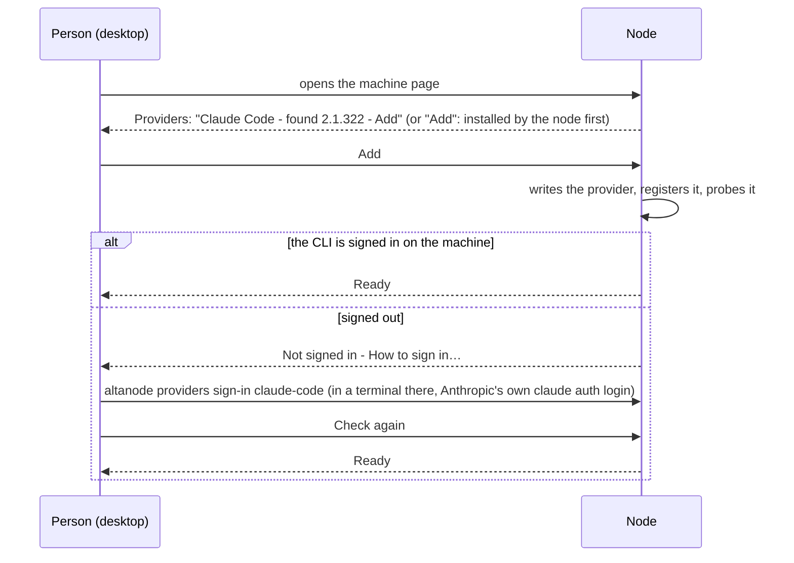

# Set up Claude Code and the other agent providers of a machine from the desktop (#414)

[#414](https://github.com/CodeAlta/CodeAlta/issues/414): someone with a server, a node and a desktop, and Claude Code installed and signed in on the node, could not start a session with Claude Code there. Claude Code was not in any list. An agent told them to write the provider into the node's `config.toml`; the node then showed **Not ready - The machine left it out: its log says why**, and **Sign in…** answered **This computer does not manage this machine**.

Reproduced on pc-ai (Linux, `systemd --user`, node 4.2.0) on 2026-11-11. Four gaps add up:

| # | Gap | Where |
|---|---|---|
| 1 | **Add a provider…** offers only the types that take a key or a device code: `claude-code`, `codex-cli`, `mistral-vibe` and the ACP agents of plugins cannot be added. A node creates no provider by itself, even with `claude` on its `PATH`; `altanode` has no provider command | `NodeProviders.OfferedTypes` ([NodeProviders.cs](../../src/CodeAlta.Node/NodeProviders.cs#L32)) |
| 2 | A `config.toml` edited by hand is read by the page but not by the runtime until the node restarts. The page then says "its log says why" for a log that says nothing | `NodeProviders.Describe` (no runtime state → `skipped`), `machineManagement.ts` |
| 3 | A computer that does not manage the machine (reached through the server, or paired without `--manage`) sees **Sign in…** and **Add a provider…** enabled; they fail after the click | `FleetNodeService` (`PairedOnly`), `MachineSignIns.tsx`, `MachineProviders.tsx` |
| 4 | The node speaks as the desktop: a signed-out Claude Code says "Run `claude` in a terminal… CodeAlta does not handle the credentials of Claude Code", beside a **Sign in…** that does exactly that. The sign-in looks for `claude` on `PATH` only, where sessions also look in the folders of its installers and in the CLI CodeAlta pins, which the desktop downloads on first use and a node never does | `ClaudeCodeModelProviderRuntime` probe message, `NodeSignIns.FindClaude` ([NodeSignIns.Claude.cs](../../src/CodeAlta.Node/NodeSignIns.Claude.cs#L122)) |
| 5 | The type of a new provider is a plain drop-down of names, without the icons the desktop shows everywhere else for providers, and a long list of look-alike names | `MachineProviders.tsx` (`HTMLSelect` of `view.types`) |

Also seen on the way:

- The page link of the sign-in dialog is a plain `<a target="_blank">` ([MachineSignIns.tsx](../../src/CodeAlta/frontend/src/machines/MachineSignIns.tsx#L153)); the host cancels new windows (`NewWindowRequested` → `Cancel` in `DesktopApplication.cs`), and clicking it showed a warning instead of opening the page.
- `NodeProviders` counts `mistral-vibe` as a CLI type; it is an HTTP provider that signs in with the Vibe console in the browser and runs no CLI.
- After `apt` replaced the .NET runtime (10.0.15) under the running node, every connection to the server failed with `Could not load file or assembly 'System.Net.WebSockets.Client'` until the service was restarted by hand.

## What the person does once this is done

From the composer, **Run on: pc-ai** with no provider ready shows **Set up a provider on pc-ai…**, which opens that section of the page. Nothing in the flow needs `config.toml`. Claude Code is the exception for the terminal: it signs in on the machine itself (see "Claude Code signs in on the machine" below).

## Decisions

- **One way to install and update every agent.** Each provider that runs a program is installed and kept up to date by the node itself, the same way, with the same progress on the page: Claude Code (`ClaudeCodeCliInstaller`, the version CodeAlta pins), Codex CLI (`CodexAppServerInstaller`, the pinned app-server), and the agents of the ACP registry (`AcpAgentInstaller`: a binary of the registry, or the `npx`/`uvx` runner it names). A pinned CLI follows the version of CodeAlta: a node updated to a release that pins a new version downloads it before its next session, then removes the versions no longer used. A registry agent shows **Update to {version}** when the registry has a newer one. A CLI the person installed is still used when the provider's `command` names it. Mistral Vibe runs no program and needs no installer. These installers sit behind one contract of the node (state, progress, install, update, remove), so the page has one component for all of them, and the desktop's own first-use download of Claude Code moves to it too.
- **Detected, offered, not added by itself.** A node lists the agents it finds (Claude Code, Codex CLI, Mistral Vibe, the ACP agents of its plugins whose command is found) as **Available** in its Providers section, each with **Add**. It never adds one silently: a subscription of the owner must not appear for the people of a shared machine without the owner's choice ([security](../../site/docs/fleet/security.md), "a personal plan serves its owner only"), and an agent found on `PATH` may not be the one the person wants.
- **One picker of types, with their icons.** **Add a provider…** opens a picker, not a drop-down of names: each type with its icon (`ProviderIcon`/`BrandIcon`, as in Settings > Providers), its name and one line of what it needs (an API key, a sign-in, nothing), grouped as the desktop groups them (agents, subscriptions, API keys, local models), filterable by typing. The agents of the ACP registry come from the same catalog as the desktop's (`ProviderCatalogDialog`), with their icons, read from the node so that it lists what runs there. The type decides what follows the add: install if needed, then a key field, a device code, the agent's sign-in, or nothing.
- **ACP agents get the same experience as the built-in agents**: found, installed and updated by the node, their sign-in on their provider row (an API key typed on the desktop and kept as a secret of the node, or the sign-in the agent declares), and a reason in words when one cannot run on the machine (no `node` for an `npx` agent, no build for its platform).
- **A change of `config.toml` applies without a restart.** The node watches the file (debounced) and applies the providers that changed, as a change from the desktop does (`NodeProviders.Reconcile`).
- **Only a computer that manages the machine changes its providers and signs it in**, as today (agreed for 4.3.0: managing through the server would change the security model). A computer that does not sees the same rows, read only, and one line that says how to get the permission: `altanode pair --manage` on the machine, then **Pair a machine…** here.

## Steps

### Phase 1 - Say the truth (small, first)

- [x] 1. Claude Code on a node: its signed-out message names the way of the node ("Not signed in: use Sign in… on the page of the machine"), not a terminal, when the provider runs in a node. The desktop keeps its message.
   > **As built.** `ModelProviderRegistry.CliSignInHint`, set by the node host (`CodeAltaHostOptions.CliSignInHint`), reaches `ClaudeCodeModelProviderRuntimeOptions.SignInHintOfHost`: the probe and a turn that fails say "not signed in on this machine" and where to sign it in, never a terminal.
- [x] 2. `NodeSignIns.FindClaude` resolves `claude` as a session does (`ClaudeCodeInstalledCli.Resolve(command, pinnedRoot)`: the provider's `command`, then the pinned CLI, then the installed one), so that the sign-in and the sessions run the same executable.
   > **As built.** Through `ConfiguredClaudeCodeCli.ResolveExecutable`, the facade of Hosting.
- [x] 3. A provider of the configuration with no runtime state says why: "Added to the configuration; the node applies it…" while a reload is pending, the real reason of the builder when it was refused (`issued` messages kept per provider), never "its log says why" without a log line. Each refusal is logged with the provider key.
   > **As built.** New reason `pending` (its configuration composes, the node has not applied it yet), `secret_missing` for a `${secret:NAME}` of its environment the machine lacks, and "The machine cannot start it with its configuration." otherwise.
- [x] 4. A computer without **Manage**: **Add a provider…**, **Sign in…**, **Add its key…** are disabled with the reason and the way to get it (a machine reached through a server: pair it directly with `--manage`). The `PairedOnly` error says "This computer is not paired with the machine to manage it" instead of "Only a device paired with the node may do this".
   > **As built.** The gate is `machine.paired`: a computer that reaches the machine through a server sees the rows with the actions disabled and one line with `altanode pair --manage`. The node's own refusal says the same.
- [x] 5. `mistral-vibe` leaves `CliTypes`: it is a sign-in provider (its browser sign-in already runs on the node).
- [x] 6. The page link of every sign-in dialog opens in the browser of the computer through the host (the opener the Markdown links use), not `target="_blank"`. Find what the warning was (console of the window) and cover it with a browser test.
   > **As built.** The host refuses new windows (`NewWindowRequested` → `Cancel`), which was the warning: the link now calls `machines.openSignInPage` (https only), and the page of a code to paste back (Claude Code) opens at once, as the user guide already said.

### Phase 2 - One installer contract for every agent

- [x] 7. A contract of the node for the programs its providers run: for a provider type (and an ACP registry id), its state (`missing`, `installed {version}`, `update {version}`, `installing {received}/{total}`, `failed {reason}`, `unsupported {reason}`), `install`, `update`, `remove`. Implemented over `ClaudeCodeCliInstaller`, `CodexAppServerInstaller` and `AcpAgentInstaller`, without changing where each keeps its files.
   > **As built.** The contract is the one plugins already share, `IPluginProviderCatalog` (Codex CLI, ACP registry), with Claude Code's pinned download beside it in `NodeProviders.Programs.cs`; node API `control.providers.offers`, `add`, `update`, `operation.wait` (polled like the sign-ins). No `remove`: a provider is turned off or its section deleted.
- [x] 8. Pinned versions follow CodeAlta: after an update of the node, the pinned CLIs of its configured providers are downloaded before their next session (while it is idle), and the versions no longer pinned are removed once no session runs them. A registry agent compares its version with the registry's and offers **Update**.
   > **As built.** Only where a pinned version was installed before (`FollowPinnedVersionsAsync` at the start of the node), so that a first install stays the person's choice; the providers that run it start again once it is there. **Deviation:** older versions are not removed: the cache is shared with the other CodeAlta of the profile (the desktop on a workstation that is also a node), which may still run one (review).
- [x] 9. The page shows the state of the program of each provider on its row: version, **Install**, **Update to {version}**, progress, and the reason when it cannot run there. The desktop's own Claude Code first-use download (`ClaudeCliFirstUse`, `ConfiguredClaudeCodeCli`) and the Codex CLI download use the same component, so that a computer and a machine look and behave the same.
   > **As built.** `ProgramProgress` draws the progress of the machine page with the painted bar and the style of the desktop's own Claude Code download (`provider-claude-cli-progress`), so a computer and a machine look the same. **Deviation:** the desktop's first-use downloads keep their own code paths (they run in the desktop, not through the node API); only the visual is shared.

### Phase 3 - Add any provider from the page

- [x] 10. The node lists the provider types it can run: the built-in types (`OfferedTypes`, plus `claude-code`, `codex-cli`, `mistral-vibe`), the types of its plugins (`PluginModelProviderTypes`), and the agents of the ACP registry it can run, each with how it gets its credential and the state of its program (step 7). `FleetProviderType` gains these fields and an icon key; the list stays bounded.
   > **As built.** `FleetProviderOffer` (a new list, so that an older desktop keeps reading `Types`), with the program and an icon SVG the desktop sanitizes.
- [x] 11. The type picker of **Add a provider…**: a dialog with a filter, groups, and one row per type with its icon, name and need, in place of the `HTMLSelect`; the ACP rows reuse the catalog of `ProviderCatalogDialog`. The same picker serves the desktop's Settings > Providers where it lists types, so that the two do not drift. Checked in both themes and at 900×650.
   > **As built.** `ProviderPicker` on the machine page: groups, filter, icons (`ProviderIcon`, the registry's SVG), what each needs and installs, why one cannot run there. Checked against pc-ai in the developer instance. **Deviation:** Settings > Providers of the desktop keeps its own menu, which already shows the icons of the built-in types and of the catalogs; the picker reads offers of a node, the menu the desktop's own catalog.
- [x] 12. `control.providers.set` accepts those types: a built-in CLI type is written as a provider of `config.toml`, a plugin or ACP type as an external provider (`SaveGlobalExternalProvider`), its program installed first when missing (step 7), then applied and probed (`ApplyNow`, `PrepareAsync`).
   > **As built.** Through `control.providers.add`; `control.providers.set` also takes `claude-code`, `codex` and `mistral-vibe` now.
- [x] 13. **Available** rows: the agents found on the machine and not configured, each with its icon and **Add** (one click: the default key, enabled). After the add, the row becomes the provider, and its state decides the next action inline: **Install**, **Sign in…**, or nothing when it is ready.
   > **As built.** The picker is where they are found: an agent installed on the machine says "Found on the machine"; no separate rows on the page. After the add, the row shows its program and the next action (**Install**, **Update to**, **Sign in…**).
- [x] 14. The sign-in of a provider is on its provider row (Claude Code: how to sign in on the machine, Codex CLI device code, Mistral Vibe browser, an ACP agent's key or its declared method); Sign-ins keeps MCP servers and tools, and lists providers only as a summary.
   > **As built.** A provider not ready with a sign-in of the machine gets **Sign in…** on its row (Claude Code: **How to sign in…**), and adding one opens its sign-in at once. **Deviation:** the Sign-ins section still lists the providers: it carries **Sign out** and serves older nodes, whose offers the row cannot read.
- [x] 15. Composer: when the machine chosen in **Run on** has no provider ready, the disabled **Start session** comes with **Set up a provider on {machine}…**, which opens the machine page at Providers. The provider picker of a machine shows each provider with its icon, and those not ready disabled with their reason.
   > **As built.** The new-session page says the machine has no provider ready and links to it with **Set up a provider on {machine}…** (`offersProviderSetup`). **Deviation:** the model picker of the composer is unchanged: it already shows the icons of the providers, and lists only those a machine can run.

### Phase 4 - Reload, terminal, recover

- [x] 16. The node watches `~/.alta/config.toml` and applies the providers whose definition changed (added, changed, removed), through the same path as the desktop's changes. A file that does not parse leaves the running providers as they are, and the page says the configuration has an error, with its line.
   > **As built.** Each `[providers.*]` section is compared with what was applied (`CodeAltaConfigStore.ReadProviderSections`); the node's own writes are remembered so they are not applied twice. The list says the error while the file does not read.
- [x] 17. `altanode providers` for a person in a terminal on the machine: `list` (state, reason, program version), `add <type>` (installs its program), `update [<key>]`, `sign-in <key>` (Claude Code: runs its own `claude auth login` in the terminal, CodeAlta keeps nothing), `remove <key>`. It talks to the running node through its local control, so the change applies at once.
   > **As built.** `list`, `available`, `add <what>`, `update <key>`, `sign-in <key>` (device code, code to paste, or a key read from the terminal; a browser sign-in is left to the desktop). No `remove`, as the node API has none.
- [x] 18. A node whose shared .NET runtime was replaced under it (a `FileNotFoundException`/`FileLoadException` for an assembly of the framework) logs it once and exits with the code its service restarts on, after its sessions are idle, rather than failing every connection until someone restarts it.
   > **As built.** Already on main before this work (`ccf090c21`, `UpdateRuntimeFiles`): nothing to add here.

### Phase 5 - Documentation and verification

- [x] 19. `site/docs/fleet/machines.md`: the Providers row of the machine page and a short "Use an agent on a machine" section (add, install and update, sign in, who may). `doc/fleet/node.md`, Credentials on a node: providers detected and offered, programs installed and updated by the node, the configuration watched. The desktop's provider pages say the same of the installer when it moves (step 9).
   > **As built.** `machines.md`: "Give it providers", the Providers row, Claude Code in the sign-in table, the paired-only rule. `doc/fleet/node.md`: "The providers of a node and what they run" and the Claude Code row of the credentials.
- [x] 20. Tests: the installer contract over fakes of the three installers (install, update after a pin change, removal of old versions, unsupported platform); node types and add for each kind (key, device code, Claude Code, Codex CLI, ACP binary and `npx`); the reload of a changed `config.toml`; the Claude Code sign-in with the fake CLI on the resolved path; browser tests of the type picker (icons, filter, groups), the Available row, inline **Install** and **Sign in…**, the read-only page of a computer without Manage, the page link, and the composer action.
   > **As built.** `NodeProviderProgramsTests`, `NodeProviderStatusTests`, `NodePluginSignInTests`, `NodeCliSignInTests`, `MachineSignInPageTests`, the Claude Code session and provider tests; browser tests of the picker, Claude Code's help, a relayed machine and an older node in `machinePage.browser.test.ts`; `providerOffers`, `machineManagement` and `runOn` unit tests. No test of the removal of old versions (not done, step 8).
- [x] 21. Live check on pc-ai (Linux, `systemd --user`), the Mac (LaunchDaemon, no keychain) and a Windows node: from a fresh profile with no `config.toml` and no agent installed, reach a ready Claude Code, Codex CLI and one ACP agent and run a session on each, without SSH; then update the node and see the pinned CLIs follow. Then the same machine reached only through the server: the page is read only and says how to manage it. Then an edit of `config.toml` by hand applies without a restart.
   > **Done on pc-ai (branch node, 2026-11-11):** the node installed Claude Code 2.1.322 from the page; the owner signed it in with `altanode providers sign-in claude-code` over SSH; the provider became Ready with no token in CodeAlta's configuration or secrets; a hand edit of `config.toml` applied without a restart; the picker listed agents, subscriptions, keys and model servers with their icons. **Open:** a turn on pc-ai stops at the sandbox: `bwrap` has its AppArmor profile there, but the proxy of the `node` profile makes its namespaces with util-linux `unshare` (mxc's pre-flight `unshare --user --map-current-user --keep-caps --net`), which Ubuntu 24.04 refuses without a profile of its own; the owner sets it up with `sudo`. The node now detects it (`LinuxNetworkNamespaces`), the machine page and `altanode status` say the sandbox cannot run with the command to run, and the user guide has "Set up the sandbox on Linux". With the profile of `unshare` added, a Claude Code turn ran there in the sandbox `node` and reached github.com through the proxy. The owner closed the work without the Mac and Windows checks and without Codex CLI and an ACP agent end to end.

## Review (Codex GPT-6.1 Sol, max)

13 findings on `88b65c2f4`, all addressed in the next commit: the error of a configuration file that does not read gives its line and column, never its text (a key typed in a broken line); the watch never ends the process and keeps the last working providers when the typed configuration refuses a value; no deletion of older pinned versions; a key typed in `altanode providers sign-in` is read without echo; a provider of a plugin edited while it is prepared is registered again once it can be (retried); the providers that run a pinned program start again once it was downloaded; an update re-reads the provider before it writes; the node remembers only the section it wrote itself; the picker falls back to the types of an older node; keys and operations are chosen and kept under one lock; an installation failure stays on the page; the ACP version is read from `agent_version`.

## Claude Code signs in on the machine (decision of 2026-11-11)

Claude Code's terms (code.claude.com, Legal and compliance; Consumer Terms §2 and §3.7) forbid a third party to "collect, store, or intermediate Claude.ai credentials or session tokens", and allow a person to sign their own unmodified Claude Code in with their own subscription. The owner chose the safest reading: CodeAlta no longer runs `claude setup-token`, relays the code or keeps the token. The person signs Claude Code in on the machine with `altanode providers sign-in <key>`, which starts `claude auth login` of the Claude Code the node runs, in their own terminal; the page of the machine gives these steps, with the command to copy and **Check again**. A token an older version kept still works until its Sign out removes it. A subscription is never propagated beyond the person's own machines; machines run for others use API or gateway keys the server lends.

## State left on pc-ai

The branch node runs from `~/altanode-dev` (port 2585, started by hand, so not after a reboot); the `altanode` service of `systemd --user` is stopped. `~/.alta/config.toml` holds `[providers.claude-code]`, signed in with the owner's Claude account by Claude Code itself. Restore with `systemctl --user start altanode` once a release with this work is installed there.