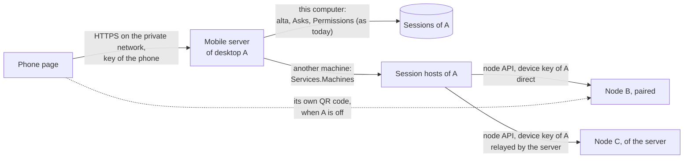

# The phone page on CodeAlta Node, and several machines from one phone page

Today the phone page exists only where CodeAlta Desktop runs, and shows the sessions of that one computer. A headless
machine cannot offer it ([#456](https://github.com/CodeAlta/CodeAlta/issues/456)), and a person with two machines needs
two browser tabs and two pairings.

Once this is done:

- **A node serves the page.** `altanode mobile` shows a QR code; the phone opens the sessions of that machine, as it
  does with a desktop. No window, no virtual display.
- **One page, several machines.** The phone connected to a desktop also shows the machines that desktop reaches: the
  ones it is paired with, and the ones of its server. One list, a chip per machine, the same session page.
- **A node can still be opened on its own**, with its own QR code, when the desktop is off.

| Host | Serves the phone page | Why |
| --- | --- | --- |
| CodeAlta Desktop | Yes, as today, plus the other machines | It is the person's device, and already reaches them |
| CodeAlta Node (`altanode`) | Yes, its own sessions | It owns a profile and stays on |
| CodeAlta CLI (`altacli`) | **No** | It takes no profile lock, keeps an ephemeral state and ends with its prompt: there is nothing to serve between two runs |

## What changes



The phone never reaches machine B by itself through A's page: A's server does, with the session hosts the window
already uses for remote sessions, so B applies to the phone exactly what it applies to A's window.

### 1. The Mobile plugin runs on a node

Its server, its pairing, its `alta` calls and Web Push need no window. What keeps it off a node today:

| What blocks | What the plan does |
| --- | --- |
| The plugin declares the desktop alone | `PluginFrontends.Node`; a node host starts the plugins that declare `Node` or `Cli`, so the others are unchanged and `altacli` never starts Mobile |
| A node gives its plugins no-op services | `NodePluginServices`: the `alta` bridge, the private networks (`PrivateNetworkRegistry`, a shared library), the page files, and, for `builtin:mobile` only, Asks and Permissions over the objects the node API answers with |
| The page is built with the desktop, and a node has no page | The files of the phone page are taken out of the one build of the frontend and packed in `altanode` as `mobile-page/`, with the list of its files |
| The plugin needs the ASP.NET Core runtime (`Microsoft.AspNetCore.App`), which `altanode` does not need today | `altanode` takes it as a prerequisite: the self-contained archives carry it, the tool package and the SSH setup of the desktop check it and say what to install |
| Nothing turns a built-in plugin on or off on a node | The node does it itself (`control.mobile.enable` writes the setting and applies it with `ApplyBuiltInAsync`), since a plugin that is off cannot hear the request |

Mobile stays off until it is turned on, as on the desktop. Agents of a node still cannot ask questions or request reviews (`ask` and `review` stay out of `NodeBuiltInRoots`): the phone of a node answers permission requests.

**A session the phone starts or prompts on a node is admitted as the work of a paired device is**: the policy of the
machine, a worktree of its own, the record of whose work it is, budgets and seats. Those checks live in the node API
handlers today (`FleetNodeService.Commands.cs`); they move behind one seam that the node API and the phone both call, so
the phone is not a way around them.

**A node other people use does not serve the page.** A phone gets what the owner of the profile has, with no person
attached to it. So a node that lets other people in (a team machine, a person it invited) refuses to turn Mobile on, and
turns it off when it becomes one.

### 2. Connecting a phone to a node

Without a window, the QR code is shown in the terminal, or by a desktop that manages the node:

```console
$ altanode mobile on
Mobile: served at https://mac-mini.tail1a2b.ts.net:2584 through Tailscale.
Scan this code with the phone within 5 minutes:

  █▀▀▀▀▀█ ▄▀ ▄█ █▀▀▀▀▀█
  █ ███ █ ▀█▄▀  █ ███ █
  …
1 phone connected. `altanode mobile reset` disconnects every phone.
```

| Command | What it does |
| --- | --- |
| `altanode mobile` | The state, the address, a new QR code, or what keeps phones out and how to fix it |
| `altanode mobile on \| off` | Turns the plugin on or off on this node |
| `altanode mobile set [--network tailscale\|devtunnel] [--port n] [--https-port n]` | The settings of **Settings > Extensions > Mobile** |
| `altanode mobile reset` | **Reset access** |

They go through the node's local control, as `altanode pair` does, so they need its listener (a node started with
`--no-listen` says so). One method, `control.mobile.invoke`, carries the calls the Mobile tab already makes
(`mobile.status`, `mobile.retry`, `mobile.act`, `mobile.settings.get`, `mobile.settings.set`, `mobile.reset`). A
desktop paired with **Manage it from this computer** calls the same method: the page of the machine gains **Connect a
phone**, which draws the Mobile tab of that node.

**Who can get a pairing code.** On the desktop the code exists only in the window, so no program can read it. On a
node it is printed by a command, which any process of that OS user can run. The plan keeps that honest rather than hide
it:

- The code of a node is good for one phone and for five minutes, never the standing code a desktop shows.
- It is never an `alta` command, and the port of the page joins the ports a sandboxed session cannot reach
  (`ReservedLocalPorts`, on the desktop too, where only 2582 and 2583 are reserved today).
- A session in the `node` sandbox profile, the default of a node, can neither read the device key nor reach the local
  control: tests try to pair and to allow a request from such a session, and must fail.
- A session that runs without a sandbox on a node already holds everything its OS user holds, the device key included;
  the user guide says so, as it does for `altanode pair`.

### 3. Other machines on the phone

A session of another machine is named **with its machine**: an id alone is not enough, since a moved session exists on
two machines, and the registry gives a session two machines list to neither.

```http
GET  /api/machines                                  → { machines: [{ id, name, this, state, path, can, features, waiting }] }
GET  /api/sessions?machine=all|<id>                 → each session carries machineId and machine
GET  /api/sessions/{id}/…                           → this computer, as today (old links keep working)
GET  /api/machines/{machineId}/sessions/{id}/…      → the same routes, for a session of that machine
POST /api/machines/{machineId}/sessions             → a new session there
```

A session this computer gave away says where it went, with a link that opens it there. A machine is asked for a session
it did not list yet (its cached list holds 200), and an ambiguous owner is refused, never guessed.

The plugin reaches another machine through one new service, given to the built-in Mobile plugin only:

```csharp
/// The machines this computer reaches, and their sessions, for the person.
public interface IPluginMachineService
{
    bool HasMachines { get; }
    ValueTask<IReadOnlyList<PluginMachine>> ListAsync(CancellationToken ct = default);
    ValueTask<PluginMachineSessionPage> ListSessionsAsync(string machineId, PluginMachineSessionQuery query, CancellationToken ct = default);
    // A read of one session, answered with the records `alta session …` gives on that machine.
    ValueTask<PluginAltaCommandResult> ReadAsync(string machineId, PluginMachineRead read, CancellationToken ct = default);
    ValueTask<PluginMachineCommandResult> SendAsync(PluginMachinePrompt prompt, CancellationToken ct = default);   // send, queue, steer
    ValueTask<PluginMachineCommandResult> AbortAsync(string machineId, string sessionId, CancellationToken ct = default);
    ValueTask<PluginMachineSession> CreateSessionAsync(PluginMachineNewSession request, CancellationToken ct = default);
    IAsyncEnumerable<PluginMachineChange> WatchAsync(CancellationToken ct = default);
}
```

**Writes are the node API as it is** (`sessions.send`, `queue`, `steer`, `abort`, `create`, asks, permissions), with a
retry key per request of the phone.

**Reads get one new method of the node API, `sessions.read`.** The phone page is built on the records of
`alta session events`, `tail`, `status`, `tool`, `image`, `queued`, `choices` and `alta job`, which count in sequence
numbers, where `sessions.history` counts in byte cursors of one revision of the journal. Rather than map one onto the
other for every read, the machine that owns the session runs the read and returns its records. The request is typed:
the machine builds the command, the caller never sends arguments.

```jsonc
{ "sessionId": "0193…", "read": "events", "since": 120, "limit": 50 }
{ "sessionId": "0193…", "read": "tool", "activityId": "…", "outputOffset": 0, "maxOutput": 32000 }
{ "sessionId": "0193…", "read": "image", "imageId": "…", "offset": 0 }      // 1 MiB at a time: a frame holds 4 MiB
{ "sessionId": "0193…", "read": "job", "jobId": "…", "output": true }       // refused unless the job is of that session
→ { "records": [ { "type": "alta.session.event", … } ], "truncated": false }
```

- It needs `view`, and passes the checks of `sessions.history`: own sessions only on a team machine, content grants,
  Private sessions, spaces. Each read registers its parameters with those checks (`SessionIdOf`), and a job is checked
  to belong to the session.
- What `view` gains: the prompts that wait in a queue, the images a session keeps, and job output. Tool output is
  already in `sessions.history`. The security page says it.
- Sub-agents are read from the list (`ParentSessionId`), not from `alta session children`, which checks nothing of the
  fleet.

**Live state and notifications.** The phone's dots, lines and notifications are fed by the agent events of this
computer. For another machine, the desktop turns what it already follows into the same records: the state of each
listed session (`working`, `waiting`, `idle`) for the cards and for notifications, and the display of the one session a
phone has open for its line. A reconnection takes the state it finds as a baseline and notifies nothing for it; a
transition is notified once, by machine, session and time.

**Questions, reviews and permission requests.** `FleetAsk` carries no kind and no revision today, and the remote
permission record drops details (outside the sandbox, a shortened command, a skill). Both gain those fields, which older
machines do not send. The phone then answers the plain questions and the permission requests of another machine, and
shows a review request as **Review it on a computer**: an ask whose kind is not known is never offered as a question.

**On the phone** (`src/CodeAlta/frontend/src/mobile`):

- The line that names the computer becomes a chip. It opens **Machines**: **All machines**, this computer, each
  machine with its state (online, offline with when it was last seen, not allowed), **direct** or **relayed**, and how
  many of its sessions wait for you.
- **All machines** is the list when there is more than one: latest activity first, a machine chip on the cards of the
  other machines. A sub-agent on another machine still folds under its parent.
- A session of another machine has the same page, with its machine in the header. What that machine does not offer is
  not shown, rather than shown and refused.
- **New session** starts with **Run on**; the projects, providers and models are those of that machine (`node.info`).

| On a session of another machine | First version |
| --- | --- |
| List, timeline, tool calls with their output, images of the session, live state, background jobs and their output | Yes |
| Send, queue, steer, stop; model and effort of the next prompt; questions and permission requests; new session; notifications | Yes |
| Review requests | No: **Review it on a computer** |
| Files and photos with a prompt; files and pictures of the disk a message links | No (the node API has no attachment or file read yet) |
| Stop a job, archive and restore, take a queued or steered prompt back, change the provider | No (later, one node API method each) |

### 4. Who the phone is on another machine

The phone has no key of the fleet. It holds the key A gave it, and **A acts for it with A's device key**: machine B
sees desktop A, checks A's permissions (`view`, `drive`, `start`), and records A. Nothing new is trusted, and nothing
is relayed that A's window could not do.

- **A lost phone reaches more.** So the other machines are shown only once **Show my other machines on the phone** is
  turned on (the Mobile tab and its settings), which says that it lends the phone what this computer reaches.
  **Reset access** cuts the phone from all of them at once.
- **Machines are not transitive.** The phone sees the machines A reaches, never the machines B reaches.
- **A node shows its own sessions only.** A node is an execution node, not a person's controller device.
- **Spaces.** With the plugin limited to spaces, every read of another machine is kept to those spaces: sessions,
  options, asks, images and notifications. A session whose space cannot be matched is not shown. A change of the
  spaces, or of the setting above, ends the open streams and drops the notifications that wait.

## Steps

**Part 0: what the rest stands on**

- [x] 1. The page files of a node come out of the one build of the frontend: `frontend/scripts/mobile-page.mjs` copies `mobile.html` and what it reaches (129 files, 4.4 MB) with `files.json`. **Changed from the draft:** no second Vite build. `npm ci` needs the generated client package whatever is built, and two builds at once would write the same `node_modules`; `MobilePage.targets` asks the desktop project for its frontend target instead, the way its own per-runtime builds do, so MSBuild runs it once. The node references no assembly of the desktop.
- [x] 2. The ASP.NET Core runtime on a node: `CodeAlta.Node.csproj` and its packages, the check of `altanode` at start, the SSH setup of the desktop (**Add a machine**), `doc/fleet/deployment.md`; `altanode run` started on a machine that has the runtime alone.
- [x] 3. The port of the page is reserved from sandboxed sessions (`ReservedLocalPorts`, in `DesktopApplication` and `NodeHost`, following the setting); tests that a session in the `node` profile reads neither the device key nor the listener file, and reaches neither the control port nor the page.
- [x] 4. `sessions.read`: contract (`FleetNodeContracts.cs`), typed reads and the command each builds, handler in `FleetNodeService` with `Access.View`, `SessionIdOf` and the content-grant list extended for it, the job checked against its session, image chunks, output bounds; announced as a feature; `FleetNodeClient.ReadAsync`. Tests through the multi-host harness: an unknown read, a session of another person, a Private session, a job of another session, a device without `view`, a grant that expires, an older node.
- [x] 5. `FleetAsk` gains its kind and its response revision, the permission record its details (additive); `RemoteSessionHost` reads them; an ask without a kind is not answerable.
- [x] 6. The admission of a person's work as one seam in `src/CodeAlta.Fleet` (from `FleetNodeService.Commands.cs`: policy, worktree, work record, environment, budgets, seats), called by the node API handlers unchanged in behavior; the existing tests of the node API pass as they are.

**Part 1: the phone page on a node** (closes #456)

- [x] 7. `PluginFrontends.Node` and `Supports` (`src/CodeAlta.Plugins.Abstractions/PluginFrontends.cs`); `NodeHost.CreateHostOptions` reports `Node`; every reader of `Host.Frontend == Cli` checked; `PluginFrontendTests`.
- [x] 8. `src/CodeAlta.Plugin.Mobile/MobilePage.targets` runs the build of step 1 incrementally and copies it to `mobile-page/` of the output and of every package; `CodeAlta.Node.csproj` imports it. `FolderPluginAppFiles : IPluginAppFileService` in `src/CodeAlta.Plugins` serves only the files `files.json` lists.
- [x] 9. `NodePluginServices` (`src/CodeAlta.Node/Plugins/`): `alta` bridge (`PluginAltaServiceBridge` over `NodeHost.Alta`), private networks, page files, Asks and Permissions for `builtin:mobile` only; a folder plugin gets the no-op ones (test).
- [x] 10. Mobile among the built-ins of the node (`NodeBuiltInPlugins`, off by default), declared `Desktop | Node`. On a node its new sessions and prompts go through the seam of step 6, always in a worktree of their own.
- [x] 11. Turning it on and off is the node's: `control.mobile.enable` persists the setting and calls `ApplyBuiltInAsync`; refused, and turned off, on a node that lets other people in. Tests: a restart, safe mode (`--no-plugins`), a start that fails, turning it off while a phone reads.
- [x] 12. `IMobileHostControl.InvokeAsync(method, payload)` in the plugin, one implementation for the tab, the settings page and the host. `control.mobile.invoke` in `FleetNodeService`: the owner's local control and a device that manages the node **by pairing**; its pairing code is for one phone and five minutes. Tests of who is refused.
- [x] 13. `altanode mobile`, `on`, `off`, `set`, `reset` (`NodeCommandLine.cs`, `NodeClientCommands.cs`): the QR code drawn from the rows of `MobileStatus.Qr`, the states of the network with their fix, and what a node without a listener says.
- [x] 14. Desktop: **Connect a phone** on the page of a machine (`frontend/src/fleet/console`, `Desktop/Fleet`): the Mobile tab component over `control.mobile.invoke`, for a machine managed by pairing; component and browser tests.
- [x] 15. Packages: npm in the pack job of `CodeAlta.Node` (`.github/workflows/ci.yml`, `src/dotnet-releaser.toml`); `mobile-page/` in the tool package and in each runtime package; their size under the limit of nuget.org.

**Part 2: other machines on the phone**

- [x] 16. `IPluginMachineService`, its records and its no-op in `src/CodeAlta.Plugins.Abstractions`; `IPluginMachineRuntimeService.ForPlugin` gives it to `builtin:mobile` only; XML docs.
- [x] 17. `DesktopPluginMachines` (`src/CodeAlta/Desktop/Fleet/`) over `DesktopFleet.Hosts`: machines with state, path, permissions and features; sessions by page, asked of the machine past its cached list; `ReadAsync`; send, queue, steer, abort and create by `SessionReference`, never by id alone.
- [x] 18. Asks and permissions of other machines through the plugin services: `DesktopPluginAsks` and `DesktopPluginPermissions` take the machine of a session and route through the registry; reviews are reported as not answerable there.
- [x] 19. Changes of other machines (`WatchAsync`): the states of listed sessions, bounded and coalesced; the display of an open session; the baseline after a reconnection; what a revoked or narrowed pairing ends.
- [x] 20. Mobile plugin, reads: `/api/machines`, the machine-qualified routes, `MobileSessions` and `MobileAlta` with a machine, the merged list, the moved session that names where it went, features per machine and `409 not_on_this_machine`, the spaces rule on every read.
- [x] 21. Mobile plugin, writes: prompts, stop, new session, answers and permission answers of another machine, with their retry keys.
- [x] 22. Mobile plugin, live and push: `MobileLive` and `MobilePushEvents` take the changes of step 19; one notification per transition; the payload names the machine.
- [x] 23. The setting **Show my other machines on the phone** (`mobile.json`, settings page, Mobile tab), off at first; turning it off or changing the spaces ends the streams and drops waiting notifications.
- [x] 24. Phone page: `contract.ts`, the machine chip and sheet, the merged list, the header of a session, **Run on** in a new session, what a machine does not offer left out, an offline machine read-only with its last state, **Review it on a computer**; `fixtureServer.ts` with two machines; `mobileMachines.browser.test.ts`.

**Part 3: documentation**

- [x] 25. User guide: `site/docs/plugins/mobile.md` (a node, other machines, the security lines), `site/docs/fleet/machines.md` (connect a phone to a machine), `site/docs/fleet/security.md` (what `view` reads, who gets a pairing code on a node).
- [x] 26. Architecture: `doc/fleet/architecture.md` (the Mobile page row and the first diagram, stale today), `doc/fleet/node.md` (commands, `control.mobile.*`, the prerequisite), `doc/fleet/protocol.md` (`sessions.read`), `doc/fleet/security-and-privacy.md` (the phone acts as the device it is paired with), `doc/plugins.md` (the table, `Services.Machines`, the `Node` frontend), `doc/fleet/roadmap.md` (what M3c keeps).

**Changed from the plan, and left open** (review by Codex/GPT-6.1 Sol/Max, 2026-11-16):

- Other machines also take a change of provider, archive, restore, un-queue, un-steer and the stop of a job (`sessions.act`), which the plan kept for later.
- There is no check inside `altanode` for the ASP.NET Core runtime: the .NET host refuses the application before its code runs. The SSH setup and the staging of a self-update check it; a node older than that check rolls back without saying why.
- The choices of a new session are not filtered by the spaces of the plugin (task `53nb`), and a person of a team machine cannot start a session there from the phone (task `8t3b`).
- The review asked for more tests than exist: denied connections from a real sandboxed session (step 3), reads of another person's sessions and expiring grants (step 4), a session beyond the 200 of the cached list (step 17).

## How it is verified

- [x] `dotnet build -c <Configuration>` then `dotnet test -c <Configuration> --no-build` and `npm test` at the same time, and `lunet build` in `site/`: all pass.
- [ ] A node with a temporary `--data-root`: `altanode mobile on` prints an address and a QR code; the page lists its sessions, sends a prompt, answers a permission request, starts a session in a worktree of its own. The code is refused after one phone, and after five minutes. **Done in part:** `altanode mobile on` printed the address and the QR code on an isolated profile (a stand-in `tailscale`), the page signed in and went live, a second use of the code was refused, `mobile off` stopped serving; prompts, permission answers and worktrees are covered by `NodeMobileAdmissionTests`, not driven by hand.
- [ ] A session in the `node` sandbox on that node cannot pair a phone nor allow its own request; `altacli` on the same profile starts no Mobile server. **By tests only** (`NodeHostTests`, reserved ports): no connection was attempted from a real sandboxed session.
- [x] A node that lets another person in refuses `altanode mobile on`, and a node that takes one in stops serving. (`MachineMobileTests`, `NodeMobileAdmissionTests`.)
- [ ] The developer instance paired with the node, the setting on: the phone page of the desktop lists both machines, opens a session of the node, reads a tool output and an image of 8 MB, sends, steers, stops, allows a request, starts a session there. The same prompt sent twice with one retry key runs once. **Not exercised live:** covered by the fixture browser tests of the phone and the C# tests against a real node.
- [ ] A node reached **only through a server's relay**, never paired: the same, with **relayed** on its chip. **Not exercised live.**
- [x] The setting off: a session of another machine is unknown to the phone (404), its stream ends, no notification comes. (`MobileServerTests.Machines`.)
- [ ] The pairing of the desktop revoked on the node while the phone reads: the stream ends and the machine shows as not allowed. A desktop with `view` only: the phone reads, and every write is refused by the node. **By tests only** (`DesktopPluginMachinesTests`, `MobileServerTests.Machines`).
- [x] A session moved to the node: the old link says where it went and opens it there; the node stopped: its sessions stay listed with their last state, read-only. (`MobileServerTests.Machines`, `mobileMachines.browser.test.ts`.)
- [x] Both themes and a narrow screen for the machine sheet and the chips, through the browser tools.

## Decisions

| Decision | Choice | Why |
| --- | --- | --- |
| Where the phone page can be served | Desktop and Node, not `altacli` | Only the owner of a profile lock keeps sessions between two prompts |
| How the phone reaches another machine | Through the host it is paired with, over the session hosts and the node API | One remote protocol, one place that enforces access; works for relayed machines the phone cannot reach itself |
| Reads of a remote session | `sessions.read`: typed requests, the machine's own `alta` records as the answer | The phone counts in sequence numbers, the history in byte cursors; opaque results have a precedent (`FleetHistoryEvent`), an opaque command line would not be safe |
| Not a tunnel of the Mobile HTTP API to the other machine | Ruled out | A second remote API beside the node API, around the machine's rules for work from elsewhere |
| Not one page that calls several machines from the phone | Ruled out | Every machine published and paired with the phone, and no relayed machine |
| The identity of the phone | The device of the host it is paired with | No key in a browser to protect; the fleet device for phones stays with M3c |
| Naming a session of another machine | Its machine and its id | A moved session is on two machines; the registry refuses an ambiguous owner |
| Work the phone starts on a node | Admitted as the work of a paired device, always in its own worktree | Nobody sits at a node; its checkout is shared |
| A node other people use | Does not serve the page | A phone has no person attached to its key |
| ASP.NET Core on a node | A prerequisite of `altanode` | The plugin's server is Kestrel; a second server only for nodes is not worth it |
| Dev Tunnels on a node | Offered when `devtunnel` is already signed in on the machine; otherwise the command to run | Its sign-in opens a browser |
| When a phone sees the other machines | Only once **Show my other machines on the phone** is turned on (decided in review) | Phones connected before were told they reach this computer only |
| Questions and reviews on a node | Both stay off: `ask` and `review` are not added to `NodeBuiltInRoots` (decided in review) | The phone of a node answers permission requests only |
| A node as a gateway to other machines | Not in this plan (decided in review) | A node is not a person's controller device; it needs a delegation the fleet has not built |
| The pairing code of a node | Printed by `altanode mobile`, for one phone and five minutes, and shown by a desktop that manages the node (decided in review) | A node nobody paired a desktop with must still connect a phone |

## Risks

- **The phone reaches more machines than before.** Limited by the setting, by the permissions each machine gives the desktop's device, and by **Reset access**; the user guide says so.
- **A pairing code on a node is a command away** for anything that runs as its user without a sandbox. One phone, five minutes, and the sandbox tests bound it.
- **Version skew.** The page comes from A and the records from B. `sessions.read` and the new fields of asks are announced as features; a machine without them is listed with "update CodeAlta on this machine". Records are read as the node API is: unknown fields ignored, missing ones optional.
- **The seam of step 6 touches the admission of every remote session.** It is a move without a change of behavior, done before anything calls it from the phone, under the existing tests of the node API.
- **The node needs npm to build and a larger runtime to run.** The build is incremental and separate from `frontend/dist`; the prerequisite is checked at start and by the SSH setup.
- **Tailscale Serve under a service account** needs the operator right (`tailscale set --operator`); `altanode mobile` prints what the network says, with the fix.
- **Load.** Lists are read by page and states are coalesced; only the open session is watched, and offline machines are not asked.

## Out of scope

- `altacli` as a host of the page.
- The phone as a device of the fleet with its own key, a page served by CodeAlta Server, a signed mobile application.
- A node as a gateway to other machines, and a page of a node for several people (a key per person).
- Questions (`alta ask`) and reviews for the sessions of a node.
- Reviews, attachments and file reads on a session of another machine; moves from the phone; the remote editor and terminals.
- The fleet console on the phone (machines to manage, automations, statistics).
- The TUI.

<details><summary>Evidence</summary>

- `MobilePlugin` declares `Frontends = PluginFrontends.Desktop` and returns from `OnActivatedAsync` on any other host (`src/CodeAlta.Plugin.Mobile/MobilePlugin.cs`); its project references `Microsoft.AspNetCore.App`, which no project of the node does.
- A node composes its host with `PluginFrontend = Cli`, built-ins Git, Jira, MCP, ACP, Codex CLI and Statistics (`NodeHost.cs`, `NodeBuiltInPlugins.cs`), and sets no `PluginServices`, so plugins get `NoopPluginServices`.
- The node API already answers asks and permissions for paired devices (`FleetNodeService.Interactions.cs`); `FleetAsk(AskId, RunId, State, Questions)` has no kind and no revision.
- The page is a second Vite document (`vite.config.ts`, input `mobile`); `frontend/package.json` depends on `file:../obj/neoastra/client`, and `mobile/attachments.ts` imports `SessionPromptImage` from `#neoastra`.
- `altacli` (`src/CodeAlta.Cli/CliHost.cs`) takes no `alta.lock`, uses an ephemeral state root, and has no listener.
- Remote sessions are a desktop seam: `ISessionHost`, `SessionHostRegistry`, `SessionReference(SessionId, MachineId)` (`src/CodeAlta/Desktop/SessionHosts/`), `RemoteSessionHost` (`src/CodeAlta/Desktop/Fleet/`), machines from `DesktopFleet.Hosts` (paired, and those of the linked servers, direct first, then relayed). `SessionHostRegistry.Resolve(sessionId)` gives a session two machines list to the local host.
- A remote session today: list, history windows, live display, send, queue, steer, abort, asks, permissions, create. Not: attachments, tool output, jobs, archive, file reads.
- Only ports 2582 and 2583 are reserved from sandboxed sessions (`SessionRuntimeService.SandboxTools.cs`).
- `NodeFleet` writes `fleet/node-listener.json`, which the local control reads, only when the node listens.
- No node API method lists the machines another machine reaches, and a node has no relay client: reach is not transitive.
- `doc/fleet/security-and-privacy.md`: in Private spaces the phone's page comes from a machine the person owns, never from the server. This plan keeps that rule.

</details>

<details><summary>Review by a second model</summary>

A read-only session on `codex:gpt-6.1-sol@max` reviewed the first draft. What it changed here: `sessions.read` typed, with every resource checked, in place of a list of commands with arguments; the pairing code of a node and its limits; a node other people use; the machine in the name of a remote session; live state, notifications, asks and reviews as steps of their own; the page build without the desktop's generated client; the ASP.NET Core runtime; the admission seam for work the phone starts on a node; the node turning the plugin on and off itself. It agreed with leaving `altacli` and the node gateway out.

</details>