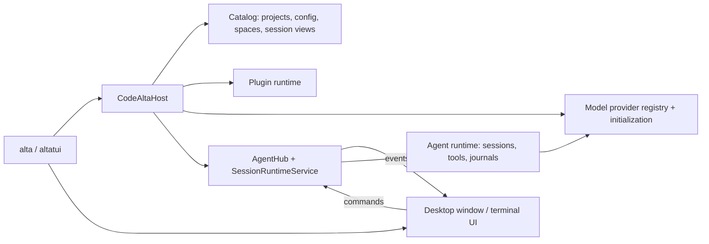

# Architecture

CodeAlta runs AI coding agents on local projects. One profile (`~/.alta`) is shared by two frontends: CodeAlta Desktop (`src/CodeAlta`, the `alta` executable, where new features go) and CodeAlta TUI (`src/CodeAlta.Tui`, `altatui`, kept working). Everything else is shared, headless libraries.

## Principles

These hold everywhere; the area docs explain how each area applies them.

1. **CodeAlta owns the sessions, providers are adapters.** A session is a CodeAlta journal; a model provider only turns a request into an answer. That is why a session can change provider mid-conversation, and why agents that run their own loop (Claude Code, ACP agents) are *turn executors* that never own a session or a journal.
2. **Journals are the truth, the database is the projection.** Each session is an append-only JSONL journal. Everything a listing, the Explorer, search or a resume needs is projected into the application database when the journal is written, so normal operation never reads a journal: the cost of the app does not grow with the history.
3. **One writer per session.** Mutable state of a session is owned by its mailbox actor; sessions run concurrently, with no process-wide lock around providers, tools or journals. Events are ordered per session and streams are bounded.
4. **A headless core, thin frontends.** Orchestration, catalog, providers, plugins and the `alta` tool know no window. A frontend presents state and sends commands; it never holds orchestration logic. That is what lets both frontends, plugins and agents drive the same runtime.
5. **Extensions use the public contracts.** Built-in plugins (Git, Jira, MCP, Statistics, Mobile, ACP) use the same plugin API as user plugins; an `alta` command, a tool or a provider type of a plugin goes through the same registries as the built-in ones.
6. **Local and private.** No telemetry. Credentials stay with the provider that owns them and never reach logs or errors; logs, journals, prompts and outputs are treated as sensitive.
7. **The prompt cache is respected.** The system prompt of a session stays byte-stable; what the agent must learn during a session reaches it as a host-context note of the next prompt.
8. **Work is bounded.** Per-delta work never grows with the message, the journal or the number of sessions; reads after a write read what changed. Tests bound work by counts, not clocks.

## Composition

`CodeAltaHost.CreateAsync` (`src/CodeAlta.Orchestration/Hosting`) composes the shared services; each executable adds its own process concerns (logging, the window or the terminal, the configured providers through `CodeAlta.Hosting`). Provider initialization and session listing are independent tracks: sessions show while providers are still being probed, and a failing provider is a provider state, never a startup failure.

## Projects

| Project | Role |
| --- | --- |
| `CodeAlta` | Desktop executable: native window (NeoAstra over WebView2), host RPC services, React frontend in `frontend/`. See [desktop](desktop.md). |
| `CodeAlta.Tui` | Terminal executable. |
| `CodeAlta.Orchestration` | Headless runtime: `SessionRuntimeService`, `AgentHub`, session actors, queues, skills, plugin bridges, `CodeAltaHost`. See [runtime](runtime.md). |
| `CodeAlta.Agent` | Provider-neutral contracts and the agent runtime: sessions, events, tools, journals, compaction, provider contracts, the harness for agents that run their own loop. |
| `CodeAlta.Agent.*` | One package per provider family (OpenAI, Anthropic, Google, Mistral, Copilot, xAI, Claude Code). See [providers](providers.md). |
| `CodeAlta.Hosting` | Composition only: registering configured providers, their defaults, and sign-in flows the frontends share. |
| `CodeAlta.Catalog` | `~/.alta` and project `.alta`: config, projects, spaces, session views, skills, the application database. See [catalog and config](catalog-and-config.md). |
| `CodeAlta.LiveTool` | The `alta` tool agents call: command registry and dispatcher. See [live tool](live-tool.md). |
| `CodeAlta.Plugins`, `.Abstractions` | Plugin runtime and the public authoring API. See [plugins](plugins.md). |
| `CodeAlta.Plugin.*` | Built-in plugins. |
| `CodeAlta.Search` | Local search index (words and meaning). |
| `CodeAlta.NativeEngines` | Pinned native downloads and worker processes (speech, embeddings). |
| `CodeAlta.Acp` | Agent Client Protocol types and client. |

Dependencies point down: frontends → Orchestration/LiveTool/Hosting → Agent, Catalog, Plugins. Nothing below a frontend references a frontend; `CodeAlta.Search` and `CodeAlta.NativeEngines` know neither the host nor a window. `ArchitectureGuardrailTests` checks the main boundaries.

## A turn

1. The frontend (or an agent through `alta`) sends a command to `SessionRuntimeService`, bound to the exact session it targets.
2. The session actor admits it; `AgentHub` attaches the session to its provider runtime.
3. The agent runtime builds the request from the journal's last compaction, calls the provider or the turn executor, runs tool calls with the session's permissions, and appends every event to the journal; the database row follows in the same write.
4. Events flow back as `SessionRuntimeEvent`s to every frontend and plugin that observes them.

## State

`~/.alta` holds what is shared by every instance (config, providers and credentials, projects, spaces, prompts, skills, plugins); the *state root* of an instance holds its sessions, its database and its UI state, so a developer instance (`--dev`) can run beside the normal one. Projects add their own `.alta` folder (config, MCP servers, skills, plugins, plans, tasks). See [catalog and config](catalog-and-config.md).

## Where new code goes

- Presentation: `src/CodeAlta` (desktop) or `src/CodeAlta.Tui` (terminal), never shared logic.
- Session behavior, queues, runtime commands and events: `CodeAlta.Orchestration`.
- Provider-neutral contracts and the agent loop: `CodeAlta.Agent`; a provider protocol: its `CodeAlta.Agent.*` package.
- Files and settings of the profile or a project: `CodeAlta.Catalog`.
- A command agents call: an `alta` contributor (`CodeAlta.LiveTool` or a plugin).
- A feature that can stand alone (an integration, a view, a provider type): a plugin.
