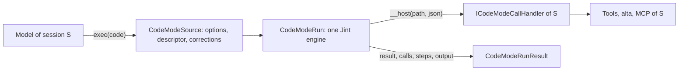

# Code Mode

Code Mode lets an agent send a JavaScript program instead of a string of tool calls. CodeAlta runs it in-process, and
every effect of the program is a call through the functions its host binds: the tools of the session, `alta`, MCP
tools. Loops, filters and parallel calls run without model turns, and only what the program returns reaches the
model.

## Boundary

The script runs beside the agent loop, not on the computer it works on. The engine has no file, network, timer,
module or .NET access: CLR interop and string compilation (`eval`, `new Function`) are off, and the only way out is
one host function, `__host(path, json)`, which the prelude hides in a closure. So the rights of a script are exactly
those of the calls it makes, and a call runs with the permissions, the sandbox and the gates of the session that owns
it. That is why a script is safe in any session, a sandboxed one included.

`CodeAlta.CodeMode` knows no CodeAlta project (`ArchitectureGuardrailTests`): its host gives it a `CodeModeApi` (the
paths of the functions, their schemas) and an `ICodeModeCallHandler` (what runs them).

## Runs

- **One engine per run.** A Jint engine is not thread-safe, and costs microseconds to create, so each run has its
  own; runs of every session, and several runs of one session, execute at the same time. Nothing is shared but
  immutable prepared scripts (`CodeModeScriptCache`, one per host, bounded): the prelude of each API and scripts that
  run again.
- **One thread at a time runs the script; host work runs in parallel.** A call returns a promise of a .NET `Task`
  that the handler runs on the thread pool. Handlers never touch the engine; they settle promises, and
  `EvaluateAsync` resumes the script on the thread that wakes it. A run that awaits holds no thread.
- **Calls** go through a slot limit (`MaxCallsInFlight`); functions that are not `Parallel` run one at a time, so
  `Promise.all` over writes stays ordered. A call has an identity (index, path, step, source location) and a record
  (queued time, duration, status). An exception of a handler becomes an error the script can catch, never the end of
  the run.
- **Steps.** `step(id, fn)` makes `id` the current step while `fn` runs; the engine's job callbacks carry it across
  every `await` started inside, so calls belong to their step also in parallel branches.
- **Locations.** The innermost frame of the script in the engine's stack gives the line of each call. The bridge
  calls the host from a plain function: an async function in between would hide the script's frames.

## Hosts

`exec` and `wait` (`CodeModeToolFactory`, in `CodeAlta.LiveTool`) are tools of the session, given by the host beside
`alta` while `[code_mode] mode` is `on` (`CodeModeSessionTools`, read at each send). Each `exec` binds the functions of
its run: the session's tools through `AgentToolInvocation.Tools` (`ToolScriptBinding`: `tools.*`, `mcp.<server>.*`), the
typed `alta` commands for its caller (`AltaScriptBinding`), and discovery over that same API (`CodeModeDiscovery`).
A tool's structured value (`AgentToolResult.Structured`) is what a script receives; the model reads its text.

Runs belong to the host (`CodeModeRunRegistry`, owned by `CodeAltaHost`), not to a turn:

- `exec` waits for its run until the yield time; the run then goes on in the background, and the turn may end.
- Its result is taken once: by the `exec` that waited, by a `wait` that waits when it ends, or else delivered to its
  session as a prompt of provenance `workflow`.
- Limits count runs (per session, per host) and refuse a run over them, never queue it.
- The host stops every run before its sessions close.

## Limits

The limits protect the process: memory, statements and CPU time per synchronous slice (awaited time does not count),
recursion with the stack overflow guard, regular-expression time, array size, the wall time of a run, and the calls a
run may make. Jint 4.17 needs three settings that are not optional: the stack overflow guard (deep recursion would
end the process), no promise timeout (its 10 s default would fail any longer await; the run's token bounds the wall
time), and Task interop for host promises (the public promise API cannot be settled from another thread).

A script that waits while no call is in flight and no JavaScript runs can never be resumed: a watchdog fails it as
stalled. Calls still pending when the script returns are cancelled and listed in the result.

## Sources

`CodeModeSource.Prepare` never throws. It reads the first-line options (`// @exec: {…}`, unknown keys refused) and
the descriptor (`export const meta = {…}`, a pure literal read with Acornima, never executed), and corrects what models
often send: Markdown fences, `export default`, a lone function, a final expression without `return`. TypeScript syntax
and `import` are refused with the fix. Lines keep their numbers: the script runs as the body of an async function
opened on its first line, so errors point at the line the model wrote.

## Determinism

`Date` reads the run's clock and `Math.random` its source, both given by the host. A replayed run gives back what it
recorded. Built-in prototypes stay writable: freezing them breaks common code (`this.name = …` in an `Error` subclass),
and each run has its own engine, so a script can only break its own globals. The bridge itself is frozen and its
globals are read-only.
