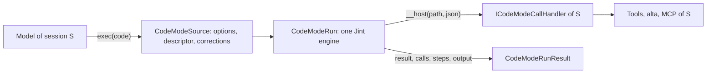

# Code Mode

Code Mode lets an agent send a JavaScript program instead of a string of tool calls. CodeAlta runs it in-process, and
every effect of the program is a call through the functions its host binds: the tools of the session, `alta`, MCP
tools. Loops, filters and parallel calls run without model turns, and only what the program returns reaches the
model.

## Boundary

The script runs beside the agent loop, not on the computer it works on. The engine has no file, network, timer,
module or .NET access: CLR interop and string compilation (`eval`, `new Function`) are off, and the only way out is
one host function, `__host(path, json)`, which the prelude hides in a closure. So the rights of a script are exactly
those of the calls it makes, and a call runs with the permissions, the sandbox and the gates of the session that owns
it. That is why a script is safe in any session, a sandboxed one included.

`CodeAlta.CodeMode` knows no CodeAlta project (`ArchitectureGuardrailTests`): its host gives it a `CodeModeApi` (the
paths of the functions, their schemas) and an `ICodeModeCallHandler` (what runs them).

## Runs

- **One engine per run.** A Jint engine is not thread-safe, and costs microseconds to create, so each run has its
  own; runs of every session, and several runs of one session, execute at the same time. Nothing is shared but
  immutable prepared scripts (`CodeModeScriptCache`, one per host, bounded): the prelude of each API and scripts that
  run again.
- **One thread at a time runs the script; host work runs in parallel.** A call returns a promise of a .NET `Task`
  that the handler runs on the thread pool. Handlers never touch the engine; they settle promises, and
  `EvaluateAsync` resumes the script on the thread that wakes it. A run that awaits holds no thread.
- **Calls** go through a slot limit (`MaxCallsInFlight`); functions that are not `Parallel` run one at a time, so
  `Promise.all` over writes stays ordered. A call has an identity (index, path, step, source location) and a record
  (queued time, duration, status). An exception of a handler becomes an error the script can catch, never the end of
  the run.
- **Steps.** `step(id, fn)` makes `id` the current step while `fn` runs; the engine's job callbacks carry it across
  every `await` started inside, so calls belong to their step also in parallel branches.
- **Locations.** The innermost frame of the script in the engine's stack gives the line of each call. The bridge
  calls the host from a plain function: an async function in between would hide the script's frames.

## Hosts

`exec` and `wait` (`CodeModeToolFactory`, in `CodeAlta.LiveTool`) are tools of the session, given by the host beside
`alta` while the mode of the session is `on` or `only` (`CodeModeSessionTools`, read at each send). The mode depends on
the provider and the model of the send, by one rule (`CodeModeScopes`, in `CodeAlta.Catalog`): the model's
`code_mode`, its provider's, `[code_mode] mode`, else `on`; only the user's file decides it. Every host passes the
provider and the model to the tools, and the prompt builder passes the same to `CodeModeOf`, so both resolve the same
mode. In `only`, `exec` takes
over (`AgentToolSpec.ScriptsTakeOver`): the model is offered only the tools of exposure `Model` and those that stay
direct (`view_image`), and calls the others from scripts. Each `exec` binds the functions of
its run: the session's tools through `AgentToolInvocation.Tools` (`ToolScriptBinding`: `tools.*`, `mcp.<server>.*`), the
typed `alta` commands for its caller (`AltaScriptBinding`), and discovery over that same API (`CodeModeDiscovery`).
A tool's structured value (`AgentToolResult.Structured`) is what a script receives; the model reads its text.

Runs belong to the host (`CodeModeRunRegistry`, owned by `CodeAltaHost`), not to a turn:

- `exec` waits for its run until the yield time; the run then goes on in the background, and the turn may end.
- Its result is taken once: by the `exec` that waited, by a `wait` that waits when it ends, or else delivered to its
  session as a prompt of provenance `workflow`.
- Limits count runs (per session, per host) and refuse a run over them, never queue it.
- The host stops every run before its sessions close.

## Sessions of a script

`agent()` and `session()` start sessions of their own (`CodeModeAgents`, in `CodeAlta.Orchestration/Hosting`, through
the host's `HeadlessSessionDriver`). They are children of the script's session, created by kind `workflow`, and their
answers go back to the script, never to the parent: `TakeParentNotifications` gives nothing for a session created by
that kind, on every path, because `CreatedBy` is durable. A child has at most the tools of its creator and at least
its restrictions (review, permission mode, sandbox: a script turns a sandbox on, never off), as a session the model
creates with `alta session create`. A run caps its sessions (8 at work, 50 in all, 3 levels deep) and its tokens
(`budget_tokens`). A tier the script asks for that is not set up gives the parent's model, with a warning: scripts are
examples copied into any profile. A child works in the project and the worktree of its parent, or with `worktree: true` in
a new worktree that stays when it closes, with its branch, for the work to be merged.

## Instructions

A session that has `exec` is told when to use it, by a section of its instructions that the prompt builder adds from the
mode the host gives it (`CodeModeRunRegistry.CodeModeOf`, set by the tools that give `exec`), so that the instructions
and the tools never disagree. Without it, models rarely write a script on their own: they work through the parts of a
request one turn after another. The section is the same text for every session of a mode, for prompt caches; a session
a script started is also told to do its part itself, since each level of sub-agents is a whole session more. Claude
Code loads `exec` and `wait` with `alta` instead of deferring them behind its tool search.

## Records

A run writes `AgentWorkflowEvent` records in the journal of its session (`RunStarted`, `StepsDeclared`, steps,
sessions, waits, `RunEnded`), all before its result is given, so what reads the journal after the result sees the
whole run. Their `RunId` is null: a run outlives the turn that started it. The card of the run and its tab read these
records; they keep no state of their own.

Desktop and TUI also keep each run in a store under the state root (`CodeModeRunStore`): its source, arguments, the
value of each step, the calls of tools that are not idempotent, its sleeps and its result. Writes are queued off the
script's thread. The store is the index of runs after a restart (listing reads `run.json` files, never a journal) and
the memory of resume. `altacli` keeps none: its state root is thrown away.

## Resume

Jint cannot save a suspended script, so a resume runs the script again over what the store recorded. A step has a key,
its id and occurrence under the path of the `workflow()` calls that reach it (`lib#0/read#0`), and a run with the
scripts it calls shares one step space (indexes, occurrences, the replay cursor, under one lock) so that parallel
scripts keep their keys. A replayed step gives its recorded value without running; a resume replays the longest
unchanged prefix, a rerun every matching step or the steps before one. A step that would repeat a call of a tool that
is not idempotent and was in flight is refused unless the user agrees: its outcome is unknown. Closing CodeAlta leaves
its runs without an end, and the next start marks them interrupted. Only a run cut during `sleep()` resumes by itself,
at its wake time: a sleep is the script's own request to go on later.

## Runs started outside a turn

A script needs the tools of its session, which exist only inside a model turn (`AgentToolInvocation.Tools`), and a
provider that runs its own tools (Claude Code, the ACP agents) holds its conversation. So whatever starts a run without
a turn (an automation, **Run…** of the Workflows tab, `alta script run`, **Resume**) sends the session a short prompt
asking it to call `exec` (`CodeModeScriptRunPrompt`), and gives that session `exec` whatever the setting says
(`CodeModeRunRegistry.RequireCodeMode`). The run then has the permissions, the sandbox and the timeline of an ordinary
call.

## The library

`CodeModeScriptLibrary` reads the samples shipped with CodeAlta, the user's scripts (`~/.alta/scripts`) and the
project's (`.alta/scripts`), the project's winning on a name. Agents publish through `alta script save`, which checks
the script and refuses a copy changed since it was edited; they never write `.alta` with their file tools, which the
write guard and the sandbox keep out of their reach, because a library script later runs with the tools of whoever runs
it, an automation at night included. An automation that runs a script is allowed with the script's hash, so a change
brought by an agent or a pull waits for the user.

## Questions and time

`ask()` goes through the questions of `alta ask` and resolves the script's promise with the answer; a script's question
shows at once, also during its turn, because the turn's `exec` is the one waiting for it. Waiting for the user stops the
run's clocks (its time limit and `exec`'s yield), and the questions and approvals of a run come one at a time. A session
nobody watches (an automation's, `altacli`) gets `unavailable`. `sleep()` counts toward the yield, so a sleeping script
goes to the background, but not toward the time limit, and its wake time is recorded for a resume.

## Limits

The limits protect the process: memory, statements and CPU time per synchronous slice (awaited time does not count),
recursion with the stack overflow guard, regular-expression time, array size, the wall time of a run, and the calls a
run may make. Jint 4.17 needs three settings that are not optional: the stack overflow guard (deep recursion would
end the process), no promise timeout (its 10 s default would fail any longer await; the run's token bounds the wall
time), and Task interop for host promises (the public promise API cannot be settled from another thread).

A script that waits while no call is in flight and no JavaScript runs can never be resumed: a watchdog fails it as
stalled. Calls still pending when the script returns are cancelled and listed in the result.

## Sources

`CodeModeSource.Prepare` never throws. It reads the first-line options (`// @exec: {…}`, unknown keys refused) and
the descriptor (`export const meta = {…}`, a pure literal read with Acornima, never executed), and corrects what models
often send: Markdown fences, `export default`, a lone function, a final expression without `return`. TypeScript syntax
and `import` are refused with the fix. Lines keep their numbers: the script runs as the body of an async function
opened on its first line, so errors point at the line the model wrote.

## Determinism

`Date` reads the run's clock and `Math.random` its source, both given by the host. A replayed step gives back what it
recorded. Built-in prototypes stay writable: freezing them breaks common code (`this.name = …` in an `Error` subclass),
and each run has its own engine, so a script can only break its own globals. The bridge itself is frozen and its
globals are read-only.
