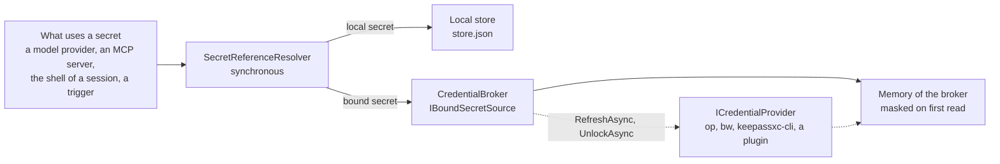

# Credentials

A secret is a name (`${secret:NAME}`, `api_key_secret`). Its value is on this computer, in the local store
(`CodeAlta.Catalog/Secrets`, `store.json`), or in an item of a vault the user already uses: 1Password, Bitwarden,
KeePassXC, a secret manager of a cloud, a command, a plugin. A *credential provider* reads one vault; the *credential
broker* of a host owns the providers, the values they read and the confirmations of the secrets that ask before use.

## The model

- **A binding** maps a name to a vault item: `~/.alta/secrets/bindings.json` (`SecretBindings`), beside the store,
  `{ bindings: { NAME: { provider, ref, label, version, set_by, set_at } }, ask_before_use: { NAME: duration } }`. It
  holds no value. Members it does not know are kept, so that a part that owns another member (`ReadMember`,
  `ChangeMember`) and an older CodeAlta on the same profile do not lose each other's data.
- **A provider** is a table `[credentials.<id>]` of the user's own `config.toml` (`CredentialProviderSettings`): its
  `type`, the settings of that type, `cache` and `unlock_at_start`. The configuration of a project never names a vault,
  and a configuration file never names a vault item: only the user's own files choose what is read from a vault.
- **`store.json` does not change.** A binding replaces the local value of its name (`LocalSecretStore.Bind`), and the
  list of secrets shows both kinds, the binding first.

Why a separate file: an older CodeAlta, such as the normal instance beside a developer instance, rewrites `store.json`
whole and would drop a field it does not know.

## The broker

`CredentialBroker` (`src/CodeAlta.Credentials`) is one per host, built by `CodeAltaHost` before the model providers are
registered, so CodeAlta Desktop, CodeAlta TUI, `altacli` and `altanode` work the same way.

- **Reading is split in two.** A vault can take seconds and may need the user, but `${secret:NAME}` is resolved
  synchronously, in many places. So the broker reads ahead (`RefreshAsync` at start, within a time limit, then after an
  unlock and when a value expires) and the resolution reads memory only (`IBoundSecretSource.ReadBound`). A bound secret
  that is not in memory resolves to an error that names it and its vault, never to an empty value or the value of
  another source.
- **The broker reaches the resolvers through instances**, never a static: `ModelProviderRegistry.BoundSecrets` for model
  providers and plugin provider types, `PluginSecretSink.AttachBound` for plugins and MCP servers, the resolver of the
  identity of a session, the triggers of automations. A resolver built without a broker treats a bound secret as not
  available.
- **Every value is masked from its first read**: the broker gives it to the masking of the host (`Mask`,
  `AgentSecretMasker.Retain`) before it keeps it. The masking finds it as it is, escaped as JSON writes it, and
  percent-encoded as a form or an address sends it.
- **Memory**: a value stays until the duration of its provider ends (`cache`: until CodeAlta closes, or 15 minutes to
  8 hours), the user locks the provider, or CodeAlta closes. Nothing is written to disk: no value, no master password,
  no session key. A lock is a barrier: each provider has a generation that a lock increments, a read or an unlock that
  began before it drops its result, and a provider the user locked is neither checked nor read until the user unlocks
  it, since the lock of some vaults (pass, a keychain) forgets nothing.
- **Prompts**: only a host with a user (`CanPrompt`, the normal desktop instance) asks a vault to unlock, once at start
  for the providers whose `unlock_at_start` is on and whose vault prompts by itself, then on a click. `altacli` and
  `altanode` read only what a vault gives without a prompt. So does the developer instance, unless the user lets it unlock
  (`developer_instance = "unlock"` under `[secrets]`, read each time it is needed): then it asks on a click, never at
  start, since agents start developer instances. A vault such as 1Password authorizes each process on its own, so values
  never pass from one instance to the other.
- **Changes**: `Changed` names the secrets that became readable or not. CodeAlta Desktop then registers the model
  providers that were left out or waiting for one of them (and only those, so that no runtime in use is replaced); an MCP
  server that did not start for a missing secret is not remembered as failed, and starts at its next use.
- **Waiting providers**: in CodeAlta Desktop (`WaitForVaultProviders`), a model provider whose secret a vault cannot give
  now is registered *waiting* rather than left out: its descriptor says what it waits for (`WaitsFor`) and its factory
  throws `ModelProviderWaitingException`. A run (`AgentHub.PrepareSessionAsync`, the headless driver of Code Mode
  agents) calls `ModelProviderRegistry.WaitForProviderAsync`: `VaultSecretWaiter` asks the vault to unlock, one task per
  vault shared by every run, or the user to confirm a secret that asks before use, and the run waits for the host to
  register the provider again on `Changed`. It never asks where the host cannot prompt, for a vault whose password is
  typed in the page, or again within two minutes of a dismissed prompt: the run then fails with `WaitsFor`. Hosts
  without the waiter (`altacli`, `altanode`, the TUI) still leave such a provider out, since nothing registers it
  again.

## Providers

`ICredentialProvider` and `PluginCredentialProviderContribution` (`CodeAlta.Plugins.Abstractions`) are the contract of
every kind of vault, the built-in ones included (`Providers/`). A provider answers its status without a prompt, unlocks
with the user present, reads one value (with `interactive` false it never prompts) and lists names for the picker,
never values. The host owns the rest: bindings, memory, masking, confirmations, the states shown, the settings form.

A plugin type is `<prefix>/<name>`, shadows no built-in type, and comes only from a built-in plugin or a plugin of the
user, never from the plugin of a project folder: a cloned repository cannot bring code that reads the vaults.

`VaultCommandRunner` holds the rules every program of a vault is run with: its full path and an argument array, never a
shell; a folder of its own, never the folder of a project; the session variables of vaults (`BW_SESSION`, `OP_SESSION_*`)
removed from its environment; a password or a token on its standard input or in its own environment, never in an
argument; its output bounded in size and time, the process killed after it, from its start to its end. What a program
writes on its error output can hold a value the masking does not know yet: a provider gives a classified message, and the
raw line only in `Detail`, which Settings shows the user and nothing gives an agent or a log. A password the user types
to unlock is given to the masking before the program starts.

## Ask before use

A secret with `ask_before_use` is given only after the system verified the user (`IUserPresenceVerifier`: Windows Hello
through `IUserConsentVerifierInterop` with the handle of the window, Touch ID through `LAContext`). A confirmation is
kept per secret and use for its duration, so that something new that asks for the same secret asks the user again. A use
names what it is for, never a name another consumer can share: `provider <key>`, `MCP server <name> of <its file>` (and
its space), `shell of the session <id>`, `triggers of the automations of the project <id>`. A confirmation of each use is
taken by one operation: an MCP server reads its secrets once for its validation and its start. Without a user, the use is recorded as pending and the secret is not given;
the page of Settings asks again. The broker records the recent uses (secret, use, time, outcome), never a value.

**The shell of a session** is asked for when the session attaches, never later: its environment is built once
(`ShellSecretConfirmations`, `ResolutionSecrets` in `CodeAltaHost`). The confirmation decides which sessions get a secret,
not what their commands do with it.

- A session the user is in front of waits for the answer to the uses its own environment asked for, for a bounded time,
  then builds its environment again; the uses of one start are one prompt and one verification. What is denied, not
  answered or stopped leaves no use waiting.
- A session nobody is in front of (a creator of the automation kind anywhere up its lineage) asks nobody: the secret is
  left out at once.
- A session another session created takes the answers that session was given when it attached
  (`SessionIdentity.SecretAnswers`), while that session is attached: it already has those values. Only the creator the
  host recorded counts, never the parent a session names, which the agent that creates it chooses.
- An environment built for a session that does not attach (what the window shows, a job of a session not attached)
  asks nobody and takes no confirmation of one use (`CredentialBroker.WithoutAsking`).

It is a check of CodeAlta, not encryption: a program that runs as the user is stopped by the vault, not by CodeAlta.

## Sign-ins of websites

A sign-in (`SignIns`, members `sign_ins` and `site_grants` of `bindings.json`) names the vault references of a user
name, a password and a one-time code, and the origins they are typed on; a site grant lets one origin go without the
card for 30 days. `CredentialBroker.ReadSignInAsync` reads them without a prompt, masks each value first and keeps
none: the `SignInValues` it returns is disposed once the fields are typed. It reads the sign-in the card showed, and
refuses when the saved one changed since or no longer lists the site; `ReadSignInCodeAsync` reads its one-time code again
under the same checks when the code expired before its field came. How the browser types them is in
[browser](browser.md#sign-ins).

## Agents

Agents see names and states, never a value nor the item a secret names (`alta secret list|test|uses`,
`alta credential types|list|status`). A change (`secret bind|unbind`, `credential add|remove`) is an
`AgentCredentialPermissionRequest`, which no permission mode answers (`SessionPermissionService.AlwaysAsks`,
`OnlyTheUserAllows`) and a host without a user denies. An agent never adds a provider of type `command` nor sets a path,
both of which choose a program to run, and a setting that is a token names a local secret.

A sandboxed session gets none of these commands (`AltaSandboxGate` is an allow list), and the session variables of
vaults never enter its sandbox (`SandboxPolicyBuilder.IsVaultSessionName`), even when its profile names them. Nor does a
value of a vault given to the shells of the sessions, whatever the variable that carries it (`SandboxHost.WithheldValues`).
An MCP server never gets a secret of a vault in its command line, which other programs read: only in `env` or `headers`. Outside the
sandbox, `VaultCommandGuard` refuses a shell command of an agent that runs the program of a configured vault, unless
the user allows it (`agent_vault_commands`): a guardrail against mistakes, not a wall, since a session that is not
sandboxed runs as the user.
