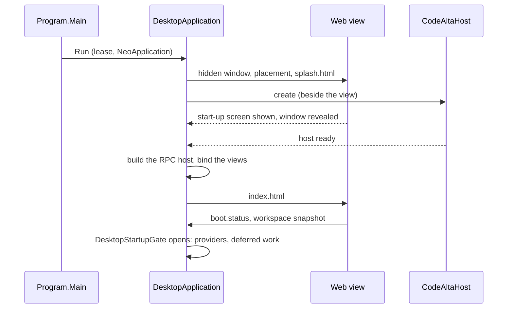
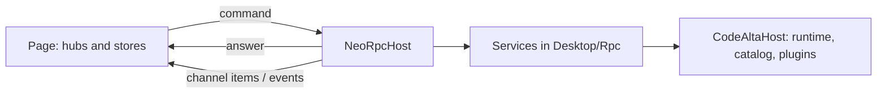

# CodeAlta Desktop

CodeAlta Desktop (`src/CodeAlta`, package `CodeAlta`, command `alta`) is the host of CodeAlta in a native
window: a .NET process that owns the runtime, and a React page in a web view that shows it. This page explains
how it is put together and why. What the user sees and does is in the user guide under `site/docs`; build and
run steps are in [`src/CodeAlta/README.md`](../src/CodeAlta/README.md) and `AGENTS.md`.

## Responsibilities

| Part | Where | Owns |
| --- | --- | --- |
| Host process | `src/CodeAlta/Program.cs`, `Desktop/` | The native application and its windows, the `CodeAltaHost` of the profile, the RPC services of the page, the MCP server, the worker processes |
| RPC services | `Desktop/Rpc/` (one `*Rpc.cs` per service) | What the page may read and ask, as typed commands, events and channels |
| Page | `src/CodeAlta/frontend` (React, Blueprint, FlexLayout, Monaco, xterm.js) | Presentation, local presentation state (tabs, drafts, layout), and the calls to the host |
| Shared runtime | `CodeAlta.Hosting`, `CodeAlta.Orchestration`, `CodeAlta.Catalog`, `CodeAlta.Plugins`, `CodeAlta.LiveTool` | Sessions, providers, catalog, plugins, `alta`: the same as for `altatui` ([architecture](architecture.md)) |
| Native engines | `CodeAlta.NativeEngines`, `Desktop/Speech/`, `Desktop/Search/Embedding/` | Native libraries downloaded on first use, run in worker processes |

The desktop references no terminal presentation library and not `altatui` (`DesktopArchitectureTests`): what
both frontends need lives in the shared libraries, and the desktop only composes and presents it.

## The host process

`alta` is a windowed .NET executable on NeoAstra (sources in `../NeoAstra/` beside the repository), which gives it the native application
(`NeoApplication`, `NeoWindow`), the web view (WebView2 on Windows, WKWebView on macOS, WebKitGTK on Linux), the
`app://codealta` asset scheme, and a typed RPC between C# and the page. The window has no native title bar: the
page draws it, and NeoAstra keeps the platform's caption buttons over it.

The host is the same `CodeAltaHost` as the TUI's: it takes the runtime lock of the profile, loads the catalog,
starts the providers and the plugins (built-in, `~/.alta/plugins`, the project's), and runs the sessions. The
desktop adds no state of its own to `~/.alta`. What belongs to the window lives in the platform's local
application data (`%LOCALAPPDATA%\CodeAlta\desktop`, `desktop-dev` for the developer instance): the web view
profile (`localStorage`), `preferences.json`, `appearance.json`, `window.json`, `windows.json` and the logs.

### One instance per profile

Two processes must never write the same session files, so a profile has one running CodeAlta:

- **The lease.** `CodeAltaSingleInstanceGuard` holds `alta.lock` of the state root for the life of the host. It
  is released only once the host is confirmed closed (`DesktopApplication.CanReleaseOwnedLease`): a native loop
  that ended is no proof that the host work did.
- **A second start** finds the profile in use and hands its request to the running one through
  `NeoSingleInstance` (`NeoLaunchEvent`): show the window, open folders as projects (`alta <folder>`), or exit
  (`alta --exit`). The instance id is a hash of the profile root, so instances of different profiles never meet.
- **The developer instance** (`--dev`) shares the configuration, providers, plugins and project catalog of
  `~/.alta`, and keeps its own sessions, database and lock under `~/.alta/dev/`, its own web view data and its
  own MCP port. It is how CodeAlta is developed with CodeAlta: the instance the user works in builds and drives
  another one (`AGENTS.md`, "Developer instance").
- **The command line beside it.** `altacli` writes its sessions into the same sessions folder without the lock, and
  each session has a lease ([runtime](runtime.md#sessions-shared-with-other-processes)). The pages tell the host the
  session tabs they have (`spaces.openSessions`, every space for the main page), so a session open in a tab keeps its
  lease and a closed, idle one is let go. A session another process holds is in the activity of the spaces with its
  holder: the page marks it, makes its composer read-only, and reads its timeline again as its journal grows; a
  `sessions` event of `spaces.watch` makes every page read the list again.
- **Explicit roots** (tests, automation, demos) take everything from the folders they are given: no network
  update check, no desktop entry, no speech, a free MCP port.

### Started from a terminal

A shell waits for the program it starts, and on Windows the launcher of a .NET tool is a script that waits for a
windowed program too. So `alta` typed in a terminal starts the application again in a detached process and ends
once the window shows its start-up screen (`DesktopTerminalStart`, with a token file in the temporary folder); a
failure before that is printed by the first process. `--wait` keeps the application in the started process.
`Program.Main` dispatches, in order: the worker options, the macOS login shell (a bundle started by the Finder
has no `PATH`), the terminal hand-over, then the command line (`DesktopCommandLine`). A start that fails says why
where the user started it (`DesktopStartupFailure`: missing native libraries, no WebView2 Runtime, the WebKitGTK
sandbox).

## Startup

- **The window comes first.** It is created hidden, given its placement and its theme color (from
  `appearance.json`) before it is shown, so it never appears in the wrong place or flashes white. It shows
  `splash.html`, which names the step of the start (`DesktopStartupStatus`, read from `/startup-status.json`).
- **The host starts beside the view**, not before it, and the work the first page does not need (model
  providers, three at a time; search; deferred plugin work) waits for `DesktopStartupGate`: the first workspace
  snapshot served plus a moment for the page to draw it, with a bound. The window is never shown empty and the
  first data is not slowed by work the user does not see yet.
- **Configuration recovery.** When the global `config.toml` cannot be loaded, the window opens on a minimal set of
  services (`BootService` with `ConfigRecovery`, `StartupConfigService` over `ConfigRecoveryService`) that read,
  check and write that one file: nothing else starts until it is valid. A provider type this version does not
  know is not such a failure: it is skipped and kept as written.
- **The epoch.** Each host lifetime has an epoch (a GUID, `BootStatus.HostEpoch`). Requests that change state
  carry the epoch the page knows (`ExpectedEpoch`), and a host answers `stale_epoch` to a page of another
  lifetime instead of acting on what that page saw.

## Shutdown

- **Close is not exit.** Closing the window hides it to the notification area by default (the user's choice in
  `preferences.json`), so sessions, automations and reminders keep running; while CodeAlta runs it holds off idle
  system sleep (`DesktopKeepAwake`). Exit comes from the tray, Ctrl+Q, `alta --exit`, Quit on macOS, or a close
  that cannot hide.
- **The page asks, the host decides.** `DesktopShell` owns the exit; the questions (unsaved files, running
  sessions) are asked by the page of the main window only. Once the exit is confirmed, the services stop
  admitting new work (`CloseAdmission`) and `DesktopClosing` begins; once the host has closed, the secondary
  windows are saved, then closed, before the placement of the main window is written.
- **An automated start asks nothing.** Started by another program (`--automated`, `CODEALTA_AUTOMATED`), a close, an
  exit or SIGTERM never hides the window nor asks the page: `DesktopShell` waits until no session is at work, then
  exits as a confirmed exit does. Whoever started CodeAlta also ends it, without a user to answer.
- **The host closes off the window thread**, step by step, each step logged and logged again every 15 seconds
  while it waits (`CloseOwnedHostWhenRequestedAsync`, `CloseStepAsync`). The window thread stays free so that the
  page can still be told. `boot.status` reports `closing` with the step it waits for; after ten seconds the page
  offers `desktopShell.forceExit`, which logs what was pending, flushes the log and kills the process. Only that
  path gives up on the host: an ordinary close waits for it, with its lease.

## RPC between host and page

The page talks to the host only through NeoAstra RPC. A service is a C# class with `[NeoRpcService]` and
`[NeoRpcMethod]` in `Desktop/Rpc/`, its records serialized through the source-generated `DesktopJsonContext`
(no reflection). The build generates the typed TypeScript client and a contract hash
(`obj/neoastra/neoastra.ts`, imported by the page as `#neoastra`); a call made with another contract is refused.
A method is a **command** (request, answer), an **event**, or a **channel** (a stream from host to page, such as
the `watch` methods through which `alta editor open` or a plugin reaches the window).

### Dispatch and ordering

- **Handlers run on the thread pool** (`NeoRpcDispatchMode.Background`, the default), side by side with each other
  and with the window. State a service shares is behind a lock or thread-safe, a handler never touches a window or
  a view without the dispatcher, and two writers of one file write one at a time (`config.toml` through
  `CodeAltaConfigStore`). Only a few methods that act on native windows run on the window thread
  (`NeoRpcDispatchMode.UiThread`: the zoom, the moves and drags of `windows`).
- **The window thread carries every frame** of every call, both ways: nothing dispatched there does file IO or
  waits. `DesktopUiWatchdog` logs stalls of that thread, of the thread pool and of the process, and
  `DesktopThreadPool` raises the pool minimum (a child process with redirected output holds pool threads on
  Windows).
- **Answers may come back out of order.** A call that sets a state the host keeps (shown, visible, attached) goes
  through `createOrderedCalls` (`frontend/src/orderedCalls.ts`); a sequence that must stay ordered carries its own
  numbering (the audio chunks of a dictation).
- **Errors.** Every exception of a command is logged with its correlation id (`DesktopRpcExceptionLog`); the page
  gets `internal_error`, never exception text.

### Limits and the channel budget

The page is the application's own, on the same computer, and it waits for every call (below). The NeoAstra
options of the window's host (`DesktopApplication.RunOwnedAsync`) are therefore sized so that a busy host makes
calls wait, never refuses them: thousands of concurrent invocations, 1024 per command (NeoAstra's default is 8,
which a host with many tabs passes), a request rate no page reaches, and a frame cap that leaves room for pasted
images.

Channels are the exception, and the reason for the budget. A channel the host's limit refuses is refused after its
handler ran, so the page cannot simply send it again. Channels are therefore few and long-lived: one per kind of
push (a `watch`), or one per open pane, multiplexing what flows through it, never one per call. The services offer
a fixed set of channel methods, counted against a budget of 35 by `RpcChannelBudgetTests`: a new channel takes room
from it and is counted there. What a plugin canvas calls (`alta.rpc`) rides the single `canvases.watch` channel with
a run-time NeoAstra host per instance ([plugins](plugins.md), "The carrier of `alta.rpc`"). The open channels stay
far under the per-session limit, and at most two items of a channel wait for the page's acknowledgement: a slow page
holds its stream back instead of letting it pile up.

### How the page calls

- **No call is given up on a timer** (`localCalls.ts`). The host is local and a message is not lost while the
  connection lives: a call that has not answered is slow, not failed. A call ends with its answer, its
  `AbortSignal` (its owner went away) or a closed connection. A call refused by an admission limit before it ran
  (`too_many_requests`) is sent again. Slow calls are logged to the console and to the host log.
- **Liveness** (`hostLiveness.ts`): a ping every 10 seconds that also never gives up. A ping that waits shows
  **CodeAlta is busy**; only a closed connection is final, and the window reloads by itself or offers **Reload**.
  A reload opens a new RPC session with the same host: sessions keep running.
- **Pollers never overlap** (`createCoalescedRead`: one in flight, one queued); without timeouts, a slow host would
  otherwise get a pile of the same call.
- **A failed call never holds the window.** A rejected promise, `internal_error` or a malformed reply leaves no
  pending state; only the host's own answer (`stale_epoch`, `stale_runtime`) latches a capability, and a state that
  only a reload ends offers **Reload** where the user sees it.

## The page

`src/CodeAlta/frontend` is a Vite build of React 19 with Blueprint 6 (components and theme), FlexLayout (the dock of
tabs and splits), Monaco (prompt, code and diff editors), xterm.js (terminals), markdown-it with DOMPurify, pele (Mermaid diagrams, colored by CSS variables),
ECharts, and React Flow with dagre for the graphs of Code Mode runs (lazy chunks). It is served from `frontend/dist` on `app://codealta` and runs under `StrictMode`, so
effects are idempotent. `npm run demo` runs the page in a browser against `demo-api.ts`, a fake of the services.

### Sources

`main.tsx` holds the shell: `App`, the state of the whole window, and the workspace. A feature has a folder of its
own under `frontend/src` with its components, state modules, tests, messages and stylesheet (`explorer/`, `editor/`,
`changes/`, `monaco/`, `terminal/`, `canvases/`, `pluginScript/`, `lent/`, `spaces/`, `windows/`, `review/`,
`search/`, `speech/`, `statistics/`, `charts/`, `mobile/`...). What several features share (the shell, the tabs,
icons, localization, Markdown) stays at the root.

- A new feature gets a folder; files of an existing one move there with `git mv` when a change touches most of them.
- What can be decided without the DOM is a module of plain functions with a test beside it; the component is thin.
- A feature's stylesheet is imported from `main.tsx`, after `style.css`, not from its components, because tests
  import components without a bundler.
- `mobile/` is a second document of the build (`mobile.html`): the phone page of the Mobile plugin, plain
  TypeScript on the DOM that talks to the plugin's HTTP API and imports nothing that reaches `#neoastra`.
- Plugins render inside the page with the application's own React, Blueprint and FlexLayout instances, lent
  through an import map (`lent/`); see [plugins](plugins.md).

### State and host reads

- **The host owns what lasts**: sessions, their journals and live state, the catalog, settings, reviews. The page
  draws it again from the host and keeps no second authority (a review thread lives in `ReviewService`, not in
  Monaco; a canvas instance is asked for again when its tab is shown).
- **The page owns presentation**: open tabs per space, prompt drafts, layout sizes and window-local preferences, in
  the web view's `localStorage` (shared by every window of the instance), versioned and bounded, best effort when
  storage fails.
- **Hubs.** A feature's link to the host is a hub (`windowsHub`, `spacesHub`, `reviewsHub`, `canvasHub`,
  `localSearchHub`...): it holds one `watch` channel or poller and exposes `subscribe` and `getSnapshot` for
  `useSyncExternalStore`.
- **Shared reads.** What several panes read alike goes through the window's `HostReadsContext`
  (`createHostReads`): one read for all, not one per pane.
- **Hidden panes stop reading.** Session tabs that are not visible stay mounted (their drafts and scroll), so what
  a pane polls follows `PaneObservingContext` and stops while it is hidden. Only the tabs of the shown space are
  mounted at all, and the window is given the catalog as that space has it (`scopeSnapshot`).
- **Settings are one catalog.** `frontend/src/settings/builtInSettings.json` declares the pages of Settings and every
  built-in setting (id, texts, kind, default, page, who keeps it, what agents may do); the page imports it for its
  search, and the host embeds it. `DesktopSettings` (`Desktop/Settings/`) is the registry: it binds each setting the
  host keeps to the store its page already uses, keeps the values of those the page keeps (the page reports them over
  the `settings` service and applies the changes it is passed, so they stay in `localStorage`), and adds the settings of
  the plugins. The search of Settings, `Ctrl+P`, `alta settings` and the index read it, so they cannot drift; the page
  checks in its tests that every text of the catalog is translated, and the host that every setting it keeps has a
  binding whose default is the catalog's. Why one file: the page owns the words and their translations, the host owns
  the values and who may change them, and both read the same list.
- **Live session state** comes from the `display` service (`SessionDisplayService`): the projection of the
  session, sent when it changed and at most every 33 ms. The persisted timeline is read in bounded windows of the
  journal (`WorkspaceHistoryRpc`, cursors tied to the journal's length and time), so a long session never loads
  whole.

### Performance

`App` holds the state of the window and every open session tab stays mounted with its timeline, so what renders
`App`, and how far a render goes, decides how the window feels with long sessions and many tabs:

- A keystroke, a streamed token or a timer never renders `App`. What changes often lives in a store or in the
  component that shows it; a component follows one fact of a store
  (`useSyncExternalStore(store.subscribe, () => fact(store))`, returning a primitive or a stable object).
- Context values and the props of memoized components keep their identity while they say the same.
- A live update touches what changed: timeline rows are compared by group, and a history window is never changed
  in place.
- No layout read (`getBoundingClientRect`, `scrollTop`) in an effect that runs on every render.
- **Window regions never move a box.** Everything with `app-region` (the tab strips of the title bar, the rail,
  dialogs, popovers, menus) is sent to the native window again by Chromium after any frame in which one of
  its boxes moved, and on Windows the host's UI thread then spends kernel time on every frame, until the mouse of the
  whole desktop lags. What animates there changes opacity, color or paint only (a painted angle, `clip-path`), and
  `regionChurn.browser.test.ts` measures it. Toasts are no region: they sit below the title bar, and Blueprint slides
  each one in, the ones of every start included.
- A performance change is measured in the developer instance before and after: the CPU of the `alta` process, and
  `regionChurnScript` run in the page over `codealta-dev`. A fix whose "before" was not seen to be bad is not a fix.

### Native gestures

The page runs on three engines, and some gestures differ from headless Edge, where the browser tests run:

- **Drags are pointer events** (session tabs, Explorer rows, projects onto spaces), never HTML5 drag and drop: on
  Windows NeoAstra replaces the web view's OLE drop target to take file drops, and a drag between two elements of the
  page never completes there. Test drags with trusted mouse input (`Input.dispatchMouseEvent`).
- **WebKit** (macOS) starts a text selection on a handle's press and still delivers the click of a Ctrl+click: a
  handle prevents the press's default (`startSplitterDrag`), and `contextClickGuard.ts` stops that click for the
  whole window. Check a new handle or gesture in the application on macOS.

### Localization

The shell is translated in the page only: English, Spanish, French, German, Japanese and Simplified Chinese.
`localization.ts` and the `messages.ts` of features hold frozen dictionaries keyed by the English text;
`shellLanguage.tsx` gives `t()` through a context. The choice is a preference of the web view
(`codealta.desktop.language.v1`); **Auto** follows `navigator.languages` and falls back to English. A change of
language re-renders text and remounts nothing. Identifiers, codes, configuration values, and what the host or a
model produces stay as they are.

## Several windows

Tabs can move from the main window to secondary windows. The main window stays the control center (rail,
Explorer, title-bar actions, Settings, the questions of an exit); a secondary window holds tabs only.

- **One registry, one RPC host.** `DesktopWindows` (`Desktop/Windows/`) owns the windows, the window focused last
  and which window holds each tab, and changes them on the window thread only. Every view is bound to the same
  `NeoRpcHost`; a method that needs its caller's window reads `NeoRpcContext.ViewLabel` (`main`, `window-<id>`).
- **No singleton "page" in the host.** Watchers are kept per window label (`DesktopPageWatchers<T>`), and a request
  meant for one window is routed (`DesktopWindows.Route`: the window that holds the tab, else the caller's, else the
  main one) and published with that label, never to every page, which would open a file in each window.
- **Tabs have references** (`windows/tabRefs.ts`: `session:<id>`, `editor:<project>`, `terminal:<id>`...), the same
  on both sides. A moved tab carries its payload; sessions, terminals and canvases are the host's, so the page that
  receives the tab attaches to them again. A tab is in one page at a time, so two pages never own one composer.
- **A secondary page is a role, not another app** (`windowsHub.secondary`): it skips what only the main page does
  (exit questions, application toasts, writes to shared `localStorage`, the Welcome page) and keeps its tabs in its
  window record, not in `localStorage`.
- **Persistence.** `windows.json` and `window-<id>.json` keep the windows and their placements; placements are
  clamped to the displays that exist (`NeoWindowStateRestore.Clamp`). On exit the windows are saved first, then
  closed. Dragging a tab out needs a platform that knows where its windows are (`NeoWindowCapability.Placement`).

## Security boundaries

The page is trusted; what it shows often is not. Each boundary has one owner:

- **The view.** It loads the two documents of the application and nothing else (`DesktopApplication.DecideNavigation`),
  has no history navigation, opens no new window, and grants permissions (microphone while speech is on, local
  fonts) only to `app://codealta`. Its content security policy is in `neoastra.json`: scripts only from the
  application, `connect-src 'self'`, `frame-src mcpapp:` and nothing more, and `base-uri 'none'`, which the Markdown
  boundary relies on.
- **Markdown.** The parser (`markdown.ts`) returns HTML that is explicitly unsanitized; its only consumer is the
  instance-owned boundary of `MarkdownContent` (`markdownBoundary.ts`, DOMPurify), with an explicit list of tags and
  attributes. After sanitization the renderer may add only what it computes from text (highlighted code, the SVG
  of pele for a `mermaid` block, with links and images off and sanitized again, front matter tables, task boxes, alerts, the copy button); no authored or unsanitized markup
  is concatenated afterwards. Renderer-owned attributes that must survive (`data-source-lines`, file links) carry a
  random mark of the render, so authored HTML cannot claim them. Rendering never navigates: a web link opens in the
  system browser only on a trusted user gesture, through `markdownLinks.open`, which validates the address again on
  the host; a file link is resolved by the host (`DesktopFileLinks`) and opens in the code editor. A target that only
  breaks the limit of 2,048 units stays an `href` in the sanitized HTML (`markdownHrefTarget`), so it stays a focusable
  link and its address is not lost: following it never reaches the opener, and a toast says it is too long and offers
  **Copy address** (`tooLongMarkdownHref`).
- **HTML that runs scripts** (the view of an MCP App) never runs on `app://codealta`, the only origin the bridge
  trusts. It is served on the `mcpapp` scheme (`DesktopMcpAppViews`, one origin per session and server, a CSP from
  `DesktopMcpAppPolicy`) in a sandboxed `iframe`, and what it asks goes through a token-bound `mcpApps` RPC. It relies
  on NeoAstra answering the bridge from the top-level page only ([mcp](mcp.md), "MCP Apps").
- **Plugin HTML and script** run in the page through `pluginScript/` and the lent libraries, under the page's policy
  ([plugins](plugins.md)).

## The MCP server and the UI tools

CodeAlta Desktop is an MCP server (`Desktop/Mcp/`): other applications, and CodeAlta developing itself, see and
drive the window and run `alta` commands through it.

- **Transport.** Streamable HTTP on a Kestrel server of its own (`ModelContextProtocol.AspNetCore`). It listens
  before the host runs, with the tools of the window; `alta` joins them once the host runs. Requests share
  no state, so a client survives a restart of the application.
- **Address.** `http://127.0.0.1:2582/mcp` (2583 for the developer instance, a free port on explicit roots), written
  to `mcp_url.txt` beside the instance lock while it listens.
- **Who is answered.** On loopback, the programs of this computer and no web page: a `Host` that is not loopback and
  an `Origin` of a remote page are refused, since a web page could otherwise drive the window. A server bound to
  another address asks for a bearer token (`mcp_token.txt`).
- **UI tools** (`Desktop/Ui/`): the tools of Chrome DevTools MCP, with the same names and arguments so a model uses
  them unchanged, built on NeoAstra's in-page automation (`NeoAutomation`), the same on the three engines. Each window
  is a page. Sessions get them on request (`alta ui activate`, built-in plugin `ui`), and never a session whose
  commands the user reviews, nor a host started with `--review-owned-command-permissions`: a session that drives the
  window could answer its own review.

## Native engines in worker processes

Speech to prompt (sherpa-onnx) and search by meaning (ONNX Runtime) run native code that can end its process (a
custom model the engine refuses, a crash in native code). The engine must not be able to close CodeAlta, so it runs in
a worker: the same executable started with `--speech-worker` or `--embedding-worker`, dispatched first in
`Program.Main`, so a worker never loads NeoAstra or a web view.

- `CodeAlta.NativeEngines` has what workers share: `WorkerProcess` (start, priority, end), `WorkerFrames` (framed
  messages on the standard streams) and `PinnedDownloader`.
- Native libraries are not in the package. They download on first use into `~/.alta/cache/runtime/...`, pinned by
  version and hash, resumable, and named only once complete; a managed binding loads its library by full path.
- Workers serve the user first: background work runs below normal priority, pauses during a dictation, and ends when
  idle. A dead worker fails what it was doing, and the next request starts another.

## Testing

- **.NET** (`src/CodeAlta.Desktop.Tests`): services, host composition, windows, startup and shutdown, without a
  window. `RpcChannelBudgetTests` and `DesktopArchitectureTests` guard the boundaries above.
- **Frontend** (`npm test` in `src/CodeAlta/frontend`): every `*.test.ts(x)` under `src`, beside its module, with
  `tsx --test`. `*.browser.test.ts` files mount real components from a `*.mount.tsx` fixture in headless Edge, under
  `StrictMode` to exercise the double run of effects, and under the production policy where it matters (Markdown,
  charts). `browserTarget.ts` finds Edge on Windows, macOS and Linux;
  the tests skip only where none is installed). They assert what the product promises (an order, no overlap), not
  the margin one font gives, and press the modifier of the system.
- **The real window.** Headless Edge is not WebView2, WKWebView or WebKitGTK. A visual or native change is checked in
  the developer instance, driven over its MCP server (`codealta-dev`: snapshot, screenshot, click, `evaluate_script`),
  in both themes and a narrow window; `AGENTS.md` ("Working on the desktop WebApp") has the loop.

## Charts

Charts go through `frontend/src/charts/` on Apache ECharts, and no other chart library is added. Colors are CSS
variables (`--chart-*`, from Blueprint's palette) so themes and color schemes restyle them; options are plain data
(`sanitizeChartOption` refuses functions, links and markup). `Chart` catches what ECharts throws, which would
otherwise unmount the whole React root. The engine is a lazy chunk loaded by the first chart, and `chartEngine.ts`
imports only what the pages use, since the page's policy forbids `eval` and `new Function`. The Statistics canvas is the main user ([statistics](statistics.md)).
