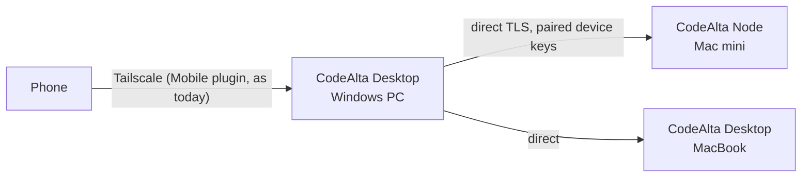
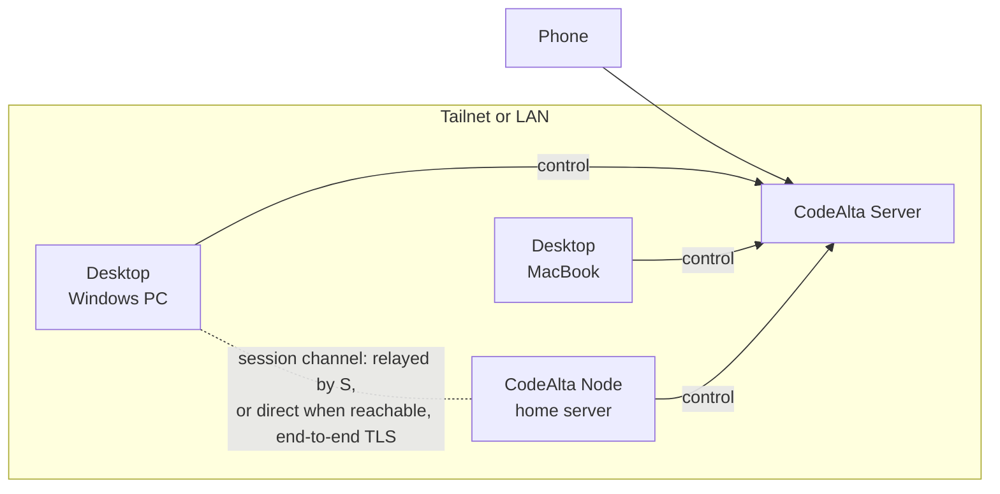
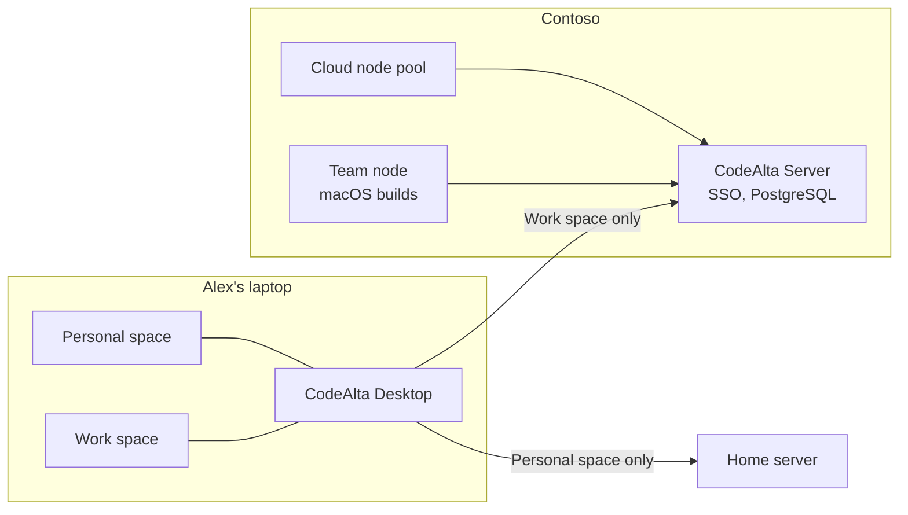
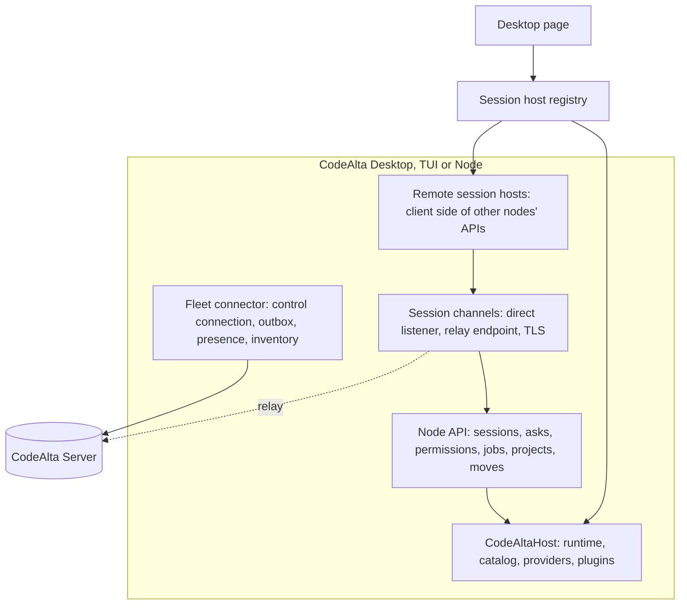

# Fleet architecture

How CodeAlta grows from one host on one computer to many hosts on many computers, and what each part owns. The
plan and its vocabulary are in the [readme](readme.md); this page is the structure the other documents build on.

## What CodeAlta already gives us

The fleet is mostly an extension of invariants the runtime already keeps. Each one below is load-bearing.

| What exists (see [runtime](../runtime.md), [catalog](../catalog-and-config.md)) | What the fleet does with it |
| --- | --- |
| **Journals are the truth**: one append-only JSONL file per session, the database is a projection | A session that moves ships bytes; a replica follows a journal by shipping what was appended; any host can rebuild its projection from a journal it receives. |
| **One writer per session**: the session actor in a process, the OS-held lease across processes (`SessionLeaseStore`) | Extended to one **owner node** per session across machines, with an ownership epoch that fences a stale owner. |
| **Owned session commands bind to exact identities** (host epoch, session, runtime instance, attachment generation, run, client retry key; `OwnedSessionCommandService`) | Already safe over a network: a retry with the same key returns the first receipt, a stale view is refused instead of retargeted. Remote commands reuse them unchanged. |
| **Display projection**: full replacements with a revision and a gap flag (`RuntimeDisplayProjection`) | A lossy remote stream that can never become inconsistent: a slow or reconnected viewer gets the latest state, not a backlog. |
| **History windows** of a journal with cursors (`WorkspaceHistoryRpc`) | Remote timelines read in bounded windows; a long session never crosses the network whole. |
| **Headless faces** (`HeadlessSessionDriver`, `altacli`) | The node is the headless host that is missing: it owns a state root like Desktop does, with no window. |
| **Following sessions another process writes** (`ExternalSessionFollower`) | The model for showing sessions whose writer is elsewhere: project what grows, never take ownership silently. |
| **The Mobile plugin**: a remote session API over HTTP, pairing by QR code, a key per phone, only hashes on disk, Tailscale Serve | The first remote client of CodeAlta. Its API is the seed of the node API, its pairing the seed of device pairing. |
| **Spaces**: a setup and an identity per group of projects; a session's space is fixed at creation | The unit of what an instance publishes, and to which server. A Work space links to the company server, a Personal space to the home server. |
| **Space containment, no wider tools, permission modes never widened** (`alta` safety rules) | The same rules, across machines: an agent never gets more on another computer than it has on its own. |
| **The sandbox** (mxc: ProcessContainer, Seatbelt, Bubblewrap) | Confines sessions on machines that run work for others or that an agent started remotely. |
| **Claude Code cloud and teleport** (`claude --cloud`, `--teleport`) | The user-facing model of "move this session", and a reminder that agents with their own loop keep their own conversation. |
| **Statistics facts** per session and quarter hour, additive | Fleet usage roll-ups without content. |
| **Traces** (`ActivitySource` `CodeAlta.Agent`, no content unless asked) | Fleet traces across machines with the same rule. |

## Components

| Component | Executable | Role in a fleet |
| --- | --- | --- |
| CodeAlta Desktop | `alta` | A node while it runs (its sessions are visible and drivable from other devices when its space allows it), and the **console of the fleet**: machines, sessions, people, setup, administration. |
| CodeAlta TUI | `altatui` | A node while it runs. No fleet console (no new TUI features, see `AGENTS.md`); it keeps working beside the rest. |
| CodeAlta CLI | `altacli` | Unchanged: runs beside an instance of its machine. Later, `altacli` may drive remote nodes for scripts. |
| **CodeAlta Node** | `altanode` (new) | A headless CodeAlta host that runs as a service: the always-on machine, the build Mac, the cloud VM. Same runtime, providers, tools, plugins and sandbox, no window. |
| **CodeAlta Server** | `altaserver` (new) | The coordinator: identity, devices, directory and presence, routing and relay, session ownership, what people share, policies, audit, notifications. It runs **no agent** and reads **no content** it was not given. |
| Mobile page | served by Desktop today | The phone. Served by a node today (Mobile plugin); later also by the server, to reach the whole fleet. |

Names are proposals ([readme](readme.md#naming)).

## Three topologies

Each is optional and builds on the previous one; the protocol between a viewer and a node is the same in all three.

### 1. Paired machines (no server)

Issue [#284](https://github.com/CodeAlta/CodeAlta/issues/284). A desktop pairs with a node, or with another desktop,
by scanning a code, and talks to it directly over the LAN, Tailscale or an SSH tunnel.

### 2. A home fleet with a server

An always-on machine runs CodeAlta Server (and usually a node). Every device keeps one outbound connection to it.

### 3. An organization

The server runs where IT runs services (a VM, a container platform, on premises), with SSO. Developers' machines,
team build machines and cloud nodes connect to it. A developer's instance can be in two fleets at once, one per
linked space.

## Who owns what

Every fact has exactly one writer. That is what makes offline work and reconnection simple: there is nothing to
merge, only facts to replay.

| Fact | Single writer | Others hold |
| --- | --- | --- |
| A session's journal, live state, queue, asks, jobs | Its **owner node** | Viewers: display replacements and history windows, read through the owner |
| Which node owns a session, and its ownership epoch | The server (the source node in paired mode) | Nodes: their own sessions' epochs |
| A node's inventory: projects, capabilities, providers' readiness | The node | The server: the last publication |
| Presence (who and what is online) | The server, in memory | Clients: what they watch |
| People, teams, roles, policies | The server (admins) | Nodes: the policies that apply to them |
| Shares, project channels, messages | The server | Devices: caches |
| A device's private key | The device, never exported | The server: the public key and status |
| Model provider and Git credentials | Each node, for itself | Nobody |
| Preferences of a person | Their devices (local storage, as today) | Optionally synced later |

## Connections

- **The control connection.** Every device that belongs to a fleet keeps one outbound WebSocket to the server:
  presence, publications from its outbox, the directory it watches, routing and relay. No device needs an inbound
  port when there is a server.
- **The session channel.** A viewer that opens a session of another node talks to that node over a channel with
  TLS 1.3 between the two devices, authenticated by their device keys. With a server, the channel is **relayed** by
  default (the path that always works) and **direct** when the node is reachable (same LAN, same tailnet); paired
  machines without a server are always direct. The server relays opaque bytes: it does not hold the keys. No
  peer-to-peer hole punching: it mostly fails through home routers. Details: [protocol](protocol.md).
- **Bulk transfers** (a session that moves, a replica) use the session channel too, with flow control.

## Inside a host

New code, by layer (names to confirm in the first sub-plan):

| Project | Owns | Depends on |
| --- | --- | --- |
| `CodeAlta.Fleet.Protocol` | Message contracts (source-generated JSON), framing, versions, error codes | nothing of CodeAlta |
| `CodeAlta.Fleet` | Fleet connector, outbox, node API over the runtime, remote session hosts, session channels, session bundles | Orchestration, Catalog, Fleet.Protocol |
| `CodeAlta.Node` | The `altanode` executable: headless host, service integration, pairing and enrollment commands | Hosting, Fleet |
| `CodeAlta.Server` (+ storage packages) | The `altaserver` executable: ASP.NET Core coordinator, identity, storage, relay, web pages | Fleet.Protocol only |
| `src/CodeAlta/Desktop/Fleet`, `frontend/src/fleet` | Fleet console, remote sessions in the window, setup wizard | Fleet |

Two boundaries matter and get guardrail tests (`ArchitectureGuardrailTests`):

- **The server never references the agent runtime** (`CodeAlta.Agent`, `CodeAlta.Orchestration`). It cannot run an
  agent or read a journal by accident.
- **The runtime does not know the fleet.** Orchestration gains what any host needs (export and import of a session,
  a relocation record, an ownership check before attaching), not the network.

## The desktop: one session host abstraction

Today the page's session services (`Desktop/Rpc/`) call the `CodeAltaHost` of the process. The fleet introduces a
**session host registry** in the desktop host: the local runtime is one host, each remote node another. A session id
stays a global GUID; a session that is not local carries the node that owns it. The RPC services resolve the host
of a session and forward to it; the page draws a remote session with the same components, plus a machine chip.

What a remote session supports at first: the list, the timeline (history windows), the live display, send, queue,
steer, stop, answers to asks and permissions, background jobs and their output, a new session on that node, and
moves. Not at first: the code editor, terminals and the Changes view on remote files. They need remote file access
(a later milestone, see [roadmap](roadmap.md)); a session's own file changes are in its journal and show anyway.

The same registry gives **client mode**: a desktop started on a machine whose profile is held by a local node opens
the node as a host over loopback, so sessions keep running when the window exits.

## Offline and failures

Nodes are autonomous: the server adds visibility and reach, it never gates local work.

| Situation | What happens |
| --- | --- |
| The server is down or unreachable | Every node keeps running its sessions and its automations. Outboxes fill (bounded, then summarized). Direct channels between devices that can reach each other still work. On reconnection, outboxes replay from the last acknowledged sequence; nothing is duplicated (idempotent by node and sequence). |
| A node goes offline | Its sessions show as offline with their last known state, and wait: requests to them fail with a retryable "machine offline", never silently. Nobody else may write them. A person can **take over** a session from its replica (milestone 3), which fences the old owner. A machine has two states, kept apart: its enrollment (active, paused, revoked) and its connection (online, asleep, offline). |
| A viewer loses its channel | It reconnects and asks for the current display replacement and the history after its cursor. A command it sent is retried with the same key and answered with the same receipt. |
| Two nodes believe they own one session | Cannot happen through moves (the server commits one epoch). After a forced takeover, the old owner learns on reconnection that its epoch is stale, stops writing, and keeps its divergent tail as a fork. |
| Version skew | The protocol negotiates a version range; a node one minor version behind keeps working, a feature it lacks is unavailable, never misbehaving. |
| Clock skew | Ordering never relies on clocks: sequences and epochs order facts; times are for display. |

## Bounds

Principle 8 of the [architecture](../architecture.md) holds across the network: per-delta work never grows with the
history, the number of sessions or the number of machines. Streams are bounded and lossy where a replacement
follows (display), lossless with credits where every byte counts (bundles, replicas). A node publishes session
states coalesced (at most a few per second per session), never per token.
