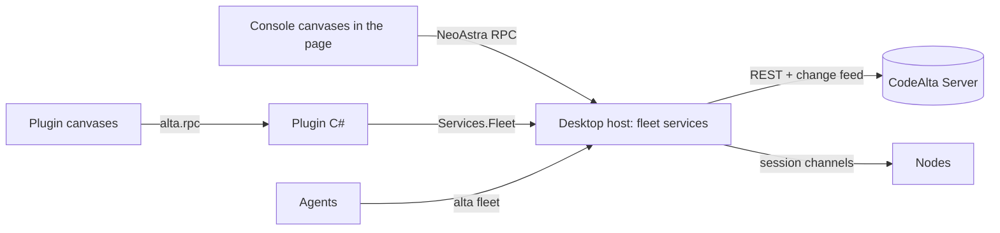

# CodeAlta Desktop, the console of the fleet

CodeAlta Desktop is where a person manages their fleet: machines, the server, sessions, automations and runs,
statistics, people and access. The server provides a complete REST API and no administration interface of its own;
the desktop integrates that API into the same Agentic Development Environment as everything else, and plugins can add
whatever a team needs on top of it.

## Why the desktop, and what it costs

**Why.** One environment instead of two:

- The desktop already runs everything the fleet needs to show and drive: sessions, timelines, canvases, charts,
  graphs of Code Mode runs, Monaco, terminals, the setup of providers and identities, the `alta` tool. A web
  administration would duplicate a large part of it, in a second stack to build, test, translate and secure.
- **Plugins** extend the console with the same API as the rest of CodeAlta: a team builds the canvas it needs (an
  incident board, a release dashboard) without waiting for CodeAlta to ship it.
- **Agents** can operate the fleet: the same operations are `alta fleet` commands, so "pause the night automations of
  the build Macs" is a prompt, within the person's access.
- **The server stays small**: an API service with a few web pages has less code, fewer dependencies and less attack
  surface than one that also serves an administration application.

**What it costs**, said plainly:

- Managing the fleet needs CodeAlta Desktop installed; an administrator without it uses the API, `altacli fleet`, or the
  phone page for the urgent part.
- Some flows are web by nature and stay on the server: setup, sign-in (passkeys and SSO redirects), device approval, and
  the phone page.
- A browser administration is not planned. Because the server is API-complete (below), one can be written later, by
  the project or by anyone, without changing the server.

## The server is API-complete

Every operation of the console goes through public, documented protocols, with the same access rules
([access control](access-control.md)):

- **management** (machines, automations, runs, statistics, people, grants, policies, audit) through the REST API
  ([protocol](protocol.md#the-servers-rest-api)), described by an OpenAPI document published with each server version;
- **what reaches a session's content** (driving a session, a move, a setup terminal) through the session-channel
  protocol, end to end with the node, documented as well and shipped as a client library;
- the console has no private endpoint and no capability these lack; `altacli fleet`, plugins, scripts and integrations
  reach everything the console reaches, under their own grants;
- **actions that need a person's authority** (a remote start, an approval, enabling an automation) need a person's
  device key whatever the client: an integration token can read and manage what it was granted, never act for a person.

The rule is guarded by tests that play complete journeys (enroll a machine, publish and run an automation, answer an
approval, read statistics) through the public client library alone.

## How it is built

- **The host holds the connections and the credentials.** The page never calls the server: it talks to the desktop
  host over NeoAstra RPC, as for everything else, so tokens and keys stay in the host process and the page's content
  security policy stays `connect-src 'self'` ([desktop](../desktop.md#security-boundaries)).
- **The console is a built-in plugin** (`fleet`) of canvases, as Statistics is: it uses the public plugin API, which
  keeps that API honest for the plugins of others.
- **Live**: canvases follow the server's change feed through the host, and redraw what changed; sealed names (titles,
  projects of Private spaces) are decrypted in the host before they reach the page.
- **Sessions of other machines** are not a canvas: they are ordinary session tabs, through the session host
  abstraction ([architecture](architecture.md#the-desktop-one-session-host-abstraction)).

## The canvases

| Canvas | What it shows and does |
| --- | --- |
| **Fleet** | The overview: machines online, sessions at work and the ones that wait (mine first), runs in progress, alerts, cost today |
| **Machines** | Each machine: state, version, readiness per space, providers, labels, load, logs, a setup terminal, enrollment and revocation, update |
| **Automations** | Automations by scope, the calendar of next runs across machines, runs and their states, a run's page with its trigger, graph, approvals and sessions ([orchestration](orchestration.md#in-the-console)) |
| **Statistics** | Today's Statistics canvas with a scope: this machine, my fleet, a team, the organization, an automation, a machine ([statistics](statistics.md#in-the-console)) |
| **People and access** | People, teams, roles, grants, service identities, transfers, devices, enrollment tokens, who can do what |
| **Providers and secrets** | Organization providers and gateways; the secrets, variables and environments of each scope, which machines hold them, approvals that wait, rotation ([secrets](secrets.md)) |
| **Policies and budgets** | The signed policy, its rules and versions, the kill switch, budgets and their consumption |
| **Audit** | The audit log, filtered and exported, and the check of its chain |
| **Server** | Health, version, connections, storage, backups and restore, updates, sign-in methods, SSO |

- **Updates** today: the Fleet canvas shows the version of each machine; Settings > Fleet > Server shows the server's
  version and policy, **Update the fleet…** (a version, now or at a time, the machines), the last campaign with each
  machine's state and **Cancel**, and **Policy…** ([deployment](deployment.md#updates)). Machines paired directly,
  without a server, are updated on them (`altanode update`).
- **Policies and audit** today: Settings > Fleet > Policies (the kill switch first, set and lifted by a signer in one
  confirmed action; the rules; the versions) and Settings > Fleet > Audit (the timeline by day with its filters, the
  check of the chain, exports in CSV and JSON Lines); while a stop holds, the title bar of the window says so.

- Each canvas exists in the application scope; some also in a project's scope (the automations, runs and statistics of
  a project) or a machine's.
- A household sees Fleet, Machines, Automations and Statistics; the others appear under **Advanced** or for roles that
  need them.
- A **Fleet** button in the title bar shows the fleet's state (machines online, what waits for me) and opens the Fleet
  canvas; the search (`Ctrl+P`) reaches every canvas and action.
- The setup assistant ([deployment](deployment.md#the-setup-assistant)) is part of the console, and so is everything a
  machine's owner manages after it: a machine's row opens its page (state, version, what each device may do, projects,
  providers and their readiness, automations it holds, log, update, revoke), and what waits for a person (a device to
  approve, a machine that fell behind, a sign-in that expired) is shown where they look, with the button that settles it.

## Plugins

- `Services.Fleet` gives a plugin a typed client of the REST API and the change feed, through the host, with the
  person's grants: listing machines, querying statistics, creating an automation, answering an approval.
- A plugin declares what it uses: reading the fleet is granted with the plugin; changing it (creating, deleting,
  granting, approving) needs the plugin to declare it and the person to accept, and every change it makes is audited as
  made through that plugin. These declarations are **consent and audit, not confinement**: a plugin is code with the
  person's rights in the desktop process ([plugins](../plugins.md)), so it can reach anything the person can.
- An organization can **offer** plugins to its members; a person installs them knowingly, and a desktop that also
  holds personal spaces never receives one by policy alone.
- Examples the samples will show: a team dashboard, an incident board fed by a trigger source, a cost report.

## Agents and scripts

- `alta fleet` (machines, sessions, automations, runs, statistics, access) maps the API one to one for agents, within
  their person's access and the agent rules of [access control](access-control.md#agents-and-access): changing access is
  read-only for agents, and what would run unattended stays disabled until a person enables it.
- `altacli fleet` gives the same commands to scripts and CI jobs, with an integration token or the person's device.
- **A built-in `codealta-fleet` skill** teaches agents to use the fleet well: which machine fits a task (capabilities,
  labels, readiness, load), starting and steering work elsewhere (`--machine`, Run on, moves), placing and checking
  automations, reading statistics, updates and health, managing machines a person owns, and the rules agents keep
  (what needs a person, what stays read-only). It explains the important commands in plain words, with the job each one does,
  and sends the agent to `alta fleet --help` (and `alta fleet <command> --help`) for the full list and the options, so
  the skill stays short and never goes out of date with the commands.

## The phone and the TUI

- **The phone** shows the Fleet view, what waits for its person (approvals, questions), runs, and **Run now**; it does
  not administer. In Private spaces its page comes from a machine the person owns, never from the server
  ([security](security-and-privacy.md#channels)).
- **CodeAlta TUI** gets no console (no new TUI feature): it is a node like the others when it runs.
