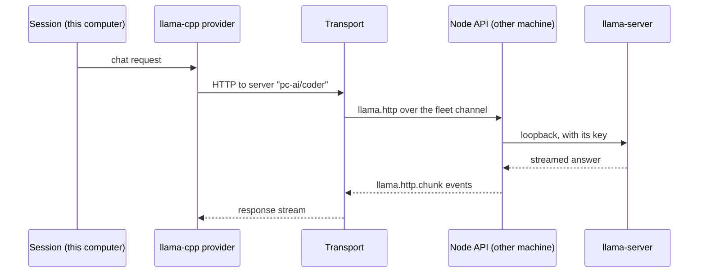

# Model servers

CodeAlta runs llama.cpp (`llama-server`) on the machines of a person: it chooses and installs the build that suits each
machine, downloads GGUF models from Hugging Face, supervises the servers, updates them, and gives the sessions of the
person's computers a provider for each. This page says who owns what, the main flows and what must hold.

## Responsibilities

| Part | Owns |
| --- | --- |
| `CodeAlta.ModelServers` | The model host of one machine (`ModelHost`): its hardware inventory, its builds of llama.cpp, its models and their downloads, its servers and their processes, its update policy and schedule. It knows no window, no fleet and no session. |
| `CodeAlta.Fleet` | The node API of the model host (`control.llama.*`, `llama.http`, the events `llama.changed` and `llama.ended`), the permissions it checks, and the transports by which a provider reaches a server of this machine or of another one. |
| CodeAlta Desktop | The model host of this computer, the view of the paired machines (`DesktopModelServers`), the page Settings > Fleet > Model servers, the Discover models canvas, and the `alta llama` commands over all of them. |
| CodeAlta Node | The model host of its machine, its node API, and `alta llama` for its own sessions, over that host only. |
| `CodeAlta.LiveTool` | The `alta llama` commands and their rules, over `IAltaModelServers`. |
| `CodeAlta.Catalog` | The `server` key of a `llama-cpp` provider, which names a server instead of an address. |

One action vocabulary (`ModelHostAction`) is shared by the page, the node API and `alta llama`: what one can do, the
others can, and a machine runs the same code whoever asks.

## Storage

- Models live in the Hugging Face hub cache of the machine (`HF_HUB_CACHE`, `HF_HOME`, else the default), in its own
  layout (`models--org--name/{blobs,snapshots,refs}`): llama.cpp and other tools find them, and two quantizations of a
  repository share their common files. A model is removed through its snapshot only; a blob another model uses stays.
- Builds and the settings of the machine are under `~/.alta/llama`, shared by the instances of a profile. Servers, their
  keys, logs and runs are under the state root of the instance, so that the developer instance never touches the servers
  of the normal one.
- A download writes `<sha256>.incomplete` with a journal of its ranges, and becomes a blob only once its digest matches.

## Builds

The latest stable release of llama.cpp names a build (`bNNNNN`); the channel can follow every build or stay on one. The
choice of a backend is a pure function of the hardware inventory and of the release (`BuildSelector`): CUDA by the
version the driver supports, ROCm by the GPU architecture and the libraries found, Metal on Apple silicon, Vulkan where a
loader exists, CPU last. An install checks the digest of each asset, extracts beside the target, runs `--version` and
`--list-devices`, and refuses a build that sees no GPU of its backend. The previous build is kept for a way back; a build
that failed its test is marked and not offered again.

## Servers

A server of several models runs `llama-server` in router mode: a preset names each model by its path in the cache, the
router loads them on demand within `--models-max` and frees the least used. A server of one model runs it directly. Every
server listens on loopback with a key of its own; its cache folder is its own and empty, and it runs `--offline`, so
llama.cpp never downloads anything by itself. The model host starts processes detached from its own pipes, writes the
log to a file, follows them every two seconds, restarts a failed one with a growing delay, and says why from its log.

A server can outlive its host (CodeAlta Node always, CodeAlta Desktop when asked): the host records what it started and
takes it back at its next start, by process id and start time.

## Updates

An update installs the new build beside the current one, waits for the servers of that backend to be idle (one hour at
most), switches them, and tests each with a short completion. A failed test switches back and marks the build. A policy
is kept by each machine (manual, daily or weekly at a time of the machine), and an update planned at a time is kept by the
machine too: none depends on the computer that asked being on. Updating several machines from CodeAlta Desktop goes one
machine after another and stops at the first failure.

## Reaching a server

A provider names its server (`local/<id>`, `<machine>/<id>`); the transport of this computer resolves it, so no address
or key of a server is in the configuration. The node forwards only the paths of inference, never the router's
management, and only for a server whose access lets the person's computers in. The context the model runs with, which
the router does not report, is added to `/v1/models` by the model host from what its slots say.

## Permissions

- The owner of a machine and a device with Manage change its model servers; a device with View reads them.
- A device with Models (on at pairing) uses the servers whose access is `my-computers`, and nothing else.
- `alta llama` refuses what downloads code or starts a program (an install, an update, a server that starts, a test) to a
  session without the shell or whose commands are reviewed; a sandboxed session reads only. Removing a model or a server
  and changing the policy are left to the person's request.
- The end of a download, an install or an update an agent started is sent to its session as the end of a background job.
