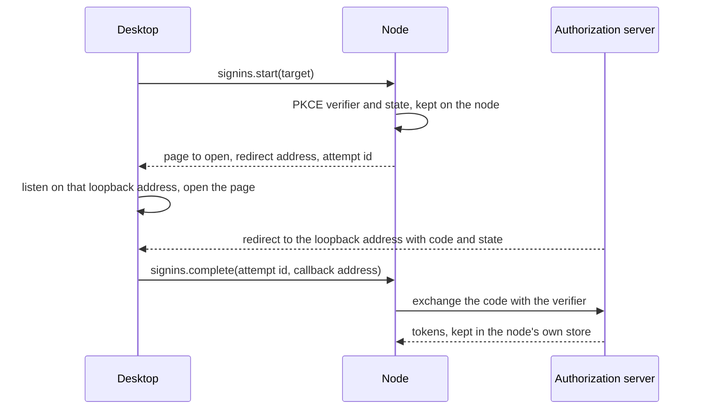

# CodeAlta Node

The headless CodeAlta host: the always-on machine at home, the Mac that builds iOS, a cloud VM. It answers issue
[#284](https://github.com/CodeAlta/CodeAlta/issues/284)'s "headless mode". Its names (`CodeAlta Node`, `altanode`)
are decided ([readme](readme.md#naming)).

## What it is

`altanode` is `CodeAltaHost` without a window: the same runtime, catalog, providers, tools, plugins made for headless
hosts, sandbox, Code Mode, automations, jobs and reminders, plus the fleet connector and the node API
([architecture](architecture.md#inside-a-host)). It owns a state root and its lock, as Desktop and TUI do, so it is
**the** instance of its profile on that machine.

What it is not:

- not `altacli`, which runs one prompt beside an instance and never owns the state root;
- not a server: it runs agents; the coordinator is [CodeAlta Server](server.md), a separate process that can run
  on the same machine;
- not a UI: it is driven from CodeAlta Desktop, the phone, or `altanode` commands for the basics.

## Commands

| Command | What it does |
| --- | --- |
| `altanode run [--port <n>] [--bind <address> \| --listen-all \| --no-listen]` | Runs in the foreground (logs to the console). What a service starts. Listens for paired devices on port 2585 of loopback by default. |
| `altanode install [--user \| --system [--account <name> [--password-stdin]]] [run options] [--dry-run]` | Installs and starts the service of this OS (below), which runs `altanode run` with the options given. `--dry-run` prints the definition and the commands. |
| `altanode uninstall [--system [--account <name>]]` | Stops and removes the service; keeps the profile. |
| `altanode secrets key-file` | Moves the key of the node's secrets from the Keychain or libsecret into a private file, for a node started at boot. |
| `altanode pair` | Shows a pairing code and QR code (in the terminal) for a desktop to scan. The first slice prints the `codealta-pair://` link only, and waits until a device redeems it or it expires. |
| `altanode join <server-url> [--token <enrollment>]` | Enrolls in a fleet: with an enrollment token, or by a device code a person approves. |
| `altanode status` | Where the node listens, its paired devices, the sessions at work, its versions and its update, the service, and whether it will still run after a restart or a logout. Later: the fleet connections, the providers' readiness. |
| `altanode logs [--follow] [--lines <n>]` | The node's log (`logs/altanode.log`), followed across its daily rolls. |
| `altanode devices`, `revoke <device>`, `permissions <device> [--allow <list>] [--deny <list>]` | The devices paired with the node: name, short fingerprint, permissions (`view`, `drive`, `start`, `move`, `automate`, `manage`), paired and revoked dates. A revoked device is disconnected at once; one that loses a permission is disconnected and reconnects with what it may do. Without a running node, they change `fleet/trusted-devices.json`. |
| `altanode projects [list]`, `add <path>`, `clone <url>`, `remove <project>` (`--space <space>`) | The projects of the node's catalog: an existing folder added, a repository cloned into `~/code/<host>/<owner>/<repo>` (the clone-on-demand of moves), a project removed from the catalog with its files left. Through the running node's local control (`control.projects.*`), which keeps a project that has sessions; otherwise on the catalog files of the profile. |
| `altanode update [--version <v>] [--source <feed>] [--check] [--now]` | Downloads a version (the latest release, a prerelease when one runs), checks its hash, and switches to it when the node is idle; the new version runs on trial and is rolled back if it does not confirm ([deployment](deployment.md#updates)). Later: the version the fleet recommends. |
| `altanode machines`, `connect <link>`, `remote <machine> info\|sessions\|history\|send\|create\|watch` | The client side, for testing until the desktop does it: the machines this profile paired with, pairing with a node from its link, and its sessions. They read only the device key and `fleet/paired-machines.json` (written under a lock file), so they run beside a desktop or a node on the same profile. |
| `altanode remote <machine> move <session> [--move-id <id>] [--clone]`, `altanode moves` | A session of a paired machine moves to the node of this profile (which runs, and which the machine lets this device move sessions to it): the machine gives it through `moves.start`, the command forwards the target's methods to the node over its local control. The same `--move-id` goes on with a move that stopped. `moves` lists the move records of the profile (`fleet/moves`). |

`altanode pair`, `status`, `devices`, `revoke`, `permissions` and `uninstall` are the owner's local control of the node
that runs on the same profile: the node writes where it listens in `fleet/node-listener.json` of its state root, and
they open a session channel to it with the node's own device key, read from the profile. The node accepts its own key
only from this machine, and only for the `control.*` methods (pairing offers, status, devices, a graceful stop): the key
file, which only the owner of the profile can read, is the credential, with no token or second endpoint.

**Managing from a desktop.** A paired device with the `manage` permission calls the same `control.*` methods from
elsewhere, pairing and stopping the node excepted: status, devices and their permissions, revocations, projects, the log
(`control.log`), the self-update (`control.update`, as `altanode update`, its switch recorded as asked by
`manage:<device>`), and joining a server (`control.servers.join`, as `altanode join`, with a token the managing device
made; the node enrolls with its own key, so that the device approves the node by the id the node gave it). It is what the machine page of CodeAlta Desktop uses, so that managing a node never needs its
terminal. `manage` is given only when asked: to the device a pairing link made with `altanode pair --manage` adds (the
desktop's **Add a machine** over SSH makes one when the person ticks **Manage it from this computer**, off by
default), and by a device that has it or the owner on the machine (`altanode permissions <device> --allow manage`); a
device paired again keeps it. Being the first device that pairs gives nothing more: a plain link seen by someone else
never hands over the node's devices, secrets and updates. Each call is
checked against the trusted devices at that moment, as every other method is; a member of the organization reached
through a server's relay never has it. The answer to a manager that reduces or revokes its own device goes first, then
its channel closes.

## Running as a service

Agents run as an OS user, and the credentials they use (Git, SSH, `gh`, the Claude Code login, cloud CLIs) live in
that user's home folder and keychain. So the node runs **as the user whose credentials it uses**, or as an account of
its own whose credentials are its own, never as root or LocalSystem.

| OS | In the login session of a person (`install`) | At boot, without a login (`install --system`) |
| --- | --- | --- |
| Windows | A task at logon of the user (Task Scheduler). A Windows service would run in Session 0 and not see the user's Credential Manager, ssh-agent or Git Credential Manager | A Windows service, under a virtual account of its own (`NT SERVICE\altanode`, no password, its profile under `%ProgramData%`) or under the person's account, whose password Windows keeps |
| macOS | A LaunchAgent of the user: it runs in the login session, with the keychain | A LaunchDaemon with `UserName`: the person, or a dedicated account. It has no login keychain |
| Linux | A `systemd --user` unit with lingering on (`loginctl enable-linger`), so it runs without a login; libsecret needs a session bus, so prefer tokens in files the node protects | A system unit with `User=codealta` (`Microsoft.Extensions.Hosting.Systemd`, `Type=notify`, watchdog) |

**One node per OS user.** A machine several people use runs one node per person, never one privileged node acting
for everyone. A dedicated machine gets its own OS user (`codealta`) with its own logins, set up from the desktop.

- The installer writes the unit with restart on failure, and a bounded log under the state root. It starts the
  executable from a stable path: a .NET tool from its shim (`~/.dotnet/tools/altanode`, a symbolic link on macOS and
  Linux, `altanode.cmd` on Windows), which `dotnet tool update` points at the new version, never from its versioned
  folder under `.store`, which the update deletes. That entry point runs the version `altanode update` selected as
  its child, so an update never rewrites the service ([deployment](deployment.md#updates)). launchd and systemd units get the installer's `PATH` and `DOTNET_ROOT`, since they start with almost none.
- On Windows the task runs `conhost.exe --headless` (no console window) at logon, with a time trigger that starts the
  node again within 5 minutes if it stopped (`conhost` hides the node's exit code from Task Scheduler). Windows runs
  the `.cmd` shim through `cmd.exe`, so `install` refuses an option `cmd.exe` would change (`"`, `%`, `&` outside a
  quoted value). `uninstall`
  deletes the task, then stops the node through its local control.
- **A user service depends on a login** on Windows and macOS: after a restart nothing runs until the person signs in,
  and signing out stops it. It is right for a workstation that also serves as a node, and for a Mac that signs iOS
  builds, which needs its login keychain. A machine that must come back by itself gets the system service. The desktop's
  SSH setup offers it as **Always on**: on macOS the LaunchDaemon as the person, on Linux lingering. On a Mac nobody is
  logged in to, a user install writes the agent and says it starts at the next login, rather than fail.
- **The Windows service is the launcher.** The process the service manager starts is always the launcher, which never
  exits during an update. On Windows it answers the Service Control Manager (`run --service`, `ServiceBase`), and turns a
  stop or a shutdown into the graceful stop of the version that runs, through its local control, killing it only after a
  bound. The service is registered with `sc.exe`; the password of a named account goes to Windows through its API and
  nowhere else: no file, no log, no command line. The Control Manager cannot start the `.cmd` shim of a .NET tool, so a
  tool install registers the program the shim starts, in the folder of the tool.
- **A service without a login has no login keychain or session bus.** The secrets key of a person's store moves
  from the Keychain or libsecret to the store's private file (`secrets key-file`), run as that person: the values keep
  their key. The SSH setup does it for **Always on**, and `install --system` says when it is needed.
- A node keeps the machine awake while sessions work (as `DesktopKeepAwake` does), and lets it sleep when idle
  unless the owner says it is always on.
- Exit is graceful: admission closes, running turns finish or stop after a bound, journals are flushed; a session
  interrupted by a stop is resumable, as after a crash today.

## What a node publishes

| Inventory | Content | Who sees it |
| --- | --- | --- |
| Identity | Node id, name (editable), owner or team, OS, architecture, CodeAlta version | The fleet |
| State | Online, busy (sessions at work), always-on, last seen | The fleet |
| Capabilities | Sandbox backend available, tools found on `PATH` (git, gh, dotnet, node, python, xcodebuild, docker...), CPU and memory class, free disk | The fleet |
| Tags (stored as `labels`: `fleet/labels.json`, the inventory) | Set by the owner (`always-on`, `ios`, `gpu`...) | The fleet |
| Providers | Keys, types, readiness, models (never a credential) | The owner's devices; the fleet sees readiness only |
| Projects | Repository keys, branches checked out | The fleet sees the keys (for matching); paths and branches go to the owner's devices only |
| Spaces | The linked spaces whose sessions it publishes | The server of each space sees only its own |

## Credentials on a node

The fleet never copies a secret from one machine to another ([security](security-and-privacy.md#credentials)).
Each node signs in by itself; the desktop drives the sign-ins so that nobody has to sit at the server.

| Need | How the node gets it |
| --- | --- |
| Providers CodeAlta signs in (Codex subscription, Copilot, xAI, Mistral Vibe) | Signed in from the desktop ([below](#signing-in-from-the-desktop)); tokens stay in the node's `~/.alta/auth/` |
| Providers with an API key, and any other token a run needs | A secret of the node's store ([secrets](secrets.md)): typed by the person from the desktop and sent over the end-to-end channel, or a secret of a space, a team or the organization sealed to the node; kept in its protected store (DPAPI, Keychain, libsecret), or named as an environment variable of the service |
| Claude Code | `claude setup-token` run by the node in a pseudo-terminal (`script` on macOS and Linux, ConPTY on Windows); the token it prints is a secret of the node's store, named by the provider's `CLAUDE_CODE_OAUTH_TOKEN` (`${secret:NAME}`) |
| Codex CLI, ACP agents | The sign-in method of their plugin: Codex CLI's device code is shown by the desktop; an ACP agent's API key (`env_var`) is typed on the desktop and kept as a secret of the node, which its `env` names (`${secret:NAME}`, resolved when its runtime starts); an agent that signs in in a terminal or with a browser on its own loopback signs in on the machine |
| MCP servers with OAuth | Signed in from the desktop; tokens stay in `~/.alta/auth/mcp/` ([MCP](../mcp.md#runtime)) |
| Git over SSH | A key made on the node; its public key added to the Git host (`gh ssh-key add`, or copied by the person); the space identity names it. Organizations can sign short-lived SSH certificates instead (milestone 5) |
| GitHub | `gh auth login` with a device code, per space profile, run by the node on behalf of the desktop; with a server, the CodeAlta GitHub App's device flow gives the node expiring user tokens (8 hours, refreshed for up to 6 months) |
| Cloud CLIs | The login command of the space's CLI profile (`gh`, `glab`, `az`, `aws`, `gcloud`), checked by its check command |
| Organization providers (API keys or gateway keys for unattended runs) | Sealed by the server to this node's key when an admin allows the node to use them; kept in its protected store; lent only to runs of the scopes that may use them ([orchestration](orchestration.md#credentials-of-unattended-runs)) |

### Signing in from the desktop

Every sign-in a node keeps for itself is made from the machine page, with the browser of the person's computer. The node
starts and completes it, so that the token is never on the desktop:

- **The node names the redirect address**, a loopback address of the desktop, and keeps it per target; the desktop
  listens there and forwards the whole callback address. The code is useless without the verifier the node holds.
  A device code or a code the person pastes takes the same path, started and completed by the node. A sign-in that
  needs no redirect (Mistral Vibe) only has its page opened by the desktop, while the node asks the service until it is
  done; a value the person types (an API key) goes once to the node, which keeps it as a secret and never gives it back.
- **Tools sign in through an allowlist of login commands, never a shell**, run with the identity environment of the
  space. The node reads the page and the code from their output and writes the pasted code to their input; when it
  cannot read a tool, the answer is the command to run on the machine. A tool keeps its own login.
- **Who.** The owner on the machine, and a device paired with `manage`; never a member reached through a server's relay.
  One attempt per target at a time, expiring after 15 minutes, logged with the device and never with a token.
- **Personal plans serve their owner only.** A session another person starts on a machine (`OwnSessionsOnly` devices:
  a team machine, a person a personal machine lets in) cannot run on a provider that runs with a personal plan, nor can
  its sub-sessions, fallbacks and model tiers; the node refuses at every attachment of a provider to a session, and the
  start dialog lists the account providers only ([security](security-and-privacy.md#credentials)).

**Readiness.** For each linked space, the desktop shows whether the node is ready to run its sessions: the identity
**Check** of the space run on the node (who Git commits as, whether keys exist, which GitHub account), and the
providers of the space that are ready there, with **Set up…** beside what is missing. It also answers two questions
a household asks: **Will this still run after a restart or a logout?** (the kind of service, automatic login,
lingering; the node answers it in `control.status`, from what `ServiceManager` reads of its own service, and the page
shows **Start at boot** with the command that fixes it) and, for an automation, **Why can't this machine run it?** (credential kind, tools, sandbox, project,
tags, its local policy).

## Automations and statistics

- **Automations run on nodes.** The automation engine leaves the desktop (where it runs today) for a library every
  host runs, so a node fires schedules, polls triggers with its credentials, claims runs with a lease, and checks each
  run's signed automation version, its credential kind and its own local policy before starting it
  ([orchestration](orchestration.md)). It keeps the schedules assigned to it, to fire them while the server is
  unreachable.
  - What a paired device assigns (`automations.put`, the `automate` permission, off at pairing) is kept apart from the
    profile's own automations (`fleet/assigned-automations.toml`), with who assigned which fingerprint. It runs while
    that device keeps the permission and only as it was assigned: a copy changed on the node by anything else does not
    run. A command trigger is never taken from another device.
  - Each due time is claimed once with a lease (`fleet/automation-claims.json`), so a time fired twice or caught up
    after a restart runs once; a claim is never taken again (at most once).
  - Before a run starts, the node reads its policy (`fleet/automation-policy.json`: automations on or off, credentials
    `any` or `account` only; a policy file that cannot be read runs nothing) and derives the credential kind from how
    the provider starts; `unknown` is refused, and a refused run is recorded with its reason, without a session.
- **Statistics are counted on nodes.** The statistics engine runs headless too, from the node's first day; the node
  publishes its facts as a versioned set per session ([statistics](statistics.md)).
- **The node's host runs permission modes.** Unlike today's headless runs of `altacli`, which grant everything
  (`FullTrust`), a node runs each session in its permission mode, as CodeAlta Desktop does, and routes what a mode asks
  about, and questions, to people, bound to their exact attempts; it refuses what nobody may approve.

## Workspaces

- A node clones the repositories it is asked to work on into its workspace root (`~/code` by default, set per node),
  as `<host>/<owner>/<repo>`, and adds them to the space that asked.
- Moved sessions, sessions started remotely (by a person or by an agent of another machine) and the runs of its
  automations work in worktrees of their own, so that two sessions never edit, build and commit in the same checkout,
  and a person's checkout on that machine is never changed under them. A project in no git repository, or one without
  a commit yet, is worked in where it is; a worktree that cannot be made refuses the session rather than share the
  checkout.
- A headless node runs no CodeAlta Desktop to remove them, so it removes them itself (`FleetSessionWorktreeCleanup`,
  hourly): the worktree on an `alta/` branch of a session archived, deleted or idle for 7 days, when the session neither
  works nor waits and nothing in it is uncommitted. Its branch goes only when all its commits are in another branch. A
  session whose worktree went gets a new one, from the branch that kept its commits, at its next prompt. The worktrees a
  pass saw are kept in `fleet/session-worktrees.json`, since a deleted session no longer names its own.
- What the worktrees take on the disk is measured at each pass and shown on the page of the machine.

## Limits and good citizenship

- At most N trees of sessions at work at a time (`fleet/limits.json`, `control.limits.*`), the others queued, as a machine
  shared by a family or a team needs. The node enforces it alone, in memory (`FleetSessionSeats`): a session and its
  sub-sessions hold one seat, so a parent never waits for a seat its child needs, and a session that waits for a person
  holds none. The work of other machines asks a seat after its budgets, at the places that already admit it (a send of
  the node API, a queued prompt of the work of the fleet, the run of an automation), and waits first in first out; a
  send that waits is kept with the held sends (`reason: queue`) and taken again after a restart. The work started on the
  machine itself is counted and never waits. Nothing is shared with another machine: a node that stops takes its runs,
  and so its seats, with it. The load (seats taken, queued, limit) travels with `node.info`, `sessions.list` and the
  presence of the node.
- Background work runs at a lower priority than the person using the machine.
- A node shared by several people (a team build Mac) runs their sessions in the sandbox, under the team's
  credentials, until per-person credentials on shared machines exist (milestone 5,
  [security](security-and-privacy.md#shared-machines)).

## Safety

- A node listens only where its owner allows (loopback, LAN, tailnet interface, or nowhere when a server relays).
- Every request is authenticated by a device key the node trusts (paired, or the same person in the fleet, or a share).
- A session without a mode of its own (started from another computer, a run of an automation) runs in the mode of the
  machine (`fleet/session-defaults.json`): `bypassPermissions`, since a machine is installed to run agents and nobody
  sits at it, until its owner or a device that manages it chooses to ask first. A policy of the organization narrows it,
  and a session another session creates asks what its creator asks.
- Where the sandbox can run, a session no scope sandboxes runs in the built-in profile `node`: `workspace` and the
  hosts of git hosting, so that its agents fetch, push and open pull requests without leaving it. Every computer knows
  that profile, so a session in it moves from a node to a desktop and back. It is the default of the host, below the
  settings: `[sandbox] all_sessions` decides first (`off` included), and a profile of that name in them changes it. Where it cannot run, the sessions run without one rather than run no command, and the node
  says why and what to install (`control.status`, the page of the machine, `altanode status`).
- Agent-started sessions from other machines are off until the owner turns them on, per space; they have at most the
  mode of their parent, never bypass permissions unless the owner allows it, and run sandboxed when the policy says so.
- The node's owner can stop everything it runs, from the desktop or with `altanode` locally, and can quarantine the
  node (refuse all remote requests) without uninstalling it.

## Desktop and TUI as nodes

A desktop is a node of the person's other computers while it runs, once they let it be (**Let my other computers pair
with this one**, off by default): it serves the same node API as `altanode` over its own runtime, on a port of its own
(2587, so that a node and a server of the same machine keep 2585 and 2586), with the same key it pairs with its machines and its own list of
paired devices. Another desktop pairs with it from a link, exactly as with a node. Until it is turned on, it listens
nowhere and makes no key (S1).

One pairing goes both ways between two desktops. The link of a desktop says it reaches the devices that pair
(`both=1`), unless its person turned that off; a node's links never do. The desktop that pastes it, when the person
leaves both ways on, trusts the linking desktop over the channel pinned to the key of the link (listening first if it did
not), then redeems with its addresses and what it grants; the linking desktop records it as a machine only once the
secret is accepted and its setting still allows it, and says so in the answer. The trust comes before the redemption so
that the first connection back is accepted; a refused secret or a one-way answer takes it back. The single six-word check
covers both keys, and each side revokes or narrows the other on its own. On a private network that says where it is (Tailscale, or one a plugin brings:
[plugins](../plugins.md)), its links name it there first, so that a laptop away
from home reaches it. When it exits, it is offline. A machine that must stay reachable runs `altanode`, and the desktop
opens it in client mode ([architecture](architecture.md#the-desktop-one-session-host-abstraction)).

A desktop linked to a server is reached through its relay too, once the person lets it be (**Let my other computers reach
this one through my server**, off by default, apart from pairing): its control connection then serves the relayed channels
with the same node API, trusting the members of the organization as a node does (the person's own controller devices get
what a pairing gives), and its inventory names the capability `reachable`. The person's other desktops list a controller
device with that capability, of the same person in the signed device list, with their machines; another person's desktop
is never listed. Nothing listens on a port for it. Turned off, its relayed channels close and new relays are declined.
The work started there follows the policies of its servers. A desktop runs no automation for others and takes no fleet
update: those stay for nodes.

## Packaging

- A .NET tool like the other executables (`dotnet tool install -g <package>`), for developers.
- Self-contained archives per platform (`win-x64`, `win-arm64`, `osx-arm64`, `osx-x64`, `linux-x64`, `linux-arm64`)
  for servers without the .NET SDK, signed.
- A container image (`linux/amd64`, `linux/arm64`) for cloud nodes, with the sandbox's Linux backend.
- Installers come later (winget, Homebrew, apt): see [deployment](deployment.md#packaging).
