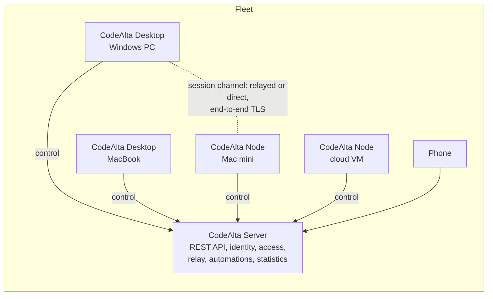

# CodeAlta Fleet

CodeAlta runs agents on one computer. This plan takes it to every computer a person owns, then to the people they
work with, without changing anything for someone who stays on one computer.

> [!NOTE]
> First round of the design (2026-11-01), for CodeAlta 4.0. It proposes a direction, takes the decisions it can, and
> records the owner's answers of 2026-11-02. It builds on research into about 30 products, open source and commercial,
> summarized in [What others taught us](#what-others-taught-us). Issue
> [#284](https://github.com/CodeAlta/CodeAlta/issues/284) asks for its first step. Unlike the rest of `doc/`, this
> folder is a plan: once built, what it describes moves to the architecture documents and the user guide.

## Documents

| Document | What it covers |
| --- | --- |
| [Scenarios](scenarios.md) | The stories the fleet must make easy, from one person to an organization, with what must hold |
| [Architecture](architecture.md) | What exists to build on, the components, the three topologies, who owns what, offline behavior |
| [Sessions across machines](sessions-across-machines.md) | Remote sessions, starting a session elsewhere, project matching, moves, replicas, ownership of sessions |
| [Automations, workflows and runs](orchestration.md) | Scopes (personal, project, team, organization), triggers beyond Git, placement, who a run acts as, account credentials for unattended runs, graduated autonomy, workflows across machines |
| [Fleet statistics](statistics.md) | Every machine's facts published as versioned rows, dimensions, measures, who sees what, queries, the Statistics canvas by scope |
| [Ownership and access control](access-control.md) | Owners of every resource, principals, roles and grants, what the node decides, transfers, agents, access and keys, where access matters |
| [The console](console.md) | CodeAlta Desktop as the gateway of the fleet: why and at what cost, the API-complete server, canvases, plugins, agents |
| [Protocol](protocol.md) | Three planes; connections, handshake, envelopes, durability, versions, the services, the REST API, and why WebSocket |
| [Identity](identity.md) | People, devices, nodes, service identities; pairing, sign-in, enrollment, confirmations, agents acting for people |
| [Security and privacy](security-and-privacy.md) | What the server sees, keys, the device list, credentials, remote execution, policies, threats, audit, SOC 2 |
| [Collaboration](collaboration.md) | Presence, project channels, sharing, handoffs, notifications, questions across people |
| [CodeAlta Server](server.md) | The coordinator: responsibilities, stack, data, SQLite or PostgreSQL, availability, administration |
| [CodeAlta Node](node.md) | The headless host: commands, services per OS, credentials, workspaces, safety |
| [Deployment](deployment.md) | The setup assistant, home recipes, how machines reach each other, cloud recipes, packaging, updates |
| [Observability](observability.md) | Fleet views, facts, budgets, traces across machines, logs, audit versus telemetry |
| [Roadmap](roadmap.md) | Milestones M0 to M6, what each delivers, when it is done, risks |

## What is missing today

- A person with a Windows PC, a MacBook and a Mac mini sees each machine's sessions only on that machine.
- Work started on one machine cannot continue on another: pushing the branch moves the code, not the session.
- Closing the laptop stops its sessions; nothing takes over, and automations wait for the desktop to be open.
- A session cannot use another machine (run the macOS tests on the Mac).
- Colleagues cannot hand each other a session, share one, or talk about a project next to its sessions.
- Automations live on one person's desktop: they cannot belong to a team, a project or the organization, react to
  events outside Git, or run with credentials fit for unattended work.
- Nobody can see, across machines and people, what agents do and what they cost, or who owns what.

## Three steps

Each step is optional, useful alone, and builds on the previous one. A person who takes none keeps today's CodeAlta,
with no account and no network call.

| Step | For | What it adds |
| --- | --- | --- |
| **1. Paired machines** | One person, two or more computers | A headless node (`altanode`) for always-on machines; a desktop that pairs with other machines and sees and drives their sessions directly (LAN, Tailscale, SSH); sessions moved from one machine to another |
| **2. A fleet with a server** | One person or a household | CodeAlta Server on an always-on machine or a small VM, managed from the console of CodeAlta Desktop: every machine and session in one view from anywhere, relayed channels, automations on the always-on machine, statistics of every machine, recovery of a lost laptop's sessions, the phone for the whole fleet, budgets. Private: the server cannot read sessions |
| **3. An organization** | Teams | Company SSO, ownership and access control, team machines, team and organization automations with API keys, triggers beyond Git, graduated autonomy, team statistics, sharing and handoffs, project channels, policies, audit, PostgreSQL and high availability, cloud templates |

## Principles

1. **Local-first.** A machine works alone; the server adds reach and visibility, never gates work. Nothing changes for
   a person who connects nothing.
2. **Nodes own sessions.** A session's journal lives on the machine that runs it; the server is a control plane that
   runs no agent.
3. **Private by default.** The server never reads a prompt, an answer, a tool output or a file unless a person shares
   it; a session can always be kept off the server entirely.
4. **Credentials do not travel.** Each machine signs in by itself; the fleet helps set it up, never copies a secret.
5. **The machine decides what runs on it.** Remote work is remote code execution: a node's local policy is the final
   authority, and requests are signed by a person's device, not by the server.
6. **No more power elsewhere.** An agent gets on another machine at most what it has on its own: its space, its tools,
   its permission mode, its sandbox.
7. **One writer per fact.** Sessions by their node, ownership by the server, inventories by their node: nothing to
   merge after an outage, only facts to replay.
8. **Offline is normal.** Sequences, epochs and cursors make reconnection a resume.
9. **Attributable.** Every remote action names the person, the device, the machine and the session, in an audit log
   without content.
10. **Everything has an owner.** Every machine, session, automation, run and fact has one owner, recorded and
    transferable, and access follows from it.
11. **One console, a complete API.** CodeAlta Desktop is where the fleet is managed, in the same environment as the
    rest; the server's REST API can do everything the console does, so plugins, scripts and agents can too.
12. **.NET, any OS, no Kubernetes, nothing hosted by us.** Single binaries and containers; self-hosting first.

## Vocabulary

| Term | Meaning |
| --- | --- |
| **Fleet** | The machines and people connected through one server, or paired with each other |
| **Machine**, node | A computer where CodeAlta runs sessions: a desktop or TUI while open, or CodeAlta Node. "Machine" in the interface, "node" in these documents |
| **CodeAlta Node** (`altanode`) | The headless host that runs as a service |
| **CodeAlta Server** (`altaserver`) | The coordinator of a fleet |
| **Owner node** | The node that owns a session's journal now |
| **Move** | Giving a session to another machine, with its conversation and work in progress (the "teleport") |
| **Share**, **handoff** | Letting others see or drive a session; giving unfinished work to someone with a note |
| **Channel** | The messages of a project in an organization |
| **Space link** | A space connected to a server: what that server knows of this instance |
| **Private**, **Managed** | Whether a space's shared content is sealed from the server or readable by its organization |
| **Replica** | An encrypted copy of a journal on the server, to recover a lost machine's sessions |
| **Console** | The canvases of CodeAlta Desktop that manage the fleet, over the server's REST API |
| **Automation**, **run** | Work started without a person at the keyboard (personal, project, team or organization scope), and one execution of it |
| **Service identity** | The identity a team or the organization runs unattended work as |
| **Account credentials** | API keys or gateway keys of an organization or a team, as opposed to a person's subscription |
| **Relay**, **direct** | The two paths of a session channel: through the server, or straight to the node |

### Naming

Decided by the owner on 2026-11-02 (decision 23), for these reasons:

- **Fleet** stays: it says many machines under one command, it is the word the field uses for agents and runners, and
  it fits machines and people alike. Considered: *mesh* (implies peer-to-peer, and there is a server), *swarm* and
  *hive* (autonomous AI, no humans), *network* (vague), *crew* (people only), *constellation* (long), the mountain
  family that suits Alta (*basecamp* is a trademark; *summit*, *rope team*) is charming but less clear.
- **CodeAlta Server** says what admins expect to install; "coordinator" is its role in these documents.
- **CodeAlta Node** with `altanode` follows `altatui` and `altacli`. In the interface, people see **machines**.
  Alternatives: a `node` command group of `altacli` (one package less, but `altacli` never owns a profile today), or
  `alta --node` (the desktop executable has no console on Windows).

## Architecture at a glance

- Every device keeps one outbound connection to the server; nothing connects into a node.
- Three planes: the **REST API** manages resources (machines, automations, runs, statistics, access); the **control**
  connection keeps the fleet alive; **session channels** carry what only devices read
  ([protocol](protocol.md)).
- **CodeAlta Desktop is the console**: canvases over the REST API, extended by plugins, operated by agents through
  `alta fleet` ([console](console.md)).
- A viewer reaches a session through a channel to its owner node, end to end, relayed by default and direct when the
  node is reachable.
- The desktop shows local and remote sessions through one **session host** abstraction, with the same components.
- Sessions move between nodes as journals, with their Git state; an ownership epoch fences a stale owner.
- The rest of CodeAlta's architecture carries over: journals, one writer per session, commands bound to exact
  identities, bounded streams ([architecture](architecture.md#what-codealta-already-gives-us)).

## What the server sees

| Always | Sealed (Private) or readable (Managed) | Never |
| --- | --- | --- |
| Machines, people, presence; session facts (state, times, model, token counts, cost); the audit log | Titles, project names, branches; shared snapshots; channel messages | Prompts, answers, tool output and files that are not shared; credentials |

Details, keys and the device list: [security and privacy](security-and-privacy.md).

## What others taught us

From a tour of about 30 products (their documentation, and the code of the open-source ones):

- **Every product that works has the worker dial out** to a rendezvous (Claude Remote Control and runners, Codex, Cursor
  workers, Copilot CLI remote, Warp, Happy, Orca, VS Code tunnels). Peer-to-peer through home NATs mostly fails
  (measured by Harness: 0 of 9 home trials).
- **Pairing converges** on a short code or QR, a PAKE, pinned device keys and revocable device tokens (Vibe Kanban,
  Harness, OpenClaw, Orca, NetClaw).
- **Handoffs are Git-shaped** (Claude teleport, Codex handoff) and almost always fork the session; nobody moves one
  session with one identity across machines matched by Git remote.
- **The laptop as host is the top complaint** (Remote Control breaks on sleep and network changes): an always-on node
  that owns the session, with laptops as viewers, is the fix.
- **Zero-knowledge works for a person's own devices** (Happy, Harness); for teams, Nimbalyst gave up and went
  server-managed. Hence Private and Managed spaces.
- **Sharing is mostly snapshot links**; live multi-person sessions exist in Warp and Amp, and Amp's exposes the thread's
  secrets to every participant.
- **Surprise bills** are the first complaint (Cursor, Devin, Copilot): budgets ship in 4.0.
- **The indie tier is fragile** (Vibe Kanban's company shut down, Terragon closed its hosted service, Crystal became
  Nimbalyst, Coder deprecated AgentAPI): self-hosting first, nothing hosted by us in the path.
- **In .NET, only NetClaw** (Petabridge, Akka.NET) is close: a well-run single-host daemon with pairing, no fleet.

Where CodeAlta can lead: a true move of one session between a person's machines; offline nodes that reconcile; a
coordinator that cannot read sessions yet offers fleet views, sharing and traces; automations on the person's own
always-on machine; a vendor-neutral fleet across providers; home-scale deployment; one trace across machines.

## Roadmap

| Milestone | Delivers |
| --- | --- |
| **M0 Foundations** | Session host abstraction, session bundles and the move record, the local person, owners in the data model, the automation and statistics engines out of the desktop, the protocol package, a multi-host test harness, spikes |
| **M1 Paired machines** | `altanode`, the node API, pairing, the Machines canvas, remote sessions in the desktop, **Run on**, automations on a paired machine, client mode (issue #284) |
| **M2 Moves** | Move to machine between paired machines, project matching, Git payloads, provider continuity |
| **M3 CodeAlta Server for home** | The coordinator and its REST API, the console, Private spaces and keys, relay, personal fleet automations, fleet statistics, cross-machine sub-agents, replicas, the phone, budgets |
| **M4 Organizations and collaboration** | SSO, ownership and access control, team and organization automations with account credentials, triggers beyond Git, graduated autonomy, team statistics, Managed spaces, shares, channels, handoffs, notifications, signed policies, audit |
| **M5 Enterprise operations** | PostgreSQL and high availability, SCIM, brokered credentials, shared machines, node pools, cloud templates, statistics exports, compliance pack |
| **M6 Beyond** | Search across machines, overlap warnings, digests, remote editor and terminals, A2A |

Details, done criteria and risks: [roadmap](roadmap.md).

## Decisions

Each is argued in its document. Decisions 1 to 22 were proposed by the first rounds and confirmed by the
owner on 2026-11-02, whose answers also settled the questions that were open (23 to 30).

1. **Paired machines before the server** (M1): it answers #284 soonest and builds the node API, the protocol and
   pairing that the server reuses.
2. **Nodes own sessions; the server runs no agent** and is a control plane. Not the cloud-log model of Omnara or
   Coder Agents, which would end "the server never sees prompts".
3. **Relayed by default with a server, direct when reachable**; no WebRTC.
4. **Plain WebSocket with our own envelope**, sequences and epochs; not SignalR, gRPC or QUIC for nodes.
5. **ECDSA/ECDH P-256 device keys and the .NET base library** for the cryptographic primitives (a vetted library for
   what it lacks, such as the PAKE): TLS between devices inside the relay, envelope encryption for data at rest with
   one key per kind of thing and audience, algorithm ids for later curves.
6. **Spaces link to servers**, one server per space, several servers per instance; **Private** by default, **Managed**
   for organizations that choose it.
7. **The server is its own identity provider** (ASP.NET Core Identity, OpenIddict); Microsoft, Google and GitHub are
   linked sign-in methods through the desktop's native sign-in; company SSO by OpenID Connect; no SAML.
8. **The node's local policy is authoritative**; remote starts signed by a person's device; agent-started remote
   sessions off by default.
9. **Credentials never copied**; each node signs in itself; a CodeAlta GitHub App with per-node device flow.
10. **A true move with one session id** (not a fork); a fork only when two owners diverged after a takeover.
11. **SQLite by default, PostgreSQL behind the same store**; no EF Core; the server is not Native AOT.
12. **Nodes as user-level services** (logon task, LaunchAgent, `systemd --user`); one node per OS user.
13. **No hosted CodeAlta service in 4.0**; SOC 2 is the customers' audit, which CodeAlta equips.
14. **Budgets and alerts in 4.0**, for households too.
15. **CodeAlta Desktop is the console; the server has no administration interface** and an API-complete REST API, so
    plugins, scripts and agents can do what the console does. A browser administration can be built later on the same
    API ([console](console.md#why-the-desktop-and-what-it-costs)).
16. **Every resource has one owner** (person, team or organization), authorship kept apart, management inherited and
    content never; authority to run things is signed by a person's device ([access control](access-control.md)).
17. **Unattended runs off a person's own machine use account credentials only** (API keys, gateway keys), never a
    personal subscription, checked by the scheduler and the node
    ([orchestration](orchestration.md#credentials-of-unattended-runs)).
18. **Automations are organized by scope** (personal, project, team, organization); events only select a signed
    version, never authorize; allowed autonomous actions are tools with typed parameters, not shell patterns.
19. **Fleet statistics are the Statistics plugin's facts**, published by each machine as versioned rows; per-person
    numbers need an explicit grant ([statistics](statistics.md)).
20. **Devices have classes**: controller devices (a person's desktop or phone) sign; execution nodes only act as
    themselves; a small set of signers signs policies and team machines. Authority on a machine is a delegation signed
    by a person's device, never a token of the server ([security](security-and-privacy.md#the-device-list)).
21. **Two kinds of automations when disconnected**: offline-capable ones on one named machine, lease-bound ones on
    pools; a run already under way follows its preset (continue, stop before replacement, manual recovery)
    ([orchestration](orchestration.md#disconnects)).
22. **The phone's page comes from a machine the person owns** in Private spaces, never from the server, which could
    otherwise serve code that reads what the phone decrypts.
23. **Names**: Fleet, CodeAlta Server (`altaserver`), CodeAlta Node (`altanode`), and "machines" in the interface.
24. **CodeAlta Server is open source**, under CodeAlta's licence (BSD-2-Clause), in one edition: every milestone, the
    features of organizations included, is part of the open product. Its dependencies keep to licences compatible with
    it (no AGPL or GPL inside), which already rules out embedding Zitadel and keeps OpenIddict.
25. **Organizations may require facts on their machines**: on the machines an organization manages, its policy may
    require the facts (never the content) of the sessions of its spaces. Private stays the person's choice everywhere
    else, and personal spaces are never known to an organization.
26. **The CodeAlta project registers and maintains public sign-in client ids** with Microsoft, Google and GitHub, and
    publishes Google's consent screen, so that CodeAlta Desktop signs people in to any self-hosted server.
27. **Scope**: 4.0 ships M0 to M3 and the part of M4 that the two cases of issue #292 need
    ([roadmap](roadmap.md#what-40-contains)); replicas come in M3, as M3c; a signed mobile application, a remote code
    editor and terminals, direct messages and the Slack and Teams mirrors come after 4.0.
28. **No hosted service, ever**: CodeAlta is self-hosted only; nothing run by the project is in the path of a fleet.
29. **Recovery**: the sealed data of Private spaces is unrecoverable without a device or the recovery key; Managed
    spaces may escrow keys with their organization.
30. **Confirmed as proposed**: paired machines before the server; titles sealed by default, with an opt-in for
    organizations; remote starts off by default, one switch per machine; a person's subscriptions only for their own
    runs on their own machine; the GitHub token broker as an opt-in of organizations; plugins may change the fleet once
    the person accepted them, every change audited; client mode over an explicit local node for a desktop that must
    stay reachable; statistics per person only with an explicit grant.

## Open questions

None at this point: the owner answered the questions of the first rounds on 2026-11-02 (decisions 23 to 30). New
questions go here.
