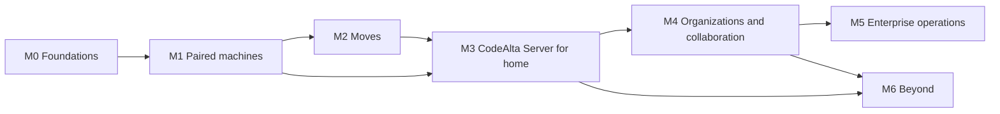

# Roadmap

The fleet in milestones, each shippable on its own and useful without the next. Each milestone gets its own sub-plans
(`.alta/plans/`) when it starts; this page says what each delivers, how we know it is done, and what can go wrong.
Scenario numbers refer to [scenarios](scenarios.md).

| Milestone | In one line | Scenarios | Size |
| --- | --- | --- | --- |
| M0 Foundations | What every later step needs, invisible to users | (S1 must hold) | M |
| M1 Paired machines | Issue #284: a headless node, and a desktop that sees and drives other machines directly | S1, S2 | L |
| M2 Moves | Move a session between paired machines, matched by Git remote | S3, S4 (paired) | M |
| M3 CodeAlta Server for home | The coordinator and its REST API: one fleet of all my machines, the console, relayed and private, always-on automations, fleet statistics, recovery, the phone | S4 to S10, S19 (personal) | XL |
| M4 Organizations and collaboration | SSO, ownership and access control, team and organization automations with account credentials, triggers beyond Git, graduated autonomy, shares, channels, handoffs, policies, audit | S11, S12, S14 to S18, S20, S21 | XL |
| M5 Enterprise operations | PostgreSQL, high availability, SCIM, brokered credentials, cloud templates, node pools, shared machines, statistics exports | S13 | XL |
| M6 Beyond | Fleet search, overlap warnings, digests, remote editor and terminals, A2A | | ongoing |

Sizes are relative (M < L < XL), for ordering, not estimates.

## M0: Foundations

Invisible changes that make the rest small and safe. Nothing reaches the network.

- **Session host abstraction in the desktop**: the RPC services of sessions go through a registry of hosts (the
  local runtime first), so a remote host plugs in later ([architecture](architecture.md#the-desktop-one-session-host-abstraction)).
- **Session bundles**: export and import of a session (journal, attachments, git payload) with the same id; the
  `codealta.sessionMoved` record; a host-context note after a move; tests that round-trip sessions of every provider
  kind.
- **Ownership check** before attaching a session, beside the OS lease (always true until M2/M3 give it meaning).
- **The local person**: a profile, and the person in prompt provenance.
- **Owners in the data model**: every resource the fleet will publish (sessions, automations, runs, facts) carries its
  owner and its author from the start, so access control is designed in, not retrofitted
  ([access control](access-control.md)).
- **Engines out of the desktop**: the automation engine and the statistics engine become libraries any host runs,
  with the desktop unchanged for the user ([architecture](architecture.md#inside-a-host)).
- **`CodeAlta.Fleet.Protocol`**: envelopes, handshake, errors, versions, generated TypeScript; an in-memory transport;
  the conventions of the REST API (OpenAPI document, generated clients, problem details).
- **A multi-host test harness**: two or three hosts with temporary roots in one test process, talking through the
  in-memory transport, as the base of every later integration test.
- **Spikes**: our envelope vs StreamJsonRpc; TLS inside a relayed stream with pinned P-256 keys on the three OSes;
  WebAuthn in WebView2 and WKWebView on a tailnet name; a PAKE (CPace or SPAKE2) in .NET; service installation per OS
  (logon task, LaunchAgent, `systemd --user`).

Done when: every existing test passes, a session round-trips through a bundle on each OS, and the spikes have
answers recorded in the M1 sub-plan.

## M1: Paired machines

The answer to [#284](https://github.com/CodeAlta/CodeAlta/issues/284), without any server.

- **`altanode`**: the headless host, its commands, service installation per OS, its log ([node](node.md)).
- **The node API** over a direct session channel (TLS, pinned keys, device proofs): sessions (list, watch, history,
  create, send, queue, steer, abort, asks, permissions, jobs), projects, providers' status and sign-in by device code,
  readiness per space ([protocol](protocol.md#node-api-over-a-session-channel)).
- **Pairing**: QR code, typed code with a PAKE, or over SSH; **Paired machines** with what each may do and **Revoke**
  ([identity](identity.md#paired-machines)).
- **CodeAlta Desktop**: the console's first canvas, **Machines** (a client-side registry of paired machines, as Hermes
  Desktop does, with a **Test** button); remote sessions in the Explorer and in tabs, with a machine chip; **Run on** in
  the composer; **Add a machine…** over SSH; a setup terminal on a node for the sign-ins of agent CLIs.
- **Automations on a paired machine**: **Runs on** copies a personal automation to a paired node, which runs it while
  the desktop is closed.
- **Desktop as a node**: a desktop can be paired by another desktop, per space (**Allow my other devices to drive the
  sessions of this machine**).
- **Client mode**: a desktop on a machine whose profile a node holds opens it over loopback.
- The Mobile plugin is unchanged.

Done when: S2 works between Windows, macOS and Linux in each direction; a dropped connection never runs a command twice
(tests through the harness with injected disconnects); S1 is unchanged (no network activity without pairing).

Risks: the desktop refactor behind the host abstraction (many RPC services; done in M0, in steps); service quirks
per OS (keychain on a headless Mac); the sign-in of agent CLIs on headless machines.

## M2: Moves

- **Move to machine…** between paired machines: preconditions, offer, bundle, worktree on the target, verification,
  commit, the source left read-only ([sessions across machines](sessions-across-machines.md#moving-a-session)).
- **Repository keys** and project matching; **clone on demand**.
- **Git payload** of unpushed commits and changes not committed, with secret-looking files (`.env`, `*.pem`, keys)
  left out by default and listed.
- **Provider continuity**: same account, another provider, agents with their own conversation re-started from the
  rendering.
- **Move before sleep**: the offer when the desktop closes or the machine sleeps with sessions at work.

Done when: S3 works across OSes with a pushed branch, with unpushed commits and with uncommitted changes; a move that
fails at any step leaves the session where it was; a moved session of each provider kind continues.

## M3: CodeAlta Server for home

The coordinator, for one person or a household.

- **`altaserver`**: identity (owner setup, devices, device codes, passkeys, linked Microsoft/Google/GitHub sign-in
  through the desktop, Tailscale identity), directory and presence, relay, deliveries, ownership and epochs,
  backups ([server](server.md)).
- **Spaces linked to a server**; Private mode; the signed device list, space keys, recovery key; sealed metadata and
  blind indexes ([security](security-and-privacy.md)).
- **The REST API v1** and its change feed, API-complete for what M3 offers ([protocol](protocol.md#the-servers-rest-api)).
- **The console** ([console](console.md)): the Fleet, Machines, Automations, Statistics and Server canvases, the Fleet
  button, `alta fleet` for agents.
- **Relayed session channels** by default, direct ones when reachable.
- **Fleet automations** (personal scope): **Runs on** a machine or any capable one, schedules at the server with copies
  on the assigned machines, runs with leases, the run records ([orchestration](orchestration.md)).
- **Fleet statistics**: machines publish their facts as versioned rows; the Statistics canvas gains the **My fleet**
  scope ([statistics](statistics.md)).
- **Cross-machine sub-agents and messages**, with their safety rules.
- **Replicas and takeover** for lost laptops (S8).
- **The phone through the server** (the browser channel decided in its sub-plan).
- **Budgets and alerts**, **health** notifications, basic **audit**.
- Setup assistant: **Create my server** (this computer, over SSH, a VM), Tailscale and domain recipes.

Done when: S4 to S10 work; the server can be killed at any time without losing or duplicating a fact (S6); a
compromised server cannot read a session or start one (tests with a hostile server in the harness).

Risks: key management UX (recovery, new devices); the browser channel for the phone; scope (split M3 into M3a
coordinator and relay, M3b replicas and automations, M3c phone).

## M4: Organizations and collaboration

- **Company SSO** (OpenID Connect), enforcement, break-glass owner, group-to-role mapping.
- **Ownership and access control**: teams, roles, grants, service identities, transfers, team machines; admin is not
  content access; the People and access canvas ([access control](access-control.md)).
- **Team and organization automations**: scopes, signed versions, **Publish to…**, organization providers with account
  credentials only, credential kinds checked by the scheduler and the node
  ([orchestration](orchestration.md#credentials-of-unattended-runs)).
- **Triggers beyond Git**: Jira versions and queries, incident.io, Slack (Socket Mode), the hooks ingress; replies to
  the event's source.
- **Graduated autonomy**: allowed tools per automation, approvals routed to owners, teams and on-call resolvers, taking
  over a run from the phone.
- **Team statistics** with the per-person rule ([statistics](statistics.md#who-sees-what)); `Services.Fleet` for plugins.
- **Managed spaces**; **shares** (snapshot, live, co-drive, fork for), with authorship in co-driven sessions.
- **Project channels**, mentions, cards, **handoffs** with notes written by the session's agent.
- **Notifications** routed by presence (desktop, Web Push).
- **Signed policies** and the kill switch; **audit** viewer and exports; profiles and avatars.

Done when: S11, S12 and S14 to S21 work; deprovisioning a person stops their work on team machines and transfers what
they owned; an admin cannot read an unshared session; a team automation never runs with a personal subscription; the
server cannot make a machine run an automation version nobody signed (tests).

## M5: Enterprise operations

- **PostgreSQL**, `migrate --to postgres`, **two or more server instances**.
- **SCIM 2.0**; SIEM exports; retention policies; crypto-shredding.
- **Credentials**: the GitHub App token broker, SSH certificates, model gateways, the credential broker in the
  sandbox's network proxy.
- **Shared machines** with per-person credentials; **node pools** (host agents, cloud sandboxes).
- **Cloud templates**: `azd`/Bicep for Azure, Terraform for AWS and GCP, a Helm chart.
- **Statistics at scale**: exports (CSV, JSON, OpenTelemetry metrics), retention by the organization.
- **Compliance pack**: hardening guide, shared-responsibility table, SBOM, provenance, a security whitepaper.

## M6: Beyond

Ideas that build on the fleet once it exists, to be chosen by their value then: search across all machines' sessions,
overlap warnings when two people's sessions change the same files, a morning digest written from the fleet's facts,
remote code editor and terminals, `alta ask --to` a colleague, an organization library of skills, prompts and scripts,
A2A Agent Cards, the Slack and Teams mirrors, waking an asleep machine on the LAN before placing work on it, and
ephemeral cloud machines for heavy tasks.

## Cross-cutting rules for every milestone

- **S1 never regresses**: a test asserts no fleet network activity and no new prompt for a profile that never paired
  or linked anything.
- **The TUI keeps working** (no new TUI feature, `AGENTS.md`): its host is a node like the others when it runs.
- **Security reviews** at each milestone's end (a review session on another model, the threat model updated).
- **The user guide** follows each user-visible step (`site/docs`), and `doc/` describes the architecture once it is
  real; this folder is the plan.
