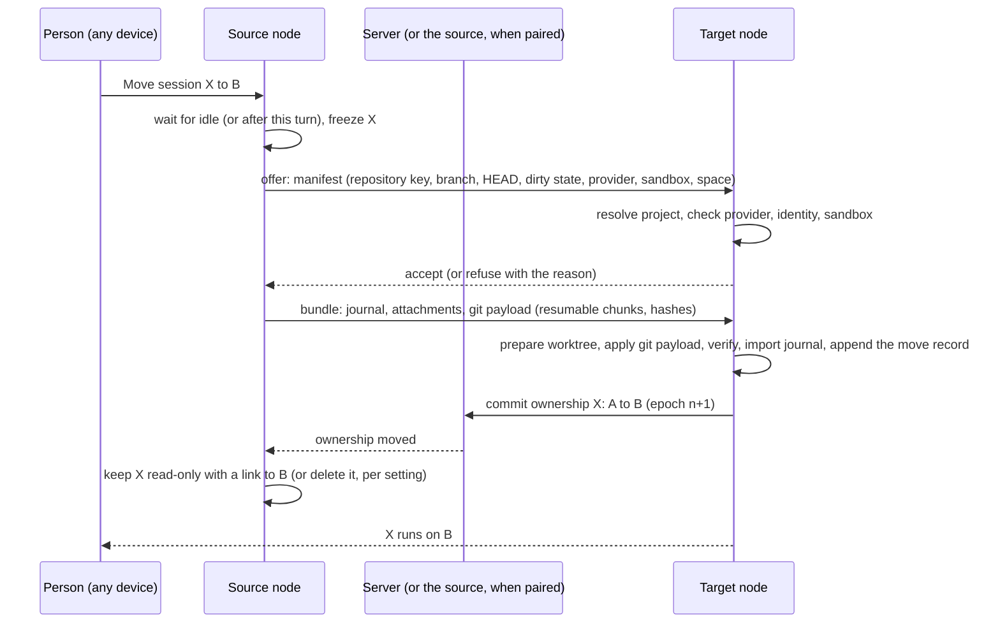

# Sessions across machines

How a session of one machine is seen, driven, started, moved and recovered from another. The architecture and its
invariants are in [architecture](architecture.md); the wire protocol in [protocol](protocol.md).

## Remote sessions: see and drive where they run

The most frequent need is not to move a session but to reach it: open the session that runs on the Mac mini from
the Windows PC, read it, answer its question, send the next prompt.

- A remote session is listed with the local ones, with the machine it runs on. The Explorer can show **This machine**
  or **All machines**, and group by machine.
- Its tab is the same tab: timeline, live display, composer, asks, permission cards, background jobs. The header
  shows the machine, and whether the channel is direct or relayed.
- Commands go to the owner node with their exact identities and retry keys
  ([runtime](../runtime.md#owned-session-commands)): a command decided about one run never applies to the next one,
  and a retry after a lost reply never runs twice.
- A remote session the channel cannot reach shows its last known state, read-only, with when it was last seen.

Who may see and drive the sessions of a machine:

| Mode | Rule |
| --- | --- |
| Paired machines | The devices paired with the node, for the spaces the node allows (by default: every space it publishes). |
| With a server | The owner of the node and the devices of the same person; others only through an explicit [share](collaboration.md#sharing-a-session); team nodes per their access list ([access control](access-control.md#what-the-node-decides)). |
| Always | A session marked **Private** is never published: not listed, not reachable remotely. |

## Starting a session on another machine

**By a person.** The composer of a new session gains a discreet **Run on** chip (beside the agent chip): *This
machine*, a named machine, or, with a server, *Any machine that can* (see placement below). The project list of a
remote machine is its own inventory: a project it does not have can be cloned there first.

**By an agent.** `alta session create --machine <name|any> ...` creates a child session on another node, for example
"run the iOS tests on the Mac". The parent and the child keep their link across machines: the child's final answer,
failure or `<notify-parent>` update comes back to the parent as a host prompt, through the fleet's message route
(queued by the child's node, then by the server, until the parent's node takes it). The rules of `alta` still hold,
across machines:

- the target is in the caller's space, and that space is linked to the same fleet;
- the child does without at least the tools its parent does without, never asks the user less, and runs in a
  sandbox at least as strict (the target refuses what it cannot hold, as `RefuseRunAsync` does locally);
- the target machine accepts agent-started sessions for that space (**off** by default: a node owner turns it on);
- every such creation is audited with the parent session, the person and both machines.

**Placement.** "Any machine that can" picks among the online nodes of the fleet that have the project (or may clone
it), have a ready provider for the selection, can hold the sandbox, and match the labels asked (`macos`, `xcode`,
`always-on`, `gpu`...), preferring the least busy. Labels are set by node owners; some are measured (OS, tools found).

## Projects across machines

A project is one folder on one machine. Across machines, the same repository is recognized by its **repository
key**: the normalized URL of its `origin` remote (or of its first remote).

- `git@github.com:CodeAlta/CodeAlta.git`, `https://github.com/CodeAlta/CodeAlta`, and
  `ssh://git@github.com/codealta/codealta.git` are one key: `github.com/codealta/codealta`. Rules: drop the scheme,
  the user, `.git` and a trailing slash; host in lower case; default ports dropped; path case kept as the host treats
  it (lower case for GitHub, GitLab, Bitbucket and Azure DevOps, which are case-insensitive); Azure DevOps
  `_git` forms unified.
- Each node publishes the repository keys of its projects; the paths stay private to the owner's devices. In a
  Private space the server sees only a blind index, `HMAC(space key, repository key)`: equal on every machine of the
  space, meaningless to the server ([security](security-and-privacy.md#what-the-server-sees)). A project without a
  remote has no key: it can be reached where it is, not matched elsewhere.
- **Clone on demand.** A node asked to work on a repository it does not have offers to clone it into its workspace
  root (`<root>/<host>/<owner>/<repo>`, configurable), with the credentials of that node, then adds it to the space.
  An agent cannot clone on another machine by itself unless that node allows it.
- A monorepo's subfolder project is matched by key plus relative path.

## Moving a session

A move (the "teleport") gives a session to another machine: the conversation, its state and its work in progress.
The source stops owning it; the target continues it, with the same session id.

Within one machine, a session already changes folder with its conversation (**Change worktree…**,
`alta session set_worktree`): the attachment is retired, Claude Code's transcript is relocated, the timeline records
the change and the next prompt carries a note. A move to another machine is that change, plus the transfer of the
journal and of the work in progress, plus a change of owner.

### Preconditions

- The session is idle: no run, queued prompt, pending ask or permission, provider background task, job or Remote
  Control. Otherwise the move waits for the end of the turn (**Move after this turn**) or the person stops the turn.
- The target has the space linked, a ready provider for the session (or the person picks one), the identity the space
  requires (Git author, keys, GitHub profile: the existing identity **Check**), and the session's sandbox.
- Background jobs, reminders and terminals do not move; the dialog lists them.
- An agent may move its own session, as `set_worktree` allows today: the move happens when its turn ends, with its
  queue held and run on the target afterwards; nothing moves in the middle of a turn. A person's move of a working
  session waits for the end of its turn or stops it first.

### The bundle

| Part | Content |
| --- | --- |
| Manifest | Session id, journal length and hash, space, repository key, path of the working folder relative to the repository root, worktree, branch, HEAD, upstream, whether the tree is dirty, provider and model selection, sandbox profile, work item links |
| Journal | The JSONL bytes and the attachments folder, as written |
| Git payload | Nothing when the branch is pushed and the tree is clean. Otherwise the commits not on the remote (`git bundle`), then the working tree changes as a binary diff with untracked files, within a size limit the dialog states. Files that look like secrets (`.env`, `*.pem`, `*.key`, `id_*`, `*.tfvars`) and ignored files stay behind unless the person picks them; the dialog lists what stays |
| Hints | Provider continuity (below); notes; the scratchpad file of the session |

The bundle travels over the session channel (end-to-end encrypted, resumable, verified by hash). The server never
stores it. A repository too large to ship a diff for, or a binary change over the limit, is moved as "pushed state
only" after the person confirms.

### On the target

1. **The folder.** A moved session works in a worktree of its own on the target (`worktrees/` of the profile, as
   today), on its branch at the source's HEAD, so it never disturbs the target's main checkout. The git payload is
   applied, then the result is verified (the tree's hash matches the manifest).
2. **The journal** is imported with the same id. Earlier records keep their paths, which name the old machine; a
   **move record** (`codealta.sessionMoved`: from, to, old and new working folder, epoch, time) is appended, and the
   session header records the new folder. The database projects the journal as for any session.
3. **The agent learns** of the move through a host-context note of its next prompt ("this session moved from
   Windows PC, `C:\code\X`, to Mac mini, `/Users/alex/code/X`; paths in earlier turns refer to the old machine"), never
   through its instructions. The session context (folder, platform) changes once, which costs one cold prompt cache.
4. **Provider continuity.**
   - API providers continue from the journal. With the same account (same provider key and credentials on both
     machines), the provider's prompt cache usually still applies, since it is keyed by content, not by machine.
   - Agents that keep their own conversation: for Claude Code with the same account on the target, the bundle carries
     its transcript and the target relocates it into its provider folder under the new working folder, as a change of
     worktree does, so the agent continues its own conversation. Otherwise (another account, Codex CLI, ACP agents
     whose store CodeAlta does not manage) the harness starts a new conversation with the rendering of the recorded
     one, as after a provider switch ([providers](../providers.md#agents-that-run-their-own-loop)).
   - When the target lacks the provider key, the person chooses another provider of the space, or the session's
     tier picks one.
5. **Ownership** is committed: by the server in a fleet, by the source in paired mode. Only then does the session
   run on the target.

### After the move

- The source keeps the journal read-only, listed as "moved to Mac mini", and opens the live session through the
  fleet; or deletes its copy after a confirmation (a setting).
- A move that fails before the commit changes nothing: the source unfreezes the session; the target removes what it
  prepared.
- Parent and children keep their links; a child that stays behind is a cross-machine child.

### Moves before sleep or shutdown

When the person closes CodeAlta Desktop, logs off or the laptop goes to sleep with sessions at work, and an
always-on node is in the fleet, CodeAlta offers **Move to Home server**: the sessions finish their turn (or are
stopped), then move. A setting makes it automatic for chosen spaces. Without a server, the offer lists paired nodes
that are online.

## Replicas and recovery (with a server)

A laptop that dies, or one closed without a move, leaves its sessions out of reach. A **replica** keeps them
recoverable:

- The owner node ships each session's appended journal bytes to the server, **encrypted with a key the server does
  not hold** (the person's devices share it). Append-only journals make this cheap: what was appended since the last
  acknowledged offset, with the stamp; a rewind or a fork that rewrites a journal sends it again.
- It also ships, at the end of each turn, the session's work in progress as an encrypted git payload (as in a move).
- **Take over.** From any device, a person opens an offline session and chooses **Continue on…**: the target node
  fetches the replica, applies the payload over the pushed branch, imports, and the server commits a new epoch. The
  old owner, when it reconnects, finds its epoch stale, stops writing that session and keeps any tail it wrote
  meanwhile as a fork named after it.
- Replication is per space (on for Personal, off for Work, for example), shows its lag, and is never done for a
  Private session.

## Ownership and fencing

- The server records, for each published session, its owner node and an **epoch**. A move or a takeover increments
  it; only the server commits it.
- A node attaches a session only while it owns it (a check before attaching, beside the OS lease, which still keeps
  one writer per session on the machine).
- Everything a node publishes about a session, and every replica append, carries the epoch; the server refuses a
  stale one.
- A node that is offline keeps its epoch and keeps working: offline is normal. Only an explicit takeover fences it.

## Messages between sessions across machines

`alta session message` and `request` reach sessions on other nodes of the same space, through the same route as
child answers: queued by the sender's node, carried by the server, delivered as an agent message by the recipient's
node. Within the rules of the space, and audited.

## Automations on the fleet

Automations gain **Runs on** (this machine, a named machine, any machine that can), scopes (personal, project, team,
organization), triggers from outside Git, credentials fit for unattended work and routed approvals: see
[automations, workflows and runs](orchestration.md).

## What does not cross machines

- Background jobs, reminders and terminals stay with the process that runs them (and end with it, as today).
- A provider's background tasks and Claude Code Remote Control block a move until they end.
- Claude Code cloud sessions keep their own path (`claude --cloud`, `--teleport`); a session brought back from the
  cloud is an ordinary session, which can then move between machines.
