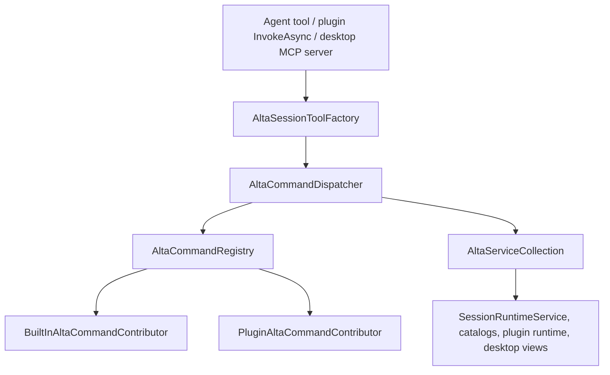

# `alta` live tool

`alta` is the in-process command gateway of a CodeAlta host. Agent sessions call it as a tool, plugins call it through
`Services.Alta.InvokeAsync`, and CodeAlta Desktop exposes it on its MCP server. It is not a daemon and not a shell
command: each invocation builds a command tree, runs one command and returns help text or a finite JSONL transcript.
The name stays `alta` whatever the frontend executable is called (`altatui` for the TUI).

The command reference is the help of the tool (`alta --help`, `alta <group> --help`) and the user guide under
`site/`; this page describes the contract and the rules.

## Architecture



| Type (`src/CodeAlta.LiveTool`) | Role |
| --- | --- |
| `AltaSessionToolFactory` | The agent tool named `alta`: `args`, optional `stdin`, `cwd`, output caps and timeout. |
| `AltaCommandDispatcher` | Runs one invocation: captures output, applies the caps, returns the transcript. |
| `AltaCommandRegistry` | Creates a fresh `XenoAtom.CommandLine.CommandApp` per invocation from the contributors, with the built-in roots its `AltaCommandRegistryOptions` allow. |
| `BuiltInAltaCommandContributor` | The built-in groups, one partial file per group (`.Spaces.cs`, `.Jobs.cs`, `.Windows.cs`...). |
| `PluginAltaCommandContributor` | Adapts plugin command roots and enforces reserved roots. |
| `AltaServiceCollection` | The host services the commands use; a group exists only when its service is registered. |
| `AltaCallerIdentity` (Orchestration) | Who calls: `agent` (with its source session), `plugin`, `mcp`, `cli`, `host`. |

The frontends compose the registry, the dispatcher and the services (`CodeAltaFrontendComposition` in the TUI, the
desktop host in `src/CodeAlta/Desktop`).

A fresh command tree per invocation is deliberate: command actions capture the invocation (caller, services,
cancellation, retention lifetime), the set of plugin roots changes when plugins reload, and the groups depend on the
services the host registered. Nothing is shared between invocations.

## Tool input

```json
{ "args": ["session", "status", "<session-id>"], "stdin": null, "cwd": null,
  "maxOutputRecords": 50, "maxOutputBytes": 20000, "timeoutMs": 5000 }
```

- `args` is required, without the executable name. `stdin` is read only by commands that take `--stdin`; text with
  quotes or several lines goes there, never through quoting in `args`.
- `cwd` resolves project-relative references. Caps and timeout are optional positive integers; JSON `null` is omission.

## Output contract

- `--help` returns plain text. Every other invocation returns compact JSONL: an `alta.result` header (`exitCode`,
  `recordCount`, `truncated`, `durationMs`), then flat records typed `alta.<group>.<what>` (for example
  `alta.session.created`), with `alta.warning` and `alta.error` records for diagnostics. A field without a value is left
  out.
- Records are bounded: discovery commands default to compact aggregates (`alta.project.refs`, `alta.skill.refs`), and
  `--detailed` gives per-item records. Output beyond the caps is cut and marked `truncated`.
- Commands that submit work return what was submitted (receipt, queue state, `nextStep`), never wait for a model run.
- Exit codes (`AltaExitCodes`) are stable: 0 success, 1 failure, 2 usage, 3 not found, 4 policy denied, 5 service
  unavailable, 6 timeout or cancellation, 7 unsupported in this host or state. Error codes are `<group>.<code>`
  (`session.notFound`, `job.shellDisabled`), and `usage.<code>` for argument errors.
- Each command declares an `AltaCommandPolicy`: mutating, disruptive (such as abort), requires the in-process runtime,
  supports a catalog-only context. `alta tool capability list` reports them. Mutating commands of plugins carry plugin
  provenance.

## Command groups

| Group | Purpose |
| --- | --- |
| `version`, `tool` | Host version, live-tool status and command capabilities. |
| `project`, `space`, `label` | The project catalog, the spaces that group projects, and the labels that group them inside a space ([catalog and config](catalog-and-config.md)). |
| `session` | Create, send, queue, steer, abort, compact, inspect, report, fork, rewind, archive; peer `message` and `request`. |
| `provider`, `model` | Configured providers, model refs (`provider:model@effort`), tiers. |
| `prompt`, `skill` | File-backed agent and system prompts; skills ([skills](skills.md)). |
| `ask`, `review`, `notes` | Questions to the user, reviews ([review](review.md)), the session's sticky notes. |
| `reminder`, `job` | Delayed prompts, background commands whose result comes back as a prompt. |
| `task`, `plan`, `bookmark` | Follow-up tasks and plans of a project (`.alta/tasks`, `.alta/plans`), bookmarks of the instance. |
| `issue` | Issues and pull requests from the trackers plugins give for a project. |
| `plugin` | Inspect plugins and their API; in the desktop, create, build and reload source plugins ([plugins](plugins.md)). |
| `diff`, `editor`, `canvas`, `landing`, `documentation`, `terminal`, `window`, `appearance`, `automation`, `search` | Desktop surfaces: they exist only where the desktop host registers their service (`IAltaChangesView`, `IAltaEditorView`, `IAltaCanvasView`, `IAltaTerminals`, `IAltaWindows`, `IAltaAutomations`, `SearchService`...). |
| Plugin roots | `mcp` ([MCP](mcp.md)), `ui` (the window's UI tools), `statistics` ([statistics](statistics.md)), `jira`. |

`note`, `skills activate`, `skills_activate` and `issues` are compatibility aliases.

## How commands are added

- **Built-in groups** are written in `BuiltInAltaCommandContributor`. A group that needs a host surface reads its
  service from the collection and adds nothing when the host has none: in the TUI the desktop groups are absent from
  the commands, their help and `alta tool list`.
- **An allow-list of built-in roots** (`AltaCommandRegistryOptions.AllowedBuiltInRoots`) narrows a registry further,
  for a host where a service may exist but the command must not: the command-line application
  (`AltaCommandRegistryOptions.Cli`) has no user to answer `ask` or `review`, no window, and does not outlive its run
  for `reminder` or `automation`. The registry applies it to the tree, its help, the policies of `alta tool list` and
  `tool capability list`, and the examples of the root help. A new built-in root is absent there until it is listed;
  plugin roots are not filtered. Without options (the desktop and the TUI) every root its service supports is offered.
- **Plugins** return `PluginAltaCommandContribution` records from `PluginBase.GetAltaCommands()`: a root or path,
  policy flags, ordering, and a factory that creates a fresh unattached `CommandNode`. A root that collides with a
  reserved root or an earlier plugin root is skipped and diagnosed. Reserved roots (`version`, `ask`, `project`,
  `space`, `session`, `skill`, `skills`, `skills_activate`, `provider`, `model`, `plugin`, `tool`, `canvas`, `landing`,
  `documentation`, `search`, `window`) are reserved on every host, also where the host lacks the command, so a plugin
  cannot claim a name in the TUI that means something else in the desktop.
- **Plugins call commands** through `Services.Alta.InvokeAsync(...)` without referencing `CodeAlta.LiveTool`;
  project-scoped plugins inherit their project and working directory.
- **Sessions** get the tool injected by the runtime on any provider when the in-process runtime is available; the
  coordinator help text names the commands an agent starts with.

## Callers and scope

- An agent defaults to its own session (`alta session current`, `notes`, `ask`, `reminder create`); other callers name
  one with `--session`. An explicit session never falls back to another one.
- `project current` is the project of the calling session (also from a worktree), else the catalog project of `cwd`.
- A prompt sent by a caller other than a person is recorded with its source session and provenance
  (`AgentPromptProvenance`: `agent-session`, `reminder`, `plugin`, `background-job`, or what the host names through
  `AltaCallerIdentity.PromptProvenance`, never an argument), so timelines never show it as the user's words.

## Safety rules

The live tool lets agents act on other sessions and on the host. These rules keep an agent within what the user gave
it:

- **Space containment.** A calling session reaches only the resources of its own space (`SpaceFilter`): prompts,
  skills, MCP servers, providers, projects. It sends, steers, forks, archives and sets reminders only for sessions of
  its space and its own descendants (`space.notOwnSpace`), and creates sessions only in its space. The user, without a
  calling session, reaches everything.
- **Shell turned off.** A session without `shell_command` must not start a program another way: `job start`, command
  triggers of automations, typing in terminals, building or reloading plugins, the UI tools and adding MCP servers are
  refused (`job.shellDisabled`, `plugin.shellDisabled`..., exit code 4). Plugin commands ask the same through
  `PluginAltaCommandContext.ResolveSourceCommandRefusalAsync`. Worktrees created for such a session are checked out
  without git hooks.
- **No wider tools.** A session never hands a tool it does without to another session (`session.widerTools`): the
  target of a create, set_agent, fork, send, steer, queue or reminder must do without at least as much. A session
  without some tool also cannot change what tools come from (prompts, spaces, projects, automations:
  `settings.toolsDisabled`).
- **Permission modes.** A session whose commands the user reviews must not run what nobody reviewed
  (`AltaCommandReviewPolicy`): `job.startDenied`, `terminal.inputDenied`, `automation.commandDenied`,
  `plugin.buildDenied`. A session never creates or prompts a session that asks the user less than it does
  (`session.permissionModeDenied`, `session.promptDenied`).
- **User settings stay the user's.** Commands change the calling session or what the user asked for, never a global
  setting: no command writes the spaces of a resource, the window settings or the `[sessions] title` setting. Window
  and space commands never move the user's window by themselves: a project of another space answers
  `project.notInShownSpace`, and the agent asks before `alta space switch`.
- **What only the user decides** says so in the help of the command (`statistics history ...`: "Only when the user
  asks for it"), so the agent reads the rule where it reads the command.

## Delegation and yielding

Commands that hand work to another party return at once with guidance (`shouldYield`, `shouldPoll`, `nextStep`), so an
agent ends its turn instead of polling:

- `session create`/`send` for a child: the child's final reply (or failure, or `<notify-parent>` update) is forwarded
  to the parent as a prompt. `status`, `tail` and `events` are for diagnostics.
- `ask` and `review request`: the answer comes back as the next prompt of the session; the agent stops after
  `alta.ask.queued`. Only a run the window started can ask, once per run.
- `job start`: the result comes back as a prompt when the command ends (steered into a running turn, else queued).
- `reminder create`: the prompt fires on its timer, whether or not the awaited thing ended.

A child created without a model option inherits the provider, model and effort of its creator; `--tier
complex|standard|quick` picks the first ready target of a tier of the user's settings instead of naming a model, and
records the tier for the fallback. The runtime context lists the tiers when they are set.

## Lifetimes

| What | Where it lives |
| --- | --- |
| Notes | Journal records (`AgentNotesEvent`); the last one wins. Reads use the session index, not a scan. |
| Asks | In memory, per session, FIFO (`AltaAskService`); an answer is bound to the exact pending attempt and never replayed. |
| Reminders | In memory (`AltaReminderService`); lost when the host exits. A firing captures target and prompt before it is sent. |
| Jobs | In memory (`SessionJobService`): at most 8 per session and 32 per host, output tail kept, ended when the host exits. |
| Tasks, plans | Files of the project; links to sessions in `work_items.json` of the instance. |
| Bookmarks | Rows of the application database of the instance, named by session, run and content id; the offset is a hint. |

## Retention admission

Where automatic session retention runs (the desktop), every command that works on a session claims it in the host's
`ISessionRetentionAdmission` before it resolves the session, and keeps the claim until its work is handed to an owner
that claims it in turn (the runtime, the reminder worker, the job service). A command with an unknown target, and the
factories of plugin commands, claim all sessions for the time of the invocation. A refused claim fails the command; it
is never replaced by a no-op. `AltaCommandRegistry.InvokeAsync` owns the invocation for this reason, and exporting a
raw command tree is refused while admission is registered.
