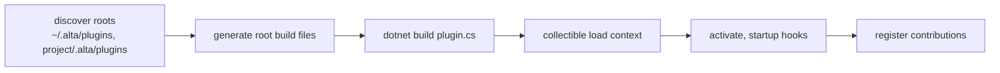

# Plugins

A plugin is trusted local .NET code loaded into the CodeAlta process. It adds commands, agent tools, `alta` commands,
prompt text, model provider types, issue trackers, and in CodeAlta Desktop tabs (canvases), buttons, landing cards and
scripts that draw with the window's own components. Plugins are how CodeAlta extends itself too: Git, Jira, MCP,
Statistics, ACP and Search are built-in plugins on the same contracts.

Plugins are not sandboxed. Building one runs SDK, NuGet and MSBuild logic, and loading one runs its code in the
process; a sandbox would give users a false sense of safety. The boundaries that exist are about stability and about
text from outside: a plugin cannot break the window it runs in, and nothing a plugin shows as HTML becomes script.

| Project | Owns |
| --- | --- |
| `src/CodeAlta.Plugins.Abstractions` | The public authoring API: `PluginBase`, contribution records, contexts, `IPluginServices`, `PluginHtml`, `PluginScript`, canvas RPC. No dependency on a frontend, NeoAstra or terminal UI |
| `src/CodeAlta.Plugins.Tui` | Optional terminal authoring types (`PluginTui`: native visuals, dialogs, prompt-editor hosts, key mapping) |
| `src/CodeAlta.Plugins` | Discovery, generated build files, builds, loading, activation, the contribution registry and adapters, diagnostics, reload (`PluginRuntimeManager`), state and database services, `PluginApiReference` |
| `src/CodeAlta.Orchestration/Runtime/Plugins` | `PluginOrchestrationBridge`: plugin tools, prompt parts and hooks for agent runs |
| `src/CodeAlta.Hosting` | `PluginModelProviderTypes`: providers of plugin types in the provider registry |
| `src/CodeAlta/Desktop` | The desktop host: `DesktopPlugins` (built-ins), `DesktopPluginUi`, `DesktopCanvases`, `DesktopCanvasRpc`, `DesktopPluginModules` |
| `src/CodeAlta/frontend/src` | The page side: `PluginHtml.tsx`, `pluginHtmlSanitizer.ts`, `pluginScript/`, `lent/`, `canvases/`, `pluginButtons/` |
| `src/CodeAlta.Tui/Plugins` | The terminal host: `TerminalPluginUi`, startup feedback, terminal presentation of built-ins |
| `src/CodeAlta.Plugin.*` | The built-in plugins |

## Authoring model

A plugin is a public, concrete, non-generic `PluginBase` subclass with a public parameterless constructor; one assembly
may hold several. It overrides the contribution methods it needs and returns declarative records:

```csharp
[Plugin(DisplayName = "Hello")]
public sealed class HelloPlugin : PluginBase
{
    public override IEnumerable<PluginCommandContribution> GetCommands()
    {
        yield return Command.Prompt("hello", "Say hello.", static async (context, ct) =>
        {
            await context.Ui.NotifyAsync("Hello from a plugin.", ct);
            return PluginCommandResult.Handled;
        });
    }
}
```

- **A contribution method is called once per activation.** What it returns is what the plugin contributes until it is
  stopped or rebuilt. The runtime owns handles, registration, ordering, validation and removal; a contribution that
  breaks a rule (a duplicate id, too many buttons) is left out with a diagnostic, not thrown.
- **Plugins see services, not frontends.** A command receives `PluginCommandContext` (`Ui`, `Sessions`, `Prompts`,
  `Workspace`), never raw command text, frontend view models or controls. `IPluginServices` gives the `alta` bridge,
  state, database, tasks, canvases, spaces, identity and asks. A host without a window gives no-op services
  (`HasInteractiveUi` is false).
- **Asks are answered for the user, never by an agent.** `Services.Asks` (`IPluginAskService`) reads the question or
  review request a session waits on and answers or cancels it as the window does, naming the revision it read, so an
  answer to an ask that changed meanwhile is refused. An agent must not answer what it asks (an approved review lets it
  commit), and an agent can write a plugin of a folder, so only the built-in Mobile plugin gets a working service: the
  runtime asks the host for the service of each plugin (`IPluginAskRuntimeService.ForPlugin`, with whether the plugin
  is built in), and the desktop gives it to `builtin:mobile` without a package folder, the no-op service to every other
  plugin; a host without that interface gives none. The services of a plugin's `alta` command, which an agent runs,
  are always wrapped and have the no-op service.
- **One contract, two applications.** Both hosts run the same runtime. `PluginAttribute.Frontends` says which
  applications a plugin supports; a host does not activate one made for the other. The default, `All`, is the desktop
  and the terminal: the command-line application (`altacli`, no window and no user) is a third value, `Cli`, that a
  plugin names explicitly when its contributions for agents work without a window, so a plugin written for a window
  never starts there by surprise. A host that names no application (`None`, tests and tools) starts every plugin.
  Portable results carry `Text`,
  `Markdown` and `Html`: the desktop shows the richest, the terminal ignores `Html`. Desktop-only contributions
  (canvases, buttons, landing cards, scripts) are declared everywhere and drawn only by the desktop.
- **The scope comes from the location.** A plugin under `~/.alta/plugins` is global; one under
  `<project>/.alta/plugins` belongs to that project and only applies there.

Contribution areas, all virtual methods of `PluginBase`:

| For agents | For the window |
| --- | --- |
| Agent tools (`AgentTool`), `alta` command roots (`GetAltaCommands`), static and dynamic prompt parts, final instruction processors, before-run, tool-call and tool-result hooks, agent-event observers, model provider types (`GetModelProviders`), resource roots (skills), issue trackers (`IIssueTrackerSource`) | Commands with key bindings, status items and region content, dialogs, prompt pickers, buttons, canvases, landing cards, timeline cards (session-event projections), command-line options and prompt processors (terminal) |

Two rules protect the host from a plugin:

- **Bounded admission.** An activation has at most 64 outstanding callbacks (agent events, landing cards). An event
  observer is called only when it overrides `OnAgentEventAsync`, and can opt out of streaming deltas
  (`ObservesContentDeltas`); deltas never take the last 16 slots, so the events that end a run always get through. A
  slow observer must enqueue and return.
- **Synchronous callbacks read fields.** Status items and button states are read whenever the window draws: they
  must not touch files or the network. Anything slower is asynchronous with a limit (landing cards: 5 seconds).

Instruction processors run after the whole prompt is composed and before it is hashed and sent; the host records what
each changed in the prompt manifest, without the text. They are an audit and extensibility hook for trusted code, not a
security boundary.

## Source plugins: build and load



- **Layout.** A package is `<root>/<package-id>/plugin.cs` (a file-based C# program, plus any files it wants). CodeAlta
  owns the root files `Directory.Build.props`, `Directory.Build.targets`, `Directory.Packages.props` and `global.json`:
  they pin the SDK and the versions of the host assemblies and shared packages, so a plugin always compiles against
  the API it will run with. A package that brings its own copies of those files is diagnosed as unsupported. A generated `.gitignore`
  keeps only the sources in a repository. An installed tool has no `Directory.Packages.props`, so versions come from
  the host assemblies' product versions.
- **One authoring profile for both applications.** Both ship `CodeAlta.Plugins.Tui` and the terminal UI assemblies
  (`PluginAuthoringProfile.Terminal`), so a plugin with terminal visuals still loads in the desktop. The generated
  props record the running executable: starting the other application regenerates them and rebuilds once.
- **Build** (`PluginBuildService`) runs only when the sources or the generated inputs changed (a manifest stamps
  both). Compiler errors become `PluginBuildDiagnostic`s with paths relative to the package.
- **Load** (`PluginAssemblyLoadContext`): each package gets a collectible `AssemblyLoadContext`, and its assembly is
  read into memory with its symbols, so the build output is never locked and the next build writes over it. CodeAlta
  assemblies and shared authoring packages resolve from the host context (one copy of each type); a plugin's own
  package dependencies resolve from its output folder.
- **Desktop startup** builds while the start screen shows progress; failures are logged, notified once and shown per
  plugin in Settings > Plugins. The terminal shows build progress in the console.

### Changing plugins while the application runs

`PluginRuntimeManager` changes one package at a time (`PluginRuntimeReload.cs`): `BuildPackageAsync` (compile only),
`ReloadPackageAsync`, `StopPackageAsync`, `RefreshPackagesAsync` (apply what changed on disk and in configuration) and
`ApplyBuiltInAsync`. A reload keeps the application usable while a plugin is written:

1. The package is built first. A failed build changes nothing: the running version keeps running.
2. The running plugins are deactivated and their contributions removed, with ten seconds to stop; the collection of
   the old load context is not awaited, since a session may still hold one of its tools.
3. The new assembly is loaded and activated; when nothing starts, nothing of the package runs.

Changes are serialized and owned by the runtime: once the build ended, a change completes whatever its caller does,
and a plugin callback that asks for a change of plugins is refused rather than waiting for itself. `Changed` tells a
host to read contributions again. A session binds a plugin tool at call time (`PluginOrchestrationBridge`), so a tool
whose plugin was rebuilt calls the new code, and `alta plugin reload` registers changed tools into the running turn.
This is how an agent writes a plugin from a session: `alta plugin create|build|reload|status|api` and the built-in
`codealta-plugin-runtime` skill.

## Enablement, spaces and safe mode

- Source plugins are enabled by default; `[plugins.<id>] enabled = false` keeps one from building or loading. Each
  built-in has its own default (`BuiltInPluginDefinition.EnabledByDefault`); a switch applies at once.
- `[plugins.<id>] spaces` in the global configuration assigns a plugin to spaces. Plugins load once per process, so a
  space only hides what a plugin contributes to the sessions and panes of other spaces
  (`PluginContributionAdapterService.IsAvailableInSpace`, checked before the project). Observers and background work
  keep running. A plugin that serves something of its own (Mobile) reads its spaces with `Services.Spaces`; a plugin
  never reads `config.toml` itself.
- Safe mode (`CODEALTA_DISABLE_PLUGINS=1`; `--no-plugins` or `--plugin-safe-mode` in the terminal) skips discovery,
  build and load before any plugin command-line option runs, and starts the window without plugin scripts.

## The page side (CodeAlta Desktop)

### HTML is data

A plugin's HTML (results, dialogs, canvases, cards) is sanitized by DOMPurify (`pluginHtmlSanitizer.ts`): an
allow-list of elements and attributes, `alta-*` classes only, links shown and never followed; scripts, styles, event
handlers, images, frames and forms are removed. Interaction goes through attributes that `PluginHtml.tsx` handles by
delegation: `data-alta-command` runs a command of the plugin for the pane the fragment belongs to, `data-alta-action`
calls the plugin's action handler with the named fields. Elements of class `alta-markdown` and `alta-chart` are drawn
by the window's own Markdown and chart components. This is the invariant: text that comes from outside (an issue, a
tool result) never becomes script, whatever the plugin writes.

### Scripts

A plugin that wants JavaScript gives a `PluginScript` beside its HTML, never inside it: `File` (a `.js`/`.mjs` of the
package), `Inline` (modules as text), or `App` (a module of the application's own build, accepted only for built-in
plugins). The module either exports a React component, drawn in the window's own tree inside an error boundary, or
`mount(root, alta)`, which fills the sanitized fragment and returns a cleanup. The `alta` object is the only thing a
script touches: its context, visibility, an abort signal, `alta.host` (open a file, a session, a canvas; notify; set
the tab title), the theme, `alta.html` (sanitize), and `alta.rpc` for canvases.

`DesktopPluginModules` serves modules at `app://codealta/plugin/<plugin key>/<stamp>/<path>`, from the application's
origin, so the page's content security policy (`script-src 'self'`, no inline script, no eval) stays unchanged. It
serves only files below the package folder, of web types and bounded size, never through a link. The stamp changes
with each reload, so a new version is a new module address.

### Lent libraries

Scripts import `react`, `react-dom`, `@blueprintjs/core`, `@blueprintjs/table`, `flexlayout-react`, `lucide-react`
and `codealta` and get **the instances the window runs**. Sharing is a requirement, not a saving: two copies of React
break hooks and contexts, and a plugin's popover must open in the window's layer with its theme.

- Each library is an entry of the Vite build (`frontend/src/lent/*.ts`, listed in `lent/libraries.ts`) emitted at a
  fixed address with its exports whole, sharing chunks with the application.
- An import map in the entry document maps the names. An import map is inline, so its SHA-256 is the one addition to
  `script-src` in `neoastra.json`; the build writes the map, and tests on both sides compare its hash with the policy.
  Adding a library means a new entry, `libraries.ts`, and the new hash.
- There are two tiers. The HTML vocabulary and the `codealta` module (`html` for JSX without a build, hooks for the
  `alta` object and RPC, Markdown, code, diagrams, icons, links, charts) are CodeAlta's and stay stable across
  releases. The libraries follow their own versions (`alta.versions`). The application's state, RPC services and dock
  are never lent.
- Agents write plugins from the skill's references (`codealta-plugin-runtime/references/script-api.md`,
  `script-libraries.md`), checked against the exports by `scriptApiReference.test.ts`. A measured authoring run showed
  that without them an agent reverse-engineers the minified bundle; keep them aligned when a lent library changes.
  An authoring API is added only for a measured benefit.
- A built-in plugin whose interface is part of the frontend names an application module (`lent/appModules.ts`, served
  at `lib/app/<name>.js`) instead of a file.

### Canvases

A canvas is a tab whose state belongs to the plugin; the tab is a view. Closing the tab loses nothing, a restart
restores the tab and asks the plugin again, and an agent can describe it or run its actions without a tab
(`alta canvas ...`). A canvas has a scope (application, project, session) and an instance is identified by canvas,
space, scope subject and an optional key, so opening the same identity twice focuses one tab. `Open` returns a view
(fixed HTML, or a renderer called again on invalidation), and the plugin pushes updates through its context. A
rebuilt plugin reopens its instances; a stopped one leaves its tabs waiting, offering to rebuild. A canvas with
`Placement = Settings` is the settings page of its plugin instead of a tab. Buttons (title bar, rail, project and
session menus) and landing cards name a command or a canvas of the same plugin; their limits per place keep the window
the user's.

### The RPC carrier of `alta.rpc`

A canvas script calls its plugin's C# handlers by name (`canvas.Rpc.Handle`, `Stream`, `PublishAsync`; `useRpc` and
`useStream` on the page). The page's RPC contract is generated and frozen when the host is built, and plugin code gets
no native bridge, so plugin calls cannot be services of that contract. Instead:

- Each open canvas instance gets **its own NeoAstra host, built at run time** from what its plugin registered in
  `Open` (`DesktopCanvasRpc.cs`: `PluginRpcRegistry`, `CanvasRpcEndpoint`). Requests are `JsonElement` to NeoAstra and
  typed records to the plugin, read with the plugin's `JsonOptions`. The abstractions know nothing of NeoAstra, so the
  terminal and the plugin contract take no dependency on it.
- Frames travel on the existing `canvases.watch` channel (`ICanvasRpcCarrier`), because the page has a fixed budget of
  35 channels; frames are batched by the page and queued in order by the host, and a slow page holds back the stream
  behind it (stream credits stop the plugin's iterator, also while the tab is hidden).
- Connections are named per instance and per page generation, so a reloaded page never talks to the session of the
  page it replaced. Handlers run on the thread pool; the page's RPC thread never waits for a plugin.
- What a handler throws never reaches the page: it is logged by the plugin's logger and the script gets
  `internal_error`, unless the handler throws `PluginRpcException` with a code and a message made to be shown. Limits
  (frame and result sizes, concurrent calls and streams, rate, 30 s timeout) are NeoAstra options of the endpoint.
- A call is never replayed: after `timeout` or `connection_closed` a mutation may have been applied, and the script
  decides.

## Data

| Service | Use | Where |
| --- | --- | --- |
| `Services.State` (`IPluginStateStore`) | Settings and small documents read and written whole | JSON files under `~/.alta/plugin-data/<plugin key>/` (user, session) or `<project>/.alta/plugin-data/<plugin key>/`, written atomically |
| `Services.Database` (`IPluginDatabase`) | Rows that are queried, filtered, summed, or that grow | Tables of the application database (`<state root>/data/alta.sqlite3`, see [catalog and config](catalog-and-config.md)) |

The database service gives each plugin a stable `TablePrefix` from its key, versioned migrations run in one write
transaction, reads on a connection that never waits for a writer, and writes in turn with every other writer of the
application. A migration that touches an object outside its prefix is rolled back: a plugin is trusted, so this is a
checked convention, not a wall. Writes must stay short (others wait), and a write cannot start another write. When
the database file is replaced after damage, the host reruns the last migration before the plugin's next access, so
migrations depend on nothing but their arguments. Data stays when a plugin is disabled; the host can list and drop a
plugin's tables.

## Background work and unload

Long work uses `Services.Tasks.Run` (or `Tasks`), never an untracked `Task.Run`: the runtime cancels tracked tasks at
deactivation and waits for them before unloading. Where the host retains sessions automatically, a task claims
protection of every session before it starts unless it declares `SessionRetentionIndependent` (it never starts,
queues or changes a session); a callback whose dependencies cannot be proven finished keeps its claim. Unload can still
be delayed by static references, native resources or untracked work: collectible contexts are not a guarantee.

## Built-in plugins

| Id | Project | Applications | What it adds |
| --- | --- | --- | --- |
| `git` | `CodeAlta.Plugin.Git` | all three | The provider of a repository from its remotes (GitHub, GitLab, Azure DevOps, Bitbucket), its issues and pull requests as an issue tracker, and the provider CLIs (`gh`, `glab`, `az`) as agent tools when installed |
| `jira` | `CodeAlta.Plugin.Jira` | all three | A Jira tracker for projects whose `.alta/issues.toml` names one, through the Atlassian CLI, and `alta jira` |
| `mcp` | `CodeAlta.Plugin.Mcp` | all three | MCP servers, see [MCP](mcp.md) |
| `statistics` | `CodeAlta.Plugin.Statistics` | desktop, terminal | Timeline cards everywhere; in the desktop the statistics store, canvas, button and landing card, see [statistics](statistics.md) |
| `acp` | `CodeAlta.Plugin.Acp` | all three | The provider type `acp`, see [providers](providers.md) |
| `landing` | desktop project | desktop | The canvas of the landing page; the cards on it are other plugins' |
| `search` | desktop project | desktop | The canvas and landing card of the search index |
| `mobile` | `CodeAlta.Plugin.Mobile` | desktop, off by default | A local server published on the tailnet by Tailscale Serve that serves the sessions of its spaces to a phone, acting through `alta` (images by an id resolved from the records of their session, never a path from the phone), and answers their asks through `Services.Asks`. It keeps no usable secret on disk, only the SHA-256 of the pairing token and of each phone's key, so a program that reads its files cannot answer as the user |
| `ui` | desktop project | desktop | On request, the tools that see and drive the window; not offered when the user reviews commands, since a session could then answer its own review |

"All three" is the desktop, the terminal and the command-line application (`Cli`): what these plugins give agents
(tools, `alta` roots, prompt parts, hooks, provider types) needs no window. Their attribute and their definitions in the
built-in lists of the hosts say the same.

Two invariants of the integrations:

- **Credentials go only to their own host.** Issue trackers resolve a token per provider host (environment, then the
  provider's CLI) and send it nowhere else. Provider CLIs run with the identity of the session's space (its CLI
  profile folders), and lookups are cached per profile, so one account never reads what another read. Jira signs in
  through `acli` with the token on standard input, never on its command line, and a project's shared file cannot
  choose which token goes to its site.
- **Tools that start programs** (`gh`, `glab`, `az`) take arguments as an array (`ProcessStartInfo.ArgumentList`,
  never a shell string), are marked `StartsPrograms` so the host refuses them to a session without `shell_command`, and
  on Windows never start a batch file, which `cmd.exe` would parse again.

The desktop serves each built-in's backend only; the terminal adds its own presentation (the `/mcp` dialog, the `#`
issue picker, statistics visuals) from `src/CodeAlta.Tui`.

## Troubleshooting

- **Build failures**: Settings > Plugins and `alta plugin status <id>` show compiler errors with file, line and
  column; the log has the full output.
- **Missing SDK**: source plugins need the .NET 10 SDK the generated `global.json` selects.
- **Dependency load failures**: plugin-owned packages must be copied to the plugin output by the SDK.
- **A broken plugin**: start in safe mode, then disable or fix it.
