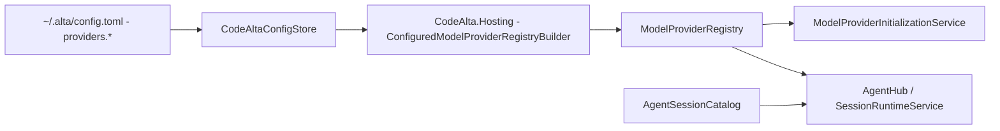
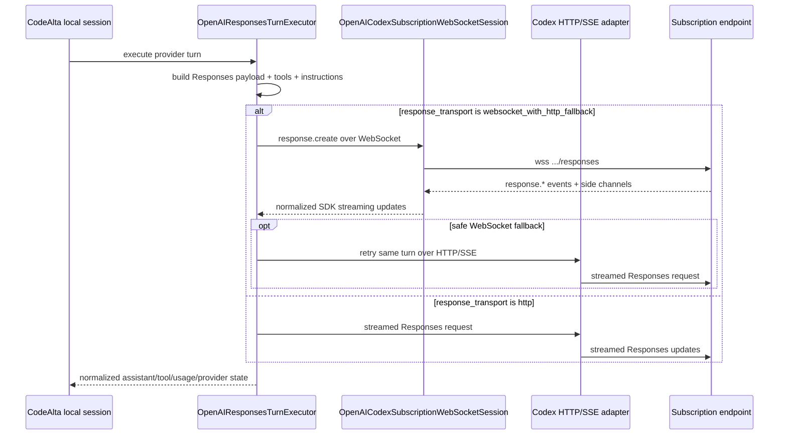
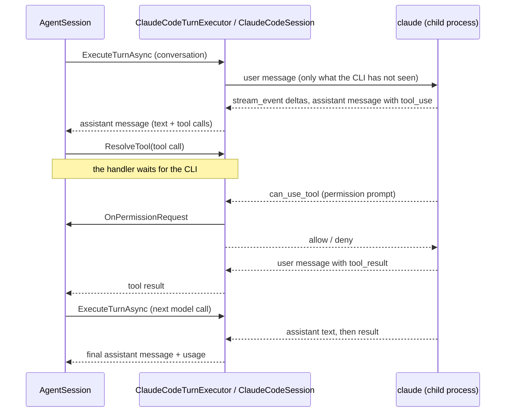
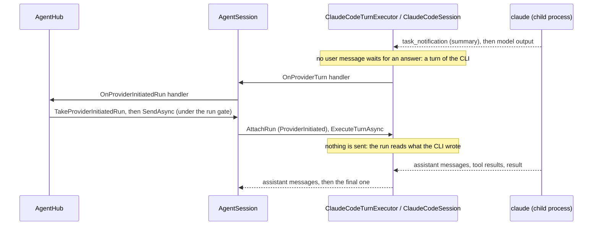

# Model providers

A model provider is the user-facing execution configuration for an LLM endpoint/runtime. Providers own credentials, protocol adaptation, readiness, model metadata, and turn execution. They do not own persisted CodeAlta sessions; sessions are listed and restored through the session catalog.

## Registration and initialization pipeline



At startup, the TUI's `CodeAltaOwnedServices` supplies `CodeAltaConfigStore`, the state root and optional models.dev metadata service to `CodeAlta.Hosting.ConfiguredModelProviderRegistryBuilder`. The composition-only Hosting library builds `ModelProviderDescriptor` entries and lazy concrete runtime factories; registration does not start or probe providers. The same builder serves the existing TUI refresh and temporary test/model-list registration paths. `ModelProviderInitializationService` probes each provider independently and caches readiness/model information. Session listing uses `AgentSessionCatalog` against the single configured sessions root and runs independently of provider probing.

Hosting also owns the raw-provider defaults resolver and bundled `ProviderDefaults/provider_defaults.toml`, copied to application output/publish directories. Provider-specific compatibility defaults and configured overrides retain their existing precedence. The global-store overload excludes disabled definitions; the document-sequence overload preserves caller ordering and disabled descriptors, leaving filtering to its caller. A registration batch shares one Codex subscription concurrency limiter. Registries, config stores and metadata services are borrowed, not newly disposed by the builder; registry replacement retains its existing cached-runtime disposal behavior and is not transactional.

`CodeAlta.Hosting.ConfiguredProviderInspection` owns cached test/model-list policy and uncached temporary probing. TUI adapters still look up active state by provider key only, choose the root lazily, supply synchronous localized message factories, and render forms/progress. A Ready cached test succeeds; Probing/Failed/Unsupported return the cached failure text. Cached model listing reuses Ready only and returns the same list without applying requested sorting. Other states fall back to a directly created runtime, not a temporary registry. A returned probe counts as successful even when empty or non-Ready; only uncached model listing applies requested stable display-name/ID sorting.

Temporary runtimes are asynchronously disposed after probing and success-message formatting, including on probe, sorting, formatting or cancellation failure. Disposal is awaited and its exception takes precedence. There is no explicit start/stop or early cancellation check; the token is forwarded to the probe. The state root and optional metadata service are caller-supplied and borrowed, and unsorted lists are not snapshots. Other auth/configuration/refresh workflows and the background models.dev service lifetime remain TUI-owned, except for the bounded Copilot/xAI orchestration below. Concrete authentication/protocol implementations remain in provider packages, and configuration persistence remains in Catalog. These extractions do not change key-only cache reuse for edited settings, startup admission, host rollback/disposal, active-run refresh safety or desktop composition.

`CodeAlta.Hosting.ConfiguredCopilotAuthentication` composes configured Copilot device login, CodeAlta-owned credential deletion and non-secret cached status. Both TUI login buttons use the same device flow; TUI retains the localized prompts, report-before-browser callback, browser-launch error handling and result formatting. The exact ordinal `copilot` check precedes manager construction; construction precedes the caller's lazy root callback. Options still observe the provider key before that callback and enterprise/API fields afterward, forwarding blank values without new validation. The provider owns credential validation/storage and cached-expiry policy; cached status is not live authentication or environment-token verification. Production operations can perform network/credential I/O. There is no new early cancellation, context suppression, retry or disposal: the existing absence of manager/HTTP-client disposal remains a separate lifetime limitation. Tests use mandatory in-memory operation factories, never concrete managers or credential stores. Copilot model listing still follows the existing connectivity-test route rather than selectable-model listing.

`CodeAlta.Hosting.ConfiguredXaiAuthentication` composes configured xAI browser-PKCE login, separate device-code login, CodeAlta-owned credential deletion and non-secret cached status. TUI retains the distinct prompts, report-before-browser ordering for browser authorization, device reporting without an opener, result formatting and lazy root selection (owned-services global root, otherwise UserProfile/.alta). Required-object validation and the exact ordinal `xai` check precede deferred manager construction; construction precedes provider-key/root/API option evaluation. Keys and roots are forwarded unchanged, invalid or relative API URIs become null, other absolute schemes remain accepted, and no polling override is set. Auth-source/enabled settings do not select these explicit operations. xAI cached status can include past or unknown expiry: it performs no live authentication, refresh-skew/freshness check, environment-token verification or model turn. The provider retains real network/credential I/O, browser PKCE/loopback binding, CORS, cancellation transformation, callback response/persistence ordering and listener teardown. Mandatory recording-factory tests do not exercise those concrete paths. No early cancellation, context suppression, retry or manager/HTTP-client disposal is introduced; the existing non-disposal remains a lifetime limitation. xAI model listing and other provider/configuration/refresh workflows are unchanged.

Providers that are disabled, invalid, or missing required credentials are skipped or marked unavailable without deleting their config entries.

## Config shape

Each provider is configured under `providers.<provider-key>`:

```toml
[chat]
default_provider = "work"

[providers.work]
enabled = true
display_name = "Work endpoint"
type = "openai-responses"
api_key_env = "WORK_ENDPOINT_API_KEY"
api_url = "https://api.example.test/v1"
network_timeout_seconds = 180
model = "model-id"
reasoning_effort = "high"
models_dev_provider_id = "openai"
models_include_regex = "model-id|model-next"

[providers.work.model_overrides.model-id]
context_window = 400000
output_token_limit = 128000
```

Important behavior:

- `enabled = false` prevents registration. Omitted `enabled` normalizes to `true` for user entries.
- `spaces` lists the spaces whose sessions can use the provider, read from the global `config.toml` only; absent is every space. The rule and what refuses a provider out of the space of a session are in `doc/catalog-and-config.md`, "The spaces of providers, MCP servers, plugins, skills and prompts".
- `display_name` is optional; CodeAlta can derive a display name from the provider key.
- `icon` and `color` are optional and only change how CodeAlta Desktop shows the provider. `icon` is the id of a
  brand logo (`mistral`, `ollama`, `openrouter`...) or the name of a general icon (`rocket`, `server`,
  `flask-conical`...); `color` is `#rgb` or `#rrggbb`. The store keeps both as written (trimmed, the icon in
  lower case) and never refuses a file for them: an id a version does not draw, or a text that is not a color,
  is ignored by the page. Only the form of the Providers page holds them to their shape when it saves. The
  shipped template names neither: the logo of a shipped provider is found from its key (see "Brand icons" in
  `doc/desktop.md`).
- `model` and `reasoning_effort` are defaults, not a hard limit on model selection unless the provider is configured with `single_model_id`.
- `models_include_regex` is an optional .NET regular expression applied to discovered model ids. Omit it to expose every discovered/fallback model; use alternation such as `model1|model2` or patterns such as `model\d+` to keep a smaller catalog.
- `sort_models = true` sorts discovered models alphabetically by display name (then id) in model selectors. The default is `false`, which preserves the order returned by the provider.
- `api_key` stores a literal secret; `api_key_env` points to an environment variable. Prefer environment variables for shared machines.
- `api_url`, `network_timeout_seconds`, organization/project fields, provider-specific auth fields, `extra_body`, `profile`, `compaction`, `models_dev_provider_id`, `models_include_regex`, `sort_models`, and `model_overrides` are preserved by the advanced TOML editor.
- `network_timeout_seconds` sets the OpenAI/Azure SDK network timeout for `openai-chat`, `openai-responses`, `azure-openai`, and `codex` providers. Leave it unset to use the OpenAI SDK default timeout of 100 seconds.
- The bundled template disables all built-ins explicitly. Users opt in by enabling/configuring a provider.

## Built-in provider types

A `[providers.<key>]` section whose `type` is written and is none of the values below is taken as the provider of a newer
version: `CodeAltaConfigStore` sets it aside when it loads the file (`CodeAltaConfigDocument.UnsupportedProviders`)
instead of refusing the file, keeps its section across every save, and the registry builder logs that it was
skipped. A section without a `type` (other than `codex` and `copilot`, which have a default) is still an error.

`ConfiguredModelProviderRegistryBuilder` currently recognizes these `type` values:

| `type` | Runtime adapter | Notes |
| --- | --- | --- |
| `openai-chat` | `CodeAlta.Agent.OpenAI` chat-completions executor | Requires API key. Supports streaming chat completions, strict function schema normalization, usage mapping, and optional protocol traces. |
| `openai-responses` | `CodeAlta.Agent.OpenAI` responses executor | Requires API key. Uses Responses streaming over HTTP by default and stores local CodeAlta session journals. |
| `azure-openai` | `CodeAlta.Agent.OpenAI` Azure OpenAI chat-completions executor | Requires API key and an Azure OpenAI resource endpoint. Uses deployment names as model ids. |
| `codex` | `CodeAlta.Agent.OpenAI` responses executor with subscription options | Uses ChatGPT/Codex subscription credentials stored in CodeAlta state; not treated as an OpenAI platform API-key provider. |
| `copilot` | `CodeAlta.Agent.Copilot` direct HTTP executor | Uses configured token/device-flow auth and dispatches turns through compatible agent-runtime executors according to the selected model. |
| `xai` | `CodeAlta.Agent.Xai` direct HTTP executor | PKCE browser OAuth or device-code OAuth against the xAI API; every turn is dispatched through the OpenAI Responses executor. |
| `anthropic` | `CodeAlta.Agent.Anthropic` | Requires API key. Wraps SDK chat streaming through the agent runtime and supports model metadata enrichment. |
| `google-genai` | `CodeAlta.Agent.GoogleGenAI` | Requires API key. Wraps SDK chat streaming through the agent runtime and supports model metadata enrichment. |
| `vertex-ai` | `CodeAlta.Agent.GoogleGenAI` | Uses Vertex project/location settings instead of an API key. |
| `mistral` | `CodeAlta.Agent.Mistral` | Requires API key. Uses Mistral chat completions with streaming, tool calls, multi-turn replay, and upstream model listing. |
| `claude-code` | `CodeAlta.Agent.Claude` | Runs the Claude Code CLI (the pinned version, else the user's own) signed in to the account of its `config_dir`. No credential, endpoint or login of CodeAlta; see [Claude Code CLI provider](#claude-code-cli-claude-code-provider). |

External ACP CLI adapters are no longer registered as model providers. Legacy `[acp]` config is ignored and preserved only as compatibility data.

## CodeAlta runtime provider behavior

OpenAI-compatible, Anthropic, Google, Mistral, direct HTTP, and subscription-backed providers attach to the agent session runtime. They share these properties:

- sessions are CodeAlta-owned, provider-independent, and journaled under `~/.alta/sessions/yyyy/MM/dd/<session-id>.jsonl`;
- a session that was forked or rewound needs nothing from them: the conversation is sent whole with each request, from a
  journal that holds the turns of the point (see "Fork and rewind" in [runtime](runtime.md)). What a fork needs is the
  prompt cache of its source: its requests start with the same instructions and messages, and
  `AgentTurnRequest.PromptCacheKey` (the session at the start of its chain of forks) replaces the session id wherever a
  provider routes its cache by a key. Providers with an implicit prefix cache or explicit breakpoints (Anthropic, generic
  Responses and chat completions, xAI, Google, Mistral) send nothing per session and need nothing more;
- provider/model switches are represented as events in the journal when history can be replayed safely;
- tool declarations are generated from CodeAlta `AgentToolDefinition` values;
- system/developer instructions and project context are composed by CodeAlta before the provider turn;
- compaction is implemented locally through provider summarizer calls;
- model metadata is enriched from upstream discovery, bundled/static metadata, refreshed models.dev data, and user `model_overrides` where available.

## OpenAI-compatible providers

`openai-chat` uses streaming chat completions. The adapter maps content, reasoning, tool calls, usage, and finish reasons into normalized `AgentEvent` values. Tool schemas are normalized for strict function-schema requirements.

`openai-responses` uses SDK-owned Responses streaming over HTTP. For a recognized reasoning model against the official OpenAI endpoint, CodeAlta requests `summary: auto` and encrypted reasoning content even when effort is left to the service's model-specific default: summaries feed the visible timeline, while the opaque encrypted item preserves stateless reasoning continuity between locally replayed calls. OpenAI-compatible custom endpoints retain their existing summary and encrypted-content request shape. Local replay preserves the relative order of assistant messages, opaque reasoning items, and tool calls. WebSocket transport and `response_transport` configuration are available only for subscription-backed `codex` providers.

`azure-openai` uses `Azure.AI.OpenAI` against an Azure OpenAI resource endpoint such as `https://your-resource.openai.azure.com`. Azure OpenAI deployment names are used anywhere CodeAlta asks for a model id, so set `model` and/or `single_model_id` to the deployment name. The Azure SDK does not expose model management for Azure OpenAI, and CodeAlta falls back to the configured single model instead of listing deployments. Azure OpenAI is currently wired to the chat-completions path; use OpenAI-compatible `openai-responses` only for endpoints that expose the OpenAI v1 Responses API directly.

Long-running OpenAI-compatible or Azure OpenAI requests can exceed the SDK pipeline's default network timeout. Set `network_timeout_seconds` to a larger positive value on the affected provider entry when you need to extend that timeout.

Provider profiles can adjust role support and reasoning replay details. For endpoints that do not support developer-role messages, defaults can merge developer guidance into system content. Profiles and `extra_body` remain provider-specific and should be documented in provider examples only when a concrete endpoint requires them.

## Subscription-backed `codex` provider

`CodeAlta.Hosting.ConfiguredCodexAuthentication` composes the same ChatGPT token-sharing flow used on `main`, without moving OAuth or credential handling into either frontend. `LoginWithBrowserAsync` constructs the provider login manager, gets the stable host ID, awaits `BeginBrowserLoginAsync`, starts and retains the callback wait, reports the authorization URI, opens the system browser, and awaits that original wait. The browser-login context is disposed as on `main`. Plan permission is reported independently of validated identity: declining plan access retains the registration but does not enable inference.

`SignOutAsync` delegates to the provider's remote-revocation/local-token-clearing operation and returns whether remote revocation was confirmed. It retains the issued registration for later sign-in; it is not credential-file deletion. `TestAuthenticationAsync` calls `GetCredentialAsync` without a model turn and can refresh/save credentials; fresh cached credentials need not contact the server. Legacy device login, credential imports and Codex-home authentication discovery are removed.

`ReadAccountMetadataAsync` loads the owned credential record and returns null unless the provider identifies a validated registration. It does not refresh or enumerate remote accounts, and does not reinterpret a configured workspace ID as the registration identity. Sign-in, testing and metadata lookup expose only `CodexAccountMetadata`: raw account label, validated subject, issued client ID and plan-permission flag, never access/refresh/ID tokens. TUI uses `main`'s exact label/subject/null fallback and registration messages. Account metadata may be personal data and must not acquire incidental logging.

Required inputs and exact ordinal `codex` selection precede concrete login/sign-out/test factories; local metadata lookup retains its absence of a type guard. Original definitions, lazy root callbacks and cancellation tokens are forwarded. The root is trusted backend input, not a renderer filesystem grant. Localization, system-browser launch and the TUI's global-root fallback stay frontend-owned; no scheduling, retries, context suppression or new exception transformations are introduced by Hosting. Wrapper fixtures qualify forwarding and presentation, not native login or complete application lifetime.

Both the TUI and owned desktop use `ConfiguredModelProviderRegistryBuilder` and the same OpenAI provider runtime, config normalization and global credential store. Sign in through the TUI's **Continue with ChatGPT** action before using the configured provider in the desktop. The desktop's provider Settings remain read-only; this merge does not add browser authentication RPCs or a second credential store.

The `codex` provider type is dedicated ChatGPT/Codex subscription endpoint access. It is intentionally distinct from OpenAI platform API-key access.

Current behavior:

- default endpoint: `https://api.openai.com/v1`;
- default auth source: `codealta_oauth`;
- supported auth source: `codealta_oauth` only; legacy credentials and Codex auth-file imports are rejected;
- default response transport: HTTP/SSE; WebSocket with HTTP fallback is opt-in;
- `response_transport = "http"` forces the Codex HTTP/SSE path (the config validator intentionally does not accept the legacy programmatic `"sse"` alias);
- encrypted reasoning is included by default;
- fast routing is opt-in via provider-scoped `service_tier = "priority"` (`"fast"` alias); omitted or `"default"` uses standard routing;
- model discovery defaults to `codex_endpoint_with_static_fallback`, which reads the subscription `/models` endpoint and falls back to the static allow-list if discovery fails;
- recognized reasoning efforts follow the order advertised by Codex, including model-specific `max`; CodeAlta ignores Codex's `ultra` client tier because its distinct proactive delegation policy is not implemented;
- the static fallback includes GPT-5.6 Sol, Terra, and Luna with `max` as their highest reasoning effort;
- `send_installation_id` defaults to `false` and sends a CodeAlta-owned stable id only when explicitly enabled;
- `send_responses_beta_header` defaults to `false`; set it to `true` only for a legacy turn endpoint that still requires `OpenAI-Beta: responses=experimental`;
- requests use CodeAlta-owned stored subscription credentials and do not convert subscription tokens into platform API keys.

CodeAlta does not rotate accounts, bypass provider limits, or silently fall back to a different provider when this provider reports quota or authentication failures.

### ChatGPT token-sharing authentication

OpenAI's [OSS sign-in documentation](https://developers.openai.com/siwc/token-sharing-open-source/sign-in) requires no pre-provisioned CodeAlta client ID. Initial authorization uses `dynamic_agent_client`, `agent_name_hint=CodeAlta`, a persisted `ext_agent_host_id`, fresh state/nonce/PKCE, and an already-running `127.0.0.1` loopback listener. The callback's issued client ID is used for code exchange and retained with the validated OIDC subject for reauthorization. Returning callbacks may omit the client ID but may not replace it. ID tokens are checked with the pinned OpenAI JWKS and BCL RS256 verification, including issuer, audience/authorized party, lifetime, and nonce; returning sign-in and refreshed ID tokens must retain the verified subject. Email and subject are not workspace IDs.

The browser callback waiter owns each original `HttpListener.GetContextAsync` task through completion. Cancellation or the ten-minute deadline stops the listener, but does not abandon the accept via `Task.WaitAsync`: `EndGetContext` can fault after that proxy wait has already been canceled. The cancellation registration is joined and released before the login context closes the listener. Caller cancellation still returns `OperationCanceledException` with the caller's token; expiry still returns the existing sign-in `TimeoutException`. No global unobserved-task suppression or credential-validation/persistence changes are involved. Gated inert tasks cover late listener faults deterministically, while loopback fixtures exercise actual local HTTP cleanup without browser launch, real credentials or provider requests; these are not live OAuth or cross-platform qualification.

Each configured Codex provider owns a separate protected credential record, so users add/select provider entries for multiple accounts or workspaces. Successful sign-in is persisted only after identity validation. If the first code exchange returns `invalid_grant`, only the callback's issued client ID and host ID are retained as an incomplete registration, without identity, tokens, or granted scopes. The next **Continue with ChatGPT** action reuses that ID with fresh state/nonce/PKCE, including after restart; it does not register another client or force consent. Pending callbacks cannot change the issued ID, and recovery does not overwrite another completed sign-in. An incomplete registration never authorizes inference. A valid identity lacking plan permission is retained, but inference requires both `chatgpt.tokens.use.direct` and `resource.invoke`. Explicit reauthorization of that disabled grant requests consent; ordinary returning sign-in does not. Authorization URLs omit the optional retained `id_token_hint` so the existing copyable login URL never exposes an ID token; a verified email is used as `login_hint`, and OpenAI displays account selection.

Credential writes atomically replace the token set with Windows DPAPI protection or Unix `0600` permissions. Per-provider file leases serialize rotating refreshes across managers/processes; requests reload credentials so later sign-out or replacement is observed. Refresh fetches OpenAI's signing keys before submitting the rotating refresh token, then validates any returned ID token locally with those keys. A temporary JWKS failure therefore occurs before rotation and can be retried without losing the saved refresh token. The refresh token is consumed by then: a returned ID token that cannot be checked now (its signing key is not in the keys fetched, as after a key rotation, or its lifetime does not fit the local clock, `OpenAICodexSubscriptionIdTokenUnverifiableException`) leaves the rotated access and refresh tokens saved with the previous ID token and identity, instead of losing them and failing the next refresh as reused. A bad signature, another issuer, audience or subject is still refused without saving. Refresh sends the issued client ID, refresh token, and public resource, omitting scope to retain the grant. Terminal refresh error codes clear unusable tokens but preserve the registration; network, infrastructure, and `invalid_client` errors do not erase credentials. OAuth/JWKS HTTP 4xx failures during discovery are surfaced rather than hidden by static model fallback; network and HTTP 5xx failures remain eligible for configured fallback. Sign-out uses the revocation endpoint from pinned OpenAI discovery, clears local tokens even if revocation fails, and reports unconfirmed remote revocation. The validated account/client mapping and host ID survive sign-out; signing out an incomplete registration discards that pending ID.

The local agent comparison at migration time found Pi's `packages/ai/src/auth/oauth/openai-chatgpt.ts` using the new flow, but registering on every login and checking only ID-token presence rather than verifying its signature. Codex's `codex-rs/login/src/auth/manager.rs` and OpenCode's `packages/opencode/src/plugin/openai/codex.ts` still used the fixed Codex client ID. CodeAlta follows the official contract rather than copying those registration/validation shortcuts.

New tokens use public `/v1/models` and `/v1/responses`, not ChatGPT's private backend. Model slugs/display names and server order are preserved. Discovery sends `client_version=<major.minor.patch>` (derived from the CodeAlta OpenAI provider assembly version); the endpoint gates newer models on it and omitting it returns only an older subset. The picker keeps models with `visibility: "list"` (or no visibility) and does not filter on `supported_in_api`, which describes API-key availability rather than the signed-in ChatGPT account's catalog. Authentication/permission failures are surfaced instead of falling back to static models. HTTP requests enforce `store: false`, `stream: true`, array input, developer rather than system messages, namespace-grouped local tools, and omission of unsupported preview fields and HTTP continuation IDs. `web_search` (sent as the provider's `web_search` setting says, see below) is the one hosted tool the endpoint takes: it is kept at the top level of `tools`, beside the `codealta` namespace, which takes only `function` and `custom` tools. Every other hosted tool is refused before the request is sent; the endpoint refuses `tool_search` and `programmatic_tool_calling` on every plan model (live probes `OpenAIToolSearchLiveProbeTests` and `ChatGptPlanHostedToolsLiveProbeTests`, `CODEALTA_TEST_CODEX_SUBSCRIPTION_ROOT`). Existing model-side Lite `additional_tools` input remains supported. The former default backend URL is normalized on config load; custom overrides are left user-owned. All previous Codex credentials require fresh sign-in, and the old device-login UI/implementation has been removed.

### Subscription web search

`web_search` on the `[providers.codex]` table chooses the hosted search OpenAI runs during a response, as the setting of the same name of Codex does: `cached` (the default) sends `{"type":"web_search","external_web_access":false}` (an index OpenAI maintains), `live` sends `external_web_access: true` (pages read from the web), and `disabled` sends no search tool. Config loading lowercases the value and rejects others and the key on other provider types; saving elides `cached`. `OpenAICodexSubscriptionOptions.WebSearch` carries it to the executor, which adds the tool in `ApplyCodexSubscriptionRequestCustomizationAsync` for every request but a standalone one (the summary of a compaction).

Every model of the subscription speaks Responses Lite (October 2026). `CodexResponsesLiteRequestBuilder` moves only the `function` and `custom` tools to the `additional_tools` input item and keeps a hosted tool at the top level of `tools`: placed in `additional_tools`, the search is not used by the model (live probe of 2026-10-18).

The stream gives a `web_search_call` output item (`action.queries`, `open_page` with its URL, or `find_in_page`) and the answer cites its sources itself, as inline Markdown links in its text, with `url_citation` annotations that CodeAlta does not need. `MapAssistantMessage` turns each call into an `AgentTurnProviderActivity` of `AgentTurnResponse.ProviderActivities`, with the index of the message part it came before, and `AgentSession` journals it there as a `WebSearch` activity (`name` `web_search`; the query as its message and in `details.query`, or for a page read its URL, in `details.url`), which the desktop timeline shows as a `web_search` tool call. Activities of the provider are never parts of the conversation: the call is not replayed, and the live continuation counts the output items without it. `ChatGptPlanHostedToolsLiveProbeTests.Live_TheExecutorSearchesTheWeb_ShowsTheSearch_AndReplaysTheAnswerThatCitesIt` runs a real search through the executor and replays the answer.

### Subscription fast routing and tool batching

To opt in, add `service_tier = "priority"` to the existing `[providers.codex]` table in `~/.alta/config.toml`, or use the advanced TOML editor. It is a dedicated subscription setting, not arbitrary body injection; subscription `extra_body`, `request`, and `model_request` remain rejected. Non-Codex providers reject this top-level setting. Config loading normalizes `fast` to `priority`, rejects other tiers, and saving elides explicit `default`; removing the setting or setting `default` restores standard routing without a wire-level tier field.

Discovery carries only advertised `service_tiers[].id` values into the `serviceTiers` model capability. Missing/malformed advertisements and the static fallback catalog do not imply fast support. The executor sets the SDK `ServiceTier` to `priority` only for an opted-in provider and an advertised `priority` tier. Otherwise it omits the field and emits a session warning plus a log diagnostic for unsupported/unknown priority routing. There are no premium eligibility probes or automatic tier retries.

Tier selection is provider-wide, including child sessions and compaction summaries, and is preserved through option cloning, WebSocket continuation/reconnect, Lite transformation, and HTTP fallback. Fast routing may increase subscription usage or cost; backend/model/account eligibility and actual latency or charging are not guaranteed by sending the field. Reasoning effort and Codex's separate `ultra` client policy are not changed.

Regular subscription prompts set `parallel_tool_calls = true` independently of the removed `supports_parallel_tool_calls` discovery field. Responses Lite still forces false; exported `supportsParallelToolCalls` reflects `!useResponsesLite` for discovered and static models. This permits model-side batching only: `AgentSession` continues to await tool handlers sequentially, and `max_concurrent_requests` limits subscription requests rather than tool execution.

### Subscription transport details



Implementation notes verified against `OpenAIResponsesTurnExecutor` and `OpenAICodexSubscriptionWebSocketSession`:

- Ordinary `openai-responses` providers always use the HTTP/SSE SDK path. The WebSocket path is created only when `provider.CodexSubscription` is set.
- Generic Responses providers remain on SDK-owned HTTP streaming. Codex subscription HTTP uses a narrow adapter around the configured `HttpClient`, SSE framing, and SDK event deserialization so initial response headers and Codex extensions are available before body events.
- The WebSocket URI preserves configured query parameters, appends `/responses` when needed, and changes `http/https` to `ws/wss`. HTTP and discovery also preserve configured query parameters.
- Turn requests consistently send `session-id`, `thread-id`, and `x-client-request-id`; the obsolete underscored `session_id` HTTP header is not sent. The service takes the affinity of its prompt cache from `session-id`, so that header and `prompt_cache_key` carry the prompt-cache key of the session (`AgentTurnRequest.PromptCacheKey`: the session a fork comes from), over HTTP and in the WebSocket handshake; `thread-id`, `x-client-request-id` and the `client_metadata` of the turn stay the session itself, as the Codex client does for a fork that shares cache routing. WebSocket handshakes additionally send `OpenAI-Beta: responses_websockets=2026-02-06`. HTTP turns send `Accept: text/event-stream`; the legacy Responses beta header is sent only when explicitly enabled.
- HTTP, WebSocket, and `/models` requests share the CodeAlta User-Agent shape, subscription account/FedRAMP identity, endpoint rules, and supplied HTTP transport where applicable. `/models` never receives the Responses beta header.
- A canonical per-turn request context owns compatibility headers and internal `client_metadata`; token-sharing normalization omits `client_metadata` from the wire payload. Turn state remains turn-scoped and is never persisted.
- Responses Lite is enabled only by trusted model metadata (currently GPT-5.6 Sol/Terra/Luna in the static catalog). Lite moves tools and nonempty instructions into leading developer input items, removes top-level tools/instructions and image detail, and uses all-turn reasoning context; ordinary Codex and generic Responses payloads retain their standard shape. When a session has no reasoning-effort override, CodeAlta sends the model's advertised default and requests `summary: auto`, allowing the service to select its most detailed supported summarizer; explicit `None` remains an opt-out from summary delivery. Visible timeline reasoning comes from provider summary events/final summary parts, and terminal raw-reasoning extension data is not promoted into a summary.
- Codex lifecycle reduction stops at the first terminal event, requires a terminal event for Codex streams, treats indexed `output_item.done` items as authoritative, and honors explicit `end_turn: false` by continuing inference. Fatal policy failures are not retried; safe transport failures use a bounded retry/fallback budget.
- Reasoning summary part/done, summary text done, and encrypted reasoning output are retained. The reducer supports sequential-cutoff events, but CodeAlta does not negotiate sequential-cutoff delivery by default.
- Initial/event metadata is projected through an allowlist. Rate limits become usage, effective-model reroutes and safety/verification/moderation become transient updates, and only bounded request/model/ETag/reasoning/rate-limit summaries enter provider state; raw headers, moderation blobs, turn state, credentials, and unknown metadata are excluded.
- Safety buffering is server-side (the backend delays output for extra safety review) and cannot be disabled by the client. Matching the official Codex client, `x-codex-safety-buffering-*` headers only provide the fallback faster model; buffering is reported only when a stream event carries a `safety_buffering` object with `use_cases`/`reasons` (or a `response.metadata` event of metadata type `safety_buffering`), and repeated payloads produce one transient update per attempt unless the retry model changes.
- Model discovery has a five-second outer timeout and up to three attempts for network, timeout, or HTTP 5xx failures. It does not retry 4xx responses, preserves 401 behavior, reads successful ETag headers, and uses the configured static fallback mode after eligible discovery failure.
- Active in-memory WebSocket sessions can reuse provider continuation with `previous_response_id` only when the replayed request prefix still matches. This continuation is not a persisted recovery mechanism; journals remain the durable source of truth.
- Open WebSocket sessions recheck saved credentials before each turn. Sign-out stops subsequent sends; token renewal reconnects with the new credential and full local context rather than carrying continuation across authenticated connections. Token-sharing quota/eligibility/capability/permission errors are terminal rather than ordinary transport-retry signals.
- WebSocket sessions are cached per CodeAlta session and expire after an idle timeout, defaulting to five minutes.
- The turn executor retries subscription streams with a small bounded budget (five retries) when it is safe to retry, using `Retry-After` when the service supplies it and otherwise a 200 ms exponential backoff with 0.9-1.1 jitter (200 ms, 400 ms, 800 ms, 1.6 s, 3.2 s). It avoids retrying after committed final content, dispatched tool side effects, or observed tool-call items.
- Reconnect updates are numbered within the retry budget (`1/5` through `5/5`). The first WebSocket retry is not surfaced because short socket drops are usually self-healing; later WebSocket retries and all HTTP retries are reported. The reported ones are kept in the journal with what failed (see [What a failure keeps](#what-a-failure-keeps)).
- A stream `error` event is read with its fields at the top level (the Responses API) or in a nested `error` object with an optional `status` (the ChatGPT plan route and the Codex backend: `{"type":"error","error":{"code":…,"message":…,"param":…},"status":400}`), which the SDK keeps only as an unknown property; its code then decides the retry and the kind of failure, and an event that carries neither code nor message says so. `subscription_sharing_usage_unavailable` and `subscription_sharing_user_unavailable` are `Unavailable`; `misalignment_policy_violation` is not asked again.
- An HTTP request body of 32 KiB or more to `api.openai.com` is sent with `Content-Encoding: gzip` (the ChatGPT plan route reads it; over HTTP a session sends its whole history on each request); a body for another `api_url` is sent as it is, since a proxy may not read it. A `415 Unsupported Media Type` answer sends the same request once more uncompressed. The request id is read from `x-request-id`, else `x-oai-request-id`, else `cf-ray`.
- Failed WebSocket upgrades keep the HTTP response status and `Retry-After`/request-id headers from the handshake, so a rejected upgrade is classified exactly like the equivalent HTTP response: 401 triggers one credential refresh, 426 switches to HTTP/SSE, and 429/5xx use the bounded retry budget instead of ending the turn. Upgrades that fail without a response status are treated as safe transport failures.
- Wrapped WebSocket error frames with code `websocket_connection_limit_reached` or `previous_response_not_found` are safe reconnect-and-retry signals: the socket is dropped and the next attempt resends the full request without provider continuation.
- An unexpected non-text (binary) WebSocket frame received mid-stream is a retryable stream error rather than a fatal turn failure: the attempt is retried within the bounded budget and can still fall back to HTTP/SSE.
- A WebSocket attempt can switch to HTTP/SSE fallback before visible output or after WebSocket retry exhaustion. Retry exhaustion emits a transport-fallback warning instead of an out-of-budget reconnect counter, retries immediately over HTTP without extra backoff, and restarts the retry budget for the HTTP transport. Authentication failures can trigger one credential refresh only before visible output is emitted.
- `max_concurrent_requests` defaults to `16` per provider/account and is enforced locally to avoid unbounded parallel subscription requests from one CodeAlta process.

Relevant config keys for `type = "codex"` include `auth_source`, `account_id`, `max_concurrent_requests`, `text_verbosity`, `service_tier`, `web_search`, `include_encrypted_reasoning`, `model_discovery`, `response_transport`, `send_responses_beta_header`, `send_installation_id`, `installation_id_source`, and `experimental`.

### Usage of the plan

The sign-in of CodeAlta is not given the usage of the ChatGPT plan: the answers to its turns carry no
`x-codex-*` limit header, and the usage endpoint of the ChatGPT backend refuses its token. The parser
of those headers stays for the day they are sent. `CodexAccountUsage` reads the usage by asking the
Codex CLI of OpenAI instead: it starts `codex app-server` (found on the `PATH`), sends `initialize`,
`account/read` and `account/rateLimits/read`, and stops it. The answer is used only when the CLI is
signed in with a ChatGPT plan of the same e-mail address as the provider (`tool_signed_out`
otherwise, `tool_missing` without the CLI). CodeAlta never reads `auth.json` of the CLI and never
calls the ChatGPT backend itself. The app-server schema is not a stable contract: every field is read
leniently.

## Direct HTTP `copilot` provider

`CopilotAccountUsage` reads the quotas of the billing period from `GET
https://api.<host>/copilot_internal/user` with the GitHub token the provider stores (or the one of
`github_token_env`): `quota_snapshots` (`premium_interactions`, `chat`, `completions`), counted in AI
credits when `token_based_billing` is set and in requests otherwise, and `monthly_quotas` with
`limited_user_quotas` for a free plan. The endpoint is the one the Copilot extension of an editor
reads; it is not documented, so what is missing is left out. A Copilot token of the environment
(`copilot_token_env`) has no GitHub account to ask.

The `copilot` provider type registers direct HTTP access through `CodeAlta.Agent.Copilot`. Supported auth sources are device-flow, a GitHub-token environment variable, or a provider-token environment variable. Device-flow and GitHub-token auth exchange for a provider token and cache CodeAlta-owned credentials under the global state root.

Model discovery uses the provider `/models` endpoint with a static fallback according to configuration. Per-model dispatch selects the compatible agent-runtime executor for Responses, chat-completions, or messages-style turns.

The reasoning efforts of a model are the `capabilities.supports.reasoning_effort` list of `/models`, and nothing else: the endpoint rejects any other effort with `invalid_reasoning_effort`, also for a model that lists thinking budgets (Claude Haiku 4.5). A model that has a `supports` object therefore says that its list is complete (`AgentReasoningEffortCapability`), and one that lists none offers no effort. A model the catalog says nothing of (static fallback, `single_model_id`) may still be sent one: when the endpoint rejects it, `CopilotDirectTurnExecutor` sends the request again without it and sends that model no effort for as long as the provider runs.

Copilot bills tokens (AI credits), and cached input at a fraction of the input price (a tenth for most models), so every route has to reach the prompt cache:

- Messages (Claude): the Anthropic executor marks the cache breakpoints (see "Anthropic, Google, and Mistral providers"). Without them Copilot caches nothing of a Claude request.
- Responses (GPT, Grok, MAI): `ConfigureOpenAIResponsesRequest` sends `prompt_cache_key` = session id (for a session that was forked, the session it comes from: `AgentTurnRequest.PromptCacheKey`) and `store: false`. The cache of these models is implicit; the key keeps the requests of one session on the cache that holds its prefix (without it, Grok requests miss at random). `prompt_cache_retention` is accepted but changes nothing on Copilot and is not sent.
- Every route sends `X-Interaction-Id` = session id, as the Copilot clients do, also for a fork: an interaction is the session, the cache key is its lineage.

The Copilot endpoint reports what it bills beside the events of each protocol: a `copilot_usage` object (`total_nano_aiu` and `token_details` with `input`, `cache_read`, `cache_write` and `output`) on `response.completed`, on `message_delta` and on the last chat chunk. `CopilotRequestUsage` reads it from the stream (`CopilotUsageSseStream` through `OpenAIProviderOptions.ResponseStreamObserver` for the OpenAI SDK, `CopilotAnthropicSseHandler` for the Anthropic SDK) and puts it on the usage of the turn: `Cost` in AI credits (10^9 nano AIU, 0.01 USD), `CostUnit` and `CacheWriteTokens`. Optional settings control enterprise domain, model-policy handling, preview model inclusion, single-model pinning, models.dev metadata enrichment, model overrides, and protocol tracing.

## Direct HTTP `xai` provider

The `xai` provider type registers direct HTTP access through `CodeAlta.Agent.Xai`. The base API is `https://api.x.ai/v1` and every turn is dispatched through `OpenAIResponsesTurnExecutor`.

Supported auth sources:

- `xai_browser_oauth` - PKCE login against `auth.x.ai` using the public Grok-CLI OAuth client; the login manager binds the registered loopback redirect URI, exchanges the callback `code` for tokens, and persists them under `<state>/auth/xai/<provider>.json`. The loopback handler answers the consent screen's CORS / Private-Network preflight so the redirect succeeds cleanly.
- `xai_device_flow` - RFC 8628 device authorization against `https://auth.x.ai/oauth2/device/code` for headless hosts.

The auth manager persists access + refresh tokens and auto-refreshes inside the configured `TokenRefreshSkew` window using the rotating refresh-token grant; if refresh fails, the cache is invalidated so the user is prompted to re-authenticate. 401 responses from the upstream xAI API force a single in-flight credential refresh before retrying the turn.

The bundled static fallback catalog ships `grok-4.3`, `grok-4`, and `grok-4-fast`. When endpoint discovery is enabled (`xai_endpoint_with_static_fallback` or `xai_endpoint`) the xAI `/v1/language-models` response is surfaced - image/video models are excluded at the source because they are not listed there. Each discovered model is tagged with reasoning-effort support inferred from the id (`grok-build*`, `grok-code*`, and `*non-reasoning*` ids are treated as non-reasoning, so `reasoning.effort` is not sent for them).

Relevant config keys for `type = "xai"` include `auth_source`, `model_discovery`, `api_url`, `single_model_id`, `models_dev_provider_id`, `model_overrides`, `profile`, `compaction`, and `protocol_trace`.

## Claude Code CLI `claude-code` provider

`CodeAlta.Agent.Claude` runs CodeAlta sessions through the `claude` executable: the version CodeAlta pins, downloaded on the user's request, or the one the user installed. It is not an API client: Anthropic's subscriptions are not reachable from a third-party application, and CodeAlta does not try. It starts the unmodified CLI as a child process and speaks the protocol of the Claude Agent SDKs with it (`-p --input-format stream-json --output-format stream-json`, one JSON object per line in both directions).

### What CodeAlta does and does not do

The provider follows Anthropic's conditions for running Claude Code from another product ([Legal and compliance](https://code.claude.com/docs/en/legal-and-compliance)):

- The executable is the official release of Anthropic, unmodified. CodeAlta ships none and modifies none: it runs the user's installation, or downloads the archive of the release it pins from GitHub when the user asks it to, checked against its SHA-256 (`ClaudeCodeCliLocator`, `ClaudeCodeCliInstaller`, below).
- CodeAlta stores and forwards no credential. The CLI signs in with what the user set up for it: `claude` then `/login`, an API key, or a cloud provider. There is no login flow, no token store and no `api_key`/`api_key_env`/`api_url` for this type (the configuration rejects them), and `ClaudeCodeLauncher` sets no authentication, endpoint or provider variable. The one it may remove is `ANTHROPIC_API_KEY` (below). It never passes `--bare`, which would restrict the CLI to API-key authentication.
- Usage is billed by Anthropic to the account the CLI is signed in to. CodeAlta does not pay for, resell or route it.
- Claude Code keeps its system prompt, its tools, its permission rules, its hooks and its settings. CodeAlta adds to them (`appendSystemPrompt`, an MCP server, a hook that only waits before an edit, a hook that refuses the plan mode of Claude Code); it replaces none.
- The UI names the provider for what it runs ("Claude Code"). It is one provider type among others, not a product or feature name of CodeAlta.

The variables removed from the child's environment are the marks of a Claude Code session CodeAlta itself may have been started from (`CLAUDECODE`, `CLAUDE_CODE_ENTRYPOINT`, `CLAUDE_CODE_SESSION_ID`, ...), and `ANTHROPIC_API_KEY` when the user chose their login over it. `CLAUDE_AGENT_SDK_CLIENT_APP=codealta/<version>` names CodeAlta in the CLI's user agent. The one variable set for the account is `CLAUDE_CONFIG_DIR`, from `config_dir` (below).

### The pinned CLI

A newer Claude Code can change its JSON input and output under CodeAlta, so CodeAlta pins the version it is tested with (#136). `ClaudeCodePinnedCli` holds it as immutable data: the version, and for each platform (`win-x64`, `win-arm64`, `osx-x64`, `osx-arm64`, `linux-x64`, `linux-arm64`, `linux-musl-x64`, `linux-musl-arm64`) the name, the size and the SHA-256 of its archive in the GitHub release (`claude-<os>-<arch>[-musl].tar.gz`, `claude-win32-<arch>.zip`; the hashes are those of the assets and of `SHASUMS256.txt`). Each archive holds the executable alone, at its root.

- **The cache.** `CatalogOptions.ClaudeCodeRoot` is `~/.alta/cache/claude-code`, shared by the normal and the developer instance. A version is installed in `<root>/<version>/<rid>/`: `claude.exe` or `claude`, and the marker `claude-code.json`.
- **The download** (`ClaudeCodeCliInstaller`, modeled on the speech installer) runs only when the user asks for it. The archive is written as `<name>.part` in `<rid>.partial`, resumed with a range request where it stopped, checked against the pinned size and SHA-256, then the executable is taken out of it (made executable on macOS and Linux) and the archive removed. The folder takes its name once its marker is written, so a folder under its name is complete; a lock file in `.partial` keeps the two instances from writing the same files (`busy_elsewhere`). Failures are `network`, `not_found`, `checksum`, `busy_elsewhere`, `disk` and `unsupported_platform`.
- **Resolution** (`ClaudeCodeCliLocator`): the `command` of the provider; else the pinned version when it is in the cache; else `claude` on `PATH` and in the folders of its installers. The probe of a provider that runs the user's installation reads its version (`claude --version`, once per file) and adds to its status that it is not the pinned one (`ClaudeCodeCliVersion`). When nothing is found, the message points to the download in Settings > Providers.
- **CodeAlta Desktop** serves the `claudeCli` RPC service (`read`, `install`, `cancelInstall`, `watch`): the form of a `claude-code` provider shows which CLI it runs, proposes the pinned version with its size, follows the download, and gives the login command. An instance started on explicit roots downloads nothing.
- **Bumping the pin** is a step of the release (see `doc/development-guide.md`).

### Several accounts: `config_dir`

Several Claude accounts are several `claude-code` providers, each with its own `config_dir` (#134). The value, a full path or one that starts with `~` (the configuration refuses a relative one), is expanded and given to the CLI as `CLAUDE_CONFIG_DIR` (`ClaudeCodeLauncher`), so that its login, settings, memory, MCP servers and transcripts are those of that folder. CodeAlta reads the same folder where it reads the Claude folder itself, through `ClaudeCodeModelProviderRuntimeOptions.ReadEnvironment`: the answer about `ANTHROPIC_API_KEY` in its `.claude.json`, and the transcripts it moves when a session changes folder (`ClaudeCodeProjectFolders.ResolveConfigRoot`). The processes that list the models and read the usage of the plan are started by the same launcher, so they use the account of the provider too. The option is fixed for a provider runtime: a change of it registers the providers again.

In the desktop form, **Duplicate** adds `<key>-2` (the next free number) with the type and the settings of the provider and no folder of its own; changing the folder of a provider that has sessions asks first, since their transcripts stay in the old folder. The form gives the login command to copy: the executable the provider runs and `CLAUDE_CONFIG_DIR`, written for PowerShell on Windows (`$env:CLAUDE_CONFIG_DIR="$HOME\.claude-work"; & "<claude.exe>"`) and for a POSIX shell elsewhere (`CLAUDE_CONFIG_DIR="$HOME/.claude-work" "<claude>"`), with the home folder as `$HOME`.

A `codex` provider takes `codex_home` likewise: it is `CODEX_HOME` for the `codex app-server` process that reads the usage of the plan (`CodexAccountUsage`), and the folder an installation id is read from (`CodexHomeResolver`). The ChatGPT sign-in of CodeAlta is per provider key already.

### `ANTHROPIC_API_KEY`

Run in a terminal, Claude Code asks once whether to use an `ANTHROPIC_API_KEY` of its environment, and saves the answer in its configuration file (`customApiKeyResponses` of `.claude.json`, in `CLAUDE_CONFIG_DIR` or the home folder: the last 20 characters of the trimmed key, under `approved` or `rejected`). Started in print mode, as CodeAlta starts it, it asks nothing and uses the key: the turns are billed to the API account of the key, not to the plan of the user's login, whatever the user answered in the terminal. CodeAlta decides instead, before the process starts (`ClaudeCodeApiKey`):

| `anthropic_api_key` | The CLI |
| --- | --- |
| `use` | is given the key. |
| `ignore` | is started without it (`ANTHROPIC_API_KEY` removed from its environment), and signs in with the user's login. |
| absent | follows the answer Claude Code saved for the key: given it when approved, started without it when rejected. Without an answer, a turn does not start: it fails with a message that names the setting. |

Nothing is decided when the variable is absent, or when the CLI uses a cloud provider (`CLAUDE_CODE_USE_BEDROCK`, `CLAUDE_CODE_USE_VERTEX`, `CLAUDE_CODE_USE_FOUNDRY`). CodeAlta only reads `.claude.json`: a file it cannot read or whose shape it does not know saves no answer, so a change of the CLI can make a turn ask for the setting, never bill a key the user did not approve. The processes that only list the models or read the usage of the plan are given what a turn would be, and keep the key while nothing is decided: they send no prompt.

The models are the ones the CLI lists for the account. Each is then described by what models.dev knows of the Anthropic model it runs (`ClaudeCodeModelCatalog.Describe`): the catalog is asked under the provider `anthropic`, for the `resolvedModel` of the entry, so that an alias such as `sonnet` gets the family, the limits and the abilities of the model it stands for. The entry keeps the name and the description the CLI gave it. An entry with a larger context window (`[1m]`) keeps the limits the CLI reports, not the ones listed for the model.

### A CLI that runs its own loop, behind a turn executor

The CLI calls the model, runs its tools and calls the model again. `AgentSession` expects the opposite: an executor that answers one model call, after which the session runs the tool calls. `ClaudeCodeSession` presents the first as the second, so that the journal, the timeline, the queue, steering and the session catalog work as for any provider:



- Each `ExecuteTurnAsync` returns the next assistant message of the CLI. A message with tool calls is returned as soon as it is complete; one without is held until the CLI says whether the turn is over (`result`), so that a continuation after a Stop hook or a queued message is another turn of the same run.
- `IAgentProviderToolHost.ResolveTool` gives `AgentSession` the definition that "runs" a tool call of such a message. For a tool of Claude Code (`Bash`, `Edit`, `Read`, ...) the handler waits for the `tool_result` the CLI writes. The session therefore emits the same `Requested`/`Started`/`Completed` activity events and records the same tool messages as for its own tools, under the names Claude Code uses.
- The conversation in the request is not sent again. The CLI keeps the context of the session in its own transcript; the executor only sends the user messages it has not sent yet (the prompt, and steering inputs while a turn runs). `ProviderState` records the CLI session id and how much of the CodeAlta conversation it holds.
- A session is resumed with `--resume <id>`. When the transcript is missing (another folder or machine, a cleaned profile), or when another provider wrote part of the conversation, the CLI starts a new conversation and receives a rendering of the recorded one as context (`<codealta_previous_conversation>`). The prompts at its end that no answer followed (a run of the other provider that failed, then the continuation of a fallback) are sent as one prompt: sent apart, the CLI would answer each in turn.
- One process per session is kept between turns and closed after `IdleTimeout` (10 minutes); the next turn resumes. A change of model, reasoning effort or working folder restarts it the same way. A process that still works by itself is not closed: the timer starts again while the CLI runs a turn, while a turn it started by itself has not been read, and while it lists a background task (`background_tasks_changed`), because closing the process ends its background commands and the turn their end starts.

### What the CLI sends

`ClaudeCodeConnection` writes every line it reads from the CLI (`<`) and writes to it (`>`) at the Debug level of
the `CodeAlta.ClaudeCode.Protocol` logger, each cut at 4000 characters. The desktop application writes that level for
the loggers named in `CODEALTA_DEBUG_LOGGERS` (separated by commas or semicolons), for instance
`CODEALTA_DEBUG_LOGGERS=CodeAlta.ClaudeCode.Protocol` before starting `alta --dev`; its log is under
`%LOCALAPPDATA%\CodeAlta\desktop-dev\logs` (`desktop` for the normal instance). It is how a message of a new version
of the CLI is seen before CodeAlta reads it. The lines hold the conversation itself: the variable is for a developer,
and is not set otherwise.

### Turns Claude Code starts by itself

The CLI does not only run a turn when it is sent a prompt. A command the model left running in the background (`run_in_background`) ends after the turn, or a wake-up the model scheduled fires: the CLI then starts a turn by itself, in which the model reads the output and answers. Its tool description tells the model so, and the model relies on it ("I'll report once it finishes"). No user message of CodeAlta started that turn, so no run of the session reads it. `ClaudeCodeSession` therefore has a run started for it:



- **Detection** is done by the reader of the connection (`ClaudeCodeSession.NoteModelOutput`), in the order of the lines the CLI writes. A user message is answered by the turn whose `result` names it (`user_message_uuids`). Model output of the main conversation (`assistant`, `stream_event`) while no user message waits for its answer is a turn of the CLI. Such turns are numbered; the `result` that ends one carries its number to the run that reads it (`MessageEvent.OwnTurn`), which is how the session knows a turn was read, whatever run read it.
- **The run** is started by `AgentHub`, which registers with the session when it attaches it (`IAgentProviderInitiatedRuns`, implemented by `AgentSession` over `IAgentProviderInitiatedTurns` of the executor). It goes through the run gate of the session coordinator like a run that was sent, so it is ordered with a prompt sent at the same moment and with a manual compaction. The options are taken once the run has its turn: when a run that was waiting before it read the turn of the CLI, nothing is left to show and no run starts.
- **What is recorded.** The run has a message in the place of a prompt, `Claude Code started a turn by itself: <summary>`, where the summary is what the CLI said ended (`task_notification`). It is a user message of the conversation of CodeAlta, so that the conversation stays well formed for another provider. The CLI is not sent it (`AgentProviderRunContext.ProviderInitiated`): it has the notification in its own words. The run never starts or restarts the process, since another process would not have what this one wrote.
- **Permissions and tools.** A permission prompt of the CLI in such a turn waits until the run attaches, and is answered with its handlers. These are the defaults of the session, as for a queued prompt: the terminal UI asks as usual; the desktop application allows what the permission mode of the session grants, and otherwise opens a review for that one request on the live attachment of the session (`SessionPermissionService.HandleOwnedDefaultAsync`), so the request waits on the card of the session as in a send. A tool of CodeAlta the model calls in the turn (`alta ...`) is run by the run, as in any turn; without a run the CLI would wait for it for ever.
- **Without a run.** A host that does not register (a session used without `AgentHub`) starts no run. What the CLI wrote is then read with the next prompt, before its answer, and is never dropped. The same happens when a prompt gets its turn before the run that was started for the CLI.
- A prompt sent while a turn of the CLI still runs is queued by the CLI. The run reads the end of that turn first: its `result` names no message, so the answer is the one of the turn that follows. A failure of the turn of the CLI does not fail the run of the prompt.
- Stopping a run interrupts the CLI and withdraws what it wrote, a turn of its own included.

### Background tasks

The CLI says what it goes on doing outside its turns with `system` messages, which the reader of the
connection turns into the tasks of the session (`ClaudeCodeSession.BackgroundTasks.cs`):

| Message | What is read |
| --- | --- |
| `background_tasks_changed` | The tasks that go on, all of them at each change: `task_id`, `task_type`, `description`, `parent_task_id`, `ambient`. It is what says that a task is there. |
| `task_started` | The `tool_use_id` of the call that started a task, which the list does not carry. It comes just after the list that first has the task. |
| `task_updated`, `task_notification` | The end of a task: `completed`, `failed`, `stopped` or `killed`. They come just before the list that no longer has the task, so the task is taken out at its end and the second of the two messages changes nothing. |

- A task is told as `AgentBackgroundTask`: `local_bash` is a `command`, `local_agent` an `agent`,
  `local_workflow` a `workflow`, and another type keeps its name. A task marked `ambient` is housekeeping
  of the CLI: it keeps the process alive like the others and is not shown.
- Each change calls the handler `AgentSession` registered (`IAgentProviderBackgroundTasks`), from the
  thread that reads the CLI and whether or not a run is going on. `AgentSession` publishes
  `AgentBackgroundTasksEvent` to those who listen, under the lock that also orders the events of a run,
  and neither keeps it in its history nor records it.
- The tasks are forgotten, and told as gone, when the process starts, is closed, or ends by itself.
- `IAgentBackgroundTaskProvider.StopBackgroundTaskAsync` sends the control request `stop_task` with the
  `task_id`, without taking the turn gate: a task is stopped during a turn as well as between two turns.
  The CLI then says the end of the task as for any other end (`task_updated` with `killed`, then
  `task_notification` with `stopped`). A CLI that does not know the request, or a process that ended
  meanwhile, answers that nothing was stopped.

What the desktop application shows of them is in `doc/desktop.md`, "Running sessions".

### Prompt suggestions

Started with `--prompt-suggestions`, the CLI asks the model once a turn ended what the user may write next, with
a request of its own that reads the prompt cache of the conversation, and writes
`{"type":"prompt_suggestion","suggestion":"go ahead"}`. The message comes after the `result` of the turn and the
idle state, when no run reads the CLI, and not after every turn: Claude Code 2.1.296 writes none for the first
turn of a conversation, nor when it has nothing to propose.

- **The setting** is the provider's, since only Claude Code makes suggestions: `prompt_suggestions = true` in
  its `[providers.<key>]` table (off by default: each suggestion is a request; `true` is refused for any other
  provider type, like `permission_mode`), **Suggest the next prompt** in the provider editor of the desktop. It becomes
  `ClaudeCodeModelProviderRuntimeOptions.PromptSuggestions`; applying the providers registers the provider
  again, and its sessions are attached again with their next prompt.
- **The session** says whether it takes suggestions: `AgentSessionCreateOptions.PromptSuggestions`, which
  `SessionRuntimeService` sets in a host that shows them (`CodeAltaHostOptions.ShowsPromptSuggestions`: the
  desktop, not the terminal UI, where nothing would show what the request costs) for a session without a parent
  (nobody writes the next prompt of a session an agent drives), and `AgentTurnRequest.PromptSuggestions` with
  each turn.
- **The CLI.** Both together are part of `ClaudeCodeLaunchKey`: a process is started with the option only for
  a provider set to and a session that takes them. It is given as `--prompt-suggestions=true`: the option takes
  an optional value, and the first of the user's `args` must not be read as it. A CLI that predates an option
  refuses to start with it and names it; `StartConnectionAsync` starts again without the option it names, one
  after the other for a CLI that knows neither `--thinking-display` nor this one.
- **The suggestion.** `ClaudeCodeSession.PromptSuggestions.cs` reads the message outside the turns and tells it
  through `IAgentProviderPromptSuggestions`, without a run: the CLI does not say which turn it suggests for,
  and one that comes while a turn goes on is dropped. `AgentSession` publishes `AgentPromptSuggestionEvent` for
  a session that takes suggestions, when it is one line of at most 256 characters
  (`AgentPromptSuggestionEvent.Normalize`), which, like
  `AgentBackgroundTasksEvent`, is never recorded. The runtime keeps the last one in the entry of the session
  until a run starts (`SessionRuntimeCurrentEntry.PromptSuggestion`), and the desktop reads it with the runtime
  state of the session (`SessionRuntimeStateEntry.PromptSuggestion`, sent as it is or not at all).
- **Between runs only.** `AgentSession` tells a suggestion only while no run of the session goes on
  (`AgentSessionPromptSuggestionTests`), and the runtime entry takes it only while it knows no active run: one
  that comes late is not shown after the answer that follows.

What the desktop application shows of them is in `doc/desktop.md`, "Prompt suggestions".

### Remote Control

Claude Code can connect a session to claude.ai (Remote Control), where it is followed and driven from the
browser or the Claude app. The provider implements `IAgentRemoteControlProvider` (`SupportsRemoteControl`,
`RemoteControl`, `SetRemoteControlAsync`), through `IAgentProviderRemoteControl` of the turn executor
(`ClaudeCodeSession.RemoteControl.cs`); `ModelProviderDescriptor.SupportsRemoteControl` says it for the
choices of a session.

- **Turning it on** sends the control request `remote_control` (`enabled: true`, `name`: the title of the
  session, `reattach_session_id`: the bridge of a process started again, `keep_session_on_exit: true`). Without
  `keep_session_on_exit` (the bridge's `neverArchive` in Claude Code 2.1.295), the CLI archives the claude.ai
  session when its process ends; the next process un-archives it as it reattaches, but a page open on claude.ai
  stays archived until it is reloaded. With it, no exit archives the session, also when Remote Control is turned
  off or the session ends: it stays offline in the claude.ai list. The answer gives `session_url`
  (`https://claude.ai/code/session_…`) and `bridge_session_id` (`cse_…`). With no process running, one is
  started for it from a request `AgentSession` builds as for a compaction (no prompt, no tools: the tools of
  CodeAlta are announced at the first turn); while a turn starts one, the turn connects it. `initialize`
  says whether it is available (`remote_control_available`, also `remote_control_auto_enable` and
  `remote_control_auto_connect_default`, which CodeAlta does not follow); with an API key the CLI refuses
  it, and the state says so (`Failed` with the CLI's error). A caller that stops waiting (the window's request
  timed out) does not cancel the request to the CLI: it keeps its own timeout (`ControlTimeout`), and its answer
  sets the state. Given up while the process starts, the process is closed (as for any start given up, since it
  is not ready), and the state is `Failed`: nothing connects it before the next prompt or **Try again**.
- **State.** `AgentRemoteControl` (`Off`, `Connecting`, `Connected`, `Failed`; the link; the error) follows
  the answer and the `system`/`bridge_state` messages (`ready`, `connected`, and those of a bridge that
  connects again). A bridge that says `connected` before the answer that gives its link is read stays
  `Connecting` until the link is known. Each change is computed from the state it replaces, under the gate:
  the reader of the CLI and the answer change it at the same time. It is told by `AgentRemoteControlEvent`,
  which, like `AgentBackgroundTasksEvent`, is never recorded.
- **Keeping it.** While it is on, `WorksByItself` keeps the process past the idle timeout: the bridge ends
  with the process. A Remote Control that failed keeps nothing, and its failure stays shown once the idle
  process is closed. A process started again (another model, effort or folder, a permission mode the CLI
  could not switch to) is connected again in `StartConnectionCoreAsync`, with `reattach_session_id`, so the
  link stays the same. A process that stops by itself (`OnClosed` of the current connection) shows it as
  `Failed` ("Claude Code stopped"): nothing starts another one before the next prompt sent in CodeAlta, or
  **Try again**, which connects the new process. Turning it off sends `enabled: false` and lets the idle
  timeout close the process; turned off while it is being connected, the bridge the answer connected is turned
  off again, and its `bridge_session_id` is not kept for the next connection.
  While it is on, the permission mode can be changed from claude.ai without CodeAlta being told: before each
  turn of CodeAlta, `SwitchPermissionModeAsync` sends `set_permission_mode` with the mode of the turn even when
  it believes the CLI is in it already.
  A send that does not match the attachment of the session (another model, effort or agent prompt, a tool a
  plugin adds) makes `SessionRuntimeService` replace it: the provider session, its process and its bridge end
  with the old attachment. The runtime keeps the request per session, not per attachment
  (`_remoteControlWanted`, with the name), and turns Remote Control on again in the new attachment once it is
  published, in the background (`CarryRemoteControlAsync`), if it is still wanted then: turning it off while
  the session is attached again is not undone. That new provider session has no bridge to name: Claude Code
  2.1.295 gives a resumed conversation the link it had (seen across restarts of CodeAlta), but nothing in
  CodeAlta ensures it.
- **Prompts from claude.ai.** The CLI replays them as `user` messages (`isReplay`, `origin.kind == "human"`)
  with a uuid CodeAlta did not send, then runs their turn by itself (`command_lifecycle`). The run that shows
  that turn records the prompt as its user message (`NoteRemotePrompt`), instead of "Claude Code started a
  turn by itself". The prompts of CodeAlta are replayed the same way and are told apart by their uuid.
- **Requests answered on claude.ai.** A permission request is sent to both sides, also in a turn started from claude.ai, which asks as described in "Turns Claude Code starts by itself". When the phone answers,
  the CLI sends `control_cancel_request` for it, which withdraws the pending request, and the tool result
  says who decided (`tool_result_meta[].permission_decision`, `source: "user_temporary"`). The card of CodeAlta
  then ends as cancelled: that is not a decision of the user, and the withdrawn request gets no answer and does
  not mark the turn as stopped (`HandlePermissionAsync`).
- **A turn stopped on claude.ai.** The CLI ends it with a `result` `error_during_execution` whose
  `terminal_reason` is `aborted_tools` or `aborted_streaming` (seen with 2.1.295, with an `[ede_diagnostic]` in
  `errors`, then `command_lifecycle` `cancelled`). A turn CodeAlta did not stop itself ends as a stop in CodeAlta
  does (`OperationCanceledException`, "Run cancelled before the assistant response completed."), not as a
  failure.
- **Work secret.** The CLI may ask `remote_control_work_secret` (bridge environments only): it is answered
  with nothing.

Not followed yet: a mode the CLI changes by itself (an approved `ExitPlanMode`, a `setMode` suggestion
allowed for the session) is not known to `ClaudeCodeSession`.

### Tool calls of one message

The CLI does not wait for the end of a message of the model to run its tool calls. It runs a call as soon as the model wrote it, some at the same time and others one after the other (seen with CLI 2.1.292: two subagents and a `Read` ran together, two `Bash` commands that write a file ran in their order). The result of a first call can therefore arrive while the model still writes the next one, and several calls are running at once.

`AgentSession` asks a provider for one assistant message and then runs its tool calls. For a provider that runs tools itself (`IAgentProviderToolHost`) it runs them as the provider does:

- **One message of the model is one assistant message of the session.** While the stream says the message goes on (`message_start` seen, `message_stop` not yet), a tool result or a request about one of its calls does not close it (`ClaudeCodeSession.PendingGoesOn`). The calls the CLI runs together are thus given to the session together. A CLI that does not stream is read as before: the first sign of a tool call closes the message.
- **Each call is shown from when it starts.** `IAgentProviderToolHost.WhenToolStarts` gives the session a task per call. The session records the call as started (`AgentActivityPhase.Started`, which the timeline shows as running), reads the files an edit changes and waits for the result when that task ends, and at the latest when the calls before it in the message ended, which is the order a provider that tells nothing runs them in. Calls that run at the same time end in any order, and each is recorded when it ends. What they record (events, conversation, file changes) is written by one of them at a time (`AgentSession.RunToolCallsAsync`).
- **The CLI tells when a call starts** through a `PreToolUse` hook without a matcher (`codealta_pre_tool`), which it calls before it runs any tool. A permission prompt for the call, the request to run a tool of CodeAlta, the first output of a subagent and the result of the call say the same when the hook did not (hooks turned off in the settings of the user).
- The tools of the session itself are still run one after the other: the CLI asks for one at a time.

The model is called again when every call of the message has its result, as before.

### Tools of CodeAlta

The tools of a session (`alta`, plugin tools, the tools of MCP servers CodeAlta connected) are offered to the CLI through an MCP server named `codealta` that is served over the control protocol (`"type": "sdk"`): no port is opened and the caller is the session. Claude sees them as `mcp__codealta__<name>`.

A call of such a tool is returned to `AgentSession` under the tool's own name: the session runs the real handler (with its own permission requests, activity events and skill handling), and the wrapper returned by `ResolveTool` gives the result back to the CLI as the answer of the MCP `tools/call`. The tools of the first request are set before the process starts, so that they are the ones the CLI lists when it connects to the server. A tool registered during a run (`alta ui activate`, `alta mcp activate`) reaches the CLI through `notifications/tools/list_changed`.

CodeAlta's file, search, web, shell and question tools are not offered: Claude Code has its own (`ClaudeCodePrompts.ReplacedTools`).

Claude Code defers the tools of an MCP server behind its own tool search once they are many. Only `alta` is listed with `_meta["anthropic/alwaysLoad"]`: it is how a session finds and uses everything else (`alta search` among them). The other tools of CodeAlta (of its MCP servers, of plugins, of the window) are left to the CLI, which loads them all while they are few and lets the model search them when they are many (search for tools of plan #118). One case remains, seen with CLI 2.1.292: a tool that joins while a turn runs is not added to the tool list of that turn, and the model loads it with the tool search of the CLI (`select:mcp__codealta__<name>`), which the note of the instructions tells it. From the next prompt on it is there.

A picture in the result of a tool is passed to the CLI as MCP image content. The CLI also saves it in its own folder (`~/.claude/projects/<folder>/<session>/tool-results`), whether or not the tool was asked to save a file.

### Instructions

Claude Code's system prompt stays. The developer instructions CodeAlta composes for the session (agent prompt, runtime context, tool guidance, skills, project context) are appended to it through the `appendSystemPrompt` field of the `initialize` request. CodeAlta's own system prompt is not sent.

The instructions are the ones every provider gets: there is no second set of prompts for Claude Code. A short note written by `ClaudeCodePrompts.CreateAppendSystemPrompt` precedes them and says how they apply there:

- a tool named `<name>` is `mcp__codealta__<name>`, and `alta <command> ...` is a call of that tool with those words as `args`, never a shell command;
- CodeAlta's file, search, web, shell and question tools are not part of the session: the same work is done with the tools of Claude Code, which the note does not name (which ones a version of the CLI has is its own business);
- what CodeAlta has its own way for is done its way, because the user sees and manages it in the window: `alta session` for everything the model delegates (see "Sub-agents" below), `alta ask`, `alta skill`, the plan mode and the plan files, `alta notes`, `alta reminder`;
- a background command of its own that ends after its turn, or a wake-up of its own that fires, starts a turn the user sees as a run of the session, as long as the session stays open in CodeAlta (see "Turns Claude Code starts by itself"): for what has to bring it back in any case it sets an `alta reminder`;
- where the instructions differ from the defaults of Claude Code (when to commit, for instance), the instructions are followed.

**The CLI keeps the system prompt a conversation started with.** A process that resumes a conversation (`--resume`, also with `--fork-session`) ignores the `appendSystemPrompt` it is given: checked with CLI 2.1.292 by resuming a conversation with another appended text and asking for it. The instructions of CodeAlta change during a session (another agent prompt after `alta session set_agent`, an activated skill, the line that says whether the UI tools are active, the date), so `ClaudeCodeSession` keeps what the conversation was told and compares it with the instructions of each prompt that starts:

- nothing changed: nothing is sent;
- something changed: the first content block of the user message is a `<codealta_instructions_update>` note (`ClaudeCodePrompts.CreateInstructionsUpdate`) that names the paragraphs that no longer apply by how they start and gives the new ones in full;
- what the conversation was told is not known (the hash kept in the provider state of the session differs after a restart of the application, or the session predates this): the note gives all the instructions, as a replacement.

A turn that goes on is never interrupted for it: the note goes with the next prompt. The provider state of the session keeps the hash of what was told last (`instructions`).

### Sub-agents

A subagent of Claude Code works inside the process of the CLI: it is no session of CodeAlta, so the user cannot open it, read its timeline, write to it or stop it, and it is not listed under its parent. All the session shows of it is a few lines under the tool call that started it, and nothing at all once that call returned because the subagent runs in the background, which is the default of the CLI.

A session that has the `alta` live tool therefore starts the CLI with `--disallowedTools=Agent,Task,Workflow` (the subagent tool under its name and under the one older versions gave it, and the tool that runs agents from a script, which are no sessions either; `ClaudeCodeLauncher`): the model is not offered these tools, and the note above tells it that what it delegates is a child session (`alta session create`, `alta session send`), as the agent prompt describes for every provider. Checked with CLI 2.1.292: either name removes the subagent tool from the list the CLI reports (`system`/`init`), `Workflow` removes that one, and a model asked for a subagent tool answers that it has none.

A session without the live tool keeps the subagents and the workflows of Claude Code, since it has nothing to delegate to.

A session that does without `shell_command` runs the CLI in its restricted mode (`--restricted --strict-mcp-config`, checked with CLI 2.1.292): the CLI leaves out the tools that run code (and WebFetch), ignores the settings files of the user, the project and the local folder (their hooks, `apiKeyHelper` and MCP flags run commands), loads no MCP server but CodeAlta's, keeps its file tools in the working folders and refuses `bypassPermissions` (it exits with `Error: bypassPermissions not supported in restricted mode`). CodeAlta also turns off its subagents, `EnterWorktree` (git runs hooks), `Skill` (a skill may declare hooks), `SendMessage` (another Claude Code session of the computer has its shell) and `RemoteTrigger`, runs it in `default` instead of `acceptEdits`, `auto` or `bypassPermissions` so that every edit is asked, checks the path of each edit against the write guard of the session, and denies every tool it is asked for that is not in a read-only list. Still in the list the CLI reports there: `Read`, `Glob`, `Grep`, `Write`, `Edit`, `NotebookEdit`, `WebSearch`, `ToolSearch`, the task and cron list tools, `ScheduleWakeup`, `PushNotification`, `ListAgents`.

### Permissions, questions and edits

The CLI only prompts for what the user's Claude Code settings neither allow nor deny (`--permission-prompt-tool stdio`). A prompt is answered with the permission policy of the CodeAlta session:

| Tool | Request | Notes |
| --- | --- | --- |
| `Bash`, `PowerShell` | `AgentCommandPermissionRequest` | Reviewed like `shell_command` when the session reviews commands. |
| `Edit`, `MultiEdit`, `Write`, `NotebookEdit` | `AgentFileChangePermissionRequest` | As for CodeAlta's own edit tools. |
| `AskUserQuestion` | `AgentUserInputRequest` | Answered through the question form when the run takes live questions. The desktop application does not (it asks with `alta ask`): the tool is then refused with a message that names `mcp__codealta__alta` and `ask --stdin`, so that the model asks that way instead of concluding that nothing can be asked. |
| `EnterPlanMode` | none | Refused by a `PreToolUse` hook (`codealta_plan_mode`): the plan mode of Claude Code ends with an approval of the user, which CodeAlta has no form for, and allowing it tells the model "User has approved your plan". The refusal names the plan mode of CodeAlta (`alta session set_agent --prompt-id plan`). |
| `ExitPlanMode` | none | Refused when the session runs in `plan` (its provider is configured with `permission_mode = "plan"` and the session has no mode of its own): that session was made to plan and nobody approved anything. Allowed otherwise, so that a model that got into the mode another way is not kept in it. |
| `mcp__codealta__*` | none | The tool asks its own permission when the session runs it. |
| any other | none (allowed) | CodeAlta gates commands and file changes only, as for its own tools. |

"Allow for session" applies the rules the CLI proposed with the prompt (`updatedPermissions`). `permission_mode` of the provider sets the mode the CLI starts with. It is edited in the configuration file, in the provider editor of the terminal UI, and in the **Permissions** field of the desktop Providers page, which is shown only for a provider that runs the CLI: `GlobalConfigRpc` lists the modes (`permissionModes` of the providers response), carries the value on `GlobalConfigProvider`/`GlobalConfigProviderEdit`, refuses a mode that is not one of the six, and writes none for a provider of any other type, which the configuration store rejects the field for.

To show the change of an edit, `AgentSession` reads the file before and after the tool runs. The CLI does not wait for that by itself, so the answer of the `PreToolUse` hook (see "Tool calls of one message") waits, for an edit tool (`Edit`, `MultiEdit`, `Write`, `NotebookEdit`), until the session starts the call. For any other tool it is answered at once. The hook never decides: it returns no decision, and the permissions of the CLI apply. The CLI may ask while the model still writes the message of the edit: the session has the call when the message ends, and the hook is released 20 seconds after that at the latest (5 minutes after it was asked, and 10 minutes on the side of the CLI, whatever happens).

### Models, usage and compaction

- Models come from the CLI: `ClaudeCodeModelCatalog` starts a short-lived process (`--no-session-persistence`), sends `initialize` and reads `models` and `account`. No model is called. The list is what the plan, the settings and the policies of the user allow, with the effort levels each model supports. The CLI lists a `default` entry first ("Default (recommended)"), which is one of its models under another name (`resolvedModel`): it is not offered. The entry of the same model (`opus` for a Max plan) is moved first instead, where a session that names no model takes it; when no other entry names that model, it is listed under its model id. A session or a `model` setting that still says `default` runs without `--model`, with the choice of the CLI. Aliases (`sonnet`, `opus`, `haiku`) are the fallback when the CLI cannot be asked. `--effort` is passed only for a level the CLI lists for the model. Every model is listed with `supportsImageInput`: the CLI does not say which models take images, the ones it runs do, and the composer only lets an image be pasted for a model that says so. A pasted image is sent as an image block of the user message.
- The probe fails with a message when the executable is not found or when the CLI says it is signed out (`account.tokenSource` is `none` and it names no API key source). A signed-in CLI names its plan and no token source; anything the probe does not recognize is tried, and a turn tells. The probe reports how the CLI authenticates (a plan or a provider), never an identity. The answer of a signed-in CLI is kept for five minutes; a signed-out one is not, so that a test made after `/login` asks the CLI again. A failure has an error category (`claude-code-signed-out`; `claude-code-not-found` when no executable CodeAlta runs was found; `claude-code-unavailable` when it did not start or did not answer), which the desktop application gives to its Providers page as the reason of a failed test.
- The CLI writes the thinking blocks of the model empty unless it is asked for their summary: the provider passes `--thinking-display summarized`, so that the timeline shows the reasoning as for other providers, and starts again without the option for a CLI that predates it.
- Usage is the usage of the last model request, the context window the CLI reports (`get_context_usage`, then `modelUsage`), the cost of the turn and the subscription limit events (`rate_limit_event`). The window holds what the request read and wrote. The operation keeps the three inputs apart, as the statistics expect: `InputTokens` is the input that was not cached, `CacheReadTokens` and `CacheWriteTokens` what was read from and written to the prompt cache. The output tokens are those of the whole message (`message_delta`): the assistant line of a block only has the tokens generated so far. Two values of a `result` are those of the whole conversation, also in a process that resumed it, and are read accordingly: `total_cost_usd` (the cost of a turn is what was added since the result before; the total is kept in the provider state of the session, and a session saved without it gives its next turn no cost), and `modelUsage`, which names every model the conversation used, a subagent's included (the window is the one of the model that answered).
- The CLI keeps and compacts its context. Local compaction is disabled for the provider, and a manual compaction sends `/compact` to the CLI (`IAgentProviderCompaction`). For such a provider the session keeps the context count the provider reported when the images of a run leave the conversation the session would send again: the CLI still has them, and its count holds a prompt and tools the session cannot estimate.

### Fork and rewind

The CLI owns the conversation, so a fork or a rewind of the journal of CodeAlta is not enough: the CLI has to be started
on the conversation of the point. It has the options for it, and CodeAlta uses them, checked with Claude Code 2.1.292 and 2.1.300:

- `--resume=<id> --fork-session` continues a conversation as another one, whose id the CLI reports in `system/init` and in
  the results; the transcript of the resumed one is not written.
- `--resume=<id> --resume-session-at <uuid>` keeps the messages up to and including the entry of the transcript with that
  id. The option is not in `--help`; it is the one the Agent SDK passes for `resumeSessionAt`, and it only works in print
  mode. With `--fork-session` it is a fork at a point. Without it the same conversation goes on: the transcript is
  append-only, the next prompt is written as a child of that entry, and the entries after it stay in the file, off the
  conversation. **That cut exists only once a prompt was written**: a process started again before it resumes the whole
  transcript.
- The prompt cache of the model is read in both cases: the conversation the CLI sends starts with what it sent before.

What the provider does with them:

- Each answer records the entry of the transcript it ends with: the `uuid` of the last top-level `assistant` line or tool
  result (`ClaudeCodeProviderState.Leaf`). The state written before a point therefore names the entry to resume at.
- A session that was just forked or rewound carries `AgentSessionState.ProviderBranch` with the provider state of the
  point. `ClaudeCodeSession.BindConversation` then starts the CLI on that conversation with `--resume-session-at <leaf>`,
  and with `--fork-session` for a fork; a fork of a whole conversation needs no entry. It does so again for every
  process it starts **until the CLI answered**, from the conversation of the source: a fork is reported under its new id
  as soon as the CLI starts, before its transcript exists.
- The cost the CLI reports is the total of the transcript, also of the turns a fork or a rewind leaves out. The cost of
  the next turn is counted from what the conversation cost when it was last written
  (`AgentProviderBranch.CurrentProviderState`), not from the cost at the point.
- A point whose state has no entry (a turn recorded before entries were followed) cannot be cut in the CLI: the session
  starts a new conversation and is told the recorded one as text, as for a missing transcript. A fork of the whole
  conversation always works.
- The CLI keeps the system prompt a conversation started with, also for a fork: instructions that differ reach it as an
  update with the next prompt, as for any resumed conversation.

`--rewind-files` of the CLI restores the files its own Write and Edit tools changed, when checkpointing was enabled for
the conversation. CodeAlta does not use it: a rewind restores no file, for any provider.

### Robustness

The stream is treated as open-ended: a line that is not a JSON object, a message type, a `system` subtype, a stream event or a content block this version does not know is skipped; a control request it does not handle is answered with an error instead of being left waiting. A failed request is recognized by its meaning (`is_error`, the `error` of the assistant message), not by its subtype. Stopping a turn sends `interrupt`, waits for the CLI to be idle, and stops the process when it is not within `InterruptTimeout`; the conversation is resumable either way. A permission answered with **Cancel** is denied with `interrupt: true`: the CLI then ends the turn with an error result of its own (`error_during_execution`, an `[ede_diagnostic]` text), which the session reads as the end of a turn the user stopped, not as a failure. `ClaudeCodeFakeCli` in the tests scripts the CLI with messages of the shape Claude Code 2.1.289 and 2.1.292 write (the background task messages are those of 2.1.292). `ClaudeCodeLiveCliTests` run against a real executable when `CODEALTA_TEST_CLAUDE_CLI` names one (`auto` for the one the provider finds); `CODEALTA_TEST_CLAUDE_TURN=1` also runs a few short turns of the smallest model with the account of that CLI (a file read, a command and an edit with their permission prompts, a tool of CodeAlta, stop and resume, a fork at a turn and a rewind to one, one turn through a headless `CodeAltaHost` that shows the composed instructions reach Claude Code, and one in which a background command ends after the turn and the turn the CLI starts by itself is shown as a run), and `CODEALTA_TEST_CLAUDE_TRACE=1` prints the lines exchanged. Run them after a change of the protocol code and when a new CLI version behaves differently.

On Windows the provider runs a native `claude.exe` and refuses a `.cmd`/`.bat` shim, whose arguments cannot be escaped reliably for `cmd.exe`.

### Configuration

```toml
[providers.claude-code]
type = "claude-code"
model = "sonnet"                       # optional; omit to let Claude Code choose
reasoning_effort = "high"              # optional; low, medium, high, xhigh or max
command = "~/.local/bin/claude"        # optional; default: `claude` on PATH or in an installer folder
permission_mode = "default"            # optional; default, acceptEdits, plan, auto, dontAsk or bypassPermissions
anthropic_api_key = "ignore"           # optional; use or ignore ANTHROPIC_API_KEY; default: Claude Code's saved answer
prompt_suggestions = true              # optional; the CLI suggests the next prompt after a turn; default: off
args = ["--add-dir", "/shared/specs"]  # optional; added to the command line
```

`single_model_id`, `models_include_regex` and `sort_models` apply as for other providers.

The provider reports its permission modes (`ModelProviderDescriptor.PermissionModes`). A session can have a
mode of its own (`AgentSessionCreateOptions.PermissionMode`, `AgentTurnRequest.PermissionMode`), chosen in the
composer of the desktop application, which overrides `permission_mode` for that session; `plan` is not offered
for a session. The CLI is launched with the session's mode, else the provider's. Before a turn whose mode
differs from the one the running CLI has, the session sends `set_permission_mode`, and restarts the CLI with
`--permission-mode` only when that request fails. A mode chosen while the CLI runs, during a turn or between turns
(a turn the CLI starts by itself, such as one for a background command, then follows it), is sent to it at
once (`IAgentPermissionModeProvider.ApplyPermissionModeNowAsync`, `IAgentProviderPermissionMode`); a CLI that
refuses it then is not restarted, since that would end the turn, and neither is it before a later segment of the
same turn (one that sends the CLI no new message, such as the one after a tool call): it takes the mode at the next
turn, and meanwhile the host answers what it asks by the new mode. A session that goes back to no mode returns the CLI to the
mode of the user's settings, learned from `initialize` (`current_permission_mode`), else restarts it. The
orchestration keeps the session's mode in its saved local state (`permission_mode`, also in the SQLite cache),
reads it at every attach and clears it on a provider switch.

The mode also decides what the desktop host does with what the CLI asks (`SessionPermissionModes.Policy`, see
"Permission modes" in `desktop.md`): `bypassPermissions` approves, `acceptEdits` approves file changes and has
commands reviewed, any other mode has every request reviewed. The other providers run the tools of CodeAlta and
report no modes: the desktop host offers their sessions its own three (`default`, `acceptEdits`,
`bypassPermissions`), which need nothing from the provider since the host answers the requests. The session
keeps the mode the same way; `AgentSession` passes it in the turn request, which those providers ignore.

### Limits

- A prompt that starts with `/` is a slash command of Claude Code (`/compact`, `/context`, `/clear`).
- A turn Claude Code starts by itself is only shown while its process runs. The process ends with the session (the application is closed, the session is detached, a stopped turn that the CLI does not end), and its background commands with it: nothing then starts the turn. The note above therefore tells Claude Code to set an `alta reminder` for what has to bring it back in any case. A process that lists a background task is kept for as long as the task runs, also one that never ends (a development server).
- The message of the run that shows such a turn is recorded as a user message, and the timeline shows it as one.
- A tool call that was running when a run is stopped stays shown as running, as for any provider: the session records no end for it.
- In a session without the live tool, the tool calls of a subagent of Claude Code are shown as the output of the `Agent` tool call that started it, not as tool calls of the session, and only until that call returns.
- `ExitPlanMode` and tools other than commands and edits are allowed without a CodeAlta prompt.
- Images and PDFs of a prompt are sent as content blocks of the user message (`image`, and `document` with a base64 PDF source; the CLI passes both on to the model, checked with CLI 2.1.292), so every model of the CLI declares `supportsPdfInput`; other files are passed as text (`AgentAttachedFiles`).
- Changing the instructions or the tools during a conversation does not change the system prompt the CLI recorded.

### Usage of the plan

`ClaudeCodeAccountUsage` starts the CLI as the model list does (no session is saved), sends
`initialize` and the control request `get_usage` with `skip_behaviors`, and reads `rate_limits`:
`five_hour`, `seven_day`, `seven_day_opus`, `seven_day_sonnet`, `model_scoped` and `extra_usage`, with
`subscription_type` as the plan. The request is not part of the documented contract of the CLI: an
error answer or an answer without limits is "not available". During a turn, `rate_limit_event` fills
the two windows of the session usage from `unifiedWindows` (five hours first, the week second) when
the CLI sends them, and the window that limits otherwise.

## Failure kinds of a turn

A run that ends on an error says what kind of failure it was, when the provider tells it:
`AgentErrorEvent.Failure` is an `AgentFailureInfo` with a `Kind`, the `ResetsAt` of a quota or a limit
when the provider names it, and the `RetryAfterSeconds` of the response. It is null for a run the user
cancelled and when nothing is known. The fallback of a session to the next model of its tier (see
"Provider fallback" in [runtime](runtime.md#provider-fallback)) reads it; nothing else depends on it.

| `AgentFailureKind` | Meaning |
| --- | --- |
| `QuotaExhausted` | The quota, the credits or the allowance of the account are used up until they reset. |
| `RateLimited` | The provider limits the rate of requests for a short while. |
| `Unavailable` | The provider stays unavailable (outage, overload, network, timeout) after its own retries. |
| `Auth` | The account is not signed in or not allowed. |
| `ModelUnavailable` | The account cannot use the model it asked for (not found, not enabled for it, not in its plan); its other models may still answer. |
| `Other` | Anything else: a tool, a malformed request, a context overflow, an unknown error. |

The kind is decided once the provider has given up: the retries of an executor (Codex, the Claude Code
CLI) come first. `AgentSession` sets it when it writes the error, with
`AgentFailureClassifier.Classify(exception)`, which walks the exception and its inner exceptions:

- a failure a provider already classified wins: the `AgentTurnFailure.Failure` of an
  `AgentTurnExecutionException`, or the `Failure` of an `AgentProviderFailureException` (the exception a provider
  ends a run with when it knows the kind);
- else an `HttpRequestException` with a status (`FromHttpStatus`): 401 and 403 are `Auth`, 402 is
  `QuotaExhausted`, 429 is `RateLimited` unless its message speaks of a quota (`IsQuotaMessage`:
  `insufficient_quota`, `usage_limit_reached`, `usage_not_included`, "quota", "credit", "billing"), and 408, 529
  and the 5xx statuses are `Unavailable`;
- an `HttpRequestException` that could not connect or resolve the name, and a `TimeoutException`, are
  `Unavailable`;
- an `OperationCanceledException` that is not a timeout gives no kind.

`AgentFailureClassifier.TryParseRetryDelay` reads the wait a provider writes in its message ("try again in 6.2s",
"try again in 1m30s", "Please retry in 37.4s", "Please wait 5 hours 52 minutes"); the classifiers use it for
`RetryAfterSeconds` and `ResetsAt` when the response has no `Retry-After`.

A context overflow is always `Other`, whatever the status that carried it: a model that cannot read the
conversation is not a reason to change provider. The providers classify their own errors:

| Provider | Classifier | What it reads |
| --- | --- | --- |
| `codex`, `openai-responses`, `xai`, the Responses route of `copilot` | `OpenAIResponsesTurnExecutor.ClassifyFailure` | The codes of the error decide first: those of a stream error or a WebSocket frame, and the `code` and `type` of the HTTP error body (a string or a number). `model_not_found`, `model_not_supported`, and a 403 or 404 that "does not have access to model" are `ModelUnavailable`; `insufficient_quota`, `usage_not_included`, `usage_limit_reached`, `subscription_sharing_usage_limit_exceeded`, `credit_balance_exhausted`, `organization_spend_limit_exceeded`, `project_spend_limit_exceeded` and `organization_usage_limit_exceeded` are `QuotaExhausted`; `rate_limit_exceeded`, `slow_down` and a code with `rate_limit` (Copilot's `user_weekly_rate_limited`, `user_global_rate_limited:<plan>`, `integration_rate_limited`) are `RateLimited`; `server_error`, `service_unavailable`, `upstream_error` and `server_overloaded` are `Unavailable`. Only then the words: a quota or plan limit in the body or the message (never the response headers, nor the "ChatGPT/Codex …" message CodeAlta wraps a Codex failure in) is `QuotaExhausted`; 401, 403 and "authentication failed" are `Auth`; 429 is `RateLimited`; 408, 5xx, a retryable Codex subscription signal, a response that ended early and a WebSocket timeout are `Unavailable`. The reset comes from `resets_at` (Unix seconds) or `resets_in_seconds` of the body, else from the `x-codex-primary-reset-at` header, else from `Retry-After` or the wait the message writes. With the base URL of the provider (`ClassifyFailure(exception, baseUri)`), the codes of Z.ai (`z.ai`, `bigmodel.cn`: `1113`, `1308`–`1310`, `1313`, `1316`–`1321` `QuotaExhausted`, `1311` `ModelUnavailable`, `1302` `RateLimited`, `1305` `Unavailable`) and of Alibaba (`aliyuncs.com`: `Arrearage` `QuotaExhausted`, `Throttling.*` and `limit_requests` `RateLimited`) are read before the others. The new quota codes, the model codes and the weekly and global limits of Copilot are not asked again by the retries of the stream. |
| `openai-chat`, `azure-openai`, the chat route of `copilot` | `OpenAIChatTurnExecutor`, with the same `ClassifyFailure` and the base URL of the provider | As above. An `error` object in a chunk of the stream (OpenRouter, after HTTP 200) ends the turn: a numeric `code` of 400–599 as that HTTP status, another code as a stream error. The SDK throws on a finish reason it does not know: `error`, `insufficient_system_resource` and `aborted` (DeepSeek) end the turn as `Unavailable`, another one as `Other`. |
| `anthropic`, the Messages route of `copilot` | `AnthropicModelProviderRuntime.ClassifyFailure` | An `AnthropicApiException` by its body and HTTP status, an error in the stream by its body: a spend cap (`enforced_spend_limit_reached`, with the reset of "regain access on <date> at <time> UTC"), "credit balance is too low", "API usage limits", a "usage limit" (Kimi for Coding answers its 5-hour limit with a 403) and `billing_error` are `QuotaExhausted`, whatever the status; `model_not_supported` and a 404 on the model are `ModelUnavailable`; "overloaded" (also a 429 of an overloaded engine), and `api_error` and `timeout_error` in the stream, are `Unavailable`; a `_rate_limited` code (Copilot's weekly and global limits) is `RateLimited` with the wait its message writes; `authentication_error` and `permission_error` in the stream are `Auth`; an `AnthropicIOException` is `Unavailable`. A 413 `request_too_large` (over the 32 MB the API takes) is `Other`, and `DescribeFailure` says to compact the session or leave the largest attachments. A `RateLimited` failure with no wait nor reset gets `RetryAfterSeconds = 30`: the SDK has already waited the `retry-after` of its two retries and its exception keeps no header, and the limits of the API are per minute, so the fallback waits it out (`ShortRateLimit`) instead of leaving Anthropic for 15 minutes. |
| `google-genai`, `vertex-ai` | `GoogleGenAIModelProviderRuntime.ClassifyFailure` | `Google.GenAI.ApiException` hides the status of its `HttpRequestException` behind a `StatusCode` of its own, so the generic classifier sees none. An invalid key (a 400 `INVALID_ARGUMENT` "API key not valid") is `Auth`; a 429 `RESOURCE_EXHAUSTED` is `RateLimited` with the wait of its message or of `retryDelay`, or `QuotaExhausted` for a daily quota (`PerDay`) or a wait of an hour or more (every Gemini 429 says "quota"); a 404 on a model is `ModelUnavailable`; the other statuses by `FromHttpStatus`. The SDK client asks again three times on 408 and 5xx (`HttpRetryOptions`), not on 429. |
| `mistral` | `MistralModelProviderRuntime.ClassifyFailure` | A `MistralApiException` by its status, its `Retry-After` and its body, not by the message CodeAlta writes ("rate limit or quota"): a 429 is `RateLimited` unless the body speaks of a quota or credits; `invalid_model` is `ModelUnavailable`. An `error` event of the stream ends the turn as a `MistralApiException` without status: `RateLimited` when it says so, else `Unavailable`. |
| `claude-code` | `ClaudeCodeSession.CreateFailure` | The CLI has retried before it gives up; what is left is the `error` of its last assistant message and the limit of the plan it rejected during the run (a `rate_limit_event` with status `rejected`, kept as `_rejectedLimit` with its reset). `billing_error` is `QuotaExhausted`; `rate_limit` is `QuotaExhausted` with the reset of the rejected limit when there is one, else `RateLimited`; `server_error` is `Unavailable`; `authentication_failed` is `Auth`; any other error is `QuotaExhausted` when a limit was rejected, else `Other`. |

## What a failure keeps

A failure is diagnosed from the session itself, with no `protocol_trace`: what the provider said of the error is kept with
it, for every provider.

- **On the exception.** A provider puts what it knows beyond the message in `Exception.Data`, under the keys of
  `AgentErrorData`: `code`, `type`, `param`, `httpStatus`, `requestId`, `transport`, `attempts` and `payload` (the body
  or the event it received). `AgentErrorData.Set` sets one; `SetIfMissing` leaves the entry of a wrapped exception.
- **In the journal.** `AgentExceptionInfo.Data` keeps, for each exception of the chain of an error event, the entries
  of those keys only (and the status of an `HttpRequestException`): the other entries a provider keeps for itself, such
  as the raw headers of a response, are not recorded. A bearer token or a JWT in a value is redacted, then the value
  is cut to 2,048 characters, the payload to 8,192. `Collect` never throws: what it cannot read is left out.
  `CollectData()` gives the entries of the chain, an outer exception's entry before the same entry of an inner one.
- **Retries and fallbacks.** A `Reconnecting` update, and an update a provider marks `AgentTurnSessionUpdate.Durable`
  (the WebSocket-to-HTTP fallback of Codex), is durable: the journal keeps each retry and fallback with what failed
  (`error`, the `providerCode`, the status, the request id, a bounded payload, written by
  `AgentErrorData.WriteDiagnostics`). The other session updates, the other warnings among them (moderation and
  safety metadata, the local concurrency guard, fast routing, the rate-limit warnings of Claude Code), stay transient.
- **In the log.** `AgentSession` logs a warning for each failed run (session, run, provider, kind of failure,
  exception and the entries of its chain) and for each durable retry or fallback of a provider; the hidden first retry
  of a Codex WebSocket is logged as information. Nothing is logged while logging is not initialized (a test host), so
  that the error always reaches the journal.
- **Where it is read.** The card of an error in the timeline has the exception, the kind of failure, the exceptions
  it wraps (`causes`) and the entries under `data`, the payload last (`WorkspaceHistoryRpc.ErrorDetails`).
  `alta session report` gives the `failureKind`, the `details` and the `causes` of `finalError`; `alta session events`
  gives them as the metadata of an `error` record, and the details of the `host.reconnecting` and `host.warning`
  records.
- **What each provider adds.** OpenAI, Codex, xAI and Copilot through `OpenAIResponsesTurnExecutor`: the code, type,
  param and status of a stream `error` event (top-level or nested, see Codex), the code and the error of
  `response.failed`, the status, request id and body of an SDK `ClientResultException` and of a Codex HTTP error, the
  frame of a WebSocket error without its `headers` (its request id is kept), and for the turn the number of requests sent, the transport and the last
  request id. The executors on `ChatClientTurnExecutor` take `AttachFailureDiagnostics`: Anthropic the status and the
  body of an `AnthropicApiException`, Google the status and code of an `ApiException`; a `MistralApiException` sets its
  own (code, type, param, request id, body).

## Token counts of a request

`AgentOperationUsageSnapshot` is the usage of one request to the model, whatever the provider:

- `InputTokens` is the whole input: what was read from the prompt cache and what was written to it are parts of it. It is what OpenAI, Codex and `Microsoft.Extensions.AI` report; a provider that reports the parts apart (the Claude Code CLI) adds them up.
- `CachedInputTokens` is the part read from the cache, and `CacheWriteTokens` the part written to it. `CacheReadTokens` is the name some providers give the cached input: it is the same count, never one to add.
- `OutputTokens` holds `ReasoningTokens`.

`AgentInputTokenUsage.From` gives the parts (total, uncached, cache read, cache write) and is what every view uses, so that a token is counted once: the breakdown of the usage window and of the TUI, the saved usage text, `alta session metrics` and the Statistics plugin. A journal written before this rule by a provider that counted the cache beside the input holds less input than cache; `From` reads such a record as it was meant.

## Anthropic, Google, and Mistral providers

`anthropic`, `google-genai`, `vertex-ai`, and `mistral` are implemented CodeAlta-runtime providers, not placeholders. They use `Microsoft.Extensions.AI.IChatClient`-based turn execution, list upstream models when supported, and can be constrained with `single_model_id`.

The Anthropic Messages API caches nothing by itself: a request is cached only up to a `cache_control` marker, and the Anthropic SDK adds none. `AnthropicPromptCache` marks, for the `anthropic` provider and for the Messages route of Copilot, the four breakpoints a request may carry: the last tool, the system prompt (the instructions are sent as system content for that), the last message, and the message that ended the previous request, which is the one before the last assistant message. The marker of the last message is where the next request reads, so a read never depends on the 20-block lookback of the API. The markers use the default lifetime of five minutes, or name `ttl: "1h"` when the provider sets `prompt_cache_ttl = "1h"` (`AnthropicProviderOptions.PromptCacheTtl`, five minutes or one hour; only the `anthropic` type accepts the key, `5m` is stored as its absence). Every marker of a request names the same TTL, since an entry kept longer may not follow one kept shorter, and the executor's `promptCacheLifetime` is that TTL, so the expiry of the cache in the usage (`PromptCacheExpiresAt`) follows it. A one-hour write costs 2x the input price instead of 1.25x, which is why five minutes stays the default: the hour pays only when the start-to-start gap between requests of a session often passes five minutes. `AgentProviderProfile.SupportsCacheControl` (`supports_cache_control` in a profile) is null by default, which lets the transport decide: only `false` turns the markers off. A request that stands alone (`AgentTurnRequest.IsStandalone`, the summary of a compaction) is not marked: its cache write would be paid and never read. Cache writes are reported as `CacheWriteTokens` (the `CacheCreationInputTokens` count of the SDK).

**Deferred tools.** A tool can be deferred (`AgentToolSpec.Deferred`, with an optional `Group`): it stays callable in the session, but its definition is out of the model's context until a tool result loads it with an `AgentToolResultItem.ToolReference`, the provider-neutral journal form of "this tool is loaded from here". `AgentSession.CreateTurnRequest` asks the executor (`IModelProviderToolDeferral.DefersTools`) and applies `AgentToolDeferral.Apply`: a provider that defers tools is sent every tool, the deferred ones included, and the tool that searches them (`AgentToolSpec.SearchesDeferredTools`, the `tool_search` tool of `AgentToolSearch`) while one is deferred; any other provider is sent the tools that are not deferred and those the conversation loaded, with each `ToolReference` as a line of text (`Loaded tool: <name>`), and no search tool. So a session that changes provider replays cleanly: only the request changes, never the journal. `AgentRunTools.IsDeferred` and `GetDeferredTools` tell a tool call of the run which tools are deferred. `AgentToolDeferral.IsSupported(provider, model)` decides from `AgentProviderProfile.SupportsToolDeferral` (`supports_tool_deferral`) when it is set, and otherwise answers true only for the Claude API (Anthropic Messages with no base URL or `api.anthropic.com`) with a Claude 4.5 model or later, the models of the API's tool search; the Anthropic executor uses the same rule with the base URL of its provider options. For such a request, the Anthropic executor marks each deferred declaration with `defer_loading: true` (an `AdditionalProperties[nameof(Tool.DeferLoading)]` entry, as the cache marker is one), the cache breakpoint of the tools goes on the last tool that is not deferred (the API refuses `cache_control` on a deferred tool, and keeps deferred tools out of the cached prefix), and a `ToolReference` reaches the SDK's chat client as a marked text that `AnthropicToolDeferral.ToolReferenceHandler`, the first `DelegatingHandler` of the SDK client, rewrites in the body into `{"type":"tool_reference","tool_name":…}` blocks: the chat client of the SDK has no content for them (a raw `ToolReferenceBlockParam` is serialized as `{}`). A result that loads tools carries only its references, as the API documents a custom tool search; a reference to a tool the request no longer declares (its server is gone) is sent as text, since the API refuses it. The `tool_search` tool of the desktop asks the index of search (kinds `tool` and `mcp`, `Origin = "tool_search"`) and falls back to the words of the deferred tools of the run when the index has nothing; its result names only deferred tools of the run, and says which tools found are loaded already. Its name, description and schema never change. The live test `AnthropicToolDeferralTests.Live_TheClaudeApiTakesDeferredToolsAndToolReferences` sends one request when `CODEALTA_TEST_ANTHROPIC_API_KEY` is set (`CODEALTA_TEST_ANTHROPIC_MODEL`, `claude-haiku-4-5` by default).

The reasoning efforts of an `anthropic` model are those `capabilities.effort` of the Models API says it supports (`low`, `medium`, `high`; `xhigh` or `max` as XHigh; and Max, sent as `max`, only for a model that lists both `xhigh` and `max`, so that a session saved at XHigh on a model that lists only `max` keeps its effort). XHigh of a session is sent as `xhigh` where the model lists it, and as `max` only where it lists `max` and not `xhigh` (the `anthropicHighestEffort` capability, passed to `AnthropicAdaptiveThinkingChatClient` in the options of the request); a model the endpoint lists no effort of is sent `xhigh` from Claude Opus 4.7 and from the fifth generation on, else `max`. The list is complete (`AgentReasoningEffortCapability`). A model that takes no effort but thinks with a budget (`capabilities.thinking.types.enabled.supported`, such as Claude Haiku 4.5 and Sonnet 4.5) offers Low, Medium, High and XHigh, which the SDK client sends as `thinking.type=enabled` with `budget_tokens` 1024, 8192, 16384 or 32768, below `max_tokens`, and no `output_config.effort`; a model that takes neither offers none and is sent none. A model the endpoint says nothing of (an Anthropic-compatible endpoint, `single_model_id`) may still be sent the effort of its session. The SDK chat client is created in its `Extended` thinking mode, so an effort is sent as the thinking budget of `thinking.type=enabled`; `AnthropicAdaptiveThinkingChatClient` sends adaptive thinking with `output_config.effort` instead to the Claude models that take it (4.6 and later). The SDK's own default, adaptive thinking for every model, is rejected by older models.

A response the provider stopped by its content filter (`ChatFinishReason.ContentFilter`: `stop_reason: "refusal"` of the Messages API, or the same finish reason from the client of another provider) fails the turn in `ChatClientTurnExecutor`, with the kind `Other`: what the model wrote before the stop is not kept in the conversation, and the fallback of the tier does not take another model (a refusal is neither a quota nor an outage). The message of the failure names the category and the explanation of the refusal for `anthropic` (`stop_details` of the `message_delta` event, `AnthropicModelProviderRuntime.DescribeRefusal`).

On the Claude API (`IsClaudeApi`), `AnthropicAdaptiveThinkingChatClient` sends the server-side refusal fallback, `fallbacks: "default"` with the beta `server-side-fallback-2026-07-01`, to the models that take that form (`TakesDefaultFallback`: Claude Fable 5.1, Opus 5.5, Opus 5 and Sonnet 5.5), unless the provider sets `refusal_fallback = false` (`AnthropicProviderOptions.RefusalFallback`, true by default; only the `anthropic` type accepts the key). The field goes in the raw body of `MessageCreateParams`, like `block_binding`, and the beta joins the others of the request. A request the classifiers decline is run again by the API on the model it chooses for the category: the stream carries a `fallback` content block (`{"type":"fallback","from":{"model":...},"to":{"model":...}}`), which the SDK keeps as raw JSON and its chat client ignores. `AnthropicModelProviderRuntime.ReviewFallback` (the `reviewResponse` hook of `ChatClientTurnExecutor`) removes the reasoning and the tool calls the declined model wrote before the last such block (the API asks that they not be echoed; its text is kept, the fallback model was given it), and names the model that answered: the `to` of that block, else the model of `message_start` (a conversation that already fell back is served by the fallback model for about an hour). A model that differs from the requested one, other than by a date suffix, gives a `ModelChanged` session update of the shape the Codex reroute has (`requestedModel`, `effectiveModel`, no `modelId`, so the TUI does not take it as the selection of the session), and the usage of the turn is that model's. The timeline shows it as `Model · <effective model>`, "Instead of <requested model>".

The SDK clients retry a request that fails before its response starts; an error in the middle of the stream reaches `ChatClientTurnExecutor`. When the stream had started, no tool call was emitted yet, the failure is not a context overflow and its kind is `Unavailable` (for Anthropic: an `overloaded_error` or `api_error` event, or a dropped connection), the executor sends the same request once more after `MidStreamRetryDelay` (2 seconds). Each attempt gives its streamed text and reasoning an `AttemptId` (`<run id>:<attempt>`), and the retry is announced by a `Reconnecting` session update with `draftAttemptId` and `discardDraft`, the shape of the Codex reconnects, so the session drops the draft of the failed attempt. A second failure ends the turn as before; a tool call is never asked twice.

`ChatClientTurnExecutor.MapAssistantMessage` keeps the text and the reasoning of a response in the order they came, and makes one `AgentMessagePart.Reasoning` per block of reasoning: a block ends where it has its signature (`ProtectedData`), or where it is encrypted. The API checks each thinking block against what came before it, so two blocks merged under the first signature, or text moved after the reasoning that followed it, would lose that reasoning. A `redacted_thinking` block, which the Anthropic client marks with the additional property `anthropic:redacted_thinking`, is kept with `Reasoning.Redacted = true` (written to the journal only when set), and `MapPart` sets the marker again on replay, so the client sends it back as `redacted_thinking` instead of a `thinking` block whose signature is the encrypted payload, which the API refuses with a 400 on every later request of the session.

A tool call whose arguments the client could not parse (`FunctionCallContent.Exception`, typically a call the output limit cut in the middle of its input, `stop_reason: "max_tokens"`) is recorded with no arguments and does not run: `ChatClientTurnExecutor` names it in `AgentTurnResponse.UnrunnableToolCalls`, and `AgentSession` records for it a failed result that tells the model the call was cut and to make it again with less in it, instead of running the tool with `{}`.

A failed tool result (`AgentToolResult.Success` false: a tool that failed or was refused, a cut call, a call interrupted with its run) keeps its text, and `MapPart` sets `FunctionResultContent.Exception` on it: the Anthropic client sends it as a `tool_result` with `is_error: true`. The Google GenAI and Mistral clients read only the result and ignore the exception.

The `lifecycle` of a model of the Models API decides whether it is offered: a `retired` model (listed only when asked for, and failing every request) is left out of the list; a `deprecated` one gets the capability `status = "deprecated"`, the key models.dev fills for its own deprecated models, and `retiresAt` from `retires_at`. `ModelCatalogRpc` projects them as `Deprecated` and `RetiresAt` of `ModelCatalogModel`, which the Models page shows beside the name and in the details. A session still on a model the API no longer serves gets a 404 `not_found_error` naming the model: `AnthropicModelProviderRuntime.DescribeFailure` (the `describeFailure` hook of `ChatClientTurnExecutor`) turns it into a message that names the model and asks for another one.

A whole `.pdf` file named in a prompt (`AgentInputItem.File` with a full path and no line range) or attached to it (`AgentInputItem.LocalFile` of type `application/pdf`) is mapped by `AgentSession.MapInputItems` to an `AgentMessagePart.Uri` with the media type `application/pdf`, not to the `File: <path>` line. `AgentPdfInputs.Resolve` gives it its form for each request, after the images of the tools: a model whose capability `supportsPdfInput` is true (`capabilities.pdf_input.supported` of the Anthropic Models API, and every model of Claude Code; no other provider sets it) gets an `AgentMessagePart.Data` with the bytes of the file, which the Anthropic client and the Claude Code CLI send as a `document` block; a file that is gone, over 20 MB or not a PDF gets the `File: <path>` line, with the reason. Any other model gets the Markdown the PDF was converted to when it was sent (`<file>.md` beside an attached copy, see `doc/prompt-images.md`) between `attached_file` tags, or else the `File: <path>` line. The PDF is read again for each request and stays in the conversation like the file reference it is (the prompt cache holds it); a compaction summarizes it as a reference.

Whether an `anthropic` model takes images is `capabilities.image_input.supported` of the Models API, kept as `supportsImageInput` (`AgentImageInputCapability`): the composer accepts a pasted image only for a model that says it does. A model the endpoint says nothing of keeps an unknown capability, which models.dev metadata (`inputModalities`) can still fill.

A thinking block's `signature` is bound to what preceded it (the system prompt, the tools, the earlier messages), to the model that wrote it and, for some models, to the organization of the API key. Accounts created from 2026-08-31 have Anthropic check it ("preserved thinking"): a block that no longer matches fails the request with `messages.N.content.M: Invalid signature in thinking block. The block is bound to a different conversation`, and fails every later request of the session the same way (#147). Such a block comes from another API key put on the same provider (`AgentReasoningProvenance` names the provider key, not the account, so `AgentReasoningReplay` keeps it), from the messages a compaction keeps, or from a change of the tools or the system prompt between turns. On the Claude API (`AnthropicModelProviderRuntime.IsClaudeApi`: the endpoint the SDK resolves is `api.anthropic.com`), `AnthropicAdaptiveThinkingChatClient` therefore sends `thinking.block_binding.prefix_mismatch_behavior = "drop_block"` with the beta `thinking-binding-controls-2026-08-01` whenever it sends adaptive thinking (the models older than 4.6, sent a thinking budget by the SDK, do not check the binding): the API leaves out a block it cannot match, unbilled, and the model goes on without that reasoning. The SDK has the field on its beta types only, so it is added to the JSON of the non-beta `ThinkingConfigAdaptive`, and the beta to the headers of the request. A Claude model of the fifth generation and later is sent its default, `thinking.type=adaptive`, with that control and `display: "summarized"` when the session names no effort: it thinks either way, and its default display (`omitted`) would leave the reasoning the session shows empty. The blocks are still replayed as they were received; only the API can check a signature. An Anthropic-compatible endpoint (Copilot, MiniMax, a gateway) is sent neither the field nor the beta, which it may refuse.

`vertex-ai` uses project/location configuration and application-default/environment credentials expected by the Google SDK. `google-genai` uses API-key configuration. Both can use `models_dev_provider_id` and `model_overrides` for context-window and output-limit metadata.

`mistral` uses API-key configuration (`api_key` or `api_key_env`) and the Mistral `/v1/chat/completions` streaming endpoint for turns. CodeAlta serializes Mistral request roles and tool declarations directly so multi-turn user/assistant/tool replay and streamed tool-call fragments map into normalized CodeAlta messages. Model listing uses the Mistral SDK and can be enriched with `models_dev_provider_id = "mistral"` and `model_overrides`.

Example:

```toml
[providers.mistral]
type = "mistral"
display_name = "Mistral"
api_key_env = "CODEALTA_MISTRAL_API_KEY"
model = "mistral-small-latest"
models_dev_provider_id = "mistral"
```

## Model metadata and context limits

CodeAlta combines model metadata from:

1. upstream model-list APIs when available;
2. provider-specific static fallback lists for selected providers;
3. the bundled `src/CodeAlta.Agent/Data/models_dev_db.json` snapshot;
4. a refreshed cache under `~/.alta/cache/model-catalog/`;
5. user `model_overrides` in `config.toml`.

Context usage uses the resolved input-token limit. If only `context_window` is known, it is treated as the practical input limit. If both total context and output limit are known, CodeAlta derives input capacity from `context_window - output_token_limit` unless an explicit input limit is configured.

When CodeAlta infers a models.dev provider from the configured provider key, it maps local aliases to models.dev ids where needed: `copilot` resolves as `github-copilot`, and `gemini` resolves as `google`.

To refresh the bundled models.dev snapshot manually:

```sh
dotnet run --project src/CodeAlta.Agent.ModelsDev.Updater/CodeAlta.Agent.ModelsDev.Updater.csproj -c Release
```

## Compaction configuration

CodeAlta-runtime providers can set a `compaction` block:

```toml
[providers.work.compaction]
enabled = true
ratio = 0.95
summary_output_ratio = 0.10
post_compaction_target_ratio = 0.10
summary_share_of_target = 0.40
file_context_share_of_summary_target = 0.15
keep_last_user_message = true
allow_split_turn = true
```

The provider-management UI omits properties that match built-in defaults when saving. See [Runtime and agent sessions](runtime.md#compaction) for trigger and checkpoint behavior.

## Protocol tracing

For supported providers, `protocol_trace = true` writes a trace file under `~/.alta/sessions/traces/<session-id>.trace`. Credential headers are redacted, but traces can contain prompts, generated output, tool arguments/results, file names, and streamed SDK updates. Keep tracing disabled except during targeted local diagnostics.

## Provider-management UI

The model providers dialog edits `~/.alta/config.toml` through the same store used at startup. It supports provider add/delete, enable/disable, validation, credential-source edits, lazy model listing/selection when the provider model default is unchecked, connectivity tests, login flows for providers that require them, advanced TOML editing, and refreshing saved provider configuration plus runtime availability with the dialog **Refresh** button or `/model_providers_refresh`. Successful connectivity tests and successful Codex/Copilot login flows automatically enable the provider in the draft before saving.

Startup validates existing global config before constructing provider runtimes. Invalid config opens a recovery editor and blocks provider/session startup until the file is valid or the process exits.
