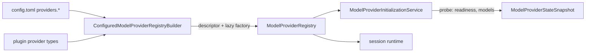

# Model providers

A model provider is a configured way to run turns: an LLM endpoint that CodeAlta drives, or an agent program that runs
its own loop. A provider owns its credentials, its protocol, its readiness, its models and the execution of a turn. It
does not own sessions: a session is CodeAlta's, keyed by its own id, journaled by CodeAlta, and can go on with another
provider and come back (see [runtime](runtime.md)).

| Project | Owns |
| --- | --- |
| `src/CodeAlta.Agent` | The contracts (`IModelProviderContracts.cs`, `ModelProviderDescriptor`, `ModelProviderRegistry`, `ModelProviderInitializationService`), the session runtime that drives API providers (`Runtime/AgentSession`, `ChatClientTurnExecutor`), failure classification, and the harness toolkit for agents with their own loop (`Harness/`) |
| `src/CodeAlta.Agent.OpenAI` | `openai-chat`, `openai-responses`, `azure-openai`, and the ChatGPT/Codex subscription (`codex`, `Codex/`) |
| `src/CodeAlta.Agent.Anthropic`, `.GoogleGenAI`, `.Mistral` | `anthropic`; `google-genai` and `vertex-ai`; `mistral` |
| `src/CodeAlta.Agent.Copilot`, `.Xai` | `copilot` and `xai`: direct HTTP with their own sign-in, dispatched to the executors above |
| `src/CodeAlta.Agent.Claude` | `claude-code`: the Claude Code CLI as a child process |
| `src/CodeAlta.Acp`, `src/CodeAlta.Plugin.Acp` | The ACP protocol and client; the built-in plugin that adds the type `acp` |
| `src/CodeAlta.CodexAppServer`, `src/CodeAlta.Plugin.CodexCli` | The Codex app-server protocol, client and pinned release; the built-in plugin that adds the type `codex-cli` |
| `src/CodeAlta.Hosting` | Composition: `ConfiguredModelProviderRegistryBuilder`, sign-in and inspection workflows (`Configured*`), `PluginModelProviderTypes`, bundled `ProviderDefaults/provider_defaults.toml` |
| `src/CodeAlta.Catalog` | The `[providers.*]` configuration (`CodeAltaConfigStore`) |

## The model

- **Descriptor** (`ModelProviderDescriptor`): the key, type, display name, endpoint, defaults (model, effort,
  permission mode) and what the provider can do (`PermissionModes`, `SupportsRemoteControl`, `SharesConversations`).
  It is data: the orchestration and the window decide from it without creating a runtime.
- **Registry** (`ModelProviderRegistry`): descriptors with a runtime factory each. `RegisterOrReplace` swaps a
  provider and disposes the registry's cached runtime; an attached session has a runtime of its own and keeps it
  until it detaches, so saving settings never breaks a running turn. Registering starts and probes nothing.
- **Runtime** (`IModelProviderRuntime`): `StartAsync`, `ProbeAsync`, `CreateTurnExecutor`. An
  `IAgentModelProviderRuntime` attaches to the session runtime with a `ModelProviderRuntimeDescriptor`, which carries
  the protocol family and the compatibility profile.
- **Turn executor** (`IModelProviderTurnExecutor.ExecuteTurnAsync`): one `AgentTurnRequest` in, one
  `AgentTurnResponse` out, with streamed deltas and session updates. Optional interfaces of the executor
  (`IAgentProvider*`) add what only some providers have: tools run by the provider, compaction by the provider,
  turns started by the provider, background tasks, remote control, permission modes, catch-up of turns made elsewhere.
- **Initialization** (`ModelProviderInitializationService`): probes each provider independently, with a timeout, and
  caches readiness and models. One slow or failing provider never blocks another, and listing, opening or restoring
  sessions never waits for a probe.

Both applications build the registry with the same builder, from the same configuration store and credential store,
and each owns one `ModelsDevCatalogService` that it passes in. A registration batch shares one HTTP client per
provider (`ProviderHttpClients`) so sessions reuse connections, and one credential manager per Copilot or xAI provider
so a token is refreshed once for all its sessions.

### Configuration

Each provider is a `[providers.<key>]` table of the global `config.toml`; the key is its identity. `type` selects the
adapter. A table is never deleted because it cannot run:

- `enabled = false` keeps it out of the registry; a provider that is invalid or lacks credentials is marked
  unavailable.
- A `type` this version does not know is set aside, not refused (`CodeAltaConfigDocument.UnsupportedProviders`), kept
  across saves, and given to plugins as raw values (`CodeAltaConfigStore.LoadGlobalExternalProviders`): it may be the
  type of a plugin or of a newer version.
- `spaces` limits which spaces' sessions may use the provider (see [catalog and config](catalog-and-config.md)).

Startup validates the file before creating any runtime: an invalid file blocks providers and sessions until it is
fixed. The user documentation under `site/` lists the settings of each type.

### Defaults and profiles

Endpoints that speak a known protocol differently (no developer role, another max-tokens field, reasoning in another
field, required extra body) are described by rules in `ProviderDefaults/provider_defaults.toml`, matched by type,
provider key and host (`RawApiProviderDefaultsCatalog`). A rule fills an `AgentProviderProfile`; what the user writes
in the provider table wins over the rule. Adding support for a compatible endpoint is a rule, not code.

The models of a provider come from its model list, or a static fallback. The models.dev snapshot
(`CodeAlta.Agent/Data/models_dev_db.json`, refreshed into `~/.alta/cache/model-catalog/` every 12 hours) adds limits,
prices and abilities, and the user's `model_overrides` win over both. The models.dev provider of a configured provider is `models_dev_provider_id`, else the
one whose `api` is the provider's `api_url`, else the provider key, else the default of the type; a model it does not
list is looked up under its vendor (`ModelsDevVendors`). Without a known context limit, threshold compaction cannot
run. Refresh the snapshot with `dotnet run --project src/CodeAlta.Agent.ModelsDev.Updater -c Release`.

## Two kinds of providers

### API providers: CodeAlta runs the loop

`openai-*`, `azure-openai`, `codex`, `copilot`, `xai`, `anthropic`, `google-genai`, `vertex-ai` and `mistral` answer one
model call per `ExecuteTurnAsync`. `AgentSession` owns everything else: it composes the instructions, declares the
tools from `AgentToolDefinition`s, sends the whole conversation from the journal with each request, runs the tool
calls, journals every event and compacts locally. A provider switch, a fork or a rewind therefore needs nothing from
the provider: the next request is built from the journal.

Invariants that hold across these providers:

- **Prompt cache.** The requests of a session start with the same bytes. `AgentTurnRequest.PromptCacheKey` is the
  session at the start of its chain of forks, so a fork reads the cache of its source wherever a provider routes its
  cache by a key. Anthropic caches only up to explicit markers: `AnthropicPromptCache` places the breakpoints (last
  tool, system, last message, the end of the previous request). A standalone request (a compaction summary) is not
  marked: its cache write would never be read.
- **Reasoning replay.** Opaque reasoning (Anthropic signatures, OpenAI encrypted reasoning) is sent back only to the
  provider key, protocol family, transport and model that produced it (`AgentReasoningReplay`); any other gets the
  text. Signatures are bound to their conversation and account, and a mismatched block fails every later request.
- **Token counts.** `InputTokens` is the whole input, cache reads and writes included; `AgentInputTokenUsage.From` is
  the one rule every view and the statistics use, so a token is counted once.
- **Deferred tools.** A provider that supports tool search (`AgentToolDeferral.IsSupported`) gets deferred tools and
  the search tool; others get only loaded tools. Only the request changes, never the journal, so a session that
  changes provider replays cleanly.
- **Retries.** SDK clients retry before a response starts. A stream that fails before any output or tool call
  (`Unavailable`, or `RateLimited` on Responses) is asked again within a small budget; a tool call is never asked
  twice, and a retry discards the draft of the failed attempt.

The `codex` type is the ChatGPT/Codex subscription, deliberately distinct from OpenAI API-key access: it signs in with
OpenAI's token-sharing flow (`ConfiguredCodexAuthentication`, ID tokens verified locally), keeps one credential per
provider key (several keys are several accounts), speaks the subscription Responses endpoint over HTTP/SSE or
WebSocket with HTTP fallback, and limits concurrent requests per account (`CodexSubscriptionConcurrencyLimiter`). It
never converts subscription tokens into API keys.

### Agents that run their own loop

`claude-code`, ACP agents and the types plugins add run a program that calls the model, runs its tools and calls the
model again. `AgentSession` expects an executor that answers one model call. The executor bridges the two, so the
journal, the timeline, the queue, steering, fork, fallback and the session catalog work as for any provider:

- Each `ExecuteTurnAsync` returns the next assistant segment of the agent, up to a tool call or the end of its turn.
- `IAgentProviderToolHost.ResolveTool` gives the session a handler for each tool call the agent made: for the agent's
  own tools it waits for the result the agent reports, so the session records the same tool activity as for its own.
- The conversation is not sent again: the agent keeps its context. The provider state in the journal records the
  agent's conversation id and how much of the CodeAlta conversation it holds. When they do not match (another
  provider wrote part of it, a fork, a missing transcript), a new agent conversation starts with a rendering of the
  recorded one (`HarnessHistory`, `<codealta_previous_conversation>`).
- CodeAlta's instructions are appended to the agent's own system prompt, never replacing it. An agent keeps the system
  prompt its conversation started with, so a change is sent as an update with the next prompt
  (`HarnessInstructions.CreateUpdate`).
- CodeAlta's tools (`alta`, plugin and MCP tools) reach the agent as an MCP server of the session; a call is run by
  the session with its own permissions. A tool registered during a run reaches the agent by `tools/list_changed`.
- The agent's permission prompts become CodeAlta permission requests (commands and file changes), answered by the
  permission mode of the session or the user.
- Compaction is the agent's: local compaction is off for such a provider.

The toolkit for this is `CodeAlta.Agent.Harness`: previous-conversation rendering, instruction updates, the tool-call
bridge, and `LoopbackHarnessToolEndpoints`, a minimal HTTP/1.1 MCP server on loopback (no ASP.NET, so the TUI does not
load it) with one bearer-protected endpoint per session.

#### Claude Code

`CodeAlta.Agent.Claude` starts the unmodified `claude` executable and speaks the Agent SDK protocol with it
(`-p --input-format stream-json --output-format stream-json`). Anthropic's subscriptions are not reachable from a
third-party application, and CodeAlta does not try: it runs the user's CLI, signed in to the user's account, under the
conditions Anthropic sets for running Claude Code from another product. So:

- **The CLI is official and pinned.** A newer CLI can change its JSON under CodeAlta, so `ClaudeCodePinnedCli` names
  the tested version with the size and SHA-256 of each platform archive; it is downloaded only when the user asks
  (`ClaudeCodeCliInstaller`, into `~/.alta/cache/claude-code`). Else the user's installation is used, and its status
  says it is not the pinned one. Bumping the pin is a release step: new hashes from the GitHub release, then the live
  tests (`ClaudeCodeLiveCliTests` with `CODEALTA_TEST_CLAUDE_CLI` and `CODEALTA_TEST_CLAUDE_TURN=1`).
- **Accounts are folders.** `config_dir` is passed as `CLAUDE_CONFIG_DIR`; several accounts are several providers.
  `ANTHROPIC_API_KEY` is decided before the process starts (`ClaudeCodeApiKey`): print mode would bill a key silently,
  so CodeAlta follows the setting, else the answer Claude Code saved, else refuses the turn.
- **CodeAlta adds, never replaces**: `appendSystemPrompt`, its MCP server (served over the control protocol, no port),
  and hooks that only wait before an edit or refuse Claude Code's own plan mode. Claude Code's file, shell and
  question tools stand in for CodeAlta's (`ClaudeCodePrompts.ReplacedTools`); a session with the `alta` tool runs
  without subagent tools, so that delegation goes through child sessions the user can see.
- **One process per session**, closed after 10 minutes idle unless it still works by itself (a background task, Remote
  Control). A turn the CLI starts by itself (a background command ends, a wake-up fires) gets a run started for it
  through `AgentHub` (`IAgentProviderInitiatedRuns`), ordered by the session's run gate.
- **The transcript is shared with VS Code and the terminal.** The journal is the source of truth and the transcript
  under `<config root>/projects/` a mirror that CodeAlta reads and never writes. Before resuming, CodeAlta checks the
  CLI's live registry (`ClaudeCodeLiveSessions`) and asks the user when another process holds the conversation; turns
  written elsewhere are added to the journal (`ClaudeCodeExternalTurns`, under `external:` runs that statistics do not
  count). `ClaudeCodeTranscriptReader` ports the SDK's chain rules; it skips what it does not understand and degrades
  to a notice or a new conversation with the rendering, never to a silent loss.
- **Cloud sessions go through documented commands only.** `claude --cloud <task>` starts one, in a pseudo-terminal the
  desktop gives (`IAgentInteractiveTerminal`), since the CLI refuses to start one without a terminal; `claude -p --cloud
  <id>` sends a message; `claude -p /cost --teleport <id> --session-id <uuid>` brings it back, a local command that
  makes no model call. CodeAlta never calls the cloud service, reads the CLI's credentials or uses its internal control
  requests, so it knows only the cloud sessions it started or was given a link to. A session in the cloud has no
  turns, only its cloud state, and the runtime refuses to attach it to its provider (`in_cloud`). Bringing it back is
  reserved in the journal first, then the teleported transcript is read by the catch-up reader (origin `Cloud`, cut
  at Claude Code's continuation entry) and written in one append.
- **Fork and rewind** start the CLI on the conversation of the point (`--resume`, `--fork-session`,
  `--resume-session-at <entry>`), so its prompt cache is still read.
- **The stream is open-ended**: unknown lines and messages are skipped, unhandled control requests answered with an
  error. `CODEALTA_DEBUG_LOGGERS=CodeAlta.ClaudeCode.Protocol` logs every line exchanged (it contains the
  conversation: developers only).

#### ACP agents

The built-in plugin `acp` adds the type `acp`: the agents of the [Agent Client Protocol](https://agentclientprotocol.com)
registry (Copilot CLI, Gemini CLI, Cursor, Qwen Code...). `src/CodeAlta.Acp` holds the protocol only (generated
schema types, JSON-RPC transport, client, process, registry and installer) and no CodeAlta runtime type;
`src/CodeAlta.Plugin.Acp` uses only the public plugin contracts and the harness toolkit.

- A provider is a `command` with `arguments`; `agent` and `agent_version` only record which registry entry it came
  from, for the update. Adding from the registry downloads a binary distribution or writes an `npx`/`uvx` command.
- `AcpAgentSession` owns one agent process and one agent session per CodeAlta session. It resumes the agent session
  when the journal holds the same conversation (`AcpProviderState`), else creates one with the previous conversation.
- Models and efforts are the agent's config options; the probe selects each model once to learn its efforts, then
  restores the selection, since some agents remember the last choice. What an agent does beyond the protocol is a
  subclass of `AcpAgentQuirks`, chosen from the registry id or the command.
- CodeAlta's tools reach the agent through `LoopbackHarnessToolEndpoints` when it supports HTTP MCP servers.
- Regenerate the protocol types from the ACP repository cloned beside this one:
  `dotnet run --project src/CodeAlta.Acp.Generator -- --acp-repo-dir ../agent-client-protocol --surface unstable --source-ref <tag>`
  (`unstable` because CodeAlta uses `session/resume`, `session/close` and `systemPrompt`).

#### Codex CLI

The built-in plugin `codex-cli` runs OpenAI's standalone `codex-app-server` (JSON-RPC over stdio), so that the model
loop is Codex's and its sign-in is Codex's own: ChatGPT Business workspaces refuse the sign-in of the `codex` type
(`3p_delegated_access_policy_denied`), not Codex's. `src/CodeAlta.CodexAppServer` holds the protocol only and no
CodeAlta runtime type; `src/CodeAlta.Plugin.CodexCli` uses only the public plugin contracts and the harness toolkit.

- **The release is pinned** (`CodexPinnedRelease`): the latest stable release when it was pinned, never a pre-release,
  with the SHA-256 of the `codex-app-server-package-<target>.tar.gz` of each platform. It is downloaded the first time
  a provider without `command` needs it, into `~/.alta/cache/codex-cli` (`CodexAppServerInstaller`, over
  `PinnedDownloader`). The protocol types are generated from the schema Codex checks in at the same tag, scoped to the
  methods of `codex-app-server-methods.json`; enums and unions accept the values and kinds a later Codex adds. Bump
  both together: `dotnet run --project src/CodeAlta.CodexAppServer.Generator -- --codex-repo-dir ../codex --source-ref <tag>`,
  then the live tests (`CodexCliLiveTests`, `CODEALTA_TEST_CODEX_CLI`, `CODEALTA_TEST_CODEX_HOME`, `CODEALTA_TEST_CODEX_TURN=1`).
- **A home of CodeAlta's per provider** (`CODEX_HOME`, `CodexAppServerHome`), never `~/.codex`: CodeAlta writes its
  `config.toml` before each start (`CodexCliHomeConfig`), with Codex's sandbox, sub-agents, skills, plugins, hooks,
  apps, memories and reviewer off. What depends on the session goes with each `thread/start`, `thread/resume` and
  `thread/fork`, since Codex does not keep it: the MCP server of the session's tools (the harness loopback endpoint,
  approved by CodeAlta), web search, and the trust of the folder (`untrusted`: CodeAlta gives AGENTS.md itself).
- **CodeAlta adds, never replaces**: its instructions are `developerInstructions`, part of the turn context Codex
  rebuilds at each turn and after a compaction; a change goes with the next prompt (`HarnessInstructions.CreateUpdate`).
- **One app-server and one thread per session** (`CodexCliSession`), resumed in a new process, forked at the turn a
  rewind or a fork ends (`CodexCliProviderState` keeps the last turns), or started again told the conversation. A
  message sent during a turn steers it (`turn/steer`). The approvals of Codex are answered by the permission mode or
  the user (`untrusted` asks for what is not plainly safe, `never` in `bypassPermissions`).
- **The sign-in runs in CodeAlta**: `account/login/start` (browser or device code) in a short-lived app-server of the
  home, shown to the user through the prompt of `IPluginProviderAccount.SignInAsync`.

#### Provider types of plugins

A plugin returns `PluginModelProviderContribution` from `GetModelProviders()`: the type, its settings, its permission
modes, a runtime factory, validation, sign-in methods and an optional catalog (see [plugins](plugins.md)).
`PluginModelProviderTypes` registers the providers of the active types and registers them again when the set of types
changes. Before a type goes away or is rebuilt, the running turns of its sessions are stopped as a user stop would,
so they do not fail when their runtime is disposed. While the plugin is not active, its providers stay in the file
and their sessions cannot run.

## Credentials

CodeAlta holds a credential only where it signs in itself, and never hands one to anything else:

- **API keys** come from the provider table (`api_key`, or `api_key_env` to keep the secret out of the file) and are
  sent only to that provider's endpoint.
- **Signed-in providers** (`codex`, `copilot`, `xai`) keep their tokens under `~/.alta/auth/`, one record per
  provider key. Writes are atomic (temporary file, then move) and protected (DPAPI or owner-only permissions), and a
  refresh runs under a file lock and rereads the credential first, so a rotating refresh token is never sent twice by
  two processes or registrations. The window and the `alta` tool receive account metadata, never a token.
- **Agents sign in themselves.** Claude Code and ACP agents use the login the user set up for them. CodeAlta stores
  no token for them, sets no authentication or endpoint variable, and only removes variables that would change the
  account (`ANTHROPIC_API_KEY` when the user chose their login).
- **The plan usage of an account CodeAlta did not sign in** is asked of the vendor's own CLI (`codex app-server`,
  `claude` with `get_usage`), never read from the CLI's credential file or fetched with its token.

The reasons: a subscription belongs to the vendor's own client and its terms, forwarding a credential to another
program or host would expose it beyond the account the user approved, and CodeAlta must not misreport what it is.
For the same reason CodeAlta does not rotate accounts or route around provider limits; changing account after a
failure is the user's fallback setting, along models the user listed.

## Failures and fallback

A run that ends on an error carries `AgentErrorEvent.Failure`, an `AgentFailureInfo` with a kind, the reset of a quota
or a limit, and the retry delay. It is decided once the provider has given up (its own retries come first), by
`AgentFailureClassifier.Classify`: a kind the provider set (`AgentProviderFailureException`,
`AgentTurnExecutionException`) wins, then the HTTP status, then connection failures and timeouts. Each provider
classifies its own error codes (`ClassifyFailure` of the OpenAI executors, the Anthropic, Google and Mistral
runtimes, and `ClaudeCodeSession`), because the same status means different things across vendors (a 403 quota, a 429
quota versus a rate limit).

| `AgentFailureKind` | Meaning |
| --- | --- |
| `QuotaExhausted` | The account's quota, credits or plan allowance are used up until a reset |
| `RateLimited` | A short limit on the rate of requests |
| `Unavailable` | Outage, overload, network or timeout after the provider's retries |
| `Auth` | Not signed in or not allowed |
| `ModelUnavailable` | This model is not available to the account; its other models may be |
| `Other` | Anything else, including a context overflow and a content-filter refusal |

A context overflow or a refusal is always `Other`: another model would not read the conversation better, so the
fallback must not move. The only consumer of the kind is the fallback of a session to the next model of its tier
(opt-in, in [runtime](runtime.md)).

What the provider said is kept with the error, without a protocol trace: providers put `code`, `type`, `httpStatus`,
`requestId`, `transport`, `attempts` and `payload` in `Exception.Data` under `AgentErrorData` keys. The journal keeps
only those keys, with bearer tokens and JWTs redacted and values bounded; retries and transport fallbacks are durable
session updates with the same diagnostics. `protocol_trace = true` writes full traces under
`~/.alta/sessions/traces/` for local diagnosis only: they contain prompts and output.

## Adding a provider type

- An endpoint that speaks a supported protocol: a rule in `provider_defaults.toml`, or a profile in the provider table.
- A built-in type: an adapter in its own `CodeAlta.Agent.*` project, registered by type in
  `ConfiguredModelProviderRegistryBuilder`, with its configuration validated by the Catalog and its failures classified.
- An agent with its own loop, or a type users install: a plugin provider type over the harness toolkit, as ACP does.
