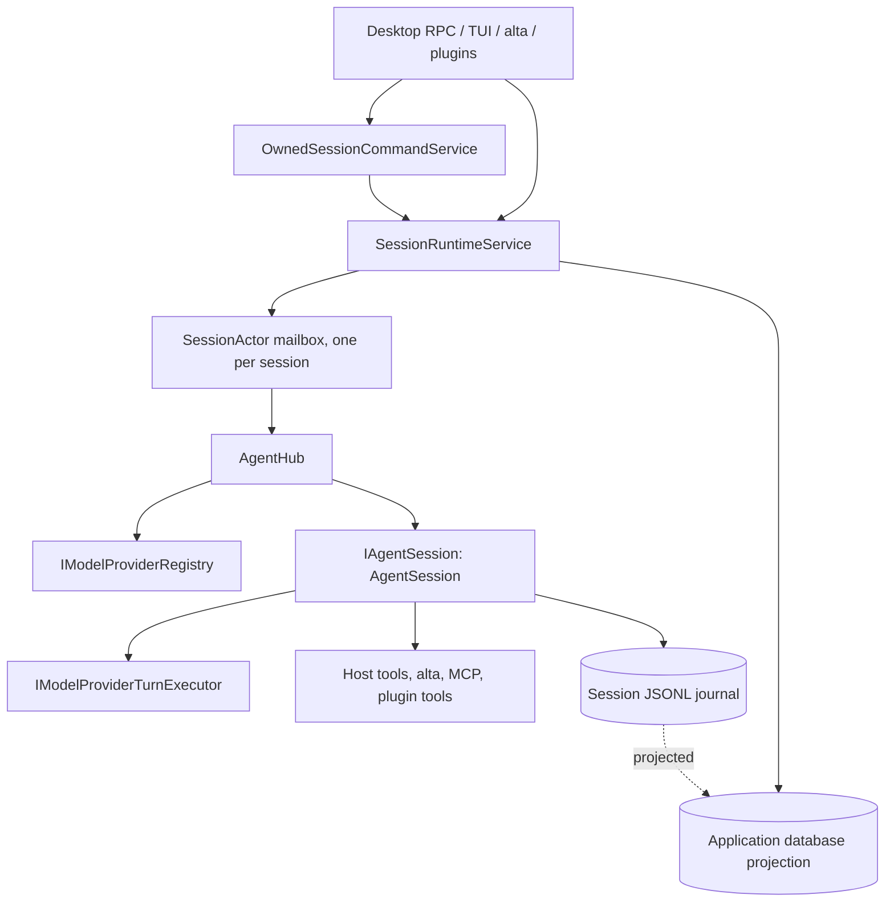

# Runtime and agent sessions

The runtime turns requests of the frontends, of `alta` commands and of plugins into CodeAlta-owned sessions: ordered
per-session commands, normalized events, journals and projections for the UI and the plugins. Model providers run
turns and describe their models; they never own session identity, persistence or discovery.

## Layers



| Project | Owns |
| --- | --- |
| `CodeAlta.Agent` | The headless contracts (`IAgentSession`, `AgentEvent`, `AgentInputItem`, `IModelProviderRuntime`, `IModelProviderTurnExecutor`), the local agent loop (`AgentRuntime`, `AgentSession`), the built-in tools, compaction, and the journal store (`FileSystemAgentSessionStore`, `AgentSessionJournalFile`). |
| `CodeAlta.Orchestration` | `CodeAltaHost` (composition and lifetime), `AgentHub`, `SessionRuntimeService`, `OwnedSessionCommandService`, the session actors, permissions, prompts and instructions (`SystemPromptBuilder`, `AgentPromptCatalog`), fallback, retention, the plugin bridge. |
| `CodeAlta.Catalog` | Session-view metadata and its journal records (`SessionViewJournalStore`), the projections in the application database, config, projects and spaces (see [catalog and config](catalog-and-config.md)). |

- `SessionRuntimeService` is the runtime facade: session creation, sends, queues, steering, abort, compaction, skills,
  notes, fork/rewind, moves, history reads, and publication of `SessionRuntimeEvent`. Its partial files are named by
  feature (`SessionRuntimeService.Branch.cs`, `.CatchUp.cs`, `.Jobs.cs`...).
- `AgentHub` holds the attached sessions: it resolves a provider through the registry, starts or resumes the session,
  and serializes run, abort, steer and compact through a per-session handle. It neither lists stored sessions nor
  probes providers.
- `AgentSessionCatalog` and `IAgentSessionStore` own discovery and history reads (`ListSessionsAsync` streams).
- Provider initialization (`IModelProviderInitializationService`) starts eagerly and per provider, fault-isolated:
  listing, history, import and restore never wait for a provider. Model lists are cached by the probe and reused.

## Sessions, runs and turns

- A **session** is a durable conversation with a CodeAlta id, a journal and a working directory (a project folder, or
  the global root for a chat); it may work in a git worktree. CodeAlta generates the id before any provider is attached,
  and a provider that returns another id violates its contract: the session is never rekeyed.
- An **attachment** is the live `IAgentSession` the hub holds for a session, with its provider, model, effort, agent
  prompt, tools and callbacks. It is replaced (retired, then attached again) when any of these change, after a move, a
  provider switch, a rewind or a catch-up of external turns. Its ordinal (`AttachmentGeneration`) names a replacement.
- A **run** is one prompt executed until the session is idle, with a `RunId`; a **turn** is the journal records of one
  run. Turns are the points of fork and rewind.
- A busy session queues prompts (`codealta.sessionState` keeps the queue; pending items keep their text, handled ones
  only a preview, so the record does not grow with the history). The runtime drains at most one queued prompt when the
  session becomes idle. Steering goes into the running turn when the provider supports `SteerAsync`, else falls back to
  the queue or a send, depending on the caller.

A normal prompt:

1. The caller names a session (or creates one) and the selection (provider, model, effort, agent prompt, mode).
2. `SessionRuntimeService` resolves the session on its actor and composes the execution options
   (`SessionExecutionPolicy`: from captured descriptors, never from a selected tab) and the instructions.
3. `AgentHub` attaches the session, or reuses the attachment when the options still match.
4. `IAgentSession.SendAsync` runs the turn; normalized `AgentEvent` values are journaled by the session and forwarded to
   the actor, which projects them into `SessionRuntimeEvent` values, display state, parent notifications and plugin
   observations.
5. On idle, the runtime updates usage and state and drains the queue.

Prompt input is typed (`AgentInputItem`): text, images, files and directories (`@path` references, resolved by the
host against the catalog root of the project when the send is admitted, as paths and line ranges, never file
contents), and `HostContext` notes. Queue and steer take literal text.

## Turn executors and the local agent loop

A provider runtime (`IModelProviderRuntime`, created by an `IModelProviderAdapter`) gives a turn executor
(`IModelProviderTurnExecutor.ExecuteTurnAsync`): one assistant response for one `AgentTurnRequest` (instructions,
conversation, tools, model, effort, `PromptCacheKey`), streamed as `AgentTurnDelta` updates.

`AgentSession` is the agent loop around it, the same for every provider: it composes the request from the normalized
history, calls the executor, runs the tool calls of the response through the host tools, appends the results, and calls
again until the model stops; it handles steering, abort, compaction, usage, titles and the journal. API providers
(OpenAI, Anthropic, Google, Mistral, Copilot, xAI...) are plain executors.

An agent CLI that runs its own loop and tools (Claude Code, ACP agents) is still a turn executor, never an
`IAgentSession` of its own: it implements optional capabilities instead, so the session keeps one journal, one event
model and one permission path.

| Capability | Meaning |
| --- | --- |
| `IAgentProviderToolHost` | The provider runs tools itself; the session shows and records each call and supplies host handlers (permissions, user input). Tools never run twice. |
| `IAgentProviderKeptConversation` | The provider keeps the conversation (a CLI transcript): a resumed session does not read its history, and passes `AgentTurnRequest.EarlierConversation` unread, loaded only if the provider cannot continue its own. It compacts itself (`IAgentProviderCompaction`). |
| `IAgentProviderInstructionsChannel` | Instructions reach the model another way than system/developer messages (appended system prompt, first prompt); recorded with the system prompt. |
| `IAgentProviderExternalTurns`, `IAgentProviderSharedConversation` | The conversation is shared with other programs (see "Turns made outside CodeAlta"). |

`AgentHub` also accepts an `IModelProviderSessionRuntime`, a provider that creates its sessions itself; every provider
of the repository goes through `AgentRuntime`. Provider details are in [providers](providers.md).

## The per-session actor

Every session has one `SessionActor` (`SessionActorRegistry.GetOrCreate` makes exactly one, even under races), backed
by `OrchestrationMailboxActor`, a small bounded mailbox. It is the single writer of the session's runtime state: the
coordinator entry, attachment transitions, the queue, local state appends, the projection of provider events.

Why an actor per session:

- Commands and provider events of one session are applied in one order, without locks spread over the runtime.
  Providers post their events inline, one after the other; the mailbox admits commands first come, first served, so a
  delta can never be applied after the `Idle` of its run (a semaphore would resume waiters in any order).
- Different sessions run in parallel: a slow provider, a tool or a journal append of one session never blocks another.
- The mailbox only decides: long work (provider calls, tools, user decisions, joins) runs outside it, and its result
  comes back as a command. Plugins and frontends never touch actor-owned state.

Supervision: a validation failure fails the command; a recoverable failure becomes a structured outcome; an
unrecoverable one stops the actor and completes its pending replies. Runtime event streams are bounded
(`BoundedRuntimeEventStream`, newest dropped and counted), so a slow reader costs events, not memory. There is no
actor framework, on purpose: the primitives stay internal and public APIs expose ids, requests, snapshots and events.

## Journals are the source of truth

Each session has one JSONL journal, `<state root>/sessions/yyyy/MM/dd/<session-id>.jsonl`, with its attachments in
`<session-id>.attachments/` beside it (images, prepared tool images; the journal holds paths, never image bytes). It
holds the normalized `AgentEvent` history plus snapshot records: `local.sessionSummary` (title, lineage, fork origin,
rewind count), `local.sessionState` (provider state, compaction, loaded skills, usage), `local.compactionCheckpoint`,
and the session-view records `codealta.sessionHeader` (first line: scope, working directory, space) and
`codealta.sessionState` (local state: selection, queue, tier, archive, permission mode). An append is one write: a
crash leaves all records of an append or none. A reader tolerates an incomplete final record; a writer refuses to
append after a malformed one.

**Normal operation never reads a journal.** Journals grow to hundreds of megabytes, and listing, sending, notes,
`alta` queries and bookmarks run constantly. So the journal is projected into the application database (see
[catalog and config](catalog-and-config.md#the-application-database)):

- the session list (`SessionJournalSqliteCache`): header, summary preview, view state, queue count, and the last
  state record, which writers append and read back;
- the session index (`SessionJournalIndexStore`): offsets of the snapshot records, of each turn, of usage and notes,
  so a reader seeks the records it needs.

Rules that keep this safe:

- A row is valid only at the stamp (length, last-write time) of its journal. Every reader checks the stamp; a journal
  another writer changed is projected again from where the projection ends.
- A durable write never reads its journal back: `AppendLinesTrackedAsync` returns the stamps before and after, and the
  projection moves forward from the appended lines alone.
- The database is derived: missing, damaged, older or newer tables are rebuilt from the journals. Nothing holds state
  in memory beside the row.
- A resume reads only what its provider needs: nothing for a provider that keeps the conversation and has a provider
  state, the journal back to the last compaction checkpoint for the others, the whole history only as a fallback.
  Earlier events stay in the journal until an action needs them (`GetHistoryAsync`).

The legacy name `SessionView` survives in types and records (`SessionViewJournalStore`, `SessionViewDescriptor`); it
means session. Optional protocol traces are `sessions/traces/<session-id>.trace` when a provider enables tracing.

## Tools and permissions

Sessions on the in-process runtime get host tools: `read_file`, `view_image`, `list_dir`, `grep`, `webget`,
`shell_command`, `write_file`, `replace_in_file`, `delete_file_or_dir`, `rename_file_or_dir`, `apply_patch`, the `alta`
live tool ([live tool](live-tool.md)), the MCP tools of activated servers ([MCP](mcp.md)), plugin tools, and
`request_user_input` when a send enables it. Tools that become available during a turn (an activated MCP server) are
registered through `AgentToolInvocation.RunTools` and offered on the next model request.

- **Permissions.** Mutation and shell tools ask through the permission callback of the send or of the session.
  `SessionPermissionService` (one per runtime, a mailbox) owns pending requests: a handle carries session, run,
  interaction and a fresh attempt id, so an old or replayed answer resolves nothing. The mode of a session decides
  (`SessionPermissionModes.Policy`: `bypassPermissions` approves, `acceptEdits` grants file changes and reviews commands,
  anything else reviews); a change of mode applies to a running send at once. The provider still enforces the decision.
- **Command guards.** A command refused in every mode is an `AgentCommandGuard`, checked before any permission by the
  shell tool and by the Claude Code hook.
- **Tools turned off.** A session does without the union of `[tools] disabled` (global), `tools.disabled` of its space
  and `disabled_tools` of its agent prompt; prompt files can branch on a tool with `<!-- if-tool: name -->`. A runtime
  can also give a session patterns over tool names (`SetDisabledToolPatterns`, `AgentToolPatterns`: MCP, plugin and
  provider web tools included), never offered to the model and inherited by the sessions it creates. Without
  `shell_command` nothing may start a program for the session: `alta` commands that start programs refuse, plugin tools
  that start programs (`PluginToolActivationPolicy.StartsPrograms`) are refused, Claude Code runs restricted without
  its shell tools, and a session never hands a wider tool set to another session. The rules are in the code that
  enforces them (`BuiltInAltaCommandContributor.ShellTurnedOffAsync`, `RefuseWiderToolsAsync`).
- **Write guard.** `AgentWriteGuard` limits file tools to the session's working directory, worktree, project roots and
  scratchpad, resolving links and short names, and keeps agent configuration folders (`.git`, `.alta` except plans and
  tasks, `.claude`, `.vscode`...) out of reach. Without it, Claude Code writes nothing.
- **Bounded inspection.** File-change diffs (`AgentTurnFileChangeTracker`) and tool images (`AgentSessionToolImages`)
  are bounded before serialization with an explicit omission notice; the limits never change what a tool does.
  `shell_command.timeoutMs` bounds both the process and the collection of its output.
- **Running output.** What a tool writes while it runs is not journaled; `RuntimeToolOutputProjection` keeps it for
  observers while the call runs, and the finished result is the persisted record.
- **Child processes** (commands, jobs, the CLI of a provider) start with the environment of the session's identity and
  `CODEALTA_SESSION_ID`, `CODEALTA_MODEL`, `AI_AGENT=codealta` (`SessionProcessEnvironment`), fixed per attachment.

## System prompt and instructions

Prompts are files under `prompts/` roots with precedence built-in (`content/prompts/`) < global (`~/.alta/prompts/`)
< project (`<project>/.alta/prompts/`): `system/<id>.system-prompt.md` for invariant host behavior and
`agents/<id>.prompt.md` for selectable agent prompts. A later file replaces an earlier one with the same id, or extends
it with `mode: append`; an agent prompt can `inherit:` others (depth-first, at most 16). GitHub Copilot custom agents
(`.github/agents/*.agent.md`) are read-only agent prompts below the built-in ones.

`SystemPromptBuilder` composes the system message and the developer instructions: system prompt, agent prompt body,
runtime context (working directory, project root, scratchpad file, space, model tiers, commit trailer), tool guidance,
skills, and project context (instruction files `AGENTS.md`, `CLAUDE.md`, `.github/copilot-instructions.md`, the largest
per folder, from the instruction boundary to the working directory). Orchestration then appends parent guidance and
plugin prompt parts, and plugin instruction processors may rewrite the result. An unreadable instruction file is
skipped with a warning, never a failure.

**The instructions stay byte-stable.** Providers cache the prompt prefix; any change of the instructions invalidates
the cache of every later request. So:

- nothing in the instructions depends on volatile state: no time, no counts, no per-turn data; the scratchpad name of a
  fork comes from the root of its chain (`ForkedFrom.RootSessionId`);
- a state the agent must learn during a session (review before commit) reaches it as an
  `AgentInputItem.HostContext` note of the next prompt, shown to the user as a chip, never through the instructions;
- inputs that do change between prompts (settings, skills ranking) are composed so they change as seldom as possible;
  the session records an `AgentSystemPromptEvent` only when the hash of the effective prompt changes, and providers that
  keep a conversation get an `<codealta_instructions_update>` note instead of a new prompt.

Composition is deterministic and file-backed: large static prompt text belongs in prompt resources, not in code.

## Titles and prompt suggestions

A title carries its source (`AgentSessionSummary.TitleSource`): `user` titles are never replaced; `auto` titles change
according to the title mode (`[sessions] title` or the session's own `title_mode`: first prompt, last message, or the
model's `<session_title>` tag). Only the live `AgentSession` writes automatic titles, through `UpdateSummaryAsync`, so a
rename during a run wins. In the desktop, a session the user writes in may ask the model for a `<next_prompt>`
suggestion. Both tags are removed wherever assistant text leaves the session (timeline, journal content events, parent
notifications, plugins); the raw assistant message keeps them. The guidance paragraphs are per run, so a change of mode
needs no new attachment.

## Compaction

Compaction (`AgentSession`, `CodeAlta.Agent.Runtime.Compaction`) summarizes the history with the session's own model
through the same turn executor, and records a `local.compactionCheckpoint`; a resume replays from the last checkpoint.

- **Triggers.** Manual (`CompactAsync`, `alta session compact`), threshold (projected context reaches `ratio` of the
  input limit, before a turn and after idle), and overflow recovery after a context-limit failure.
- **Unknown limits.** A model that reports no input limit is compacted against `DefaultAssumedInputContextLimit`
  (128,000 tokens), or for an overflow against the input size of the last accepted request, so a session can never grow
  until the provider rejects it. Summary output budgets have a floor and a ceiling for the same reason.
- **Usage.** Summary requests are billed operations of the session (initiator `compaction`): counted once in usage and
  statistics, never taken for the size of the prompt.
- Providers that keep the conversation compact it themselves and refuse local summaries.
- Activated skills are rehydrated into the instructions after compaction.

Settings are `AgentCompactionSettings` (`ratio` 0.95 by default, post-compaction target, summary shares...).

## Fork and rewind

Both are journal operations of the store, committed by one rename (`FileSystemAgentSessionStore.CommitForkAsync`,
`CommitRewindAsync`, through `SessionViewJournalStore` and `SessionRuntimeService.Branch.cs`). No provider is called and
no file of the working folder is restored.

- **Points** are turn starts, named by the run id of the turn they precede, never by a count or an offset a caller
  kept. `AgentJournalTurnReader` finds turns by reading each record by its two ends, so a scan costs the file read
  whatever the size of a record. A running turn is never part of a fork and cannot be removed.
- **Fork.** A new session with the records before the point, copied as bytes (`AgentJournalBranchWriter`: only the
  session id a record ends with and attachment paths change), then a summary, the state last written before the point,
  and a local state with the source's choices. The four metadata snapshots of the source are left out, because a
  summary inherits lineage from the ones before it. A fork is not a child: its origin is
  `AgentSessionSummary.ForkedFrom`, never `ParentSessionId`.
- **A fork reads its source's prompt cache**: same messages (byte copy), same instructions (nothing depends on the
  fork's id), and `AgentTurnRequest.PromptCacheKey` is the root session for providers that route their cache by key. No
  "forked from" message is injected.
- **Rewind** needs an idle session (no run, queue, pending interaction or background work), retires the attachment
  before the journal changes (the conversation in memory must not be written back), and rewrites the header with
  `rewind_count`: readers that follow a journal by offset recognize it by its first line, and views reload on
  `RewindCount`. By default the session as it was is kept as a fork of kind `Rewind`, so nothing is lost.
- A provider that keeps the conversation takes it up from `AgentSessionState.ProviderBranch` at its next start.
- Outcomes are statuses (`SessionBranchOutcome.Status`), not exceptions.

## Turns made outside CodeAlta

A provider can share its conversation with other programs (`ModelProviderDescriptor.SharesConversations`: Claude Code,
whose transcript VS Code and the CLI also write). The CodeAlta journal stays the source of truth; the other program's
files are only read.

- **Catch-up** (`SessionRuntimeService.CatchUp.cs`) adds the turns written elsewhere to an idle session before a prompt
  is admitted and when the desktop shows a session: observed and committed on the actor, read off it, under the lease of
  the session from the observation to the append, refused while anything runs, and written as runs `external:<guid>` that the statistics skip. Counts in the provider state are
  advanced by exactly what was written, never recounted from the copy. The attachment is then retired, because its
  process holds the old conversation.
- **Held conversations.** A conversation open in another live process is never resumed silently: the run asks
  (`SessionConversationHeldService`, wait / continue as copy / open anyway / cancel) or fails with a message.
- **Import** (`SessionRuntimeService.Import.cs`) turns a conversation started elsewhere into a session of a project,
  with the same `external:` marking; it is idempotent by provider session id.

## Sub-agents

A sub-agent is an ordinary session whose `ParentSessionId` names the session that created it (`CreatedBy` records the
creator of a session without a parent). Parent and child share lineage only: no run gate, cancellation, provider state
or journal writer. The parent link gives:

- the child's instructions a parent paragraph, and the parent the child's final reply (or failure, or a
  `<notify-parent>` update) as a host prompt, steered into a running turn or queued (`DeliverHostPromptAsync`);
- nesting in session lists, and deletion and retention families (`SessionLineage`): a parent is not removed before
  its descendants.

## Headless runs

`HeadlessSessionDriver` is the one loop the faces without a user share (a command line run, an ACP server): it opens
a session (new, resumed, or named by the caller) and holds its lease until it closes it (see "Sessions shared with other
processes"), checks that its provider and model can run, sends prompts through
the owned commands, owns the single reader of `SessionRuntimeEvent` and gives an observer the events of its sessions
and of the sessions they started, and reports how each run ended from the journal (`SessionOutcome`).

- **Settlement.** A run is over when its tree has settled, not at the first `Idle`: the answer of a child starts its
  parent again, a queued prompt drains, a job tells its end, a fallback continues. `WhenSettledAsync` waits until the
  root and every session it started have no run, queue drain or pending prompt, provider background task, job or job
  delivery, retention claim (sends, parent notifications, host prompts in delivery), owned command, fallback or
  forwarded callback. It wakes on the signals of the runtime and ends after two consecutive idle probes on the
  actors; a slow re-check only bounds what a missed signal would cost.
- **Abort.** `AbortTreeAsync` stops the runs and jobs of a tree, cancels the sends of the owner admitted before it,
  and holds their queues until a prompt is sent to them again, so that nothing starts after a timeout or a signal; each
  journal records the abort and its reason. Each abort takes a number that a send captures when it is admitted and
  checks on the session actor when it claims its run: a send admitted before an abort of its session or of an ancestor
  (a detached `alta session send` to a child included) never starts its run after it.
- **Flush.** What a face writes after a run (a result, the response of a prompt) comes after every update of the run:
  `FlushEventsAsync` publishes a marker that waits for room in a full stream instead of being dropped, and ends once
  the observer has returned from every event before it. The stream stays bounded and lossy; each event tells the
  observer how many were dropped before it (`HeadlessSessionEvent.DroppedBefore`), so a face repairs from completed
  content.
- **A host without a user.** `FullTrust` grants every request, `HeadlessInstructions` ends every system prompt with one
  fixed paragraph and turns review before commit off, and `ReadOnlyGlobalState` lets the process run beside Desktop:
  it writes nothing shared under the global root (a folder outside the catalog gets a transient project, and the
  database is a private, throwaway one), only the journals of its sessions.

## Sessions shared with other processes

Desktop or TUI and the command line (`altacli`) write journals into one sessions folder at the same time, each with
its own database. Two rules keep one writer per session across processes:

- **Leases.** A host with `SessionLeaseOwner` holds the lease of a session (`SessionLeaseStore`, an OS-held handle,
  released when the process ends) from the moment it attaches it (`SessionLeaseRegistry`: the attachment, the holds of
  a frontend that shows it or of a headless driver that opened it, and the hold of a change being written). A session
  another process holds is neither attached nor changed: `SessionInUseException`, or the status `session_in_use` of
  the commands that report one; a fork, which writes a new session, is allowed. Leases fail closed: a lease that cannot
  be taken (the folder cannot be written) refuses the attachment and the change too (`SessionLeaseUnavailableException`),
  since the journal alone would still be writable. The lease goes when the attachment goes
  for good (after its retirement) and no hold is left. A frontend says what it shows (`SetShownSessions`); from then
  on a session it does not show is detached once it has had nothing to do for a while (no run, queue, job, background
  task, pending agent prompt or remote control), so a closed tab lets another process continue the session.
- **Following.** A host that owns the database of its state root (`FollowExternalSessions`: Desktop, TUI) runs
  `ExternalSessionFollower`: it projects the sessions the command line names in markers, then deletes the markers;
  it follows the sessions another process holds, projecting their journals again as they grow (head and tail only,
  about once a second, only while held; a marker whose journal is not a session yet is looked at again at that pace)
  and once more when released, and raises `Changed` for the frontends. The
  folders are watched and listed again on a bounded period, since watchers drop events. This and the reconciliation
  are the only projections of journals another process writes.

## Owned session commands

The desktop reaches the runtime through `CodeAltaHost.Commands` (`OwnedSessionCommandService`): send, queue, steer,
abort, exact-run cancellation, idle compaction, permission and question answers, provider switches, moves, archive,
fork and rewind. Its requests carry scalar identities: host epoch, session, runtime instance, attachment generation,
run, and a client retry key.

They bind to exact identities, and never retarget, because the page is not the runtime: what it shows may be stale
(another attachment, a later run, a restarted host). A steer, an abort or an approval decided about one run must not
apply to the next one, and a lost reply must not execute a command twice. So:

- the session actor validates the identity before acquiring the attachment; a mismatch is refused, not redirected;
- a retry with the same key returns the original receipt; a receipt that was evicted answers `Expired`, never runs
  again;
- receipts say that the operation was admitted and settled, not that a turn completed or that effects rolled back;
- caller cancellation ends only the caller's wait; admitted work is retained and joined at shutdown before the runtime
  dependencies it uses are released.

Questions (`alta ask`) and provider user input follow the same rule: an answer is bound to the attempt it answers.

## Runtime events and display

- `SessionRuntimeEvent` is the original event route (`StreamEventsAsync`), bounded and lossy, with one reader at a time
  (the TUI). Plugin observation, cache invalidation and parent notifications run from the publication itself, outside
  publisher and actor locks, independent of that reader.
- `SessionRuntimeService.Display` (`RuntimeDisplayProjection`) is the bounded live view for frontends: observers receive
  full replacements with a revision and a gap flag, never deltas to replay, so a slow observer misses intermediate
  states, never consistency. It is display data only, without command or permission authority. Sizes are fixed bounds
  in the code (sessions, text items, tool rows, observers).
- Plugins see normalized events through the plugin bridge with bounded admission; their derived events are transient
  projections, recomputed from history after a restart, never transcript records.
- Per-delta work never grows with the message, the journal or the number of sessions (`StreamedAssistantText`,
  `PluginBase.ObservesContentDeltas`).

## Provider fallback

When enabled (`[models.fallback]`, or `new_sessions.fallback` of a space with its own tiers; see
[catalog and config](catalog-and-config.md#model-tiers-and-fallback)), a run that fails on its provider continues on the
next target of its tier. `SessionFallbackCoordinator` (owned by `OwnedSessionCommandService`) decides and runs it;
`SessionRuntimeService.RunFailureFallback` is the hook.

- It starts on the failure kind (`AgentErrorEvent.Failure`): quota and long rate limits for `quota`, `Unavailable` and
  `ModelUnavailable` for `unavailable`. Never on auth, ordinary errors, a stopped run or an error without a run.
- The claim is made on the actor with the error event, and holds back what the error would release (parent
  notification, queue drain) until the continuation runs or the fallback gives up.
- Only targets the user listed are used (listing approves the account), only providers of the session's space, and
  the permission mode is kept or narrowed, never widened.
- It switches the provider with the selection carried over, records the tier, writes a timeline card, and sends a
  continuation prompt from CodeAlta.
- Protected reasoning (signatures, encrypted reasoning) is replayed only to the provider, transport and model that
  produced it (`AgentReasoningReplay`); another provider gets it as text.

## Session retention

Automatic cleanup of old sessions (`SessionRetentionService`, desktop only, one pass at startup, policy
`[storage.session_retention]`) is fail-closed:

- **Readiness is authorization.** `SessionRetentionProtection` protects everything until every participant (windows,
  bookmarks, jobs, reminders, live tool, plugins, provider preparation) has published its complete set. An owner claims
  a session before making work on it visible or runnable; an unknown target protects all sessions for the time of the
  work. A missing participant skips the pass.
- **Age is the journal's last write time**, a file stat, never a parse of its records.
- A family is removed leaves first; a session with a recent descendant, a bookmark or work in progress stays.
- Statistics may save the facts of a retired session; saving is best effort and never keeps an expired session.
- Deletion is by exact held handle (Windows); other platforms report `platform_unsupported` rather than fall back to
  path deletion.

## Errors and cancellation

Recoverable failures surface as structured events or outcomes. Join the original task before releasing what it uses:
cancellation, a timeout or a lost reply is not completion, and noncooperative work keeps shutdown pending rather than
releasing dependencies under it.

## Measuring the runtime

`src/CodeAlta.Benchmarks` runs sessions through the real runtime of a headless host (journals, the SQLite projection,
the display projection, plugin observers) with a fake provider that streams text and tool output, and reports wall and
CPU time, CPU and allocations per streamed item, collections, lock contention, thread-pool work and the retained heap.

```sh
cd src
dotnet build CodeAlta.Benchmarks -c Release
dotnet CodeAlta.Benchmarks/bin/Release/net10.0/CodeAlta.Benchmarks.dll --sessions 10 --turns 3
dotnet CodeAlta.Benchmarks/bin/Release/net10.0/CodeAlta.Benchmarks.dll --sessions 50 --rate 50 --deltas 400
```

`--help` lists the options. For a CPU profile, run it under `dotnet-trace`.
