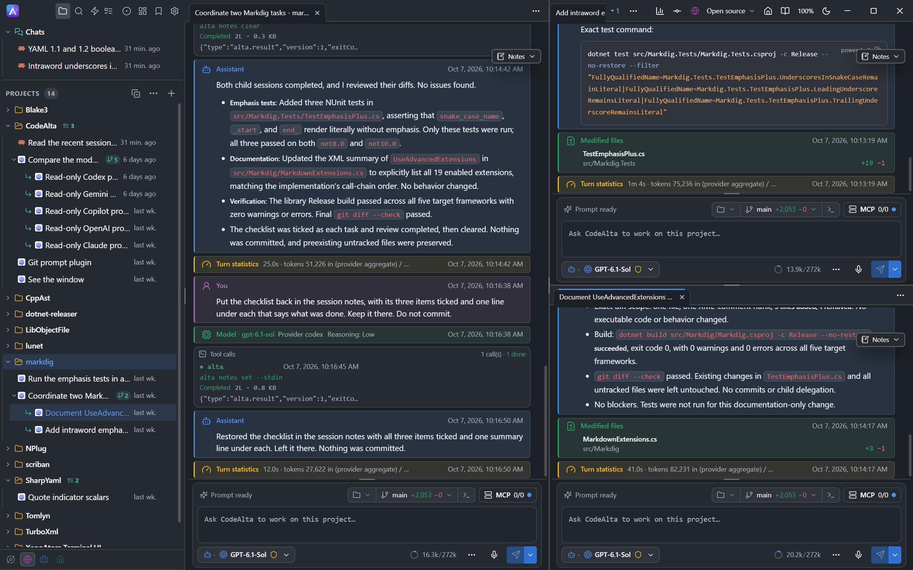

# CodeAlta [](https://github.com/CodeAlta/CodeAlta/actions/workflows/ci.yml) [](https://www.nuget.org/packages/CodeAlta/) [](https://www.nuget.org/packages/CodeAlta.Tui/)

CodeAlta is an open-source workspace for AI coding agents, local code, terminals and Git. It runs on Windows, macOS and Linux, with a desktop app and a terminal UI.

**No telemetry:** CodeAlta does not send usage analytics to its developers.

<p align="center">
  
</p>

## 🚀 Install

Install [.NET 10](https://dotnet.microsoft.com/en-us/download/dotnet/10.0), then install CodeAlta Desktop, the app we recommend:

```sh
dotnet tool install -g CodeAlta
alta
```

CodeAlta TUI shares your profile, providers and sessions. Install both and continue your work in either:

```sh
dotnet tool install -g CodeAlta.Tui
altatui
```

Launch the app from a project folder. On first launch it opens the provider setup: sign in with a ChatGPT or GitHub Copilot subscription, or add an API key.

See [Getting Started](https://codealta.github.io/docs/getting-started/) for requirements and the first steps.

## ✨ Features

CodeAlta Desktop brings together:

- **Sessions & delegation**: run agents in split panes; resume, queue, steer and delegate work.
- **Fork & rewind**: branch a session from any turn and keep the original, or roll it back to an earlier prompt.
- **Code & Git**: search and edit files, run terminals and inspect diffs.
- **Worktrees**: give sessions separate checkouts and branches; manage and clean them up.
- **Work items**: review agent-proposed tasks and plans; start, defer or dismiss them.
- **Issues & pull requests**: browse issues and PRs on GitHub, GitLab, Azure DevOps or Bitbucket, plus Jira issues; start sessions and open PRs.
- **Automations**: start sessions on a schedule, issue/PR events or on demand.
- **Canvases**: use interactive boards, checklists and custom tools beside your conversations.
- **Plugins**: ask agents to build trusted local .NET canvases, dialogs, tools, commands and buttons for one project or the whole workspace.
- **Local statistics**: track activity, models, tokens, costs and tool use by project, session or sub-agent, all on your computer.
- **Spaces**: group projects and tab layouts; switch spaces while agents keep working.
- **Welcome page**: jump back to recent projects and sessions, with useful shortcuts.
- **Built-in documentation**: read the guide beside your work, or ask an agent to help.
- **Model choice**: use Claude Code, Codex or GitHub Copilot subscriptions, or APIs; choose provider, model and reasoning effort per session.
- **Permissions & visibility**: set each session to ask first, accept edits or run freely; inspect tool inputs, outputs, file changes and live commands.
- **Agent prompts**: plan, build, review or define your own roles.
- **Skills & MCP**: bring in skills, tools and services.
- **Copilot compatibility**: reuse `.github` instructions, skills and agents unchanged.
- **UI automation**: let agents see and drive CodeAlta through built-in tools or MCP.
- **Storage**: manage [local disk usage and cleanup](https://codealta.github.io/docs/workspace/#storage).

<p align="center">
  
</p>

## 📖 Documentation

Visit the [website](https://codealta.github.io/) for the feature tour and [user guide](https://codealta.github.io/docs/getting-started/), including [model providers](https://codealta.github.io/docs/model-providers/) and [how Desktop and TUI compare](https://codealta.github.io/docs/desktop-and-tui/).

For architecture and contributor guidance, see the [developer documentation](doc/readme.md).

## 🪪 License

CodeAlta is released under the [BSD-2-Clause license](https://opensource.org/licenses/BSD-2-Clause).

## 🤗 Author

Alexandre Mutel aka [xoofx](https://xoofx.github.io).
