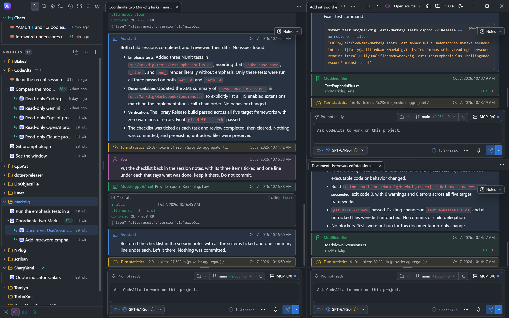
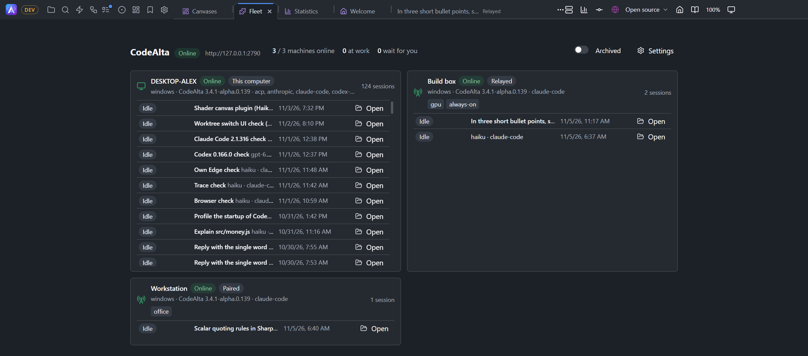

# CodeAlta [](https://github.com/CodeAlta/CodeAlta/actions/workflows/ci.yml) [](https://www.nuget.org/packages/CodeAlta/) [](https://www.nuget.org/packages/CodeAlta.Tui/) [](https://www.nuget.org/packages/CodeAlta.Cli/)

**Your agents. One workspace. One fleet.**

CodeAlta is an open-source agentic development environment, local and distributed: AI coding agents, your code, terminals and Git in one workspace. Run your agents on this computer, on your other machines, or across a whole company, from one laptop at home to the machines of your organization. It runs on Windows, macOS and Linux, with a desktop app, a terminal UI, a command line, and a node and a server for your fleet.

Its agent harness holds its own against the vendors' own agents: on hard tasks of [SWE-bench Pro](https://codealta.io/docs/benchmark/), it resolves as many tasks as Claude Code with Claude Opus, for 12% less, and one more than Codex with GPT.

**No telemetry:** CodeAlta does not send usage analytics to its developers.

<p align="center">
  
</p>

## 🚀 Install

Install [.NET 10](https://dotnet.microsoft.com/en-us/download/dotnet/10.0) (on macOS, 10.0.13 or later), then install CodeAlta Desktop, the app we recommend:

```sh
dotnet tool install -g CodeAlta
alta
```

CodeAlta TUI shares your profile, providers and sessions. Install both and continue your work in either:

```sh
dotnet tool install -g CodeAlta.Tui
altatui
```

CodeAlta CLI runs the same agents without a window, for scripts, CI and editors (ACP):

```sh
dotnet tool install -g CodeAlta.Cli
altacli run "Fix the failing test"
```

Launch the app from a project folder. On first launch it opens the provider setup: sign in with a Claude, ChatGPT or GitHub Copilot subscription, or add an API key.

See [Getting Started](https://codealta.io/docs/getting-started/) for requirements and the first steps.

For your [fleet](https://codealta.io/docs/fleet/), CodeAlta Node runs sessions and automations on an always-on machine, a build machine or a cloud VM, driven from CodeAlta Desktop; CodeAlta Desktop can also [install it over SSH](https://codealta.io/docs/fleet/machines/):

```sh
dotnet tool install -g CodeAlta.Node
altanode run
```

CodeAlta Server brings your people and machines together, for you alone or a whole team ([CodeAlta Server](https://codealta.io/docs/fleet/server/)); CodeAlta Desktop can also [create one for you](https://codealta.io/docs/fleet/server/#create-my-server) on this computer or over SSH:

```sh
dotnet tool install -g CodeAlta.Server
altaserver run
```

## 🛰️ Fleet

<p align="center">
  
</p>

CodeAlta is no longer one desktop: [Fleet](https://codealta.io/docs/fleet/) scales it from home to enterprise, one optional step at a time.

- **Move a session, mid-task**: [send a session to another machine](https://codealta.io/docs/fleet/sessions/#move-a-session) and it goes on there, with its conversation, its commits and its changes; bring it back the same way.
- **Run on any machine**: start sessions on the Mac that runs your iOS tests or the box with the GPU, run automations where they fit, and read, answer and steer them from CodeAlta Desktop.
- **Agents that use the fleet**: ask an agent to "run the iOS tests on a Mac that is free": it [picks a machine, starts a session there and gets its answer back](https://codealta.io/docs/fleet/sessions/#let-agents-use-the-fleet), moves sessions, places automations and reads the health of the fleet with `alta fleet`, within the limits each machine accepts.
- **Your machines, no server**: [pair two CodeAlta Desktops](https://codealta.io/docs/fleet/machines/#pair-two-codealta-desktops) from a link and six words, both ways in one step, nothing to install, at home or away through Tailscale; or [add a machine](https://codealta.io/docs/fleet/machines/) over SSH; your computers talk directly, encrypted end to end.
- **A server that cannot read**: [CodeAlta Server](https://codealta.io/docs/fleet/server/) reaches every machine from anywhere without opening a port, [your other CodeAlta Desktops](https://codealta.io/docs/fleet/server/#reach-a-codealta-desktop-through-the-server) too; it relays sessions encrypted end to end, runs no agent and reads no conversation.
- **Rules your devices sign**: who may do what is signed by your devices and checked by every machine; [a kill switch and an audit log](https://codealta.io/docs/fleet/policies-and-audit/) for the whole fleet.
- **For teams**: [people and teams](https://codealta.io/docs/fleet/people-and-access/) who sign in with Microsoft, Google, GitHub, a passkey or your company's sign-in; team machines, budgets, secrets, updates and statistics of every machine.

<p align="center">
  
</p>

## ✨ Features

CodeAlta Desktop brings together:

- **Sessions & delegation**: run agents in split panes; resume, queue, steer and delegate work; archive finished sessions and restore them when you need them.
  In Desktop, `Enter` sends when idle and enqueues while busy; `Cmd+Enter` on macOS or `Ctrl+Enter` on Windows/Linux sends now (steers a busy turn).
- **Several windows**: [move or drag tabs](https://codealta.io/docs/workspace/#windows) into windows of their own, name and color them, and find them on their monitor at the next start (the terminal UI has one screen).
- **Fork & rewind**: branch a session from any turn and keep the original, or roll it back to an earlier prompt.
- **Attach files**: [add files, images, folders and issues to a prompt](https://codealta.io/docs/getting-started/#attach-files) from a menu, a drop or a paste; PDFs go to the models that read them, and other documents (Word, Excel, PowerPoint…) are converted to Markdown for any model.
- **[Math & research](https://codealta.io/docs/workspace/prompt/#equations)**: LaTeX formulas, chemistry and footnotes in messages and documents, a live preview of the formula you type and an equation editor in the prompt (`Alt+=`), and LaTeX and BibTeX files highlighted.
- **Speech to prompt**: [dictate a prompt](https://codealta.io/docs/speech/) with a speech model that runs on your computer, downloaded the first time you use the microphone.
- **Search your work**: `Ctrl+P` and [`alta search`](https://codealta.io/docs/search/) find the prompts and answers of your sessions, your plans, the guide, the skills and the tools from a local index; turn on search by meaning to find them by what they are about, with a model that runs on your computer. `Ctrl+F` finds in the session you are in, with every match marked and counted.
- **Code & Git**: search and edit files, run terminals and inspect diffs; [paste the commands of an answer](https://codealta.io/docs/workspace/code/#commands-from-a-message) in the terminal of its session, to check them before you press Enter.
- **Worktrees**: give sessions separate checkouts and branches, move a session to another worktree with its conversation; manage and clean them up.
- **Prompt suggestions**: after a turn, the model suggests the next prompt in the empty composer, with any provider; `Tab` or `→` takes it.
- **Session titles**: a title you give stays; other sessions are titled from the first prompt, the last message or by the model, as you choose.
- **Work items**: review agent-proposed tasks and plans; start, defer or dismiss them; follow the reviews in flight.
- **[Reviews](https://codealta.io/docs/reviews/)**: comment on the lines of a plan, a file or an agent's changes, send them with a verdict, and have agents wait for your approval before they commit.
- **Bookmarks**: mark a message or a whole session, jump between the bookmarks of a timeline, and find them all in one tab.
- **Issues & pull requests**: browse issues and PRs on GitHub, GitLab, Azure DevOps or Bitbucket, plus Jira issues, with views of your filters (on Azure DevOps, the PRs that wait for your review, also through nested groups); start sessions and open PRs.
- **Automations**: start sessions on a schedule, issue/PR events, Jira, Slack, incident.io and signed webhooks, or on demand, and write the answer back where the event came from.
- **On your phone**: [follow, answer, steer and start sessions from a phone, follow their background jobs, and answer the questions, permission requests and review requests of agents](https://codealta.io/docs/plugins/mobile/), on your own tailnet through Tailscale, or through a Dev Tunnel of Microsoft.
- **Canvases**: use interactive boards, checklists, graphs and custom tools beside your conversations.
- **Plugins**: ask agents to build trusted local .NET canvases, dialogs, tools, commands and buttons for one project or the whole workspace, and [hooks](https://codealta.io/docs/plugins/developers/) that check, block or change the tool calls and prompts of sessions, or continue a session when its run ends.
- **Local statistics**: track activity, models, tokens, costs, tool use, skills and MCP tools by project, session or sub-agent, all on your computer.
- **Context usage**: see context pressure as a ring beside the prompt and when the prompt cache expires; inspect the last operation and session-wide token usage and costs.
- **Spaces**: give each kind of work its own setup: its projects and chats, providers and accounts (a second Claude account too), MCP servers, skills, agent prompts and plugins, and the Git, GitHub, Jira and command line (Azure, AWS, kubectl…) identity its agents use. Switch spaces while agents keep working. Inside a space, nested labels group the projects in the Explorer.
- **Welcome page**: jump back to recent projects and sessions, with useful shortcuts.
- **Built-in documentation**: read the guide beside your work, or ask an agent to help.
- **Model choice**: use Claude Code, Codex, GitHub Copilot or Mistral Vibe subscriptions, APIs, or a llama.cpp server of your own, with several accounts of the same provider; choose provider, model and reasoning effort per session, and [hide the models of a provider](https://codealta.io/docs/model-providers/#hidden-models) you never use.
- **Codex CLI**: run OpenAI's Codex agent as a provider, signed in from CodeAlta with Codex's own ChatGPT sign-in (ChatGPT Business and Enterprise included), with the instructions, tools, permissions and sandbox of CodeAlta.
- **ACP agents**: add a coding agent of the [ACP registry](https://agentclientprotocol.com/get-started/registry) (GitHub Copilot, Gemini CLI, Cursor…) in one click as a provider, with the tools of CodeAlta, its models named and priced and the reasoning levels of each, and continue its sessions with any other provider.
- **Adaptive**: CodeAlta [runs each turn on the models of a level](https://codealta.io/docs/model-tiers/#adaptive) (Low, Medium, High, Max): a strong, inexpensive model for the turns, and critics of another family that review each change of code, read-only, before the session fixes what they found.
- **Model tiers & fallback**: pick Complex, Standard or Quick instead of a model, and optionally [go on with the next model of the tier](https://codealta.io/docs/model-tiers/) when a provider runs out of quota or goes down, or resume by itself once the limit resets.
- **Claude Code with VS Code**: [continue in CodeAlta](https://codealta.io/docs/sessions/claude-code/) the Claude Code sessions you started in VS Code or a terminal, and open CodeAlta's in VS Code in one click.
- **Claude Code in the cloud**: [send a session to the cloud](https://codealta.io/docs/sessions/claude-code/#run-in-the-cloud), follow it on claude.ai or your phone, and continue it here with its conversation and its branch.
- **Permissions & visibility**: set each session to ask first, accept edits or run freely, and turn off tools a session should not have, such as the shell; inspect tool inputs, outputs, file changes and live commands.
- **[Sandbox](https://codealta.io/docs/sessions/sandbox/)**: run the commands and file tools of a session in a container of the operating system, built on Microsoft's [MXC](https://github.com/microsoft/mxc), for every session or only for a provider, a model, a space or a project: it writes in its project, reaches the hosts you allow, and never reads your credentials.
- **[Code Mode & workflows](https://codealta.io/docs/sessions/code-mode/)**: agents write short JavaScript programs that call their tools, MCP servers and `alta` commands in loops and in parallel, with the session's permissions, and run whole workflows: steps that give each part of the work to a sub-agent, drawn live as a graph in the timeline, that can go on in the background, sleep, ask you, resume and return Markdown with pictures. Keep a run that went well as a script of the library, run it again from the **Workflows** tab or an automation, or start from the samples.
- **Agent prompts**: plan, build, review or define your own roles.
- **Skills & MCP**: bring in skills, tools and services, and the skills MCP servers publish, loaded once you approve them; the views of [MCP Apps](https://codealta.io/docs/plugins/mcp/#views-of-mcp-apps) show in the conversation; the skills used most come first in the prompt, and hundreds of them stay cheap.
- **Command line**: run a prompt to its end with [`altacli`](https://codealta.io/docs/command-line/) from a script, a CI job or a benchmark, with exit codes and a JSON Lines trace in the ACP format, or serve CodeAlta to an editor as an ACP agent; its sessions show in the app as they run.
- **Your agent files, unchanged**: reuse the instructions, skills and agents a project already has for other agents: `AGENTS.md`, `CLAUDE.md` and `.github/copilot-instructions.md`, the skills of `.agents/skills` and `.github/skills`, the custom agents of GitHub Copilot and the subagents of Claude Code.
- **UI automation**: let agents see and drive CodeAlta through built-in tools or MCP.
- **[Browser tools](https://codealta.io/docs/browser/)**: let agents drive Chrome, Edge, Firefox or Safari with the tools of Chrome DevTools MCP, without Node.js: in a private profile by default, in a profile where you signed in once, or in your own browser after you agree, site by site. Mark elements of your own app or mockup in the page and send your notes as a prompt, with where each element is written.
- **[Settings you find](https://codealta.io/docs/workspace/settings/#search-settings)**: search Settings and change a setting where it is found, find settings with `Ctrl+P`, and ask an agent to show or change one with `alta settings`: it changes only what does not protect you, and the window offers Undo; plugins declare settings of their own.
- **Storage**: manage [local disk usage and cleanup](https://codealta.io/docs/workspace/settings/#storage).

<p align="center">
  
</p>

## 📖 Documentation

Visit the [website](https://codealta.io/) for the feature tour and [user guide](https://codealta.io/docs/getting-started/), including [model providers](https://codealta.io/docs/model-providers/), [Fleet](https://codealta.io/docs/fleet/) for your machines and your team, and [how Desktop and TUI compare](https://codealta.io/docs/desktop-and-tui/).

For architecture and contributor guidance, see the [developer documentation](doc/readme.md).

## 🪪 License

CodeAlta is released under the [BSD-2-Clause license](https://opensource.org/licenses/BSD-2-Clause).

## 🤗 Author

Alexandre Mutel aka [xoofx](https://xoofx.github.io).