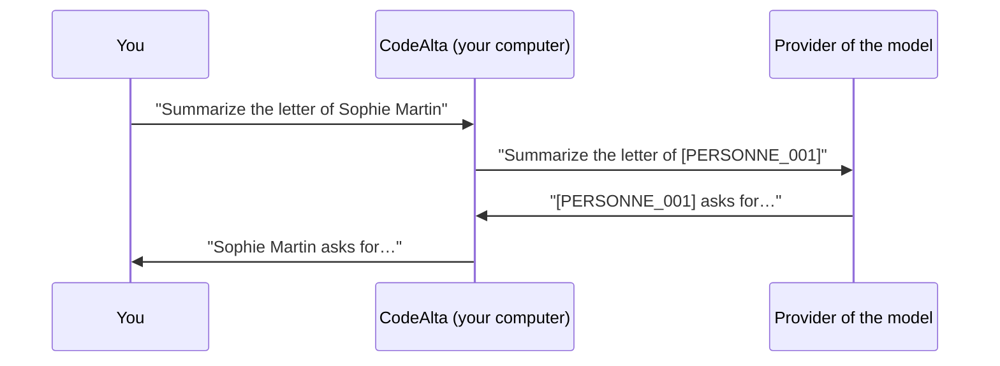

# Pseudonymizer plugin

The built-in Pseudonymizer plugin keeps personal data away from the provider of a model. In a pseudonymized project, what its sessions send (prompts, files read, tool results) goes out with pseudonyms in place of names, places, phone numbers and identifiers: `[PERSONNE_001]`, `[LIEU_002]`, `[IBAN_001]`. The real values stay on your computer, and the answers, the tool calls and the files the agent writes get them back.

Detection runs on your computer, in CodeAlta: patterns and checksums for identifiers, and for names a local model of the language of your documents. Nothing is sent to a service to find what to hide.

The plugin is for CodeAlta Desktop. In CodeAlta TUI, the sessions of a pseudonymized project send nothing.

## How it works

- **One value, one pseudonym.** A value keeps its pseudonym for the whole session, so the model can follow who is who. Pseudonyms are numbered by kind in the order they appear.
- **The model is told.** It is asked to copy each pseudonym exactly, never to guess what it stands for.
- **Your tools get the real values.** A command, a file edit or a search on your computer runs with the real values. The tools that send their arguments away from your computer (web search and fetch, a browser page) get the pseudonyms: see **Tools that get pseudonyms** below.
- **What you see is real.** The conversation, its history and the files keep the real values. Only the requests to the provider hold pseudonyms.
- **The table stays here.** The pseudonyms of a session and their values are stored encrypted with your account's key on this computer (DPAPI, the Keychain or libsecret).

## Pseudonymize a project

1. In the Explorer, open the menu of the project and choose **Pseudonymize the project…**.
2. Choose the **Language of the documents** (see below).
3. Optionally, open **Names and words**:
   - **Names always hidden**: the parties of the file, hidden wherever they appear, even where nothing finds them. One per line.
   - **Words never hidden**: what was taken for personal data by mistake. One per line.
4. Choose **Pseudonymize**. The project shows a padlock, and its next requests are pseudonymized.

The same menu item, **Pseudonymization…**, changes these choices later or stops pseudonymizing the project. The choices are saved in the project's `.alta/config.toml`.

> [!IMPORTANT]
> A session that sent pseudonyms once stays confidential: if the project stops being pseudonymized, it goes on pseudonymizing, since its history would otherwise go out in clear. Its sub-agents are confidential too.

## Languages and models

Each project chooses the language of its documents, which chooses the model that finds names. A model is downloaded once, the first time a project needs it, and runs on your computer.

{.table}
| Language | What it finds |
|---|---|
| French | Names of people, places and organizations in French, and the identifiers of France (NIR, SIRET…). |
| English | Names of people, places and organizations in English, and the identifiers of the UK and the US (NI, NHS, SSN…). |
| Several languages | Ten languages, French and English among them, and the identifiers of France, the UK and the US. |
| Identifiers only | Emails, phone numbers, IBAN, social security and company numbers of France, the UK and the US. Names are not looked for, and nothing is downloaded. |

**Settings > Plugins > Pseudonymizer** lists the languages with their model and its size, and deletes a model or downloads it again. A **Custom model** setting takes the folder of a token classification model of yours (ONNX, with its tokenizer and a `ner-model.json` that describes it).

## What is hidden

People, contact details (emails, phone numbers, postal codes) and identifiers (bank accounts and cards, social security, passport and tax numbers…) are always hidden. **Settings > Plugins > Pseudonymizer** decides the rest, for every pseudonymized project:

{.table}
| Setting | By default |
|---|---|
| **Places** | Hidden: streets, towns, regions and countries the model finds. |
| **Organizations** | Hidden: companies, firms and administrations the model finds. |
| **Company numbers** | Hidden: SIREN and SIRET, Companies House numbers, EIN. |
| **Every date** | Off: only dates of birth are hidden, the dates of acts and meetings are sent. |
| **Web addresses** | Off: links to documentation, a repository or a site are sent. |
| **Words never hidden** | `CodeAlta` and `noreply@codealta.io`: names of products or of your firm that name no one. |
| **Tools that get pseudonyms** | The web tools and the pages of a browser. `*` stands for any characters. |

## See what was hidden

- In the composer, the **Pseudonymizer** item tells how many values the session hid. Choose it to list the pseudonyms the provider read, their kind and their value, and how many times each was sent.
- **Pseudonymizer: try a text**, in the command search, shows what a text would become, with the pseudonyms of your project's language, without sending anything.

## Images, PDFs and documents

- **Text** read by a tool (a file, the output of a command, a document converted to text) is pseudonymized like a prompt.
- **A PDF** attached to a prompt is sent as its text, pseudonymized. A PDF whose text cannot be read is not sent.
- **An image** is not sent: the model gets a note that an image was left out, since the text in a picture cannot be checked.

## When nothing is sent

A pseudonymized session sends nothing it could not pseudonymize. The turn stops with a message that says why, when:

- the Pseudonymizer plugin is off;
- the model of the project's language is not downloaded yet: the session's **Pseudonymizer** item offers the download;
- the model cannot run, or a part of the request cannot be analyzed;
- the project's `.alta/config.toml` cannot be read, so CodeAlta cannot tell whether the project is pseudonymized;
- the provider runs an agent of its own that reads files itself (Claude Code, Codex CLI, an ACP agent): CodeAlta does not see what that agent sends. Choose a provider whose requests CodeAlta sends itself, such as a provider with an API key.

## Limits

Detection finds most personal data, not all of it. A name the model misses, a rare spelling or the context ("the mayor of a small town") can still tell who someone is. Add the names that matter to **Names always hidden**, and check with **try a text** on a sample of your documents.

Pseudonymization covers the requests CodeAlta sends for the sessions of the project on this computer. It does not cover:

- **A session run in the cloud of a provider.** Its task and the messages you send to it go to that cloud as they are.
- **Another machine.** A session moved to another machine, or a sub-agent started on one, is not pseudonymized there: that machine does not know the project is.
- **A session of another project.** What a pseudonymized session sends to it goes to its provider with the real values, and it reads the real values when it searches or reads the history of a pseudonymized session.
- **The other tools.** A tool that is not in **Tools that get pseudonyms** gets the real values, also when it sends them away from your computer: a browser tool that fills a form or runs a script in a page, a tool of an MCP server. Add the ones you use to the setting.
- **A provider that runs an agent of its own.** Its turns are stopped, but not what it does without a turn: its own compaction and Remote Control.
- **What is not text of the conversation.** The descriptions of the tools and the names of the fields of their arguments are sent as they are.
- **A text already sent.** It is sent again as it went the first time: a name you add to **Names always hidden** later is hidden in new texts only.
- **The lists of the project.** **Names always hidden** and **Words never hidden** are saved in clear in the project's `.alta/config.toml`, beside its documents.
